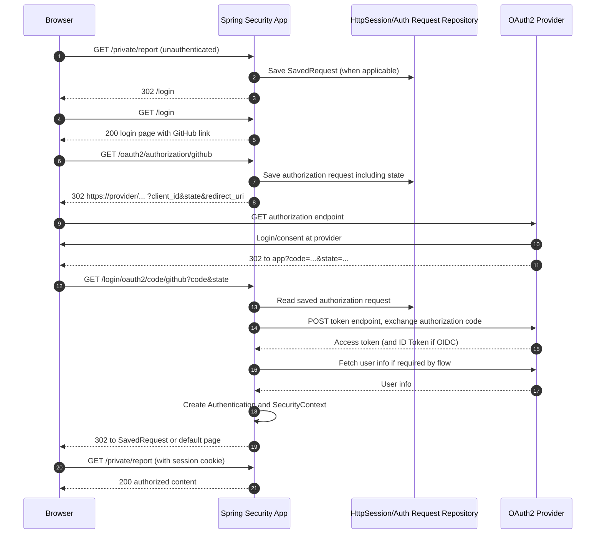

# oauth2Login: initiation endpoint, callback, and successful login

> **Scope:** Spring Security **Servlet** (Spring MVC / Spring Boot 3.x / Spring Security 6.x). This lesson focuses on the OAuth 2.0 Login flow: the endpoint that sends the browser to the provider, the endpoint that receives the authorization code, and handling successful login. Examples use **Java 17+**, **Spring Boot 3.3.0**, and a GitHub OAuth App, along with MockMvc tests that require no GitHub connection. This article is about an application acting as an **OAuth2 Client**, not building an OAuth2 Authorization Server.

## 1. Learning objectives

After this lesson, you will be able to:

1. Identify the exact default URLs `/oauth2/authorization/{registrationId}` and `/login/oauth2/code/{registrationId}`, and explain why they differ.
2. Trace the **Authorization Code flow** step by step from an unauthenticated user to the application receiving the code, exchanging it for an access token, loading user info, and establishing an authenticated session.
3. Distinguish `OAuth2AuthorizationRequestRedirectFilter`, `OAuth2LoginAuthenticationFilter`, `ClientRegistration`, `OAuth2AuthorizationRequestRepository`, `OAuth2AuthorizedClient`, `OAuth2AuthenticationToken`, and the authentication success handler.
4. Understand `state` verification, preserving session/cookies, `redirect_uri`, callback errors, and the **SavedRequest** mechanism that determines which page opens after login.
5. Configure minimal `oauth2Login`, run the application with a real OAuth App, test the initiation endpoint and endpoint protection, and recognize the limits of simulated tests.
6. Troubleshoot common errors such as `redirect_uri_mismatch`, `authorization_request_not_found`, wrong `registrationId`, lost session, redirect loops, and wrong callback paths.

## 2. What is OAuth2 Login, and how does it differ from API tokens?

In the **OAuth2 Login** model of a Servlet application:

- **The user** visits your website in a browser.
- **Your application** is the OAuth2 Client (also the relying application). It redirects the browser to the identity provider's authorization page, receives the authorization code, and calls the token endpoint **from the server**.
- **The Authorization Server/Provider** is GitHub, Google, or a similar provider. It authenticates the user and sends the browser back to the registered `redirect_uri`.
- After authentication, Spring Security creates an `Authentication` and saves it in `SecurityContext`; in a session-based web app configuration, the application login session is typically maintained via a session cookie.
- **The access token obtained from the provider** serves for calling the provider's resources within the granted scopes. It is not by default an access token for your internal APIs, nor is it the application session cookie.

**OAuth 2.0** is primarily an authorization framework and does not by itself define a complete user-identification standard. Spring Security `oauth2Login` can use OAuth2 user-info (e.g., GitHub) or **OpenID Connect** with a provider supporting OIDC and the `openid` scope. With OIDC, the ID Token and rules like issuer/audience/nonce have distinct roles; **the GitHub OAuth App in this example is not an OIDC example and does not issue an ID Token in this flow**.

Easily confused values:

| Value | Meaning |
| --- | --- |
| `registrationId` | Provider configuration identifier **in the application**, e.g., `github`. Not a user ID or secret client ID. |
| `client-id` | Identifier of the OAuth App issued by the provider; appears in the authorization request. |
| `client-secret` | Confidential client secret; kept strictly server-side/in a secrets manager. |
| `scope` | Access permissions requested by the application from the provider; does not automatically become internal roles. |
| `state` | Random value linking the initiation request and callback; defends against unsolicited authorization responses. |
| `code` | Short-lived, usually single-use authorization code exchanged for tokens on the server. |
| `redirect_uri` | **Application callback** URL; must match the provider configuration and the filter endpoint receiving callbacks. |
| `access_token` | Credential for calling the provider's APIs within granted permissions; should not be placed in URLs/logs. |
| `JSESSIONID` | Cookie identifying the application session when using Servlet sessions; not an OAuth access token. |

## 3. Two default endpoints and execution order

When configuring a `ClientRegistration` with id `github` and enabling `oauth2Login`, by default there are two very different endpoints:

| Step | URL on **application** | Handling component | Role |
| --- | --- | --- | --- |
| 1. Initiation | `GET /oauth2/authorization/github` | `OAuth2AuthorizationRequestRedirectFilter` | Builds the authorization request, stores data to match the callback, returns `302` to the provider. |
| 2. Callback | `GET /login/oauth2/code/github?code=...&state=...` | `OAuth2LoginAuthenticationFilter` | Checks the response, retrieves the saved authorization request, verifies state, exchanges code for token, loads user, and completes authentication. |

**Specifically:** the callback URL is **not** a login URL that users should open manually. If you type `/login/oauth2/code/github` directly without a valid authorization request in the session, the callback lacks the data needed for authentication and will fail.

On the provider side there is a different endpoint (e.g., GitHub's authorization URL), which is a server external to the application. The initiation flow does not route the user to a normal Spring MVC controller; the request is typically handled by security filters before reaching any controller.

### Sequence diagram



The diagram illustrates the common flow with a **GET** authorization-code callback. Not every provider requires the same user info call; OIDC can use claims from the ID Token. Details of the token endpoint, PKCE, and authorized client storage are configured by Spring Security and the provider.

## 4. Initiation step: OAuth2AuthorizationRequestRedirectFilter

When the browser opens:

```http
GET /oauth2/authorization/github HTTP/1.1
Host: localhost:8080
```

`OAuth2AuthorizationRequestRedirectFilter` uses `ClientRegistrationRepository` to look up the `ClientRegistration` with `registrationId = github`. From there, it builds a request to the provider that can include:

- `response_type=code`: requests an authorization code per the Authorization Code flow.
- `client_id`: identifier of the OAuth App.
- `scope`: requested permission scopes.
- `redirect_uri`: callback sent by the client and used/matched by the provider.
- `state`: random value to correlate upon callback.
- With appropriate configuration/support: **PKCE** parameters such as `code_challenge` and `code_challenge_method`.

Before redirecting, Spring Security saves the `OAuth2AuthorizationRequest` via an `AuthorizationRequestRepository`. By default in Servlet web apps, this is `HttpSessionOAuth2AuthorizationRequestRepository`, binding the authorization request data to the corresponding session. The application then returns:

```http
HTTP/1.1 302 Found
Location: https://github.com/login/oauth/authorize?response_type=code&client_id=...&scope=read:user&state=...&redirect_uri=...
```

**The response above is illustrative only**: query parameters may be URL-encoded, and the exact order and URL depend on the provider. Never copy raw `state`/authorization codes from one session to another.

### When the user starts from a protected page

For example, if an anonymous user visits `GET /private/report` first, `ExceptionTranslationFilter` can use `RequestCache` to remember the target page and send the user to the login page; then the user chooses the OAuth2 provider. **SavedRequest and OAuth2 authorization request are two separate objects**:

- `SavedRequest`: "After logging in, which page should we return to?" Usually saved by `HttpSessionRequestCache`.
- `OAuth2AuthorizationRequest`: "How was this authorization flow initiated, with which state, redirect URI, and registration?" Usually saved by `HttpSessionOAuth2AuthorizationRequestRepository`.

Losing either one has different consequences: losing `SavedRequest` may send the user to a default page; losing the authorization request usually prevents **the callback from being verified**.

### What role does the /login page play?

If the application has at least one OAuth2 Client registration and uses default login, Spring Security can generate a `GET /login` page containing a link to `/oauth2/authorization/github`. The login page is just an interface to choose a login method. Actual user authentication takes place at the provider.

If you build a custom `/login`, render the link pointing to the right initiation URL and permit anonymous access to that page. Do not create a form submitting `POST /login/oauth2/code/github` like a traditional username/password form.

## 5. Callback step: OAuth2LoginAuthenticationFilter

After the user authenticates/consents at the provider, the browser returns, for example:

```http
GET /login/oauth2/code/github?code=REDACTED&state=REDACTED HTTP/1.1
Host: localhost:8080
Cookie: JSESSIONID=...
```

`OAuth2LoginAuthenticationFilter` intercepts requests matching the callback URI. Conceptually, it:

1. Reads `code`/`state` or `error` from the authorization response.
2. Loads the original authorization request from `AuthorizationRequestRepository` (usually `HttpSession`), verifying correlation between the callback and the initiated request; a wrong state or missing data must be rejected.
3. Resolves the corresponding `ClientRegistration`/registrationId and creates an authentication request.
4. Sends the code to the **provider's token endpoint** along with appropriate client/PKCE credentials. Codes are typically single-use, short-lived, and bound to the redirect URI.
5. Builds the principal and authorities from OAuth2 user-info or ID Token/claims in OIDC; creates `OAuth2AuthenticationToken`. It may store an `OAuth2AuthorizedClient` containing access/refresh tokens per repository/service policy.
6. Completes Spring Security authentication, saves the security context per configuration, and invokes the appropriate success handler or failure handler.

### Three distinct responsibilities

| Component | Function |
| --- | --- |
| `OAuth2LoginAuthenticationFilter` | Handles the authorization response/callback and coordinates authentication. |
| `OAuth2LoginAuthenticationProvider` (or related OIDC provider) | Exchanges the authorization code, fetches user info, and authenticates the result in the pipeline. |
| `AuthenticationSuccessHandler` | Decides the response **after authentication succeeds**, typically returning `302` to SavedRequest or a default page. |

A callback with a code **does not automatically mean login succeeded**. If `state` mismatches, the token endpoint returns an error, client config is wrong, or the provider fails to supply required info, the success handler should not run.

### Why must callback and session stay together?

With the default repository storing data in `HttpSession`, the browser must preserve the **session cookie** throughout the entire round trip through the provider:

- The tab starting login and the tab receiving the callback must share the appropriate browser session/cookie.
- Do not accidentally switch hosts between `localhost` ↔ `127.0.0.1`, change scheme/port, or alter cookie domain/path causing session loss.
- Behind a load balancer with multiple instances, sessions must remain consistent (shared session store or suitable deployment mechanism).
- For a top-level GET callback from another site, `SameSite=Lax` generally allows the browser to send the session cookie. `SameSite=Strict` may block the cookie upon returning from the provider, losing the OAuth2 authorization request. POST callbacks in other integrations require separate analysis.
- Behind a reverse proxy/TLS termination, `{baseUrl}` and forwarded headers must safely reflect the **public HTTPS origin**.

**Do not disable `state` verification to "fix" the callback**. Fix the underlying cause of the lost authorization request data or wrong redirect URI.

## 6. Successful login: SecurityContext, session, SavedRequest

Once Spring Security authenticates the user:

1. `Authentication` is marked authenticated and placed into `SecurityContext`.
2. In session-based web login configurations, `SecurityContextRepository` can save the context so subsequent requests identify the same user via the session.
3. `OAuth2AuthenticationToken` represents the authenticated principal/authorities; `getAuthorizedClientRegistrationId()` tells which registration the user logged in with.
4. `OAuth2AuthorizedClient` describes the client + principal + access token/refresh token (when present) relationship; it serves provider API calls and has its own lifecycle separate from `SecurityContext`.
5. The success handler picks the target page and returns a redirect/response. The request to the target page still goes through normal authorization checks.

**Default success behavior:** `SavedRequestAwareAuthenticationSuccessHandler` prioritizes the pre-login request when a `SavedRequest` exists; if not, it uses the default target. `defaultSuccessUrl("/after-login", false)` configures the fallback page without **forcing `SavedRequest` to be ignored**. Conversely, `defaultSuccessUrl("/after-login", true)` forces redirecting to the default URL, discarding the saved request.

Example:

| What did the user do before login? | Outcome after successful OAuth2 callback |
| --- | --- |
| Opened `/private/report` and then chose GitHub login | Redirected back to `/private/report` if `SavedRequest` is still valid. |
| Opened `/oauth2/authorization/github` directly | No prior protected page; goes to `/after-login` (fallback). |
| Callback failed due to state/token | Goes to `/login?error` or configured failure page. **Not** treated as authenticated. |
| Login succeeded, but lacks permission for target page | Post-redirect request receives 403 from authorization, not automatically granted access. |

Avoid custom success handlers that blindly concatenate untrusted query parameters into `Location` (open redirect). If you must redirect to a dynamic path, restrict it with an origin/relative-path allowlist and check business authorization. A default post-login endpoint must be one that authenticated users are permitted to access.

## 7. Spring Boot 3.3 Demo: logging in via GitHub

This example **compiles and runs** with Java 17+, Maven, and credentials from a **GitHub OAuth App** that you create. The real browser login flow requires GitHub to be reachable from the user's machine and valid credentials; there is no way to run end-to-end against GitHub with two dummy strings. The `MockMvc` section below tests some behaviors **offline** using test credentials and a simulated authentication.

### 7.1. Registering the OAuth App

In GitHub's OAuth Apps settings, create a development app with:

- **Homepage URL**: `http://localhost:8080/`.
- **Authorization callback URL**: `http://localhost:8080/login/oauth2/code/github` (default path).
- Obtain `Client ID` and `Client Secret`; store the secret in environment variables, a secret manager, or runtime environment—**never commit to Git**.
- Only request needed scopes, e.g. `read:user` to read profile info. Permissions on GitHub do not automatically become application roles.

In production deployments, replace all callbacks with public HTTPS URLs and update the configuration in GitHub accordingly. Many providers require an **exact match** on the registered redirect URI; even a differing trailing slash, scheme, host, or port can cause errors.

### 7.2. Project structure

```text
oauth2-login-demo/
├── pom.xml
└── src/
    ├── main/
    │   ├── java/demo/login/
    │   │   ├── DemoApplication.java
    │   │   ├── SecurityConfig.java
    │   │   └── PageController.java
    │   └── resources/
    │       └── application.properties
    └── test/java/demo/login/
        └── OAuth2LoginFlowTest.java
```

**`pom.xml`:**

```xml
<project xmlns="http://maven.apache.org/POM/4.0.0"
         xmlns:xsi="http://www.w3.org/2001/XMLSchema-instance"
         xsi:schemaLocation="http://maven.apache.org/POM/4.0.0 https://maven.apache.org/xsd/maven-4.0.0.xsd">
    <modelVersion>4.0.0</modelVersion>
    <parent>
        <groupId>org.springframework.boot</groupId>
        <artifactId>spring-boot-starter-parent</artifactId>
        <version>3.3.0</version>
        <relativePath/>
    </parent>
    <groupId>demo</groupId>
    <artifactId>oauth2-login-demo</artifactId>
    <version>0.0.1-SNAPSHOT</version>
    <properties>
        <java.version>17</java.version>
    </properties>
    <dependencies>
        <dependency>
            <groupId>org.springframework.boot</groupId>
            <artifactId>spring-boot-starter-web</artifactId>
        </dependency>
        <dependency>
            <groupId>org.springframework.boot</groupId>
            <artifactId>spring-boot-starter-security</artifactId>
        </dependency>
        <dependency>
            <groupId>org.springframework.boot</groupId>
            <artifactId>spring-boot-starter-oauth2-client</artifactId>
        </dependency>
        <dependency>
            <groupId>org.springframework.boot</groupId>
            <artifactId>spring-boot-starter-test</artifactId>
            <scope>test</scope>
        </dependency>
        <dependency>
            <groupId>org.springframework.security</groupId>
            <artifactId>spring-security-test</artifactId>
            <scope>test</scope>
        </dependency>
    </dependencies>
    <build>
        <plugins>
            <plugin>
                <groupId>org.springframework.boot</groupId>
                <artifactId>spring-boot-maven-plugin</artifactId>
            </plugin>
        </plugins>
    </build>
</project>
```

**`src/main/resources/application.properties`:**

```properties
server.port=8080

# GitHub is a provider already recognized by Spring Boot from the registration ID.
spring.security.oauth2.client.registration.github.client-id=${GITHUB_CLIENT_ID}
spring.security.oauth2.client.registration.github.client-secret=${GITHUB_CLIENT_SECRET}
spring.security.oauth2.client.registration.github.scope=read:user
spring.security.oauth2.client.registration.github.redirect-uri={baseUrl}/login/oauth2/code/{registrationId}

# For standard GET callbacks from the provider, Lax is usually more suitable than Strict.
server.servlet.session.cookie.same-site=lax
server.servlet.session.cookie.http-only=true

# Production: use HTTPS, Secure cookie, and configure a trusted reverse proxy.
# server.servlet.session.cookie.secure=true
```

`{baseUrl}` and `{registrationId}` are **Spring Security placeholders** substituted per request/client registration. `${GITHUB_CLIENT_ID}` and `${GITHUB_CLIENT_SECRET}` are Spring Boot placeholders reading environment variables. Do not change the callback to the initiation endpoint URL. If running behind a reverse proxy, configure a trusted forwarded-header policy so `{baseUrl}` resolves to the real public origin.

**`src/main/java/demo/login/DemoApplication.java`:**

```java
package demo.login;

import org.springframework.boot.SpringApplication;
import org.springframework.boot.autoconfigure.SpringBootApplication;

@SpringBootApplication
public class DemoApplication {
    public static void main(String[] args) {
        SpringApplication.run(DemoApplication.class, args);
    }
}
```

**`src/main/java/demo/login/SecurityConfig.java`:**

```java
package demo.login;

import org.springframework.context.annotation.Bean;
import org.springframework.context.annotation.Configuration;
import org.springframework.security.config.annotation.web.builders.HttpSecurity;
import org.springframework.security.core.userdetails.UserDetailsService;
import org.springframework.security.web.SecurityFilterChain;

@Configuration
public class SecurityConfig {
    @Bean
    SecurityFilterChain securityFilterChain(HttpSecurity http) throws Exception {
        return http
            .authorizeHttpRequests(auth -> auth
                .requestMatchers(
                    "/", "/login", "/error",
                    "/oauth2/authorization/**",
                    "/login/oauth2/code/**").permitAll()
                .requestMatchers("/private/**", "/after-login").authenticated()
                .anyRequest().denyAll())
            .oauth2Login(oauth -> oauth
                .defaultSuccessUrl("/after-login", false)
                .failureUrl("/login?error"))
            .build();
    }
}
```

**Exact explanation:**

- `oauth2Login` enables the OAuth2 login filters. `ClientRegistration` is created by Boot from registration properties; no controller is needed to handle `/oauth2/authorization/github` or `/login/oauth2/code/github`.
- `GET /login` is the default login page generated by Spring Security in this configuration. Because the `github` registration exists, the page typically includes a link to `/oauth2/authorization/github`. Do not write a `/login` controller when using the default page.
- `permitAll` allows unauthenticated browsers to reach the login page, initiation endpoint, and callback. The callback filter still validates the authorization response; `permitAll` does not turn a forged callback into a valid login.
- `/private/**` and `/after-login` require authentication, so unauthenticated requests are sent to the entry point; authenticated users are not automatically allowed into every endpoint if the application adds authorization rules.
- `defaultSuccessUrl("/after-login", false)` preserves `SavedRequest` priority; `failureUrl("/login?error")` defines the redirect target when the callback fails.
- The demo does not configure `SessionCreationPolicy.STATELESS`. The default flow uses `HttpSessionOAuth2AuthorizationRequestRepository` and typically relies on sessions to retain the security context after login.
- Default CSRF protection is not disabled site-wide. The Authorization Code callback uses GET and is correlated via `state`; future state-changing POST endpoints still need appropriate CSRF protection.
- You can remove the `UserDetailsService` import in this file if your IDE warns about an unused import; it is a leftover import, not a required component of OAuth2 login.

**`src/main/java/demo/login/PageController.java`:**

```java
package demo.login;

import org.springframework.security.oauth2.client.authentication.OAuth2AuthenticationToken;
import org.springframework.stereotype.Controller;
import org.springframework.web.bind.annotation.GetMapping;
import org.springframework.web.bind.annotation.ResponseBody;

@Controller
public class PageController {
    @GetMapping("/")
    @ResponseBody
    public String home() {
        return "Open /private/report to start OAuth2 login.";
    }

    @GetMapping("/private/report")
    @ResponseBody
    public String privateReport(OAuth2AuthenticationToken authentication) {
        return "Protected via " + authentication.getAuthorizedClientRegistrationId();
    }

    @GetMapping("/after-login")
    @ResponseBody
    public String afterLogin(OAuth2AuthenticationToken authentication) {
        return "Signed in via " + authentication.getAuthorizedClientRegistrationId();
    }
}
```

The controller reads the authenticated user's `OAuth2AuthenticationToken`; `registrationId` is displayed to show which provider was used. **Never** return access tokens, refresh tokens, or sensitive details to the browser. In real applications, identify internal users by mapping the provider's verified identity rather than blindly trusting an unverified username/email string.

### 7.3. Running and testing with a real browser

Set both environment variables using your OS's mechanism. For example, **Bash**:

```bash
export GITHUB_CLIENT_ID='your-github-oauth-client-id'
export GITHUB_CLIENT_SECRET='your-github-oauth-client-secret'
mvn spring-boot:run
```

The values above are **placeholders to replace with real OAuth App credentials**. The Java code compiles/runs, but browser GitHub login only works with valid credentials and a properly registered callback. In PowerShell, set environment variables with `$env:GITHUB_CLIENT_ID` and `$env:GITHUB_CLIENT_SECRET`.

Test sequentially in an incognito tab:

1. Open `http://localhost:8080/private/report`. You are unauthenticated, so the app redirects to `/login`; the `/private/report` request may be saved in `RequestCache`.
2. On `/login`, select GitHub. The browser opens `/oauth2/authorization/github` and receives a redirect to GitHub's authorization endpoint with `state`.
3. Log in/consent on GitHub. The provider redirects the browser to `http://localhost:8080/login/oauth2/code/github?code=...&state=...`.
4. Spring Security processes the callback, retrieves the token and user info, and authenticates. Because a `SavedRequest` for `/private/report` exists, the browser is redirected back there; the **exact** expected response body is:

```text
Protected via github
```

5. In a fresh incognito session, open `http://localhost:8080/oauth2/authorization/github` **directly** and log in. Because there is no `SavedRequest` from a protected page, the post-login fallback is `/after-login`; response body:

```text
Signed in via github
```

You do not need to manually enter the callback URL or copy codes between browsers. Watch requests in DevTools → Network (Preserve log) to observe the chain of `302`s, cookies, and final response. **Do not share callback URLs containing raw code/state**, access tokens, client secrets, or session cookies.

Only verify the initial redirect with curl, **without following** to the provider:

```bash
curl -i http://localhost:8080/private/report
curl -i http://localhost:8080/login
curl -i -c cookies.txt http://localhost:8080/oauth2/authorization/github
```

`GET /private/report` when anonymous typically returns `302` to `/login`; `GET /login` returns `200` with the OAuth2 link; `GET /oauth2/authorization/github` returns `302` to GitHub and may set a session cookie. **Do not expect curl to complete OAuth login by itself**: user consent, session cookies, state, and provider callbacks require a real browser flow or an HTTP client with full session and credential handling.

## 8. Testing with Spring Security Test and MockMvc

The offline tests below use `spring-security-test` without calling GitHub's token endpoint. They verify **routing, initiation link, redirect to provider, login requirement, and a simulated OAuth2 principal**. They do not prove that a real end-to-end token exchange ran.

**`src/test/java/demo/login/OAuth2LoginFlowTest.java`:**

```java
package demo.login;

import org.junit.jupiter.api.Test;
import org.springframework.beans.factory.annotation.Autowired;
import org.springframework.boot.test.autoconfigure.web.servlet.AutoConfigureMockMvc;
import org.springframework.boot.test.context.SpringBootTest;
import org.springframework.test.web.servlet.MockMvc;

import static org.hamcrest.Matchers.containsString;
import static org.hamcrest.Matchers.startsWith;
import static org.springframework.security.test.web.servlet.request
    .SecurityMockMvcRequestPostProcessors.oauth2Login;
import static org.springframework.test.web.servlet.request.MockMvcRequestBuilders.get;
import static org.springframework.test.web.servlet.result.MockMvcResultMatchers.content;
import static org.springframework.test.web.servlet.result.MockMvcResultMatchers.header;
import static org.springframework.test.web.servlet.result.MockMvcResultMatchers.status;

@SpringBootTest(properties = {
    "spring.security.oauth2.client.registration.github.client-id=test-client",
    "spring.security.oauth2.client.registration.github.client-secret=test-secret"
})
@AutoConfigureMockMvc
class OAuth2LoginFlowTest {
    @Autowired
    MockMvc mvc;

    @Test
    void loginPageHasGitHubAuthorizationLink() throws Exception {
        mvc.perform(get("/login"))
            .andExpect(status().isOk())
            .andExpect(content().string(
                containsString("/oauth2/authorization/github")));
    }

    @Test
    void startEndpointRedirectsToGitHub() throws Exception {
        mvc.perform(get("/oauth2/authorization/github"))
            .andExpect(status().is3xxRedirection())
            .andExpect(header().string("Location",
                startsWith("https://github.com/login/oauth/authorize?")))
            .andExpect(header().string("Location",
                containsString("client_id=test-client")))
            .andExpect(header().string("Location",
                containsString("state=")));
    }

    @Test
    void anonymousProtectedPageRequiresLogin() throws Exception {
        mvc.perform(get("/private/report"))
            .andExpect(status().is3xxRedirection())
            .andExpect(header().string("Location",
                containsString("/login")));
    }

    @Test
    void simulatedOAuth2PrincipalMayAccessProtectedPage() throws Exception {
        // oauth2Login() builds a test Authentication; it does not call the provider callback.
        // Default registrationId of the test processor is "test".
        mvc.perform(get("/private/report").with(oauth2Login()))
            .andExpect(status().isOk())
            .andExpect(content().string("Protected via test"));
    }
}
```

Run `mvn test`. The first test proves the login page generates the right link; the second triggers the redirect **without following 302** and without exchanging tokens; the third verifies the rule for the private page; the last uses `oauth2Login()` to **simulate an authenticated user**, which is completely different from a real browser calling the callback.

**To verify callbacks thoroughly**, you need a **test IdP/mock OAuth2 server** exposing standard-compliant authorization, token, and user-info endpoints, or a provider sandbox environment. In that test suite, verify at least:

- A callback with valid `code`/`state` and the same session is accepted.
- A callback with wrong, missing, or already-used `state` is not authenticated.
- Repeated callbacks with a previously used code are rejected per provider policy.
- Provider returning `error=access_denied`, or token endpoint returning `invalid_client`/`invalid_grant`: routes to failure handler without creating a valid login session.
- After success, a valid `SavedRequest` is prioritized; without a `SavedRequest`, the fallback is used.
- When the user lacks a role on the target page, the browser may receive 403 after redirect; do not assume login failed as the only reason.

Avoid mocking a `code` and expecting the app to accept it without verifying state/tokens: that kind of test bypasses the very checks you need to protect.

## 9. Customizing the authorization endpoint and callback

Some applications need non-default URLs, e.g. for legacy routing or proxies. **You must update three places consistently**:

1. The **initiation** path opened by the browser.
2. The `baseUri` of the **callback**-handling filter, plus the `redirect-uri` template on `ClientRegistration`.
3. The callback URL registered with the provider.

Below is an **illustrative replacement configuration** inside `HttpSecurity` in `SecurityConfig`, not a standalone program:

```java
.oauth2Login(oauth -> oauth
    .authorizationEndpoint(auth ->
        auth.baseUri("/connect/oauth2"))
    .redirectionEndpoint(redir ->
        redir.baseUri("/callback/oauth2/*"))
    .defaultSuccessUrl("/after-login", false)
    .failureUrl("/login?error"))
```

With this config, the initiation link becomes:

```text
/connect/oauth2/github
```

and in `application.properties` you must update:

```properties
spring.security.oauth2.client.registration.github.redirect-uri={baseUrl}/callback/oauth2/{registrationId}
```

The provider must also have the real callback registered, e.g. `http://localhost:8080/callback/oauth2/github`. Update `authorizeHttpRequests` so anonymous users can reach the required endpoints, and update links on any custom login page. **Never change only half**: changing `redirect-uri` without changing `redirectionEndpoint.baseUri` sends callbacks to a URL not matched by the OAuth2 login filter; changing `authorizationEndpoint.baseUri` while keeping old links prevents the browser from starting the flow.

When using multiple registrations (e.g., `google` and `github`), each registration has its own id and provider metadata; initiation routing keys off `{registrationId}`. Provider authorization URLs, client credentials, and scopes cannot be mixed. Do not infer which registration to use from a user's email domain or from an arbitrary user-supplied path outside framework-controlled mechanisms.

### Custom login page

If you want a custom login UI:

```java
.oauth2Login(oauth -> oauth
    .loginPage("/signin")
    .defaultSuccessUrl("/after-login", false))
```

This is also only an **additional configuration snippet**. You must create the `GET /signin` controller/view, permit anonymous access to it, render the `/oauth2/authorization/github` link (or custom initiation baseUri), and ensure `/signin` does not redirect to itself. Configuring a login page while forgetting the route or accidentally requiring authentication can lead to a 404 or a redirect loop.

## 10. State, PKCE, callback, and security boundaries

### 10.1. state prevents unlinked authorization responses

`state` binds the authorization response to the authorization request initiated from that browser/session. It mitigates **login CSRF** and various authorization response injection attacks. Never use a static `state` value, never accept a `state` from the query alone to declare login valid, and never remove the repository just because you hit a state error.

`state` **does not replace** CSRF tokens for application form POSTs. OAuth `state` relates to the **authorization flow**, whereas Spring Security's CSRF token protects state-changing requests of the **web application**.

### 10.2. PKCE strengthens defense against authorization code theft

PKCE uses a per-flow secret `code_verifier` and a `code_challenge` sent in the authorization request; the token endpoint requires the matching verifier. With OAuth2 providers that support it, prefer PKCE per current provider requirements and client model. Spring Security has APIs to customize authorization requests to add PKCE; do not fabricate challenges with hardcoded strings. In `oauth2Login`, **do not assume PKCE is always enabled** merely because you added the starter. Inspect the provider authorization request and test actual token exchange.

**Illustrative configuration capability example** (not in the default demo and only used when supported by the provider):

```java
.oauth2Login(oauth -> oauth.authorizationEndpoint(auth -> auth
    .authorizationRequestResolver(customResolver)))
```

Here `customResolver` must be an `OAuth2AuthorizationRequestResolver` initialized with `ClientRegistrationRepository`, using standard customizers such as `OAuth2AuthorizationRequestCustomizers.withPkce()` when needed, while keeping state/redirect URI and required provider parameters. The snippet above is intentionally **not standalone code** because it requires initializing the resolver and choosing a PKCE policy per provider; do not replace the default mechanism with a custom resolver without a clear reason.

### 10.3. Redirect URI and post-login URL are two different redirects

- `redirect_uri` is the **provider → application** destination, which must be strictly registered/allowlisted; never accept an arbitrary redirect URI injected from an external request.
- Success handler redirect is the **application → post-login page** destination, usually reading `SavedRequest` or a fixed fallback.
- Failure URL is the page displaying authentication errors, which must allow anonymous access.
- Never take an unvalidated `returnUrl`/`next` from user input and redirect externally at will. Use internal paths or a strict allowlist.

### 10.4. Credentials, tokens, and identity

- Do not put `client-secret` in JavaScript or frontend bundles; keep it on the server/secret manager.
- Do not log/return `code`, `state`, access tokens, refresh tokens, session cookies, or ID Tokens. Callback URLs carrying codes may appear in history/logs/proxies; limit retained data and enforce TLS.
- Use HTTPS and exact callback URLs in production. Verify proxy forwarded-header configuration from **trusted proxies**; do not trust headers arbitrarily set by untrusted clients.
- Do not use an unverified email as an internal identifier or role. Many providers have missing/hidden/unverified emails. Combine issuer/provider ID + stable subject/ID per provider contract.
- Do not treat OAuth2 scope `read:user` as application `ROLE_ADMIN`. Map and enforce permissions per internal policy.
- If the app calls provider APIs after login, manage token storage/expiration, refresh, revocation, and expired-token errors. `OAuth2AuthorizedClient` should not be serialized into public data.

## 11. Debugging initiation, callback, and success errors

| Symptom | Common cause | How to check/fix |
| --- | --- | --- |
| `/oauth2/authorization/github` returns 404/no redirect | Missing `github` ClientRegistration, `oauth2Login` not enabled, request hits wrong chain, or different custom baseUri. | Check registration config, chain matcher, login page link, and `authorizationEndpoint.baseUri`. |
| Provider reports `redirect_uri_mismatch` | Callback sent in authorization request differs from registered URL. | Compare exact **scheme + host + port + path** with provider; check `{baseUrl}`/proxy. |
| Callback to `/login/oauth2/code/github` returns 404/403 | Callback filter does not match route, another chain handles it, URL altered, or different method/provider. | Compare `redirect-uri` and `redirectionEndpoint.baseUri`; check chain order and dispatcher. |
| `authorization_request_not_found` / `invalid_state_parameter` | Lost session, wrong state, callback in different browser, cookie SameSite/Domain/Path, load balancer, or expired auth flow. | Restart from initiation link; preserve cookies, check repository/session store and exact host URL. |
| Provider returns `access_denied` | User declined consent or provider blocked. | Use failure handler, show safe error; never mark login successful. |
| Token endpoint returns `invalid_client` | Wrong Client ID/secret or mismatched client authentication method. | Check secret and registration/provider token endpoint; do not print secret in logs. |
| Token endpoint returns `invalid_grant` | Expired/reused code, wrong redirect URI, or wrong PKCE verifier. | Do not replay code; start a fresh flow, check callback and PKCE. |
| After login, keeps returning to `/login` | Session not persisted, target/error URL requires authentication, success URL loops, or wrong chain/forwarded headers. | Check cookie, `SecurityContext`, login page `permitAll`, `SavedRequest`, and every `Location`. |
| After login, does not return to original page | `RequestCache` lost `SavedRequest` or success handler forces default target. | Check `defaultSuccessUrl(..., false)`, custom handlers, and session. |
| Login succeeded, but `/private` returns 403 | Valid authentication, but missing internal permission/role. | Distinguish **authorization failure** from OAuth2 login failure. |
| Valid login, but provider API returns 401/403 | Access token expired, missing scope, or token/provider mismatch. | Check authorized client, scopes, and token lifecycle; do not conflate with session login. |

### Practical investigation workflow

1. In the Network tab (Preserve log), record **status, Location, host/path** of each hop; do not auto-follow 302s and look only at the final URL.
2. Verify the authorization request to the provider has the right `client_id`, `redirect_uri`, and `state`; never post raw state/code/tokens to an issue tracker.
3. Confirm the browser sends **the same session cookie** to `/oauth2/authorization/github` and `/login/oauth2/code/github`; if switching host/scheme or going through a proxy, inspect cookie flags.
4. Verify the callback reaches `OAuth2LoginAuthenticationFilter` in the intended chain, not intercepted by another filter/proxy/controller.
5. Check the token exchange result and principal loading; on failure, enter the failure handler; on success, verify a valid `SecurityContext`.
6. Check whether the success handler selects `SavedRequest` or fallback, and which roles the post-redirect page requires.
7. If running multiple instances, check session distribution and token/authorized-client storage. Investigate only with safe logs, masking credentials.

You can temporarily enable logging for debugging in test environments:

```properties
logging.level.org.springframework.security=DEBUG
```

Detailed security logs can contain sensitive data, so do not leave them enabled indefinitely or share them verbatim in public places. Never deliberately weaken state, CSRF, HTTPS, or session checks to hide a routing/callback bug.

## 12. Implementation checklist

- `ClientRegistration` exists with the **right** `registrationId`, client ID/secret, provider metadata, scopes, and redirect URI.
- Browser links open the **initiation endpoint** `/oauth2/authorization/{registrationId}` (or customized baseUri), never directly calling the callback.
- Provider has the **exact** callback registered; `OAuth2LoginAuthenticationFilter` in the right `SecurityFilterChain` receives the code + state response.
- Initial authorization request is saved/read in the same session; state, PKCE when applicable, and token exchange are verified per configuration.
- Login page and failure URL must be accessible anonymously; avoid redirect loops.
- Success handler **prioritizes SavedRequest if desired**; fallback URL is valid and accessible to authenticated users.
- After success, subsequent requests still pass through Spring Security authorization; OAuth2 profile/scope does not implicitly replace business roles.
- Never expose codes/states/tokens/secrets/session IDs in responses/logs; enable TLS/Secure cookies in production and verify SameSite/callbacks.
- Separately test the start endpoint, callback errors, success, `SavedRequest`, and roles; distinguish **MockMvc simulated principals** from real end-to-end OAuth2 testing.

**Core takeaway:** `oauth2Login` is a stateful chain from **initiation URL → provider → callback URL → authentication → success redirect**. Initiation URL, callback, `state`, session, and post-login handler must stay consistent. Breaking any link in the chain typically causes a 404, state mismatch, redirect loop, or a successful login that fails to return to the intended page.