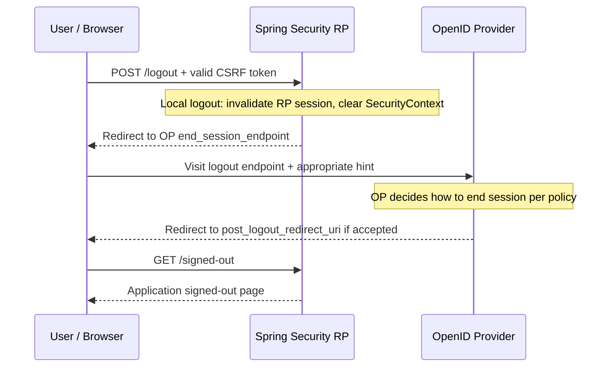
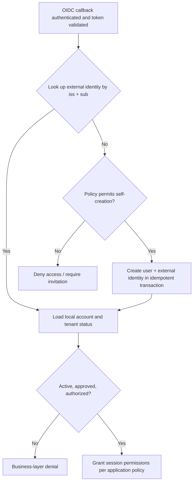

# OIDC Logout, Error Handling, and Account Provisioning Boundaries

> **Context:** Spring Security **Servlet** with `oauth2Login()` and OpenID Connect (OIDC). This topic focuses on how an **OAuth2 Client / Relying Party (RP)** logs out of its own session, coordinates logout with an **OpenID Provider (OP)**, handles error cases, and draws a clear boundary between login/logout and creating, linking, locking, or deleting application accounts.

## 1. Distinguishing three things often lumped together as "logout"

An application using OIDC typically involves at least three independent states:

1. **Application session (RP session):** `HttpSession` and `SecurityContext` used by Spring Security to recognize a logged-in user in the current application. *Local logout* terminates this state.
2. **Identity provider login session (OP session):** SSO cookie/session at the Identity Provider, e.g., `login.example.test`. If the OP session persists, the user can visit `/oauth2/authorization/{registrationId}` and log back in without entering a password. *RP-initiated logout* asks the OP to terminate its session per the protocol/capabilities supported by the OP.
3. **Accounts and business data:** internal user records, resource access permissions, roles, profiles, invitations, orders, or memberships. **Logout does not implicitly delete, lock, provision, or update this data**.

There is also a fourth state: **access tokens, refresh tokens, and sessions at Resource Servers**. Invalidating the RP's HTTP session **does not automatically revoke every issued token**; you may need token revocation, clearing token stores, shorter TTLs, or system-specific mechanisms.

| Action | Intended effect | Not automatically guaranteed |
| --- | --- | --- |
| Local logout at Spring Security RP | Destroys or invalidates the session and clears the current security context | OP session also ends; tokens issued elsewhere are revoked; user DB row is deleted |
| OIDC RP-initiated logout | Sends the browser to the OP logout endpoint so the OP processes the logout request | Every other SSO app logged out; OP logout definitely succeeded; account destroyed |
| Token revocation | Revokes a specific token per the authorization server's contract | RP session or OP browser session ends simultaneously |
| Disable/deprovision account | Changes user access status, data, and lifecycle per business workflow | Happens automatically upon clicking logout |
| Delete account | Business action with separate verification, data policy, and auditing | Permitted merely because a logout event occurred |

**Easy mental model:** logout is **session** management, while provisioning/deprovisioning is **identity and account** management. The two workflows may relate, but must never be conflated unconditionally.

## 2. Roles in the OIDC flow

- **User agent (browser):** navigates between the RP application and OP; carries cookies per domain, SameSite, and browser policy.
- **Spring Security OAuth2 Client / RP:** initiates login via `oauth2Login()`, validates callbacks, creates `Authentication` containing `OidcUser`, stores security context, and manages RP sessions.
- **OpenID Provider (OP):** authenticates users, provides authorization endpoint, token endpoint, OIDC metadata, ID Tokens, and (if supported) `end_session_endpoint`.
- **Application account service:** executes business logic on internal users, identity mapping, authorization, account provisioning, suspension/restoration, or lifecycle. This is not the default responsibility of the OP logout endpoint.

### 2.1. ID Token differs from access token

An **ID Token** is OIDC evidence of the authentication session and identity issued by the OP to the RP. It is typically a JWT with claims such as `iss`, `sub`, `aud`, `exp`. An **Access token** is for accessing APIs/Resource Servers; never use it as a substitute for an ID Token in a logout hint.

The **RP-Initiated Logout** flow typically passes an `id_token_hint` parameter so the OP can identify the RP's login session/context. This parameter carries the previously issued ID Token; **it is not a request to delete the account or revoke all access tokens**. Avoid putting tokens into logs, analytics, or public places even though an ID Token is not a password.

### 2.2. Three critical data boundaries

- **OIDC authentication:** verifies that the OP authenticated a specific subject.
- **Local account linking:** finds the corresponding application user using a stable identity key such as the **(`iss`, `sub`)** pair; email is a mutable attribute and should not be the sole linking key.
- **Business authorization:** decides which data this user may view/edit; do not blindly equate every group/role in the OP with internal business permissions.

These boundaries must be explicitly designed even when the user experience is just a single "Sign in with SSO" button.

## 3. Local logout in Spring Security Servlet

In default configuration, Spring Security's logout endpoint is typically **`POST /logout`** when CSRF protection is enabled. The reason is that logout **changes session state**: allowing a GET link from an external page to log a victim out enables *logout CSRF*. Some setups provide a logout confirmation page on GET, but GET should not be treated as a mandatory logout command.

For local logout, Spring Security's `LogoutHandler` implementations perform tasks such as:

- Clearing the current `SecurityContext`.
- Invalidating `HttpSession` per the default configuration of `SecurityContextLogoutHandler`.
- Running additional logout handlers if configured (e.g., cookie cleanup, token cleanup depending on the system).
- Then invoking `LogoutSuccessHandler` to decide the next response, such as redirecting to a signed-out page or initiating OP logout.

**Do not equate "server session invalidated" with "every cookie or token has vanished."** The browser may still hold the old `JSESSIONID` cookie even though the server session is no longer valid. If using persistent remember-me, Redis sessions, a shared token store, or `OAuth2AuthorizedClientService`, separately verify how data is stored/deleted. A single logout handler does not automatically know about every external credential store.

### 3.1. Why is Local Logout not enough for OIDC SSO?

Suppose a user logged into both the RP app and the OP. When the RP only invalidates the local session:

1. The browser no longer has a valid session at the RP.
2. The SSO cookie at the OP still exists.
3. Next time the RP sends the browser to the OP's authorization endpoint, the OP may immediately re-authenticate thanks to the SSO session.
4. The user feels like "I logged out, yet logging back in did not ask for a password."

This **does not prove Spring Security forgot to destroy the session**. It may be intended SSO behavior, requiring an RP-initiated logout flow if the product wants to ask the OP to terminate the shared session.

## 4. RP-Initiated Logout per OpenID Connect

OIDC RP-Initiated Logout is the mechanism where the RP directs the browser to the **OP's logout endpoint**, typically fetched from OIDC discovery metadata under `end_session_endpoint`. The OP may accept parameters such as:

- `id_token_hint`: ID Token associated with the login session; helps the OP identify the RP/session.
- `post_logout_redirect_uri`: URL to which the OP may redirect the user after processing logout; usually must be strictly allowed/registered at the OP.
- `state`: value correlating logout request and response (when used per provider contract); if implemented, it must be safely generated, stored, and verified.
- `client_id`: supported by some OPs to identify the client per protocol and provider rules; do not replace `id_token_hint` arbitrarily.

Which parameters are required/supported depends on the OP and spec version; the client must respect the OP's contract rather than crafting logout URLs with unverified query parameters.



**Three trust boundaries:**

- The RP can confirm **local logout** occurred.
- The RP can issue a **redirect requesting OP logout**, but the redirect response does not prove the OP processed it successfully. The browser might not follow the redirect, the OP might not support the endpoint, or the OP might require extra confirmation.
- The `/signed-out` page is only a **return landing page**; the browser opening this page is not independent proof that all SSO sessions or other apps have been logged out.

### 4.1. Single Logout does not automatically propagate to every RP

An SSO environment may have RP A, RP B, and RP C all sharing an OP. RP-initiated logout from A may cause the OP to end the user's OP session, yet there is **no general guarantee** that local sessions at B/C are immediately invalidated. Some systems require **front-channel logout** or **back-channel logout**, session correlation, and corresponding support at each RP.

- **RP-initiated logout:** RP requests the OP to log out; typically uses browser redirect.
- **Front-channel logout:** OP uses the browser to notify RPs of logout, subject to cookie/iframe/browser policies.
- **Back-channel logout:** OP sends server-to-server logout notifications to RPs; each RP must verify the notification/logout token and map the OP session/subject to local sessions.

Configuring Spring Security's `OidcClientInitiatedLogoutSuccessHandler` **does not automatically implement all Single Logout protocols** or revoke sessions in other applications. If the product requirement is "log out of all systems," explicitly define the protocol and coverage supported by every RP/OP.

## 5. Java 17+ example: Spring Boot 3.x OAuth2 Client with OIDC logout

Complete illustration at the **application source code** level: Spring MVC, Spring Security 6, and a properly configured OIDC provider supporting RP-initiated logout. You can create a new Spring Boot 3.x project or add the corresponding configuration to an existing application. Running login/logout successfully requires a **real OIDC issuer, valid client credentials, and redirect URIs registered at the OP**. The Java code compiles in a project with the declared dependencies; it is not runnable with plain `javac` because it uses Spring Boot.

### 5.1. Gradle dependencies

File `settings.gradle`:

```groovy
rootProject.name = 'oidc-logout-demo'
```

File `build.gradle`:

```groovy
plugins {
    id 'java'
    id 'org.springframework.boot' version '3.3.5'
    id 'io.spring.dependency-management' version '1.1.6'
}

group = 'com.example'
version = '0.0.1-SNAPSHOT'

java {
    toolchain {
        languageVersion = JavaLanguageVersion.of(17)
    }
}

repositories {
    mavenCentral()
}

dependencies {
    implementation 'org.springframework.boot:spring-boot-starter-web'
    implementation 'org.springframework.boot:spring-boot-starter-security'
    implementation 'org.springframework.boot:spring-boot-starter-oauth2-client'
    implementation 'org.springframework.boot:spring-boot-starter-thymeleaf'
}
```

These are illustrative versions for Spring Boot 3.3.x. In real projects, use your existing dependency management rather than declaring conflicting version sources.

### 5.2. Client configuration with issuer

File `src/main/resources/application.yml`:

```yaml
spring:
  security:
    oauth2:
      client:
        registration:
          learning:
            provider: learning-idp
            client-id: ${OIDC_CLIENT_ID}
            client-secret: ${OIDC_CLIENT_SECRET}
            scope:
              - openid
              - profile
              - email
        provider:
          learning-idp:
            issuer-uri: ${OIDC_ISSUER_URI}
```

The environment variables `OIDC_CLIENT_ID`, `OIDC_CLIENT_SECRET`, and `OIDC_ISSUER_URI` must be supplied from the OP. Store secrets in a secret manager/environment; never commit sensitive info into source control. `issuer-uri` must match the real issuer and the OP's discovery metadata. Register the exact **login redirect URI** at the OP, typically:

```text
http://localhost:8080/login/oauth2/code/learning
```

To use RP-initiated logout, the OP must advertise `end_session_endpoint` or provide a trusted logout endpoint as configured on the client. Register the corresponding **post logout redirect URI** if required by the OP:

```text
http://localhost:8080/signed-out
```

Pay attention to HTTPS, public domains, reverse proxies, and ports. When running behind a proxy, the base URL recognized by Spring Security must reflect the public scheme/host. Only trust forwarded headers like `Forwarded`/`X-Forwarded-*` from a **trusted reverse proxy**, avoiding caller-controlled redirect URLs.

### 5.3. Spring Boot application

File `src/main/java/com/example/oidcdemo/OidcDemoApplication.java`:

```java
package com.example.oidcdemo;

import org.springframework.boot.SpringApplication;
import org.springframework.boot.autoconfigure.SpringBootApplication;

@SpringBootApplication
public class OidcDemoApplication {
    public static void main(String[] args) {
        SpringApplication.run(OidcDemoApplication.class, args);
    }
}
```

### 5.4. Spring Security OIDC logout configuration

File `src/main/java/com/example/oidcdemo/SecurityConfig.java`:

```java
package com.example.oidcdemo;

import org.springframework.context.annotation.Bean;
import org.springframework.context.annotation.Configuration;
import org.springframework.security.config.Customizer;
import org.springframework.security.config.annotation.web.builders.HttpSecurity;
import org.springframework.security.oauth2.client.registration.ClientRegistrationRepository;
import org.springframework.security.oauth2.client.oidc.web.logout.OidcClientInitiatedLogoutSuccessHandler;
import org.springframework.security.web.SecurityFilterChain;

@Configuration
public class SecurityConfig {
    @Bean
    SecurityFilterChain securityFilterChain(
            HttpSecurity http,
            ClientRegistrationRepository registrations) throws Exception {

        OidcClientInitiatedLogoutSuccessHandler oidcLogout =
                new OidcClientInitiatedLogoutSuccessHandler(registrations);

        oidcLogout.setPostLogoutRedirectUri("{baseUrl}/signed-out");

        return http
                .authorizeHttpRequests(auth -> auth
                        .requestMatchers("/", "/login", "/signed-out", "/error")
                        .permitAll()
                        .anyRequest().authenticated()
                )
                .oauth2Login(oauth -> oauth
                        .failureHandler((request, response, exception) ->
                                response.sendRedirect(
                                        request.getContextPath() + "/login?error"
                                )
                        )
                )
                .logout(logout -> logout
                        .logoutSuccessHandler(oidcLogout)
                )
                .build();
    }
}
```

**Mechanics of the example:**

- `oauth2Login(...)` enables login via OIDC/OAuth2 Client; with the `openid` scope and a valid OP, the OIDC principal is typically `OidcUser`.
- `OidcClientInitiatedLogoutSuccessHandler` is a `LogoutSuccessHandler` provided by Spring Security to build a redirect to the OIDC logout endpoint when eligible. The handler can use `ClientRegistrationRepository` and OIDC principal/ID Token information to prepare the request.
- `setPostLogoutRedirectUri("{baseUrl}/signed-out")` uses the RP's base URL; this URI must match the OP configuration. The `/signed-out` path is simply a public page displaying status after redirect.
- Local logout is handled by Spring Security before invoking the success handler. The original `Authentication` can still be passed to the success handler to build `id_token_hint` even though the current `SecurityContext` has been cleared.
- **Do not call `csrf.disable()`:** the POST logout form needs a valid CSRF token, just like other state-changing actions.
- `failureHandler` only demonstrates handling **OIDC login failure** at the login filter: redirecting the user to a generic message without putting exception details/tokens in the URL. It **cannot detect every error occurring at the OP after the browser has left the app to perform logout**.

If the OP does not provide `end_session_endpoint`, or the request lacks a suitable principal/ID Token, the handler cannot guarantee OP logout. **Do not infer from the RP returning a redirect that OP logout completed**; inspect OP characteristics and observe the actual flow.

### 5.5. Controller only serves pages, does not provision/delete accounts

File `src/main/java/com/example/oidcdemo/PageController.java`:

```java
package com.example.oidcdemo;

import java.security.Principal;

import org.springframework.stereotype.Controller;
import org.springframework.ui.Model;
import org.springframework.web.bind.annotation.GetMapping;

@Controller
public class PageController {
    @GetMapping("/")
    String home(Principal principal, Model model) {
        model.addAttribute(
                "userName",
                principal == null ? "guest" : principal.getName()
        );
        return "home";
    }

    @GetMapping("/signed-out")
    String signedOut() {
        return "signed-out";
    }
}
```

These handlers **do not create, delete, lock, or change account roles**. `Principal#getName()` is used for illustrative display; never assume it is an email, or use it directly as a DB key. For long-term identity mapping, verify `iss`/`sub` from OIDC claims.

### 5.6. CSRF-safe logout form

File `src/main/resources/templates/home.html`:

```html
<!doctype html>
<html lang="en" xmlns:th="http://www.thymeleaf.org">
<head>
  <meta charset="utf-8">
  <title>OIDC Client Demo</title>
</head>
<body>
  <p>User: <span th:text="${userName}">guest</span></p>

  <p>
    <a th:href="@{/oauth2/authorization/learning}">
      Sign in via OIDC
    </a>
  </p>

  <form th:action="@{/logout}" method="post">
    <button type="submit">Sign out</button>
  </form>
</body>
</html>
```

With Spring MVC, Thymeleaf, and Spring Security CSRF integration, forms processed via `th:action` normally get a hidden CSRF field injected by `RequestDataValueProcessor`. **Inspect the actual rendered HTML** to ensure the `POST /logout` request carries a valid token. If building plain HTML forms or an SPA frontend, actively obtain and send the CSRF token per the application's mechanism instead of switching logout to GET "to make it work."

File `src/main/resources/templates/signed-out.html`:

```html
<!doctype html>
<html lang="en">
<head>
  <meta charset="utf-8">
  <title>Signed out of application</title>
</head>
<body>
  <h1>Application session ended</h1>
  <p>Identity provider logout request was initiated
     when supported by the OIDC flow.</p>
  <a href="/">Return to home page</a>
</body>
</html>
```

The message intentionally **does not claim every OP session and other RP has been destroyed**, because the RP has no general proof for that conclusion from a single browser redirect.

### 5.7. Running and verifying

If the project has a Gradle Wrapper:

```bash
# Linux/macOS
./gradlew bootRun

# Windows PowerShell
.\gradlew.bat bootRun
```

After setting environment variables and a valid OIDC client, open `http://localhost:8080/`. Click "Sign in via OIDC"; the browser redirects to the OP, authenticates, and returns to `/login/oauth2/code/learning` per registration. Click "Sign out":

1. DevTools → Network: verify the **POST /logout** request includes a valid CSRF token.
2. Check the RP response: the local session is no longer valid; the response may be a redirect to the OP's `end_session_endpoint` with appropriate logout parameters.
3. Observe whether the browser actually reaches the OP logout endpoint and whether the OP displays confirmation or reports an error.
4. If the OP processes it and accepts the redirect, the browser returns to `/signed-out`. This page only confirms navigation flow, not that all SSO systems logged out.
5. Visit an authentication-required URL at the RP again. If the OP session still exists, the OP may log back in immediately; distinguish **RP session destroyed** from **OP session active**.
6. Test logging out while the IdP is unavailable in a test environment: local logout must still follow proper policy, and the UI should not claim remote logout definitely completed.

With an arbitrary GET or a POST missing a CSRF token, the result may be a confirmation page or 403 depending on configuration; **never switch logout to GET as a workaround**.

## 6. Distinguishing OIDC error categories

Errors appear around the login/logout buttons yet happen at different boundaries:

| Stage | Examples | Which side can detect it? | Right response |
| --- | --- | --- | --- |
| Login initiation | Missing `ClientRegistration`, wrong issuer/discovery, client ID | RP at config/startup or login request | Log filtered technical details, show "cannot start sign-in", check config |
| Authorization callback | `error=access_denied`, wrong/missing state, invalid authorization code | RP's OAuth2 login filters | Reject login; never create session or internal account on callback error |
| ID Token validation | Wrong issuer/audience/signature/expiry/nonce | OIDC token validation at RP | Reject principal; investigate clock skew, metadata, client config, security |
| Session or CSRF | Missing session holding authorization request, POST logout lacking CSRF | RP / Spring Security | Separate cookie/session/CSRF errors from provider errors |
| Local logout | Special handler/storage/session failure | RP | Log error, enforce safeguard so session does not stay active unintentionally |
| Building OP logout redirect | Missing `end_session_endpoint`, missing OIDC principal, wrong redirect URI | RP can partially detect | Controlled fallback, do not promise SSO logout; fix metadata/registration |
| Browser at OP | OP timeout, confirmation prompt, OP denial, browser blocks cookies/redirects | Primarily OP and browser; RP cannot observe all steps automatically | Clear UI/support guidance; verify using browser/OP traces |
| Returning to `/signed-out` | Callback never arrives, wrong URL, allowlist error, or proxy error | RP only sees if a return request arrives | Do not infer OP logged out solely from local session |
| Local account provisioning | DB transaction failure, mapping conflict, invalid tenant | Business application | Do not conflate with OIDC login/logout; return business error and audit separately |

**Error groups to separate in operations:** authentication callback, token validation, local session logout, redirect requesting OP logout, OP logout outcome, and account lifecycle. Each group has a different owner, retry strategy, and impact.

### 6.1. Login failure handler: what to do and what not to do?

In the example code, `failureHandler` receives `AuthenticationException` from the login flow handled by the filter and redirects to a generic error page. This avoids exposing `exception.getMessage()`, authorization codes, tokens, or stack traces in user-visible URLs.

In real applications, you can:

- Log **error category, correlation ID, registration ID**, and sanitized classification codes; never log raw ID Tokens, access tokens, refresh tokens, authorization codes, client secrets, or cookies.
- Distinguish a user declining consent/login from broken configuration or an unavailable OP.
- Provide safe retries for retryable situations; avoid infinite redirect loops between RP and OP.
- Never auto-create an internal user or "temporarily grant access" when the OIDC callback fails.
- Check session/cookie `SameSite` when state or authorization requests go missing after redirect; never skip `state` validation as a "fix."

**Limitation:** the failure handler inside `oauth2Login()` is not a catch-all error handler for every HTTP request in the app, every controller exception, or all logout steps occurring at the OP.

### 6.2. Remote logout fails after redirect

RP-initiated logout is typically **front-channel browser navigation**. Once the RP returns HTTP 302 to the OP, the RP **has no synchronous result** confirming the OP actually ended the session. Situations to anticipate:

- The browser closes the tab before opening the OP logout URL.
- The OP does not support `end_session_endpoint` or rejects `id_token_hint`.
- The OP prompts for user confirmation or rejects an unregistered `post_logout_redirect_uri`.
- The OP's cookie/session has already expired, preventing the OP from recognizing the session.
- Network drop, blocked cookies/iframes, or browser policy interrupts the flow.
- The OP finishes without redirecting back to the RP due to policy/timeout; or redirects back while other RPs still hold sessions.

**Trustworthy UX policy:** if local logout succeeded, inform the user they have signed out of **the current application**; for OP logout, say "SSO sign-out request was sent" or offer guidance if the OP reports an error. Never display "signed out of all applications" without matching mechanisms and evidence.

### 6.3. Should you try to "roll back" local logout when OP logout fails?

**No.** Once local logout has invalidated the session, trying to recreate a logged-in session just to match OP logout could reopen access after the user intentionally signed out. Instead, local logout takes effect independently, and remote logout is a subsequent step that may fail. If the product strictly requires system-wide logout, add back-channel logout, session registries, timeouts, and separate status observability—never silently restore an invalidated session.

## 7. Boundaries with account provisioning and lifecycle management

### 7.1. OIDC login does not mean automatically creating a DB user

When Spring Security receives a valid OIDC callback, it usually holds an `OidcUser` in `Authentication`. This **does not implicitly** mean:

- The application created a new user row in the DB.
- The user already has permission to use the product or was granted business roles.
- The user's email has been verified per the application's policy.
- The user was invited/approved to join a tenant/organization.
- The OP created or modified your application account.

**Provisioning** must be decided by an explicit business layer. For instance, the app may accept only pre-provisioned subjects, or allow Just-in-Time (JIT) provisioning **only when** invitation/tenant policies permit. This is a product choice, not a default handled by OAuth2 Client or a logout handler.

### 7.2. Identity linking: use issuer + subject

A stable OIDC identifier key for an RP should rely on the pair:

```text
(issuer, subject) = (id_token.iss, id_token.sub)
```

For multi-tenant/multi-issuer apps, ensure validation of issuer, client audience, relevant tenant, and account-linking conditions before mapping to a user DB row. **Do not link users by email alone**: emails can change, be missing, be unverified, or be recycled. Attributes like `preferred_username`, `name`, or `email` are better suited for display than as a sole linking key.

Illustrative JIT provisioning rules as a pseudo-flow, **not a default Spring Security API**:



Points to watch when implementing this yourself:

- Create a unique key on external identity `(iss, sub)` and protect transactions against concurrent logins creating two accounts.
- Only auto-provision after verifying tenant and invitation/approval policies; never infer permissions solely from an email domain.
- Map group/role claims from the OP via an allowlist/explicit rules; group claims can be missing or changed.
- When a local account is locked, **a successful OIDC authentication must never auto-unlock the account**.
- A failed account-creation transaction must not leave a "shadow account" or grant higher fallback privileges.
- Write audit events for provisioning/account linking/role changes separately from login events.

### 7.3. Logout is not deprovisioning, disabling, or deleting an account

| Operation | Who decides? | When does it happen? |
| --- | --- | --- |
| RP session logout | User, admin session management, or session policy | Upon logout/expiration/session revocation |
| OP session logout | OP per RP-initiated/front/back-channel logout or OP policy | When OP receives and processes an eligible request |
| Create internal user | Account service + tenant/invitation policy | When onboarding/JIT is permitted |
| Grant roles | Role administration / policy system | Via an independent authorization workflow |
| Lock user | Admin, security event, or business workflow | When disable/suspend policy triggers |
| Delete user / process data | Account lifecycle + retention/privacy policy | Upon verified deletion request and data workflow |
| Revoke token | Authorization server/Token manager | When token revocation policy requires |

Clicking "Sign out" is **not** a "Delete account" command; likewise, creating an account at the OP does not automatically create a record at the RP. Workflows can be connected when product requirements are clear, but each workflow needs its own trigger, authorization, idempotency, auditing, and error handling.

### 7.4. When an account is locked at the RP while the OP still authenticates it

An OP may issue a valid ID Token for an identity whose business access the RP has locked. In that case:

1. The RP may still **verify the token successfully** (valid OIDC identity).
2. The account service looks up the local account and sees status `SUSPENDED`/`DISABLED`.
3. The RP must **refuse to establish a privileged application session** or block requests per policy.
4. Do not call OP logout as a substitute for disabling the account; conversely, logout is not enough to prevent a locked user from logging in again.

An admin request to "log out all sessions of a user" also differs from "disable account": it may require a session registry/cluster session invalidation, token revocation, and back-channel/logout notifications, **not just a browser redirect**.

## 8. Common design mistakes

| Design mistake | Consequence | Right approach |
| --- | --- | --- |
| Only local logout then concluding SSO is logged out | OP session remains, allowing immediate re-login | Use RP-initiated logout if OP supports it and product requires it |
| Redirecting to OP logout then concluding all RPs are logged out | Other RPs still have local sessions | Define Single Logout coverage; add front/back-channel if needed |
| Using access token as `id_token_hint` | Wrong protocol semantics/OP may reject | Use the valid ID Token from OIDC authentication |
| Hardcoding logout URL, redirecting to unvalidated request URL | Wrong provider metadata; open redirect | Use trusted metadata and allowlisted/registered redirect URIs |
| Switching logout to GET to avoid CSRF | Logout CSRF, external pages mutating session state | Keep POST/CSRF token or equivalent protection |
| Logging full tokens and logout queries | Leaks identifiers/tokens to logs/analytics | Mask sensitive data, log correlation IDs and filtered error codes |
| Retrying logout by restoring RP session | Accidentally reopens a session the user ended | Keep local logout in effect; handle remote failure independently |
| Granting ADMIN by default on successful OIDC login | Privilege escalation | Separate identity authentication from business authorization/approval |
| Linking DB users solely by email | Risk of account takeover when email changes/is recycled | Bind `iss` + `sub` and linking policies |
| Logout calling API to delete DB user | Data loss, unintended action | Account deletion is a separate verified workflow |
| Treating refresh token revocation as system-wide end-user logout | Other RP/OP sessions may remain | Manage each session/token layer separately |
| Disabling `state`/nonce checks on callback errors | Increases login CSRF, code injection, replay risk | Keep standard validations; fix cookie/proxy/redirect config |
| Using an unregistered logout callback URL at OP | OP rejects redirect or shows an error | Register exact URIs consistently across environments |
| Enabling SameSite=None cookies everywhere | Expands cross-site request surface without fixing other config | Understand cookie context, apply tailored policies, keep CSRF separate |

## 9. Layered testing checklist

Use **a demo app, test-registered clients, and test users**—never use customer data or production environments to intentionally trigger failure cases.

### 9.1. Local logout

- Logged in, send `POST /logout` with a valid CSRF token: RP session is no longer valid.
- POST missing/wrong CSRF: request is blocked when CSRF protects logout; never switch to GET.
- Refresh a protected page after logout: must require logging in again at the RP; if sent to the OP and the OP logs in automatically, distinguish **RP session destroyed** from **OP session active**.
- If using persistent sessions/token stores: verify remaining active resources and cleanup policies per design.

### 9.2. OP logout

- OP has `end_session_endpoint`, valid ID Token, registered redirect URI: observe browser redirecting to OP and potentially returning to RP.
- OP lacks a logout endpoint: define fallback UX; never display "logged out of all SSO."
- OP logout rejects `post_logout_redirect_uri`: app must still not restore the invalidated RP session.
- OP slow/unavailable: show suitable message and retry/guidance; never log tokens.
- With multiple RPs: verify whether other RPs' sessions are invalidated; if not, do not call it system-wide single logout.

### 9.3. Login errors

- User declines login/consent: show friendly error, create no session.
- Wrong issuer, client ID, client secret, or redirect URI: clear login failure with filtered technical logs.
- Callback missing/wrong `state` or token validation fails: rejected, never bypassing checks.
- Cookies/session lost after redirect: check cookie SameSite, Secure, proxy, session store, and timing; never "rescue" callbacks by removing state validation.

### 9.4. Account provisioning boundaries

- **Linked OIDC subject, active account**: logs in and receives right internal roles.
- **Unlinked OIDC subject, no invitation**: denied or routed to permitted onboarding; never auto-creates user with arbitrary privileges.
- **New OIDC subject permitted for JIT**: creates local mapping by unique `iss/sub`, preventing duplicates/concurrency races.
- **Locked account** yet OP authenticates successfully: local policy keeps account locked; logout does not unlock it.
- Clicking logout repeatedly: creates no users, deletes no business data, triggers no provisioning requests.
- User changes email at OP: does not transfer ownership of local account while subject stays the same.

## 10. Self-check questions

**1. Why can clicking logout still allow logging right back in without entering a password?**  
The RP's local session may be destroyed while the browser still holds an OP SSO session. Distinguish OP logout/Single Logout policies from local logout.

**2. Does `OidcClientInitiatedLogoutSuccessHandler` delete accounts in the database?**  
No. It is a logout success handler for OIDC navigation; it does not replace account provisioning/deprovisioning.

**3. The RP returns HTTP 302 to `end_session_endpoint`. Can you immediately log "OP logout succeeded"?**  
No. The RP just emitted a redirect; the browser and OP still have to process it. Use wording/tracking accurate to what was actually observed.

**4. When does `POST /logout` require a CSRF token?**  
In Spring Security Servlet configurations with default CSRF protection enabled, logout is a state-changing action and normally requires a POST with a token.

**5. Which claims should be used for long-term linking to a local user?**  
The verified `(iss, sub)` pair, alongside appropriate tenant/client policies. Email and username can change or be recycled.

**6. What if a user is locked at the RP yet still has a valid ID Token from the OP?**  
The RP must respect local account status/authorization; valid OIDC authentication does not mean the user regains privileges.

**7. Should you restore the old HTTP session if remote logout fails?**  
No. Local logout was explicitly requested by the user; silently restoring it could reactivate the session unintentionally.

## Conclusion

In Spring Security Servlet, **local logout** destroys the RP session; **OIDC RP-initiated logout** asks the OP to terminate its session via OP-supported protocols; **Single Logout across multiple RPs** requires additional mechanisms and verification; and **provisioning, locking, or deleting accounts** is separate system business logic.

For a secure implementation: keep `POST /logout` with CSRF, use `OidcClientInitiatedLogoutSuccessHandler` with issuer metadata and registered redirect URIs, handle login errors separately from remote logout errors, never infer remote results from a redirect alone, and always separate **identity authentication** from **account policy and business authorization**.
