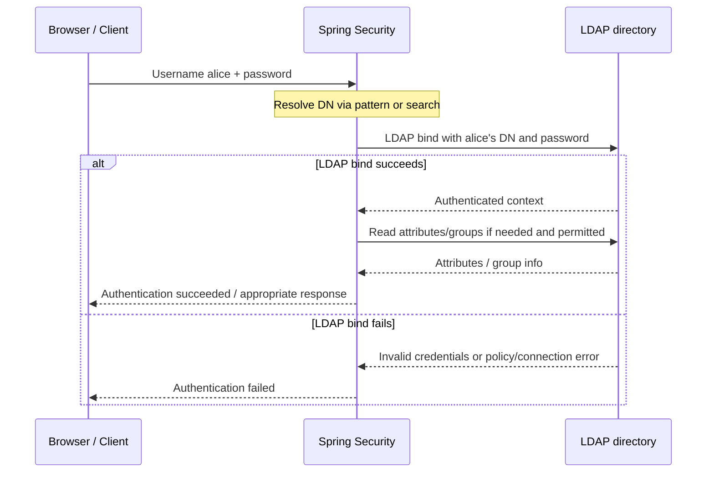
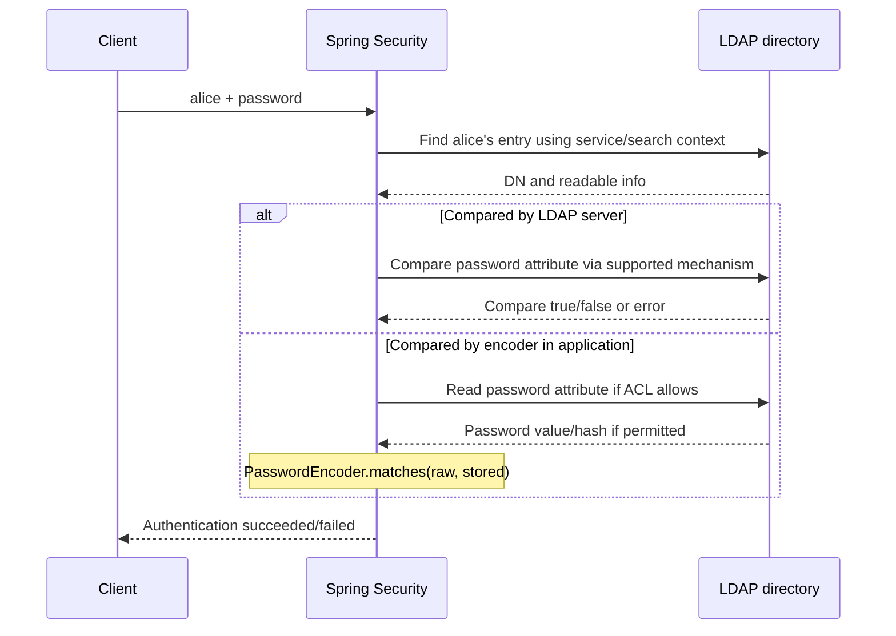

# LDAP Bind and Password Comparison in User Authentication

> **Scope:** user authentication via LDAP in **Spring Security on the Servlet stack** (Java 17+, Spring Boot 3.x, Spring Security 6.x). The focus is understanding and properly configuring the two strategies—**LDAP bind** and **password comparison**—rather than treating them as two names for the same password check.

## 1. Goal and General Model

LDAP (Lightweight Directory Access Protocol) is a protocol for accessing directory services. A directory can hold accounts, user attributes, and groups; for example, a user entry has a distinguished name (DN):

```text
uid=alice,ou=people,dc=example,dc=com
```

Where:

- `uid=alice` is the entry's Relative Distinguished Name (RDN).
- `ou=people` is the organizational unit containing the entry.
- `dc=example,dc=com` is the base DN portion of the directory tree.
- The login attribute may be `uid`, `cn`, `mail`, or another identifier depending on the schema. **Do not assume the username is always the email, or that one username always maps uniquely across all tree branches.**

When an application receives a username and password, there are two main strategies:

1. **Bind authentication:** the application asks the LDAP server to authenticate via a **bind operation with the user's own DN and the password they supplied**. The LDAP server decides whether the credentials are accepted.
2. **Password comparison authentication:** the application locates the entry and checks the password via a **comparison mechanism**: either asking the LDAP server to run a compare operation against the password attribute, or reading the hash/attribute when policy permits and comparing locally with a compatible `PasswordEncoder`. This depends on the actual schema, ACLs, and password encoding mechanism.

Both approaches only produce an **authentication decision (who the user is and whether the credentials are valid)**. Allowing access to `/admin/**`, mapping LDAP groups to roles, checking tenants, or checking account lock status remain separate **authorization/account policy** decisions.

### 1.1. Distinguishing LDAP from Spring Security Components

| Component | Role |
| --- | --- |
| LDAP directory | Stores user/group entries; executes bind, search, and compare per server permissions and schema |
| `ContextSource` | Provides LDAP connections/contexts; may use a service account to search entries |
| `LdapBindAuthenticationManagerFactory` | Creates an `AuthenticationManager` using the bind strategy |
| `LdapPasswordComparisonAuthenticationManagerFactory` | Creates an `AuthenticationManager` using the password comparison strategy |
| `LdapAuthenticator` and `LdapAuthenticationProvider` | Provider-layer LDAP authentication mechanism |
| `UserDetailsContextMapper` / authorities mapper | Converts LDAP attributes/groups into principal/authorities per application policy |
| `SecurityFilterChain` | Uses authentication results to protect URLs, sessions, Basic/form login, and other filters |
| Business account/roles | Determines business permissions; never arises automatically just because LDAP authentication succeeded |

Spring Security LDAP integrates authentication **at the application**, rather than turning LDAP into an OIDC/OAuth2 provider. If using Active Directory (AD), DNs, searches, UPNs, group nesting, and bind errors may differ; verify the AD schema/environment separately.

## 2. LDAP Bind: Verifying Passwords by Signing In to the Directory

### 2.1. Processing Flow

With username `alice` and a user-entered password:

1. The application receives credentials over HTTPS and passes them to Spring Security's authenticator.
2. Resolve the user's DN: either construct it from a known **DN pattern**, such as `uid={0},ou=people`, or **search** using a service account with a defined filter.
3. Spring Security LDAP opens a context to perform a **bind using alice's DN and the password alice supplied**.
4. The LDAP server decides whether the bind succeeds or fails based on account details, password policy, account lockout, and permissions.
5. On success, the provider can continue reading needed attributes/groups to build an authenticated `Authentication`; `SecurityFilterChain` processes authorization rules.
6. On bind failure, the application rejects authentication; it does not invoke the controller as an authenticated user.



**Key point:** alice's password is sent during the bind flow over a secure LDAP connection; the application **does not need to download alice's `userPassword` value to compare it itself**. The directory owns the hashing algorithm/password policy; the application does not need to know how passwords are hashed. Thus bind is usually the sensible default when the directory supports standard user authentication.

### 2.2. Direct DN Pattern vs. Finding Users via Search

**DN pattern** works well when user placement rules are uniform:

```text
Base DN: dc=example,dc=com
DN pattern: uid={0},ou=people
Username: alice
Effective DN: uid=alice,ou=people,dc=example,dc=com
```

However, a DN pattern does not fit when users reside across multiple `ou`s, use varying RDNs, or have login names different from the DN. In that case, the application uses **user search** with an explicit base/filter, for example:

```text
Base DN: ou=people,dc=example,dc=com
Search filter: (uid={0})
Username: alice
Result DN: uid=alice,ou=staff,ou=people,dc=example,dc=com
```

This only describes the user lookup strategy; exact API configuration syntax depends on the factory/version. Search typically requires a **service account with necessary read access**, or anonymous search if the directory permits it (many systems do not). The service account is **not** authenticated on behalf of the user: search finds the DN, then a bind happens with the user's credentials.

**Security rule:** search filters must use safely escaped/bound parameters from Spring LDAP; never concatenate the username directly into the filter string. LDAP injection can alter search conditions. Check for **0 or more than 1 entry** and enforce a fail-closed policy rather than arbitrarily picking the first record.

### 2.3. Advantages and Limitations of Bind

Advantages:

- Passwords are verified by the LDAP server; the application does not need to read hashes or determine the directory's hashing algorithm.
- Fits naturally with directories whose ACLs forbid reading the password attribute.
- Server-side account/password policies can be enforced during bind (such as expired/locked), depending on server and configuration.
- Easy-to-explain logs: binding with the user's DN either succeeds or fails, and only then are permissions mapped.

Limitations:

- Requires the ability to bind with user credentials; some directory/identity provider architectures have special rules.
- The client/app must transmit the password to the LDAP server over a **trusted TLS** channel. Never use simple bind sending passwords over an unencrypted connection in production.
- If the DN rule is wrong or the search account lacks permissions, it can report "invalid login" even when the password is correct.
- With multiple LDAP replicas or directory proxies, consider consistency, account lockout, and failover policies.
- Never infer that a user has application permissions merely because LDAP accepted the bind.

## 3. Password Comparison: Verifying Passwords via Attribute

### 3.1. Difference at the Final Check

In password comparison, the application typically:

1. Uses a service context to locate the target entry.
2. Identifies the password attribute, usually `userPassword`, though it may vary by schema.
3. Executes an **LDAP Compare operation** on the server or reads the permitted password attribute to check using a compatible `PasswordEncoder`.
4. If the comparison matches, establishes authenticated state and collects authorities per configuration; otherwise, returns authentication failure.



These two branches represent **possible implementation paths**, not a guarantee that every LDAP server or Spring Security setup supports both automatically. You must verify authenticator behavior, password read ACLs, encoding, and the directory's own policies. **Do not open up broad read access to password hashes** just to make a demo work.

### 3.2. Distinguishing LDAP Compare from Local Hash Comparison

- **LDAP Compare operation** sends an assertion value so the LDAP server determines whether the attribute satisfies the condition. The server may deny compare via ACLs or handle the password attribute specially. You cannot assume every system permits Compare on `userPassword`.
- **Local comparison** retrieves the stored password value (typically a hash if schema/server permits) and calls `PasswordEncoder.matches(rawPassword, storedHash)`. This only works if the application can read a suitable value and the encoder understands the exact stored format.
- **Password hashing:** `{SSHA}...`, `{CRYPT}...`, BCrypt `$2a$...`, or other schemes are not equivalent. `BCryptPasswordEncoder` **does not automatically understand every LDAP hash**. Some directories handle compare on password attributes via their own mechanism; some do not support your chosen hash type.
- **Salted hashes:** do not compare by re-encoding the raw password and comparing strings, because random salts produce different outputs every time; use `matches` or the LDAP server's proper check.
- **Account policy:** a successful compare is not necessarily equivalent to "allowed to log in" under every constraint enforced by a server bind (expired password, forced reset, lockout, time-of-day restrictions...). Test specific rules rather than assuming both modes share identical semantics.

### 3.3. When to Consider Password Comparison?

Consider it if the organization owns the directory/schema and explicitly designed password verification via compare, or for legacy integration requiring attribute inspection. Minimum prerequisites:

- A process selecting a **unique** user entry and least-privilege compare/read access for the service identity.
- Accurate password attribute and a hash/encoder compatible with the chosen comparison mode.
- Directory password policies, account status, and lockout are properly enforced or guarded by separate rules.
- TLS connectivity and zero logging of passwords/hashes.
- Tested failure/success cases with valid passwords, wrong passwords, locked/expired accounts, missing attributes, ACL denials, and server downtime.

If the goal is "let the LDAP server decide user login," **bind is usually simpler and less coupled to password storage details**. Do not switch to compare merely to work around an undiagnosed bind error.

## 4. Comparison Table: Bind vs. Password Comparison

| Criterion | LDAP Bind | Password Comparison |
| --- | --- | --- |
| Primary verification | Bind with user's DN and supplied password | Compare password attribute in LDAP or use encoder when reading is permitted |
| Service account permissions | May need read/search for DN and groups; verification binds as user | Usually needs entry lookup and compare/read on the relevant attribute |
| Needs to read `userPassword`? | No | Depends on implementation; local compare needs read, server-side compare not necessarily |
| Coupling to LDAP hash format | Usually none in the application | Can depend heavily on hash/encoder/compare semantics |
| Directory password policy | Bind typically enforces server authentication constraints | Equivalence not guaranteed; must be verified |
| Compatibility | Widely supported in standard LDAP authentication | Depends on ACLs, schema, hashes, implementation, and server |
| Secret surface | User password travels in LDAP bind; requires TLS | Raw password used for compare, hash may be read; requires TLS and ACLs |
| When password is wrong | Bind rejected | Compare false or encoder `matches` false |
| Implementation risks | Wrong DN/search, cleartext transport, improper service bind handling | Unsafe hash reading, wrong encoder, missed account policies |
| Sensible default | Preferred when the directory can authenticate users | Use only after verifying server/schema/ACL/password policy |

Commonality: both answer authentication, and **neither automatically grants roles, permissions, or application entitlements**. Group mapping is a separate step.

## 5. Preparing a Secure LDAP Connection

### 5.1. DN, Search Permissions, and Transport Protocol

Suppose the directory contains:

```ldif
dn: uid=alice,ou=people,dc=example,dc=com
objectClass: inetOrgPerson
cn: Alice
sn: Example
uid: alice
mail: alice@example.com
```

This LDIF sample **only illustrates identity attributes**, intentionally **omitting passwords/hashes**; the LDAP server manages credentials through its provisioning tools and password policies.

The application needs to know:

- LDAP server URL, e.g. `ldaps://ldap.example.com:636` or `ldap://ldap.example.com:389` combined with StartTLS and certificate validation.
- Base DN, e.g. `dc=example,dc=com`.
- DN pattern or search base/filter matching the schema.
- If searching is required: service DN and password for an account with only the needed read permissions.
- A truststore containing the appropriate CA to verify the server certificate; check hostname verification per JDK/LDAP client.
- Timeouts, failover, connection lifecycle, and safe logging configuration.

**Do not treat `ldap://` port 389 as encrypted.** Simple bind over non-TLS LDAP can expose credentials. For production environments, prefer LDAPS or StartTLS established **before sending credentials**, with verified certificates and no silent fallback to plaintext connections. `ldaps://` port 636 is only a common example; actual ports are determined by your infrastructure.

### 5.2. A Service Account Must Never Become a User Account

When using a search account, the service context may bind first to look up DNs and read groups. However, **a successful service account bind does not prove alice's password is correct**. For bind mode, there must be a bind step with the user's DN. For compare mode, there must be an actual password comparison. Never treat authentication as successful just because `ldapsearch` with the service account returns an entry.

Service accounts should be least-privilege, have secrets stored in a secret manager/environment, restrict log access, and follow a rotation schedule. Never use a domain admin account when only user search is needed.

## 6. Spring Boot 3.x Example: LDAP Bind Authentication

This section demonstrates Spring Security **Servlet** code for an API using HTTP Basic. The Java code compiles once dependencies and packages are in place; **actual sign-in** requires a configured LDAP server, trusted certificates, and an existing user with valid DN/password. LDAP authentication cannot succeed without an external directory; this example does not spin up an LDAP server itself.

### 6.1. Structure and Dependencies

Create the files:

```text
ldap-auth-demo/
├── build.gradle
├── settings.gradle
└── src/main/
    ├── java/com/example/ldapdemo/
    │   ├── LdapDemoApplication.java
    │   ├── LdapConfiguration.java
    │   ├── SecurityConfig.java
    │   └── DemoController.java
    └── resources/application.yml
```

`settings.gradle`:

```groovy
rootProject.name = 'ldap-auth-demo'
```

`build.gradle`:

```groovy
plugins {
    id 'java'
    id 'org.springframework.boot' version '3.3.5'
    id 'io.spring.dependency-management' version '1.1.6'
}

group = 'com.example'
version = '0.0.1-SNAPSHOT'

java {
    toolchain {
        languageVersion = JavaLanguageVersion.of(17)
    }
}

repositories {
    mavenCentral()
}

dependencies {
    implementation 'org.springframework.boot:spring-boot-starter-web'
    implementation 'org.springframework.boot:spring-boot-starter-security'
    implementation 'org.springframework.security:spring-security-ldap'
}
```

`spring-security-ldap` integrates Spring Security with Spring LDAP; `spring-boot-starter-web` selects Servlet MVC. The Spring Boot BOM manages compatible dependency versions. The Gradle plugin versions above are examples for Boot 3.3.x; real projects should use their standardized versions.

### 6.2. application.yml

`src/main/resources/application.yml`:

```yaml
app:
  ldap:
    url: ${LDAP_URL:ldaps://ldap.example.com:636}
    base-dn: ${LDAP_BASE_DN:dc=example,dc=com}
    manager-dn: ${LDAP_MANAGER_DN:cn=reader,ou=service,dc=example,dc=com}
    manager-password: ${LDAP_MANAGER_PASSWORD}
```

The sample addresses, DNs, and users are illustrative only. The `LDAP_MANAGER_PASSWORD` environment variable is **required** if the bean configuration needs a service account; never commit passwords into source or shared config files. Truststore/CA must be configured properly for LDAPS connections.

### 6.3. Java Entry Point

`src/main/java/com/example/ldapdemo/LdapDemoApplication.java`:

```java
package com.example.ldapdemo;

import org.springframework.boot.SpringApplication;
import org.springframework.boot.autoconfigure.SpringBootApplication;

@SpringBootApplication
public class LdapDemoApplication {
    public static void main(String[] args) {
        SpringApplication.run(LdapDemoApplication.class, args);
    }
}
```

### 6.4. ContextSource and LDAP Bind AuthenticationManager

`src/main/java/com/example/ldapdemo/LdapConfiguration.java`:

```java
package com.example.ldapdemo;

import java.util.List;

import org.springframework.beans.factory.annotation.Value;
import org.springframework.context.annotation.Bean;
import org.springframework.context.annotation.Configuration;
import org.springframework.security.authentication.AuthenticationManager;
import org.springframework.security.config.ldap.LdapBindAuthenticationManagerFactory;
import org.springframework.security.ldap.DefaultSpringSecurityContextSource;

@Configuration
public class LdapConfiguration {
    @Bean
    DefaultSpringSecurityContextSource ldapContextSource(
            @Value("${app.ldap.url}") String ldapUrl,
            @Value("${app.ldap.base-dn}") String baseDn,
            @Value("${app.ldap.manager-dn}") String managerDn,
            @Value("${app.ldap.manager-password}") String managerPassword) {

        DefaultSpringSecurityContextSource source =
                new DefaultSpringSecurityContextSource(
                        List.of(ldapUrl), baseDn);
        source.setUserDn(managerDn);
        source.setPassword(managerPassword);
        return source;
    }

    @Bean
    AuthenticationManager ldapAuthenticationManager(
            DefaultSpringSecurityContextSource ldapContextSource) {

        LdapBindAuthenticationManagerFactory factory =
                new LdapBindAuthenticationManagerFactory(ldapContextSource);

        // uid=alice,ou=people under base dc=example,dc=com
        factory.setUserDnPatterns("uid={0},ou=people");
        return factory.createAuthenticationManager();
    }
}
```

**Code explanation:**

- `DefaultSpringSecurityContextSource` uses URL + base DN and optional manager credentials; Spring manages the bean's lifecycle.
- Service DN/password are used to create a context for accessing the directory when needed, **not as the credentials sent by logging-in users**.
- `LdapBindAuthenticationManagerFactory` creates a manager that uses bind when authenticating users.
- `setUserDnPatterns("uid={0},ou=people")` assumes every user in the test directory has a uniform DN location. In systems with multiple OUs/other identifiers, replace this with **user search** using properly escaped filters and uniqueness checks; do not treat this pattern as standard for every directory.
- Never hardcode user passwords: passwords sent by clients are verified via bind against LDAP.
- The example does not configure separate group-to-authorities mapping because the demo API only requires `authenticated()`, **not a specific role**.

**Spring API note:** if a project uses an older Spring Security version, the DSL/factories may differ. This example is written for Spring Security 6 architecture and `SecurityFilterChain`, not the deprecated `WebSecurityConfigurerAdapter`.

### 6.5. SecurityFilterChain

`src/main/java/com/example/ldapdemo/SecurityConfig.java`:

```java
package com.example.ldapdemo;

import org.springframework.context.annotation.Bean;
import org.springframework.context.annotation.Configuration;
import org.springframework.security.authentication.AuthenticationManager;
import org.springframework.security.config.Customizer;
import org.springframework.security.config.annotation.web.builders.HttpSecurity;
import org.springframework.security.web.SecurityFilterChain;

@Configuration
public class SecurityConfig {
    @Bean
    SecurityFilterChain securityFilterChain(
            HttpSecurity http,
            AuthenticationManager ldapAuthenticationManager) throws Exception {

        return http
                .authenticationManager(ldapAuthenticationManager)
                .authorizeHttpRequests(auth -> auth
                        .requestMatchers("/public").permitAll()
                        .anyRequest().authenticated()
                )
                .httpBasic(Customizer.withDefaults())
                .build();
    }
}
```

- `authenticationManager(...)` explicitly sets the LDAP manager for this chain.
- HTTP Basic is a simple authentication interface for terminal testing, **not a recommendation to use Basic for public browser apps in every context**. If Basic is used in production, HTTPS is mandatory and logout/session/CSRF UX must be evaluated separately.
- `/public` requires no login; other paths require a valid identity. The demo does not grant `ROLE_ADMIN` merely because a user exists in LDAP.
- Spring Security enables multiple protections by default; for instance, it **does not disable CSRF globally**. The test commands below use GET and do not require a CSRF token.

### 6.6. Verification Controller

`src/main/java/com/example/ldapdemo/DemoController.java`:

```java
package com.example.ldapdemo;

import java.util.Map;

import org.springframework.security.core.Authentication;
import org.springframework.web.bind.annotation.GetMapping;
import org.springframework.web.bind.annotation.RestController;

@RestController
public class DemoController {
    @GetMapping("/public")
    public Map<String, String> publicRoute() {
        return Map.of("status", "public");
    }

    @GetMapping("/me")
    public Map<String, String> me(Authentication authentication) {
        return Map.of("username", authentication.getName());
    }
}
```

The `/me` controller is protected by Spring Security via `authenticated()`. `Authentication#getName()` returns the username according to the configured mapper/principal value, not full proof of the LDAP DN or email. If the application needs DN/entry attributes, use `LdapUserDetails`/context mapper with an appropriate data exposure policy, never printing passwords/hashes.

### 6.7. Running and Expected Results

Assuming the project was created with Gradle Wrapper, a real LDAP server is reachable, and environment variables are provided:

```bash
# Linux/macOS
./gradlew bootRun

# Windows PowerShell
.\gradlew.bat bootRun
```

Test requests:

```bash
# Public endpoint
curl -i http://localhost:8080/public

# No credentials sent
curl -i http://localhost:8080/me

# Username/password existing in test LDAP
curl -i -u alice:correct-password http://localhost:8080/me

# Incorrect password
curl -i -u alice:wrong-password http://localhost:8080/me
```

**Conditional expectations:**

| Request | Typical result | Condition |
| --- | --- | --- |
| GET `/public` | HTTP 200, body `{"status":"public"}` | App is running and endpoint has no errors |
| GET `/me` without credentials | HTTP 401 + `WWW-Authenticate` | Default HTTP Basic on auth-required route |
| GET `/me` with valid LDAP user | HTTP 200 and JSON containing username | LDAPS/TLS, DN pattern, bind, and provider are all valid |
| GET `/me` with wrong password | HTTP 401 | Normal authentication failure |
| GET `/me` when directory is down | Depends on error mapping; may not be 401 | Infrastructure errors must be classified separately, not masked as "wrong password" in operations |

There is no single standalone stdout string to claim beyond the HTTP responses above: actual results depend on the test LDAP server, entry data, TLS truststore, and credentials. **Use dummy passwords in examples, never real passwords in publicly shared command history**.

## 7. Switching to Password Comparison in Spring Security

**Do not register two `AuthenticationManager` beans for the same purpose simultaneously in the demo.** To try password comparison, replace only the `ldapAuthenticationManager` bean in `LdapConfiguration` with the snippet below; keep `ContextSource`, `SecurityConfig`, and the controller unchanged. A test directory allowing comparison and a compatible password attribute format are required.

```java
@Bean
AuthenticationManager ldapAuthenticationManager(
        DefaultSpringSecurityContextSource ldapContextSource) {

    LdapPasswordComparisonAuthenticationManagerFactory factory =
            new LdapPasswordComparisonAuthenticationManagerFactory(
                    ldapContextSource, new BCryptPasswordEncoder());

    factory.setUserDnPatterns("uid={0},ou=people");
    return factory.createAuthenticationManager();
}
```

Additional imports:

```java
import org.springframework.security.config.ldap.LdapPasswordComparisonAuthenticationManagerFactory;
import org.springframework.security.crypto.bcrypt.BCryptPasswordEncoder;
```

This is a **replacement component snippet inside the configuration class**, not a standalone Java class. Ensure the password attribute and comparator used by Spring Security actually match the directory: with an incompatible scheme/hash or ACLs blocking compare/read, authentication can fail even with the right password. **You cannot conclude "just passing BCryptPasswordEncoder makes every LDAP server verify passwords properly."** For directories using `{SSHA}` or custom password policies, design/verify an appropriate adapter and checks, or prefer LDAP bind.

Checks before deployment:

1. Which password attribute does the directory store, and what is the value's format?
2. Does the server permit the **Compare operation** on that attribute, or can the attribute be read for encoder verification?
3. Does the configured `PasswordEncoder` genuinely recognize the returned/compared value?
4. Does the server enforce account lockout/expiry/disabled status during compare the same way as bind?
5. Are the service account's permissions minimal? Is read access to password hashes accidentally opened too broadly?
6. When the password attribute is masked/blocked, does the API log/emit an error distinguishable from wrong password for operational diagnostics while keeping the user-facing response generic?

**BCrypt warning:** `BCryptPasswordEncoder#encode` uses a random salt; re-encoding and string-comparing against a stored hash will fail. `BCryptPasswordEncoder#matches` is the proper check for BCrypt hashes in local comparison. LDAP server-side compare has its own semantics; do not assume it interprets every hash Spring's way.

### 7.1. Why Not Use NoOpPasswordEncoder in Production?

Using `NoOpPasswordEncoder` or keeping cleartext passwords to make compare pass easily can leak passwords if LDAP ACLs are misconfigured or the directory is accessed without authorization. When using password comparison, the goal must remain **secure credential verification based on hashes and clear policies**, never downgrading password store protection. For a live directory, **do not bulk-convert password formats** just to run a Spring example; coordinate with directory administrators to choose a compatible strategy.

## 8. Authentication Does Not Mean Authorization

A user may bind/compare successfully and still lack permission to access sensitive data. Additional controls may include:

- Group membership in LDAP, such as the `memberOf` attribute or group entries containing `member`/`uniqueMember` depending on schema.
- Rules converting groups to `GrantedAuthority` such as `ROLE_SUPPORT`, `ROLE_ADMIN`, or fine-grained permissions.
- Application policies on tenants, approved users, suspended accounts, and grant durations.
- Permission checks at URL and method/service layers, not only in the frontend.

**Business example:** user `alice` has a valid LDAP password and authenticates successfully, but if she does not belong to the "finance-readers" group, the application must deny `GET /finance/report` under the proper authorization policy. Never relax permissions just because bind succeeded. Some LDAP integrations use group search to populate authorities; **group search requires dedicated configuration and does not guarantee nested groups expand automatically the way the application expects**.

Be careful with **Active Directory**: user DNs can differ from login names, and nested groups plus `userAccountControl` and disabled/locked policies have specific details. Do not treat a `uid={0},ou=people` example as a default for every AD forest. Spring Security supports AD authentication with specialized components when appropriate, but the principle of "bind vs. compare and separate authorization" stays the same.

## 9. Difference Between Password Errors and Infrastructure Errors

| Symptom | Likely cause | What to check before fixing |
| --- | --- | --- |
| LDAP bind returns invalid credentials | Wrong password, mismatched DN, user locked/expired per server | Verify DN/search, test with test account and filtered server logs |
| Service account bind succeeds but user login always fails | Search may work, while user bind uses wrong DN/password | Confirm an actual user bind step executes |
| Password compare always returns false despite valid hash | Wrong password attribute, encoding, ACL, or unsupported compare mechanism | Check hash scheme and compare semantics on the LDAP server |
| Directory returns insufficient access | Service account lacks search/compare/read attribute permission | Adjust minimal ACLs or choose bind instead of widening hash read access |
| Directory returns no such object | Wrong base DN, OU, filter, or DN pattern | Check schema/base, uniqueness, search results |
| TLS handshake or certificate validation fails | Wrong CA/truststore, hostname mismatch, improper LDAPS/StartTLS setup | Check TLS chain, hostname, proxy, truststore; never disable certificate checking |
| Connection refused/timeout | Unreachable server, DNS, network firewall, port, or timeout | Check network/retry policy and infrastructure; do not treat as wrong password |
| Login succeeds but route returns 403 | Missing role/authority or business policy | Inspect authorities and access rules post-authentication |
| Login fails only for one OU | Narrow pattern/search base | Use schema-accurate user search; avoid hardcoding a single OU |
| Username with `*`, `(`, `)` yields odd results | Potential LDAP filter injection from string concatenation | Use filter escaping/binding APIs and validate input sensibly |
| Password comparison passes even when account is locked | Account/password policy not enforced identically to bind | Add account policy checks or use bind for proper semantics |
| HTTP Basic repeatedly returns 401 | Wrong credentials, auth manager not wired to chain, LDAP down | Distinguish via logs and metrics; do not disclose account existence to client |

With LDAP result codes, `49` often indicates invalid credentials, `32` no such object, `50` insufficient access, and `52` unavailable. Do not treat them as absolute: connectors/servers may map exceptions differently or include vendor-specific details. Inspect root causes safely without exposing internal details to end users.

### 9.1. Do Not Create User Enumeration via Error Messages

**Client-facing messages** for an unknown username vs. wrong password should avoid differences that disclose whether an account exists, for instance returning the same "Invalid username or password" message for credential failures. **Internal technical telemetry** should still classify invalid credentials, bad DN, TLS, unavailable, and missing ACL accurately so operations does not inadvertently mask infrastructure failures.

Never log raw passwords, password hashes, service passwords, authorization headers, or LDAP bind credentials. For diagnostics, log only request/correlation ID, timestamp, filtered error category, necessary LDAP host/service name, and suitably restricted account data. Maintain a separate audit trail for role/ACL and password policy changes.

## 10. Systematic Testing: Bind and Compare

Use a **test directory**, synthetic users, and temporary secrets. Never run repeated wrong-password attempts against real accounts because that can trigger lockouts.

| Test case | Bind | Comparison |
| --- | --- | --- |
| Existing user, valid password | Succeeds if bind/context/LDAP policy are valid | Succeeds if compare/encoder/ACLs match |
| Wrong password | Rejected | Compare false or local `matches` false |
| Non-existent username | Search/DN bind fails | Entry not found, no comparison |
| Duplicate username across two OUs | Search must fail or resolve uniquely | Search must also fail or resolve uniquely |
| Disabled/locked account | Verify server rejects bind per policy | Verify compare does not inadvertently bypass this state |
| Expired/forced-reset password | Response follows server password policy | Never assume compare enforces the same policy by default |
| Search account cannot read groups | Authentication may succeed, but authorities are missing | Same; authorization may fail |
| Search account lacks password attribute permission | User bind can still work | Compare/local read may fail |
| Wrong base DN or pattern | Wrong user DN, bind fails | No entry found to compare |
| LDAP down or invalid certificate | Must reject safely and log infra error | Must also reject safely |
| State-changing client POST without CSRF | Spring Security may return 403 independently of LDAP | Same, unrelated to LDAP strategy |
| HTTP GET on protected route with unprivileged user | Authentication may pass while authorization still returns 403 | Same |

### 10.1. Production Readiness Checklist

- [ ] Choose the **bind** strategy when the directory can authenticate by user DN and reading passwords is unnecessary.
- [ ] If **compare** is required, confirm schema, ACLs, hash algorithm, server-side vs. local comparison, and account/password policies.
- [ ] Connect to LDAP over TLS, verify CA/hostname, and never downgrade silently to cleartext.
- [ ] Search base and DN pattern/filter are sound; usernames are safely escaped in LDAP filters.
- [ ] Zero user ambiguity; reject when 0 or multiple entries match outside designed rules.
- [ ] Service account has minimal permissions; secrets are managed outside source code with rotation.
- [ ] Never store/log raw passwords or password hashes; limit data exposed in responses and logs.
- [ ] Disabled/locked/expired accounts are handled properly even when using compare.
- [ ] Roles/groups are mapped explicitly; never grant overly broad default permissions from a successful bind.
- [ ] Separate credential errors from infrastructure errors in observability; prevent user enumeration in responses.
- [ ] Test network outages, TLS rotation, DN migration, nested groups, and LDAP failover.
- [ ] Evaluate timeouts, connection pooling, retry policies, and lockout risk; never blindly retry failed passwords.

## 11. Self-Check Comprehension

**1.** If the application fetches `userPassword` and calls `PasswordEncoder.matches`, is that LDAP bind?  
**No.** That is local password comparison; LDAP bind sends credentials to the server so the server authenticates via a bind operation.

**2.** LDAP bind succeeds, but the user lacks the `ROLE_ADMIN` group. Can they access `/admin`?  
**Not by default.** Authentication succeeded, but authorization still checks separate authorities/policies.

**3.** Why doesn't `uid={0},ou=people` fit every directory?  
Because users may live in multiple OUs, use different RDNs, or search by another attribute. When needed, perform a safe search and verify a unique result.

**4.** Why doesn't adding `BCryptPasswordEncoder` guarantee password comparison works?  
Because the directory's `userPassword` format, ACLs, and server-side/local compare behavior may not be compatible. BCrypt requires `matches` for local hashes; LDAP servers have their own semantics.

**5.** Why are LDAPS or StartTLS required?  
Because simple bind and compare exchange credential data over the network; TLS protects confidentiality and integrity when certificate validation is properly configured.

**6.** If LDAP times out yet the UI reports "incorrect password," what is wrong?  
An infrastructure failure was masked as a credential failure, misleading diagnostics and potentially prompting unnecessary client retries. Provide safe public messaging alongside separate technical logs.

## Conclusion

**LDAP bind** verifies passwords by **signing into LDAP with the user's own DN**; the application does not read hashes and the LDAP server actively enforces bind/password policies. **Password comparison** verifies against the **password attribute**, either via directory compare or locally when reading is allowed and the encoder is compatible; ACLs, hash formats, and account policies require special verification.

In Spring Security Servlet, both strategies can be configured via their respective factories, but **they should not be swapped casually**. Choose the approach fitting your directory, always use TLS, escape search filters, keep secrets safe, test locked/expired accounts, and separate authentication from business authorization.
