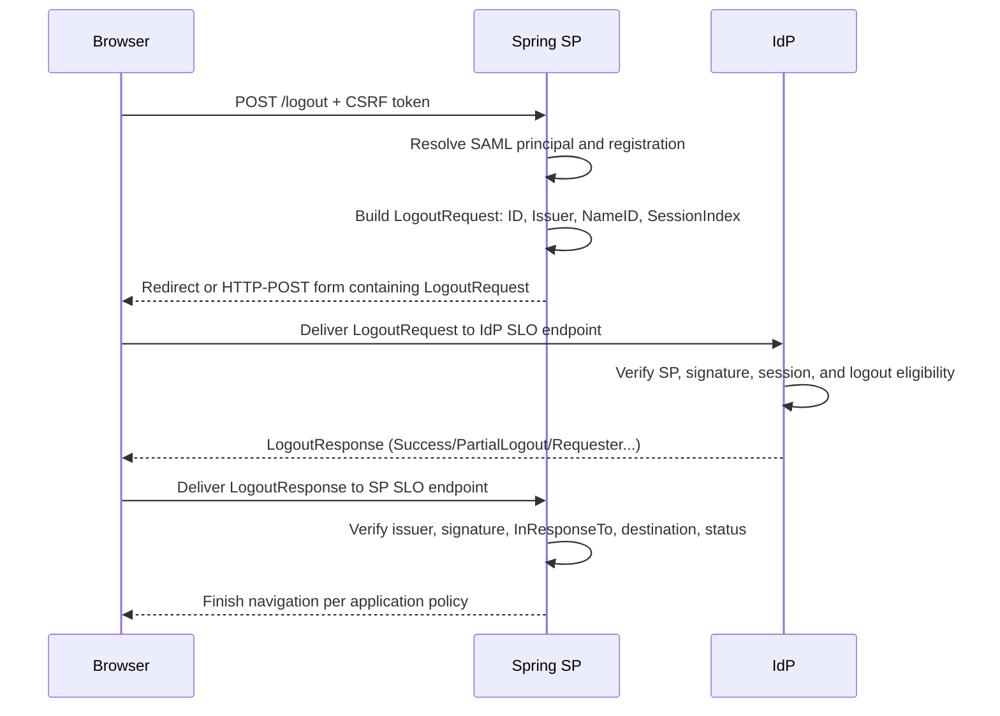
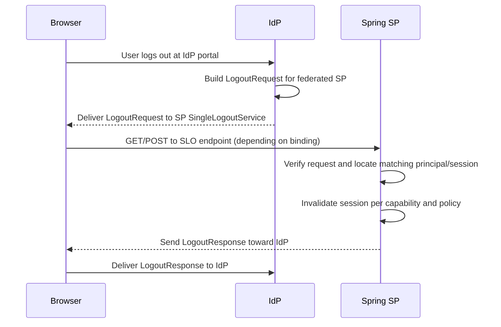

# SAML2 Single Logout and Certificate Management in Federated Systems — Spring Security Servlet

## 1. What You Will Learn and the Real-World Problem

A **SAML 2.0 federation** system typically has an **Identity Provider (IdP)** authenticating users and a **Service Provider (SP)**—our application. In Spring Security Servlet, the SP can use SAML2 to sign in and execute **Single Logout (SLO)** to exchange logout messages with the IdP.

This lesson answers four key questions:

1. **How does SAML2 Logout differ from local logout?** When logging out at the SP or IdP, which messages are sent and which sessions are actually closed?
2. **How do SP-initiated and IdP-initiated SLO run?** How do `LogoutRequest`, `LogoutResponse`, `NameID`, `SessionIndex`, bindings, and HTTP sessions relate?
3. **Which X.509 certificates are used for signing, verifying, or decrypting?** How to configure, publish metadata, track expiration, and rotate keys between SP/IdP.
4. **How to implement and verify with Spring Boot 3.x / Spring Security 6.x Servlet?** Distinguish protocol failures from missing sessions, wrong endpoints, signatures, or trust issues.

**Scope:** SAML2 Web Browser SSO and SLO in **Spring MVC/Servlet, Java 17+** applications. Example paths/metadata must be cross-checked against your Spring Security version, proxy setup, and actual IdP. Spring WebFlux uses different configurations. Do not equate SAML2 SLO with OAuth2/OIDC logout or access token revocation.

## 2. Components, Login Sessions, and Trust Layers

| Component | Role | Key data to remember |
| --- | --- | --- |
| Browser | Redirects and carries SAML messages between parties | SP/IdP session cookies, front-channel requests/responses |
| SP (Spring Security) | Receives SAML Response at login, stores SecurityContext/HTTP session, initiates or processes logout | `RelyingPartyRegistration`, SP name, `NameID`, `SessionIndex`, pending messages awaiting correlation |
| IdP / Asserting Party | Authenticates, issues assertions and `LogoutRequest`/`LogoutResponse` messages | Entity ID, `SingleLogoutService`, IdP session |
| SP metadata | Publishes SP details to the IdP | SP `entityID`, ACS, SLO endpoint/binding, public certificates for IdP to verify SP |
| IdP metadata | Tells the SP the IdP's endpoints and trusted keys | IdP `entityID`, SSO/SLO endpoints, signing certificates, and signing-requirement flags |

**Three states do not necessarily terminate simultaneously:** the SP's local HTTP session, the SSO session at the IdP, and sessions at **other SPs**. Local logout guarantees ending only the local session; SLO is a **coordinated protocol** that can fail over the network, be rejected by the IdP, or go unsupported by another SP. Never display "signed out of all devices and applications" when only one SP's `JSESSIONID` was cleared.

**Trust boundary:** the browser is a message transport channel, not an authentication authority. The SP must verify signature/issuer/destination/correlation on SAML messages per the agreed policy. Never trust an XML `LogoutRequest` merely because it hits the right URL or contains a plausible-looking `NameID`.

## 3. What Is SAML Single Logout?

### 3.1. Local Logout vs. SLO

- **Local logout:** Spring invalidates `HttpSession` and clears `SecurityContext` and session cookies per configuration. The IdP session and other SPs may remain active.
- **SP-initiated SLO:** the user logs out at the SP app; the SP asks the IdP to perform federated logout, typically sending a `LogoutRequest` via the browser to the IdP; the IdP processes it and returns `LogoutResponse`.
- **IdP-initiated SLO:** the IdP starts logout, sending a `LogoutRequest` to the SP; the SP locates the matching user/session, runs local logout, and returns `LogoutResponse`.
- **Partial SLO:** one party may close its session while another errors/times out. Inspect status and logs rather than assuming the protocol provides atomic distributed transactions.

SLO does not automatically revoke JWTs, refresh tokens, or independent cookies held by other services. Handling those requires separate policies.

### 3.2. SP-Initiated: User Clicks "Sign Out" in Spring



Common pitfalls:

- In Spring Security, **POST `/logout`** is the standard user-initiated logout trigger under default CSRF protection. **Never** use `<a href="/logout">` as a GET and permit un-CSRF-protected logout for demo convenience.
- When SAML2 logout is enabled and the registration supports SLO, a logout success handler can emit a SAML `LogoutRequest` to the IdP. If the registration/IdP lacks matching SLO configuration, verify fallback behavior to local logout; never assume calling `/logout` always sends a SAML request.
- After redirecting to the IdP, the response returns to the SP via the **SLO endpoint**. Do not confuse this with the **Assertion Consumer Service (ACS)** used for login.
- Different implementations terminate local sessions at different points. The UI must reflect actual status rather than promising all remote sessions closed simultaneously.

### 3.3. IdP-Initiated: Starting from the IdP



If the request reaches the SP while the browser **carries no SP session cookie**, or the SLO request cannot locate the target session, the outcome depends on how the framework/IdP and session repository behave. Never assume that knowing `NameID` alone lets Spring reliably invalidate **every HTTP session** across a cluster. Supporting multi-session, cross-node, or back-channel-like session revocation requires dedicated session indexing and live testing.

## 4. Inside `LogoutRequest` and `LogoutResponse`

SAML formats are governed by XML schemas and profiles. The snippets below are **structural XML illustrations**, lacking XML Signatures and **not usable for real logout**.

### 4.1. LogoutRequest

```xml
<samlp:LogoutRequest
    xmlns:samlp="urn:oasis:names:tc:SAML:2.0:protocol"
    xmlns:saml="urn:oasis:names:tc:SAML:2.0:assertion"
    ID="_lr-123" Version="2.0"
    IssueInstant="2026-01-01T10:00:00Z"
    Destination="https://idp.example.test/saml/slo">
    <saml:Issuer>https://sp.example.test/saml/metadata</saml:Issuer>
    <saml:NameID>federated-user-id</saml:NameID>
    <samlp:SessionIndex>session-from-login-assertion</samlp:SessionIndex>
</samlp:LogoutRequest>
```

- **`ID`**: unique identifier for a request; used to correlate responses and detect replay.
- **`Issuer`**: `entityID` of the sending party; not an arbitrary IP address, email, or username.
- **`IssueInstant`**: request issuance timestamp; checked against UTC clock sanity and skew policy.
- **`Destination`**: expected recipient endpoint; must match a policy-trusted address.
- **`NameID`**: federated identifier exchanged at login; **Format/qualifiers may matter**, not just display text.
- **`SessionIndex`**: if present in the SSO assertion, helps the IdP/SP identify the linked session to terminate. Never generate an arbitrary index expecting the IdP to understand it.
- **XML Signature or Redirect-binding signature**: depending on binding and IdP/SP policy, must be signed and verified against exchanged trust. Omitting the signature in the example is solely to explain structure.

**Never use `NameID` as a global key replacing controlled session tracking.** Two sessions for the same identity may have different logout scopes; combine issuer, registration, `NameID`, `SessionIndex`, and corresponding session state.

### 4.2. LogoutResponse

```xml
<samlp:LogoutResponse
    xmlns:samlp="urn:oasis:names:tc:SAML:2.0:protocol"
    xmlns:saml="urn:oasis:names:tc:SAML:2.0:assertion"
    ID="_lres-789" Version="2.0"
    IssueInstant="2026-01-01T10:00:02Z"
    InResponseTo="_lr-123"
    Destination="https://sp.example.test/logout/saml2/slo">
    <saml:Issuer>https://idp.example.test/entity</saml:Issuer>
    <samlp:Status>
        <samlp:StatusCode
            Value="urn:oasis:names:tc:SAML:2.0:status:Success"/>
    </samlp:Status>
</samlp:LogoutResponse>
```

- **`InResponseTo`** must match a previously stored pending request, never an ID supplied by the caller itself.
- **`StatusCode`** may indicate success or failure/partial logout; the client must inspect actual status.
- **`Issuer`, `Destination`, `IssueInstant`, and signature** must be checked as protocol fields—do not merely check `Status=Success`.
- **`RelayState`** can carry navigation/correlation state across bindings; never treat it as signature proof and never accept unvalidated arbitrary redirect URLs.

A syntactically valid XML response with an **invalid signature**, wrong requester/issuer, wrong recipient, or wrong `InResponseTo` must still be rejected.

### 4.3. HTTP-Redirect and HTTP-POST Bindings

| Binding | Transport mechanism | Common technical issues |
| --- | --- | --- |
| HTTP-Redirect | Browser GET to SLO endpoint; `SAMLRequest`/`SAMLResponse` DEFLATE/Base64/URL-encoded per profile | Signature sits in `SigAlg`/`Signature` query params; reverse proxy query rewriting breaks signature |
| HTTP-POST | Browser submits POST form containing Base64-encoded `SAMLRequest` or `SAMLResponse` | Signature usually verified inside XML per policy; distinguish SAML POST from CSRF-protected `/logout` form |
| Metadata binding | Each side advertises `SingleLogoutService` `Binding`, `Location`, sometimes `ResponseLocation` | SP/IdP must use a binding and endpoint actually supported by the peer |

Do not conclude a transaction failed just because DevTools shows a 302 or an HTML form: that can be normal SAML front-channel flow. What must be verified is **right endpoint, message, signature, session, and response status**.

## 5. Basic Spring Security Servlet Configuration

### 5.1. Adding Dependencies and Registering the IdP

Use a Spring Boot 3.x, Java 17+, Spring MVC project. Inside `build.gradle` (Groovy DSL) of a project already containing Spring Initializr plugins/versions:

```groovy
dependencies {
    implementation 'org.springframework.boot:spring-boot-starter-web'
    implementation 'org.springframework.boot:spring-boot-starter-security'
    implementation 'org.springframework.security:spring-security-saml2-service-provider'
    implementation 'org.springframework.boot:spring-boot-starter-thymeleaf'
    testImplementation 'org.springframework.boot:spring-boot-starter-test'
    testImplementation 'org.springframework.security:spring-security-test'
}
```

Ensure repository/OpenSAML versions match your Spring Security release. `spring-security-saml2-service-provider` contains SAML2 SP capabilities, not JWT Resource Server or `oauth2Login`.

File **`src/main/resources/application.yml`** illustrating a registration named `corp`:

```yaml
spring:
  security:
    saml2:
      relyingparty:
        registration:
          corp:
            assertingparty:
              metadata-uri: https://idp.example.test/saml/metadata
            signing:
              credentials:
                - private-key-location: file:/run/secrets/saml/sp-signing-key.pem
                  certificate-location: file:/run/certs/saml/sp-signing.crt
```

Prerequisites to run **end-to-end**: the metadata URL must be a real IdP with valid SSO/SLO endpoints and certificates; key/certificate files must actually exist, match each other, and the private key must be readable only by the app's runtime account; the IdP must trust the SP public signing certificate and SP metadata; registrations/endpoints/bindings must agree on both sides.

**Never** store real private keys in Git or public locations. Use secret mounts or an organization-approved key vault; `file:` is an illustrative machine/container path. Public X.509 certificates can be published in metadata as appropriate; private keys **must never** be published.

In some setups, decryption keys must also be configured if the IdP **encrypts SAML assertions**. Signing keys for SLO and assertion decryption keys serve different roles; do not add decryption credentials unless the app/IdP uses encryption.

### 5.2. Enabling Login and SAML2 Logout

**`src/main/java/com/example/samllogout/SamlLogoutApplication.java`**

```java
package com.example.samllogout;

import org.springframework.boot.SpringApplication;
import org.springframework.boot.autoconfigure.SpringBootApplication;

@SpringBootApplication
public class SamlLogoutApplication {
    public static void main(String[] args) {
        SpringApplication.run(SamlLogoutApplication.class, args);
    }
}
```

**`src/main/java/com/example/samllogout/SecurityConfig.java`**

```java
package com.example.samllogout;

import org.springframework.context.annotation.Bean;
import org.springframework.context.annotation.Configuration;
import org.springframework.security.config.Customizer;
import org.springframework.security.config.annotation.web.builders.HttpSecurity;
import org.springframework.security.web.SecurityFilterChain;

@Configuration
public class SecurityConfig {
    @Bean
    SecurityFilterChain securityFilterChain(HttpSecurity http)
            throws Exception {
        http
            .authorizeHttpRequests(authorize -> authorize
                .requestMatchers("/", "/error").permitAll()
                .anyRequest().authenticated()
            )
            .saml2Login(Customizer.withDefaults())
            .saml2Logout(Customizer.withDefaults());

        return http.build();
    }
}
```

The code does not attempt to parse SAML XML via hand-rolled controllers. Spring Security's filters handle login and initiating/receiving SLO per `RelyingPartyRegistration` and matching default endpoints. For SLO to work, **IdP configuration and metadata must supply matching SLO services, bindings, public keys, and session details**; calling `.saml2Logout(...)` alone does not force an arbitrary IdP to participate in SLO.

### 5.3. Test Page with POST Logout

**`src/main/java/com/example/samllogout/PageController.java`**

```java
package com.example.samllogout;

import org.springframework.stereotype.Controller;
import org.springframework.web.bind.annotation.GetMapping;

@Controller
public class PageController {
    @GetMapping("/")
    String home() {
        return "home";
    }
}
```

**`src/main/resources/templates/home.html`**

```html
<!doctype html>
<html lang="en" xmlns:th="http://www.thymeleaf.org">
<head>
    <meta charset="utf-8">
    <title>SAML2 Logout Demo</title>
</head>
<body>
    <h1>SAML2 Service Provider Application</h1>
    <a th:href="@{/saml2/authenticate/corp}">Sign in via IdP</a>

    <form th:action="@{/logout}" method="post">
        <button type="submit">Sign out</button>
    </form>
</body>
</html>
```

With Thymeleaf/Spring Security integration, `th:action` on POST forms automatically injects the CSRF parameter via the framework's `RequestDataValueProcessor`. **Inspect rendered HTML and actual security config** to confirm requests carry a valid CSRF token; never disable CSRF just so `/logout` accepts GET or tokenless POSTs. In apps without Thymeleaf, inject a hidden input with the request's CSRF token name and value.

`GET /saml2/authenticate/corp` is the standard default SAML login initiation URL for registration `corp`. For SLO to work in real environments, register the SP's exact SLO URL at the IdP and ensure both sides' metadata reflect that endpoint. With HTTP-POST binding, the SLO endpoint typically sits under `/logout/saml2/slo`; however, **never guess a hardcoded path** if the app customized it or IdP metadata specifies another path.

Run the Gradle Wrapper project (once connected to an IdP with valid mounted keys):

```bash
./gradlew bootRun
```

On Windows PowerShell use `.\gradlew.bat bootRun`. Do not expect the `idp.example.test` example to actually sign in/out; it is an illustrative domain, not a live IdP.

## 6. `RelyingPartyRegistration` and SLO Metadata: What Determines Success

In Spring Security SAML2 SP, `RelyingPartyRegistration` holds SP and asserting-party details: entity IDs, ACS/SLO endpoints, bindings, and credentials. It can be configured via Spring Boot properties, via IdP metadata, or built in Java when multi-IdP setups and complex certificate rotations are required.

Items to reconcile with your peer:

| Component | SP/IdP must align on | If mismatched |
| --- | --- | --- |
| SP `entityID` | Stable identifier registered at the IdP | IdP treats as another SP or rejects signature |
| IdP `entityID` | Trusted asserting-party issuer | SP fails to recognize sender |
| SP SLO `Location` | Public URL receiving `LogoutRequest`/`LogoutResponse` | IdP sends to wrong host/path or gets 404/405 |
| IdP SLO `Location` | Endpoint where SP sends `LogoutRequest` | SP redirects to an unsupported endpoint |
| Binding (Redirect/POST) | Sender/receiver share profile and signature algorithm | Signature validation or HTTP method fails |
| SP signing certificate | IdP knows public cert matching SP's signing private key | IdP rejects `LogoutRequest` |
| IdP signing certificate | SP trusts active public cert used by IdP | SP rejects `LogoutRequest`/`LogoutResponse` |
| `NameID`/`SessionIndex` | Values retained from the matching login assertion | Session cannot be found or IdP cannot identify login session |
| Clock sync | NTP/UTC, message age limits, and leeway | Messages deemed expired or not yet valid |
| Public scheme/host | Proxy headers and `baseUrl` generating real URLs | Destination/`redirect_uri` mismatch, redirect loops |

### 6.1. Reading Metadata XML Accurately

SP metadata excerpt example (public data; not a complete metadata file):

```xml
<md:SPSSODescriptor
    xmlns:md="urn:oasis:names:tc:SAML:2.0:metadata"
    protocolSupportEnumeration="urn:oasis:names:tc:SAML:2.0:protocol">
    <md:KeyDescriptor use="signing">
        <ds:KeyInfo xmlns:ds="http://www.w3.org/2000/09/xmldsig#">
            <!-- X.509 public certificate inside ds:X509Data -->
        </ds:KeyInfo>
    </md:KeyDescriptor>
    <md:SingleLogoutService
        Binding="urn:oasis:names:tc:SAML:2.0:bindings:HTTP-POST"
        Location="https://sp.example.test/logout/saml2/slo"/>
</md:SPSSODescriptor>
```

The simplified excerpt is solely to recognize fields. Real metadata contains `EntityDescriptor`, Base64 public certificates, and other mandatory elements. Never copy this snippet as production metadata.

Spring Security can **publish SP metadata** when the corresponding metadata config is enabled, e.g. `.saml2Metadata(Customizer.withDefaults())` on supporting 6.x versions. When using it, inspect the actual metadata endpoint (typically `/saml2/metadata/{registrationId}` or configured endpoint), verify it emits the **public URL behind the proxy**, and re-register at the IdP after changing SLO endpoints or signing certificates. Never assume the IdP updates metadata automatically just because the SP changed.

### 6.2. Behind a Reverse Proxy

If the public URL is `https://sp.example.test` while the app runs internally on `http://service:8080`, metadata/SP SLO `Destination` must use the public hostname and scheme. Accept `Forwarded`/`X-Forwarded-*` only from trusted proxies; never let browsers dictate `{baseUrl}`. Check Spring Boot's `server.forward-headers-strategy` if used, the HTTP proxy chain, TLS offload, and context path.

Issues such as `Location: http://service:8080/...`, wrong port/path, missing `Secure`/`SameSite` cookies, or query rewriting can break SLO even when signatures and certificates are valid.

## 7. Three Common Certificate/Key Types and What They Protect

SAML federation uses **X.509 public certificates** to verify signatures or encrypt data; corresponding private keys must be kept secret.

| Key/certificate | Holds private key | Needs public cert | Purpose |
| --- | --- | --- | --- |
| **SP signing** | SP | IdP | SP signs SAML `AuthnRequest`/`LogoutRequest`/`LogoutResponse` when policy requires |
| **IdP signing** | IdP | SP | SP verifies assertions, SAML Responses, and relevant logout messages |
| **SP decryption/encryption** | SP holds private decrypt key | IdP uses SP public encrypt cert | IdP encrypts assertions sent to SP; SP decrypts upon receipt |
| **TLS certificate** | HTTPS server/proxy owner | Browser/HTTP client per PKI | Protects HTTPS channel; **not equivalent** to certificate used for XML Signature |

**Certificates in metadata do not automatically have to be CA-trusted like TLS certs.** Many SAML deployments use self-signed/dedicated certificates trusted via **verified/pinned/out-of-band metadata**. What matters is metadata provenance, key material, and a trusted update channel; never accept "whatever certificate came embedded in the XML just received" as a trust anchor.

### 7.1. Never Mix Up Signing, Verification, and Encryption

- **Signing credential:** SP-side private key/certificate pair used to sign per policy. Modifying a single XML character or altering a Redirect-binding query string can break signature verification.
- **Verification credential:** the peer's public certificate used to check the peer's signatures. You never need the peer's private key.
- **Decryption credential:** SP's private key to decrypt content encrypted by the IdP using the SP's public cert. You cannot fix a `LogoutRequest` signature error by swapping the decryption key when SLO does not use encryption.
- **TLS credential:** protects HTTP transport, independent of SAML XML signature trust. Valid HTTPS does not prove a SAML message was signed by the right IdP.

Avoid reusing the same keypair for every purpose when architecture allows separation. When reuse is unavoidable, understand the risk scope and plan rotation accordingly.

### 7.2. Certificate Properties to Monitor

1. **SHA-256 fingerprint** of the public certificate (to cross-check the approved IdP/SP copy; verify the fingerprint exchange channel).
2. **X.509 Subject / Issuer**, though never use CN/subject as a substitute for `entityID` or signature validation.
3. **`NotBefore` / `NotAfter`** and the peer's certificate acceptance policy. In SAML, expiry and trust handling vary across implementations; verify the actual IdP/SP policy rather than assuming every metadata consumer enforces PKIX chains.
4. **Algorithm / key length / KeyUsage** permitted by the peer, e.g., RSA/SHA-256 per agreement; avoid weak algorithms.
5. **Public-key pair matching** between the active private key and advertised certificate; verify on a trusted system, never send a private key to the IdP to "test."
6. **Inventory**: key owner, environment, federation partner, activation date, expiration date, planned rollover, rollback owner, and where metadata must be updated.

## 8. Java 17: Checking X.509 Certificate Fingerprints and Expiration

JDK command to inspect a PEM/DER certificate without writing code:

```bash
keytool -printcert -file idp-signing.crt
```

`keytool` displays subject, issuer, validity, and fingerprints. This **reads only the public certificate** and requires no private key.

Standalone Java 17 example, without Spring; file **`CertificateAudit.java`**:

```java
import java.io.InputStream;
import java.nio.file.Files;
import java.nio.file.Path;
import java.security.MessageDigest;
import java.security.cert.CertificateFactory;
import java.security.cert.CertificateExpiredException;
import java.security.cert.CertificateNotYetValidException;
import java.security.cert.X509Certificate;
import java.time.Duration;
import java.time.Instant;
import java.util.HexFormat;

public class CertificateAudit {
    public static void main(String[] args) throws Exception {
        if (args.length != 1) {
            System.err.println(
                "Usage: java CertificateAudit <certificate-file>");
            System.exit(2);
        }

        X509Certificate cert;
        try (InputStream in = Files.newInputStream(Path.of(args[0]))) {
            cert = (X509Certificate)
                CertificateFactory.getInstance("X.509")
                    .generateCertificate(in);
        }

        byte[] sha256 = MessageDigest.getInstance("SHA-256")
            .digest(cert.getEncoded());

        System.out.println("Subject: "
            + cert.getSubjectX500Principal().getName());
        System.out.println("Issuer: "
            + cert.getIssuerX500Principal().getName());
        System.out.println("SHA-256: "
            + HexFormat.ofDelimiter(":").withUpperCase().formatHex(sha256));
        System.out.println("NotBefore: "
            + cert.getNotBefore().toInstant());
        System.out.println("NotAfter: "
            + cert.getNotAfter().toInstant());

        long daysUntilExpiry = Duration.between(
            Instant.now(), cert.getNotAfter().toInstant()).toDays();
        System.out.println("Expires within 30 days: "
            + (daysUntilExpiry <= 30));

        try {
            cert.checkValidity();
            System.out.println("Time validity: valid");
        } catch (CertificateExpiredException
                 | CertificateNotYetValidException ex) {
            System.out.println("Time validity: invalid");
        }
    }
}
```

Compile and run with JDK 17+:

```bash
javac CertificateAudit.java
java CertificateAudit idp-signing.crt
```

**Output depends on the certificate and execution time**, showing subject/issuer names, hex fingerprint, validity dates, and valid/invalid status. A fixed stdout cannot be printed without a fixed input certificate. `checkValidity()` checks **only the certificate's validity period**—not issuer metadata, chain of trust, SAML signatures, key-pair matching, or authorization to use the certificate.

For multi-part PEM files or metadata holding multiple signing keys, split and inspect **every public certificate published by the peer**, not only the first one. Verify fingerprints over an organization-trusted channel before rollout.

## 9. Safe Certificate Rotation Procedure (Rollover)

The biggest risk in rotation is not "the old certificate file expired," but **both sides switching keys out of sync**, breaking signature/decryption processing. A sound rollover plan includes an **overlap window**, monitoring, and rollback.

### 9.1. IdP Rotates Signing Certificate

When the IdP changes the key signing SAML assertions and logout messages:

1. **Before the IdP begins signing with the new key:** obtain the new IdP metadata/certificate via a trusted channel, verify issuer/`entityID`/fingerprint, and configure the SP to accept **both old and new certificates** if the framework/IdP supports multiple verification credentials.
2. Update/refresh `RelyingPartyRegistration` and relevant metadata caches; confirm all app instances/replicas loaded the new key.
3. The IdP starts signing with the new private key; test SSO and both SLO directions, checking signature verification and issuer.
4. After the agreed overlap period, remove the old certificate from the SP's trust store/config; verify no replica still depends on it.
5. Prepare a clear rollback plan for failures, but **never allow unsigned SAML** to "rescue" login/logout.

Updating only the IdP portal without updating SP trust can break login and SLO across the board. Conversely, never pull a new signing key from an attacker-controlled metadata URL without verifying the metadata channel's trust anchor.

### 9.2. SP Rotates Signing Certificate

When the SP rotates its signing key:

1. Generate a **new keypair** using an approved tool/secret service and store the private key securely.
2. Publish the **new SP public signing certificate** in metadata/the IdP portal before the SP signs with the new private key, keeping the old certificate during the transition window if the IdP supports it.
3. Confirm the IdP loaded and accepts the new public key. Only then switch the SP to **sign with the new private key**.
4. Test `AuthnRequest` (if signed), **SP-initiated `LogoutRequest`**, SLO responses, and IdP-initiated `LogoutResponse`.
5. Remove the old key after the overlap window; clean up the old private key from runtime/secret stores per retention and rollback policies.

SP and IdP must agree on whether logout messages **must be signed** and which algorithms are supported. One IdP may require signed `LogoutRequest` while another does not support the same binding/signature; check metadata/policies instead of assuming parity from working SSO.

### 9.3. SP Rotates Assertion Decryption Certificate

If the IdP encrypts assertions with the SP's public encryption cert:

1. Publish the new public encryption cert to the IdP while ensuring the SP holds the **new private decryption key**.
2. Retain the **old private key** while the IdP might still send assertions encrypted for the old certificate, if policy/implementation supports multiple decryption credentials.
3. Once certain the IdP uses the new cert and no in-flight assertions target the old one, retire the old key per policy.
4. Test login with encrypted assertions; **SLO is not necessarily encrypted the same way as assertions**, so test logout separately.

Even when an old certificate expires in some deployments, the right strategy remains **controlled key rotation with overlap**, not extending trust indefinitely or disabling signature checks.

### 9.4. Rollout Responsibility Matrix

| Task | SP owner | IdP owner | Acceptance evidence |
| --- | --- | --- | --- |
| Verify old/new metadata/`entityID`/certs | X | X | Signed/approved fingerprints over trusted channel |
| Update public verifying cert on receiver | X or IdP per direction | X or SP per direction | SSO/SLO signatures pass with new key |
| Activate new private signing key on sender | X if SP | X if IdP | Messages signed with expected key |
| Update encryption cert (if used) | Keep private decrypt key | Use public encrypt cert | Encrypted assertions decrypt cleanly |
| Test SP/IdP initiated and network failures | X | X | Multi-party logs and session outcomes |
| Retire old key and complete audit | X | X | No unplanned old keys remain active |

Do not record internal keys or sensitive inventory in public documents if restricted by organizational policy; public fingerprints are not secrets, though inventories can be operationally sensitive.

## 10. Specific Checks in Spring Security

### 10.1. RelyingPartyRegistration for SLO

A working `saml2Login()` setup **does not prove** SLO is ready. Verify the registration for the target IdP includes:

- Asserting-party metadata with valid **`SingleLogoutService` Location/Binding**.
- Public relying-party SLO endpoint registered at the IdP (optionally published via SP metadata).
- Signing credentials when SLO signing policy requires them, plus the IdP's verification credentials.
- Consistent `registrationId` across endpoints and relying parties when multiple IdPs exist.
- Post-login session state sufficient to emit a `LogoutRequest` containing `NameID` and `SessionIndex` matching the assertion.

Metadata and resolver configurations differ across versions; when adding or overriding SLO endpoints via Java DSL, use the exact API of your installed version. Never copy `assertionConsumerServiceLocation` to stand in for the SLO URL: **ACS is for login, `SingleLogoutService` is for logout**.

### 10.2. Spring Security Filters and Callbacks

Typical login path:

```text
GET /saml2/authenticate/{registrationId}
  -> Browser to IdP SSO
  -> POST /login/saml2/sso/{registrationId}
  -> Spring Security verifies SAML login
```

Typical federated logout paths involve:

```text
POST /logout               -> SP initiates logout (with CSRF)
GET/POST /logout/saml2/slo -> receives SAML LogoutRequest/LogoutResponse
```

These paths are **common Spring Security Servlet conventions**, customizable via filters/URL matchers and bindings. Check active config/metadata to verify, and never POST a homemade logout form to the SLO endpoint expecting it to know the user wants to sign out.

**CSRF differs from XML Signature:** POST `/logout` from the app normally requires a CSRF token. A SAML POST from the IdP to the SLO endpoint usually carries no HTTP session CSRF token; Spring Security provides dedicated filter handling for SAML messages. Never disable CSRF application-wide or route SLO callbacks to an unverified controller to "fix" a 403.

### 10.3. Safe Incident Logging

When debugging, observe `registrationId`, `entityID`, binding, destination, request ID, `InResponseTo`, status code, and signature/metadata/session error category; never send raw SAML assertions, full `SAMLResponse`s, session cookies, sensitive `NameID`s, private keys, or PII-bearing payloads to uncontrolled central logs.

Never blame "expired certificate" just because a browser shows a logout error. The same HTTP 400/403 can stem from binding mismatches, CSRF routing, stale sessions, signature verification, issuer, or `InResponseTo`. Use correlation IDs and redacted logs from **both SP and IdP** to pinpoint the failing layer.

## 11. Diagnosing SLO Errors by Symptom

| Symptom | Causes to check | Verification / fix |
| --- | --- | --- |
| POST `/logout` only logs out locally; IdP stays logged in | SLO not enabled, IdP metadata lacks SLO, invalid registration/credentials | Check `.saml2Logout(...)`, asserting-party `SingleLogoutService`, signing key, browser redirect |
| POST `/logout` returns 403 | Missing CSRF token in form or wrong security matcher | Inspect rendered form; never open global GET logout |
| IdP returns error receiving `LogoutRequest` | Wrong issuer/SP `entityID`, `NameID`/`SessionIndex`, signing requirement, destination, or binding | Compare both sides' metadata and IdP logs |
| SP receives `LogoutResponse` yet fails to complete | `InResponseTo` mismatches pending request, wrong issuer/signature/status, lost session | Check correlation storage, cookies, binding, and timestamps |
| IdP-initiated request gets 404/405 | Wrong SLO endpoint or mismatched HTTP method/binding | Check metadata `Location` and proxy forwarding |
| IdP-initiated SLO fails to close target session | Missing/dropped SP cookie, `NameID`/`SessionIndex` not stored, or multiple sessions | Test session mapping, multi-node storage, and user agent |
| SSO works yet SLO reports invalid signature | Different key signs logout, SP/IdP lacks trust for cert, or Redirect query rewritten | Compare signer fingerprint, binding, raw request, and metadata |
| SLO breaks right after certificate rotation | One side switched signing key before peer trusted new cert | Enable overlap verification; check metadata/caches and replicas |
| Assertions fail decryption after rotation | IdP encrypts with public cert whose matching private key SP already dropped | Inspect decryption credentials and overlap window |
| SLO response targets internal HTTP | Proxy fails to supply proper forwarded scheme/host | Fix public base URL and forwarded-headers trust boundary |
| Logout succeeds yet user logs right back in | IdP session still alive, failed/partial SLO, or browser auto-SSOs again | Inspect IdP session/cookie and status; never claim global logout |
| `NameID` differs after login or mismatches | Format/qualifiers or identity mapping changed between IdP/SP | Preserve assertion `NameID` and test IdP profile |
| Intermittent time validation errors | NTP drift, `IssueInstant`/`NotOnOrAfter` skew | Synchronize clocks and configure leeway policy |
| Another SP remains logged in | SLO does not guarantee every SP agrees/participates | Inspect federation topology and report partial logout |
| Fails only on one replica | Divergent certificates/sessions/metadata caches across nodes | Compare rollouts, secret mounts, load balancer, and versions |

When a user logs out while the IdP is unreachable, the system needs clear UX and auditing: it may **close the local session** for safety, yet must never report SLO complete when the IdP has not confirmed. Fail-open/fail-closed choices in signature verification must follow security policy; **never skip signature checks to boost logout success rates**.

## 12. Testing from Local to Federation Environments

A serious SAML SLO test does more than assert a 302 redirect, because SLO traverses the browser and an external IdP. Use two testing tiers:

### 12.1. Internal Configuration Checks

- App holds a valid `RelyingPartyRegistration` for `corp`, `entityID`, and real SLO metadata.
- Matching **SP signing private key + public certificate** are loaded with proper file permissions; IdP metadata holds the IdP's public signing cert.
- Public SP SLO endpoint behind the proxy has the right scheme/host/path/binding.
- Form POST `/logout` from a logged-in session carries a CSRF token.
- Session logout can retrieve `NameID`/`SessionIndex` from SAML authentication.
- Key/cert reloads across multiple nodes stay consistent with no stale metadata.
- Certificate audits for signing/verification/decryption run and alert ahead of expiry.

Spring integration tests can verify `SecurityFilterChain` and bean configuration, though controller unit tests alone are **insufficient** to prove SAML signatures or federated logout work properly. Avoid fake unsigned `SAMLResponse` shortcuts in production.

### 12.2. Test Matrix with a Test IdP

| Case | Action | Expected result |
| --- | --- | --- |
| SP-initiated success | Sign in then POST `/logout` | Emits `LogoutRequest`, IdP verifies, returns valid `LogoutResponse`; local session ends |
| IdP-initiated success | Log out directly at IdP | SP receives and verifies `LogoutRequest`, terminates matching session, returns response |
| Invalid signature | Test IdP sends message with untrusted key | SP rejects without dynamically trusting keys from the message |
| Invalid `InResponseTo` | Response references non-existent request ID | Response rejected and reason logged |
| Replay | Replay an already-processed response | Not processed as a fresh transaction |
| Binding mismatch | POST to a Redirect-only endpoint or vice versa | Error detected and metadata/config fixed without disabling verification |
| Session expired | Wait past session timeout between login and logout | Handled safely without logging out another user |
| Two tabs / multiple sessions | Log in across two browser profiles, then log out of one | Behavior matches agreed SLO scope; never assume global logout automatically |
| New signing cert | Switch key after receiver trusts both | SSO + SLO keep working |
| Old cert removed early | Attempt old key after receiver drops trust | Rejected, with tested rollback plan |
| Network interruption | Cut connectivity to IdP mid-logout | SP records incomplete SLO and reflects it clearly in UI |
| Multi-node | Switch node/load-balance mid-redirect chain | Session/correlation and key versions remain consistent |

Verify **real sessions** on SP and IdP, browser cookies/redirects, and SAML statuses confirmed by both sides. In multi-SP environments, test at least one logout flow involving another SP and `PartialLogout` handling per partner profile.

### 12.3. Alerting and Operations

Monitor: certificate expiration dates, approved rollover dates, metadata refresh successes/failures, login/logout signature failure rates, `InResponseTo` mismatches, SLO request timeouts, `PartialLogout` frequency, NTP clock skew, and instances with mismatched key configs.

Set alerts far enough ahead of certificate expiration to coordinate with the IdP; with multiple partner IdPs, keep separate inventories for **each registration**. Maintain runbooks for metadata updates, canary tests, rollbacks, and key compromise incidents (emergency trust revocation, key replacement, log/audit review).

## 13. Things Not to Do

1. **Do not** trust SAML XML/`NameID` merely because a browser request hit the right path; verify signatures, issuers, and transactions.
2. **Do not** confuse an active TLS cert with the SAML XML signing cert in metadata.
3. **Do not** publish private keys in metadata or place real keys in repos/logs/tickets.
4. **Do not** switch the SP signing cert before the IdP accepts the new public cert, or let the IdP sign with a new cert before the SP trusts it.
5. **Do not** delete old decryption keys before confirming the IdP stopped encrypting for the old cert if a transition window is needed.
6. **Do not** disable CSRF globally to make the POST `/logout` form work.
7. **Do not** skip `InResponseTo`/replay/destination validation to work around federation bugs.
8. **Do not** claim federation-wide single logout when only the local session was cleared or response status shows failure/partial.

## 14. Implementation Checklist

- [ ] IdP/SP agree on **entity IDs**, SSO/ACS, **`SingleLogoutService` URL and binding**, and signing requirements.
- [ ] SP `RelyingPartyRegistration` loaded asserting-party metadata and public verification certs over a trusted channel.
- [ ] SP signing private key is protected and public cert trusted by IdP; encryption/decryption certs configured only when needed.
- [ ] `.saml2Login(...)` and `.saml2Logout(...)` sit in the right `SecurityFilterChain`; logout form uses POST + CSRF.
- [ ] Browser callbacks through proxy preserve public scheme/host, cookies, `NameID`, `SessionIndex`, and transaction correlation.
- [ ] Both SP-initiated and IdP-initiated tests pass; invalid signatures/issuers/`InResponseTo`/replays are rejected.
- [ ] Both current **and upcoming** certificates are tracked with inventory, fingerprints, expiration dates, multi-key overlap, and rollback.
- [ ] System records **partial SLO**, network failures, and missing sessions and emits useful alerts without exposing SAML payloads/private keys.

**Conclusion:** SAML2 Single Logout is a verified `LogoutRequest`/`LogoutResponse` exchange protocol between SP and IdP, **not merely deleting cookies**. In Spring Security Servlet, SLO configuration must pair with `RelyingPartyRegistration`, accurate metadata/endpoints/bindings, trusted signing/verification credentials, and session correlation. Proper certificate management means knowing **which key serves which purpose, who trusts it, which side updates it, and in what order rollover executes**—only then do SSO and SLO operate safely when certificates expire or federations evolve.
