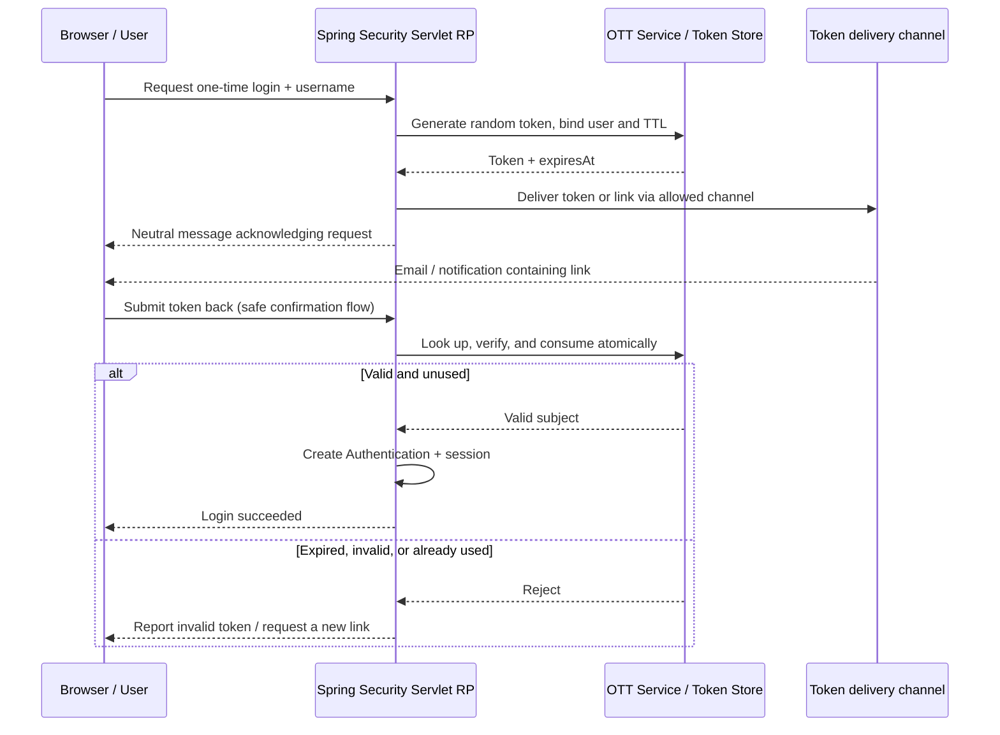

# One-Time Token Login and Distinguishing Login Tokens from TOTP Passwords

> **Scope:** advanced authentication in **Spring Security Servlet**. This article focuses on **One-Time Token Login** (logging in with a server-issued one-time token) and **TOTP — Time-based One-Time Password** (a one-time code computed from a shared secret key and time). Both techniques share the phrase “one-time,” yet differ in generation source, verification method, storage, intended purpose, and threat model.

## 1. The Problem: “One-Time Token” Does Not Mean “TOTP Password”

Imagine an application with two interfaces:

- **“Send a login link to email”**: the user enters an email address; the server generates a random secret string, stores verification metadata with an expiration time, and sends a link. The user uses the link to establish a login session without entering a traditional password. This is a form of **one-time token login** or *magic-link login*.
- **“Enter the 6-digit code from your authenticator app”**: the user opens an authenticator, reads a code that changes every interval, and enters it. The server independently computes the expected code from the secret key registered for the user. This is typically **TOTP**, per RFC 6238, extending HOTP (RFC 4226).

The two cases are not interchangeable:

1. **OTT login** typically uses a secret **newly generated for each request**, issued by the server and delivered to a verified channel; the server must record and **consume** the token atomically.
2. **TOTP** uses a **longer-lived shared secret** stored by both the device and the server; each side computes the code from the key and time step. Codes are short and can repeat within a single time step. The server must prevent code guessing and **prevent replay**, not merely verify the math.
3. **Security purposes** differ: OTT can serve as a **passwordless login method** replacing a password. TOTP is typically an **additional factor** when another factor is already present; using TOTP alone does not automatically constitute MFA.
4. Neither OTT via email nor TOTP is **automatically phishing-resistant**: users can be tricked into forwarding tokens/codes. Origin-bound methods like passkeys/WebAuthn have different properties.

After this article, you should be able to explain the login flow, Spring Security Servlet configuration, token lifecycle and error handling, the TOTP algorithm, testing, and how to avoid common vulnerabilities.

## 2. Foundational Concepts and Terminology

### 2.1. One-Time Token Login (OTT)

**One-Time Token Login** is a mechanism that issues a temporary secret (token) to complete authentication for a single login. A typical passwordless design includes:

1. The user enters an identifier (email/username) on a request form.
2. The backend normalizes and checks the request against policy; generates an **unpredictable** random token.
3. The backend stores token metadata, usually including `tokenHash`, `subject` or user identifier, `expiresAt`, used status, and necessary metadata.
4. The backend delivers the token over a user-owned channel (email/SMS/app), potentially as a **magic link** or code.
5. The user submits the token back to the RP; the backend verifies that the token is valid, unexpired, matches the purpose, and is **unused**, then marks it as used **atomically**.
6. Only then does Spring Security create an authenticated `Authentication` and a new session with permissions per application policy.

Illustrative link example:

```text
https://app.example.test/login/ott?token=RANDOM_OPAQUE_VALUE
```

This is a **URL format example** and does not assert that every Spring Security version or every system consumes tokens via HTTP GET. A GET link often needs to take the user to a confirmation page and complete login via POST or an appropriate flow to reduce the risk of email security scanners/bots **accidentally consuming the token** before the user does.

**An OTT token is a bearer secret:** anyone holding a valid token before it is used/expired can attempt to log in with the corresponding privileges. Therefore, prevent leaks via URL logs, browser history, Referer headers, analytics, screenshots, or sending to the wrong recipient. Never put tokens in application logs.

### 2.2. TOTP — Time-based One-Time Password

**TOTP** is a short numeric code (typically 6 or 8 digits) computed from:

- A secret key `K` securely shared between the server and the authenticator during enrollment.
- The current time, converted into a counter using period `X`, typically 30 seconds.
- An HMAC algorithm (RFC 6238 specifies SHA-1, SHA-256, or SHA-512 depending on configuration).
- Dynamic truncation from HOTP and modulo `10^digits` to produce a numeric code padded with leading zeros if needed.

Formula:

```text
T = floor((currentUnixTime - T0) / X)
TOTP = HOTP(K, T) mod 10^digits

Common example:
  T0 = 0
  X = 30 seconds
  digits = 6
  HMAC = SHA-1 (a widely compatible choice)
```

The authenticator **does not need to call the server to request each code**. The server likewise computes the code from `K` and the corresponding time, then compares them. This is a major difference from OTT, where the server generates and issues a separate token per request.

Short TOTP codes **can be guessed** without rate limiting. A code changing every 30 seconds **does not automatically prevent replay within the same time step**. Attempt limits and a policy marking accepted time steps must be applied if single-use enforcement is required.

### 2.3. What Does “One-Time” Mean in Each Mechanism?

- **OTT:** a specific secret token must be **consumed at most once**, even when two requests arrive concurrently. In a database-backed design, this requires an atomic state operation, not a race-prone “SELECT then UPDATE” sequence.
- **TOTP:** a code is computed per time step and remains the same across its validity window. If the server only checks the HMAC and timestamp, the code **can be re-submitted**. Replay prevention requires dedicated state (e.g., `lastAcceptedCounter`) and concurrency control.

Both techniques must have expiration, attempt limits, auditing, and confidential delivery channels; they **do not share the same verification logic**.

## 3. Comparison Table: OTT Login vs. TOTP

| Criterion | One-Time Token Login | TOTP |
| --- | --- | --- |
| Who generates the single-use secret? | Server generates a random token | Device and server compute the code from a shared secret + time |
| How is the token/code delivered? | Backend sends email, SMS, or another channel upon request | Authenticator displays the code, typically working offline |
| Typical length | High-entropy opaque token, e.g., Base64url-encoded | Short numeric code, typically 6 or 8 digits |
| Server-side state | Must track issued, expired, and used tokens; can store hashes | Must store shared secret, device metadata, and anti-replay state |
| Verification | Exact token, unexpired, right purpose/user, unused; atomic consumption | HMAC from secret and counter; controls for clock drift, replay, rate limiting |
| Lifecycle | One new token per request | Long-lived secret; code changes per time step |
| Relationship to password | Can be **passwordless primary login** | Typically an **MFA step** after a prior authentication step |
| Offline usability | Token receipt depends on delivery channel | Authenticator app typically works without network |
| Primary risks | Email compromise, forwarded links, URL leaks, replay, scanner consuming link | Code phishing, seed exposure, brute-force, clock skew, reuse within window |
| Proves device possession? | Not necessarily; an email inbox does not identify a specific device | Proves possession of provisioned secret; secret could be copied |
| Spring Security API | `oneTimeTokenLogin()` and OTT services/handlers (in supported versions) | Not synonymous with `oneTimeTokenLogin()`; requires separate TOTP verifier/MFA flow |
| Expiration / invalidation | TTL expires or token is consumed/revoked | Counter outside window, secret revoked, or counter already used |
| Phishing resistance | Not inherently | Not inherently |

**Important:** “6 digits via email” can also be a custom **server-issued OTP**, which does not automatically make it TOTP. To be TOTP, it must use a shared secret and time step per the compatible algorithm.

## 4. One-Time Token Login Flow on Spring Security Servlet

Spring Security includes the **One-Time Token Login** feature starting in Spring Security **6.4+**. The corresponding DSL is `HttpSecurity#oneTimeTokenLogin`; it is not an automatic TOTP/MFA DSL. Default endpoint names, default pages, and delivery approaches can vary by configuration, so during implementation you must verify against the **actual dependency version**, filter chain, and rendered forms.

### 4.1. Conceptual Flow



The flow shows that **token issuance** and **token verification** are two separate steps. The email submission form is unauthenticated; **do not grant a login session at the token request step**. A session is formed only when the token is verified and the account is allowed to log in by policy.

### 4.2. Basic Configuration: Do Not Mistake This for TOTP

Spring Security 6.4+ model:

```java
@Bean
SecurityFilterChain securityFilterChain(HttpSecurity http) throws Exception {
    return http
            .authorizeHttpRequests(auth -> auth
                    .requestMatchers("/").permitAll()
                    .anyRequest().authenticated())
            .oneTimeTokenLogin(Customizer.withDefaults())
            .build();
}
```

`oneTimeTokenLogin(Customizer.withDefaults())` adds OTT support to the authentication filter chain. It **does not generate a TOTP secret**, scan QR codes, verify codes from an authenticator, or automatically turn login into two-factor authentication.

**Implementation boundary:** enabling the DSL is only the first step. A production application also needs a controlled token delivery channel, token storage/consumption suited to the number of instances, account policy, anti-enumeration, rate limiting, email/link protection, and UX for invalid tokens. You must know which token service, success handler, and endpoints Spring Security uses under your actual configuration.

### 4.3. Components to Understand

| Component | Responsibility |
| --- | --- |
| `HttpSecurity#oneTimeTokenLogin` | Enables one-time token authentication configuration in the Servlet filter chain |
| `OneTimeTokenService` | Generates, looks up, and consumes tokens per Spring Security’s contract; check persistence/atomicity when running multiple instances |
| `OneTimeTokenGenerationSuccessHandler` | Decides what happens after a token is generated, such as integrating email delivery or responding to the frontend |
| `UserDetailsService` / user lookup | Loads user/authority details per configuration to build the authenticated principal |
| `AuthenticationManager` / OTT provider/filter | Coordinates token verification and initializes the authenticated principal |
| `SecurityContext` / `HttpSession` | Stores authentication state for subsequent Servlet requests |
| Account/authorization policy | Determines whether the user may log in and what actions are allowed, independent of token match |

**Token service and success handler are two distinct responsibilities:** the generation success handler **does not replace** backend token verification/consumption. Conversely, successful token generation does not prove an email was sent or reached the right recipient.

### 4.4. Default Endpoints and HTTP Requirements

In the default OTT configuration of Spring Security versions supporting this feature, you typically see:

- A **token generation request** endpoint such as `POST /ott/generate`.
- A **token authentication processing** endpoint such as `POST /login/ott`.
- A framework-generated or application-customized login/OTT page.

The URLs above are **common landmarks**; you must verify them against your Spring Security version and how you configured `oneTimeTokenLogin`, because applications may rename endpoints, replace pages, or add handlers. A magic link may contain the token in the URL, but that does not mean a GET link is an authenticating POST. For browsers, pay attention to CSRF, cookies, redirects, and email-system “link click” bots.

**It is not recommended** to create a `GET /login/ott?token=...` link that immediately consumes the token just because a browser or antivirus opened the URL, as that can cause unintended logins or consume the token before the real user accesses it. A proper design usually includes an active confirmation step using a controlled HTTP method and CSRF/session binding when needed.

## 5. Java 17+ Demo: Enabling OTT Login in Spring Boot 3.4+

This is a minimal Spring Boot **Servlet MVC** project to observe the OTT login policy. The Java code uses Spring Boot 3.4.x / Spring Security 6.4.x and compiles with the dependencies listed below. **The demo is not wired to a real email provider:** before deploying for real, you must configure a `OneTimeTokenGenerationSuccessHandler` to deliver the link to users via a trusted email/provider. Never treat a demo-mode response containing a token (if any) as a production deployment pattern.

### 5.1. Project Structure

```text
ott-login-demo/
├── settings.gradle
├── build.gradle
└── src/main/java/com/example/ottdemo/
    ├── OttLoginDemoApplication.java
    ├── SecurityConfig.java
    └── DemoController.java
```

`settings.gradle`:

```groovy
rootProject.name = 'ott-login-demo'
```

`build.gradle`:

```groovy
plugins {
    id 'java'
    id 'org.springframework.boot' version '3.4.2'
    id 'io.spring.dependency-management' version '1.1.7'
}

group = 'com.example'
version = '0.0.1-SNAPSHOT'

java {
    toolchain {
        languageVersion = JavaLanguageVersion.of(17)
    }
}

repositories {
    mavenCentral()
}

dependencies {
    implementation 'org.springframework.boot:spring-boot-starter-web'
    implementation 'org.springframework.boot:spring-boot-starter-security'
}
```

The Boot 3.4.x branch uses Spring Security 6.4.x managed by Boot (do not pin a separate Spring Security version in the demo). For projects that already have a BOM/dependency management, apply the project’s unified version. Spring Security 6.3 or earlier **does not have the same OTT DSL**, so a “cannot find `oneTimeTokenLogin`” error must be diagnosed via actual dependencies rather than adding random imports.

### 5.2. Application Class

`src/main/java/com/example/ottdemo/OttLoginDemoApplication.java`:

```java
package com.example.ottdemo;

import org.springframework.boot.SpringApplication;
import org.springframework.boot.autoconfigure.SpringBootApplication;

@SpringBootApplication
public class OttLoginDemoApplication {
    public static void main(String[] args) {
        SpringApplication.run(OttLoginDemoApplication.class, args);
    }
}
```

### 5.3. SecurityConfig with a Demo Account

`src/main/java/com/example/ottdemo/SecurityConfig.java`:

```java
package com.example.ottdemo;

import java.util.UUID;

import org.springframework.context.annotation.Bean;
import org.springframework.context.annotation.Configuration;
import org.springframework.security.config.Customizer;
import org.springframework.security.config.annotation.web.builders.HttpSecurity;
import org.springframework.security.core.userdetails.User;
import org.springframework.security.core.userdetails.UserDetails;
import org.springframework.security.core.userdetails.UserDetailsService;
import org.springframework.security.provisioning.InMemoryUserDetailsManager;
import org.springframework.security.web.SecurityFilterChain;

@Configuration
public class SecurityConfig {
    @Bean
    SecurityFilterChain securityFilterChain(HttpSecurity http)
            throws Exception {
        return http
                .authorizeHttpRequests(auth -> auth
                        .requestMatchers("/").permitAll()
                        .anyRequest().authenticated())
                .oneTimeTokenLogin(Customizer.withDefaults())
                .build();
    }

    @Bean
    UserDetailsService userDetailsService() {
        UserDetails learner = User.withUsername("learner@example.test")
                .password("{noop}" + UUID.randomUUID())
                .roles("USER")
                .build();

        return new InMemoryUserDetailsManager(learner);
    }
}
```

Part-by-part explanation:

- `.oneTimeTokenLogin(Customizer.withDefaults())` enables OTT login.
- `/` is public; `/me` (in the next controller) requires authentication.
- `UserDetailsService` provides the demo user that the token can map to; it is not an automatic **email-sending** service.
- The randomly generated password only constructs `UserDetails` per the demo contract. There is no `formLogin()`/HTTP Basic in this chain, so **there is no password login flow through those mechanisms** in the shown configuration. When combining form/basic login, you must review password policies and encoders.
- `roles("USER")` only creates an example role. Never auto-grant ROLE_ADMIN to anyone owning an email.
- `InMemoryUserDetailsManager` and the default in-memory token service are only suitable for demos/single machines; multi-instance production requires a shared token store and real account lookup.

**Never use `{noop}` for production passwords.** The random demo password value does not replace a real application’s credential management process.

### 5.4. Controller with a Protected Endpoint

`src/main/java/com/example/ottdemo/DemoController.java`:

```java
package com.example.ottdemo;

import java.util.Map;

import org.springframework.security.core.Authentication;
import org.springframework.web.bind.annotation.GetMapping;
import org.springframework.web.bind.annotation.RestController;

@RestController
public class DemoController {
    @GetMapping("/")
    public Map<String, String> home() {
        return Map.of("message", "Open endpoint");
    }

    @GetMapping("/me")
    public Map<String, String> me(Authentication authentication) {
        return Map.of("user", authentication.getName());
    }
}
```

After a successful OTT login, Spring Security creates a principal readable via `Authentication#getName()`. Succeeding at authentication **does not automatically grant all permissions**; replace `anyRequest().authenticated()` with specific business rules in real deployments.

### 5.5. Running and Observing

In a project with Gradle Wrapper:

```bash
# Linux / macOS
./gradlew bootRun

# Windows PowerShell
.\gradlew.bat bootRun
```

When the server is running on default port 8080, try:

```bash
curl -i http://localhost:8080/
curl -i http://localhost:8080/me
```

Expected `GET /` is HTTP 200 with JSON:

```json
{"message":"Open endpoint"}
```

An unauthenticated `GET /me` will be blocked by Security and sent to the appropriate entry point/page based on content negotiation/configuration (usually a redirect to login for browsers). **Do not hard-assume exactly 401 or 302 for every client/Accept header.** To complete login, use the **enabled OTT flow** and a delivery handler suited to your test environment; the token must be issued for username `learner@example.test` and used before expiration.

**Sample GET /me after successful OTT login**:

```json
{"user":"learner@example.test"}
```

If the token is not delivered, inspect the generation success handler/delivery channel before concluding the token verifier is broken. Never put real tokens in screenshots, logs, or issue trackers.

## 6. Production Design for One-Time Token Login

To turn the demo into a secure login link, you must design the parts that a few lines of DSL do not solve on their own:

### 6.1. Issuing Sufficiently Random, Time-Limited Tokens

- Generate with a **cryptographically secure random generator** with sufficient entropy, e.g., at least ~128 random bits for long bearer tokens, not based on timestamps, user IDs, `Math.random()`, or UUIDs without verified entropy for sensitive use cases.
- Encode as unpadded Base64url or a URL-safe format; the token does not need to carry user-identifying data in plaintext.
- Bind **purpose** explicitly: a login token is not a password-reset token, API token, email verification token, or privilege-escalation token. A token issued for one function must not be accepted by another.
- Keep TTL short per risk model with consistent server clocks; check `expiresAt` using trusted time and explicit expiration conditions.
- Limit the number of active tokens per account/function if appropriate; revoking earlier tokens on resend can help, but requires a clear policy when users request multiple times.

### 6.2. Storing and Consuming Tokens Safely

A possible data model:

```text
one_time_login_token
--------------------
token_hash          -- unique, avoid storing raw token if possible
user_id             -- internal account key
purpose             -- LOGIN
issued_at
expires_at
consumed_at         -- null before use
attempt_metadata    -- only necessary data, reasonable retention
```

When the user submits a token:

```text
digest = SHA-256(rawToken)
BEGIN TRANSACTION
  find tokenHash = digest, purpose=LOGIN, expiresAt > now,
       consumedAt IS NULL, user active
  update consumedAt = now conditionally while still unconsumed
  require exactly 1 row updated
COMMIT
create login session only when transaction succeeds
```

This is **architectural pseudocode**, not a default Spring Security API. You need an atomic conditional database update or equivalent Redis/transaction operation so two concurrent requests **cannot both consume the token**. With high-entropy tokens stored as hashes, a database leak does not directly expose unexpired bearer secrets.

If a user submits the same token a second time, it must be rejected even if the TTL has not expired. Never reuse a token after verification. When the store is unreachable, **fail closed**—never accept a token just because the cache/DB failed.

### 6.3. Token Delivery Channel

- Only send to a user-owned/verified channel; never take the destination address from arbitrary input unattached to an account.
- If using email, protect email accounts, restrict forwarding/alias misuse, use reliable delivery providers, and keep sensitive data out of message bodies.
- Never put tokens into logs, metric labels, analytics events, unnecessary database queries, or raw traces.
- If sending a link in a URL, enforce HTTPS, short TTL, `Referrer-Policy: no-referrer` on the link-handling page, cache controls, and avoid embedding third-party analytics/assets on pages carrying tokens; strip query parameters after moving the token into valid state/POST.
- Defend against email-security scanners opening GET links early: treat GET as a **page-view/intent confirmation step**, and complete login via active user interaction or a safely designed mechanism.
- If using SMS as a channel, account for SIM swapping, phishing, and reliability; “sent once” does not mean “phishing-resistant.”

### 6.4. Preventing Account Enumeration and Abuse

When a user requests a token for an email:

- Return the same external response for existing and non-existing accounts, e.g., “If the account is valid, instructions will be sent.”
- Ensure timing/response differences do not leak exploitable account information.
- Rate-limit by account, IP, device, and overall system load; monitor retries and prevent email flooding.
- Never auto-create a new user merely because an email address was entered in the form. Login and **account provisioning** are two separate operations.
- Do not grant a privileged session when the token is valid if the account is currently disabled/suspended or the tenant is unapproved.
- Create a secure new session after login (session fixation protection), and enforce HTTPS, HttpOnly, Secure, SameSite, and CSRF on state-changing requests per policy.

### 6.5. Multi-Server Deployments and Race Conditions

In a load-balanced app, if instance A issues a token but instance B verifies it, an **in-memory token store on A** prevents B from seeing the token. Use a token service backed by a shared store implementing the proper generate/consume contract. Observe concurrent token consumption requests and explicitly test races. If replay succeeds due to non-atomic handling, “one-time” is only a UI label, not a security property.

## 7. How Does TOTP Work?

### 7.1. Enrolling the Shared Secret

In the authenticator enrollment flow:

1. The server generates a secret `K` using `SecureRandom`.
2. The server stores the secret for the specific user and enrollment status (initially unactivated).
3. The server lets the user scan a QR code / enter an `otpauth://totp/...` URI over HTTPS.
4. The authenticator stores the secret; the user enters the first code to **confirm receipt of the seed**.
5. The server marks the factor active only after verification, and issues recovery codes per policy.

Example `otpauth` parameters:

```text
otpauth://totp/Example:alice?secret=BASE32SECRET&issuer=Example&algorithm=SHA1&digits=6&period=30
```

This is a **structural template**, not a working QR code, because `BASE32SECRET` is only a placeholder. Real secrets must be randomly generated and Base32-encoded in a format supported by authenticator apps. **The QR contains the secret**: avoid logging this URL, placing it in publicly accessible locations, caching it via CDNs, or embedding third-party tracking.

A TOTP secret lives much longer than displayed codes, so it must be protected like a credential. The server needs to compute HMAC from the secret; storing only a one-way hash of the secret like a regular password **is not sufficient** to verify TOTP. Store the secret using encryption-at-rest/KMS and restrict read/decrypt permissions; revoke/rotate the secret if compromise is suspected.

### 7.2. The HOTP/TOTP Formula

HOTP computes HMAC over an 8-byte big-endian counter; RFC 4226 defines **dynamic truncation**. TOTP per RFC 6238 derives the counter from time:

```text
counter = floor((unixSeconds - T0) / periodSeconds)
hmac = HMAC(secret, counter8ByteBigEndian)
offset = hmac[lastByte] & 0x0f
binaryCode = ((hmac[offset] & 0x7f) << 24)
           | ((hmac[offset+1] & 0xff) << 16)
           | ((hmac[offset+2] & 0xff) <<  8)
           |  (hmac[offset+3] & 0xff)
otp = binaryCode % 10^digits
display = leftPadWithZeros(otp, digits)
```

- `periodSeconds=30` is a common default, not mandatory in every implementation.
- 6 digits provide at most 1,000,000 values; 8 digits provide 100,000,000 values.
- HMAC SHA-1 is supported by most authenticators; SHA-256/SHA-512 are also in RFC 6238, but both sides must agree consistently.
- The code depends on the **time-step**, not on each time the server “issues” a code, and it is not an access token or JWT.
- Preserve **leading zeros**: OTPs must be handled as strings on input/display so leading zeros are not dropped.

### 7.3. Standalone Java 17 Example: RFC 6238 Vector

File `TotpRfcDemo.java` (no Spring dependencies, runs directly with JDK 17):

```java
import java.nio.ByteBuffer;
import java.nio.charset.StandardCharsets;
import java.util.Locale;
import javax.crypto.Mac;
import javax.crypto.spec.SecretKeySpec;

public class TotpRfcDemo {
    static String totp(
            byte[] secret, long unixSeconds, int digits) throws Exception {

        long counter = Math.floorDiv(unixSeconds, 30L);
        byte[] movingFactor = ByteBuffer.allocate(Long.BYTES)
                .putLong(counter)
                .array();

        Mac mac = Mac.getInstance("HmacSHA1");
        mac.init(new SecretKeySpec(secret, "HmacSHA1"));
        byte[] hmac = mac.doFinal(movingFactor);

        int offset = hmac[hmac.length - 1] & 0x0f;
        int code = ((hmac[offset] & 0x7f) << 24)
                | ((hmac[offset + 1] & 0xff) << 16)
                | ((hmac[offset + 2] & 0xff) << 8)
                | (hmac[offset + 3] & 0xff);

        int modulus = 1;
        for (int i = 0; i < digits; i++) {
            modulus *= 10;
        }

        return String.format(
                Locale.ROOT, "%0" + digits + "d", code % modulus);
    }

    public static void main(String[] args) throws Exception {
        byte[] secret = "12345678901234567890"
                .getBytes(StandardCharsets.US_ASCII);

        System.out.println("T=59, 8 digits: " + totp(secret, 59L, 8));
        System.out.println("T=59, 6 digits: " + totp(secret, 59L, 6));
    }
}
```

Compile/run:

```bash
javac TotpRfcDemo.java
java TotpRfcDemo
```

Exact output:

```text
T=59, 8 digits: 94287082
T=59, 6 digits: 287082
```

The value `94287082` is the **standard RFC 6238 test vector** for HMAC-SHA1, a 20-byte ASCII secret, and Unix time `59` seconds with 8 digits and a 30-second period. The last six digits are `287082`.

This is an **algorithm illustration**, **not a production verifier**: it lacks digit bounds, secret validation, drift/window handling, constant-time comparison, anti-replay, account lockout, KMS, device enrollment, and logging policy. Never use the public secret `12345678901234567890` for real users.

### 7.4. TOTP Verification Must Do More Than String Comparison

To verify a user-submitted code, the server typically:

1. Confirms the user has passed the prior factor or is in a valid enrollment/step-up flow.
2. Reads the user’s **protected** TOTP secret.
3. Computes counters for the current time and a very narrow window if policy permits clock skew (e.g., previous/current/next counter), then validates code length and performs a secure comparison.
4. Accepts only a counter **greater than the most recently used counter** if policy requires anti-replay; updates this state **atomically**.
5. Rate-limits attempts per account and context, locks/throttles as needed, and writes audit logs.
6. Only after sufficient factors are satisfied does it transition the account/Authentication to completed MFA state and grant corresponding permissions.

For example, with 6 digits checking 3 counters (−1, 0, +1), a single random guess has about a 3/1,000,000 chance of matching when codes are distinct. That is merely entropy intuition; cumulative probability rises with repeated attempts. **Rate limiting is mandatory**, especially for short numeric codes.

### 7.5. Time Synchronization and Anti-Replay

- Use trusted server time, deploy NTP synchronization, and keep clocks consistent across nodes.
- Do not accept an overly wide time window; wide windows make more codes valid and increase guessing/replay risk.
- If allowing counters `T−1`, `T`, `T+1` for clock skew, store `lastAcceptedCounter` or an equivalent record. Do not accept the same counter again.
- Only update the counter when the transaction confirms a valid code and valid account policy. Prevent races when two requests submit the same code concurrently.
- Do not indefinitely extend acceptance windows because a user types slowly or makes mistakes.
- If a factor is compromised, there must be a mechanism to **re-enroll/rotate the secret and revoke the old device**.

TOTP has no newly server-issued token to “delete after use”; the server itself must maintain anti-replay state. This is a fundamental difference from OTT.

## 8. TOTP as an MFA Step: Do Not Mix It Into OTT

### 8.1. Passwordless Login and MFA Are Two Different Goals

**Passwordless OTT**: the user owns the email/token delivery channel and completes login. Without another factor, it is **one factor**, not automatically two factors.

**Password + TOTP**: the user must satisfy two types of evidence: **something you know** (password) and **something you have/control** (secret in authenticator app). This is a common MFA model, though TOTP can still be phished or have its seed copied.

**OTT + TOTP**: a product can require both a magic-link OTP and a TOTP code for step-up, but it must separately design completed factor states, validity windows, account binding, and anti-replay for both. **Enabling `oneTimeTokenLogin()` does not automatically create a second TOTP step.**

### 8.2. Where Does TOTP Integrate into Spring Security Servlet?

Architectural options:

- **Two-step authentication flow**: after password or OTT, create a temporary restricted authentication state, then transition to fully authenticated with required permissions only after TOTP succeeds. Never treat an initial `Authentication` with `authenticated=true` as “MFA completed” if routes do not distinguish states.
- **Authorization step-up**: protect sensitive actions (password change, money transfer, administration) with an authority such as `MFA_VERIFIED` carrying a short validity period and account/session binding.
- **Custom AuthenticationProvider / filter / success handler**: use extension points accurate to your Spring Security version; separate `TotpVerifier`, `TotpEnrollmentService`, and `RecoveryCodeService`. Never stuff a raw TOTP code into the `password` field of `DaoAuthenticationProvider` and expect the framework to compute RFC 6238.
- **External IdP**: if an IdP handles TOTP/MFA and issues OIDC/SAML assertions to the RP, Spring Security can consume the IdP result per policy; check `amr`/`acr` claims and trust boundaries, and never infer MFA if claims are untrusted or unrequested.

In session-based systems, account for **session fixation**, CSRF, MFA state after logout, timeouts, and password/secret changes. For JWT APIs, require authentication-level claims issued by a trusted server; never let clients self-assert having passed MFA.

### 8.3. Recovery Codes and Lost Devices

A real-world TOTP system must have a recovery flow:

- Recovery codes generated with sufficient entropy, stored hashed, and consumed **once** per code.
- Resetting TOTP must pass strong verification with anti-social-engineering safeguards and auditing; never let a weak approval email disable all security factors.
- When a user loses their authenticator, never allow bypassing MFA simply by entering an arbitrary username/email.
- Notify the user whenever a TOTP factor is enrolled, reset, or disabled.
- Distinguish **recovery codes** (single-use tracked by server state) from **TOTP** (time-varying codes); both are one-time codes, yet their algorithms and lifecycles differ.

## 9. Common Operational Pitfalls

| Symptom | Check First | What Not to Do |
| --- | --- | --- |
| Enabled `oneTimeTokenLogin()` but no email arrives | `OneTimeTokenGenerationSuccessHandler`, mail provider, queue, user lookup, filtered logs | Print tokens to production logs or return tokens to unverified users |
| Newly sent token link says “already used” | Link scanner/prefetcher, auto-consume on GET, concurrent retries | Allow token reuse or set an excessively long TTL |
| Same token succeeds twice | Non-atomic token store, replay race, multiple instances not sharing state | Check a flag with SELECT without locking/conditional update |
| OTT works on one node but fails on another | Local in-memory token state, load balancer | Disable validation or rely on sticky sessions as the sole fix |
| OTT link rejected by browser / doesn’t reach app | HTTPS host, redirect URI, encoded query, proxy headers, CSRF | Log raw tokens to debug |
| Tokens keep expiring | TTL, email latency, clock skew, user UX | Set infinite TTL or remove expiration |
| OTP/TOTP works intermittently | Device/server clock drift, period, algorithm, digits, Base32 secret | Accept dozens of time steps for “ease of use” |
| Valid TOTP says “already used” | Anti-replay state or two tabs submitting the same code | Turn off replay protection completely |
| TOTP is brute-forced | Rate limiting, lockout, logging, risk controls | Only increase digit count without limiting attempts |
| User logs in via OTT but MFA endpoint still blocked | Missing TOTP factor proof, session/token lacks assurance level | Auto-mark MFA passed just because OTT login succeeded |
| Authenticator cannot scan QR | Base32 secret, `otpauth` URI encoding, issuer/label/digits/period | Paste real secrets into public issues |
| Multiple login methods weaken policy | Form/password/OTT/TOTP all create Authentication with different assurance | Treat every `authenticated()` as equal assurance |
| TOTP seed leaked from database | Encryption/KMS, access permissions, logging, backups | Assume the seed is “low sensitivity because the code is only 6 digits” |
| Locked account still logs in with OTT | User lookup/account status not checked after token verification | Rely solely on valid token and ignore account status |

## 10. Scenario-Based Testing Checklist

### 10.1. OTT Login

- [ ] User with valid account requests OTT: receives neutral message; token is issued with correct purpose, TTL, and delivery channel.
- [ ] Non-existent username: external response does not disclose account existence; no credential sent to out-of-policy emails.
- [ ] Random wrong or expired token: no session created, does not disclose whether the token ever existed.
- [ ] Already-used token: second attempt rejected, even for two concurrent requests.
- [ ] Token requested while user is active, but account is locked before consumption: must be rejected per current policy.
- [ ] Email link is prefetched/scanned: does not accidentally log in or consume merely from a bot GET.
- [ ] Multiple OTT resends: rate limiting and clear policy for prior tokens.
- [ ] Instance A generates, instance B verifies: succeeds validly when using a shared store.
- [ ] Password reset token cannot log in; account A’s token cannot authenticate as B.
- [ ] Email provider unavailable or token store failure: handled safely, never auto-authenticates.
- [ ] Post-login, secure session cookies, CSRF, authorization, and logout operate properly.

### 10.2. TOTP and MFA

- [ ] Enrollment uses a random secret; QR displayed only over HTTPS to the authorized user.
- [ ] Factor activates only after the initial enrollment confirmation code is correct.
- [ ] RFC 6238 test vector `T=59` for SHA-1/8 digits returns `94287082`.
- [ ] Valid code at current step is accepted once; counter reuse rejected when anti-replay is enabled.
- [ ] Wrong code / missing leading zero / wrong digit count rejected with rate limiting.
- [ ] Small clock skew within allowed window succeeds; outside window is rejected.
- [ ] Two concurrent requests with the same code cannot both succeed when policy allows only one use.
- [ ] Locked account / revoked factor: even a valid code grants no permissions.
- [ ] Secret reset: old seed and invalidated recovery codes no longer work.
- [ ] Password-only login cannot access MFA-required routes; logout/timeout clears MFA state per policy.
- [ ] Verified across multiple nodes with synchronized clocks and consistent anti-replay state.

### 10.3. Attack Scenarios to Recognize

- **OTT phishing:** spoofed page asks the user to paste a magic link. Anyone holding the link can impersonate; mitigate via secure delivery, warnings, TTL, anti-replay, device/risk limits, and monitoring.
- **TOTP phishing:** attacker relays codes in real time; TOTP has no cryptographic binding to the website domain.
- **MFA fatigue / flood:** attacker repeatedly requests OTP/email to overwhelm or trick the user; requires anti-abuse controls and alerts.
- **Token replay:** link scanners, log leaks, or races allow token reuse; requires atomic consumption.
- **TOTP seed theft:** attacker obtains the secret and generates all future codes; reset/rotate secrets, protect backups and KMS.
- **Recovery bypass:** attacker hijacks a weak reset flow; protect recovery proportionally to the factor being replaced.

## 11. Common Misconceptions

| Misconception | Correction |
| --- | --- |
| “One-Time Token Login is the same as logging in with TOTP.” | OTT tokens are issued per login request; TOTP is computed from a shared secret + time step. |
| “A 6-digit code sent via email is definitely TOTP.” | No. If the server generates a new code and sends it, that may be a server-issued OTP, not RFC 6238. |
| “Enabling `oneTimeTokenLogin()` gives the application MFA.” | No. This DSL is a login mechanism; it does not implicitly add an independent factor. |
| “TOTP changes every 30 seconds, so anti-replay isn’t needed.” | Codes can be resubmitted within the same time step; replay policy/state is required. |
| “Email links have many characters, so attempt limits aren’t needed.” | Rate limiting is still needed to prevent flooding, enumeration, abuse, and token guessing. |
| “Caching tokens locally on one node is enough.” | Behind a load balancer, other nodes won’t see the state; atomic consumption needs a shared store. |
| “Storing raw login tokens in the DB is fine.” | Store hashes of high-entropy tokens when feasible to limit bearer secret exposure. |
| “TOTP secrets can be one-way hashed like passwords.” | The server must compute HMAC from the secret, so the secret usually must be stored securely decryptable. |
| “6-digit TOTP is phishing-resistant.” | TOTP can be relayed in real time; it is not phishing-resistant like passkeys/WebAuthn. |
| “GET magic links are always safe to log in immediately.” | Email scanners/prefetchers may open GETs; consider confirmation/POST/CSRF appropriately. |
| “If a token is valid, the user logs in regardless of account lock.” | Must verify account status and authorization at consumption time. |
| “Entering a valid code once allows the user to do everything.” | Authentication and authorization are separate steps; step-up has its own duration/scope. |

## 12. Self-Check Questions

**1. A user receives a link with a long random string via email, usable once within 10 minutes. Is this TOTP?**  
No. That is OTT/magic-link login: the server issues the secret and manages TTL/consumption. TOTP requires a shared secret and computes codes from a time counter.

**2. A user opens an authenticator app without Internet access and still sees a 6-digit code. Why?**  
Because the device independently computes the HMAC from the shared secret and clock. If both clocks are sufficiently synchronized, the server computes the matching value.

**3. Why can two requests using the same OTT fail security if implemented with just SELECT then UPDATE?**  
Both may read `unused` before either marks it as used. An atomic conditional update/transaction is required to guarantee at most one request succeeds.

**4. Why can a valid TOTP code still be rejected?**  
The code may already have been used in the current time step, the account may be locked, rate limits may be exceeded, or the flow may be missing a prior authentication factor.

**5. Does enabling `oneTimeTokenLogin()` automatically generate TOTP QR codes and store secrets?**  
No. Spring Security’s OTT login and TOTP verifier/enrollment are separate capabilities.

**6. When is “email magic link + TOTP” considered two factors?**  
Only when both pieces of evidence meet independent-factor policy and the flow actually verifies both, with binding to the same account/session, plus anti-replay and bypass prevention. Two UI steps do not count as MFA if both prove the same factor or can be skipped.

**7. Should the full magic-link URL be logged for debugging?**  
No. The token in the URL is a bearer secret that can be used to hijack the session. Log correlation IDs, error categories, and sanitized data instead of raw tokens.

## 13. Practical Summary

In Spring Security **Servlet**, `oneTimeTokenLogin()` is a login mechanism using **server-issued and server-verified one-time tokens**. To be secure, it requires a delivery handler, short TTL, high-entropy tokens, hashed/shared storage where appropriate, **atomic consumption**, rate limiting, account policies, and anti-leak/anti-prefetch design.

**TOTP** is a **one-time password computed with HMAC from a shared secret and time**. It requires enrollment, seed protection, a narrow clock-skew window, rate limiting, **counter reuse prevention**, recovery, and MFA/step-up flow integration when used as an additional factor. The code calculation can be written in pure Java 17, but a production verifier demands extensive protections beyond the HMAC math.

**Conclusion:** both carry the words “one-time,” yet OTT is an **on-demand login token**, whereas TOTP is a **periodically computed code from a shared secret**. Choose the right mechanism for passwordless vs. MFA goals, never treat them as synonymous, and never rely on code verification alone to replace full authentication, session, and authorization policies.
