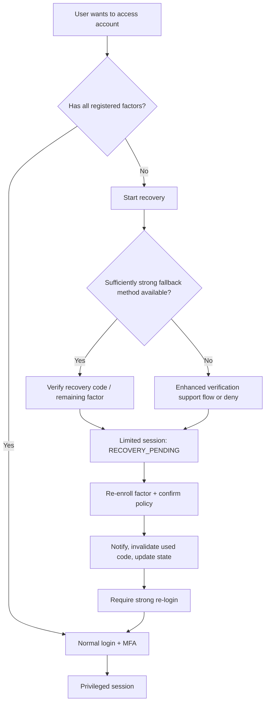
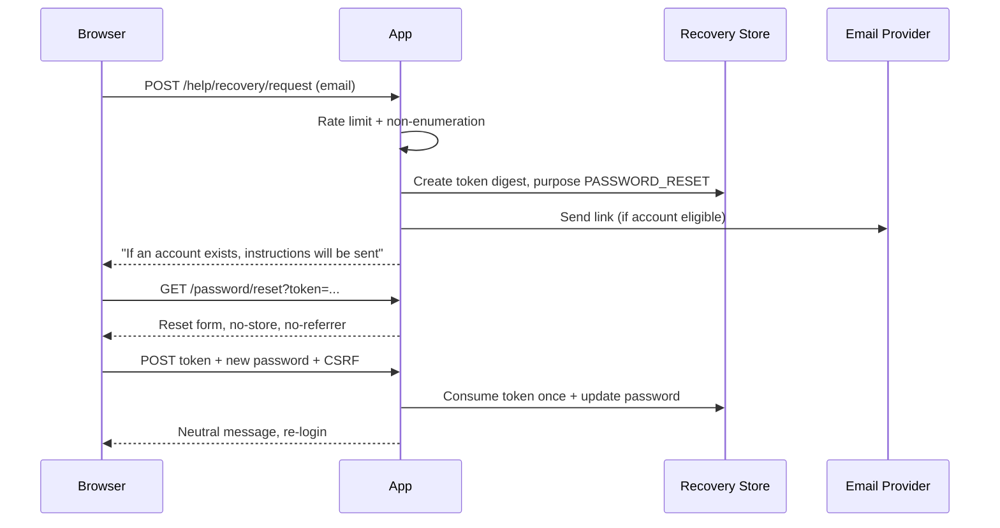
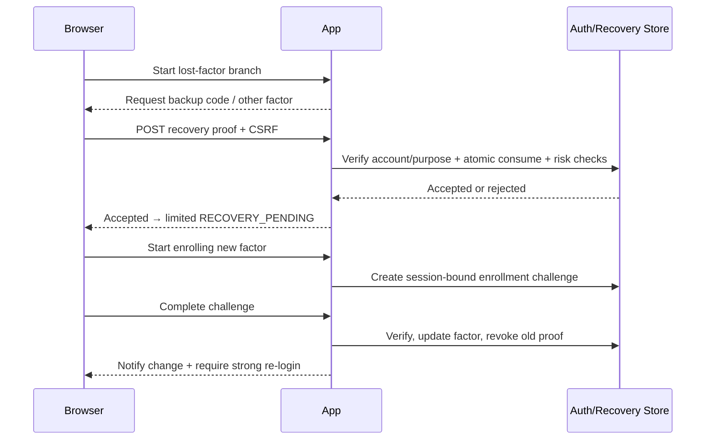

# Account Recovery, Lost Factors, and Testing Alternate Paths

> **Scope:** advanced authentication in **Spring Security Servlet** applications (Spring MVC/Spring Boot 3.x, Spring Security 6.x). This lesson focuses on designing, integrating, and testing **account recovery** paths—especially when a user loses an MFA factor or device—without creating a “backdoor” weaker than the primary login flow. Examples use **Java 17+**, combining a standalone runnable program with Spring Security configuration snippets whose applicability conditions are explicitly stated.

## 1. Learning Outcomes

After completing this lesson, you will be able to:

1. Distinguish **forgot password**, **lost MFA factor**, **lost all devices/passkeys**, **lost email access**, **compromised account**, and **locked session recovery**.
2. Choose recovery paths matching the required assurance level: another registered factor, one-time backup codes, recovery keys, staff identity proofing, or designed out-of-band processes.
3. Design a state machine so a user in a **recovering** state does not hold the privileges of someone who completed strong authentication; enforce factor re-enrollment and invalidate old evidence when needed.
4. Generate, store, and consume high-entropy backup codes, preventing replay and race conditions; understand why a password reset link **does not automatically** allow changing MFA.
5. Integrate requirements for CSRF, sessions, `SecurityContext`, authorization, risk signals, rate limiting, auditing, notifications, anti-enumeration, and post-compromise recovery controls.
6. Write tests for both **primary and alternate paths** (happy path, expired codes, wrong codes, two concurrent requests, locked accounts, changed email, old sessions, edge cases, and dependent service failures).

## 2. Why Is the Recovery Path Part of Authentication?

A system with strong MFA on the login page that offers “forgot OTP?” and replaces OTP with guessable security questions, an unprotected email, or unverified support chat requests has effectively built a **shortcut** bypassing MFA.

Model authentication as a set of paths:



This diagram is a **security model**, not an assumption that providers supply every step out of the box. When sufficiently strong verification is impossible, **denying or delaying recovery** may be more appropriate than granting access to sensitive data.

### Foundational Principles

- **No factor is strong merely because it is named “recovery.”** Every method must be evaluated for hijacking, replay, spoofing, revocability, and subject verification strength.
- **An alternate path does not automatically equal strong login.** Upon successful recovery, the application may grant only **factor-reset permissions**, require extra checks, and force re-login rather than immediately granting transaction/transfer/admin privileges.
- **Legitimate users must have a prepared escape hatch**, such as backup codes issued when enabling MFA. When no trusted evidence remains, manual support needs dedicated rules and fraud controls.
- **Every exit point is testable**: success, failure, timeout, replay, race, cancel, and dependency failures.

## 3. Classifying Incidents and Choosing a Recovery Path

| Incident | What Does the User Still Have? | Paths to Consider | What Not to Infer |
| --- | --- | --- | --- |
| Forgot password, MFA still works | MFA device/key, registered channel | One-time password reset token + MFA/step-up verification step per policy | Changing a password does not prove the user passed MFA. |
| Lost OTP phone, still has backup passkey/security key | Another registered factor | Authenticate with the remaining factor, then enroll a new device | Not every “trusted device” is an independent factor. |
| Lost TOTP, has backup codes | Previously issued recovery code | Consume **one code**, restrict session to re-enroll MFA | Never reuse codes or grant a full session immediately. |
| Lost all MFA factors, still has email and password | Email channel + a password | Risk evaluation and support/identity proofing matching assurance level | **Email inbox + password** does not automatically equal the lost factor; an attacker could hold both. |
| Lost recovery email too | Possibly offline codes/methods | Securely stored recovery codes or support flow with strong evidence | Never change emails based on an unverified phone call. |
| Compromised account, attacker added a factor | Some signals or independent evidence | Controlled account-takeover flow, freeze high-risk actions, investigate, and revoke sessions | “Resetting MFA” does not automatically kill attacker-held sessions/tokens. |
| User simply replacing a phone normally | Old factor still works | Add the new factor **before** removing the old one, reauthenticating if needed | Do not force lost-device recovery when sufficient proof still exists. |

**Critical distinction:** password reset, changing recovery email, and resetting MFA are **three separate security actions**. If a low-trust path can execute all three directly, an attacker can chain them into full account takeover.

### Assurance Level and Action Sensitivity

An e-learning app and a money-transfer app do not need identical policies. Accounts with admin rights, payments, secret access, legal detail changes, or device control require higher recovery standards. Define **assurance targets** and account-takeover impact before choosing fallback methods.

Risk signals such as unusual location, new device, automated-looking IP addresses, or repeated code attempts can heighten monitoring, yet those signals **do not replace** authentication evidence. Geo-IP can be wrong due to VPNs, mobile networks, or NAT; never treat it as identity.

## 4. Threat Model for Account Recovery

Include these scenarios in your threat model from the start:

1. **Account enumeration:** an attacker submits thousands of emails to discover existing accounts via messages, HTTP status codes, or response timing.
2. **Token guessing and brute force:** short codes, unlimited retries, or open reset endpoints enable guessing.
3. **Replay:** a used backup code or reset token is accepted a second time.
4. **Race:** two parallel requests consume the same code before either marks it used, creating two recovery sessions.
5. **Recovery channel compromise:** email, SIM, or support accounts are hijacked, making the recovery channel untrustworthy.
6. **Session fixation or stale privilege:** after MFA reset/change, old sessions keep elevated privileges or session cookies are not rotated.
7. **Support staff social engineering:** factor-removal requests look plausible using forged identity evidence.
8. **Phishing and leaked codes:** recovery codes are entered into fake sites or leaked via URLs, referrers, logs, analytics, or browser extensions.
9. **Cross-account binding:** user A’s token/code is accepted for user B because only the value is checked without binding `userId` and `purpose`.
10. **Fallback chaining:** an attacker chains “forgot password” → “change email” → “lost MFA” to dismantle one barrier at a time.

Each scenario needs one or more specific **controls** and tests; testing a single happy-path login misses the most critical cases.

## 5. Safe State Machine: Do Not Auto-Grant Privileges After Recovery

A business model can use these states:

| State | Example Entry Event | Privileges It Should Have |
| --- | --- | --- |
| `ANONYMOUS` | Unauthenticated | Only initiate recovery requests, receiving non-enumerating responses. |
| `PASSWORD_VERIFIED` | Proved password factor but missing MFA | Only complete MFA or enter an evaluated recovery path. |
| `RECOVERY_PENDING` | Valid recovery proof or approved support ticket | **Only** view/re-enroll factors in a narrow flow; cannot read sensitive resources. |
| `FACTOR_REENROLL_PENDING` | Proof consumed; must register new key/TOTP | Verify the new factor’s challenge before activating it. |
| `MFA_VERIFIED` | Completed full authentication requirements | May enter MFA-required routes, still subject to role/resource authorization. |
| `RECOVERY_DENIED/LOCKED` | High risk, too many failures, or insufficient evidence | Deny/throttle further attempts; offer non-leaking help guidance. |

This is a **logical model**. Spring Security does not automatically create these authorities just from configuring `oauth2Login`, `formLogin`, or `rememberMe`. If using names like `MFA_VERIFIED` or `RECOVERY_PENDING` in `GrantedAuthority`, the application must **issue/resolve them via a trusted pipeline** bound to the current session, login mechanism, and step-up timestamp—never from client-supplied query params, JSON, or cookies.

### State Transition Rules

- Transition **ANONYMOUS → RECOVERY_PENDING** only when a specific recovery mechanism has genuinely verified sufficiently strong evidence. An email having been sent is not evidence.
- Transition **PASSWORD_VERIFIED → MFA_VERIFIED** only if the additional factor was actually verified, not merely because `/mfa/complete` was called.
- Transition **RECOVERY_PENDING → FACTOR_REENROLL_PENDING → MFA_VERIFIED** only after policy-compliant factor replacement. Depending on the product, forcing a **fresh login** and restricting sensitive actions temporarily after factor replacement is safer.
- **Reject invalid transitions**, e.g., `POST /mfa/replace` from `ANONYMOUS`, or `POST /transfer` from `RECOVERY_PENDING`.
- For concurrent requests, updating state and consuming recovery proof must be an **atomic transaction** with proper idempotency/locking; never infer atomicity from single-threaded development runs.

### Separating Permissions Across Endpoints

```text
GET  /help/recovery                  → public, does not disclose account existence
POST /help/recovery/request          → public, CSRF/anti-abuse, submits request only
POST /recovery/proof/verify          → verifies proof only, grants limited privileges
POST /recovery/factors/enroll/start  → requires RECOVERY_PENDING
POST /recovery/factors/enroll/verify → requires RECOVERY_PENDING + valid new challenge
GET  /account/dashboard              → requires MFA_VERIFIED and read permission
POST /account/security/disable-mfa   → requires step-up and dedicated policy
```

This endpoint map is a reference design, **not built into Spring Security defaults**. Permission on a public endpoint means only permission to submit a request, not permission to modify an account. A recovery proof is not a full login session.

## 6. Fallback Methods: Pros and Cons

### 6.1. Pre-Registered Backup Factor

A second security key, a passkey on another device, a backup TOTP, or another pre-enrolled verification factor is usually easier to secure than a ticket sent to a new email. The server must check a backup factor **bound to the user before the incident**, not a new factor supplied by the recovery request itself.

Other factors tied to the same device/cloud account may not be as independent as expected. For example, multiple passkeys depending on one compromised cloud-sync account create a single point of failure. Risk and UX must match the user base.

### 6.2. One-Time Backup Codes

When a user first enables MFA, the system can issue a set of high-entropy **backup/recovery codes**:

- Generated with `SecureRandom` (or an equivalent CSPRNG), never `Math.random()`, timestamps, emails, or sequences.
- Let the user download/save them into a password manager or offline secure storage, **displaying raw values only at issuance**.
- Store only **account-bound digests**, preferably keyed digests/HMAC when extra leak protection is required; never store plaintext in databases/logs.
- Each code is accepted **strictly once**. Two concurrent requests must never both succeed.
- Codes belong to **one account/tenant and one purpose**; never use user A’s code to recover user B.
- Code usage must have **rate limiting, alerts, auditing**, and normally lead to a limited session to re-enroll factors rather than auto-granting admin rights.
- When regenerating a code set, invalidate the old set transactionally, record timestamp/actor, and notify the account owner.
- Never automatically email all backup codes whenever the user asks, because email itself may be the compromised channel.

Long random codes differ from user-chosen passwords: for a high-entropy CSPRNG secret, SHA-256/HMAC can be suitable for verification matching. For low-entropy passwords or security answers, use **dedicated password hashing** like Argon2id/bcrypt/scrypt with proper policies—never plain fast SHA-256.

### 6.3. One-Time Email Links

Email may fit **password reset** depending on the threat model, yet email does not inherently replace a lost MFA factor. For reset links:

- Tokens carry high entropy (e.g., 256 random bits), short TTL, and a dedicated scope (`PASSWORD_RESET`).
- Store hashes/keyed hashes in the DB, consume tokens **once**, and bind user/account/purpose.
- Send links with the **exact server-configured origin**, never building URLs from arbitrary `Host`/`X-Forwarded-Host` headers (reset-link poisoning risk).
- **GET endpoints display a form**, never consuming tokens or changing passwords on GET; consume tokens in a POST with proper CSRF/Origin policy and an atomic transaction.
- Set `Cache-Control: no-store`, `Referrer-Policy: no-referrer`, and restrict third-party scripts on pages with tokens in the URL to reduce link leakage.
- Avoid logging raw tokens/URL queries, protect the email channel, and audit sensitive actions.
- After password reset, verify MFA per policy (if still present), consider revoking old sessions/tokens, and send change notifications.

**Never reuse one token for “reset password,” “change email,” and “disable MFA.”** Purpose-based domain separation is a minimum requirement alongside verified authorization.

### 6.4. Human Support or Identity Proofing

When no trusted factor remains, a support workflow can be designed to match the service’s risk level and legal obligations. Choose sufficiently strong checks, minimize collected data, protect PII, enforce staff authorization, require **dual control/approval** for sensitive accounts, audit everything, and add anti-abuse waiting periods where needed.

Questions like “date of birth,” “mother’s name,” or public social-media details **are not strong evidence**. Support staff must never reset MFA simply because someone knows a phone number/email, and must never ask users to read passwords, OTPs, or recovery codes over chat/phone.

### 6.5. Methods Requiring Extra Caution

| Method | Pitfalls |
| --- | --- |
| SMS/voice | SIM swap, number porting, phishing, roaming risks; if the phone number is also lost, it is no longer a fallback channel. |
| Personal email | May be compromised together or lost; email password reset does not prove ownership of an MFA device. |
| Trusted device | Cookies can be copied/stolen or left on a lost device; requires binding and time limits. |
| Security questions | Usually low entropy, discoverable, or leaked data. |
| “Log in with provider B” | Valid only when **provider B was pre-linked** and identifiers verified; never auto-merge accounts by matching email. |
| Helpdesk shortcut | Vulnerable to social engineering, privilege misuse, and insider threats; requires dual control and auditing where appropriate. |

## 7. Standalone Java 17 Example: One-Time Backup Codes

The following program illustrates the **core generation/matching of recovery codes**; it does not create sessions, reset MFA, or replace server-side risk checks. It runs directly on JDK 17 without Maven or Spring. Raw codes exist only in local variables and are never printed to the console. The demo uses an **in-memory** store and a random in-memory HMAC key; production requires database transactions/unique constraints, a persistent secrets manager, and a rotation policy.

Save contents to **`RecoveryCodesDemo.java`**:

```java
import javax.crypto.Mac;
import javax.crypto.spec.SecretKeySpec;
import java.nio.charset.StandardCharsets;
import java.security.SecureRandom;
import java.util.ArrayList;
import java.util.Base64;
import java.util.List;
import java.util.Set;
import java.util.concurrent.ConcurrentHashMap;

public class RecoveryCodesDemo {
    static final class RecoveryCodes {
        private final SecureRandom random = new SecureRandom();
        private final byte[] hmacKey = new byte[32];

        // userId -> set of digests for still-usable codes
        private final ConcurrentHashMap<String, Set<String>> digests =
                new ConcurrentHashMap<>();

        RecoveryCodes() {
            random.nextBytes(hmacKey);
        }

        private String newCode() {
            byte[] bytes = new byte[24]; // 192 random bits
            random.nextBytes(bytes);
            return Base64.getUrlEncoder()
                    .withoutPadding().encodeToString(bytes);
        }

        private String digest(String userId, String code) {
            try {
                Mac mac = Mac.getInstance("HmacSHA256");
                mac.init(new SecretKeySpec(hmacKey, "HmacSHA256"));
                mac.update(userId.getBytes(StandardCharsets.UTF_8));
                mac.update((byte) 0);
                byte[] bytes = mac.doFinal(
                        code.getBytes(StandardCharsets.UTF_8));
                return Base64.getUrlEncoder()
                        .withoutPadding().encodeToString(bytes);
            } catch (Exception ex) {
                throw new IllegalStateException("HMAC unavailable", ex);
            }
        }

        // Call only after verified enroll/recovery authorization.
        // Issuing a new set also invalidates that user's entire old set.
        List<String> replaceAll(String userId, int count) {
            if (userId == null || userId.isBlank()
                    || count < 1 || count > 20) {
                throw new IllegalArgumentException("Invalid input");
            }
            List<String> rawCodes = new ArrayList<>();
            Set<String> stored = ConcurrentHashMap.newKeySet();
            for (int i = 0; i < count; i++) {
                String code = newCode();
                rawCodes.add(code);
                stored.add(digest(userId, code));
            }
            digests.put(userId, stored);
            return List.copyOf(rawCodes);
        }

        boolean consume(String userId, String code) {
            if (userId == null || code == null || code.isBlank()) {
                return false;
            }
            Set<String> stored = digests.get(userId);
            if (stored == null) {
                return false;
            }
            // remove on a ConcurrentHashMap key-set is atomic
            // for ONE digest in ONE demo process.
            return stored.remove(digest(userId, code));
        }

        int remaining(String userId) {
            Set<String> stored = digests.get(userId);
            return stored == null ? 0 : stored.size();
        }
    }

    public static void main(String[] args) {
        RecoveryCodes service = new RecoveryCodes();
        List<String> issued = service.replaceAll("alice", 3);
        String first = issued.get(0);

        System.out.println("issued: " + issued.size());
        System.out.println("wrong account: "
                + service.consume("bob", first));
        System.out.println("first use: "
                + service.consume("alice", first));
        System.out.println("replay: "
                + service.consume("alice", first));
        System.out.println("remaining: "
                + service.remaining("alice"));
    }
}
```

Run in the file’s directory:

```bash
javac RecoveryCodesDemo.java
java RecoveryCodesDemo
```

**Exact stdout:**

```text
issued: 3
wrong account: false
first use: true
replay: false
remaining: 2
```

### What Was Proven — and What Was Not?

- `SecureRandom` generates each code with 192 random bits; codes do not depend on `userId` or timestamps.
- HMAC-SHA256 stores verification digests instead of raw codes; HMAC input includes `userId` and a separator. Thus Alice’s code does not match Bob’s store.
- `ConcurrentHashMap.newKeySet().remove` is atomic when deleting **one element** in a single JVM; replay after a successful consumption returns false.
- The demo **lacks** user authentication, CSRF, recovery session TTL, attempt limits, auditing, code-issuance authorization, persistent storage, multi-instance support, and re-enrollment steps. Never copy this class into production as a complete account recovery system.
- In multi-instance systems, two requests can hit two different processes; in-memory code sets are not shared, and HMAC keys would differ. Production needs a shared datastore with **atomic consume/transactions** and a persistent HMAC key in a secret manager. Concurrent `replaceAll` with `consume` also needs per-user transactions/locks; the demo’s `put` does not guarantee a complete business recovery workflow.

**Why not print codes to the console?** Raw values must be delivered only to the account owner over a verified channel right at enrollment. Access logs, crash dumps, audit records, or telemetry must never contain codes; tests can hold codes in variables to simulate a user without printing them to output.

## 8. Adding Short-Lived Reset Tokens with Explicit Scope

Backup codes are pre-issued and usable when a device is lost; a **reset ticket** typically has a short TTL and is issued **after** an appropriate condition-verification step. They are two different types of evidence.

Recommended DB record:

```text
RecoveryTicket(
  id,
  user_id,
  tenant_id,
  purpose,              // PASSWORD_RESET or MFA_REENROLL
  token_digest,         // never store raw token
  created_at,
  expires_at,
  consumed_at,          // null if unused
  verification_context, // verified evidence source, contains no secret
  issued_by,
  risk_decision_id
)
```

Note: this is an **illustrative data model**, not a built-in Spring Security class. Place an appropriate unique index on `token_digest` and use one transaction to verify + transition `consumed_at` from null to current time + update recovery state.

Atomic pseudo-SQL example on a DB supporting conditional updates:

```sql
UPDATE recovery_ticket
SET consumed_at = CURRENT_TIMESTAMP
WHERE token_digest = :digest
  AND user_id = :userId
  AND tenant_id = :tenantId
  AND purpose = :purpose
  AND consumed_at IS NULL
  AND expires_at > CURRENT_TIMESTAMP;
```

Treat token consumption as successful only when **updated row count = 1** and the transaction commits cleanly. Between two concurrent requests, only one claims the row per database concurrency semantics. Afterward, **limited privileges** for re-enrollment must be issued/updated consistently; never grant privileges based on a prior “SELECT looked valid” check before the UPDATE succeeds.

If using a one-time token **to change a password**, the password update and token consumption should share the same transaction or have explicit idempotency/compensation design so retries never accept a token multiple times.

### TTL and Relay Risks

A 10–15 minute TTL is often chosen as an example for reset links, though exact duration is a **product and risk decision**, not a Spring Security default rule. Use server/database-managed timestamps in UTC, account for clock skew, and never trust client-sent `expiresAt`.

When tokens appear in URLs, browsers may record them in history, extensions, referrers, or reverse proxy logs. Set `Referrer-Policy` and `no-store`, omit third-party analytics on token-bearing pages, and consider exchanging the URL token for temporary server-side state after GET loads the form before POST uses it. Adjust the design only while preserving CSRF, session binding, and single-use.

## 9. Integrating with Spring Security Servlet

Spring Security provides the foundation for authentication, authorization, CSRF, session management, and filters. However, **recovery-code verification flows, factor tiering, and MFA state transitions remain application logic**, not generated automatically by a single flag.

### 9.1. SecurityFilterChain Illustrating State-Based Authorization

This example is a **configuration snippet** for an application that already has a custom authentication pipeline issuing trusted `RECOVERY_PENDING` and `MFA_VERIFIED` authorities. It is not a standalone program: endpoints/services and authority-issuance logic must be built separately.

```java
import org.springframework.context.annotation.Bean;
import org.springframework.context.annotation.Configuration;
import org.springframework.http.HttpMethod;
import org.springframework.security.config.annotation.web.builders.HttpSecurity;
import org.springframework.security.web.SecurityFilterChain;

@Configuration
class WebSecurityConfig {
    @Bean
    SecurityFilterChain securityFilterChain(HttpSecurity http)
            throws Exception {
        return http
            .authorizeHttpRequests(auth -> auth
                .requestMatchers(
                    "/login", "/error", "/help/recovery").permitAll()
                .requestMatchers(HttpMethod.POST,
                    "/help/recovery/request").permitAll()
                .requestMatchers("/recovery/factors/**")
                    .hasAuthority("RECOVERY_PENDING")
                .requestMatchers("/account/**")
                    .hasAuthority("MFA_VERIFIED")
                .anyRequest().denyAll())
            .formLogin(login -> login.permitAll())
            // Default CSRF remains enabled for session-based form POSTs.
            .build();
    }
}
```

**Important points to read accurately:**

- `permitAll()` only means the public endpoint may be **invoked**, not that anyone can reset an account. The controller must run verification/risk checks and return neutral responses.
- `RECOVERY_PENDING` and `MFA_VERIFIED` are **application-defined** authorities. You must guarantee they are granted only when proof is valid, never allowing clients to self-assert and receive privileges.
- The `/recovery/factors/**` matcher precedes `/account/**` so re-enrollment routes are not accidentally covered by “fully logged in” rules. When changing routes, write regression tests for matcher ordering.
- `formLogin` here only shows one way to establish an initial authentication step; real MFA requires a custom flow/step-up. **Do not mistake default `formLogin` for MFA.**
- Default CSRF remains active for POSTs using session cookies, including the public `POST /help/recovery/request`. GET endpoints merely display forms without executing resets. If clients use a separate cookie-less API, evaluate CSRF appropriately for that chain rather than disabling it globally.
- Authentication failures and access denials must be distinguished: missing login evidence may return 401/login redirect; having a limited session while lacking authority must return 403 per policy. Custom entry points or failure handlers must keep non-enumerating messages.

### 9.2. Recovery State Must Never Be Elevated from Browser Input

A dangerous anti-pattern:

```java
// ANTI-PATTERN — DO NOT implement.
if ("true".equals(request.getParameter("mfaRecovered"))) {
    // Never grant MFA_VERIFIED from a client parameter.
}
```

Instead, the server must have a **RecoveryWorkflowService** that:
1. Resolves the target principal/`userId` using trusted data from the recovery process, never taking a request email as sole proof.
2. Validates recovery proof against purpose/account, checking TTL, rate limits, lock status, and risk decisions.
3. Consumes the proof in an atomic transaction.
4. Grants `RECOVERY_PENDING` bound to the session/proof, with short expiration and **no transaction privileges**.
5. Requires enrollment verification of the new factor (e.g., TOTP challenge or WebAuthn registration + verification); verifies origin/RP ID/challenge/user binding per protocol.
6. Invalidates the used proof and updates the factor list per policy. Optionally terminates/restricts old sessions, sends notifications, and requires re-login.
7. Elevates the session only if policy permits after full verification; usually **invalidating/rotating the session** and requiring a fresh strong login is easier to control.

This is a business workflow, not a promise that `SecurityContextHolder.getContext().setAuthentication(...)` automatically manages every session guarantee. If you replace `Authentication` during recovery, you must handle **`SessionAuthenticationStrategy`**, session fixation protection, `SecurityContextRepository`, security-context persistence for your Spring Security version, CSRF token lifecycle, and sessions on other devices. Upgrading authorities without persisting/rotating context/sessions can cause inconsistent behavior or open privilege escalation paths.

### 9.3. Should Security Chains Be Split?

You can use a separate chain for stateless bearer-token APIs and one for web browser cookies/sessions. However, **never create a weaker “recovery” chain** just because URLs are public. Each chain must have narrow matchers, explicit CSRF/session/authentication settings, and tests across all paths—especially errors and callbacks.

If form-based recovery uses `HttpSession`, `SessionCreationPolicy.STATELESS` is incompatible with storing recovery state in the session unless the app explicitly stores state in another secure mechanism. Likewise, `web.ignoring()` bypasses the Spring Security filter chain, so avoid using it on sensitive recovery routes; usually prefer `permitAll()` so CSRF and security headers remain active.

## 10. Password Change and MFA Replacement Flows Must Be Independent

### Password Reset



For accounts with MFA enabled, **a new password does not remove MFA**. If a user both resets their password and loses MFA, they must go through an additional recovery flow with sufficiently strong evidence rather than merging them into “reset password and drop OTP.”

### MFA Recovery



If a user has neither backup codes nor a backup factor, the system can route to live support or an identity-proofing workflow. Never treat knowing an email, phone number, or profile info as a default substitute for proof.

## 11. Mandatory Test Scenarios for Alternate Paths

Tests must verify **endpoints, business logic, sessions, and multi-request flows**, not merely invoke helper methods. A practical test plan:

| Group | Case | Expected Result |
| --- | --- | --- |
| Scope | Recovery requested for non-existent email | Public response does not disclose account existence; no user created. |
| Scope | Locked or under-investigation account | Apply risk policy; never unlock solely from a link token. |
| Wrong code | Mismatched code or belongs to another user | Reject, increment counter/rate limit; never grant `RECOVERY_PENDING`. |
| Purpose | Password reset token sent to MFA-change endpoint | Reject due to different purpose, even if valid in the other flow. |
| TTL | Expired / future-issued / clock-skew token | Reject or apply server-defined tolerance; never trust client clocks. |
| Replay | Using a token/code twice | First succeeds; subsequent uses fail. |
| Race | Two requests consume the same code concurrently | **At most one** request succeeds against the shared datastore. |
| Privilege escalation | `RECOVERY_PENDING` accesses `/account/billing` | 403; cannot fetch data or perform MFA-required actions. |
| Re-enrollment | Submits new factor without completing challenge | Does not activate unproven factor; remains in limited state. |
| Session | Using old session after factor change | Revoked/restricted per policy; session cookie rotated upon elevation. |
| CSRF | Cross-site recovery POST without valid token | Blocked if the flow uses cookie sessions and CSRF protection. |
| Open redirect | Parameter `next=https://attacker.test` | Never redirects to unapproved origins. |
| Notification | MFA changed successfully | Notification sent to registered channel; audit contains no secrets. |
| Dependency | Email provider/DB/HMAC key store unavailable | Fail closed with proper retry/idempotency; never skip verification. |
| Abuse | High request volume for one identity / from many IPs | Multi-dimensional rate limit; avoid unbounded DoS lockouts triggered by attackers. |
| Phishing | Attempt to get user to hand over recovery code via support | Support workflow never asks for secrets; detect and alert. |
| Email change | Recovering via a newly changed email | Do not trust a just-changed email as independent proof for both actions. |
| Credential theft | Attacker already holds another cookie/token | Revoke/restrict old sessions per policy; do not treat password change as full remediation. |

### 11.1. Pure Java Tests with One-Time Codes

The `RecoveryCodesDemo.java` program above already demonstrates three behavioral assertions via stdout:

- Valid code with wrong account → `false`.
- First use with right account → `true`.
- Reusing valid code → `false`.

With JUnit, you can test concurrency at the service layer; **multi-instance tests require a real DB** to avoid false confidence when the app uses per-process memory. In-process JUnit cannot prove production database transactions are truly atomic.

### 11.2. MockMvc Testing Authorization and CSRF

The following is an **illustrative integration test snippet** in a project with Spring Security Test, endpoints as in Section 9, and a **test authentication** mechanism granting trusted authorities. It cannot run standalone with the Java 17 program in Section 7, since corresponding controllers and workflow services must exist.

```java
import org.junit.jupiter.api.Test;
import org.springframework.beans.factory.annotation.Autowired;
import org.springframework.boot.test.autoconfigure.web.servlet.AutoConfigureMockMvc;
import org.springframework.boot.test.context.SpringBootTest;
import org.springframework.test.web.servlet.MockMvc;

import static org.springframework.security.test.web.servlet.request
    .SecurityMockMvcRequestPostProcessors.csrf;
import static org.springframework.security.test.web.servlet.request
    .SecurityMockMvcRequestPostProcessors.user;
import static org.springframework.test.web.servlet.request.MockMvcRequestBuilders.get;
import static org.springframework.test.web.servlet.request.MockMvcRequestBuilders.post;
import static org.springframework.test.web.servlet.result.MockMvcResultMatchers.status;

@SpringBootTest
@AutoConfigureMockMvc
class RecoveryAuthorizationTest {
    @Autowired
    MockMvc mvc;

    @Test
    void pendingRecoveryCannotReadSensitiveAccount() throws Exception {
        mvc.perform(get("/account/dashboard")
                .with(user("alice")
                    .authorities(() -> "RECOVERY_PENDING")))
            .andExpect(status().isForbidden());
    }

    @Test
    void mfaVerifiedUserMayReadAccount() throws Exception {
        mvc.perform(get("/account/dashboard")
                .with(user("alice")
                    .authorities(() -> "MFA_VERIFIED")))
            .andExpect(status().isOk());
    }

    @Test
    void recoveryRequestPostWithoutCsrfIsRejected() throws Exception {
        mvc.perform(post("/help/recovery/request")
                .param("email", "alice@example.test"))
            .andExpect(status().isForbidden());
    }

    @Test
    void publicRecoveryRequestWithCsrfReachesController() throws Exception {
        mvc.perform(post("/help/recovery/request")
                .with(csrf())
                .param("email", "alice@example.test"))
            .andExpect(status().isAccepted());
    }
}
```

**Limitations of the tests above:** `with(user(...).authorities(...))` **mocks authorities**; it helps test security matchers, yet **does not prove** the workflow generates authorities properly. The `202 Accepted` test assumes the demo controller was implemented to return 202 for non-enumeration; if your controller returns a neutral 200 or 204, adjust the assertion to match your contract. For comprehensive defense, run **integration tests** through actual token issuance/consumption and re-enrollment rather than only mocking an authenticated principal.

With multi-chain policies, testing `/help/recovery/request` with and without CSRF must route through the right web chain. Never assume `permitAll` implies POSTs without CSRF should be allowed.

### 11.3. Race Testing Against a Real Datastore

A high-value test submits the same code into two concurrent transactions, e.g., via `ExecutorService`/`CountDownLatch` or integration tests against a real DB. The success count **must equal 1** under concurrent execution; 0 can be acceptable if the proof expired or the system rejected earlier, but it must never be 2.

Business logic should use **database constraints** and transactions rather than relying solely on per-JVM `synchronized`. The SQL `UPDATE ... consumed_at IS NULL` in Section 8 can serve as a baseline; inspect row counts/commit results instead of “SELECT looked valid” followed by a later update.

If re-enrollment spans multiple steps, tests must also verify that a session cannot **replay challenges**, activate two factors against policy, or elevate privileges twice from one proof. Stress and property-based tests can help when branching grows.

## 12. End-to-End Testing: Matrix by Lost Factor

A **path matrix** uncovers bypasses that single-endpoint tests miss:

| Factor 1 | Factor 2 | Fallback Evidence | Valid Path | Final State |
| --- | --- | --- | --- | --- |
| Valid password | Valid TOTP | Not needed | Normal login | `MFA_VERIFIED` |
| Valid password | Lost TOTP | Backup code available | Limited recovery → re-enroll → strong re-login | `MFA_VERIFIED` after new verification |
| Valid password | Lost TOTP | No code | No full session granted; route to support or deny | `RECOVERY_PENDING` only with sufficient evidence |
| Forgot password | TOTP available | Valid password reset proof | Set new password, verify MFA per policy | `MFA_VERIFIED` after MFA step |
| Forgot password | Lost TOTP | Email only | Do not auto-disable MFA | No high-privilege access |
| Valid password | Lost security key | Backup key available | Use another registered key, manage factors | `MFA_VERIFIED` after verification |
| No evidence | None | Chat ticket submitted | Intake request only, verify out-of-band appropriately | No privileges auto-granted |
| Attacker session active | User device lost | User proves takeover | Contain compromise, revoke sessions, reset factors | Re-login after remediation |

Each row should be tested across browsers, multiple tabs, slow networks, expired cookies, back/forward navigation, refreshes, mobile, and multi-device flows.

### Questions to Ask in QA

- If a user opens **two recovery tabs** and Tab A succeeds, what actions can Tab B still take?
- If a user requests a new link, does the old link remain valid per policy?
- If email delivery fails after the ticket is written to the DB, is the user stuck in an unpredictable state?
- If a token is used right at its expiration boundary, is success/failure handled **consistently** by the clock/database?
- If a support agent confuses user A with user B, does a **second approval** or binding validation prevent changing the wrong factor?
- If the app redeploys between proof verification and re-enrollment, is recovery state safely preserved (or cleanly invalidated)?
- If an earlier session’s JWT/session remains cached, does successful recovery truly revoke sensitive privileges on the compromised session?
- If a user enters a backup code on a phishing site, is there a way to mark codes compromised and reissue a new set after strong login?
- If a new public route is added for support, does it create an authorization bypass around `/account/**`?

## 13. HTTP and Browsers: Required Protection Layers

### CSRF on Recovery Forms

Recovery pages using **session cookies** still need CSRF tokens on state-changing POSTs. A frequent mistake is setting `permitAll()` and assuming `CsrfFilter` stops checking. `permitAll` only removes the authentication requirement from authorization decisions; with default CSRF enabled, POST requests without a token are still blocked.

A recovery code or link token **does not automatically solve** CSRF on subsequent actions such as changing email, disabling MFA, logging out sessions, or changing passwords. Design each action with dedicated evidence, CSRF protection, TTL, and replay guards suited to the threat model.

### SameSite, Origin, and Fetch Metadata

`SameSite=Lax/Strict` cookies and checking `Origin`/`Referer` or `Sec-Fetch-Site` can reduce unintended cross-site requests. However, `SameSite` does not replace CSRF tokens, and browser origins may be absent in some contexts or spoofed by non-browser HTTP clients. For email links or cross-site callbacks, test real cookie behavior so valid flows do not break.

### HTTP Response Headers and Caching

Responses carrying tokens or sensitive recovery data should set proper cache/referrer policies:

```http
Cache-Control: no-store
Referrer-Policy: no-referrer
X-Content-Type-Options: nosniff
```

On HTML pages with tokens in the URL, avoid loading third-party JS, pixels, or images from external origins unless token-leak prevention is designed. Prevent XSS with output encoding, proper CSP, and dependency scanning. Headers do not replace token verification.

### Rate Limiting and Non-Enumeration

Apply multi-dimensional rate limits (normalized account/identifier, IP, subnet, device/session, behavior) and consider CAPTCHA or controlled delays under abuse. Avoid locking solely by username, which lets attackers cause mass DoS. Public responses should match between existing and non-existing users, never exposing `userId`, full emails, or lock states to unauthenticated clients.

**Example message:**

```text
If the account is eligible, recovery instructions will be sent via the registered channel.
```

Returning a consistent message does not automatically equalize internals; manage timing, headers, logs, and rate limits to close side channels.

## 14. Post-Recovery: Sessions, Notifications, and Revocation

An accepted recovery proof **does not end security responsibilities**. Subsequent steps should handle:

1. **Current session:** scope permissions narrowly, rotate the session identifier when raising trust, and set short timeouts on limited states. Never leave old authorities indefinitely in the session after factor changes.
2. **Other sessions:** depending on risk, revoke or force re-authentication. Spring Security has `SessionRegistry` and session management, yet distributed revocation must fit your session store and token architecture.
3. **Remember-me / trusted devices:** delete or revoke corresponding tokens when factor loss or compromise lowers assurance. Never keep remember-me as an MFA replacement.
4. **Recovery codes:** invalidate the used code; after MFA completion, encourage issuing a fresh set and revoking the old set after sufficiently strong authentication.
5. **Email/phone/contacts:** send “MFA removed,” “new factor enrolled,” and “recovery code used” alerts to appropriate **previously registered channels**—never only to a newly changed address.
6. **Auditing:** record subject, purpose, status, timestamp, valid source, risk decision, idempotency/correlation ID, and support actor; **never** log raw codes, OTPs, session cookies, reset links, or private keys.
7. **Cooldowns** on especially dangerous actions: optionally delay sensitive account changes after recovery depending on product, with alerts and a reporting channel if unauthorized.
8. **User experience:** clearly explain what changed, how to enroll replacement factors, official support channels, and how to report suspected takeover; never disclose internal details that help attackers probe the system.

In multi-service architectures, an “account recovered” event does not automatically revoke previously issued JWT access tokens. Self-contained JWTs remain valid until `exp` unless Resource Servers check an epoch/revocation store. Test directly against your organization’s session/token architecture.

## 15. Common Anti-Patterns

| Anti-Pattern | Why It Is Dangerous | Better Design |
| --- | --- | --- |
| `POST /disable-mfa` requires password only | Leaking the password suffices to strip MFA. | Step-up or separate recovery proof with a limited session. |
| Emailing recovery codes anytime on request | Email compromise becomes a bypass path. | Issue backup codes at MFA enrollment and store safely; evaluate email recovery separately. |
| Reusable recovery tokens | Replay and multiple session hijackings. | Atomic consume + uniqueness/purpose/TTL. |
| Tokens not bound to account/tenant | User A’s token can affect user B. | Bind `userId`, tenant, purpose; verify server-side. |
| Storing raw codes/reset tokens | DB/log leaks compromise credentials. | Store hashes/keyed digests; reveal raw values once to user. |
| Deleting old factor before verifying new factor | Users get locked out or attackers drop MFA without enrolling a strong factor. | Re-enroll challenge → verify → commit factor swap atomically. |
| Granting `MFA_VERIFIED` from a checkbox/query param | Clients elevate their own privileges. | Server auth pipeline verifies proof and state. |
| Password reset implicitly resets MFA | Weaker email channel breaks the entire system. | Separate flows, separate proofs, separate permissions. |
| Setting `permitAll()` then disabling CSRF app-wide | Recovery/session forms lose CSRF defense; other routes become exposed. | Keep proper CSRF; separate stateless APIs only when truly needed. |
| Support changes MFA with no audit/approval | Social engineering / insider risks. | Policy workflow, authorization, logging, dual control when appropriate. |
| Testing only the happy path | Misses replay, races, cross-account, and privilege bypasses. | Positive/negative matrix, concurrency, abuse, and recovery denial tests. |
| Keeping all old sessions after recovery | Attackers retain pre-takeover tokens/sessions. | Session/token invalidation and step-up matching architecture. |

## 16. System Design and Review Checklist

Before deploying to production, verify you can answer:

- [ ] Which **incident types** are supported? Does each have independent evidence/purpose, or do they share one token/bypass path?
- [ ] Does every recovery path provide assurance proportional to the resources and privileges recoverable through it?
- [ ] Do recovery codes/tokens have CSPRNG generation, sufficient entropy, account/tenant/purpose binding, expiry, and atomic single-use?
- [ ] Are rate limiting, non-enumeration, anti-DoS, and log/notification secret-leak protections in place?
- [ ] Is there a limited `RECOVERY_PENDING` state, ensuring `MFA_VERIFIED` is never accidentally granted before full proof?
- [ ] Does re-enrollment genuinely verify the new factor’s challenge before activating it / removing the old factor?
- [ ] Does Web Servlet enforce CSRF on cookie/session POSTs, with authentication/session configs and route matchers preventing bypasses?
- [ ] Are session fixation, security-context persistence, other active sessions, remember-me, and existing JWTs addressed?
- [ ] Are auditing/notifications, staff accountability, and takeover-investigation channels established?
- [ ] Have replay, races, cross-account attempts, expiration, missing state, dependency failures, multi-tab/multi-device flows, and negative authorization been tested?
- [ ] Does recovery for privileged accounts enforce stricter step-up/identity proofing and policies than standard accounts?
- [ ] Do support playbooks forbid ever asking users for passwords, OTP codes, or backup codes?

## 17. Review Questions

**Question 1:** Why does resetting a password via email not automatically permit deleting TOTP?

Because email may be a weaker channel or compromised alongside the password. Resetting one factor does not prove the requester possesses the second factor. A separate recovery proof/assurance and factor-replacement workflow are required.

**Question 2:** Does `permitAll` on the recovery-start endpoint mean POST requires no CSRF?

No. `permitAll` belongs to authorization, whereas CSRF is a separate Spring Security control. For forms using session cookies, POST requires a valid token per policy.

**Question 3:** Why “consume” tokens with a conditional UPDATE instead of SELECT then UPDATE?

Because two requests can both SELECT and see the token as unexpired and unused. A conditional UPDATE and proper transaction guarantee **at most one** request claims the proof.

**Question 4:** When a user enters a valid backup code, should admin privileges be granted immediately?

Not by default. In a secure model, the proof transitions the user into a **recovery-limited state** allowing re-enrollment/re-login, after which admin privileges still require appropriate authentication and authorization.

**Question 5:** Does a MockMvc test mocking the `MFA_VERIFIED` authority prove the recovery flow is secure?

No. It only verifies rule matchers/authorization for the mocked request. You must test **authority creation**, proof consumption, state transitions, races, expiration, session/token revocation, and real end-to-end functionality.

## 18. Key Takeaways

**Account recovery is an alternate authentication path with its own risk profile**, not a “forgot password” button or a simple public endpoint. Losing an MFA factor requires pre-prepared evidence or proper identity proofing; holding email/password alone is not enough to drop other factors.

Good design preserves three boundaries:

1. **Proof:** verify the exact account, purpose, TTL, and trusted source; codes must be unpredictable, non-replayable, and atomically consumed.
2. **Privilege:** a recovery session carries **least privilege**, not MFA-completed status; elevate only after genuine re-enrollment/step-up.
3. **Post-recovery:** invalidate old evidence, handle sessions/tokens, notify/audit, and test all alternate paths—especially negative paths and concurrency.

In Spring Security Servlet, treat the recovery service as **security business logic you must design explicitly**, while `SecurityFilterChain`, `CsrfFilter`, `SecurityContext`, and session infrastructure are the mechanisms that enforce, constrain, and test those decisions.