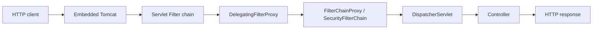

# Bootstrapping a Servlet Application with `spring-boot-starter-security`

**Topic:** Spring Security – Servlet · **Group:** Bootstrap.

This guide walks through creating a **Spring Boot application running on the Servlet stack** from scratch, adding `spring-boot-starter-security`, observing default security behavior, and then declaring a `SecurityFilterChain` for public endpoints, authenticated endpoints, and CSRF testing. The complete example uses **Java 17**, **Spring Boot 3.3.5** (Spring Security 6 generation), Maven, and embedded Tomcat. Versions are pinned so code, commands, and behavior are easy to compare; in real deployments, choose supported and compatible versions for your project.

## 1. Understanding the Two Required Starters

- **`spring-boot-starter-web`** provides the **Servlet**-based web stack: Spring MVC, `DispatcherServlet`, Jackson, and embedded Tomcat under the starter's defaults.
- **`spring-boot-starter-security`** brings Spring Security libraries into the application and enables Spring Boot auto-configuration. When the environment is a Servlet web application, Spring Boot registers the Servlet Filter integration layer to protect incoming requests.
- **The Servlet container** manages Jakarta Servlet requests/responses; **Spring Security** executes a chain of security filters before a request reaches a controller; **Spring MVC** maps and invokes the controller.

`spring-boot-starter-security` **does not automatically create REST endpoints** and does not replace `spring-boot-starter-web`. Adding the security dependency to an application can change the result of calling previously accessible URLs: unauthenticated requests are rejected or redirected to a login page before reaching the controller.



The diagram shows the typical path of an **allowed** request. A security filter can also terminate early with `401`, `403`, or a redirect; in that case `DispatcherServlet`/controller is not invoked. Responses travel back out through the filter chain during synchronous processing.

> **Version note:** Spring Boot 3 / Spring Framework 6 use `jakarta.servlet.*` packages. Older Spring Security guides using `WebSecurityConfigurerAdapter`, `antMatchers`, or `javax.servlet.*` should not be copied verbatim into this example.

## 2. Preparation and Project Creation

Install **JDK 17+**, Maven 3.6.3+ (Maven 3.9.x recommended), and an HTTP client such as `curl`. Verify:

```bash
java -version
mvn -version
```

You can use **Spring Initializr** in your IDE or on the project generator site with:

| Setting | Illustrative value |
| --- | --- |
| Project | Maven |
| Language | Java |
| Spring Boot | `3.3.5` |
| Group | `demo` |
| Artifact | `secure-servlet` |
| Package name | `demo.servlet` |
| Packaging | `Jar` |
| Java | `17` |
| Dependencies | **Spring Web**, **Spring Security** |

Or create the `secure-servlet/` directory and the files below manually. To run tests, `pom.xml` also includes Spring Boot Test and Spring Security Test in `test` scope.

Final structure:

```text
secure-servlet/
├── pom.xml
└── src/
    ├── main/
    │   └── java/demo/servlet/
    │       ├── ServletSecurityApplication.java
    │       ├── ApiController.java
    │       └── SecurityConfig.java
    └── test/
        └── java/demo/servlet/
            └── ServletSecurityApplicationTests.java
```

### `pom.xml` — dependencies and build

```xml
<?xml version="1.0" encoding="UTF-8"?>
<project xmlns="http://maven.apache.org/POM/4.0.0"
         xmlns:xsi="http://www.w3.org/2001/XMLSchema-instance"
         xsi:schemaLocation="http://maven.apache.org/POM/4.0.0 https://maven.apache.org/xsd/maven-4.0.0.xsd">
    <modelVersion>4.0.0</modelVersion>

    <parent>
        <groupId>org.springframework.boot</groupId>
        <artifactId>spring-boot-starter-parent</artifactId>
        <version>3.3.5</version>
        <relativePath/>
    </parent>

    <groupId>demo</groupId>
    <artifactId>secure-servlet</artifactId>
    <version>0.0.1-SNAPSHOT</version>
    <name>secure-servlet</name>

    <properties>
        <java.version>17</java.version>
    </properties>

    <dependencies>
        <dependency>
            <groupId>org.springframework.boot</groupId>
            <artifactId>spring-boot-starter-web</artifactId>
        </dependency>
        <dependency>
            <groupId>org.springframework.boot</groupId>
            <artifactId>spring-boot-starter-security</artifactId>
        </dependency>

        <dependency>
            <groupId>org.springframework.boot</groupId>
            <artifactId>spring-boot-starter-test</artifactId>
            <scope>test</scope>
        </dependency>
        <dependency>
            <groupId>org.springframework.security</groupId>
            <artifactId>spring-security-test</artifactId>
            <scope>test</scope>
        </dependency>
    </dependencies>

    <build>
        <plugins>
            <plugin>
                <groupId>org.springframework.boot</groupId>
                <artifactId>spring-boot-maven-plugin</artifactId>
            </plugin>
        </plugins>
    </build>
</project>
```

**Why not declare separate versions for `spring-security-*`?** Spring Boot's parent/BOM manages a compatible set of dependencies; specifying versions manually without need can cause classpath errors.

If the project uses Gradle, the two main equivalent dependency groups are:

```kotlin
dependencies {
    implementation("org.springframework.boot:spring-boot-starter-web")
    implementation("org.springframework.boot:spring-boot-starter-security")
    testImplementation("org.springframework.boot:spring-boot-starter-test")
    testImplementation("org.springframework.security:spring-security-test")
}
```

This is **only the dependencies block**, not a standalone runnable `build.gradle.kts` file; you still need the Spring Boot plugin, dependency management, Java toolchain, repositories, and corresponding test configuration.

## 3. Entry Point and Controller

### `src/main/java/demo/servlet/ServletSecurityApplication.java`

```java
package demo.servlet;

import org.springframework.boot.SpringApplication;
import org.springframework.boot.autoconfigure.SpringBootApplication;

@SpringBootApplication
public class ServletSecurityApplication {
    public static void main(String[] args) {
        SpringApplication.run(ServletSecurityApplication.class, args);
    }
}
```

`@SpringBootApplication` enables component scanning under package `demo.servlet` and Spring Boot auto-configuration. Because the project includes the Servlet web starter, the application runs with an embedded Servlet container and registers the required Spring MVC components.

### `src/main/java/demo/servlet/ApiController.java`

```java
package demo.servlet;

import org.springframework.http.MediaType;
import org.springframework.security.core.Authentication;
import org.springframework.web.bind.annotation.GetMapping;
import org.springframework.web.bind.annotation.PostMapping;
import org.springframework.web.bind.annotation.RestController;

@RestController
public class ApiController {
    @GetMapping(value = "/api/public",
                produces = MediaType.TEXT_PLAIN_VALUE)
    public String publicEndpoint() {
        return "public";
    }

    @GetMapping(value = "/api/private",
                produces = MediaType.TEXT_PLAIN_VALUE)
    public String privateEndpoint(Authentication authentication) {
        return "private for " + authentication.getName();
    }

    @PostMapping(value = "/api/private",
                 produces = MediaType.TEXT_PLAIN_VALUE)
    public String updatePrivate(Authentication authentication) {
        return "saved by " + authentication.getName();
    }
}
```

Three endpoints are explicitly declared:

| Method + URI | Intent |
| --- | --- |
| `GET /api/public` | Read a public resource |
| `GET /api/private` | Read a resource requiring authentication |
| `POST /api/private` | Simulate a state-changing operation, requiring authentication and a CSRF token under default configuration |

In `@RestController`, the `String` return value is the **response body**; `Authentication` holds the identity after the request has been authenticated by Spring Security. Only call `authentication.getName()` on endpoints that are appropriately protected.

## 4. Observing Default Security Mode Before Custom Configuration

**Try this in two phases to clearly see the starter's impact.** In the first phase, run with `ServletSecurityApplication.java`, `ApiController.java`, and `pom.xml`, **without creating `SecurityConfig.java` yet**:

```bash
mvn spring-boot:run
```

When Spring Security is on the classpath, under Spring Boot's default Servlet app security configuration and **without a custom `SecurityFilterChain`**, normal HTTP requests all require authentication. Boot also creates a test user (`user`) with a random password **if no alternative user store/bean exists**; the password is usually printed in the startup log for development convenience.

Verification example (with a request that does not accept HTML):

```bash
curl -i -H 'Accept: application/json' http://localhost:8080/api/public
```

Even with `@GetMapping("/api/public")`, an anonymous request in this phase typically receives **`401 Unauthorized`**, because the security filter runs before MVC. For clients/browsers requesting HTML, the default form login configuration usually leads to a **redirect to `/login`**. Spring Security enables both form login and HTTP Basic by default in this situation; exact behavior depends on headers and configuration.

To test the Boot-generated account, use username `user` and the password **read from that startup's log** (never put real passwords into documentation or git):

```bash
curl -i -u user:<generated-password> http://localhost:8080/api/public
```

This line is a **command template** with a placeholder for the startup-generated password, not a command to run literally. After finishing the observation phase, stop the application (`Ctrl+C`) and add `SecurityConfig.java` from the next section. Once a custom `UserDetailsService` is defined, the default `user` account from this phase is **no longer** auto-generated by Boot.

### What Does Auto-Configuration Do?

- Boot's auto-configurations detect Spring Security and Servlet web to set up default HTTP security when the application has not provided a suitable replacement configuration.
- `DelegatingFilterProxy` bridges the container's **Servlet Filter** to a Spring bean named `springSecurityFilterChain`, typically a `FilterChainProxy`.
- `FilterChainProxy` selects the matching `SecurityFilterChain` and runs authentication, authorization, CSRF, exception handling, security headers filters, etc., as configured.
- A custom `SecurityFilterChain` bean replaces Boot's **default web rules**; that **does not mean** new users/passwords are automatically created. User store auto-configuration is a separate mechanism, which is why the example explicitly declares a `UserDetailsService`.
- `@EnableWebSecurity` is usually unnecessary in this standard Spring Boot Servlet setup; declaring a `SecurityFilterChain` bean is the modern way to write policy.

**Do not confuse:** `SecurityFilterChain` is a list of security filters managed by Spring Security, **not** a single servlet `Filter` registered to replace Tomcat or `DispatcherServlet`.

## 5. Configuring `SecurityFilterChain` and an Illustrative Account

### `src/main/java/demo/servlet/SecurityConfig.java`

```java
package demo.servlet;

import org.springframework.context.annotation.Bean;
import org.springframework.context.annotation.Configuration;
import org.springframework.security.config.Customizer;
import org.springframework.security.config.annotation.web.builders.HttpSecurity;
import org.springframework.security.core.userdetails.User;
import org.springframework.security.core.userdetails.UserDetails;
import org.springframework.security.core.userdetails.UserDetailsService;
import org.springframework.security.crypto.bcrypt.BCryptPasswordEncoder;
import org.springframework.security.crypto.password.PasswordEncoder;
import org.springframework.security.provisioning.InMemoryUserDetailsManager;
import org.springframework.security.web.SecurityFilterChain;

@Configuration
public class SecurityConfig {
    @Bean
    SecurityFilterChain securityFilterChain(HttpSecurity http) throws Exception {
        http.authorizeHttpRequests(authorize -> authorize
                .requestMatchers("/api/public").permitAll()
                .anyRequest().authenticated());

        http.httpBasic(Customizer.withDefaults());
        http.formLogin(Customizer.withDefaults());

        // Do not disable CSRF: keep the default to protect POST.
        return http.build();
    }

    @Bean
    PasswordEncoder passwordEncoder() {
        return new BCryptPasswordEncoder();
    }

    @Bean
    UserDetailsService users(PasswordEncoder encoder) {
        UserDetails learner = User.withUsername("learner")
                .password(encoder.encode("change-me"))
                .roles("USER")
                .build();
        return new InMemoryUserDetailsManager(learner);
    }
}
```

**Part-by-part explanation:**

1. **`@Bean SecurityFilterChain`** receives `HttpSecurity` provided by Spring Security for configuration; `http.build()` builds the chain for the framework to use.
2. **`requestMatchers("/api/public").permitAll()`** permits access to this endpoint without logging in. This is an **authorization** rule; other security filters still run.
3. **`anyRequest().authenticated()`** requires the caller to be authenticated for any request not matched by earlier rules. Place specific matchers before the catch-all rule.
4. **`httpBasic(...)`** enables testing with an `Authorization: Basic ...` header; credentials are sent on every request. **Only use Basic over HTTPS** outside test environments.
5. **`formLogin(...)`** enables login form support for browser flows. Depending on `Accept`/the request, unauthenticated users may receive a `302` to `/login` instead of `401`.
6. **`UserDetailsService`** creates an in-memory user solely for illustration; `PasswordEncoder` uses BCrypt to store a **hash** in `UserDetails` instead of plaintext. `roles("USER")` maps to authority `ROLE_USER`.
7. **CSRF remains enabled** by default; for `POST /api/private`, having valid username/password without a CSRF token still results in a `403` rejection.

Here `learner` and `change-me` are **hardcoded demo credentials** for the lesson. Never copy demo credentials into production applications; replace them with a proper user store/identity provider, secret management, HTTPS, session policies, and authentication mechanisms. BCrypt generates a random salt, so the produced hash may differ on each run, while the password `change-me` still verifies properly.

### Difference Between Authentication and Authorization

- **Authentication:** are the credentials valid to establish the `learner` identity?
- **Authorization:** is an authenticated identity allowed to access `/api/private`?
- **CSRF:** does a state-changing request carry a valid token? This is a separate check layer, typically applied to POST/PUT/PATCH/DELETE when cookies/sessions may be sent automatically by browsers.

Therefore, `permitAll()` is **not** a way to disable CSRF; and `authenticated()` does not automatically grant the caller every business role. For fine-grained permissions, use `hasRole("...")`, `hasAuthority("...")`, or method security according to actual requirements.

## 6. Running the Project and Comparing HTTP Results

In the `secure-servlet/` directory, once all four Java files are present (including the test in section 7):

```bash
mvn clean test
mvn spring-boot:run
```

When the application is running on the default port `8080`, open another terminal:

```bash
# 1. Anonymous user can access public.
curl -s http://localhost:8080/api/public

# 2. Anonymous user is rejected at private.
curl -s -o /dev/null -w '%{http_code}\n' \
  -H 'Accept: application/json' \
  http://localhost:8080/api/private

# 3. Valid HTTP Basic can access private.
curl -s -u learner:change-me http://localhost:8080/api/private

# 4. Even with Basic, POST without CSRF token is rejected.
curl -s -o /dev/null -w '%{http_code}\n' \
  -u learner:change-me \
  -X POST http://localhost:8080/api/private
```

The four commands above, executed in order, produce outputs **exact in content** (commands 1 and 3 do not append a newline, so in actual terminal output they may run together with the next prompt/command):

```text
public
401
private for learner
403
```

Each line in the block above is the value returned by one command, **not** a single continuous stdout stream printed by one program. With `curl -i`, status lines and headers such as `WWW-Authenticate`, `Set-Cookie`, or redirects also appear depending on the scenario; those headers are not guaranteed to be identical across all environments.

**Interpretation:** `GET /api/public` → `200 OK`; anonymous `GET /api/private` with `Accept: application/json` → `401`; authenticated `GET /api/private` → `200 OK`; `POST /api/private` without a CSRF token → `403`. Do not use `curl -L` when you want to inspect HTTP redirects directly. In Windows PowerShell, use `curl.exe` to avoid hitting PowerShell aliases in older PowerShell versions.

The example does not include a `curl` workflow to fetch a CSRF token because tokens/cookies depend on the storage mechanism. The test section immediately below simulates valid tokens using Spring Security Test; for real browser frontends, integrate receiving/sending CSRF tokens according to your chosen configuration.

## 7. Automated Testing with MockMvc and Spring Security Test

`spring-boot-starter-test` provides JUnit 5, Spring Test, and MockMvc; `spring-security-test` provides helpers such as `httpBasic(...)` and `csrf()` to test security policies without sending network requests to Tomcat.

### `src/test/java/demo/servlet/ServletSecurityApplicationTests.java`

```java
package demo.servlet;

import org.junit.jupiter.api.Test;
import org.springframework.beans.factory.annotation.Autowired;
import org.springframework.boot.test.autoconfigure.web.servlet.AutoConfigureMockMvc;
import org.springframework.boot.test.context.SpringBootTest;
import org.springframework.http.MediaType;
import org.springframework.test.web.servlet.MockMvc;

import static org.springframework.security.test.web.servlet.request.SecurityMockMvcRequestPostProcessors.csrf;
import static org.springframework.security.test.web.servlet.request.SecurityMockMvcRequestPostProcessors.httpBasic;
import static org.springframework.test.web.servlet.request.MockMvcRequestBuilders.get;
import static org.springframework.test.web.servlet.request.MockMvcRequestBuilders.post;
import static org.springframework.test.web.servlet.result.MockMvcResultMatchers.content;
import static org.springframework.test.web.servlet.result.MockMvcResultMatchers.status;

@SpringBootTest
@AutoConfigureMockMvc
class ServletSecurityApplicationTests {
    @Autowired
    MockMvc mvc;

    @Test
    void publicGetWorksWithoutCredentials() throws Exception {
        mvc.perform(get("/api/public"))
                .andExpect(status().isOk())
                .andExpect(content().string("public"));
    }

    @Test
    void privateGetRejectsAnonymous() throws Exception {
        mvc.perform(get("/api/private")
                        .accept(MediaType.APPLICATION_JSON))
                .andExpect(status().isUnauthorized());
    }

    @Test
    void privateGetAcceptsBasicCredentials() throws Exception {
        mvc.perform(get("/api/private")
                        .with(httpBasic("learner", "change-me")))
                .andExpect(status().isOk())
                .andExpect(content().string("private for learner"));
    }

    @Test
    void privatePostWithoutCsrfIsRejected() throws Exception {
        mvc.perform(post("/api/private")
                        .with(httpBasic("learner", "change-me")))
                .andExpect(status().isForbidden());
    }

    @Test
    void privatePostWithValidCsrfWorks() throws Exception {
        mvc.perform(post("/api/private")
                        .with(httpBasic("learner", "change-me"))
                        .with(csrf()))
                .andExpect(status().isOk())
                .andExpect(content().string("saved by learner"));
    }
}
```

Run:

```bash
mvn test
```

With the example configured properly, all five tests above must **PASS**. `csrf()` is a **test-environment** request post-processor used to generate/attach an appropriate CSRF token for MockMvc; it does not mean a real client can just send literal `csrf()`.

The tests demonstrate three independent rules: public endpoints require no credentials, private endpoints require authentication, and state-changing requests still need a CSRF token even when authenticated via Basic. You can add tests for `GET /login` or redirect targets if the application actually serves browsers with form login; do not assume API clients and browsers receive the same response when unauthenticated.

## 8. Where Is Spring Security Initialized in a Servlet Application?

Conceptual startup sequence:

1. `SpringApplication.run(...)` builds the Spring `ApplicationContext`; auto-configuration detects Servlet web and Spring Security.
2. The `SecurityFilterChain` bean provided by `SecurityConfig` is created, attaching matchers, authentication mechanisms, and security filters to the chain.
3. Boot registers the `DelegatingFilterProxy` bridge / appropriate filter registration for the Servlet application. Spring Security manages `FilterChainProxy` and `SecurityFilterChain`s, while the Servlet container manages the Filter invocation lifecycle on HTTP requests.
4. When a request arrives, the container invokes the servlet filter chain. The bridge delegates to `springSecurityFilterChain`; Spring Security selects the matching security chain and checks the request before the controller.
5. If the request is allowed through, `DispatcherServlet` receives the request, invokes the handler/controller, and produces the response. If blocked, the security layer builds the response or redirect itself and the controller never runs.

**Separate two “filter” concepts:**

| Component | Role |
| --- | --- |
| Servlet `Filter` | The `jakarta.servlet.Filter` interface invoked by the container on configured dispatches |
| `DelegatingFilterProxy` | A Servlet Filter that delegates to a Spring bean |
| `FilterChainProxy` | Spring Security's central filter that selects the security chain matching the request |
| `SecurityFilterChain` | List of security filters and request-matching conditions managed by Spring Security |
| `DispatcherServlet` | Spring MVC's front controller, handling mappings/controllers once a request passes filters successfully |

If a project has **multiple `SecurityFilterChain`s**, `@Order` and `securityMatcher` determine which chain matches first; `requestMatchers` **inside** `authorizeHttpRequests` are only authorization rules for that chain. This lesson uses a single chain to avoid confusing chain-selection matchers with authorization matchers.

## 9. Common Bootstrap and Operational Pitfalls

### 9.1. Immediately after adding the dependency, all endpoints turn into `401`/redirects

This is usually Boot's default HTTP security: all requests require authentication when no application policy is declared. Check whether a custom `SecurityFilterChain` exists and whether paths are properly marked `permitAll()`. Do not remove the starter just to make endpoints public again.

### 9.2. `permitAll()` is set, yet POST still returns `403`

`permitAll()` removes the authorization requirement for that path; the **CSRF filter still runs** for protected HTTP methods. Check tokens, cookies/sessions, CSRF configuration, and authentication mechanisms. Do not disable CSRF globally just because you see `403`; if an API is genuinely stateless and only uses credentials that browsers do not attach automatically, analyze the threat model before changing configuration.

### 9.3. Treating `401`, `403`, and `302` as the same error

| Symptom | Questions to check |
| --- | --- |
| `401 Unauthorized` | Are valid credentials present? Did the authentication mechanism send a challenge? |
| `403 Forbidden` | Does the caller lack authorities, is the request missing a CSRF token, or was access denied in a filter? |
| `302 Location: /login` | Is the client being routed into form login? Are the `Accept` header / entry point influencing this? |
| `404 Not Found` | Did the request pass security, with no matching MVC/Servlet route? |
| `405 Method Not Allowed` | Does the URL have a handler, but not for that HTTP method? |

Do not infer the cause from the HTTP status code alone; inspect configuration logs and the selected filter chain. When debugging, you can raise the log level **in development**, avoiding sensitive data in logs:

```properties
# src/main/resources/application.properties (temporary use for debugging only)
logging.level.org.springframework.security=DEBUG
```

This is an **optional configuration snippet**, not required for the project to run, and should not be left at DEBUG in production where it could expose security details.

### 9.4. Thinking adding `SecurityFilterChain` also removes the generated user

Default HTTP policy and user store auto-configuration are two separate parts. Defining a custom web chain causes Boot's default web security to back off, but without a `UserDetailsService`, `AuthenticationProvider`, or another suitable user store, Boot may still create the default user. The example defines its own `UserDetailsService`, so the demo username is `learner`, not `user`.

### 9.5. Creating a `@Bean` that is not scanned

`@SpringBootApplication` scans the main class's package and its subpackages by default. Placing `SecurityConfig` outside this scope without corresponding imports/component scans can prevent the bean from being created and leave default behavior active. Keep classes in `demo.servlet` as shown in the directory tree.

### 9.6. Wrong Servlet stack or mixing API generations

This lesson requires `spring-boot-starter-web` and Spring MVC. If building a reactive WebFlux application, the equivalents are `SecurityWebFilterChain` and `ServerHttpSecurity`, which **differ** from Servlet `SecurityFilterChain`/`HttpSecurity`. Mixing legacy `javax.servlet` with Spring Boot 3 (`jakarta.servlet`) also causes compile/compatibility errors.

### 9.7. Wrong password format, or storing plaintext

Spring Security requires `PasswordEncoder` and stored password strings to match the encoder. In the example, `.password(encoder.encode("change-me"))` and `BCryptPasswordEncoder` match. Do not remove the encoder and store passwords directly or leave `{noop}` in a real application. If you have a custom authentication provider/user database, verify consistent password hashing and storage.

### 9.8. Testing only the controller, not the filter chain

Mocking `ApiController` directly does not prove that authentication/authorization/CSRF are working. For Servlet security, write tests via `MockMvc` integrated with the Spring Security filter chain or real HTTP integration tests; the example in section 7 tests rejection cases before the controller.

## 10. From Demo to Real-World Configuration

The example set provides bootstrapping principles, **not a production authentication design**. When moving from demo to a real service, you must decide on:

- **Application type:** form/session web app, token-based REST API, or hybrid system. Choose authentication mechanisms, session management, and CSRF based on actual clients; do not keep both Basic and form login just because the demo had both.
- **Identity source:** replace `InMemoryUserDetailsManager` with an appropriate user store/identity provider; password hashing, keys, secrets, and account lifecycles must be managed separately.
- **Authorization:** write matchers per endpoint/method and test both anonymous and authenticated users. With multiple chains, define `securityMatcher`/`@Order` and a clear fallback chain.
- **HTTPS, cookies, and reverse proxies:** protect credentials in transit, configure `Secure`, `HttpOnly`, and `SameSite` when using session cookies, and trust forwarded headers only from trusted proxies.
- **Observability and testing:** test `401`/`403`/login redirects/CSRF/handler mappings; avoid logging `Authorization`, cookies, CSRF tokens, or passwords.

## 11. Self-Check Exercises

1. Run the default phase **without `SecurityConfig`**, record the response for anonymous `GET /api/public`; then add `SecurityConfig` and explain why that URL becomes public.
2. Try `curl -u learner:wrong-password` against `/api/private`: explain why there is no `200 OK` and why the controller does not return the body `"private for learner"`.
3. Try `POST /api/private` via MockMvc with `httpBasic(...)` before and after adding `.with(csrf())`. Distinguish **successful authentication** from **valid CSRF**.
4. Change `requestMatchers("/api/public").permitAll()` to a rule requiring authentication; update the test for the intended behavior. Explain the placement order of `anyRequest().authenticated()`.
5. Add `GET /api/admin` and a `.hasRole("ADMIN")` rule. For a user with only `ROLE_USER`, distinguish between not being logged in and being logged in without sufficient authority.
6. Point out the differences among `DelegatingFilterProxy`, `FilterChainProxy`, `SecurityFilterChain`, and `DispatcherServlet` when processing an allowed GET.

**Remember:** Bootstrapping a Servlet app with Spring Security consists of three compatible pieces: **the web starter for Servlet/MVC**, **the security starter to bring security into the HTTP pipeline**, and **a `SecurityFilterChain` + authentication mechanism to express the application's own policy**. Observing default mode first, then writing intentional configuration and testing through the filter chain helps avoid confusing `401`, `403`, and redirect errors.