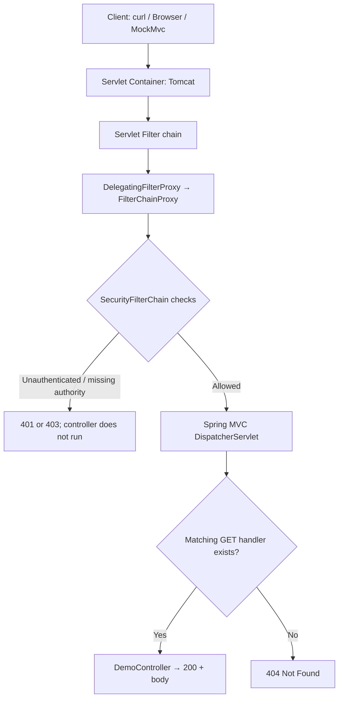

# Testing Public Endpoints, Protected Endpoints, and Initial Responses

> **Context:** Spring Boot 3.x + Spring MVC + Spring Security 6.x on the **Servlet stack**, Java 17 or newer. This lab builds a minimal application, sends the first HTTP requests, reads statuses/headers/bodies, and distinguishes security failures from routing failures. The goal is to **observe behavior**, understand why that outcome happens, and then lock it down with repeatable tests.

## 1. Desired Outcomes

After this lesson, you will be able to:

1. Start a Spring Boot Servlet application with Spring Web and Spring Security, and verify the server is listening for HTTP.
2. Create one public endpoint `GET /public` and two login-required endpoints: `GET /private` and `GET /admin`.
3. Call endpoints with no credentials, wrong credentials, and valid credentials using `curl`; interpret **200**, **401**, **403**, and **404**.
4. Explain the path **client → Servlet container → Spring Security filter chain → DispatcherServlet/Spring MVC → controller**.
5. Turn manual observations into `MockMvc` tests to catch unintended changes in security configuration.

Key point: **An endpoint's name does not determine access permissions.** A controller only defines how to handle a route; `SecurityFilterChain` decides which requests may proceed. In a new app with Spring Security, never assume a newly created route is automatically public.

## 2. Preparing the Servlet Project

Generate a project from Spring Initializr or use a working Spring Boot 3.x project with:

- **Language:** Java; **Java:** 17 or 21; **Build:** Gradle (Groovy DSL).
- **Dependencies:** Spring Web, Spring Security. To run the tests at the end, also add Spring Boot Starter Test and Spring Security Test.
- **Root package in the example:** `com.example.demo`. Place the `@SpringBootApplication` class in this root package so Spring scans the beans/controllers underneath.
- Use the project's bundled Gradle wrapper. No separate system-wide Gradle installation is required.

In `build.gradle` generated by Spring Initializr, the `dependencies` block looks like:

```groovy
dependencies {
    implementation 'org.springframework.boot:spring-boot-starter-web'
    implementation 'org.springframework.boot:spring-boot-starter-security'

    testImplementation 'org.springframework.boot:spring-boot-starter-test'
    testImplementation 'org.springframework.security:spring-security-test'
}
```

This snippet is **the dependencies section of a `build.gradle` that already has plugins and repositories** (not a standalone Gradle file). Use a Spring Boot 3.x version suited to your project and let Boot manage compatible starter/dependency versions.

Complete file structure for the example:

```text
src/
├── main/java/com/example/demo/
│   ├── SecurityDemoApplication.java
│   ├── DemoController.java
│   └── SecurityConfig.java
└── test/java/com/example/demo/
    └── SecurityEndpointsTest.java
```

Only the three files under `src/main` are needed to serve HTTP. The file under `src/test` automates verification later.

## 3. Creating the Application and Three Endpoints

**`src/main/java/com/example/demo/SecurityDemoApplication.java`**

```java
package com.example.demo;

import org.springframework.boot.SpringApplication;
import org.springframework.boot.autoconfigure.SpringBootApplication;

@SpringBootApplication
public class SecurityDemoApplication {
    public static void main(String[] args) {
        SpringApplication.run(SecurityDemoApplication.class, args);
    }
}
```

**`src/main/java/com/example/demo/DemoController.java`**

```java
package com.example.demo;

import java.security.Principal;
import org.springframework.web.bind.annotation.GetMapping;
import org.springframework.web.bind.annotation.RestController;

@RestController
public class DemoController {

    @GetMapping("/public")
    public String publicEndpoint() {
        return "PUBLIC_OK";
    }

    @GetMapping("/private")
    public String privateEndpoint(Principal principal) {
        return "PRIVATE_OK: " + principal.getName();
    }

    @GetMapping("/admin")
    public String adminEndpoint(Principal principal) {
        return "ADMIN_OK: " + principal.getName();
    }
}
```

`@RestController` lets Spring MVC return strings directly as the HTTP response body. `@GetMapping` defines HTTP method/path and `DispatcherServlet` locates the matching controller **if the request passes the security filters**. `Principal` in protected endpoints lets you observe the authenticated user's identity.

At this point, the controller code **does not say which endpoint is public or private**. Access permissions come from the security configuration below.

## 4. Defining Minimal Security Rules

**`src/main/java/com/example/demo/SecurityConfig.java`**

```java
package com.example.demo;

import org.springframework.context.annotation.Bean;
import org.springframework.context.annotation.Configuration;
import org.springframework.http.HttpMethod;
import org.springframework.security.config.Customizer;
import org.springframework.security.config.annotation.web.builders.HttpSecurity;
import org.springframework.security.core.userdetails.User;
import org.springframework.security.core.userdetails.UserDetailsService;
import org.springframework.security.crypto.factory.PasswordEncoderFactories;
import org.springframework.security.crypto.password.PasswordEncoder;
import org.springframework.security.provisioning.InMemoryUserDetailsManager;
import org.springframework.security.web.SecurityFilterChain;

@Configuration
public class SecurityConfig {

    @Bean
    SecurityFilterChain securityFilterChain(HttpSecurity http) throws Exception {
        return http
                .authorizeHttpRequests(authorize -> authorize
                        .requestMatchers(HttpMethod.GET, "/public").permitAll()
                        .requestMatchers(HttpMethod.GET, "/admin").hasRole("ADMIN")
                        .anyRequest().authenticated()
                )
                .httpBasic(Customizer.withDefaults())
                .build();
    }

    @Bean
    PasswordEncoder passwordEncoder() {
        return PasswordEncoderFactories.createDelegatingPasswordEncoder();
    }

    @Bean
    UserDetailsService userDetailsService(PasswordEncoder encoder) {
        var learner = User.withUsername("learner")
                .password(encoder.encode("demo-pass"))
                .roles("USER")
                .build();

        var admin = User.withUsername("admin")
                .password(encoder.encode("admin-pass"))
                .roles("ADMIN")
                .build();

        return new InMemoryUserDetailsManager(learner, admin);
    }
}
```

Explanation of each decision:

- **`requestMatchers(HttpMethod.GET, "/public").permitAll()`:** only `GET /public` is permitted without logging in. Switching to `POST /public` falls outside this rule.
- **`requestMatchers(HttpMethod.GET, "/admin").hasRole("ADMIN")`:** only authenticated users with role `ADMIN` may access `GET /admin`. `hasRole("ADMIN")` checks the `ROLE_ADMIN` authority generated by `.roles("ADMIN")`.
- **`anyRequest().authenticated()`:** all remaining requests require authentication, including `GET /private` and paths with no controller yet. Matcher order matters: place specific rules before `anyRequest()`.
- **`httpBasic(...)`:** enables HTTP Basic so you can test with `curl -u` and observe 401 challenges. The example does not enable form login, so it does not rely on the default login page.
- **`UserDetailsService`:** creates two in-memory users so tests produce deterministic results: `learner` has role `USER`, and `admin` has role `ADMIN`. `PasswordEncoder` encodes passwords before storing them in the user store.

The two passwords in the example are **learning data**, not a real account setup. HTTP Basic sends credentials Base64-encoded in a header; outside local environments, HTTPS and proper identity management are required.

Do not call `csrf.disable()`: all main tests use `GET`, so there is no need to disable default CSRF protection. When expanding to state-changing HTTP methods, evaluate CSRF against your actual authentication/session model.

## 5. Starting Up: Confirming the App Is Ready Before Testing Security

In the project root directory (where `gradlew` or `gradlew.bat` resides), run:

```bash
# macOS / Linux
./gradlew bootRun

# Windows PowerShell
.\gradlew.bat bootRun
```

If startup succeeds without changing port settings, the application listens on **localhost:8080**. In the console you may see logs like “Tomcat started on port 8080” and “Started SecurityDemoApplication”; exact wording and timing depend on versions and configuration.

Distinguish **server is running** from **endpoint returns 200**. A running application can still return 401, 403, or 404 for specific requests; those are HTTP processing outcomes, not proof that Boot failed to start.

If port 8080 is already in use, change `server.port` or stop the process holding the port and update the URL when running `curl`. Do not jump to diagnosing “Security is broken” when the client cannot even connect to the server.

## 6. Request Path Map



In real applications, error dispatches, authentication entry points, CSRF, and handler exceptions make the diagram more detailed. For the three `GET` routes in this lesson, this diagram suffices to explain the observed outcomes:

- `GET /public`: the `permitAll()` rule allows it through; MVC invokes `publicEndpoint()`.
- `GET /private` with no credentials: Security blocks it; MVC does not invoke `privateEndpoint()`.
- `GET /private` with valid credentials: Security authenticates; MVC invokes `privateEndpoint()` and receives `Principal`.
- `GET /admin` as user `learner`: authenticated yet missing role, so Security blocks before the controller.
- `GET /missing` with valid credentials: passes Security, yet MVC finds no handler, resulting in 404.

This is why **401/403 and 404 must be analyzed layer by layer**, instead of guessing from the URL name.

## 7. Manual Testing with curl

Open a second terminal while keeping the application running in the first. `-i` tells `curl` to show response headers too; `-u username:password` sends Basic credentials. In PowerShell, prefer `curl.exe` because `curl` may point to the `Invoke-WebRequest` alias in some environments.

### Test 1 — Public Endpoint

```bash
curl -i http://localhost:8080/public

# Windows PowerShell:
curl.exe -i http://localhost:8080/public
```

**Expected:** status **200 OK**, exact body:

```text
PUBLIC_OK
```

You sent no `Authorization` header, yet the request reached MVC thanks to `permitAll()`. **Public does not mean bypassing the Spring Security filter chain**; it means Security allows the request to continue.

### Test 2 — Protected Endpoint, Unauthenticated

```bash
curl -i http://localhost:8080/private

# Windows PowerShell:
curl.exe -i http://localhost:8080/private
```

**Expected:** status **401 Unauthorized**. With HTTP Basic, there is normally a challenge header like:

```http
HTTP/1.1 401
WWW-Authenticate: Basic realm="Realm"
```

Realm name, response body, and other headers vary by configuration. Here the key answer is **401**: Security requires valid credentials; `privateEndpoint()` **did not run**.

### Test 3 — Protected Endpoint, Wrong Credentials

```bash
curl -i -u learner:wrong-pass http://localhost:8080/private

# Windows PowerShell:
curl.exe -i -u learner:wrong-pass http://localhost:8080/private
```

**Expected:** **401 Unauthorized**. Sending an `Authorization` header does not mean authentication succeeded. The password does not match `UserDetailsService`/`PasswordEncoder`, so Security establishes no valid identity.

### Test 4 — Protected Endpoint, Valid Credentials

```bash
curl -i -u learner:demo-pass http://localhost:8080/private

# Windows PowerShell:
curl.exe -i -u learner:demo-pass http://localhost:8080/private
```

**Expected:** status **200 OK**, exact body:

```text
PRIVATE_OK: learner
```

Now a valid `Authentication` is placed into the request context; after Security lets it through, MVC invokes the controller and the `Principal` parameter supplies the name `learner`.

### Test 5 — Authenticated, Missing ADMIN Authority

```bash
curl -i -u learner:demo-pass http://localhost:8080/admin

# Windows PowerShell:
curl.exe -i -u learner:demo-pass http://localhost:8080/admin
```

**Expected:** **403 Forbidden**. User `learner` has `ROLE_USER`, while the endpoint requires `ROLE_ADMIN`. This is a crucial lesson: **401 typically relates to lacking valid authentication; 403 typically relates to access denied after already authenticating**.

### Test 6 — Sufficient ADMIN Authority

```bash
curl -i -u admin:admin-pass http://localhost:8080/admin

# Windows PowerShell:
curl.exe -i -u admin:admin-pass http://localhost:8080/admin
```

**Expected:** status **200 OK**, body:

```text
ADMIN_OK: admin
```

Same URL and HTTP method, yet changing the caller's authority shifts the response from 403 → 200. This shows role authorization lives in Security, even though `adminEndpoint()` performs no role check itself.

### Test 7 — No Handler, Yet Authenticated

```bash
curl -i -u learner:demo-pass http://localhost:8080/missing

# Windows PowerShell:
curl.exe -i -u learner:demo-pass http://localhost:8080/missing
```

**Expected:** **404 Not Found**. Security lets the logged-in user continue under `anyRequest().authenticated()`, yet MVC finds no route for `/missing`.

If you try `GET /missing` **without credentials**, you can get **401 before ever having a chance at 404**: security filters inspect the request before MVC resolves a controller. Therefore, to test routing of protected paths, you must pass Security first.

## 8. Comparison Table of Initial Responses

| Request | Credentials | Expected HTTP status | Layer explanation |
|---|---|---:|---|
| `GET /public` | None | **200** | Security allows through; MVC returns `PUBLIC_OK` |
| `GET /private` | None | **401** | Security requests HTTP Basic |
| `GET /private` | `learner` + wrong password | **401** | Authentication failed |
| `GET /private` | `learner` + right password | **200** | Authentication succeeded; MVC returns `PRIVATE_OK: learner` |
| `GET /admin` | `learner` + right password | **403** | Authenticated but missing `ROLE_ADMIN` |
| `GET /admin` | `admin` + right password | **200** | Has role; MVC returns `ADMIN_OK: admin` |
| `GET /missing` | `learner` + right password | **404** | Security allows through, yet MVC has no handler |
| `GET /missing` | None | **401** | Security blocks before MVC |

**Read responses in three parts:** status reflects processing outcome; headers show challenges, content type, or HTTP policies; body is the payload produced by the controller or error mechanism. `curl -i` lets you see all three. Do not write tests comparing entire header strings, because header ordering and values depend on server/version; here verify status, essential body, and characteristic headers.

Nor do `401` and `403` hold absolute meanings across every authentication mechanism. When form login is configured and a browser sends `Accept: text/html`, an unauthenticated request may receive a **302 redirect** to the login page. This lesson deliberately enables **HTTP Basic** and examines only `GET`s for clear, repeatable observations.

## 9. Comparing Against Spring Boot's Initial Defaults

Three states to distinguish when getting started with Spring Security:

1. **Only Spring Web added, no Security yet:** Controller-mapped endpoints usually have no Spring Security authentication layer; even `GET /private` can return 200 despite being named “private.” This is not a secured application.
2. **Spring Security starter added without declaring `SecurityFilterChain`:** Spring Boot typically applies defaults protecting requests with authentication; in development you may see a temporary user password generated and logged. Depending on content negotiation and default login mechanisms, clients can get HTTP 401 or 302. `GET /public` **does not become public just because it is named public**.
3. **`SecurityFilterChain` declared as in the example:** Clear rules: `GET /public` is public, `GET /admin` requires `ROLE_ADMIN`, and remaining requests require authentication. Observed test outputs are detailed in sections 7–8.

When defining your own chain, you are responsible for ensuring all protected URLs are covered. `requestMatchers(...)` inside `authorizeHttpRequests` are **authorization** rules; `http.securityMatcher(...)` (if used) limits **the selection scope of a SecurityFilterChain**. A URL matching no chain can go unprotected by Spring Security, even with the starter present.

## 10. Repeatable Testing with MockMvc

`curl` helps you understand real behavior and headers over HTTP; `MockMvc` lets you test endpoints and Spring Security filters in a test environment without running a server on port 8080. Ensure the two test dependencies listed in `build.gradle` are present.

**`src/test/java/com/example/demo/SecurityEndpointsTest.java`**

```java
package com.example.demo;

import org.junit.jupiter.api.Test;
import org.springframework.beans.factory.annotation.Autowired;
import org.springframework.boot.test.autoconfigure.web.servlet.AutoConfigureMockMvc;
import org.springframework.boot.test.context.SpringBootTest;
import org.springframework.test.web.servlet.MockMvc;

import static org.springframework.security.test.web.servlet.request.SecurityMockMvcRequestPostProcessors.httpBasic;
import static org.springframework.test.web.servlet.request.MockMvcRequestBuilders.get;
import static org.springframework.test.web.servlet.result.MockMvcResultMatchers.content;
import static org.springframework.test.web.servlet.result.MockMvcResultMatchers.status;

@SpringBootTest
@AutoConfigureMockMvc
class SecurityEndpointsTest {

    @Autowired
    private MockMvc mockMvc;

    @Test
    void publicEndpointIsAvailableAnonymously() throws Exception {
        mockMvc.perform(get("/public"))
                .andExpect(status().isOk())
                .andExpect(content().string("PUBLIC_OK"));
    }

    @Test
    void privateEndpointRejectsAnonymous() throws Exception {
        mockMvc.perform(get("/private"))
                .andExpect(status().isUnauthorized());
    }

    @Test
    void privateEndpointRejectsWrongPassword() throws Exception {
        mockMvc.perform(get("/private").with(httpBasic("learner", "wrong-pass")))
                .andExpect(status().isUnauthorized());
    }

    @Test
    void privateEndpointAcceptsValidCredentials() throws Exception {
        mockMvc.perform(get("/private").with(httpBasic("learner", "demo-pass")))
                .andExpect(status().isOk())
                .andExpect(content().string("PRIVATE_OK: learner"));
    }

    @Test
    void adminEndpointRejectsAuthenticatedLearner() throws Exception {
        mockMvc.perform(get("/admin").with(httpBasic("learner", "demo-pass")))
                .andExpect(status().isForbidden());
    }

    @Test
    void adminEndpointAcceptsAdmin() throws Exception {
        mockMvc.perform(get("/admin").with(httpBasic("admin", "admin-pass")))
                .andExpect(status().isOk())
                .andExpect(content().string("ADMIN_OK: admin"));
    }

    @Test
    void unknownPathAfterAuthenticationReturns404() throws Exception {
        mockMvc.perform(get("/missing").with(httpBasic("learner", "demo-pass")))
                .andExpect(status().isNotFound());
    }
}
```

Run tests from the project directory:

```bash
# macOS / Linux
./gradlew test

# Windows PowerShell
.\gradlew.bat test
```

With a compatible Spring Boot 3.x configuration and Gradle wrapper, Gradle is expected to report **BUILD SUCCESSFUL** with seven passing tests. That is the **expected result when running the code in the project**, not a pre-executed log from this article. The `httpBasic(...)` test helper builds a Basic Authorization header for the `MockMvc` request; thus it exercises the HTTP authentication flow rather than calling a controller Java method directly.

If a test merely calls `new DemoController().privateEndpoint(...)`, it **does not pass through `SecurityFilterChain`**, so it will not detect a case where an endpoint accidentally becomes public. The goal of these tests is to verify behavior from an HTTP client's perspective.

## 11. When Results Differ from Expectations, Diagnose Layer by Layer

### 11.1. Connection Refused or No HTTP Response

This is usually a **startup/network** issue, not an authentication result. Check whether `bootRun` is still running, whether there is a port conflict, whether you targeted `localhost:8080`, and whether the app changed `server.port`/context path. `curl` cannot get a 401 if the server is not serving HTTP.

### 11.2. `GET /public` Returns 401

Check whether the `SecurityFilterChain` bean loaded; whether the matcher uses **GET**, exact `/public`, and sits before `anyRequest()`. If `SecurityConfig` lies outside `@SpringBootApplication`'s component scan package, Boot may fall back to default configuration. Do not try to fix it by putting `@PermitAll` on the controller and assuming the HTTP filter will adapt automatically; inspect the active Security policy.

### 11.3. `GET /private` Returns 200 Without Credentials

Re-check the Security starter, filter chain configuration, whether `permitAll()` is overly broad, whether the app matches the right chain, and whether the request carries an existing session/cookie. An endpoint returning 200 does not prove it is properly secured; test in a fresh client with no cookies or Authorization header.

### 11.4. `GET /private` Returns 401 Even with Credentials Sent

Verify exact username/password, password encoding, and that the request actually carries the Basic Authorization header. `curl -u` corresponds to the users in the memory store; a Basic header differs from a Bearer token. Do not confuse 401 with 403: 401 here means valid authentication could not be established.

### 11.5. `GET /admin` Returns 403 for User `learner`

This is **as designed in the example**: `learner` has `ROLE_USER`, not `ROLE_ADMIN`. Compare with user `admin`. When using `hasRole("ADMIN")`, Spring Security checks for an authority with the `ROLE_` prefix; do not add that prefix a second time to the role name inside `hasRole`.

### 11.6. A URL Unexpectedly Returns 404, 405, or 403

- **404 Not Found:** no matching handler/path (after Security lets the request proceed), or a context path/routing issue.
- **405 Method Not Allowed:** the path exists, but does not support that HTTP method. `@GetMapping` is not `@PostMapping`.
- **403 Forbidden:** either missing authority or, on state-changing methods, rejected by the CSRF filter. This introductory lab uses only `GET` to eliminate the CSRF variable.
- A request without credentials can get **401 before MVC ever gets a chance to return 404/405**. Authenticate first when checking protected routes.

Do not disable CSRF just to make a `POST` test “stop returning 403.” Determine whether requests use session cookies, HTTP Basic, bearer tokens, or another mechanism, and choose a CSRF policy suited to the real model.

### 11.7. Browser Shows a Login Page Instead of 401

If instead of this lesson's HTTP Basic setup you enabled **form login** (or relied on Boot's default), browser responses can be a **302 redirect** to the login page. Check the `Location` header, `Accept` header, and enabled authentication mechanisms. Distinguish a **redirect** from connection errors or 404; not every client sees the same interface.

### 11.8. Headers and Body Differ from Illustrative Snapshots

HTTP version, `Content-Type`, `Cache-Control`, `X-Content-Type-Options`, `WWW-Authenticate`, error page bodies, or header order can vary by version. For this lesson, verify **status**, the exact bodies `PUBLIC_OK`/`PRIVATE_OK: learner`/`ADMIN_OK: admin`, and whether the controller was invoked; assert specific headers only when they belong to the configuration under test.

## 12. Why Do Both 401 and 403 Happen Even Without Controller Checks?

At the Servlet layer, `DelegatingFilterProxy` delegates to Spring bean `FilterChainProxy`, which selects a `SecurityFilterChain` and executes security filters. Depending on the situation, filters can:

1. Read `Authorization: Basic ...`, verify credentials, and construct an `Authentication`.
2. Store that authentication in the `SecurityContext` for the request.
3. Evaluate `authorizeHttpRequests`: is anonymous allowed, and does the user have the required role?
4. Send a blocking response or let the request proceed to `DispatcherServlet`.

Only if permitted to proceed does Spring MVC pick a handler via `@GetMapping` and invoke the Java method. Authentication/authorization executes **before the controller**, so MVC's `@ControllerAdvice` does not automatically handle responses generated inside security filters. Conversely, even for an authenticated request, the controller can still return business errors or MVC 404/405.

These `GET` examples do not yet cover persisting `SecurityContext` across requests. HTTP Basic is used here to supply credentials per test request; in production applications, session/stateless configuration, CSRF, and identity providers must be designed to fit specific requirements.

## 13. Hands-On Self-Verification Exercises

1. **Add a public endpoint:** add `@GetMapping("/health")` returning `"HEALTH_OK"`; add `"/health"` to the `permitAll()` rule. Observe `GET /health` without credentials returning 200, then remove the public rule and observe it requiring login.
2. **Test a role change:** call `/admin` as `learner` and then as `admin`. Record the statuses and explain why the same URL returns 403 and 200.
3. **Test routing errors with authentication:** call `/no-such-path` without credentials and then with valid credentials. Compare 401 and 404 to identify which layer responds first.
4. **Swap matcher order:** if `anyRequest().authenticated()` is accidentally placed before specific rules, authorization configuration can become invalid or specific rules will not apply as intended. Restore the order: specific URLs first, fallback last.
5. **Add a test:** write a test for `GET /missing` without credentials expecting 401; explain why a URL with no controller still gets a response from Security before MVC.

After each change, re-run `./gradlew test` and use `curl -i` to cross-check. Never rely on a single status code alone to declare success: a public endpoint must return the right content anonymously, and a private endpoint must block anonymous access **and** let valid users through.

## 14. Takeaways Before Learning Advanced Configuration

- **Spring Boot** bootstraps the application and server; the **Servlet Container** receives HTTP; **Spring Security filters** decide whether a request continues or is denied; **Spring MVC** locates the handler and returns content.
- **200:** the controller successfully processed an allowed request. **401:** valid credentials are required. **403:** access denied by permissions (or CSRF). **404:** no handler found after passing earlier layers.
- `permitAll()` still traverses security filters; `authenticated()` requires an identity; `hasRole("ADMIN")` requires the matching role.
- For the code in this lesson, the minimal test sequence worth remembering is: **public anonymous → 200**, **private anonymous → 401**, **private learner → 200**, **admin learner → 403**, **admin admin → 200**, **missing learner → 404**.
- Starting with real requests and verifying with `MockMvc` catches differences early between **“the application starts”** and **“the endpoints are properly secured”**.