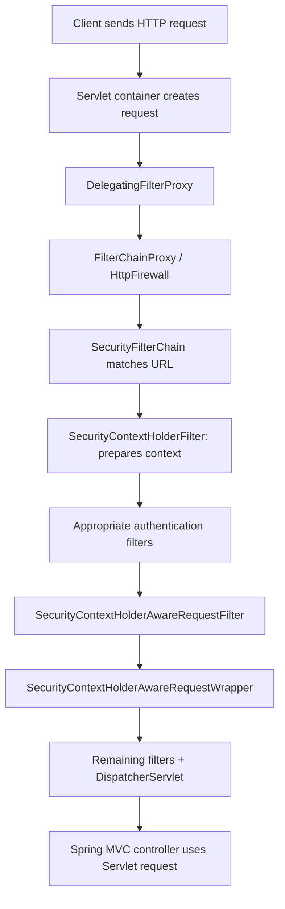

# SecurityContextHolderAwareRequestFilter and Servlet Request Wrappers

> **Scope:** Spring Security **Servlet** + Spring MVC, Java 17+, Spring Boot 3.x, and Spring Security 6.x. Learn how Spring Security bridges `SecurityContext` to standard `HttpServletRequest` security methods through `SecurityContextHolderAwareRequestFilter` and `SecurityContextHolderAwareRequestWrapper`; distinguish them from other request wrappers; and understand filter ordering, Servlet API programmatic authentication, and async behavior.

## 1. Practical Problem: Does a Servlet Request Know the Identity Authenticated by Spring Security?

In Spring MVC, a controller can use standard Servlet APIs:

```java
@GetMapping("/my-profile")
public String profile(HttpServletRequest request) {
    return request.getRemoteUser();
}
```

However, the Servlet container creates the request before Spring Security processes authentication. If an application authenticates via HTTP Basic, form login, sessions, OAuth2/OIDC, or a custom **Spring Security** authentication provider, the raw container request **does not necessarily** know about Spring's `Authentication`. Why, then, do `getRemoteUser()`, `getUserPrincipal()`, and `isUserInRole()` still work properly inside the controller?

**The answer is Servlet API integration.** `SecurityContextHolderAwareRequestFilter` wraps the request in a `SecurityContextHolderAwareRequestWrapper` so standard Servlet security methods reflect the information in `SecurityContextHolder`.

Key methods:

- `request.getRemoteUser()`: returns the authenticated user's name, or `null` when no suitable user is present.
- `request.getUserPrincipal()`: returns the `Principal` integrated with the request by Spring Security (typically `Authentication`), or `null` for anonymous callers.
- `request.isUserInRole("ADMIN")`: checks roles against `GrantedAuthority` and the role prefix convention.
- `request.authenticate(response)`: supports Servlet programmatic authentication using the configured mechanism.
- `request.login(username, password)`: supports programmatic login per the Servlet API.
- `request.logout()`: supports programmatic logout, subject to the semantics and limits of the configured handlers.

**Do not confuse responsibilities:** a request wrapper is **not an authentication provider**; it does not verify passwords, grant roles, or create authorization policies. It simply acts as a *bridge* so the Servlet API sees the authentication already managed by Spring Security.

## 2. Components That Must Be Kept Separate

### 2.1. SecurityContextHolder, SecurityContext, and Authentication

`SecurityContextHolder` is the API for retrieving the `SecurityContext` for the current execution thread. `SecurityContext` holds `Authentication`, when present:

```java
Authentication auth =
        SecurityContextHolder.getContext().getAuthentication();
```

`Authentication` holds the identifier name (`getName()`), the inner principal (`getPrincipal()`), the list of authorities (`getAuthorities()`), and provider-specific details. This is **Spring Security** state, not an intrinsic property of the raw `HttpServletRequest`.

In a typical Servlet application, the security context is prepared by security filters such as `SecurityContextHolderFilter` and backed by a `SecurityContextRepository`. In older configurations/versions you may encounter `SecurityContextPersistenceFilter`. Persisting context across requests depends on the session/repository and persistence policy, not on the request wrapper itself.

**Anonymous note:** when `AnonymousAuthenticationFilter` is active, `SecurityContextHolder` may contain an `AnonymousAuthenticationToken`. This token can report `isAuthenticated() == true` even though the user has not genuinely logged in. Therefore, never conclude "logged in" from `auth != null && auth.isAuthenticated()` alone. Use authorization rules, `AuthenticationTrustResolver`, or Servlet-aware principal semantics as appropriate.

### 2.2. Servlet API and the Container Request

The methods:

```java
String remoteUser = request.getRemoteUser();
Principal user = request.getUserPrincipal();
boolean admin = request.isUserInRole("ADMIN");
```

belong to the Servlet specification. A container using container-managed authentication can supply identities to them directly. When Spring Security owns authentication, it is normal for the raw container not to know that identity. Spring Security provides a request wrapper to align the view at the Servlet API layer.

### 2.3. SecurityContextHolderAwareRequestFilter

`SecurityContextHolderAwareRequestFilter` is a filter in `org.springframework.security.web.servletapi`. It receives `HttpServletRequest`, creates or supplies a security-aware request wrapper, and passes the wrapped request down the `FilterChain`. The wrapper inherits/delegates normal HTTP behavior while implementing security methods backed by Spring's `SecurityContext`.

Key characteristics:

1. It **wraps the request**; it does not load users from a database or compare passwords.
2. It must reside inside the **SecurityFilterChain that actually matches the request**.
3. Standard security APIs in **filters/controllers running after the wrapper** can observe Spring authentication.
4. Custom filters running **before the wrapper** may observe the container principal or `null` instead of the Spring principal.
5. If a route is excluded from the entire security filter chain, this integration may be absent on that route.

### 2.4. SecurityContextHolderAwareRequestWrapper

`SecurityContextHolderAwareRequestWrapper` extends `HttpServletRequestWrapper`. The key idea is **selective delegation**: request paths, headers, parameters, and ordinary APIs still delegate to the underlying request, whereas security methods use Spring Security semantics.

`getUserPrincipal()` typically exposes `Authentication` as a `Principal`. **Do not cast it by default** to an entity/domain user. If you need `UserDetails` or `OidcUser`, inspect `Authentication#getPrincipal()` appropriately or use `@AuthenticationPrincipal`, then map to a verified business object.

## 3. Filter Ordering and Request Flow



This diagram illustrates **responsibilities and relative positioning** for learning, not a fixed filter order for every application: real security chains also include CORS, CSRF, logout, anonymous, session management, exception translation, authorization, and custom filters, and there may be multiple chains. When debugging, inspect the chain that matches the request and its actual order.

| Component | Primary Responsibility | What It Does Not Do |
| --- | --- | --- |
| `DelegatingFilterProxy` | Bridges the Servlet container to a Spring-managed filter | Does not decide username/password itself |
| `FilterChainProxy` | Selects and executes security filter chains | Does not replace each chain's authorization policy |
| `HttpFirewall` / `FirewalledRequest` | Validates/normalizes request characteristics for security matching | Does not make a user authenticated |
| `SecurityContextHolderFilter` | Prepares and clears Spring security context per repository | Does not wrap the Servlet API request itself |
| Authentication filters | Verify credentials or restore auth state | Do not decide all business permissions |
| `SecurityContextHolderAwareRequestFilter` | Wraps request so Servlet security methods reflect Spring context | Does not verify passwords or authorize |
| `AuthorizationFilter` | Enforces access rules based on authentication | Does not replace the Servlet request wrapper |
| `DispatcherServlet` | Routes requests to Spring MVC | Does not grant authentication itself |

### 3.1. How Does Position Before/After the Wrapper Matter?

Suppose a custom logging filter positioned before `SecurityContextHolderAwareRequestFilter` calls `request.getUserPrincipal()`. It may receive `null` because the request has not been wrapped yet. Later, inside a controller, the exact same logic can return Spring Security's principal. This is **positional wrapper difference**, not necessarily Spring Security losing context.

If you need to read the Servlet-aware principal in a custom filter, you can place it **after** `SecurityContextHolderAwareRequestFilter` in the chain as intended:

```java
http.addFilterAfter(
        new AuditRequestFilter(),
        SecurityContextHolderAwareRequestFilter.class
);
```

This is a **positional configuration snippet**, not a standalone class; `AuditRequestFilter` must be defined and relevant classes imported. Avoid defining a filter bean that Spring Boot auto-registers in the Servlet container while also adding it to the Security chain uncontrolled, as the filter may execute **twice** at different positions.

### 3.2. permitAll vs. Bypassing the Security Chain

`.requestMatchers("/public").permitAll()` simply allows all users to access the URL; requests still pass through security filters, receiving headers, context, and the wrapper. Conversely, `web.ignoring()` or a security matcher that keeps a path **out of the chain** can omit Servlet API integration altogether. That explains why a `permitAll` public endpoint still sees `getUserPrincipal()` when a user sends valid credentials, whereas an ignored route might not.

Do not rush to exclude paths from the Security chain as an "optimization" if the endpoint still needs security headers, context integration, or auditing. Clearly distinguish **permit** from **bypass**.

## 4. Servlet Request Wrappers: Not Every Wrapper Is a Security Wrapper

### 4.1. ServletRequestWrapper and HttpServletRequestWrapper

`jakarta.servlet.ServletRequestWrapper` and `jakarta.servlet.http.HttpServletRequestWrapper` are adapters for Servlet requests. A wrapper holds a reference to an inner request and forwards any methods it does not override. Frameworks use them to add behavior without rewriting the entire Servlet API.

Minimal Java 17 wrapper example:

```java
package com.example.servletwrap;

import jakarta.servlet.http.HttpServletRequest;
import jakarta.servlet.http.HttpServletRequestWrapper;

public final class RequestTagWrapper extends HttpServletRequestWrapper {
    private final String requestTag;

    public RequestTagWrapper(HttpServletRequest original, String requestTag) {
        super(original);
        this.requestTag = requestTag;
    }

    public String getRequestTag() {
        return requestTag;
    }
}
```

The wrapper above only adds `requestTag`; security methods continue delegating to the wrapped inner request. It does **not** alter roles, principal, or session on its own. When wrapping outside `SecurityContextHolderAwareRequestWrapper`, proper delegation preserves Spring Security semantics.

### 4.2. FirewalledRequest and SecurityContextHolderAwareRequestWrapper

`FirewalledRequest` is an abstraction created by `HttpFirewall` for safe request handling inside `FilterChainProxy`. `StrictHttpFirewall` can reject requests that violate URL, HTTP method, or header rules; that is completely distinct from **Servlet security-aware principals**.

Multiple layers can exist on a single request:

```text
HttpServletRequest at Controller
  -> wrapper added by filter/tracing
      -> SecurityContextHolderAwareRequestWrapper
          -> FirewalledRequest
              -> Servlet container's HttpServletRequest
```

This is **an illustrative diagram**, not a guarantee that every application has that exact layer stack or order. Frameworks, Servlet containers, reverse proxy integrations, Spring MVC, and custom filters may add or reorder wrappers.

### 4.3. ContentCachingRequestWrapper Is Not a Security Wrapper

`ContentCachingRequestWrapper` from Spring Web helps cache the request body in appropriate contexts for logging or reading payloads. It does **not** provide authentication and does not replace `SecurityContextHolderAwareRequestWrapper`. If a filter wraps a request to read its payload without proper delegation, application code can lose principal info, parameters, or dispatch semantics.

**Never unwrap the request** back to the raw container request just to avoid wrappers. Doing so can bypass security-aware methods, cached bodies, or valid framework normalizations. Never hard-cast a request to a specific wrapper class or rely on class names: wrappers vary by container, filter order, and middleware.

## 5. Understanding the Servlet Security Methods Precisely

### 5.1. getRemoteUser()

```java
String username = request.getRemoteUser();
```

When an authenticated Spring principal is present and the request has passed through the wrapper, this name typically equals `Authentication#getName()`. It may be a username, subject, or provider-assigned identifier, **not always an email**. If no suitable user is present, the value may be `null`. Never rely on this returned string as the sole authorization decision when the application needs tenant or object permissions.

### 5.2. getUserPrincipal()

```java
Principal principal = request.getUserPrincipal();
```

`Principal` is a standard Java interface. With Spring Security integration, the returned principal can be an authenticated `Authentication`. In turn, `Authentication#getPrincipal()` can hold `UserDetails`, a custom user, `OidcUser`, or a username string depending on the provider.

If you need authorities from Spring:

```java
Principal principal = request.getUserPrincipal();
if (principal instanceof Authentication auth) {
    Collection<? extends GrantedAuthority> granted =
            auth.getAuthorities();
}
```

This is a **snippet inside a method** requiring imports for `Principal`, `Authentication`, and `GrantedAuthority`. It is not a standalone Java program. Avoid casting like this:

```java
// Incorrect for all authentication providers:
MyDomainUser user = (MyDomainUser) request.getUserPrincipal();
```

In Spring MVC, you can use `@AuthenticationPrincipal` or an `Authentication` parameter to work with Spring-specific identity, then look up the domain user by verified ID.

### 5.3. isUserInRole(String role)

```java
boolean hasAdmin = request.isUserInRole("ADMIN");
```

Under common Spring Security defaults:

- `User.withUsername("admin").roles("ADMIN")` creates the `ROLE_ADMIN` authority.
- `isUserInRole("ADMIN")` checks the role using the prefix convention and typically returns `true` when `ROLE_ADMIN` is present.
- `hasRole("ADMIN")` in authorization DSL uses the corresponding prefix convention.
- `hasAuthority("SCOPE_read")` matches an exact authority string and is **not automatically equivalent** to `isUserInRole("read")`.
- Customizing the role prefix or authorities mapper can change the outcome; keep configuration aligned and test empirically.

**This is a query API**; it does not protect routes on its own. If a controller only hides an admin button when `isUserInRole` is true while the server lacks an authorization rule, users can still call the admin URL directly.

### 5.4. authenticate(response)

```java
boolean ok = request.authenticate(response);
```

This is the Servlet API for **programmatic authentication**. Through Spring Security's Servlet API integration, it can trigger the configured authentication mechanism or entry point. In some cases it mutates the response with a challenge or redirect; behavior depends on the configured mechanism.

Never use `request.authenticate(response)` as a harmless way to "ask" whether a user has a role. To inspect identity, use principal/authorization APIs; to protect URLs, use `authorizeHttpRequests` and method security.

### 5.5. login(username, password) and logout()

```java
request.login(username, password);
request.logout();
```

Both APIs belong to the Servlet contract; Spring Security integration can delegate them to the corresponding authentication and logout handling. Things to verify:

- Programmatic login differs from submitting a form through `UsernamePasswordAuthenticationFilter` or OAuth2 login. It must align with the app's authentication manager, context repository, session-fixation protection, CSRF, and error handling.
- `request.logout()` does not guarantee **all** custom `LogoutFilter` handlers, cookie cleanup, remember-me cleanup, token revocation, or OIDC logout at the identity provider behave identically to a configured logout endpoint.
- For session-based web apps, prefer `POST /logout` via Spring Security `logout()` with a CSRF token rather than creating a custom GET logout endpoint.
- Logout only manages login/session state by design; it does not delete or lock the user in the database.

Never construct a `UsernamePasswordAuthenticationToken` with ADMIN privileges and place it into `SecurityContextHolder` simply because a request supplied a username; that is not secure authentication.

## 6. Runnable Example: Spring Boot 3.4, Java 17, SecurityFilterChain, and Servlet API

This example runs HTTP Basic so responses can be inspected easily from a terminal without a database. The Spring MVC controller uses `HttpServletRequest` directly. The accounts/passwords below are **for local testing only**, never for production.

### 6.1. Gradle

File `settings.gradle`:

```groovy
rootProject.name = 'servlet-request-demo'
```

File `build.gradle`:

```groovy
plugins {
    id 'java'
    id 'org.springframework.boot' version '3.4.2'
    id 'io.spring.dependency-management' version '1.1.7'
}

group = 'com.example'
version = '0.0.1-SNAPSHOT'

java {
    toolchain {
        languageVersion = JavaLanguageVersion.of(17)
    }
}

repositories {
    mavenCentral()
}

dependencies {
    implementation 'org.springframework.boot:spring-boot-starter-web'
    implementation 'org.springframework.boot:spring-boot-starter-security'
    testImplementation 'org.springframework.boot:spring-boot-starter-test'
    testImplementation 'org.springframework.security:spring-security-test'
}

tasks.named('test') {
    useJUnitPlatform()
}
```

Spring Boot 3.x uses `jakarta.servlet` instead of the older `javax.servlet`. When integrating into an existing project, follow the project's unified dependency management rather than mixing framework versions arbitrarily.

### 6.2. Spring Boot Entry Point

File `src/main/java/com/example/servletwrap/RequestDemoApplication.java`:

```java
package com.example.servletwrap;

import org.springframework.boot.SpringApplication;
import org.springframework.boot.autoconfigure.SpringBootApplication;

@SpringBootApplication
public class RequestDemoApplication {
    public static void main(String[] args) {
        SpringApplication.run(RequestDemoApplication.class, args);
    }
}
```

### 6.3. Enabling Servlet API Integration

File `src/main/java/com/example/servletwrap/SecurityConfig.java`:

```java
package com.example.servletwrap;

import org.springframework.context.annotation.Bean;
import org.springframework.context.annotation.Configuration;
import org.springframework.security.config.Customizer;
import org.springframework.security.config.annotation.web.builders.HttpSecurity;
import org.springframework.security.core.userdetails.User;
import org.springframework.security.core.userdetails.UserDetails;
import org.springframework.security.core.userdetails.UserDetailsService;
import org.springframework.security.crypto.PasswordEncoder;
import org.springframework.security.crypto.factory.PasswordEncoderFactories;
import org.springframework.security.provisioning.InMemoryUserDetailsManager;
import org.springframework.security.web.SecurityFilterChain;

@Configuration
public class SecurityConfig {
    @Bean
    PasswordEncoder passwordEncoder() {
        return PasswordEncoderFactories.createDelegatingPasswordEncoder();
    }

    @Bean
    UserDetailsService users(PasswordEncoder encoder) {
        UserDetails viewer = User.withUsername("viewer")
                .password(encoder.encode("viewer-pass"))
                .roles("VIEWER")
                .build();

        UserDetails admin = User.withUsername("admin")
                .password(encoder.encode("admin-pass"))
                .roles("ADMIN")
                .build();

        return new InMemoryUserDetailsManager(viewer, admin);
    }

    @Bean
    SecurityFilterChain securityFilterChain(HttpSecurity http)
            throws Exception {

        return http
                .authorizeHttpRequests(auth -> auth
                        .requestMatchers("/public").permitAll()
                        .requestMatchers("/admin/**").hasRole("ADMIN")
                        .anyRequest().authenticated()
                )
                .httpBasic(Customizer.withDefaults())
                .servletApi(Customizer.withDefaults())
                .build();
    }
}
```

**The focal point is `.servletApi(Customizer.withDefaults())`.** In Spring Security 6, this configures Servlet API / `SecurityContextHolderAwareRequestFilter` integration in the chain. Whether `httpBasic()` checks credentials is a separate concern. `hasRole("ADMIN")` is the actual **protection rule** for `/admin/**`. Some versions/default setups already enable Servlet API integration; declaring it explicitly here clarifies the learning intent.

`DelegatingPasswordEncoder` hashes the demo accounts' passwords. Each startup may generate a different salt, while the login password remains the configured test string. All demo requests are GET, so no CSRF token is required; when adding state-changing POST endpoints, keep CSRF protection enabled and handle tokens properly.

### 6.4. Controller Reading the Servlet Request

File `src/main/java/com/example/servletwrap/RequestController.java`:

```java
package com.example.servletwrap;

import java.security.Principal;
import java.util.LinkedHashMap;
import java.util.Map;

import jakarta.servlet.http.HttpServletRequest;
import org.springframework.web.bind.annotation.GetMapping;
import org.springframework.web.bind.annotation.RestController;

@RestController
public class RequestController {
    @GetMapping("/public")
    public Map<String, Object> publicPage(HttpServletRequest request) {
        return snapshot(request);
    }

    @GetMapping("/me")
    public Map<String, Object> profile(HttpServletRequest request) {
        return snapshot(request);
    }

    @GetMapping("/admin/panel")
    public Map<String, Object> adminPanel(HttpServletRequest request) {
        return snapshot(request);
    }

    private Map<String, Object> snapshot(HttpServletRequest request) {
        Principal p = request.getUserPrincipal();
        Map<String, Object> result = new LinkedHashMap<>();
        result.put("remoteUser", request.getRemoteUser());
        result.put("principalName", p == null ? null : p.getName());
        result.put("viewer", request.isUserInRole("VIEWER"));
        result.put("admin", request.isUserInRole("ADMIN"));
        return result;
    }
}
```

`LinkedHashMap` is used because it accepts `null` values for anonymous `remoteUser` and `principalName`. Using `Map.of(...)` with any null value would throw `NullPointerException`, which could easily be misdiagnosed as a Spring Security bug. The code **does not block `/admin/panel` itself**; the rule in `SecurityConfig` handles that before the controller is invoked.

### 6.5. Running and Reading Responses

If the project includes the Gradle Wrapper:

```bash
# Linux/macOS
./gradlew bootRun

# Windows PowerShell
.\gradlew.bat bootRun
```

Test against the default backend `http://localhost:8080`:

```bash
curl -i http://localhost:8080/public
curl -i http://localhost:8080/me
curl -i -u viewer:viewer-pass http://localhost:8080/me
curl -i -u viewer:viewer-pass http://localhost:8080/admin/panel
curl -i -u admin:admin-pass http://localhost:8080/admin/panel
```

| Request | Expected HTTP Status | Meaning |
| --- | --- | --- |
| Public without credentials | 200 | `permitAll` route, anonymous/null principal |
| /me without credentials | 401 with HTTP Basic challenge | Unauthenticated |
| /me with viewer | 200 | User `viewer` has `ROLE_VIEWER` |
| /admin/panel with viewer | 403 | Missing `ROLE_ADMIN`, so controller does not run |
| /admin/panel with admin | 200 | User `admin` has `ROLE_ADMIN` |

JSON body for `GET /public` without credentials:

```json
{
  "remoteUser": null,
  "principalName": null,
  "viewer": false,
  "admin": false
}
```

Body for `GET /me` with `viewer`:

```json
{
  "remoteUser": "viewer",
  "principalName": "viewer",
  "viewer": true,
  "admin": false
}
```

Body for `GET /admin/panel` with `admin`:

```json
{
  "remoteUser": "admin",
  "principalName": "admin",
  "viewer": false,
  "admin": true
}
```

JSON property ordering and whitespace depend on the serializer, but the meanings and values in the demo setup should correspond. If requests go through a reverse proxy or a custom filter alters statuses, inspect the real request path rather than extrapolating solely from these curl outputs.

### 6.6. Integration Tests with Spring Security + MockMvc

File `src/test/java/com/example/servletwrap/RequestControllerTest.java`:

```java
package com.example.servletwrap;

import org.junit.jupiter.api.Test;
import org.springframework.beans.factory.annotation.Autowired;
import org.springframework.boot.test.autoconfigure.web.servlet.AutoConfigureMockMvc;
import org.springframework.boot.test.context.SpringBootTest;
import org.springframework.test.web.servlet.MockMvc;

import static org.springframework.security.test.web.servlet.request.SecurityMockMvcRequestPostProcessors.httpBasic;
import static org.springframework.test.web.servlet.request.MockMvcRequestBuilders.get;
import static org.springframework.test.web.servlet.result.MockMvcResultMatchers.jsonPath;
import static org.springframework.test.web.servlet.result.MockMvcResultMatchers.status;

@SpringBootTest
@AutoConfigureMockMvc
class RequestControllerTest {
    @Autowired
    MockMvc mvc;

    @Test
    void publicIsAnonymous() throws Exception {
        mvc.perform(get("/public"))
                .andExpect(status().isOk())
                .andExpect(jsonPath("$.admin").value(false));
    }

    @Test
    void servletMethodsSeeViewer() throws Exception {
        mvc.perform(get("/me").with(httpBasic("viewer", "viewer-pass")))
                .andExpect(status().isOk())
                .andExpect(jsonPath("$.remoteUser").value("viewer"))
                .andExpect(jsonPath("$.principalName").value("viewer"))
                .andExpect(jsonPath("$.viewer").value(true))
                .andExpect(jsonPath("$.admin").value(false));
    }

    @Test
    void viewerCannotAccessAdmin() throws Exception {
        mvc.perform(get("/admin/panel")
                        .with(httpBasic("viewer", "viewer-pass")))
                .andExpect(status().isForbidden());
    }

    @Test
    void adminRoleIsAvailable() throws Exception {
        mvc.perform(get("/admin/panel")
                        .with(httpBasic("admin", "admin-pass")))
                .andExpect(status().isOk())
                .andExpect(jsonPath("$.admin").value(true));
    }
}
```

Run `./gradlew test`. With valid dependencies and build environment, these tests should pass.

**Important note:** `@AutoConfigureMockMvc` with `@SpringBootTest` runs the real Spring Security chain in MockMvc. If you construct `MockMvcBuilders.standaloneSetup(controller)` without attaching security filters, requests will not be wrapped as they are at runtime; `getUserPrincipal()` or `isUserInRole()` may behave differently, leading to the false conclusion that integration is broken.

## 7. Boundaries You Must Not Confuse

### 7.1. SecurityContextHolderAwareRequestFilter vs. SecurityContextHolderFilter

The two filter names look similar, but their roles are completely different:

| Filter | What Does It Do? |
| --- | --- |
| `SecurityContextHolderFilter` | Populates `SecurityContextHolder` from the request/repository and cleans up afterward |
| `SecurityContextHolderAwareRequestFilter` | Provides an `HttpServletRequest` wrapper supporting security-aware Servlet API methods |
| `SecurityContextPersistenceFilter` | Context load/save mechanism in earlier configurations/versions |
| `AuthorizationFilter` | Enforces conditions like `authenticated()`, `hasRole()`, ... |
| `ExceptionTranslationFilter` | Maps authentication/access-denied exceptions into appropriate HTTP responses |

If context persistence is missing, adding a wrapper alone will not fix lost sessions. If the Servlet API wrapper is missing, adding only a context filter will not guarantee the raw container request exposes Spring's principal. Address the right layer.

### 7.2. isUserInRole vs. Authorization

`request.isUserInRole("ADMIN")` is a **query**; it does not protect an endpoint by itself. If the frontend hides an admin button based on a boolean while the backend lacks a security rule, an attacker can still call the endpoint directly. Always enforce `authorizeHttpRequests` and/or method security and domain object-level authorization.

`hasRole("ADMIN")` typically matches `ROLE_ADMIN`, whereas `hasAuthority("ADMIN")` requires the exact authority `ADMIN`. When customizing prefixes, keep every layer — Servlet role checks, web rules, and method rules — consistent.

### 7.3. Anonymous Authentication Does Not Prove Login

`AnonymousAuthenticationToken` may be marked authenticated in Spring's token model, yet it remains anonymous. Never rely solely on `Authentication#isAuthenticated()` as proof that a user is logged in. Use `request.getUserPrincipal()` in Servlet API integration or `AuthenticationTrustResolver`/authorization policies depending on your goal.

### 7.4. Principal vs. Domain User

`getUserPrincipal()` is typically `Authentication`; `getPrincipal()` inside it may be `UserDetails`, `OidcUser`, or another identifier. Never cast blindly to a JPA entity. Look up the internal user via a verified ID/subject, especially with OAuth2/OIDC.

### 7.5. Programmatic Logout Does Not Delete Accounts or OP Sessions

`request.logout()` does not by default delete database users, revoke all access tokens, or log out from an SSO provider. If you need OIDC logout or global session revocation, implement dedicated flows. For session-based web UIs, use Spring Security's logout endpoint with CSRF.

## 8. Asynchronous Processing, Request Dispatch, and Security Context Propagation

### 8.1. A Request Wrapper Is Not a Mechanism for Propagating Context Across All Threads

`SecurityContextHolder` defaults to `MODE_THREADLOCAL`. A new thread from `CompletableFuture`, `@Async`, or a custom executor **does not automatically inherit the context** in all configurations. The fact that a controller received a wrapped request **does not guarantee** background tasks have authentication.

Related tools:

- `SecurityContextHolderAwareRequestFilter` supports certain Servlet async APIs such as `AsyncContext.start(Runnable)` through its wrapper.
- `WebAsyncManagerIntegrationFilter` supports certain Spring MVC async mechanisms, such as controllers returning `Callable`.
- `DelegatingSecurityContextRunnable`/`DelegatingSecurityContextExecutor` run tasks with context attached and cleaned up per contract.
- For long-running background tasks, it is usually better to pass a verified business user ID / tenant ID rather than holding `HttpServletRequest` or a session context for hours.

Executor snippet (not a standalone Java class):

```java
Executor secureExecutor =
        new DelegatingSecurityContextExecutor(delegateExecutor);

secureExecutor.execute(() -> {
    Authentication auth =
            SecurityContextHolder.getContext().getAuthentication();
    // Use context intentionally within the task scope.
});
```

`delegateExecutor` must be defined by the application; import `Executor`, `DelegatingSecurityContextExecutor`, `Authentication`, and `SecurityContextHolder` accordingly. Do not use `MODE_INHERITABLETHREADLOCAL` as an unconditional "fix" for thread pools; pooled threads can reuse and leak contexts if lifecycle is not carefully managed.

### 8.2. Async Dispatch Can Change the Wrapper

Servlet async and error dispatches can traverse different dispatcher types and filter mappings. Never assume the request is wrapped identically across every dispatch. If a bug appears only inside `Callable`, `DeferredResult`, a background thread, or an error page, inspect WebAsyncManager/Servlet async integration, the security chain, and the actual thread/dispatch context.

## 9. What to Avoid When Writing Custom Filters and Wrappers

**Avoid double registration.** If a `OncePerRequestFilter` is declared as a bean so Spring Boot auto-registers it in the Servlet container and you also call `http.addFilterAfter(...)` into the Security chain, it can run in two places. Control registration explicitly; for filters belonging solely to the security chain, ensure they are not additionally registered at the container level.

**Avoid faking roles inside a wrapper:**

```java
@Override
public boolean isUserInRole(String role) {
    return "ADMIN".equals(role) || super.isUserInRole(role);
}
```

This is an **intentionally wrong** example. It tricks Servlet code into believing the user has `ADMIN` while Spring's `Authentication` and actual authorization rules may not grant `ROLE_ADMIN`, creating two conflicting sources of truth for permissions. Map roles/authorities in the authentication provider or authorization policy, never by patching `isUserInRole` in a custom wrapper.

**Avoid retaining requests in singletons.** `HttpServletRequest` is request-scoped; holding it in a static field or long-lived queue/task risks state leakage, wrong-user attribution, or accessing an object after the request completes. For background auditing, store only filtered data such as subject ID, route, timestamp, and correlation ID.

**Avoid unnecessary unwrapping.** Stripping wrappers can discard security policies, cached bodies, or normalizations provided by the framework. Rather than depending on `request.getClass().getName()`, write behavioral tests and stick to public APIs.

## 10. Debugging: Symptom Table and Resolution Guide

| Symptom | Common Cause | How to Check |
| --- | --- | --- |
| Controller `getUserPrincipal()` returns null despite client sending cookie | Expired session, auth not saved, ignored route, or different security chain | Check session/repository, authentication, and chain matcher |
| Controller `getRemoteUser()` differs from email | `Authentication#getName()` may be another subject/username | Check principal mapper; never assume it is always an email |
| `isUserInRole("ADMIN")` is false even when logged in | Only `ROLE_USER` present or different prefix/mapping | Inspect filtered `GrantedAuthority` values and compare role prefixes |
| Custom filter sees null principal, while controller sees the user | Custom filter runs before the wrapper | Check filter order and place the filter appropriately |
| Anonymous has `auth.isAuthenticated()==true` | `AnonymousAuthenticationToken` | Use a trust resolver or proper authorization semantics |
| Spring MVC test returns null principal while real requests work | Test does not apply security filters | Use MockMvc integrated with Spring Security |
| A URL lacks a security-aware request | `web.ignoring` or matching chain lacks servletApi | Check chain matching and configuration |
| Role appears right yet access still returns 403 | Another authorization rule or method/object policy | Check active rules and actual authorities |
| HTTP 401 when sending Basic credentials | Wrong password/manager or filter not handling it | Check `AuthenticationManager` and HTTP Basic challenge |
| POST gets 403 even with sufficient roles | Missing/invalid CSRF token or business policy | Check CSRF separately before modifying wrappers |
| `@Async` does not see SecurityContext | ThreadLocal does not cross threads | Use `DelegatingSecurityContext*` or pass business ID |
| Custom request wrapper loses principal | Overriding/unwrapping breaks delegation | Delegate security methods; never spoof roles |
| Audit runs twice per request | Filter registered in both container and security chain | Check `FilterRegistrationBean` and `SecurityFilterChain` |
| Error after upgrading Boot 2 to Boot 3 | Legacy `javax.servlet` imports | Switch to `jakarta.servlet` for the newer Servlet stack |
| `request.logout()` does not revoke token at OP | Servlet logout is not an OAuth2/OIDC logout protocol | Design token/session/OP logout separately |

Effective diagnostic workflow:

1. Confirm the client actually authenticated successfully; merely seeing an `Authorization` header or cookie is **not enough** to conclude this.
2. Identify which `SecurityFilterChain` the URL matches and whether it passes through `SecurityContextHolderAwareRequestFilter`.
3. Inside the controller, compare `getUserPrincipal()` with `SecurityContextHolder.getContext().getAuthentication()`; never log credentials.
4. Inspect the `ROLE_` prefix, `GrantedAuthority` values, and `hasRole`/`hasAuthority` policies.
5. Check whether custom filters/wrappers run in the wrong order or are registered twice.
6. If the discrepancy only occurs in async/error dispatches, inspect threads and dispatcher types.
7. Test with MockMvc including security filters, then compare against real HTTP requests.
8. Distinguish 401 authentication failures, 403 authorization failures, 403 CSRF failures, and other HTTP request errors.

## 11. Implementation Checklist

- [ ] Confirm the Spring Security Servlet filter chain applies to the target MVC URLs.
- [ ] Understand that `SecurityContextHolderFilter` manages context differently from how `SecurityContextHolderAwareRequestFilter` wraps the request.
- [ ] Enable or verify `servletApi(Customizer.withDefaults())` when Servlet API integration is needed.
- [ ] Never blindly cast `getUserPrincipal()` to a user entity.
- [ ] Keep role prefix/authority mapping consistent across `isUserInRole`, URL rules, and method security.
- [ ] Handle anonymous behavior properly; never rely on `isAuthenticated()` alone.
- [ ] Protect endpoints with real authorization rules, not just by hiding UI buttons.
- [ ] Preserve proper wrapper delegation; avoid unwrapping and role overrides.
- [ ] Avoid accidentally registering custom filters at multiple layers.
- [ ] Test `request.authenticate/login/logout` with persistence, CSRF, and logout handling if actually used.
- [ ] For async/thread pools, propagate context explicitly rather than relying on the wrapper as a blanket solution.
- [ ] Use MockMvc with Spring Security integration and test real roles/users.
- [ ] Never log raw tokens, passwords, cookies, session IDs, or sensitive principal details.

## 12. Self-Check Questions

**1. Does SecurityContextHolderAwareRequestFilter verify passwords itself?**  
No. This filter wraps the request so the Servlet API reflects the Spring Security context. Authentication filters/providers verify credentials.

**2. Why does a custom filter see a null principal while the controller sees the user?**  
The custom filter may be running before the security-aware wrapper or before the context is established. Filter order matters.

**3. A user has authority ROLE_ADMIN; what does isUserInRole("ADMIN") return by default?**  
Typically `true` when the request goes through Servlet API integration and the role prefix is configured with defaults.

**4. Should getUserPrincipal() be treated as MyDomainUser?**  
Not by default; it may be an `Authentication`. To get a domain user, map or look it up appropriately.

**5. How do permitAll and web.ignoring differ?**  
`permitAll` lets the request traverse the chain without requiring an authority; `web.ignoring` can skip the security filters altogether, including the request wrapper.

**6. Does the wrapper protect /admin on its own?**  
No. You must configure `hasRole("ADMIN")`, method security, or other authorization rules.

**7. Why doesn't @Async see the user even when request.getRemoteUser() works?**  
SecurityContext is normally thread-local; you need a propagation mechanism for other threads or to pass the identity intentionally.

**8. Does request.logout() delete the database account?**  
No. Session logout, token revocation, account lifecycle, and IdP logout are distinct concepts.

## Conclusion

`SecurityContextHolderAwareRequestFilter` is the **Spring Security → Servlet API bridge**. It passes a `SecurityContextHolderAwareRequestWrapper` down the rest of the chain so `HttpServletRequest#getRemoteUser()`, `getUserPrincipal()`, `isUserInRole()`, and programmatic login/logout APIs integrate with Spring's security context.

**Remember the three separate layers:** context is prepared and stored by Spring Security's context mechanism, the request is **wrapped** for Servlet API compatibility, and permissions are **enforced** by authorization policies. One wrapper does not replace the other layers. In Spring MVC, prefer idiomatic configuration, watch filter order, preserve delegation, test async behavior, and verify with both security-enabled MockMvc tests and real HTTP requests.
