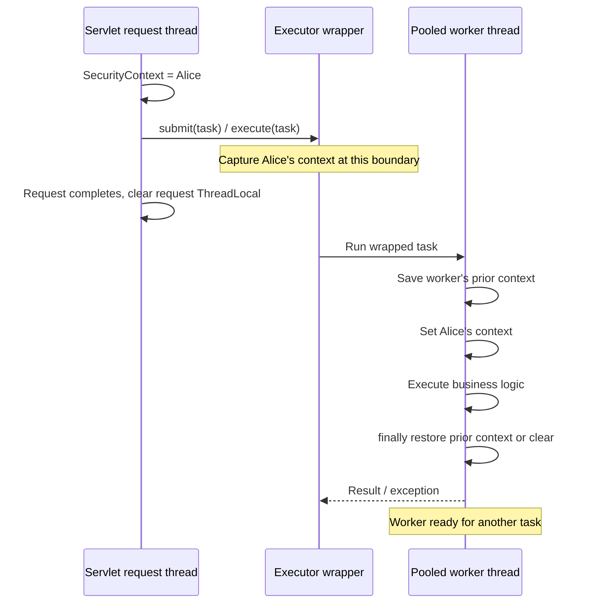

# Capturing Context on Task Submission and Cleaning Context on Completion

> **Scope:** Spring Security on the **Servlet stack** (Spring MVC, Spring Boot 3.x, Spring Security 6.x), across asynchronous flows (`Executor`/`ExecutorService`, `@Async`, `Callable`, `CompletableFuture`). The focus is **when SecurityContext is captured on task handoff** and **cleaning/restoring SecurityContext on the executing thread when work finishes**. Examples use Java 17+, Spring Boot 3.3.0, and Spring Security Test. This covers Spring Security's context, **not** an automatic mechanism for propagating arbitrary `ThreadLocal`s, HTTP requests, transactions, or tracing contexts.

## 1. Learning Objectives

After this lesson, you can:

1. Explain why `SecurityContextHolder` in default `MODE_THREADLOCAL` does not automatically transfer the request thread's `Authentication` to a thread pool worker.
2. Distinguish three moments: **task creation/wrapping**, **task submission/execution**, and **worker execution of the task**; know when each mechanism takes its snapshot.
3. Properly use `DelegatingSecurityContextRunnable`, `DelegatingSecurityContextCallable`, `DelegatingSecurityContextExecutor`, `DelegatingSecurityContextExecutorService`, and `DelegatingSecurityContextAsyncTaskExecutor`.
4. Understand the `try/finally` invariant: save the worker's prior context, set the delegated context, run the task, and **restore the prior context or clear** whether it succeeds, errors, or throws an exception.
5. Configure `@Async` with a context-propagating executor in Spring Boot Servlet and test against principal leakage across requests.
6. Distinguish Spring MVC `Callable` support from manually created `CompletableFuture.supplyAsync`/`DeferredResult`/scheduler tasks; know which paths require dedicated wrappers.
7. Recognize risks of **mutable SecurityContext references**, revoked permissions, background jobs outliving login sessions, and misusing `MODE_INHERITABLETHREADLOCAL` with thread pools.

## 2. Root Problem: Identity Is Thread-Bound, Workers Are Reused

In a normal Servlet request, a security filter chain authenticates the request and populates `SecurityContextHolder` on the **processing thread** with a `SecurityContext` holding the corresponding `Authentication`. Application code can read:

```java
Authentication auth =
    SecurityContextHolder.getContext().getAuthentication();
String name = (auth == null) ? "anonymous" : auth.getName();
```

This is an **illustrative snippet**, not a standalone Java class. In default `MODE_THREADLOCAL`, the context lives in the current thread's `ThreadLocal`. If a controller submits work to a pool:

```text
HTTP request /api/who
  servlet-http-7: Authentication = alice
        │
        └─ executor.submit(task)
                │
                ▼
           pool-worker-2: Authentication = null (if not propagated)
```

Spring Security **cannot assume** a worker pool shares the request thread's `ThreadLocal`. In fact, workers often outlive the HTTP request and get reused for another user's request.

If a developer manually calls `SecurityContextHolder.setContext(aliceContext)` in a worker and **forgets to clear**, the worker can retain Alice's identity while processing Bob's task. This is a **privilege leakage** bug (permission leakage via thread reuse), not merely a missing log entry.

### Anti-Pattern Example

```java
// ANTI-PATTERN: never use in production.
executor.execute(() -> {
    SecurityContextHolder.setContext(capturedContext);
    doWork(); // if an exception is thrown, context may linger indefinitely
});
```

The snippet above also fails to restore the worker's original context. The right way is using Spring Security's wrappers or exact `try/finally` with a proper save/restore policy.

## 3. Distinguishing Capture, Propagation, Restoration, and Cleanup

These four concepts answer different questions:

| Concept | Question to Answer | Guarantee Required |
| --- | --- | --- |
| **Capture** | Which identity is grabbed from the request thread, **and when**? | Capture the right principal at the submit or wrapper boundary, never implicitly when the worker runs. |
| **Propagation** | Which `Authentication` does the worker see? | Set the right `SecurityContext` on the worker before invoking business actions. |
| **Restoration** | What if the worker already had a prior context? | After the task, restore the exact pre-task state rather than blindly overwriting. |
| **Cleanup** | What about exceptions, cancellation, or thread reuse? | Never leave the old task's identity on the thread after completion. |

### Key Timeline



**Note:** capture timing depends on how the API is invoked:

- `new DelegatingSecurityContextRunnable(task)` or `new DelegatingSecurityContextCallable<>(callable)` normally captures the context of **the thread creating the wrapper** if no explicit context is passed. Creating the wrapper too early can capture the wrong user.
- `new DelegatingSecurityContextExecutor(rawExecutor)` (without passing a fixed `SecurityContext`) wraps the task when `execute(...)` is called, thereby capturing the **submitting thread's** context at submission time.
- `new DelegatingSecurityContextExecutorService(rawService)` works similarly for `submit`/`execute`, used when `Future` and `ExecutorService` lifecycle are needed.
- `new DelegatingSecurityContextAsyncTaskExecutor(delegate)` is convenient for `@Async` or places dispatching tasks via `AsyncTaskExecutor`; with constructors taking no fixed context, each task grabs the right context when wrapped for dispatch.
- Some constructors **accept an explicit SecurityContext**: that is a designated fixed/delegated context. It does not automatically change per request; choose it only when genuinely needing to run tasks under an approved fixed identity.

**Rule:** *capture must occur at a trusted boundary*, usually where an authenticated request hands off work; *cleanup occurs on every exit path from the worker*, including exceptions.

## 4. SecurityContextHolder and Why Not Use INHERITABLETHREADLOCAL as a Patch

Spring Security provides multiple strategies for managing `SecurityContextHolder`:

| Strategy | Scope | Recommendation |
| --- | --- | --- |
| `MODE_THREADLOCAL` | Each thread has its own context. | Appropriate default for Servlet; propagate actively when needed. |
| `MODE_INHERITABLETHREADLOCAL` | New child threads can inherit context at thread creation time. | **Not** a reliable solution for long-lived thread pools; can retain stale identities. |
| `MODE_GLOBAL` | Single shared context across the JVM. | Never use for multi-user servers; risk of global auth sharing. |

`InheritableThreadLocal` operates around **child thread creation time**. Pools usually create threads once and handle many different requests. Hence Bob could hit a worker originally created while Alice was logged in, or receive no context at all. It fails to provide **per-task** capture and post-task cleanup.

In production setups, never switch global `SecurityContextHolder.setStrategyName(...)` to patch one executor. Place wrappers at the exact submission boundary and test thread reuse.

## 5. Spring Security Context-Propagation APIs

### 5.1. DelegatingSecurityContextRunnable

`DelegatingSecurityContextRunnable` wraps a `Runnable`. Conceptually:

```java
// Illustrative PSEUDOCODE; not verbatim library source.
SecurityContext previous = SecurityContextHolder.getContext();
try {
    SecurityContextHolder.setContext(captured);
    delegate.run();
} finally {
    // Restore previous per strategy/framework,
    // or clear if the worker had no prior context.
    restoreOrClear(previous);
}
```

The snippet above only states the invariant; `restoreOrClear` is a hypothetical name to explain the idea, **not a Java API**. Real code should use Spring Security's wrappers rather than copying pseudocode.

Common API usage:

```java
import org.springframework.security.concurrent.DelegatingSecurityContextRunnable;

Runnable task = () -> doSensitiveWork();

// Captures context of the thread CREATING the wrapper:
Runnable secured = new DelegatingSecurityContextRunnable(task);
executor.execute(secured);
```

This is a **snippet**: `doSensitiveWork` and `executor` must be declared by the application. If the wrapper was created when the thread had no identity, submitting it later inside an authenticated request can still carry an empty context. Conversely, creating a wrapper in Alice's request and saving it for Bob to submit later can carry the wrong identity. Capture must be designed at the right boundary.

When explicit context selection is needed:

```java
import org.springframework.security.core.Authentication;
import org.springframework.security.core.context.SecurityContext;
import org.springframework.security.core.context.SecurityContextHolder;
import org.springframework.security.concurrent.DelegatingSecurityContextRunnable;

Authentication auth =
        SecurityContextHolder.getContext().getAuthentication();
SecurityContext snapshot = SecurityContextHolder.createEmptyContext();
snapshot.setAuthentication(auth);
Runnable wrapped =
        new DelegatingSecurityContextRunnable(task, snapshot);
executor.execute(wrapped);
```

This is also a **snippet**. It allocates a **new SecurityContext object**, reducing the risk of other code reassigning `Authentication` on the original context object; however, the `Authentication` inside remains a **reference**, not an immutable copy. Never use this snippet to bypass actual permission checks.

### 5.2. DelegatingSecurityContextCallable

`Callable<T>` returns a value and can throw checked exceptions; `DelegatingSecurityContextCallable<T>` wraps it for `ExecutorService.submit(Callable<T>)`. The idea mirrors Runnable: set context, invoke `call()`, and clear/restore on every exit path.

```java
import org.springframework.security.concurrent.DelegatingSecurityContextCallable;

Callable<String> delegate = () ->
    SecurityContextHolder.getContext()
        .getAuthentication().getName();

Callable<String> secured =
    new DelegatingSecurityContextCallable<>(delegate);
Future<String> result = rawExecutorService.submit(secured);
```

Imports for `Callable`, `Future`, and an existing `rawExecutorService` are required; the snippet is not standalone. `secured` captures context where it is instantiated, **not** when `Future.get()` is called.

### 5.3. DelegatingSecurityContextExecutor

When multiple call sites share one `Executor`, wrapping the executor once is usually less error-prone than wrapping every `Runnable` manually:

```java
import java.util.concurrent.Executor;
import org.springframework.security.concurrent.DelegatingSecurityContextExecutor;

Executor securedExecutor =
    new DelegatingSecurityContextExecutor(rawExecutor);

securedExecutor.execute(() -> doSensitiveWork());
```

With the constructor taking no fixed context, the wrapper captures context on every `execute`. This is an easy-to-maintain option for `Executor` pipelines without needing `Future`; `rawExecutor` and `doSensitiveWork` must exist in the application.

### 5.4. DelegatingSecurityContextExecutorService

When `ExecutorService`, `submit(Callable)`, `Future`, or shutdown semantics are needed, use the corresponding wrapper:

```java
import java.util.concurrent.ExecutorService;
import java.util.concurrent.Executors;
import org.springframework.security.concurrent.DelegatingSecurityContextExecutorService;

ExecutorService pool = Executors.newFixedThreadPool(4);
ExecutorService secured =
    new DelegatingSecurityContextExecutorService(pool);

// "secured.submit(...)" captures the caller's context at submission time.
Future<String> future = secured.submit(
    () -> SecurityContextHolder.getContext()
        .getAuthentication().getName());
```

For application-created executors, the application must manage shutdown, backpressure, and lifecycle. Never create a new pool per HTTP request. If a framework manages the executor via a Spring bean, let the framework own its lifecycle instead of creating/destroying it manually.

### 5.5. DelegatingSecurityContextAsyncTaskExecutor

`@Async` in Spring uses a `TaskExecutor`; `DelegatingSecurityContextAsyncTaskExecutor` wraps an appropriate `AsyncTaskExecutor`. Unlike `MODE_INHERITABLETHREADLOCAL`, the wrapper captures identity when **the caller dispatches the task** and cleans up on the worker upon completion. Full configuration is in section 7.

**Not equivalent to copying every context:** the security wrapper propagates `SecurityContext`. MDC/log tracing, locale, transaction-bound resources, JPA persistence contexts, `RequestContextHolder`, and request bodies are not automatically carried along. Each context type has its own contract and lifecycle; never assume that having `Authentication` on a worker means the servlet request or transaction is still open.

## 6. Different Cases of "Capture" and "Cleanup"

### 6.1. Create Task First, Submit Later

```text
T0: app creates a Runnable with no security context
T1: Alice's request submits via DelegatingSecurityContextExecutor
T2: worker processes task with Alice's context; finally cleans up
```

This works if Alice's authentication is already established at **T1** and the executor wrapper has capture-per-submit semantics.

Conversely:

```text
T0: create DelegatingSecurityContextRunnable while anonymous
T1: Alice logs in
T2: submit the wrapper created at T0
T3: worker runs with context captured at T0, NOT T2's context
```

Therefore, never store a `DelegatingSecurityContextRunnable` as a singleton bean to reuse across multiple users; it is not a general-purpose user-aware job.

### 6.2. Submitting When the Request Finishes Quickly

The worker may start **after** the HTTP response is sent and filters have cleared the request thread's context. This does not lose the capture if the wrapper already grabbed the context at T1 upon submission. However, that context is data captured at a point in time; **it does not prove permissions are still valid** when the task executes.

If a job running several minutes later needs to read/modify sensitive data, carry **minimal userId/tenantId/work scope** and check authorization at execution time against trusted data. Never rely solely on permissions inside a stale SecurityContext captured from an old request.

### 6.3. Task Throws an Exception

Cleanup must run even when `delegate.run()` or `Callable.call()` throws an exception. The wrapper uses `finally` to prevent stale identity from remaining on the worker. Exceptions are still propagated back through `Future`/framework mechanisms as usual; security wrappers do not perform business retries/compensation automatically.

### 6.4. Task Is Cancelled or Times Out

- If `Future.cancel(true)` interrupts a running worker, interrupt-cooperative code can stop, and then the wrapper's `finally` must clean up context.
- If the task **never started**, no context was placed on any worker for that task.
- A caller-side timeout (`future.get(timeout, unit)`) **does not automatically cancel** the worker task; the task may keep running with the captured context. Enforce cancellation policies and execution time limits.
- Never blindly retry a task with side effects just because a timeout occurred; business idempotency or transaction semantics are required.
- Long-lived schedulers and job queues should never serialize the full `SecurityContext` to DB/queues to reconstruct auth later. Use minimal payloads + appropriate service identity + permission revalidation.

## 7. Runnable Project: Proper @Async Capture and Cleanup with Spring Security

Complete example using **Spring Boot 3.3.0**, Java 17, Maven, Spring Security 6, and `@Async`. It exposes two endpoints:

- `GET /public/ping`: public, returns `pong`.
- `GET /api/who`: requires HTTP Basic; controller submits work to a worker and the worker returns **the principal name observed by SecurityContextHolder inside the worker**.

We declare **ThreadPoolTaskExecutor as a separate bean** so Spring manages its lifecycle, then wrap it in `DelegatingSecurityContextAsyncTaskExecutor`. The `@Async("securityTaskExecutor")` method is invoked on a **different** bean from the controller so the Spring AOP proxy can intercept it. No authenticated user is hardcoded inside the task.

### 7.1. File Structure

```text
security-async-capture/
├── pom.xml
└── src/
    ├── main/java/demo/async/
    │   ├── AsyncApplication.java
    │   ├── SecurityConfig.java
    │   ├── AsyncExecutorConfig.java
    │   ├── IdentityWorker.java
    │   └── IdentityController.java
    └── test/java/demo/async/
        ├── AsyncPropagationTest.java
        └── ContextCleanupTest.java
```

### 7.2. Maven POM

**`pom.xml`:**

```xml
<project xmlns="http://maven.apache.org/POM/4.0.0"
         xmlns:xsi="http://www.w3.org/2001/XMLSchema-instance"
         xsi:schemaLocation="http://maven.apache.org/POM/4.0.0 https://maven.apache.org/xsd/maven-4.0.0.xsd">
    <modelVersion>4.0.0</modelVersion>
    <parent>
        <groupId>org.springframework.boot</groupId>
        <artifactId>spring-boot-starter-parent</artifactId>
        <version>3.3.0</version>
        <relativePath/>
    </parent>
    <groupId>demo</groupId>
    <artifactId>security-async-capture</artifactId>
    <version>0.0.1-SNAPSHOT</version>
    <properties>
        <java.version>17</java.version>
    </properties>
    <dependencies>
        <dependency>
            <groupId>org.springframework.boot</groupId>
            <artifactId>spring-boot-starter-web</artifactId>
        </dependency>
        <dependency>
            <groupId>org.springframework.boot</groupId>
            <artifactId>spring-boot-starter-security</artifactId>
        </dependency>
        <dependency>
            <groupId>org.springframework.boot</groupId>
            <artifactId>spring-boot-starter-test</artifactId>
            <scope>test</scope>
        </dependency>
        <dependency>
            <groupId>org.springframework.security</groupId>
            <artifactId>spring-security-test</artifactId>
            <scope>test</scope>
        </dependency>
    </dependencies>
    <build>
        <plugins>
            <plugin>
                <groupId>org.springframework.boot</groupId>
                <artifactId>spring-boot-maven-plugin</artifactId>
            </plugin>
        </plugins>
    </build>
</project>
```

**`src/main/java/demo/async/AsyncApplication.java`:**

```java
package demo.async;

import org.springframework.boot.SpringApplication;
import org.springframework.boot.autoconfigure.SpringBootApplication;

@SpringBootApplication
public class AsyncApplication {
    public static void main(String[] args) {
        SpringApplication.run(AsyncApplication.class, args);
    }
}
```

### 7.3. SecurityFilterChain and Demo Account

**`src/main/java/demo/async/SecurityConfig.java`:**

```java
package demo.async;

import org.springframework.context.annotation.Bean;
import org.springframework.context.annotation.Configuration;
import org.springframework.security.config.Customizer;
import org.springframework.security.config.annotation.web.builders.HttpSecurity;
import org.springframework.security.core.userdetails.User;
import org.springframework.security.core.userdetails.UserDetailsService;
import org.springframework.security.crypto.bcrypt.BCryptPasswordEncoder;
import org.springframework.security.crypto.password.PasswordEncoder;
import org.springframework.security.provisioning.InMemoryUserDetailsManager;
import org.springframework.security.web.SecurityFilterChain;

@Configuration
public class SecurityConfig {
    @Bean
    SecurityFilterChain securityFilterChain(HttpSecurity http)
            throws Exception {
        return http
            .authorizeHttpRequests(auth -> auth
                .requestMatchers("/public/ping").permitAll()
                .requestMatchers("/api/who").authenticated()
                .anyRequest().denyAll())
            .httpBasic(Customizer.withDefaults())
            .build();
    }

    @Bean
    PasswordEncoder passwordEncoder() {
        return new BCryptPasswordEncoder();
    }

    @Bean
    UserDetailsService users(PasswordEncoder encoder) {
        return new InMemoryUserDetailsManager(
            User.withUsername("alice")
                .password(encoder.encode("demo-pass"))
                .roles("USER")
                .build());
    }
}
```

This is a demo config for HTTP Basic. In production, in-memory accounts/passwords are unsuitable; you can replace them with JWT, session login, or OIDC, yet the SecurityContext capture and cleanup principles at the async boundary still apply.

### 7.4. Executor: Delegate Pool + Security Wrapper

**`src/main/java/demo/async/AsyncExecutorConfig.java`:**

```java
package demo.async;

import org.springframework.beans.factory.annotation.Qualifier;
import org.springframework.context.annotation.Bean;
import org.springframework.context.annotation.Configuration;
import org.springframework.core.task.AsyncTaskExecutor;
import org.springframework.scheduling.annotation.EnableAsync;
import org.springframework.scheduling.concurrent.ThreadPoolTaskExecutor;
import org.springframework.security.task.DelegatingSecurityContextAsyncTaskExecutor;

@Configuration
@EnableAsync
public class AsyncExecutorConfig {
    @Bean(name = "workerPool")
    ThreadPoolTaskExecutor workerPool() {
        ThreadPoolTaskExecutor pool = new ThreadPoolTaskExecutor();
        pool.setCorePoolSize(2);
        pool.setMaxPoolSize(4);
        pool.setQueueCapacity(32);
        pool.setThreadNamePrefix("secured-worker-");
        return pool;
    }

    @Bean(name = "securityTaskExecutor")
    AsyncTaskExecutor securityTaskExecutor(
            @Qualifier("workerPool") ThreadPoolTaskExecutor pool) {
        // Do not pass a fixed SecurityContext:
        // on every task submission, the wrapper grabs the caller's context.
        return new DelegatingSecurityContextAsyncTaskExecutor(pool);
    }
}
```

**Why create two beans?** `ThreadPoolTaskExecutor` is the real resource with lifecycle and pool size managed by Spring. `DelegatingSecurityContextAsyncTaskExecutor` is merely the security wrapper. The bean name is written explicitly in `@Async("securityTaskExecutor")` so it never accidentally picks another executor that does not propagate identity.

With the constructor taking no `SecurityContext`, the wrapper captures the caller-bound context upon submission. Never pass a fixed `SecurityContext` containing Alice into a singleton bean: every user's task could end up running under Alice's identity.

The ThreadPool with queue 32 in the demo is just for ease of learning. Production needs capacity, rejection/backpressure, timeouts, monitoring, and graceful shutdown sized to real load. Even though the security wrapper cleans up context, it **does not** manage all business resources.

### 7.5. Worker and Controller

**`src/main/java/demo/async/IdentityWorker.java`:**

```java
package demo.async;

import java.util.concurrent.CompletableFuture;
import org.springframework.scheduling.annotation.Async;
import org.springframework.security.core.Authentication;
import org.springframework.security.core.context.SecurityContextHolder;
import org.springframework.stereotype.Service;

@Service
public class IdentityWorker {
    @Async("securityTaskExecutor")
    public CompletableFuture<String> currentIdentity() {
        Authentication a =
            SecurityContextHolder.getContext().getAuthentication();

        String name = (a == null) ? "NO_AUTH" : a.getName();
        return CompletableFuture.completedFuture(name);
    }
}
```

**`src/main/java/demo/async/IdentityController.java`:**

```java
package demo.async;

import java.util.Map;
import java.util.concurrent.CompletableFuture;
import org.springframework.security.core.Authentication;
import org.springframework.web.bind.annotation.GetMapping;
import org.springframework.web.bind.annotation.RestController;

@RestController
public class IdentityController {
    private final IdentityWorker worker;

    public IdentityController(IdentityWorker worker) {
        this.worker = worker;
    }

    @GetMapping("/public/ping")
    public String ping() {
        return "pong";
    }

    @GetMapping("/api/who")
    public CompletableFuture<Map<String, String>> who(Authentication auth) {
        return worker.currentIdentity()
            .thenApply(fromWorker -> Map.of(
                "requestPrincipal", auth.getName(),
                "workerPrincipal", fromWorker));
    }
}
```

**Tracing the execution flow:**

1. Spring Security authenticates Alice via HTTP Basic on the request thread.
2. The controller is permitted to handle `/api/who` because of `authenticated()`; it calls `worker.currentIdentity()` **through another Spring bean**, triggering `@Async`.
3. The `@Async` proxy dispatches the task via `securityTaskExecutor`. The wrapper captures the caller's SecurityContext and creates the wrapped task.
4. On the worker pool, `SecurityContextHolder.getContext().getAuthentication()` returns Alice's identity; the method produces `CompletableFuture.completedFuture("alice")`.
5. When the delegate finishes (or throws an error), the security wrapper **restores/clears** context in the worker.
6. The controller uses `thenApply` to build the response. The `thenApply` callback may run on the corresponding completing thread, so it **should not** rely on SecurityContextHolder; the example uses `auth.getName()` obtained on the request thread and the returned string.
7. Spring MVC handles `CompletableFuture` as an async result and sends JSON upon completion.

**Do not expect `thenApplyAsync` or `supplyAsync` without a specified executor to carry SecurityContext as well**. They may use the common pool or another unwrapped executor; only task work routed through the security-aware executor carries the desired guarantee.

### 7.6. Running the Project

Inside the `security-async-capture` directory:

```bash
mvn test
mvn spring-boot:run
```

Test the public API:

```bash
curl -i http://localhost:8080/public/ping
```

Expected body:

```text
pong
```

Test the authenticated API:

```bash
curl -i -u alice:demo-pass http://localhost:8080/api/who
```

With the demo config, expected status is `200 OK`, with a JSON body carrying both request and worker principals:

```json
{
  "requestPrincipal": "alice",
  "workerPrincipal": "alice"
}
```

Actual whitespace formatting and JSON key ordering depend on the serializer; do not compare the entire JSON body string as a fixed-order format. Anonymous requests to `/api/who` receive `401` with an HTTP Basic challenge and are not allowed to initiate authenticated work.

## 8. MockMvc Testing: User on Worker and Anonymous Blocked

**`src/test/java/demo/async/AsyncPropagationTest.java`:**

```java
package demo.async;

import org.junit.jupiter.api.Test;
import org.springframework.beans.factory.annotation.Autowired;
import org.springframework.boot.test.autoconfigure.web.servlet.AutoConfigureMockMvc;
import org.springframework.boot.test.context.SpringBootTest;
import org.springframework.test.web.servlet.MockMvc;
import org.springframework.test.web.servlet.MvcResult;

import static org.springframework.security.test.web.servlet.request
    .SecurityMockMvcRequestPostProcessors.user;
import static org.springframework.test.web.servlet.request.MockMvcRequestBuilders.get;
import static org.springframework.test.web.servlet.request
    .MockMvcRequestBuilders.asyncDispatch;
import static org.springframework.test.web.servlet.result.MockMvcResultMatchers.jsonPath;
import static org.springframework.test.web.servlet.result.MockMvcResultMatchers.request;
import static org.springframework.test.web.servlet.result.MockMvcResultMatchers.status;

@SpringBootTest
@AutoConfigureMockMvc
class AsyncPropagationTest {
    @Autowired
    MockMvc mvc;

    @Test
    void anonymousCannotSubmitProtectedWork() throws Exception {
        mvc.perform(get("/api/who"))
            .andExpect(status().isUnauthorized());
    }

    @Test
    void aliceIsVisibleInsideAsyncWorker() throws Exception {
        MvcResult started = mvc.perform(
                get("/api/who").with(user("alice")))
            .andExpect(request().asyncStarted())
            .andReturn();

        mvc.perform(asyncDispatch(started))
            .andExpect(status().isOk())
            .andExpect(jsonPath("$.requestPrincipal").value("alice"))
            .andExpect(jsonPath("$.workerPrincipal").value("alice"));
    }
}
```

MockMvc in the second test must perform **async dispatch** before asserting the final JSON. `with(user("alice"))` is a test post-processor supplying a mock principal to verify the security/filter flow; it is **not** testing Alice's real password. When testing real HTTP Basic, send a valid Authorization header or use an integration HTTP client with demo credentials.

**Valuable negative test:** try removing the wrapper and using raw `workerPool`; the task will likely see `NO_AUTH`, depending on thread/default context, even though the controller sees Alice's principal. Never treat "the test still passes after removing the wrapper" as proof the app is right; what matters is confirming the exact thread boundary you believe is propagating.

## 9. Testing Zero Context Leakage with a Single-Threaded ExecutorService

Using a **single worker** is a great way to catch reuse bugs: if the thread processes Alice's task and still retains context afterward, the next run on the same thread will see the old identity.

The example below is a **complete class-level JUnit test** added to the section 7 project; it makes no calls to a web server or external data sources.

**`src/test/java/demo/async/ContextCleanupTest.java`:**

```java
package demo.async;

import java.util.List;
import java.util.concurrent.ExecutorService;
import java.util.concurrent.Executors;
import java.util.concurrent.Future;
import java.util.concurrent.TimeUnit;
import org.junit.jupiter.api.Test;
import org.springframework.security.authentication.UsernamePasswordAuthenticationToken;
import org.springframework.security.concurrent.DelegatingSecurityContextExecutorService;
import org.springframework.security.core.Authentication;
import org.springframework.security.core.authority.SimpleGrantedAuthority;
import org.springframework.security.core.context.SecurityContext;
import org.springframework.security.core.context.SecurityContextHolder;

import static org.junit.jupiter.api.Assertions.assertEquals;
import static org.junit.jupiter.api.Assertions.assertNull;

class ContextCleanupTest {
    @Test
    void contextIsPresentForDelegatedTaskAndClearedAfterwards()
            throws Exception {
        ExecutorService raw = Executors.newSingleThreadExecutor();
        ExecutorService secured =
            new DelegatingSecurityContextExecutorService(raw);

        try {
            Authentication alice =
                UsernamePasswordAuthenticationToken.authenticated(
                    "alice",
                    "not-a-password",
                    List.of(new SimpleGrantedAuthority("ROLE_USER")));
            SecurityContext requestContext =
                SecurityContextHolder.createEmptyContext();
            requestContext.setAuthentication(alice);
            SecurityContextHolder.setContext(requestContext);

            Future<String> received = secured.submit(() -> {
                Authentication onWorker =
                    SecurityContextHolder.getContext().getAuthentication();
                return onWorker == null ? "NO_AUTH" : onWorker.getName();
            });

            // Only clear the caller's ThreadLocal; do not mutate the context object
            // already wrapped for execution on the worker.
            SecurityContextHolder.clearContext();

            assertEquals("alice", received.get(5, TimeUnit.SECONDS));

            // Submit directly via the raw pool on the same thread: this new task
            // MUST NOT inherit Alice after the wrapped task finishes.
            Future<Authentication> after = raw.submit(() ->
                SecurityContextHolder.getContext().getAuthentication());
            assertNull(after.get(5, TimeUnit.SECONDS));
        } finally {
            SecurityContextHolder.clearContext();
            raw.shutdownNow();
            raw.awaitTermination(5, TimeUnit.SECONDS);
        }
    }
}
```

**Evidence from the test:**

- Caller held Alice's `Authentication` when submitting via `secured`.
- Worker received Alice's identity **only during task execution**.
- Caller clearing context after submit did not destroy the context captured in the wrapper (no mutation on the old object).
- The subsequent task via `raw` ran on **that exact worker thread** and saw `Authentication == null`; no leaked Alice identity remained.
- The test does not cover multiple instances, authority revocation, latency delays, or all-thread contexts in Spring MVC. Those require separate tests.

**Limitation:** the example uses context for illustration, yet Spring Security does not guarantee turning a mutable authentication object into an immutable snapshot. If the caller **mutates the captured `SecurityContext` object itself** between submit and execution, the worker may observe the new value. Handling is discussed in section 12.

## 10. Running When a Task Throws an Error: Cleanup Must Still Happen

Cleanup must live in the wrapper's `finally`. Below is an additional test **that can be placed inside `ContextCleanupTest`** (requiring imports for `ExecutionException`, `assertThrows`, and `assertNull` as used), showing a single method:

```java
@Test
void cleanupEvenWhenBusinessTaskThrows() throws Exception {
    ExecutorService raw = Executors.newSingleThreadExecutor();
    ExecutorService secured =
        new DelegatingSecurityContextExecutorService(raw);
    try {
        SecurityContext ctx =
            SecurityContextHolder.createEmptyContext();
        ctx.setAuthentication(
            UsernamePasswordAuthenticationToken.authenticated(
                "alice", "N/A",
                List.of(new SimpleGrantedAuthority("ROLE_USER"))));
        SecurityContextHolder.setContext(ctx);

        Future<?> failed = secured.submit(() -> {
            throw new IllegalStateException("business failure");
        });
        SecurityContextHolder.clearContext();

        assertThrows(java.util.concurrent.ExecutionException.class,
            () -> failed.get(5, TimeUnit.SECONDS));

        assertNull(raw.submit(() ->
            SecurityContextHolder.getContext().getAuthentication())
            .get(5, TimeUnit.SECONDS));
    } finally {
        SecurityContextHolder.clearContext();
        raw.shutdownNow();
    }
}
```

A business exception may still cause `Future.get` to throw `ExecutionException`, yet the worker went through cleanup. This test only adds exception-path cleanup verification; it does not recommend catching-and-ignoring exceptions or blindly retrying sensitive tasks.

## 11. Servlet Async APIs: Do Not Equate Every Mechanism

| Mechanism | Who Creates/Owns the Worker? | Does SecurityContext Propagate Automatically? | Approach |
| --- | --- | --- | --- |
| Synchronous Servlet request | Container processes on one request thread | Security filter chain sets context for the request. | Use Spring Security normally. |
| Spring MVC controller returning `Callable<T>` | Spring MVC async integration | Spring Security integrates `WebAsyncManagerIntegrationFilter` for MVC `Callable`. | Still test exact lifecycle, executor, dispatch, and specific version. |
| Spring MVC `WebAsyncTask<T>` | Spring MVC handles Callable with metadata | Usually follows the Callable integration mechanism. | Test timeout/error/dispatch; do not assume all custom workers receive propagation. |
| Spring MVC `DeferredResult<T>` | App usually completes from a self-managed thread | Not guaranteed to auto-propagate for code you submit. | Use a security-aware executor/wrapper where the result is produced. |
| `@Async` | Spring task executor | Not guaranteed with a raw unwrapped executor. | Use `DelegatingSecurityContextAsyncTaskExecutor`. |
| `CompletableFuture.supplyAsync(...)` without executor | Usually common pool or JDK default | **Does not** automatically receive Spring Security ThreadLocal. | Pass a wrapped executor or pass minimal business data. |
| `CompletableFuture.thenApplyAsync(...)` | JDK-selected executor when omitted | No; the new stage may run on another thread. | Choose a wrapped executor at the right capture point, or avoid holder in the stage. |
| Plain `ExecutorService.submit(...)` | Pool you created | No. | Wrap with `DelegatingSecurityContextExecutorService`. |
| `new Thread(...)` | Thread you spawned manually | Unreliable with `MODE_THREADLOCAL`. | Avoid spawning threads ad hoc on servers; use a managed executor. |
| Long-term scheduler/queue (Quartz, Kafka, RabbitMQ...) | Independent worker/request already ended | **Cannot** assume a user SecurityContext exists. | Jobs need their own identity/capability, runtime authorization, and audit. |

Spring MVC has dedicated mechanics for `Callable`, so it is incorrect to say "no async propagates"; yet it is equally wrong to assume `WebAsyncManagerIntegrationFilter` handles every `CompletableFuture` and manual submission.

### Why Is Servlet Async Handling Different from a Security-Aware Executor?

`Callable` is created by a controller and handed to **Spring MVC async infrastructure**. Spring Security integrates with WebAsyncManager at the appropriate points to preserve context for the Callable portion. By contrast, `@Async` and `CompletableFuture.supplyAsync` are task-submission mechanisms **outside the Callable integration path**; when using another executor, Spring Security cannot guess which user to assign to that thread.

Never fix errors by passing an `HttpServletRequest` into a background thread; requests have their own lifecycle and ownership and may already be completed or recycled. Pass required data in a controlled manner.

## 12. Context "Snapshots" Are Mutable References, Not Immutable

The term "context capture" can mislead readers into thinking the framework always **deep-copies** authentication, roles, and claims. In reality, many Spring Security wrappers keep a **reference to the captured `SecurityContext`**. A `SecurityContextImpl` typically allows `setAuthentication(...)`, and `Authentication`/principals themselves may contain mutable objects.

Example scenario:

```text
T1: contextObject.authentication = Alice
T2: wrapper captures reference to contextObject
T3: other code calls contextObject.setAuthentication(Bob)
T4: worker runs with same contextObject → may see Bob
```

**Never use mutability as a "context update" channel between threads.** That creates race conditions and identity leaks. When per-request consistency is needed:

- Capture minimal data (`userId`, tenant, resource IDs, operation ID) as an immutable value object, then re-verify authorization at execution time.
- If running under an `Authentication` on a worker thread is mandatory, create a **new `SecurityContext`** upon submission and set the verified Authentication; avoid mutating the context object after submission, and ensure principal/authorities cannot be altered unexpectedly.
- Never pass mutable session objects, `HttpServletRequest`, or attached JPA entities into long-running background jobs.
- Never synthesize a "superuser" `Authentication` just for background-task convenience; if a job is truly a system job, use a dedicated service identity with least privilege and auditing.

Security context propagation solves **availability of authentication to code on the thread**; it does not magically solve transactional isolation, revocation, or business authorization.

### Context Reaches the Thread, Yet Permissions Changed?

A task submitted under Alice at 10:00 might execute at 10:15, after Alice is disabled or her admin rights are revoked. The wrapper can still carry the context captured at 10:00. For sensitive operations, check **current permissions** at execution time from a trusted source, bound TTL/queue delays, and write audit logs; never treat `Authentication.isAuthenticated() == true` as a sufficient answer.

## 13. Failure Cases and Context Cleanup Paths

### 13.1. Manual ThreadLocal Handling and try/finally

If special integration prevents using a wrapper, minimum invariants must be enforced:

1. Obtain a **verified context** from the caller and define its usage scope.
2. Wrap the task so the worker records **its own current context** before installing the new context.
3. `try` running the delegate; `finally` always restores the right context, even on error.
4. Remember the worker might already hold a framework-managed context; blindly calling `clearContext` can wipe the worker's pre-existing context.
5. With nested wrappers, both outer and inner wrappers must follow restoration discipline. Inner completion restores outer's context; outer completion restores whatever preceded outer.

Spring Security wrappers enforce this invariant. Never write a custom security `TaskDecorator` assuming "workers are always empty" without testing.

### 13.2. Nested Tasks

Suppose a worker running under Alice's context submits a child task through a security-aware executor. The child task must receive the context captured at submission time; whether it runs on the same thread or another thread, wrappers must restore/clear upon completion. A child task using a separate raw pool is not automatically protected by the parent task's wrapper. Wrap **every submission boundary** that actually uses authentication.

### 13.3. Future Chaining

`CompletableFuture.thenApply` may run directly on the thread completing the prior stage or on the caller if already done; `thenApplyAsync` picks an appropriate executor. Therefore, **never rely on which thread runs a stage to infer identity**. If stage code needs auth, supply a wrapped executor at the right place or pass immutable business identity/capabilities and verify permissions.

A `CompletableFuture` carrying a chain of business results does not inherently carry a `SecurityContext`. Context is a property of **the thread at the moment code runs**, not default metadata attached to a future object.

### 13.4. Exceptions and Request Completion

- Exceptions raised on the worker are handled per `Executor`, `Future`, or `@Async` contracts, yet wrapper cleanup must still execute.
- The Servlet request may finish before the worker; request context may be cleared at end-of-request. This does not erase the captured context object and does not automatically revoke permissions.
- If a task is rejected before running (executor queue full), no "set worker context" step occurs; the caller must handle rejected execution.
- If code hangs indefinitely, `finally` cannot run yet; enforce realistic timeouts, cancellation, and monitoring.

## 14. Monitoring and Auditing: What Information Is Propagated and Logged

To investigate async failures, logging correlation IDs and principals can help, while avoiding raw credentials/session cookies/JWTs or unnecessary PII. A few rules:

- Log **job ID, operation, verified tenant, outcome, error class**, enqueue time, and execution time.
- Never log the whole `SecurityContext` object; Authentication can contain credentials, profile info, or sensitive authorities.
- If a principal ID is needed for auditing, use a normalized ID from a trusted principal under proper privacy/retention policies.
- **MDC/trace/span context is not guaranteed by `DelegatingSecurityContext*` alone.** Use observability-specific propagation or a proper TaskDecorator; if combining multiple wrappers, test restore/cleanup ordering for each context type.
- Never conclude executor cleanup works just because request-thread logs show Alice's name; log/test **inside the worker** and test thread reuse.

In rate-limited/queued systems and multi-node deployments, tracking queue wait times also matters because the older a captured security context gets, the more likely it no longer reflects current permissions.

## 15. Testing Checklist

| Test Type | Scenario | Expectation |
| --- | --- | --- |
| Positive | Alice submits via security-aware executor | Worker sees Alice's Authentication. |
| Anonymous | Anonymous caller hits an auth-required endpoint | Request is blocked before sensitive work is dispatched. |
| Unwrapped | Caller Alice submits via raw pool | Worker **must not be assumed** to have Alice; default is usually null. |
| Reuse | Alice task completes, next raw task on same worker | Alice's Authentication is gone. |
| Isolation | Alice task then Bob task via wrapper | Each task sees its own exact context; principals never mix. |
| Failure | Worker throws exception | Future/error handler gets error; context is restored/cleared. |
| Cancellation | Future cancelled/interrupted | Cleanup runs when delegate actually finishes. |
| Queue delay | Task waits long; caller clears after submit | Worker gets captured context, independent of caller holder still existing. |
| Mutable context | Caller mutates same SecurityContext after submit | Do not rely on a "deep snapshot"; avoid or control mutation. |
| Nested wrappers | Inner finishes, outer keeps running | Inner restores outer context, outer restores prior context. |
| Cross-user | User A and user B submit concurrently | Cannot use a fixed-context singleton with A's identity for B. |
| Revocation | User permissions revoked before execute | Sensitive business actions must verify current permissions. |
| Missing @Async proxy | `@Async` method called via `this.` in same bean | Do not assume async execution; verify proxy/executor properly. |
| CompletableFuture | Stage uses common pool or another executor | Do not assume request context is present. |
| MVC Callable | Controller returns `Callable` | Test Security MVC Callable integration and async dispatch. |
| Shutdown | App shuts down while jobs run | Enforce graceful shutdown/cancel policy, cleanup when tasks actually end. |

### Notes on Writing Deterministic Tests

- Use a **single-thread executor** for cleanup tests to guarantee the next task runs on the exact same old thread.
- Use `CountDownLatch` when proving "captured at submit, executed after caller cleared", rather than arbitrary sleeps.
- Put timeouts on `Future.get` so tests never hang forever; shut down executors in `finally`.
- Use `MockMvc.asyncDispatch(...)` for controllers returning `CompletableFuture`/`Callable`; never assert body before async completes.
- Separate **endpoint authorization** tests (whether auth is required) from **context propagation** tests (which principal is on the worker).
- For work that must not receive user context (like long-running background jobs), test that jobs use their own service identity/validation rather than carrying arbitrary user auth.

## 16. Common Pitfalls

| Symptom | Common Cause | Resolution |
| --- | --- | --- |
| `SecurityContextHolder.getContext().getAuthentication() == null` in `@Async` | Executor unwrapped, task runs on another pool. | Use `DelegatingSecurityContextAsyncTaskExecutor` and `@Async("securityTaskExecutor")`. |
| Worker always sees old user | Manual setContext without clear or fixed context misused. | Use context-per-submit wrapper; test single-thread reuse. |
| Worker sees anonymous even though caller logged in | Runnable wrapped before request authentication existed or @Async bypassed proxy. | Capture at proper submit boundary; verify proxy/bean routing. |
| User B sees Alice's permissions | Singleton wrapper with fixed context, leaked ThreadLocal, INHERITABLETHREADLOCAL in pool. | Never use fixed user context for multi-tenant requests; restore/clear. |
| `CompletableFuture.thenApplyAsync` sees no principal | Stage uses another executor/common pool. | Specify security executor for the stage or pass required business data. |
| `Future.get` times out yet side effects still happen | Caller timeout does not cancel worker. | Real cancellation/timeouts, design idempotency. |
| Cleanup test passes on 4-thread pool yet leak still happens | Probe task ran on a different thread from the leaked one. | Test with 1-thread pool: task A then raw probe on same thread. |
| After role revocation, queued task still runs with old role | Context holds capture-time permissions, no re-check. | Check fresh authorization at execute time for sensitive actions. |
| Used `MODE_INHERITABLETHREADLOCAL` thinking it fixed it | Pool threads have a different lifecycle from requests. | Choose decorator/security-aware executor; avoid global strategy. |
| `@Async` called in same bean is not async | Self-invocation bypasses Spring AOP proxy. | Call from another bean or design proxy invocation properly. |
| Failing @Async task never notifies caller | `void` async method handles errors via `AsyncUncaughtExceptionHandler`, returns no Future. | Prefer returning `CompletableFuture` when callers must observe errors; configure error handling. |
| Context has auth yet lacks MDC/transaction | Wrapper propagates SecurityContext only. | Separate tracing/transaction contexts and test isolation. |

## 17. Review Questions

**1. Why does `SecurityContextHolder` work in a controller yet not appear in a worker?**

Because the default is ThreadLocal: controller and worker are on two different threads. Capture/propagate through a wrapper or pass business identity and re-verify on the worker.

**2. When should context be captured if a `Runnable` is created before the user logs in?**

Capture **at submission** after authentication is verified, e.g., via `DelegatingSecurityContextExecutor` without a fixed context; do not capture early when creating the Runnable/bean.

**3. Why is `finally` needed even when the task succeeds?**

Workers can be reused. Without cleanup, the old task's identity remains on the same thread. `finally` also runs when business code throws an exception, preventing leaks.

**4. If the caller clears context after submission, will the task still see the user?**

With a proper wrapper and an unmutated context object after capture, yes; the wrapper retained a reference at submit. This does not turn that identity into an immutable snapshot or guarantee roles remain valid later.

**5. Why is `MODE_INHERITABLETHREADLOCAL` unsuitable for fixing context propagation in pools?**

It relates to child threads **at thread creation time**, whereas thread pools reuse workers across many requests. It risks missing context or retaining stale identities.

**6. Does `@Async` returning `CompletableFuture` mean every subsequent `thenApplyAsync` receives SecurityContext?**

No. Each async stage may use a different executor; Futures do not carry context themselves. Choose a wrapped executor or avoid relying on the holder inside stages.

**7. In a test, how do you prove a worker does not retain Alice after executing a task?**

Use `newSingleThreadExecutor`, submit Alice's task via `DelegatingSecurityContextExecutorService`, wait for completion, then submit a probe **directly via the raw executor on that same worker**. The probe must see null authentication (assuming the worker started empty).

**8. Why is capturing context insufficient to authorize a job running hours later?**

Because roles, tenant memberships, or access rights can change while the job waits. Sensitive jobs need permission checks at execution time instead of trusting an old context indefinitely.

## 18. Key Takeaways

**Spring Security does not automatically transfer a Servlet request's ThreadLocal to arbitrary async workers.** A security-aware executor can capture the caller's `SecurityContext` **on submission**, set it on the worker during processing, and **restore/clear in `finally`** so identity never leaks between tasks.

Keep clear distinctions:

- **Right-time capture:** use wrappers created/submitted within a verified authentication scope; never make user wrappers singletons.
- **Right-place cleanup:** always return the worker's context to its pre-task state, including exceptions, cancellation when tasks exit, and nested calls.
- **Still-valid business authorization:** propagation does not copy immutable permissions, does not transfer sessions/transactions/traces, and does not replace permission re-verification for delayed/background jobs.
- **Right-thread testing:** assert the principal **inside the worker**, run a raw single-thread probe after the task, use MockMvc async dispatch, and exercise error/timeout paths.

**Design rule:** capture at the **task handoff boundary**, propagate within the **task scope**, restore/clear at the **completion boundary**; if you cannot point to all three boundaries, your SecurityContext propagation is missing a critical guarantee.