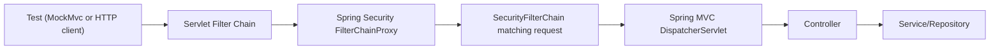
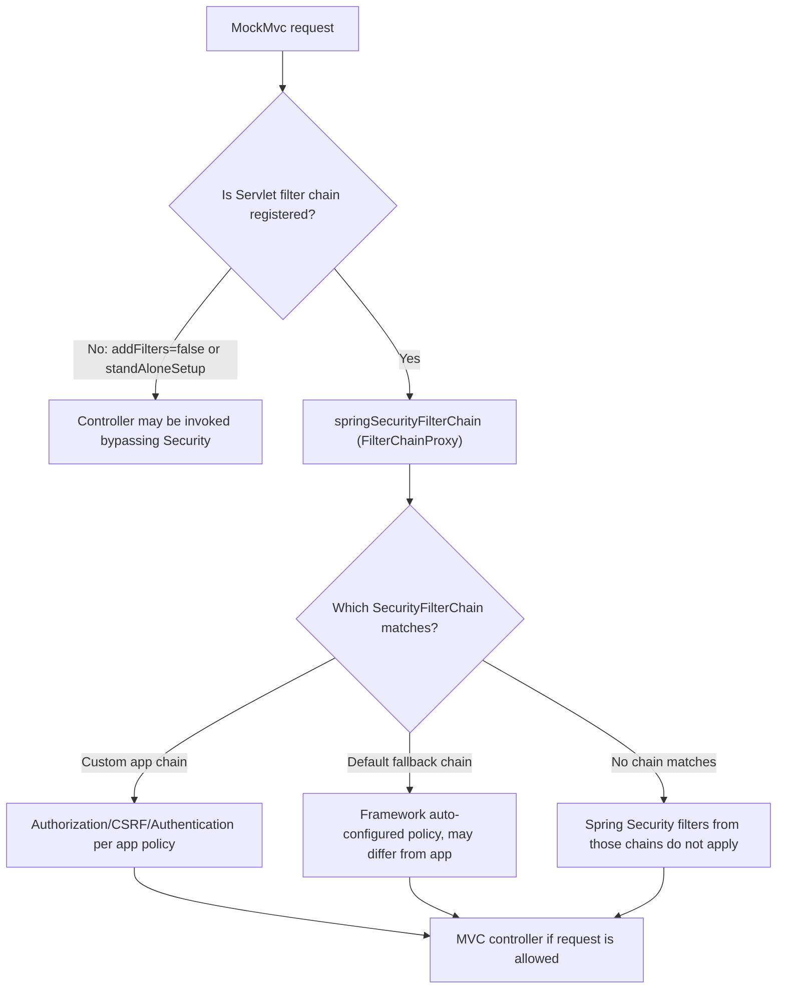

# @WebMvcTest, @SpringBootTest, and Loading the SecurityFilterChain Configuration

> **Scope:** HTTP testing for **Spring Security Servlet** applications on **Spring MVC / Spring Boot 3.3.0 / Spring Security 6.x / Java 17+**. This lesson focuses on the difference between an **MVC test slice** and a **full application context**, how to make sure the **actual SecurityFilterChain is loaded into MockMvc**, how to use `spring-security-test` to verify 401/403/CSRF, and how to avoid "green" tests that accidentally disabled security.

## 1. Learning Objectives

After this lesson, you will be able to:

1. Accurately distinguish `@WebMvcTest`, `@SpringBootTest`, and `@AutoConfigureMockMvc`: scope of loaded beans, startup cost, how MockMvc runs, and what kinds of bugs each catches.
2. Recognize the **Spring Security filter chain** in MockMvc and understand why `@AutoConfigureMockMvc(addFilters = false)` makes security tests untrustworthy.
3. Explicitly load a `SecurityFilterChain` configuration in an MVC slice via `@Import(SecurityConfig.class)` and supply dependencies excluded from the slice using `@MockBean` or test configuration.
4. Write two complementary test groups on the same API: testing MVC/authorization with `@WebMvcTest` and testing the real application configuration with `@SpringBootTest`.
5. Use `SecurityMockMvcRequestPostProcessors.user`, `httpBasic`, `csrf`, and `@WithMockUser` in their proper roles; know what is **simulated** and what passes through the real authentication mechanism.
6. Interpret 200, 401, 403, redirects, CSRF failures, and response headers based on the specific endpoint/method; never equate every 403 status with "missing role".
7. Diagnose discrepancies caused by test contexts, chains selected via `securityMatcher`, servlet filter order, mock services, test context caching, and test-only configuration.

## 2. Four Layers to Distinguish When Testing HTTP

When calling an HTTP endpoint protected by Spring Security, multiple independent layers are involved:



A test that only checks whether the controller calls the right service may skip authentication, CSRF, and `SecurityFilterChain`. Conversely, a test returning `401` might only prove that default security auto-configuration is running, **not that the real application policy was loaded**.

### Where 200/401/403 Outcomes Originate

- `401 Unauthorized`: usually missing or failed authentication for a resource using a challenge mechanism such as HTTP Basic or Bearer; if `formLogin` is configured, anonymous callers may be **redirected** to the login page instead of receiving 401.
- `403 Forbidden`: a principal is present but lacks sufficient authority for the endpoint, **or** `CsrfFilter` rejected a POST/PUT/PATCH/DELETE missing a token even before the request reached the authorization decision.
- `200 OK`: the request passed the active filters and the controller returned successfully; **not enough to prove security filters protect properly** if filters were disabled or no chain matched.
- `302 Found`: could be a login redirect, a post-authentication success redirect, or a business redirect; inspect `Location` and the specific flow.
- `404 Not Found`: the path has no handler after passing filters; **however**, if `anyRequest().denyAll()` blocks it first, the same URL can return 403. Do not force 404 as the expectation for every unknown URL.

## 3. How Do @WebMvcTest and @SpringBootTest Differ?

| Criterion | `@WebMvcTest` | `@SpringBootTest` |
| --- | --- | --- |
| Purpose | Tests the MVC slice: controllers, routing, binding, JSON, advice, validation, and web-related beans. | Tests the full application context: configuration, component graph, integration logic, security, and bean wiring. |
| Loaded beans | Only the web slice + matching auto-configuration; does not load all `@Service`, `@Repository` beans by default. | Scans application beans from `@SpringBootConfiguration`/`@SpringBootApplication` and applicable auto-configurations. |
| Security | Can auto-configure Spring Security and filters; **custom configuration** may require explicit `@Import`. | Loads the application's security configuration along with real beans, unless overridden by a profile/test config. |
| MockMvc | Auto-configures MockMvc in standard setups. | Needs `@AutoConfigureMockMvc` for MockMvc injection; `@SpringBootTest` alone does not create a MockMvc bean by default. |
| Test dependencies | Controller dependencies outside the slice usually require `@MockBean`/test beans. | Can use real services, DB/testcontainers, or external mocks depending on configuration. |
| Servlet container | Mock servlet environment, no real HTTP socket. | Default `webEnvironment = MOCK`; `RANDOM_PORT` starts a real embedded server. |
| Speed | Typically fast, smaller scope. | Typically slower due to wide context and system dependencies. |
| Should verify | HTTP/MVC contract and the filter policy imported into the slice. | Real configuration/bean wiring, security filter chain, real authentication provider, and multi-layer integration. |

**The two test types complement each other**; neither annotation is "automatically better" in every scenario. Choose based on the bug you want to catch: "Does the controller return the right JSON?" favors a slice; "Does the production `SecurityFilterChain` actually work?" requires full-context or HTTP container testing.

### Is @SpringBootTest Always E2E?

**No.** A `@SpringBootTest` with MockMvc has a broad application context, yet requests are still simulated by `MockHttpServletRequest`/`MockHttpServletResponse`. It does not automatically test TLS, proxies, gateway CORS, load balancers, real network sockets, or browser compatibility.

To test real HTTP against an embedded server, consider:

```java
@SpringBootTest(webEnvironment = SpringBootTest.WebEnvironment.RANDOM_PORT)
class RealHttpIntegrationTest {
    // Call URLs with TestRestTemplate, RestClient, or a real HTTP client.
}
```

The snippet above **illustrates the annotation**, not a standalone runnable test class. Do not conflate `RANDOM_PORT` with MockMvc or assume that injecting MockMvc under `RANDOM_PORT` automatically uses the real network port.

## 4. Where Is SecurityFilterChain Created and Applied?

In a Servlet application, `HttpSecurity.build()` creates a `SecurityFilterChain` bean. Spring Security collects one or more chains into a `FilterChainProxy`, typically registered via a bean/filter named `springSecurityFilterChain`. The Servlet filter bridge routes requests into it, and Spring Security selects **the first chain whose request matcher matches**.



**Key takeaway:** "Having Spring Security on the classpath" and "using the application's exact `SecurityFilterChain`" are two different questions.

### Default Fallback Is Not the Application Policy

When there is no custom `SecurityFilterChain` in the context, Spring Boot can create a fallback security chain via auto-configuration. In an MVC slice, configuration beans placed in ordinary `@Configuration`/`@Component` classes might not be pulled into the slice as you expect. In that case, a test sees 401 or a login redirect, **but not** because of the application's `/api/items` rule.

Conversely, importing overly broad application configuration into `@WebMvcTest` can pull in databases, messaging, and cloud clients, defeating the slice advantage. The right approach is to **import only the security configuration and mock the dependencies truly needed**.

### SecurityMatcher and authorizeHttpRequests

- `http.securityMatcher("/api/**")` on a chain restricts **which requests enter that chain**.
- `authorizeHttpRequests(... requestMatchers(...) ...)` determines **access permissions inside the already-selected chain**.
- With multiple chains, `@Order` and path/method matching decide exactly which filters run.
- `permitAll()` does not bypass the filter chain; CSRF, headers, and other filters can still execute.
- `web.ignoring()` excludes paths from the Spring Security filter chain; using it on endpoints that still need security headers can introduce discrepancies.

## 5. Sample Application: API with a Public Endpoint, Scopes, and CSRF

The demo uses **Java 17+**, Maven, **Spring Boot 3.3.0**, and Spring Security 6. All sources below belong to the same project. With this configuration:

| Endpoint | Expected policy |
| --- | --- |
| `GET /api/public/ping` | Public, returns `pong`. |
| `GET /api/items` | Requires `SCOPE_inventory.read`; returns string from service. |
| `POST /api/reserve` | Requires `SCOPE_inventory.write` **and a CSRF token**, because CSRF is enabled by default. |
| Other requests | Denied by `anyRequest().denyAll()` before reaching the controller if matched by the chain. |

HTTP Basic is used solely so local authentication provider testing is easy to follow. For pure Bearer-token APIs that do not use ambient cookie credentials, CSRF policy may differ; **do not copy a global `csrf.disable()` from some snippet when using browser cookies/sessions**.

### 5.1. File Structure

```text
mvc-security-test-demo/
├── pom.xml
└── src/
    ├── main/
    │   └── java/demo/httpsecurity/
    │       ├── DemoApplication.java
    │       ├── config/SecurityConfig.java
    │       ├── service/CatalogService.java
    │       └── web/CatalogController.java
    └── test/
        └── java/demo/httpsecurity/
            ├── CatalogWebSliceTest.java
            └── FullSecurityIntegrationTest.java
```

### 5.2. Maven pom.xml

```xml
<project xmlns="http://maven.apache.org/POM/4.0.0"
         xmlns:xsi="http://www.w3.org/2001/XMLSchema-instance"
         xsi:schemaLocation="http://maven.apache.org/POM/4.0.0 https://maven.apache.org/xsd/maven-4.0.0.xsd">
    <modelVersion>4.0.0</modelVersion>
    <parent>
        <groupId>org.springframework.boot</groupId>
        <artifactId>spring-boot-starter-parent</artifactId>
        <version>3.3.0</version>
        <relativePath/>
    </parent>
    <groupId>demo</groupId>
    <artifactId>mvc-security-test-demo</artifactId>
    <version>0.0.1-SNAPSHOT</version>
    <properties>
        <java.version>17</java.version>
    </properties>
    <dependencies>
        <dependency>
            <groupId>org.springframework.boot</groupId>
            <artifactId>spring-boot-starter-web</artifactId>
        </dependency>
        <dependency>
            <groupId>org.springframework.boot</groupId>
            <artifactId>spring-boot-starter-security</artifactId>
        </dependency>
        <dependency>
            <groupId>org.springframework.boot</groupId>
            <artifactId>spring-boot-starter-test</artifactId>
            <scope>test</scope>
        </dependency>
        <dependency>
            <groupId>org.springframework.security</groupId>
            <artifactId>spring-security-test</artifactId>
            <scope>test</scope>
        </dependency>
    </dependencies>
    <build>
        <plugins>
            <plugin>
                <groupId>org.springframework.boot</groupId>
                <artifactId>spring-boot-maven-plugin</artifactId>
            </plugin>
        </plugins>
    </build>
</project>
```

`spring-security-test` provides `user()`, `httpBasic()`, `csrf()`, `@WithMockUser`, and MockMvc support matchers/integration. Adding only `spring-boot-starter-test` without this dependency will prevent the static imports above from compiling.

### 5.3. Application and Service

**`src/main/java/demo/httpsecurity/DemoApplication.java`:**

```java
package demo.httpsecurity;

import org.springframework.boot.SpringApplication;
import org.springframework.boot.autoconfigure.SpringBootApplication;

@SpringBootApplication
public class DemoApplication {
    public static void main(String[] args) {
        SpringApplication.run(DemoApplication.class, args);
    }
}
```

**`src/main/java/demo/httpsecurity/service/CatalogService.java`:**

```java
package demo.httpsecurity.service;

import org.springframework.stereotype.Service;

@Service
public class CatalogService {
    public String items() {
        return "stock=7";
    }

    public String reserve() {
        return "reservation-created";
    }
}
```

This is a mock service with fixed responses so no database is needed. In production, per-resource/tenant authorization checks are even more important than having general `inventory.read`/`inventory.write` permissions.

**`src/main/java/demo/httpsecurity/web/CatalogController.java`:**

```java
package demo.httpsecurity.web;

import demo.httpsecurity.service.CatalogService;
import org.springframework.web.bind.annotation.GetMapping;
import org.springframework.web.bind.annotation.PostMapping;
import org.springframework.web.bind.annotation.RequestMapping;
import org.springframework.web.bind.annotation.RestController;

@RestController
@RequestMapping("/api")
public class CatalogController {
    private final CatalogService catalogService;

    public CatalogController(CatalogService catalogService) {
        this.catalogService = catalogService;
    }

    @GetMapping("/public/ping")
    public String ping() {
        return "pong";
    }

    @GetMapping("/items")
    public String items() {
        return catalogService.items();
    }

    @PostMapping("/reserve")
    public String reserve() {
        return catalogService.reserve();
    }
}
```

### 5.4. SecurityConfig: Unified Policy for Slice and Full Context

**`src/main/java/demo/httpsecurity/config/SecurityConfig.java`:**

```java
package demo.httpsecurity.config;

import org.springframework.context.annotation.Bean;
import org.springframework.context.annotation.Configuration;
import org.springframework.http.HttpMethod;
import org.springframework.security.config.Customizer;
import org.springframework.security.config.annotation.web.builders.HttpSecurity;
import org.springframework.security.core.userdetails.User;
import org.springframework.security.core.userdetails.UserDetailsService;
import org.springframework.security.crypto.bcrypt.BCryptPasswordEncoder;
import org.springframework.security.crypto.password.PasswordEncoder;
import org.springframework.security.provisioning.InMemoryUserDetailsManager;
import org.springframework.security.web.SecurityFilterChain;

@Configuration
public class SecurityConfig {
    @Bean
    SecurityFilterChain appSecurity(HttpSecurity http) throws Exception {
        return http
            .authorizeHttpRequests(auth -> auth
                .requestMatchers("/api/public/ping").permitAll()
                .requestMatchers(HttpMethod.GET, "/api/items")
                    .hasAuthority("SCOPE_inventory.read")
                .requestMatchers(HttpMethod.POST, "/api/reserve")
                    .hasAuthority("SCOPE_inventory.write")
                .anyRequest().denyAll())
            .httpBasic(Customizer.withDefaults())
            .build();
    }

    @Bean
    PasswordEncoder passwordEncoder() {
        return new BCryptPasswordEncoder();
    }

    @Bean
    UserDetailsService users(PasswordEncoder encoder) {
        return new InMemoryUserDetailsManager(
            User.withUsername("reader")
                .password(encoder.encode("reader-pass"))
                .authorities("SCOPE_inventory.read")
                .build(),
            User.withUsername("writer")
                .password(encoder.encode("writer-pass"))
                .authorities("SCOPE_inventory.read",
                             "SCOPE_inventory.write")
                .build());
    }
}
```

**Explanation:**

1. `appSecurity` is the **application's `SecurityFilterChain` bean**, not an auto-generated rule created when configuration is absent.
2. `requestMatchers("/api/public/ping").permitAll()` lets anonymous callers hit ping; **it does not disable security filters**.
3. `GET /api/items` requires the exact authority `SCOPE_inventory.read`. `POST /api/reserve` requires `SCOPE_inventory.write`.
4. `httpBasic(Customizer.withDefaults())` enables HTTP Basic. Since `formLogin` is not enabled, anonymous requests to protected endpoints typically receive `401` rather than redirecting to a login page.
5. `csrf.disable()` is not called, so Spring Security's default CSRF protection still applies to `POST /api/reserve`. Having the right authority without a CSRF token still returns `403`.
6. `reader` and `writer` are in-memory test/lab accounts, not production credentials.
7. When `SecurityConfig` is explicitly imported in the MVC slice, this security chain, encoder, and user-details beans are loaded explicitly. In the full context, beans are scanned from the application's root package.

**Important note:** `authorities("SCOPE_inventory.read")` here is a manual **Spring Security authority string** for the HTTP Basic example; it is **not an OAuth2 access token or issuer-provided token scope**. Sharing the `SCOPE_` naming convention does not turn HTTP Basic into a JWT Resource Server.

## 6. Testing the MVC Slice with @WebMvcTest + @Import(SecurityConfig.class)

### 6.1. Why Is @MockBean CatalogService Needed?

`@WebMvcTest(CatalogController.class)` focuses on controllers and MVC support; it **does not automatically pull all `@Service` beans into the context**. The controller has a constructor dependency on `CatalogService`; without supplying a matching bean, the context may fail with `NoSuchBeanDefinitionException` or `UnsatisfiedDependencyException`.

`@MockBean` (present in **Spring Boot 3.3.0**) creates a Mockito mock bean in the test context so the controller receives its dependency. Because the service is mocked, you must stub `when(...).thenReturn(...)` or `given(...).willReturn(...)` before asserting the response body. In newer versions, test mocking APIs may change/deprecate; **this example pins Boot 3.3** and does not use `@MockitoBean`, which appeared in newer stacks.

### 6.2. Why Is @Import(SecurityConfig.class) Needed?

An MVC slice should not rely on component-scanning luck to pick up every `@Configuration` in the application. `@Import(SecurityConfig.class)` brings **the exact `SecurityFilterChain` bean and its configuration dependencies** into the slice. `@AutoConfigureMockMvc(addFilters = true)` explicitly states the intent to attach registered filters to MockMvc; `true` is the appropriate default.

If a real project's `SecurityConfig` depends on heavy DB/secret-manager beans, split the security chain bean from heavy infrastructure or supply appropriate test beans so the slice stays small. Avoid importing the entire application configuration package indiscriminately.

### 6.3. Full Test File

**`src/test/java/demo/httpsecurity/CatalogWebSliceTest.java`:**

```java
package demo.httpsecurity;

import demo.httpsecurity.config.SecurityConfig;
import demo.httpsecurity.service.CatalogService;
import demo.httpsecurity.web.CatalogController;
import org.junit.jupiter.api.Test;
import org.springframework.beans.factory.annotation.Autowired;
import org.springframework.boot.test.autoconfigure.web.servlet.AutoConfigureMockMvc;
import org.springframework.boot.test.autoconfigure.web.servlet.WebMvcTest;
import org.springframework.boot.test.mock.mockito.MockBean;
import org.springframework.context.ApplicationContext;
import org.springframework.context.annotation.Import;
import org.springframework.security.core.authority.SimpleGrantedAuthority;
import org.springframework.test.web.servlet.MockMvc;

import static org.assertj.core.api.Assertions.assertThat;
import static org.mockito.BDDMockito.given;
import static org.mockito.Mockito.verify;
import static org.mockito.Mockito.verifyNoInteractions;
import static org.springframework.security.test.web.servlet.request
    .SecurityMockMvcRequestPostProcessors.csrf;
import static org.springframework.security.test.web.servlet.request
    .SecurityMockMvcRequestPostProcessors.user;
import static org.springframework.test.web.servlet.request.MockMvcRequestBuilders.get;
import static org.springframework.test.web.servlet.request.MockMvcRequestBuilders.post;
import static org.springframework.test.web.servlet.result.MockMvcResultMatchers.content;
import static org.springframework.test.web.servlet.result.MockMvcResultMatchers.status;

@WebMvcTest(CatalogController.class)
@Import(SecurityConfig.class)
@AutoConfigureMockMvc(addFilters = true)
class CatalogWebSliceTest {
    @Autowired
    MockMvc mvc;

    @Autowired
    ApplicationContext context;

    @MockBean
    CatalogService catalogService;

    @Test
    void securityChainFromApplicationIsPresent() {
        assertThat(context.containsBean("appSecurity")).isTrue();
        assertThat(context.containsBean("springSecurityFilterChain")).isTrue();
    }

    @Test
    void publicPingAllowedWithoutCredentials() throws Exception {
        mvc.perform(get("/api/public/ping"))
            .andExpect(status().isOk())
            .andExpect(content().string("pong"));
    }

    @Test
    void anonymousCannotReadItems() throws Exception {
        mvc.perform(get("/api/items"))
            .andExpect(status().isUnauthorized());
        verifyNoInteractions(catalogService);
    }

    @Test
    void readerCanReadItemsWithMockPrincipal() throws Exception {
        given(catalogService.items()).willReturn("stock=7");

        mvc.perform(get("/api/items")
                .with(user("reader").authorities(
                    new SimpleGrantedAuthority("SCOPE_inventory.read"))))
            .andExpect(status().isOk())
            .andExpect(content().string("stock=7"));

        verify(catalogService).items();
    }

    @Test
    void readerCannotReserveEvenWithValidCsrf() throws Exception {
        mvc.perform(post("/api/reserve")
                .with(user("reader").authorities(
                    new SimpleGrantedAuthority("SCOPE_inventory.read")))
                .with(csrf()))
            .andExpect(status().isForbidden());
        verifyNoInteractions(catalogService);
    }

    @Test
    void writerWithoutCsrfCannotReserve() throws Exception {
        mvc.perform(post("/api/reserve")
                .with(user("writer").authorities(
                    new SimpleGrantedAuthority("SCOPE_inventory.write"))))
            .andExpect(status().isForbidden());
        verifyNoInteractions(catalogService);
    }

    @Test
    void writerWithCsrfCanReserve() throws Exception {
        given(catalogService.reserve())
            .willReturn("reservation-created");

        mvc.perform(post("/api/reserve")
                .with(user("writer").authorities(
                    new SimpleGrantedAuthority("SCOPE_inventory.write")))
                .with(csrf()))
            .andExpect(status().isOk())
            .andExpect(content().string("reservation-created"));

        verify(catalogService).reserve();
    }
}
```

**Why is this test suite valuable?**

- The test checking that the **`appSecurity` bean exists** reduces the risk of "passing thanks to a fallback chain"; it proves the bean is loaded, though it does not by itself prove which chain a request selects if multiple chains exist.
- The ping test confirms the public route.
- The anonymous test confirms the HTTP Basic challenge and that the service is not invoked.
- The reader test mocks identity with `user()`; it only proves **authority-based authorization**, not the password encoder.
- The reader POST with valid CSRF but without write authority returns `403` — testing **authorization**.
- The writer POST without CSRF returns `403` — testing **CSRF**. The two causes behind the same 403 status must be separated.
- The writer POST with the right authority and CSRF returns `200` — testing the **positive path**.
- `verifyNoInteractions(catalogService)` guarantees the request was blocked by filters before the controller called the service, rather than the controller returning `403` from business logic.

**Important:** every `with(user(...))` here creates an already-authenticated test user; **it does not test HTTP Basic credentials, real passwords, or `UserDetailsService`**. Those are tested in the full-context test next.

### 6.4. Are Just a Few Annotations Enough?

Using only:

```java
@WebMvcTest(CatalogController.class)
class SomeTest { /* ... */ }
```

does not always bring **the same production chain** into the context. Moreover, if the controller depends on `CatalogService` without mocking it, the test may fail to start. When adding `@Import(SecurityConfig.class)`, inspect the security configuration's dependencies: if the chain uses a custom auth provider, JWT decoder, method security, or authorization manager, those must also be supplied in the slice to test the intended policy.

Do not write a test "expecting all URLs to be blocked" when you do not yet know whether it is using the fallback chain or a custom chain.

## 7. Full Application Context with @SpringBootTest + @AutoConfigureMockMvc

In this example, the full test **does not use `@MockBean` for `CatalogService`**. `@SpringBootTest` loads `DemoApplication`, scanning `CatalogService`, `CatalogController`, and `SecurityConfig`. MockMvc is created via `@AutoConfigureMockMvc`.

**`src/test/java/demo/httpsecurity/FullSecurityIntegrationTest.java`:**

```java
package demo.httpsecurity;

import org.junit.jupiter.api.Test;
import org.springframework.beans.factory.annotation.Autowired;
import org.springframework.boot.test.autoconfigure.web.servlet.AutoConfigureMockMvc;
import org.springframework.boot.test.context.SpringBootTest;
import org.springframework.test.web.servlet.MockMvc;

import static org.springframework.security.test.web.servlet.request
    .SecurityMockMvcRequestPostProcessors.csrf;
import static org.springframework.security.test.web.servlet.request
    .SecurityMockMvcRequestPostProcessors.httpBasic;
import static org.springframework.test.web.servlet.request.MockMvcRequestBuilders.get;
import static org.springframework.test.web.servlet.request.MockMvcRequestBuilders.post;
import static org.springframework.test.web.servlet.result.MockMvcResultMatchers.content;
import static org.springframework.test.web.servlet.result.MockMvcResultMatchers.status;

@SpringBootTest
@AutoConfigureMockMvc
class FullSecurityIntegrationTest {
    @Autowired
    MockMvc mvc;

    @Test
    void publicRouteWorksWithoutAuthentication() throws Exception {
        mvc.perform(get("/api/public/ping"))
            .andExpect(status().isOk())
            .andExpect(content().string("pong"));
    }

    @Test
    void missingBasicCredentialsRejected() throws Exception {
        mvc.perform(get("/api/items"))
            .andExpect(status().isUnauthorized());
    }

    @Test
    void wrongBasicPasswordRejected() throws Exception {
        mvc.perform(get("/api/items")
                .with(httpBasic("reader", "incorrect")))
            .andExpect(status().isUnauthorized());
    }

    @Test
    void realReaderUserCanReadRealService() throws Exception {
        mvc.perform(get("/api/items")
                .with(httpBasic("reader", "reader-pass")))
            .andExpect(status().isOk())
            .andExpect(content().string("stock=7"));
    }

    @Test
    void realReaderUserHasNoWriteAuthority() throws Exception {
        mvc.perform(post("/api/reserve")
                .with(httpBasic("reader", "reader-pass"))
                .with(csrf()))
            .andExpect(status().isForbidden());
    }

    @Test
    void writerWithoutCsrfRejected() throws Exception {
        mvc.perform(post("/api/reserve")
                .with(httpBasic("writer", "writer-pass")))
            .andExpect(status().isForbidden());
    }

    @Test
    void writerWithCsrfMayReserve() throws Exception {
        mvc.perform(post("/api/reserve")
                .with(httpBasic("writer", "writer-pass"))
                .with(csrf()))
            .andExpect(status().isOk())
            .andExpect(content().string("reservation-created"));
    }
}
```

**Why is this a stronger integration test than a slice?**

1. `httpBasic("reader", "reader-pass")` adds an HTTP Basic Authorization header to the **simulated** request; Spring Security must decode the header, look up the user via `UserDetailsService`, and verify the BCrypt password. Unlike `user()`, it truly passes through the relevant authentication filter/provider.
2. The test uses the real `CatalogService` instead of a mock; if service or controller wiring is broken, the test will catch it.
3. `wrongBasicPasswordRejected` catches credential validation errors that a slice mocking the user cannot see.
4. `writerWithoutCsrfRejected` verifies that default CSRF remains enabled in the full context, ensuring the test is not silently running against a special slice config.
5. Full context still uses **MockMvc** and opens no network HTTP socket; it does not yet test ingress/proxy/CDN or TLS.

### Running the Tests and Application

In the `mvc-security-test-demo` directory:

```bash
mvn test
mvn spring-boot:run
```

Both test classes are discovered by JUnit 5 under the default Maven/Spring Boot starter setup. When running the app, try:

```bash
curl -i http://localhost:8080/api/public/ping
curl -i http://localhost:8080/api/items
curl -i -u reader:reader-pass http://localhost:8080/api/items
curl -i -u reader:reader-pass -X POST http://localhost:8080/api/reserve
```

Expected results:

| Request | Status | Main body |
| --- | --- | --- |
| `GET /api/public/ping` | `200` | `pong` |
| `GET /api/items` anonymous | `401` | Do not rely on a specific body; may include `WWW-Authenticate` |
| `GET /api/items` reader | `200` | `stock=7` |
| `POST /api/reserve` reader, no CSRF | `403` | Rejected by CSRF (and reader also lacks write authority) |

To prove **reader lacks authority**, the test must first send a **valid** CSRF token (as in `realReaderUserHasNoWriteAuthority`). Otherwise, the security chain may reject in `CsrfFilter` before checking authorities. In end-to-end browser testing, you must obtain and submit the CSRF token matching the repository/session; `with(csrf())` is a test helper and **does not exist in production curl/browsers**.

## 8. Distinguishing user(), @WithMockUser, httpBasic(), and jwt()

| Test method | What does it actually do? | What does it fail to prove? |
| --- | --- | --- |
| `with(user("alice"))` | Attaches a simulated `SecurityContext` with principal/authorities for the MockMvc request. | Does not test password authentication, user store, or token verifier. |
| `@WithMockUser(username="alice", authorities={"SCOPE_inventory.read"})` | Sets a simulated security context for the test via annotation. | Does not run a real login provider or check credentials. |
| `with(httpBasic("alice","password"))` | Adds a Basic header; if security filters run, authenticates via the real provider/`UserDetailsService` (or test bean). | Does not prove a real HTTP socket or test non-Basic identity providers. |
| `with(jwt())` | Supplies a simulated authenticated JWT principal for authorization tests. | **Does not verify JWT/JWKS signatures**, issuer, or audience via a real decoder. |
| `with(csrf())` | Generates a valid test CSRF token for the MockMvc request. | Does not replace real browser tests, cookie policies, or proxy-level CSRF defenses. |

**Common trap:** a `with(user())` test returns 200 even when `UserDetailsService` is broken, the password encoder is missing, or the OAuth/OIDC login flow fails; that test only checks authorization after a simulated principal is already present. Add tests with `httpBasic`/OAuth2 test IdP/real JWT aligned with your security goals.

### @WithMockUser Is a Tool, Not a Shortcut for Enabling Security

`@WithMockUser` places a fake authentication into the test context, which is very handy for checking permissions. However, if filters are disabled, some tests may still look "valid" because the controller or method security picks up the mock context; therefore **never use the presence of `@WithMockUser` as proof that `springSecurityFilterChain` is running**. Anonymous/CSRF tests and filter bean checks are essential controls.

## 9. How to Prove the Real Chain Is Loaded in Tests

### 9.1. Checking Specific Beans and the Filter Bridge

In the demo, the configuration creates a bean named `appSecurity`. In the test context:

```java
@Autowired
ApplicationContext context;

@Test
void expectedBeansLoaded() {
    assertThat(context.containsBean("appSecurity")).isTrue();
    assertThat(context.containsBean("springSecurityFilterChain")).isTrue();
}
```

This is a **test snippet** (requiring imports as in section 6), not a standalone program. It proves the beans exist; if multiple `SecurityFilterChain` beans exist, checking bean names alone **does not prove** which bean a request passes through.

### 9.2. Testing Behavior, Not Just Counting Beans

A minimal test suite for the chain should simultaneously prove:

- Anonymous access to `/api/items` receives the defined 401/redirect.
- A user with only read scope receives 200 on `/api/items`, yet receives 403 on `POST /api/reserve` with a valid CSRF token.
- A user with write authority receives 403 on POST without CSRF, and 200 with a valid CSRF token.
- Requests to public endpoints receive 200 **with no auth**.
- Controllers/services are not invoked if the request is blocked by a filter.
- With multiple chains, test paths/methods hitting the API chain, UI chain, and unmatched routes; assert the expected headers/CSRF/entry point.

If you only assert "GET protected returns 401", a **completely different** default chain can still make the test pass. Test the behavior of **application-specific rules**.

### 9.3. Debugging the Filter Chain When Tests Fail

In a test environment, enable:

```properties
logging.level.org.springframework.security=DEBUG
```

Or pass the property only for a test:

```java
@SpringBootTest(properties = {
    "logging.level.org.springframework.security=DEBUG"
})
@AutoConfigureMockMvc
class DiagnosticSecurityTest {
    // Use when investigating; not a complete standalone demo class.
}
```

Debug logs show the request being protected, which filter chain was applied, and certain decisions; however, do not leave it enabled long-term in production because security logs can easily contain sensitive context/PII. Never copy raw Authorization headers, cookies, tokens, or passwords into an issue tracker.

When encountering unexpected outcomes, check in order: Is the chain bean loaded? Does MockMvc have `addFilters`? Which chain did the request match? Was authentication created? Did the CSRF filter reject first? Did the controller run? This is usually much faster than randomly tweaking annotations.

## 10. There Is More Than One Way to Load SecurityFilterChain in @WebMvcTest

### Option A: Import the Application Security Config (Recommended When Testing Real Policy)

```java
@WebMvcTest(CatalogController.class)
@Import(SecurityConfig.class)
@AutoConfigureMockMvc(addFilters = true)
class CatalogWebSliceTest {
    // @MockBean for dependencies outside the MVC slice.
}
```

Pros: verifies the exact matchers, headers, and auth/CSRF policy used in production; avoids rewriting rules under different assumptions. Cons: a `SecurityConfig` that bundles many heavy dependencies can drag extra beans into the slice.

### Option B: Import a Test-Only SecurityFilterChain to Isolate MVC

```java
@WebMvcTest(CatalogController.class)
@Import(ControllerOnlySecurityTest.TestSecurity.class)
class ControllerOnlySecurityTest {
    @TestConfiguration
    static class TestSecurity {
        @Bean
        SecurityFilterChain chain(HttpSecurity http) throws Exception {
            return http
                .authorizeHttpRequests(a -> a
                    .anyRequest().permitAll())
                .build();
        }
    }
}
```

**This is only a technical illustration**; imports and controller mock dependencies are omitted. If you choose Option B, you **must not claim this test verified production policy**, because every request was set to `permitAll`. This option is only appropriate when testing routing/serialization in isolation alongside strong independent security tests.

### Option C: @SpringBootTest + @AutoConfigureMockMvc

```java
@SpringBootTest
@AutoConfigureMockMvc
class RealPolicyTest {
    // Loads all app configurations and performs MockMvc HTTP tests.
}
```

Pros: tests real configuration and bean wiring across a wide scope. Cons: slower startup, requires matching DB/providers/clients, and can be affected by test profiles or bean overrides. It does not completely replace MVC slices because slices still give fast diagnostic feedback when a controller has an isolated bug.

### Choosing an Approach by Test Question

- "How does the controller handle JSON validation/binding when the service throws an error?" → `@WebMvcTest` + mock service; you can still import security config if real rules are needed.
- "Does `GET /api/items` really require `SCOPE_inventory.read`?" → slice with the **real `SecurityConfig`**, or full context.
- "Is the HTTP Basic password checked and does CSRF run with the real chain?" → `@SpringBootTest` + MockMvc with `httpBasic()` and `csrf()`.
- "Do responses behind an HTTPS proxy have the right cookies/SameSite/HSTS?" → HTTP integration tests in a deployment-representative environment, not MockMvc alone.

## 11. What Is @AutoConfigureMockMvc(addFilters=false)?

The `@AutoConfigureMockMvc` annotation has an `addFilters` attribute. When set to `false`, it **does not register filters from the application context onto MockMvc** via auto-configuration; this can strip `springSecurityFilterChain` and other Servlet filters from the request pipeline.

```java
// Use only when intentionally testing controllers WITHOUT filters.
// NEVER treat this as a Spring Security test.
@AutoConfigureMockMvc(addFilters = false)
```

A protected-endpoint test may return 200 when filters are off; that is not proof the endpoint is actually secure. If you use `MockMvcBuilders.standaloneSetup(controller)`, only the manually configured controller/MVC setup is present, **with no security filters by default**. To test security in a custom setup, wire the proper integration/filters—for example `springSecurity()` when using a Spring Security context; the more reliable default is `@WebMvcTest` or `@SpringBootTest + @AutoConfigureMockMvc`.

### The Non-Negotiable Principle

**Having a `SecurityFilterChain` bean ≠ guaranteeing MockMvc is running that filter.** You need both the right bean **and** MockMvc configured to execute the corresponding filters. The bean check in section 9 must go hand-in-hand with the behavioral assertions in sections 6 and 7.

## 12. Common Configuration Pitfalls

| Symptom | Cause | Fix |
| --- | --- | --- |
| `@WebMvcTest` reports missing `CatalogService` | Slice does not pick up all `@Service` beans. | `@MockBean CatalogService` or explicit test bean. |
| MVC slice returns 401 even for public ping | Custom `SecurityConfig` not imported; fallback chain or different matchers active. | `@Import(SecurityConfig.class)`, test `appSecurity` and public route. |
| Slice gets 200 while production returns 403 | Test-only `permitAll`, `addFilters=false`, `standaloneSetup`, or mock principal has higher authority. | Compare config/beans, `addFilters`, test principal authorities, and test negative paths. |
| `@SpringBootTest` cannot inject MockMvc | Missing `@AutoConfigureMockMvc`. | Add the annotation; distinguish from real-port HTTP tests. |
| `POST` returns 403 despite having role | Missing/invalid CSRF token; `CsrfFilter` rejects before authorization. | Test `with(csrf())` before concluding about roles; separate negative CSRF tests. |
| `GET` returns 302 instead of 401 | Config uses `formLogin` or an entry point other than HTTP Basic. | Base assertions on expected entry point, assert `Location`, do not force 401. |
| `403` with `hasRole("ADMIN")` | Spring Security adds the `ROLE_` prefix for `hasRole`, while the test supplied a different authority. | Supply matching role/authority; `hasAuthority("SCOPE_x")` requires the exact string. |
| `@WithMockUser` passes, real Basic fails | Mock principal bypasses `UserDetailsService`/encoder. | Add `httpBasic()` tests in full context. |
| Another test passes alone but fails in the full suite | Context caching, test config/profiles/mocks, shared mutable static state, or DB state. | Check isolation, reset state; use `@DirtiesContext` only when truly necessary. |
| `NoSuchBeanDefinitionException` for `JwtDecoder`/`AuthenticationProvider` | `SecurityConfig` needs beans outside the MVC slice. | Import/mock the right dependencies, split config, or move the test to full context. |
| Two `SecurityFilterChain` beans exist and tests hit the wrong one | `@Order`/`securityMatcher` routes requests to a different chain than expected. | Test each path, matcher, and order; inspect debug logs. |
| Security filter runs twice | Filter or proxy registered improperly in custom test setup, both manual and auto-registered. | Use a single `springSecurity()` integration approach and clear MockMvc configuration. |
| 404 never appears because 403 is returned | `anyRequest().denyAll` blocks the URL before `DispatcherServlet`. | Decide the policy: deny or let MVC return 404; test the intended goal. |
| Response headers differ from production | Proxy/gateway/CDN or different chain/routing. | Test a real deployed environment; MockMvc only sees app-generated headers. |

## 13. Extending to Method Security, Multiple Chains, and Other Test Slices

### 13.1. Method Security

`@PreAuthorize`/`@PostAuthorize` depend on `@EnableMethodSecurity` and AOP/method-security infrastructure. A slice with only web beans may **not represent** how the service layer is proxied in the full context. Mocking `CatalogService` also bypasses method security inside the real service. To test service-level protection, choose `@SpringBootTest` or a test configuration that loads the real bean and full method-security infrastructure.

**Mistake:** the real service has `@PreAuthorize("hasRole('ADMIN')")`, yet `@WebMvcTest` mocks the service, the test calls the controller and passes, and someone claims method security was verified. That test never invoked the real service proxy.

### 13.2. Multiple Ordered Chains

Suppose an application has:

```text
@Order(1) securityMatcher("/api/**")  → Bearer/JWT, stateless
@Order(2) securityMatcher("/web/**")  → Session/formLogin, CSRF
fallback chain                       → denyAll
```

Here, `securityMatcher` decides which chain **is selected first**; `authorizeHttpRequests` decides access **after the chain is selected**. Testing `/api/public/ping` proves nothing about the `/web/**` policy. If you import a single API chain into an MVC slice while omitting other chains, document the scope clearly; full-context tests should verify the complete routing behavior.

### 13.3. Custom Filters

If the project has a JWT filter, audit filter, exception mapping filter, or header writer, check whether it is registered inside the Spring Security chain or as a standalone servlet filter. Test configs can accidentally register a filter twice, or a slice may omit a filter bean because component scanning differs from the full app.

Do not mimic a `SecurityFilterChain` implementation with an overly simplified stub filter when the test is meant to prove the real path. If you want to isolate controllers, label it clearly as "MVC-only test" and move real filter verification to another suite.

### 13.4. Testcontainers and Dependent Services

`@SpringBootTest` does not automatically require a real DB; it only loads whatever dependencies the app configures. If the project uses a database, messaging, Redis, or IAM/IdP, use a test profile, Testcontainers, or contract-faithful mock servers; do not mock away the entire world and claim integration was tested end-to-end.

OAuth2/OIDC login needs an IdP or flow-accurate sandbox to test authorization codes and state; JWT Resource Servers need real decoder/JWKS tests to prove cryptographic verification. `@WithMockUser` and `jwt()` work well for authorization, but do not cover those layers.

## 14. Checklist for Choosing and Maintaining a Test Suite

Before opening a PR, answer these questions:

- [ ] Is the test an MVC slice or a full application context? Is the goal clear?
- [ ] Is the production `SecurityFilterChain` in the test context? Have `@Import`/bean scanning been verified?
- [ ] Does MockMvc actually have Servlet filters? Is there no `addFilters=false` in security tests?
- [ ] Are controller dependencies mocked appropriately without pulling unrelated infrastructure?
- [ ] Are public paths, anonymous paths, authorized paths, forbidden paths, and CSRF missing/present tested?
- [ ] Are 401 authentication, 403 authorization/CSRF, and 302 redirects distinguished per entry point?
- [ ] Are tests with simulated principals (`user`/`@WithMockUser`/`jwt`) clearly scoped with their limitations?
- [ ] Does at least one full-context test use the demo's real credential mechanism (`httpBasic`) when needing to prove `UserDetailsService`/encoder?
- [ ] Are negative paths tested to catch test-only `permitAll` or default fallback chains?
- [ ] Multi-chain: which path/method picks which chain? Have `@Order` and `securityMatcher` been tested?
- [ ] Do AOP/method-security layers mocked out in slices have separate tests?
- [ ] Do tests avoid production credentials, unintended network calls, or global mutation?
- [ ] When refactoring `SecurityConfig`, does the suite verify behavior rather than just bean names?
- [ ] Is there a real HTTP test tier when TLS/proxy/session cookies must be verified?
- [ ] Are error logs/test reports free of tokens, Authorization headers, or real passwords?

## 15. Review Questions

**1. If `@WebMvcTest` returns 401 when anonymous calls a URL, does that mean production `SecurityConfig` was loaded?**

No. The default security fallback can also block URLs. Check for the custom `SecurityFilterChain` bean, `@Import`, and app-specific rules such as a public route or custom authority.

**2. Is `@AutoConfigureMockMvc` needed when using `@SpringBootTest`?**

If you want to inject and use `MockMvc` in the standard setup, **yes**. `@SpringBootTest` loads the context but does not register a `MockMvc` bean for you by default.

**3. Why was `CatalogService` missing in `@WebMvcTest` in the example?**

The MVC slice restricts bean scanning scope. `CatalogService` is a service outside the MVC slice, so a `@MockBean`/test bean is needed for the controller. This lets you test HTTP/MVC without bringing real infrastructure into the slice.

**4. When a test uses `with(user("writer"))`, is password authentication tested?**

No. It injects a mock authentication into MockMvc. Use `httpBasic("writer", "writer-pass")` through the filter/provider in full context if you want to verify the demo's real credentials.

**5. Why can a writer POST with the right authority still return 403?**

Because Spring Security CSRF blocks unsafe methods lacking a valid token by default. Use `with(csrf())` to isolate authorization tests, and keep a separate test for missing CSRF.

**6. Does `@AutoConfigureMockMvc(addFilters=false)` make security tests run fast while remaining accurate?**

It strips Servlet filters from MockMvc, including `springSecurityFilterChain`. Therefore it is unsuitable when the goal is to prove authentication, CSRF, or filter-based authorization.

**7. Does `@SpringBootTest` + MockMvc test real HTTPS networking?**

No. MockMvc does not send HTTP sockets to a server. Use `RANDOM_PORT` and a real HTTP client to test the network layer, and a representative deployment environment for proxies/gateways.

**8. If the security rule is on `@PreAuthorize` in a service, does a slice with a mocked service protect the test?**

No. A mock service does not run the real bean's method-security proxy. Test method security separately with the real bean and proper authorization infrastructure.

## 16. Takeaways

- `@WebMvcTest` is an **MVC slice**: fast and focused; when testing real security policy, load the right `SecurityFilterChain` (for example `@Import(SecurityConfig.class)`) and mock dependencies outside the slice.
- `@SpringBootTest` is the **full application context**; add `@AutoConfigureMockMvc` to use MockMvc with the app's filter chain and bean wiring. For real HTTP networking, use the appropriate web environment and HTTP client.
- Having a `SecurityFilterChain` bean **does not automatically prove** test requests pass through it; ensure `springSecurityFilterChain` is registered in MockMvc **and** assert behavior specific to your app policy.
- `user()` and `@WithMockUser` simulate authentication; `httpBasic()` sends credentials to the authentication filter; `csrf()` generates a test CSRF token — each tool answers a different question.
- A solid test suite checks **public → anonymous → authenticated → forbidden → CSRF missing/present**, and distinguishes 401/403/redirects according to the real configuration.
- When refactoring multiple chains, method security, IdP, or custom filters, raise the test level accordingly; never use filter-disabled MVC tests to certify HTTP security.

**Practical rule:** state clearly **which context is loaded**, **which filters run**, **whether credentials are simulated or authenticated**, and **which policy decision is asserted**. If any one of those four is unverified, an HTTP test can pass on status code while being wrong in security meaning.