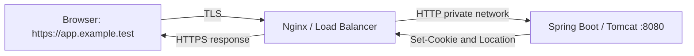

# Testing with Real Containers for Cookies, HTTPS, Proxies, and Browser Behavior

> **Scope:** HTTP testing in **Spring Security Servlet** with Java 17+, Spring Boot 3.x, a real Servlet container, session cookies, CSRF, HTTPS/TLS, reverse proxies, and browsers. The goal is to know when `MockMvc` is not enough, how to run tests over real Tomcat HTTP sockets, how to verify cookies/redirects after TLS termination, and how to test policies that **only real browsers** enforce. Local examples use test accounts and test certificates, not production-ready configurations.

## 1. Why Does MockMvc Pass While Real Browsers Still Fail to Log In?

An application can have completely green tests:

```java
mockMvc.perform(get("/private").with(user("alice")))
        .andExpect(status().isOk());
```

Yet real browsers still hit issues:

- After logging in, the user gets bounced back to login because the `JSESSIONID` cookie is not sent or gets blocked.
- Redirects point to `http://` even though the user accessed `https://` through a proxy.
- Cookies have `SameSite=None` without `Secure`, causing the browser to reject them.
- Form POSTs return **403** because the CSRF token does not match the session cookie.
- A cookie is issued on one host/path while the next request targets another host/path.
- Cross-origin `fetch` sends cookies in the browser yet the API lacks a matching CORS credentials policy.
- After login, the server rotates the session ID (session fixation protection), yet the proxy/client fails to save the new cookie.
- WebSockets or OAuth2 callbacks traverse redirects with mismatched scheme/hostname, dropping the session or failing redirect URI checks.

Root cause: `MockMvc` simulates Servlet requests/responses and filters, yet **never opens a real HTTP socket**, uses no browser cookie jar, and runs no TLS handshake; it does not verify every network, proxy, cookie, and browser rule.

**Principle:** test at the layer closest to the risk being verified. Unit/MockMvc tests are fast for checking controllers, filters, and security rules. Embedded Servlet container tests check real HTTP, sessions, and `Set-Cookie`. Reverse-proxy tests check HTTPS termination and forwarded headers. Browser tests check cookie policies, navigation, CORS, and browser-enforced behavior.

## 2. "Real Container" Can Have Two Meanings

In the Spring Security Servlet context:

1. **Real Servlet container:** Tomcat/Jetty/Undertow actually accepting requests over an HTTP(S) port. `@SpringBootTest(webEnvironment = RANDOM_PORT)` typically launches **embedded Tomcat** with a real network socket. That is a real Servlet container, **not** MockMvc's `MockHttpServletRequest`.
2. **Real OS container:** the app running inside Docker/Podman/Testcontainers, possibly alongside a reverse proxy and container network. That is a different deployment tier, useful for testing hosts, ports, TLS termination, and service connectivity. Docker is **not required** to get a real Servlet container.

Four testing tiers to distinguish:

| Tier | Example tools | What can it verify? | What does it not verify automatically? |
| --- | --- | --- | --- |
| Unit / MockMvc | JUnit, `spring-security-test`, `@WebMvcTest` or `@SpringBootTest` + MockMvc | Matchers, filters, CSRF, simulated authentication/authorization, MVC serialization | TLS handshake, browser cookie jar, real reverse proxy |
| Real HTTP + Servlet container | `@SpringBootTest(RANDOM_PORT)` + `HttpClient`/`TestRestTemplate` | HTTP status, `Set-Cookie`, session rotation, form login, redirects, CSRF over sockets | Browser enforcement, proxy TLS termination if not deployed |
| App + reverse proxy | Docker Compose, Testcontainers, Nginx/Traefik, TLS | Forwarded headers, HTTPS URL reconstruction, `Secure` cookies, domain/path, redirects | JS navigation, browser third-party cookie restrictions |
| End-to-end browser | Playwright or Selenium with Chrome/Firefox/WebKit | Browser cookie store, `SameSite`, `Secure`, `HttpOnly`, CORS, redirects, forms, storage | Does not replace isolated policy tests or load tests |

**Never use a single "status 200" test to infer all tiers are sound.** When reporting evidence to QA, state the tier, transport, host/scheme, browser, cookies, proxy topology, and outcome clearly.

## 3. Understanding Cookies Before Testing Spring Security

### 3.1. What Is a Session Cookie?

In a session-based Spring Security Servlet app, the Servlet container may issue a session cookie such as:

```http
HTTP/1.1 200 OK
Set-Cookie: JSESSIONID=opaque-session-id; Path=/; HttpOnly; SameSite=Lax
```

Once the browser accepts a valid cookie, it sends it back per domain/path/scheme/policy:

```http
GET /account HTTP/1.1
Host: app.example.test
Cookie: JSESSIONID=opaque-session-id
```

A session ID is a **bearer credential** for the session. Never log or paste real IDs into lessons, public screenshots, issue trackers, or analytics. Spring Security manages `SecurityContext` according to the configured strategy/repository; Servlet sessions may store authentication data. Deleting a browser cookie does not revoke every token or remote session, and destroying a local session does not automatically sign out of an IdP.

### 3.2. What Do Cookie Attributes Mean?

| Attribute | Primary meaning | What to test |
| --- | --- | --- |
| `HttpOnly` | JavaScript cannot read the cookie via `document.cookie`; browsers still auto-send it on HTTP requests | Cookie is marked `HttpOnly`, app still sends authenticated requests normally |
| `Secure` | Browsers send only over HTTPS (with special localhost exceptions in browsers) | Cookie carries `Secure` on HTTPS; production never relies on localhost exceptions |
| `SameSite=Strict` | Stronger restriction on sending cookies in cross-site contexts | Cross-site navigation/callbacks may need UX adjustments |
| `SameSite=Lax` | Typically allows cookies in same-site and certain safe top-level cross-site navigations; blocks other cross-site requests | Forms, callback/login redirects, CSRF, and external navigation |
| `SameSite=None` | Allows use in cross-site contexts if browser privacy settings permit; **requires `Secure`** | Browsers may still block third-party cookies even when `None; Secure` is valid |
| `Path` | Restricts request paths receiving the cookie | Check context paths, trailing slashes, and differing redirects |
| `Domain` | Host/domain scope of the cookie; when omitted, usually host-only | Apps/APIs on different hosts, sibling subdomains, and isolation |
| `Max-Age`/`Expires` | Client-side cookie lifetime | Persistent vs session cookies, cleanup after logout |
| `__Host-` prefix | Per browser rules, requires `Secure`, `Path=/`, and no `Domain` | Use when binding cookies strictly to one host; test in real browsers |

**`HttpOnly` is not encryption**, `Secure` does not replace CSRF protection, and `SameSite` does not replace access control. HTTPS protects transport when certificates are verified properly; cookies are only one piece of session security.

### 3.3. Same-Origin vs. Same-Site

- **Origin** is the combination of scheme + hostname + port. `https://app.example.com` and `https://api.example.com` are different origins; two different ports are also different origins.
- **Site** typically relies on scheme plus registrable domain (schemeful same-site). The two subdomains above can be same-site yet cross-origin.
- A `SameSite=Lax` cookie may still be sent on **cross-origin yet same-site** requests depending on cookie domain/path/credentials and browser rules. However, cross-origin `fetch` is still governed by **CORS**.
- `https://app.example.com` and `https://api.other.test` are cross-site; `SameSite=None; Secure` may be necessary if the design truly requires cross-site cookies. Browser privacy/third-party cookie restrictions can still block them.
- `http://` and `https://` can be treated as different sites under schemeful same-site semantics. Never assume "same hostname" suffices when schemes differ.

**Test with production-like domains and topology.** Special `localhost` rules, local HTTPS exceptions, browser flags, or certificate-ignoring modes are strictly for test environments.

### 3.4. Session Fixation Protection and Cookie Rotation After Login

Upon successful login, Spring Security may rotate the session ID (`changeSessionId` per config/container) to mitigate session fixation. Therefore:

1. The browser has a pre-login session cookie holding CSRF token/state.
2. After login it may receive `Set-Cookie` with a **new `JSESSIONID`**.
3. The client must store the new cookie and send it on the next request.
4. Resending only the old cookie or assuming the ID never changes can make tests fail despite valid authentication.

Never assert "session ID must equal a fixed string". In integration tests, verify behavior: post-login requests are authenticated and logout revokes access. When testing session fixation policy, compare before/after IDs through controlled test APIs rather than printing secrets to logs.

## 4. Preparing a Spring Boot 3.x Example Using a Real Servlet Container

The sample below uses **Spring Boot 3.4.x, Java 17, embedded Tomcat** (default with `spring-boot-starter-web`), and Spring Security form login. It suffices to run requests over a real HTTP port using Java `HttpClient`; no browser is needed at this tier. HTTPS and reverse-proxy steps follow separately.

### 4.1. File Structure

```text
real-http-security-demo/
├── settings.gradle
├── build.gradle
└── src/
    ├── main/
    │   ├── java/com/example/realhttp/
    │   │   ├── RealHttpApplication.java
    │   │   ├── SecurityConfig.java
    │   │   └── DemoController.java
    │   └── resources/
    │       ├── application.yml
    │       └── application-https.yml
    └── test/
        └── java/com/example/realhttp/
            └── RealHttpSessionTest.java
```

TLS-related files (`application-https.yml` and the keystore) will be created in the HTTPS section. Never store production private keys or real keystore passwords in the repository.

### 4.2. Gradle

`settings.gradle`:

```groovy
rootProject.name = 'real-http-security-demo'
```

`build.gradle`:

```groovy
plugins {
    id 'java'
    id 'org.springframework.boot' version '3.4.2'
    id 'io.spring.dependency-management' version '1.1.7'
}

group = 'com.example'
version = '0.0.1-SNAPSHOT'

java {
    toolchain {
        languageVersion = JavaLanguageVersion.of(17)
    }
}

repositories {
    mavenCentral()
}

dependencies {
    implementation 'org.springframework.boot:spring-boot-starter-web'
    implementation 'org.springframework.boot:spring-boot-starter-security'

    testImplementation 'org.springframework.boot:spring-boot-starter-test'
    testImplementation 'org.springframework.security:spring-security-test'
}

tasks.named('test') {
    useJUnitPlatform()
}
```

Use Boot's dependency management to avoid mixing incompatible Spring Security/Spring MVC versions. In existing projects, do not copy plugin versions verbatim if your project manages them through another BOM.

### 4.3. Application Class

`src/main/java/com/example/realhttp/RealHttpApplication.java`:

```java
package com.example.realhttp;

import org.springframework.boot.SpringApplication;
import org.springframework.boot.autoconfigure.SpringBootApplication;

@SpringBootApplication
public class RealHttpApplication {
    public static void main(String[] args) {
        SpringApplication.run(RealHttpApplication.class, args);
    }
}
```

### 4.4. SecurityConfig with Form Login and Sessions

`src/main/java/com/example/realhttp/SecurityConfig.java`:

```java
package com.example.realhttp;

import org.springframework.context.annotation.Bean;
import org.springframework.context.annotation.Configuration;
import org.springframework.security.config.Customizer;
import org.springframework.security.config.annotation.web.builders.HttpSecurity;
import org.springframework.security.core.userdetails.User;
import org.springframework.security.core.userdetails.UserDetailsService;
import org.springframework.security.crypto.PasswordEncoder;
import org.springframework.security.crypto.factory.PasswordEncoderFactories;
import org.springframework.security.provisioning.InMemoryUserDetailsManager;
import org.springframework.security.web.SecurityFilterChain;

@Configuration
public class SecurityConfig {

    @Bean
    PasswordEncoder passwordEncoder() {
        return PasswordEncoderFactories.createDelegatingPasswordEncoder();
    }

    @Bean
    UserDetailsService users(PasswordEncoder encoder) {
        return new InMemoryUserDetailsManager(
                User.withUsername("alice")
                        .password(encoder.encode("alice-pass"))
                        .roles("USER")
                        .build()
        );
    }

    @Bean
    SecurityFilterChain securityFilterChain(HttpSecurity http)
            throws Exception {
        return http
                .authorizeHttpRequests(auth -> auth
                        .requestMatchers("/").permitAll()
                        .anyRequest().authenticated()
                )
                .formLogin(Customizer.withDefaults())
                .build();
    }
}
```

Explanation:

- `anyRequest().authenticated()` protects `/account` and `POST /settings`, while `/` is public.
- `formLogin()` enables the default `GET /login` page and `POST /login` form processing per Spring Security mechanics.
- CSRF protection **is not disabled**. When browsers render the default login form, a hidden `_csrf` field is used on POST; missing tokens return HTTP 403.
- In-memory accounts are strictly for testing. Production needs a proper user store, password management, account locking, session policies, and auditing.
- Do not use `csrf.disable()` just to make integration tests easier to pass. Tests must reflect production protections.

### 4.5. Controller

`src/main/java/com/example/realhttp/DemoController.java`:

```java
package com.example.realhttp;

import java.util.Map;
import org.springframework.security.core.Authentication;
import org.springframework.web.bind.annotation.GetMapping;
import org.springframework.web.bind.annotation.PostMapping;
import org.springframework.web.bind.annotation.RestController;

@RestController
public class DemoController {

    @GetMapping("/")
    public Map<String, String> home() {
        return Map.of("message", "public");
    }

    @GetMapping("/account")
    public Map<String, String> account(Authentication auth) {
        return Map.of("user", auth.getName());
    }

    @PostMapping("/settings")
    public Map<String, Boolean> settings() {
        return Map.of("accepted", true);
    }
}
```

`/settings` intentionally writes nothing to a DB to keep CSRF testing simple; production mutations require authorization, validation, and transactions. With valid authentication and a valid CSRF token, the controller returns `{"accepted":true}`. With the same session missing a CSRF token, `CsrfFilter` blocks with 403 before the body executes.

### 4.6. application.yml for Local HTTP

`src/main/resources/application.yml`:

```yaml
server:
  port: 8080
  servlet:
    session:
      cookie:
        name: JSESSIONID
        http-only: true
        same-site: lax
        secure: false
```

This is a **local HTTP test** profile. `secure: false` is not a production recommendation: when serving over HTTPS, cookies must carry `Secure`. With direct TLS or proxy TLS termination, set `secure: true` and inspect actual `Set-Cookie` headers in the browser.

## 5. Integration Testing Over a Real HTTP Port with Java 17 HttpClient

`@SpringBootTest(webEnvironment = SpringBootTest.WebEnvironment.RANDOM_PORT)` starts a real Servlet container, binds an available port, and receives HTTP requests over a network socket. Unlike `MockMvc`, the test below uses `java.net.http.HttpClient`, a `CookieManager`, and real session cookies issued by the server.

### 5.1. Runnable Test Class Using Gradle

File `src/test/java/com/example/realhttp/RealHttpSessionTest.java`:

```java
package com.example.realhttp;

import java.net.CookieManager;
import java.net.CookiePolicy;
import java.net.URI;
import java.net.URLEncoder;
import java.net.http.HttpClient;
import java.net.http.HttpRequest;
import java.net.http.HttpResponse;
import java.nio.charset.StandardCharsets;
import java.util.List;
import java.util.regex.Matcher;
import java.util.regex.Pattern;

import org.junit.jupiter.api.Test;
import org.springframework.beans.factory.annotation.Value;
import org.springframework.boot.test.context.SpringBootTest;
import org.springframework.boot.test.web.server.LocalServerPort;

import static org.assertj.core.api.Assertions.assertThat;

@SpringBootTest(webEnvironment = SpringBootTest.WebEnvironment.RANDOM_PORT)
class RealHttpSessionTest {

    @LocalServerPort
    int port;

    private String url(String path) {
        return "http://localhost:" + port + path;
    }

    private HttpClient clientWithCookies() {
        CookieManager cookies =
                new CookieManager(null, CookiePolicy.ACCEPT_ALL);
        return HttpClient.newBuilder()
                .cookieHandler(cookies)
                .followRedirects(HttpClient.Redirect.NEVER)
                .build();
    }

    private HttpResponse<String> get(HttpClient client, String path)
            throws Exception {
        HttpRequest request = HttpRequest.newBuilder(
                        URI.create(url(path)))
                .GET()
                .build();
        return client.send(
                request, HttpResponse.BodyHandlers.ofString());
    }

    private String csrfFromLoginHtml(String html) {
        Matcher inputs = Pattern.compile(
                "<input\\b[^>]*>", Pattern.CASE_INSENSITIVE)
                .matcher(html);

        while (inputs.find()) {
            String tag = inputs.group();
            if (tag.contains("name=\"_csrf\"")) {
                Matcher value = Pattern.compile(
                        "value=\"([^\"]+)\"").matcher(tag);
                if (value.find()) {
                    return value.group(1);
                }
            }
        }
        throw new IllegalStateException(
                "CSRF field missing from generated login form");
    }

    @Test
    void formLoginCreatesUsableSessionCookie() throws Exception {
        HttpClient browserLikeClient = clientWithCookies();

        // GET login page: server supplies the form and CSRF token.
        HttpResponse<String> page =
                get(browserLikeClient, "/login");
        assertThat(page.statusCode()).isEqualTo(200);

        String csrf = csrfFromLoginHtml(page.body());

        // Inspect the real Set-Cookie header, not only cookie objects.
        List<String> cookies =
                page.headers().allValues("set-cookie");
        assertThat(String.join(";", cookies))
                .containsIgnoringCase("httponly")
                .containsIgnoringCase("samesite=lax");

        String form = "username=alice"
                + "&password=alice-pass"
                + "&_csrf=" + URLEncoder.encode(
                        csrf, StandardCharsets.UTF_8);

        HttpRequest postLogin = HttpRequest.newBuilder(
                        URI.create(url("/login")))
                .header("Content-Type",
                        "application/x-www-form-urlencoded")
                .POST(HttpRequest.BodyPublishers.ofString(form))
                .build();

        HttpResponse<String> login = browserLikeClient.send(
                postLogin,
                HttpResponse.BodyHandlers.ofString());

        // Form login success redirect (default usually 302).
        assertThat(login.statusCode()).isEqualTo(302);

        // CookieManager sends the new session cookie on the next request.
        HttpResponse<String> account =
                get(browserLikeClient, "/account");
        assertThat(account.statusCode()).isEqualTo(200);
        assertThat(account.body()).contains("\"user\":\"alice\"");
    }

    @Test
    void anotherClientWithoutCookieIsNotLoggedIn() throws Exception {
        HttpClient anonymous = clientWithCookies();

        HttpResponse<String> response = get(anonymous, "/account");
        assertThat(response.statusCode()).isEqualTo(302);
        assertThat(response.headers()
                .firstValue("location").orElse(""))
                .contains("/login");
    }

    @Test
    void loginPostWithoutCsrfIsRejected() throws Exception {
        HttpClient client = clientWithCookies();

        HttpRequest post = HttpRequest.newBuilder(
                        URI.create(url("/login")))
                .header("Content-Type",
                        "application/x-www-form-urlencoded")
                .POST(HttpRequest.BodyPublishers.ofString(
                        "username=alice&password=alice-pass"))
                .build();

        HttpResponse<String> response = client.send(
                post, HttpResponse.BodyHandlers.ofString());
        assertThat(response.statusCode()).isEqualTo(403);
    }
}
```

**Note on the HTML parser:** the test extracts the token from the default login form, which illustrates the HTTP layer in this setup cleanly. If Spring Security changes the login page markup in another version, the test may need an updated HTML parser or an app-contract CSRF token endpoint; **never remove CSRF** to turn tests green. With a custom login page, assert and submit the token per your form.

**Note on the request body:** `HttpClient` in the example uses `CookieManager`, so cookies from `GET /login` (and `Set-Cookie` after login) are sent on subsequent requests. A `curl` script omitting `-b/-c`, or two clients with separate cookie stores, simulates **two separate sessions**, not an authentication bug.

### 5.2. Evidence This Test Actually Provides

- A **Servlet container instance listening on a real port**, not simulated requests.
- `Set-Cookie` is emitted and the Java HTTP client stores and resends it; post-login sessions work.
- Form login requires a valid CSRF token; missing tokens are rejected.
- Clients without the cookie must log in again.
- HTTP statuses and redirects are verified directly from wire protocol data.

**Do not infer** that a browser accepts the cookie over HTTPS or in third-party contexts, because `java.net.CookieManager` **does not implement the full cookie/privacy model of Chrome/Firefox/Safari**. A valid `Set-Cookie` header is a necessary condition, not a guarantee a browser will store/send it.

### 5.3. Running Tests

In a project with the Gradle Wrapper and JDK 17:

```bash
# Linux/macOS
./gradlew test

# Windows PowerShell
.\gradlew.bat test
```

All three tests are expected to pass when config and dependencies are right. This is a **designed expectation**, not a claim of execution on the reader's machine. Gradle logs and timings vary; the port is random, injected via `@LocalServerPort` instead of hard-coding `8080` in tests.

### 5.4. Why Does MockMvc Not Replace This Test?

`MockMvc` is great for testing `SecurityFilterChain`, mock sessions, CSRF, and MVC dispatch without socket overhead. However, it performs no **real TLS handshake**, passes through no proxy, and tests no cookie jar outside Servlet mocks. If tests use `with(user("alice"))`, they also prove nothing about login/cookie flows. Keep both tiers instead of dropping MockMvc.

## 6. Testing HTTPS/TLS Directly on Embedded Tomcat

To verify real TLS, you can enable HTTPS directly on Spring Boot's Tomcat using a **local test** keystore. Never test browser behavior merely by adding `Secure` to a string; a real HTTPS connection is needed.

### 6.1. Generating a Test PKCS12 Keystore

In the project, run:

```bash
keytool -genkeypair \
  -alias localhost-test \
  -keyalg RSA -keysize 2048 \
  -storetype PKCS12 \
  -keystore src/main/resources/localhost-test.p12 \
  -storepass changeit -keypass changeit \
  -validity 7 \
  -dname "CN=localhost, OU=LocalTest, O=Example, L=Test, ST=Test, C=VN" \
  -ext "SAN=dns:localhost,ip:127.0.0.1"
```

This is a **self-signed local-only** private key/certificate. Never commit real keys or share keystores/passwords. In real environments, use an appropriate CA/truststore and rotation policy. On Windows, run the `keytool` command in your terminal using PowerShell's line-continuation syntax rather than copying POSIX `\` as a PowerShell operator.

### 6.2. Dedicated HTTPS Profile

File `src/main/resources/application-https.yml`:

```yaml
server:
  port: 8443
  ssl:
    enabled: true
    key-store: classpath:localhost-test.p12
    key-store-type: PKCS12
    key-store-password: ${LOCAL_SSL_PASSWORD}
    key-alias: localhost-test
  servlet:
    session:
      cookie:
        secure: true
        http-only: true
        same-site: lax
```

Start with `LOCAL_SSL_PASSWORD=changeit` **in local testing only**, matching the `keytool` command. In production, secrets must be managed outside source code. Activate:

```bash
./gradlew bootRun --args='--spring.profiles.active=https'
```

Test via CLI:

```bash
# -k is only for testing self-signed certs; never use -k in production
curl -k -i https://localhost:8443/login
```

Observe:

- The TLS handshake completes using the certificate with SAN for `localhost`.
- `Set-Cookie` contains `HttpOnly`, `SameSite=Lax`, and **`Secure`** when a session is created.
- After login POST with proper cookies/CSRF, the session keeps working over HTTPS.
- Redirect `Location` headers use the right HTTPS/host/port when Spring recognizes the public request.

**Never claim TLS was tested if you only called `http://localhost:8080` with `Secure` in a header.** You must open a real HTTPS connection. `curl -k` disables certificate verification to bypass self-signed errors; it **does not prove a valid chain of trust**. To test certificate verification, use a trusted CA or supply the right trust anchor to the client and run without `-k`.

### 6.3. Additional TLS Cases to Test

| Scenario | Expectation |
| --- | --- |
| HTTPS access with valid certificate and matching hostname | TLS succeeds, app serves request |
| Certificate with wrong hostname / expired / untrusted | Standard browsers/clients reject or warn; tests must not ignore |
| `Secure` cookie after HTTPS login | Browser stores and sends only over valid HTTPS connections |
| Plain HTTP to an HTTPS-only port | Connection/protocol error, not a login status |
| HTTP → HTTPS redirect at edge | Never pass credentials over plain HTTP; proper redirect/HSTS policy |
| TLS 1.0 / weak ciphers | Disabled per security baseline |
| HSTS on proper HTTPS hosts | `Strict-Transport-Security` header scoped per policy; never enable recklessly on shared test domains |

In production apps, HTTPS usually terminates at a load balancer/reverse proxy rather than embedded Tomcat. In that setup the backend receives HTTP over an internal network, yet **the browser must still see HTTPS and `Secure` cookies**.

## 7. Reverse Proxy Testing: The "HTTPS Outside, HTTP Inside" Problem

Typical diagram:



On the hop from proxy to app, the request may be plain HTTP. If the app derives scheme, host, and port from the backend connection without **knowing the external request**, it may generate:

```http
Location: http://app:8080/login
```

Instead of the desired external URL:

```http
Location: https://app.example.test/login
```

Consequences:

- Browser redirects to plain HTTP or an unreachable internal hostname.
- OAuth2/OIDC redirect URIs fail registration checks.
- `Secure` cookies fail to be set as expected if config checks the backend scheme.
- Login/CSRF/session callbacks break due to inconsistent host/scheme.
- An HTTPS parent page calling an HTTP API triggers mixed-content errors.

### 7.1. Forwarded Headers and the Trust Boundary

Reverse proxies usually inform the app of the public scheme/host via:

```http
X-Forwarded-Proto: https
X-Forwarded-Host: app.example.test
X-Forwarded-Port: 443
X-Forwarded-For: client-ip
```

Some systems use the standard `Forwarded` header. **Trust these headers only when requests genuinely arrive through a trusted reverse proxy.** An attacker can forge `X-Forwarded-Host` if the app is directly exposed or if the proxy forwards raw user-supplied values, leading to open redirects, host-header injection, or broken callback URLs.

Spring Boot offers `server.forward-headers-strategy` with values like `none`, `native`, or `framework` depending on stack/container. With `framework`, Spring can use forwarded-header processing such as `ForwardedHeaderFilter`. Specific configuration must pair with a **network boundary** and proxy header scrubbing/sanitization.

### 7.2. Docker Compose: App Behind HTTPS Nginx

This is a **separate test environment**, distinct from the direct-TLS Tomcat profile. The app runs internal HTTP; the proxy serves `https://localhost:8443` and attaches controlled forwarded headers.

After `./gradlew bootJar`, create `Dockerfile`:

```dockerfile
FROM eclipse-temurin:17-jre
WORKDIR /app
COPY build/libs/real-http-security-demo-0.0.1-SNAPSHOT.jar app.jar
EXPOSE 8080
ENTRYPOINT ["java", "-jar", "/app/app.jar"]
```

File `compose.yml`:

```yaml
services:
  app:
    build: .
    environment:
      SERVER_FORWARD_HEADERS_STRATEGY: framework
      SERVER_SERVLET_SESSION_COOKIE_SECURE: "true"
    expose:
      - "8080"

  nginx:
    image: nginx:1.27-alpine
    depends_on:
      - app
    ports:
      - "8443:443"
    volumes:
      - ./nginx.conf:/etc/nginx/conf.d/default.conf:ro
      - ./tls:/etc/nginx/tls:ro
```

File `nginx.conf`, **strictly for local testing on hostname localhost, external port 8443**:

```nginx
server {
    listen 443 ssl;
    server_name localhost;

    ssl_certificate /etc/nginx/tls/localhost.crt;
    ssl_certificate_key /etc/nginx/tls/localhost.key;

    location / {
        proxy_pass http://app:8080;
        proxy_set_header Host localhost:8443;
        proxy_set_header X-Forwarded-Host localhost:8443;
        proxy_set_header X-Forwarded-Proto https;
        proxy_set_header X-Forwarded-Port 8443;
        proxy_set_header X-Forwarded-For $remote_addr;
        proxy_set_header Forwarded "";
    }
}
```

Explanation:

- `app` is only `expose`d inside the Compose network, not published on the host for external browsers. Real edges also need firewall/network policies.
- Nginx is the TLS termination point. `X-Forwarded-Proto https` and `X-Forwarded-Port 8443` reflect the external URL of **this demo setup**.
- `Host`/`X-Forwarded-Host` are pinned to known values rather than blindly forwarding an arbitrary client-supplied host. Production must enforce host allowlists and matching ports/domains.
- `Forwarded ""` prevents forwarding an untrusted client `Forwarded` header into the app in the demo; real edge proxies must also scrub other forwarded-header variants per topology.
- `SERVER_FORWARD_HEADERS_STRATEGY=framework` lets Spring interpret proxied requests, **yet is only safe when untrusted Internet clients cannot send forged forwarded headers directly to the app**.
- `SERVER_SERVLET_SESSION_COOKIE_SECURE=true` enforces `Secure` on session cookies even though Tomcat receives HTTP from the proxy. Never set `secure=false` just because the backend hop is HTTP.

Generate a local self-signed certificate/key for Nginx with OpenSSL:

```bash
mkdir -p tls
openssl req -x509 -nodes -newkey rsa:2048 \
  -keyout tls/localhost.key \
  -out tls/localhost.crt \
  -days 7 -subj "/CN=localhost" \
  -addext "subjectAltName=DNS:localhost,IP:127.0.0.1"
```

This is a **test private key**—never commit it to Git or share it. Then run:

```bash
./gradlew bootJar
docker compose up --build
```

Test:

```bash
# -k is only for checking local self-signed certs; never use to verify CA trust
curl -k -i https://localhost:8443/login

# Check redirect on an endpoint requiring authentication
curl -k -i https://localhost:8443/account
```

Inspect `Set-Cookie`, `Location`, and browser URLs. `Location` must use the external scheme/host/port. **If the app returns `localhost:8080` or `http://app:8080`, proxy forwarding is misconfigured**, even if TLS at Nginx succeeded.

### 7.3. Why Not Just Send X-Forwarded-Proto: https Directly and Call It an Integration Test?

A test injecting `X-Forwarded-Proto` into MockMvc can verify header-processing logic, yet fails to prove:

- Real Nginx sets/resets headers properly.
- Browser–proxy connectivity has valid TLS and certificates.
- The backend cannot be reached directly with forged headers.
- Ports/hosts/redirects match production topology.
- `Secure`/Domain/Path cookies are accepted by browsers.

Header-injection tests are **unit/integration component tests**, whereas this lesson also requires **real proxy + browser paths** for system-level issues.

## 8. Testing Real Browser Behavior with Playwright

Java `HttpClient` has a cookie jar, yet does not fully simulate `SameSite` or third-party restrictions. To verify browsers store/send cookies, run **Chrome/Chromium, Firefox, and WebKit** via an end-to-end tool like Playwright against a production-like HTTPS environment.

### 8.1. Standalone Playwright Setup

In a separate test directory (without modifying the Java demo code):

```bash
npm init -y
npm install --save-dev @playwright/test
npx playwright install chromium
```

Create `tests/session.spec.ts`:

```typescript
import { test, expect } from '@playwright/test';

const origin = 'https://localhost:8443';

// Skip self-signed cert verification ONLY in LOCAL TEST.
// In CI/prod-like environments use trusted certificates.
test.use({ ignoreHTTPSErrors: true });

test('browser login sets cookies with expected flags', async ({
  page, context
}) => {
  await page.goto(origin + '/login');

  await page.locator('input[name="username"]').fill('alice');
  await page.locator('input[name="password"]').fill('alice-pass');
  await page.locator('button[type="submit"]').click();

  await page.goto(origin + '/account');
  await expect(page.locator('body')).toContainText('"user":"alice"');

  const cookies = await context.cookies();
  const session = cookies.find(c => c.name === 'JSESSIONID');

  expect(session).toBeDefined();
  expect(session?.httpOnly).toBe(true);
  expect(session?.secure).toBe(true);
  expect(session?.sameSite).toBe('Lax');
});

test('new context does not share the old context session', async ({browser}) => {
  const other = await browser.newContext({
    ignoreHTTPSErrors: true
  });

  const page = await other.newPage();
  await page.goto(origin + '/account');
  await expect(page).toHaveURL(/\/login(?:\?.*)?$/);
  await other.close();
});
```

Run:

```bash
npx playwright test tests/session.spec.ts --project=chromium
```

If there is no `playwright.config.ts` defining a project named `chromium`, omit `--project=chromium`:

```bash
npx playwright test tests/session.spec.ts
```

**Test setup warning:** never run tests with real user data or production credentials. `ignoreHTTPSErrors: true` is strictly for self-signed certs in local tests; enabling it across all CI runs masks real certificate errors, hostname mismatches, and chain-of-trust failures. Follow up with browser tests against **trusted** TLS certificates without ignoring errors.

### 8.2. What to Inspect in DevTools

In Chrome/Edge DevTools:

1. **Network → GET /login:** does the response include `Set-Cookie`? What are `Path`, `Secure`, `HttpOnly`, and `SameSite`?
2. **Application/Storage → Cookies:** did the browser **store the cookie**? If not, check the Issues tab / blocked reason.
3. **Network → POST /login:** does the request carry the session cookie and matching `_csrf` field? Does the response redirect or error?
4. **Network → GET /account:** is the post-login rotated cookie sent? Which host/scheme served the response?
5. **Console/Issues:** are there mixed-content errors, CORS failures, cookie rejections, or TLS warnings?
6. **Network → redirect chain:** does `Location` downgrade `https` to `http`, or change port/hostname?
7. **Preserve log:** enable it to trace requests across multiple redirects; avoid screenshots exposing real session IDs/tokens.

**Note:** `document.cookie` **does not show `HttpOnly` cookies**, yet browsers still attach them automatically. Thus an empty `document.cookie` does not mean no session cookie exists; inspect Storage/Network or Playwright `context.cookies()`.

### 8.3. Difference Between Form Submissions and fetch API

In traditional form logins, the browser manages cookies and redirects across navigation. With cross-origin `fetch`, extra conditions apply:

```javascript
const response = await fetch('https://api.example.test/account', {
  method: 'GET',
  credentials: 'include'
});
```

This alone **is not enough** to succeed:

- The API needs an explicit CORS origin allowlist—never `Access-Control-Allow-Origin: *` with credentials.
- When allowing credentials, the CORS response must include matching headers (e.g., `Access-Control-Allow-Credentials: true`) and the selected origin.
- Browsers still enforce cookie `Domain`/`Path`/`SameSite`/`Secure` and third-party tracking restrictions.
- CSRF protection is still needed for state-changing requests.
- Cross-origin **does not equal cross-site**; use production-like domains to test both.

**Never relax CORS and `SameSite` globally just to make browser tests pass.** Determine whether the architecture truly requires cross-site cookies or can use same-origin/first-party routing.

## 9. HTTPS, Cookies, and Proxies: Recommended CI Test Matrix

| Test case | Appropriate test tier | Expectation / signal |
| --- | --- | --- |
| `GET /account` when unauthenticated | Real HTTP `@SpringBootTest` | 302 to login in form-login demo |
| GET login then POST with CSRF + session cookie | Real HTTP `HttpClient` | 302 success, followed by `/account` 200 |
| Login POST missing CSRF | Real HTTP or MockMvc | 403, no authenticated session created |
| Login with a client that drops cookies | Real HTTP | Next request remains unauthenticated |
| `HttpOnly` cookie | Real HTTP header check + browser | JS cannot read cookie; browser still sends it |
| `Secure` cookie over HTTPS | Real TLS + browser | Cookie sent only over HTTPS per policy |
| `SameSite=Lax` cookie | Browser with real navigation/cross-site | True Lax behavior; not just string assertion |
| `SameSite=None; Secure` cookie | Browser in real cross-site context | Browser accepts or blocks per privacy rules; track exact reason |
| Session ID rotates after login | Real HTTP with cookie jar | New session works; test rotation if required by policy |
| Logout POST + CSRF | Real HTTP/browser | Session invalidated and subsequent requests require login |
| Redirect through Nginx TLS | Real proxy + browser/curl | `Location` uses external scheme/host/port |
| Proxy missing forwarded headers | Negative real-proxy test | Catches internal `http://app:8080` or wrong host |
| Header spoofing | Security/network boundary test | App ignores headers not verified by proxy |
| Wrong-hostname / expired certificate | Browser/HTTP client without ignoring TLS errors | Handshake rejected or warned |
| HSTS | Real HTTPS/browser | Policy fits scope; does not break shared local domains |
| OAuth2/OIDC callback over HTTPS | Browser + matching external/mock IdP | Redirect URI matches; state/session cookie preserved |
| Cookie with context path | Real HTTP/browser | Cookie `Path` and redirects retain base path |
| Two apps on two subdomains | Browser with real origins | No cookie leakage out of scope; CORS/SameSite right |
| Browser back/forward/cache after logout | Browser | Sensitive unauthorized data not shown from cache |

Not every case has to run on every unit test pass. Split into tiers: fast PR checks, Docker CI integration, nightly cross-browser, and real pre-release environments. However, **any concrete risk must be covered at its matching tier**.

## 10. Troubleshooting Common "Infinite Login Loop" Scenarios

### 10.1. Response Has Set-Cookie Yet Next Request Sends No Cookie

Check in order:

1. Did the browser **accept and store** the cookie (Issues/Storage)?
2. Does the next request share the scheme/host/path covered by the cookie?
3. Is the cookie `Secure` while the request uses plain HTTP?
4. Does `SameSite` block the cookie in a cross-site context?
5. Is the browser blocking third-party cookies?
6. Is the cookie `Domain` set to the wrong hostname or an invalid domain?
7. Did the session ID rotate after login while the client kept sending the old ID?
8. Did a proxy unintentionally rewrite `Set-Cookie` or `Path`?
9. Are multiple backend nodes missing a shared session store or sticky-session strategy?

Never rush to disable `HttpOnly`, `Secure`, `SameSite`, or CSRF to "fix" the issue. Identify the right attribute/proxy topology and session design first.

### 10.2. Redirect Returns HTTP Behind HTTPS

Likely causes: the app did not receive the forwarded scheme, or the proxy sent/scrubbed headers improperly. Check:

- Which public URL did the client access?
- Where does TLS actually terminate?
- Did Nginx/ingress set `X-Forwarded-Proto=https`, `X-Forwarded-Host`, and port properly?
- Does Spring Boot's `server.forward-headers-strategy` match?
- Is the backend directly reachable, letting clients spoof forwarded headers?
- Are the OAuth2 redirect URI and application base URL registered properly?

**Do not solve this by hard-coding one rigid redirect URL uncontrollably**, because staging/tenants/environments need their respective base URLs. Use host allowlists and known external URLs to configure a single trusted source for URI generation.

### 10.3. Cross-Site Login Callback Loses Session

Some login/OAuth2/OIDC flows rely on the browser returning from an identity provider. `SameSite=Strict` can block cookies on cross-site redirects; `Lax` works for top-level GET callbacks yet does not cover every mode such as form POSTs or iframes. Test against the **actual response mode**, browsers, and cookie setup.

If a callback requires a cross-site POST, you may need a different state/session design or `SameSite=None; Secure` with risk controls, though third-party cookie restrictions and CSRF still apply. Never drop `state` or CSRF checks just to work around cookie issues.

### 10.4. 403 on POST Even Though GET /account Returns 200

GET and POST have different CSRF semantics. With session-cookie auth, Spring Security normally requires a CSRF token on unsafe methods. Check:

- Is the user authenticated with a still-valid cookie?
- Does the token in the form/header belong to the same session?
- Was the token rotated/cleared on login/logout?
- Does the SPA send the header or form field expected by the active `CsrfTokenRepository`/request handler?
- Did a proxy alter `Origin`/`Host`, breaking origin checks?
- Did the 403 come from `CsrfFilter` or from authorization/service policy?

**Never conclude "missing role" from every HTTP 403**. Write tests separating CSRF errors from authorization errors to diagnose accurately.

### 10.5. Browser Passes on localhost Yet Fails on Staging/Prod

`localhost` has special exceptions and handling for secure contexts, certificates, and cookies. Specifically:

- `Secure` cookies over plain HTTP `localhost` may receive special browser treatment; that does not reflect public HTTP.
- Cross-site/third-party cookie behavior depends on real domains and browser privacy settings.
- Staging ports/schemes/hosts differ from local; proxies may produce wrong redirects.
- Local tests run one instance; staging runs multiple pods, load balancers, and a session store.
- HSTS, CSP, HTTPS redirects, `SameSite`, and cookie prefixes must be tested on **real hostnames and CAs**.

Set up a test environment with public-like hostnames and valid TLS whenever risks center on those layers.

## 11. Docker/Testcontainers: When Do You Need a Production-Like Environment?

`@SpringBootTest(RANDOM_PORT)` suffices to test a real Servlet container without Docker. Add Testcontainers/Compose only when testing deployment-level differences:

- Nginx/Traefik/Ingress generating forwarded headers and terminating TLS.
- Private app/backend networks vs. exposed frontend ports.
- Redis/JDBC session stores shared across multiple instances.
- Cookie domains/paths across multiple hostnames.
- Mock OAuth2/OIDC providers, external redirects, and callbacks.
- Real TLS certificates/keys and trust chains.
- Health checks, startup/readiness, and failover.

**Testcontainers alone does not test browsers:** even inside Docker, API clients ignore `SameSite`, third-party cookie policies, and JS CORS. You must **run a real browser engine** to verify those behaviors. Conversely, browser E2E tests do not guarantee unit authorization, negative CSRF tests, or account-policy checks are complete.

In CI, pass Docker host/port mappings cleanly into Playwright; never hard-code `localhost` when the test runner executes in a separate container. When HTTPS trust is needed, provide a clean test CA; reserve ignoring certificate errors for local debugging.

### 11.1. Stratifying Tests by Speed and Confidence

- **PR:** unit tests, MockMvc, `@SpringBootTest(RANDOM_PORT)` for cookies/sessions/CSRF. Focus on key negative cases.
- **CI integration:** real app + real proxy + real TLS, checking `Location`, `Set-Cookie`, forwarded headers, and login/session through the proxy.
- **Nightly or pre-release:** browser E2E on Chromium/Firefox/WebKit covering cross-site flows, session expiry, logout, redirects, and certificate trust.
- **Staging-like:** real domains, paths, CDN/ingress, HSTS, OAuth provider, session store, and multi-instance setup; verify production-faithful behavior.

Define clear test-environment owners and fake secrets; tests must never send real emails/SMS, use production users/credentials, or upload HAR traces holding real session tokens to public storage.

## 12. Priority Test Cases for Spring Security Servlet

### 12.1. Authentication and Sessions

- [ ] Anonymous GET on protected routes triggers login via the right entry point.
- [ ] Form login succeeds with persisted cookie jar and valid CSRF token.
- [ ] Wrong password creates no authenticated session.
- [ ] Pre/post-login sessions are managed properly; fixation protection preserves auth.
- [ ] Two clients never accidentally share sessions.
- [ ] Logout via POST/CSRF strips permissions from the old session; browser Back reveals no sensitive content.
- [ ] Idle timeouts and expired sessions have proper UX/responses.
- [ ] Cookie flags `HttpOnly`, `Secure`, `SameSite`, `Path`, and `Domain` match the profile.

### 12.2. HTTPS/TLS

- [ ] TLS handshake uses a trusted certificate with matching hostname; `-k` is never used in trust-verification tests.
- [ ] App/proxy never redirects from HTTPS back to HTTP.
- [ ] `Secure` cookies work in HTTPS browsers; plain HTTP never accidentally leaks credentials.
- [ ] HSTS/CSP/mixed-content policies suit the host and features.
- [ ] TLS termination and internal HTTP backend hops are guarded by network policy.

### 12.3. Reverse Proxies and Forwarded Headers

- [ ] Edge sends only verified scheme/host/port and strips spoofed client headers.
- [ ] Backend is not publicly exposed directly; the reverse-proxy trust boundary is enforced.
- [ ] `Location` and absolute URLs match the external hostname/port across all redirects.
- [ ] Cookie `Path`/`Domain` are not mis-rewritten; context paths are tested.
- [ ] Forwarded-headers strategy is configured explicitly for the Servlet container and app.
- [ ] Multi-instance session store / sticky-session strategy ensures post-login requests hitting another node retain auth.

### 12.4. Browsers, CORS, and CSRF

- [ ] Browsers store and send cookies per `SameSite`; do not rely solely on Java `CookieManager` assumptions.
- [ ] `HttpOnly` cookies are unreadable from JS while requests stay authenticated.
- [ ] Cross-origin `fetch(credentials:'include')` has matching CORS allowlist/credentials and valid cookies.
- [ ] Cross-site navigation/callbacks work along the real login flow.
- [ ] Third-party cookie restrictions are tested across target browsers.
- [ ] POST/PUT/PATCH/DELETE carry CSRF tokens or matching protections; missing tokens are rejected.
- [ ] TLS/certificate validation or CSRF is never disabled just to make tests pass.
- [ ] Real session IDs, raw OAuth tokens, cookies, or credentials are never logged in CI logs/traces.

## 13. Common Misconceptions

| Misconception | Reality |
| --- | --- |
| "MockMvc passed, so browser cookies definitely work." | MockMvc has no browser cookie jar, TLS, or real proxy. |
| "`@SpringBootTest RANDOM_PORT` is still MockMvc." | `RANDOM_PORT` runs a real embedded Servlet container listening on a socket. |
| "A Docker container is mandatory to get a real Servlet container." | No; running embedded Tomcat is already a real Servlet container. |
| "`Set-Cookie` has `SameSite`, so browsers will definitely send it." | Browsers also check `Secure`, origin/site, third-party restrictions, and cookie scope. |
| "`HttpOnly` stops browsers from sending cookies." | `HttpOnly` blocks JS reads; browsers still attach cookies per policy. |
| "`Secure` already protects cookies from CSRF." | `Secure` only restricts transport to HTTPS; CSRF protection is still needed. |
| "`SameSite` and CORS are the same thing." | `SameSite` governs sending cookies by site context; CORS governs JS cross-origin access. |
| "`SameSite=None` always fixes cross-site login." | Requires `Secure`, and provider/browser privacy policies may still block it. |
| "Backend uses HTTP behind an HTTPS proxy, so cookies must be insecure." | The outer browser link is HTTPS; set `Secure` and proper forwarded headers. |
| "Trust `X-Forwarded-Proto: https` whenever a client sends it." | Trust only trusted proxies that sanitize headers; prevent header spoofing. |
| "`curl -k` succeeding proves the certificate is valid." | `-k` skips certificate verification; it only checks raw connectivity/TLS encryption. |
| "A 403 after login definitely means missing role." | Could be CSRF, origin/cookie/session issues, or another authorization rule. |
| "Same hostname means same-site regardless of scheme." | Modern browsers enforce schemeful same-site semantics; HTTPS vs HTTP matters. |
| "One browser test on localhost suffices for production." | Localhost exceptions and real proxies/domains/CAs behave differently. |
| "Testing status 200 alone is enough." | Must verify cookie persistence, redirects, session isolation, negative cases, and browser enforcement. |

## 14. Self-Check Questions

**1.** Why can a MockMvc test with `with(user("alice"))` pass while real browsers keep redirecting to login?  
Because MockMvc injects authentication directly into the test context and does not prove HTTP login, session cookies, TLS, or browser cookie policies work. Real container and browser tests are required.

**2.** Does `@SpringBootTest(RANDOM_PORT)` launch Docker?  
No. It normally launches embedded Tomcat/Servlet container on a random HTTP port; Docker/Testcontainers are only needed for broader deployment topologies.

**3.** An `HttpOnly` cookie does not appear in `document.cookie`. Is the cookie lost?  
No. `HttpOnly` blocks JS access; inspect DevTools Network/Storage or Playwright's cookie API to verify whether the browser stored/sent it.

**4.** After login returns 302, the next request is unauthenticated. What do you inspect?  
Check the new `Set-Cookie`, domain/path/`SameSite`/`Secure`, cookie jar, session ID rotation, forwarded scheme/host, and session store.

**5.** Why does a backend receiving internal HTTP still need `Secure` cookies behind an HTTPS reverse proxy?  
Because the browser → proxy leg is HTTPS and session cookies must be sent by browsers only over HTTPS rather than downgraded due to the internal HTTP hop.

**6.** Why not trust `X-Forwarded-Host` from arbitrary clients?  
Because attackers can forge external hosts/protos to manipulate redirects and absolute URLs. Trust only values verified/reset by a trusted proxy.

**7.** Does running `curl -k` prove the hostname/certificate is valid?  
No. It disables certificate verification. Test without `-k` against a proper trust store/CA to prove trust.

**8.** Why might `SameSite=Lax` not resolve `fetch` calls from another site?  
Because cross-site requests do not always qualify for `Lax` exceptions; CORS, credentials mode, and third-party cookie restrictions also apply.

**9.** If Java's HTTP client stores cookies, will browsers definitely store them too?  
No. Java's `CookieManager` cannot fully emulate browser policies and third-party cookie restrictions.

**10.** Which test proves CSRF is truly enabled?  
Sending a state-changing POST with an active session yet missing/invalid CSRF token must be rejected; sending it with a valid token and sufficient authority succeeds.

## 15. Conclusion

Trustworthy Spring Security Servlet testing must verify the **mechanism** at the right layer:

- **MockMvc** verifies security rules quickly without networking.
- **Real Servlet container + HTTP client** verifies cookies, sessions, form login, redirects, and CSRF over real requests/responses.
- **Real HTTPS and reverse proxy** verifies TLS termination, forwarded headers, `Secure` cookies, scheme/host/port, and certificate trust.
- **Real browser** verifies cookie acceptance, `SameSite`, `HttpOnly`, cross-site navigation, CORS, third-party policies, and behaviors that cannot be inferred from response headers alone.

**Do not stop at status 200/302.** Inspect `Set-Cookie`, the follow-up `Cookie` header, `Location`, TLS/certificates, session state, CSRF tokens, cookie blocked reasons, and the entire redirect chain. Only when tests traverse the path real users take do you have solid evidence that cookie, HTTPS, proxy, and browser authentication genuinely works.
