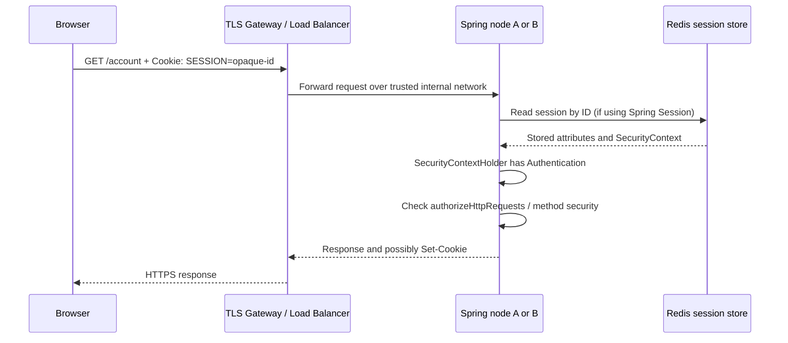

# Secure Cookies, Timeouts, and Multi-Node Session Stores — Spring Security Servlet

## 1. Objectives and Deployment Scenarios

A **Spring Security Servlet** application typically authenticates users via form login, SAML2, or OAuth2/OIDC and then maintains an HTTP session via a cookie. On a single machine, keeping the session in the servlet container's memory may work fine; when scaling to multiple nodes/pods behind a Load Balancer, sessions can be lost if the next request lands on a different node. Meanwhile, misconfigured cookies, overly long lifetimes, or an insecure session store can lead to account takeover, CSRF, and "flaky" logins.

This guide focuses on **Spring Boot 3.x, Spring Security 6.x, Java 17+, Spring MVC/Servlet** and addresses three operational pillars:

1. **Secure session cookies:** `Secure`, `HttpOnly`, `SameSite`, `Path`, `Domain`, HTTPS, session ID rotation, CSRF, and configurations behind a reverse proxy.
2. **Well-defined timeouts:** idle timeout, session cookie lifetime, absolute timeout, invalidation/logout mechanics, remember-me effects, and time-boundary tests.
3. **Shared multi-node session stores:** `HttpSession` with Spring Session + Redis, trust boundaries, resilience, rollouts, metrics, cache/session errors, and multi-node testing.

Make the distinction immediately: **a cookie holds a reference session ID, not the entire SecurityContext** in a server-side session model. The browser holds the reference token; the server looks up session data to identify the user and corresponding SecurityContext. Never write JWTs, passwords, or arbitrary authorization objects into a plain session cookie.

## 2. How Does an Authenticated Session Request Flow?



Layers to understand:

- **Browser** decides whether to send a cookie based on host, Path, Secure, SameSite, and cookie policy.
- **Gateway/Ingress** terminates or forwards TLS and routes the request to a node; if TLS only terminates at the outer gateway, internal hops must be protected per the appropriate trust boundary.
- **Servlet container + Spring Session** maps the session ID to session data and expiration, then exposes the `HttpSession` API.
- **Spring Security** reads/saves `SecurityContext` via the configured `SecurityContextRepository` mechanism. Authentication and authorities may be stored in the session; method security uses the current request's authenticated information.
- **Redis or a centralized session store** provides shared state across nodes, not an authentication/authorization policy by itself.

If node A writes `SecurityContext` after login but node B cannot read the same session, the next request may redirect back to the login page. Do not assume it is a password error: the cause could be cookies, the Redis backend, namespace, serialization, TTL, or the proxy.

## 3. Secure Session Cookies: Attributes and Common Misconceptions

An illustrative response for an application using Spring Session:

```http
HTTP/1.1 302 Found
Set-Cookie: SESSION=example-opaque-session-id; Path=/; Secure; HttpOnly; SameSite=Lax
Location: /account
Cache-Control: no-store
```

This is a **structural example**, not a real cookie to use. Never copy a session ID between users or set a fixed session ID.

| Attribute | Meaning | What to watch out for |
| --- | --- | --- |
| `Secure` | Send cookie only over HTTPS connections per browser rules | Requires HTTPS on the browser side; proxy TLS termination must be configured properly |
| `HttpOnly` | JavaScript cannot read the cookie directly via `document.cookie` | Reduces cookie theft via certain XSS attacks; does **not** replace XSS protection |
| `SameSite=Lax` | Restricts sending cookies in many cross-site scenarios, typically still allowing top-level GET navigations | Does not replace CSRF tokens; some IdP POST callbacks may need a different policy |
| `SameSite=Strict` | Stronger cross-site restriction | Easily breaks SSO/redirects and links to the app from other sites |
| `SameSite=None` | Allows sending cookies in cross-site contexts when browser permits | Must pair with `Secure`; still needs CSRF/validation and must account for third-party cookie blocking |
| `Path=/` | Cookie is sent to matching paths on the host | Not an authorization boundary between apps on the same origin |
| Omitting `Domain` | Host-only cookie, restricted to one exact host | Preferred over a broad Domain unless subdomain sharing is required |
| `Domain=example.test` | Cookie may be sent to matching subdomains | Broader scope; increases risk from weak or compromised subdomains |
| `Max-Age`/`Expires` | Browser cookie storage lifetime | **Does not mean** the server-side session TTL |
| `SESSION`/`JSESSIONID` name | Cookie name used by Spring Session/container | Spring Session Redis typically uses `SESSION`, container sessions typically use `JSESSIONID`; verify in practice |

`Secure` and `HttpOnly` do not "encrypt the cookie" in the sense that data inside the browser cannot be exposed. An attacker with access to a logged-in browser can still perform actions if the application skips authorization and CSRF checks; a session ID stolen from logs, proxies, or devices remains dangerous while still valid.

### 3.1. Why Avoid Setting a Broad Domain When Unnecessary?

For an application at `app.example.test`, a **host-only** cookie is scoped strictly to that host. If you set `Domain=example.test`, the cookie can be sent to multiple subdomains, and an insecure subdomain can compromise the application's cookie security.

Host-only cookies are completely different from **CORS**: CORS controls response access from JavaScript; it does not control all HTTP requests and cannot replace `Domain`, `SameSite`, or CSRF.

### 3.2. `__Host-` and `__Secure-` Prefixes

Browsers support cookie name prefixes:

- `__Secure-`: the cookie must be set over HTTPS with `Secure`.
- `__Host-`: requires `Secure`, `Path=/`, and **no `Domain`**, binding the cookie more tightly to the host.

If you want to use `__Host-SESSION`, you must configure **all** of those attributes, test against real browsers and proxies, and update logout cookie deletion to use the exact same name. Do not rename the cookie between two deployments without a rollout and compatibility testing; users may be forced to log in again.

## 4. CSRF, SameSite, and Automatically Sent Sessions

An application using session cookies receives cookies **automatically** from the browser whenever cookie rules permit. A cross-site request can exploit an existing session to perform state changes if the server does not verify CSRF.

Therefore:

1. Keep Spring Security's **CSRF protection** for operations using cookie/session auth. Form POST/PUT/PATCH/DELETE requests must handle tokens or equivalent architectural controls.
2. Use `SameSite=Lax` as an additional defense layer; it **does not replace** CSRF tokens and does not guarantee every cross-site request is harmless.
3. Do not create state-changing operations over GET just to avoid CSRF or make logout links easy to write.
4. For SPAs using cookies and AJAX, design how CSRF tokens are issued to the frontend, sent in headers/forms, and paired with exact-origin CORS; never enable `allowCredentials` for all origins.
5. With OAuth2 login, standard Authorization Code callbacks are **top-level GETs**, typically compatible with `SameSite=Lax`. With **SAML2 HTTP-POST binding** or OIDC `response_mode=form_post`, the callback can be a **cross-site POST**, causing `SameSite=Lax` to withhold the needed session cookie.

Do not change all cookies to `SameSite=None` just to fix a callback error before verifying the protocol, proxy, browser, and IdP. If cross-site POST is required, use `SameSite=None; Secure` together with CSRF, state/nonce/SAML validation, and proper trust policies. Some browser environments block third-party cookies independently of SameSite; test in real browsers.

### 4.1. Session Cookie vs. CSRF Token

A session cookie proves the browser holds the current **session ID**, but the server still needs to know whether a state-changing request was legitimately initiated by the application. A CSRF token is a separate value/check and usually has its own lifecycle.

`HttpOnly` on a session cookie stops scripts from reading the ID, yet a script running on a valid origin can still make authenticated requests. XSS defense, CSRF, CSP, input validation, and object-level authorization must all work together; no single cookie flag replaces them all.

## 5. Session Fixation: Rotating the Session ID at Login

**Session fixation** occurs if an attacker tricks a victim into using a pre-known session ID before login, and after login that same ID remains the credential for the authenticated session.

Spring Security Servlet provides **session fixation protection**. On modern Servlet containers, the right strategy is typically `changeSessionId()` when a user authenticates via login/session mechanisms. It rotates the session identifier while preserving required attributes per container and framework behavior.

```java
http.sessionManagement(session ->
    session.sessionFixation(fixation -> fixation.changeSessionId()));
```

This snippet goes **inside a `SecurityFilterChain` configuration**, not as a standalone Java program. In Spring Security 6, the default session fixation protection depends on the servlet container and authentication mechanism and already uses safe defaults; configuring it explicitly makes the policy clear.

**What to test:** the pre-login ID must not work as a valid post-login ID, the post-login ID is returned via `Set-Cookie` with the right name/path/domain, and the old session can no longer authenticate the user. Also check risks when custom authentication mutates `SecurityContextHolder` directly without performing standard persistence, session strategy, and cleanup.

Do not rotate the session ID on **every request** as a substitute for session fixation protection: that creates overhead and race conditions when browsers send concurrent requests. Rotate at appropriate security boundaries such as login, and define a policy for sensitive privilege elevation.

## 6. Timeouts: At Least Four Distinct Concepts

### 6.1. Idle Timeout (`maxInactiveInterval`)

A session typically expires if no recognized activity occurs within a window, e.g., **30 minutes of inactivity**. Servlet's `HttpSession.getMaxInactiveInterval()` returns the configured seconds for the session (negative values may mean no automatic expiration per contract, **not recommended** for user sessions).

For an application with a 30-minute idle timeout:

```text
T0 09:00: user logs in, session active
T1 09:15: active request -> idle window resets per store mechanism
T2 09:40: request -> still valid if idle < 30 minutes
T3 10:20: request -> session may have expired if inactive since 09:40
```

**Activity** is typically detected when the session is accessed via a request/filter; polling, background AJAX, keep-alives, or periodic tasks can unintentionally extend the idle window. Changing only a UI timer without checking the actual cookie/session store easily causes mismatches.

### 6.2. Absolute Timeout

**Absolute timeout** caps the total lifetime of a session from login/creation time, e.g., 8 hours, **regardless of ongoing user activity**. Setting `maxInactiveInterval=30m` does not enforce an absolute timeout.

To enforce an absolute timeout, the application needs its own policy: store a trusted authentication timestamp at login, check it before allowing requests/actions, and invalidate/renew the session or require reauthentication once exceeded. Never use `lastAccessedTime` to represent login time.

If session rotation is enabled, anchor the absolute timeout to the **actual authentication event**, do not reset the 8-hour window simply because the session ID was rotated.

### 6.3. Browser Cookie Lifetime

A cookie **without** `Max-Age`/`Expires` is generally a browser session cookie, eligible for removal when the browser session ends; some browsers have session-restore features, so "closing the tab" cannot be treated as a reliable security logout.

Conversely, a persistent cookie still present in the browser **does not resurrect an expired Redis session**. The browser may keep sending the ID, but the server must treat the request as unauthenticated when the session does not exist or is no longer valid.

### 6.4. Remember-Me and Token Lifetimes

Spring Security **remember-me** is separate from the HTTP session. When enabled, a remember-me cookie/token can recreate a new Authentication/session after the old session expires, depending on configuration. Timeout tests must therefore explicitly check whether remember-me is enabled; "session expired yet refreshing logged back in" does not necessarily mean Redis TTL failed.

JWT access tokens, refresh tokens, SAML IdP SSO sessions, and OAuth2 authorized-client state also have their own lifetimes and revocation rules. Logging out an HTTP session **does not automatically revoke all linked tokens or sessions**.

## 7. Java 17: Simulating Idle and Absolute Timeouts with Fixed Clocks

The following standalone program has no Spring dependency and demonstrates the two distinct timeout conditions. File **`SessionWindowDemo.java`**:

```java
import java.time.Duration;
import java.time.Instant;

public class SessionWindowDemo {

    static boolean expired(
            Instant createdAt,
            Instant lastActiveAt,
            Instant now,
            Duration idleLimit,
            Duration absoluteLimit) {

        boolean idleExpired =
            !now.isBefore(lastActiveAt.plus(idleLimit));
        boolean absoluteExpired =
            !now.isBefore(createdAt.plus(absoluteLimit));

        return idleExpired || absoluteExpired;
    }

    public static void main(String[] args) {
        Instant start = Instant.parse("2026-01-01T00:00:00Z");
        Duration idle = Duration.ofMinutes(30);
        Duration absolute = Duration.ofHours(8);

        System.out.println("active=" + expired(
            start, start.plusSeconds(600), start.plusSeconds(1200),
            idle, absolute));

        System.out.println("idle=" + expired(
            start, start.plusSeconds(600), start.plusSeconds(2460),
            idle, absolute));

        System.out.println("absolute=" + expired(
            start, start.plusSeconds(28200), start.plusSeconds(28800),
            idle, absolute));
    }
}
```

Run with JDK 17+:

```bash
javac SessionWindowDemo.java
java SessionWindowDemo
```

**Exact** stdout:

```text
active=false
idle=true
absolute=true
```

- 20 minutes since login, last activity 10 minutes ago → still active.
- 41 minutes since login, last activity at minute 10 → 31 minutes idle → expired.
- At exactly 8 hours since login → absolute expired even with recent activity.

**This is a time model for learning, not an `HttpSession` or Spring Session implementation.** In a real system, handle clock skew, UTC timestamps, concurrency, and actual TTLs in the session repository. Production code calling `Instant.now()` should accept an injectable `Clock` to make time-boundary testing straightforward.

## 8. Single-Node, Sticky Sessions, and Distributed Session Stores

### 8.1. Why Do Multi-Node Clusters Have Problems?

Suppose `JSESSIONID` is created by server A and session data lives only in A's memory:

```text
Browser --LB--> A: login -> creates JSESSIONID=123 -> SecurityContext saved on A
Browser --LB--> B: GET /account + JSESSIONID=123 -> B has no session
Browser --LB--> A: GET /account + JSESSIONID=123 -> A still sees login
```

Symptom: intermittent login failures, often dependent on which pod/backend handles the request. It does not mean the browser changes request IDs on every call; the **session lookup target** itself is inconsistent.

### 8.2. Sticky Session Approach

Routing the same session/browser to one node at the load balancer (**session affinity**) can temporarily mask the symptom. However:

- If Pod A restarts or is evicted, RAM sessions are still lost.
- Autoscaling and rolling updates can shift routing.
- Load becomes unbalanced when certain sessions are heavy.
- Sticky routing alone does not solve failover, replication, session fixation, timeouts, or session store security.

Sticky sessions can fit certain architectures, but **do not replace** analyzing session survivability across node failures.

### 8.3. Shared Session Store

With **Spring Session + Redis**, both A and B read/write sessions through a shared backend:

```text
               HTTPS
Browser --------------------> LB / Ingress
                               |       |
                              Node A  Node B
                               |       |
                               +---+---+
                                   |
                            Redis session store
```

Spring Session replaces `HttpSession` storage via `SessionRepositoryFilter`, allowing application code to keep using `HttpSession` instead of manually connecting to Redis in every controller.

**A session ID must share the same namespace and serialization schema across every node in the same application deployment.** If A writes to namespace `appA:sessions` while B reads `appB:sessions`, symptoms look like lost cookies. If A and B use incompatible class/serializer versions, deserialization errors or broken authentication state can occur.

Redis is **shared state**, not a message broker that automatically broadcasts logout to every independent application. Managing concurrent sessions, forced logouts, or per-principal revocation across multiple nodes may require an additional index/session registry and synchronization controls.

## 9. Spring Boot 3.x Project: Spring Session Redis + Secure Cookies

The example below is a minimal **Servlet application** using form login and Spring Session Redis for illustration. It requires a real Redis instance and HTTPS from the browser side (or a TLS reverse proxy), so it cannot run end-to-end with just `javac` like the standalone program in section 7.

### 9.1. Dependencies

Generate a Java 17+ Gradle project from Spring Initializr with Spring Boot 3.x. **`dependencies` section in `build.gradle`** (Groovy DSL):

```groovy
dependencies {
    implementation 'org.springframework.boot:spring-boot-starter-web'
    implementation 'org.springframework.boot:spring-boot-starter-security'
    implementation 'org.springframework.session:spring-session-data-redis'
    implementation 'org.springframework.boot:spring-boot-starter-data-redis'

    testImplementation 'org.springframework.boot:spring-boot-starter-test'
    testImplementation 'org.springframework.security:spring-security-test'
}
```

When only Servlet container sessions are needed, Spring Session Redis is optional. When using Redis HTTP sessions, `spring-session-data-redis` and proper connectivity configuration let Boot auto-configure the session repository according to version capabilities. Do not create a second session store conflicting with Redis.

### 9.2. `application.yml`

File **`src/main/resources/application.yml`**:

```yaml
server:
  forward-headers-strategy: framework
  servlet:
    session:
      timeout: 30m

spring:
  data:
    redis:
      host: ${REDIS_HOST:127.0.0.1}
      port: ${REDIS_PORT:6379}
  session:
    redis:
      namespace: security-demo:sessions
```

- `server.servlet.session.timeout` sets the target idle timeout for HTTP sessions, e.g., 30 minutes. **Verify the effective value in your Spring Session setup** via `HttpSession.getMaxInactiveInterval()` and store TTLs, as auto-configuration/property overrides can vary by version or `@EnableRedisHttpSession`.
- Redis host/port are local examples; production should configure Redis ACLs/credentials, TLS for network traffic, private networking, replication/HA, and monitoring. Never hard-code passwords in YAML or Git.
- `namespace` isolates keys by application/environment; **every node in the same deployment must use the same namespace**, while unrelated applications must never share namespaces or trust.
- `forward-headers-strategy: framework` is only safe when **a trusted proxy strips external client-sent forwarded headers and sets canonical headers**. Without a solid trust boundary, an attacker can manipulate the URL/scheme/host the framework considers public.

When production uses Redis TLS, configure SSL/credential properties matching Spring Boot and your Redis topology (e.g., managed Redis service). Never disable TLS certificate validation in production to "fix" connection errors.

### 9.3. Main Class

**`src/main/java/com/example/sessiondemo/SessionDemoApplication.java`**

```java
package com.example.sessiondemo;

import org.springframework.boot.SpringApplication;
import org.springframework.boot.autoconfigure.SpringBootApplication;

@SpringBootApplication
public class SessionDemoApplication {
    public static void main(String[] args) {
        SpringApplication.run(SessionDemoApplication.class, args);
    }
}
```

### 9.4. CookieSerializer for Spring Session

**`src/main/java/com/example/sessiondemo/SessionCookieConfig.java`**

```java
package com.example.sessiondemo;

import org.springframework.context.annotation.Bean;
import org.springframework.context.annotation.Configuration;
import org.springframework.session.web.http.CookieSerializer;
import org.springframework.session.web.http.DefaultCookieSerializer;

@Configuration
public class SessionCookieConfig {

    @Bean
    CookieSerializer cookieSerializer() {
        DefaultCookieSerializer serializer =
            new DefaultCookieSerializer();

        serializer.setCookieName("SESSION");
        serializer.setUseSecureCookie(true);
        serializer.setUseHttpOnlyCookie(true);
        serializer.setSameSite("Lax");
        serializer.setCookiePath("/");
        // Do not set Domain: use a host-only cookie.

        return serializer;
    }
}
```

These choices represent a **production policy with HTTPS**, not options to turn off when a browser fails to send cookies. If testing on `http://localhost:8080` without TLS, a `Secure` cookie may not be sent by the browser as expected; run behind a local HTTPS reverse proxy with a dev-trusted certificate, or use a separate **local-only** configuration. Never carry `Secure=false` into production.

When using **Spring Session**, `CookieSerializer` is what controls the `SessionRepositoryFilter` cookie; Servlet container cookie properties like `server.servlet.session.cookie.*` are not necessarily the final controller for the `SESSION` cookie. Inspect the actual `Set-Cookie` response header to confirm applied attributes.

Do not set `Domain` unless required and subdomains are audited. If using `__Host-SESSION`, every place configuring the name, path, and cookie deletion must align.

### 9.5. SecurityFilterChain

**`src/main/java/com/example/sessiondemo/SecurityConfig.java`**

```java
package com.example.sessiondemo;

import org.springframework.context.annotation.Bean;
import org.springframework.context.annotation.Configuration;
import org.springframework.security.config.Customizer;
import org.springframework.security.config.annotation.web.builders.HttpSecurity;
import org.springframework.security.web.SecurityFilterChain;

@Configuration
public class SecurityConfig {

    @Bean
    SecurityFilterChain webSecurity(HttpSecurity http)
            throws Exception {

        http
            .authorizeHttpRequests(auth -> auth
                .requestMatchers("/", "/signed-out", "/error")
                    .permitAll()
                .anyRequest().authenticated()
            )
            .formLogin(Customizer.withDefaults())
            .sessionManagement(session -> session
                .sessionFixation(fixation ->
                    fixation.changeSessionId())
            )
            .logout(logout -> logout
                .logoutUrl("/logout")
                .logoutSuccessUrl("/signed-out")
                .invalidateHttpSession(true)
                .clearAuthentication(true)
                .deleteCookies("SESSION")
            );

        return http.build();
    }
}
```

- `formLogin()` enables Spring Security's login page; unauthenticated users requesting protected resources are redirected to login.
- `logout()` requires POST by default when CSRF is enabled. Keep CSRF protection; **do not switch to GET logout** for convenience.
- Session fixation is handled when the user logs in.
- Logout invalidates the HTTP session and clears Authentication per Spring Security's mechanism. `deleteCookies("SESSION")` requires the real cookie name/path/domain to match; it **does not guarantee every browser deletes the cookie** if attributes or proxies differ from when `Set-Cookie` was issued.
- Spring Security does not automatically guarantee logout at an **external IdP** or across all devices merely because the local session was deleted.

The example uses Spring Boot's auto-configured demo authentication to study session behavior. For real deployment, connect a proper user store/IdP and never use development-generated passwords in production.

### 9.6. Controller to Observe Session Without Exposing ID

**`src/main/java/com/example/sessiondemo/SessionController.java`**

```java
package com.example.sessiondemo;

import java.util.Map;

import jakarta.servlet.http.HttpServletRequest;
import jakarta.servlet.http.HttpSession;

import org.springframework.security.core.Authentication;
import org.springframework.web.bind.annotation.GetMapping;
import org.springframework.web.bind.annotation.RestController;

@RestController
public class SessionController {

    @GetMapping("/")
    public Map<String, String> home() {
        return Map.of("status", "public");
    }

    @GetMapping("/signed-out")
    public Map<String, String> signedOut() {
        return Map.of("status", "signed-out");
    }

    @GetMapping("/account")
    public Map<String, Object> account(
            HttpServletRequest request,
            Authentication authentication) {

        HttpSession session = request.getSession(false);

        return Map.of(
            "principal", authentication.getName(),
            "sessionPresent", session != null,
            "idleTimeoutSeconds",
            session == null ? 0 : session.getMaxInactiveInterval()
        );
    }
}
```

`/account` does not output the **session ID**, `JSESSIONID`, or raw `SecurityContext`. It returns only minimal principal/timeout metadata for learning; production should avoid exposing unnecessary diagnostic details.

### 9.7. Running in a Test Environment

Assuming a trusted local Redis and an HTTPS proxy forwarding requests to the application (or direct HTTPS deployment). In the Gradle project created by Spring Initializr:

```bash
./gradlew bootRun
```

Windows PowerShell: `.\gradlew.bat bootRun`.

In a browser, open the configured public/dev HTTPS URL, log in with a test account, then open `/account`; the response should look similar to:

```json
{
  "principal": "test-user",
  "sessionPresent": true,
  "idleTimeoutSeconds": 1800
}
```

This is **illustrative expected JSON**, not verified stdout without a real Redis, IdP/user store, and TLS environment. If the actual idle timeout differs from 1,800 seconds, check config precedence, the session repository, and overrides rather than assuming Redis is broken.

**Never leave a plaintext Redis port exposed to the Internet.** Redis may store serializable security principals/session attributes; these are sensitive data requiring restricted networks, access controls, and backups.

## 10. Spring Session: `SESSION` Cookie and Data in Redis

With Spring Session Redis, the `SESSION` cookie typically contains a random session ID token. The server stores session attributes/expiration by namespace and serialization configuration.

The `HttpSession` API does not change for controllers:

```java
HttpSession session = request.getSession(false);
if (session == null) {
    // Caller has no active session.
}
```

This Java snippet is part of a servlet/controller that already has a `request` variable, not a standalone class. `getSession(false)` avoids creating a new session accidentally just from diagnostic code.

Spring Session must be configured consistently across **every node**: Spring Session filter order, serializer, Redis credentials, namespace, and session timeout. Do not run one node with container in-memory `JSESSIONID` and another node with Spring Session `SESSION` and expect seamless browser logins.

### 10.1. Saving SecurityContext and Custom Authentication

With standard form login/OAuth2/SAML2, Spring Security includes the components needed to persist `SecurityContext` via the configured `SecurityContextRepository`.

If implementing a custom authentication handler in Spring Security 6, do not only call:

```java
SecurityContextHolder.getContext()
    .setAuthentication(authentication);
```

This is an **illustrative snippet**, where `authentication` must come from valid authentication. Updating the ThreadLocal for the current request **does not guarantee** the context is saved in the session. Filter styles and explicit-save mechanisms may require calling `SecurityContextRepository.saveContext(...)` with the right request/response. Use standard framework flows or implement persistence, session fixation, and logout completely; never build custom auth by saving arbitrary objects in Redis.

### 10.2. Serialization and Redis Security

Session records can hold Authentication, principals, and custom attributes. Risks to manage:

- **Serialization compatibility:** a deployment changing packages/classes/serialVersionUID can prevent old nodes from reading sessions written by new nodes. Plan rolling migrations, compatibility, and forced re-login when needed.
- **Untrusted deserialization:** never allow attackers to write arbitrarily into Redis or dictate classes to deserialize; prefer safe serializers/configurations for your stack, keep dependencies updated, and audit objects stored in sessions.
- **Data minimization:** do not stuff plaintext passwords, API keys, unnecessary Bearer tokens, or full sensitive query results into sessions.
- **ACL/TLS:** keep Redis on a private network, with authentication/ACLs, appropriate TLS, per-environment key namespaces, and protected backups and logging.
- **Failover:** replication/failover does not guarantee zero lost writes by default; a newly created or invalidated session may be affected by consistency/replication lag.
- **TTL:** Redis key expiration and Spring Session cleanup/events may not fire to the exact millisecond; the server must **reject expired sessions**, not rely solely on key-deletion event timing.

Do not write code that scans and deletes Redis keys using wildcard `*sessions*` in production; the risk of wiping sessions across multiple apps/environments is high. Any purge/revocation operation must follow namespace boundaries, operational permissions, and an approved blast radius.

## 11. Idle Timeout in Redis and Expiration Scenarios

With Spring Session, `maxInactiveInterval` and timestamps interact with the session repository to determine remaining validity. Redis TTL relates to how session data/indexes are stored; keys supporting expiration/events may have different TTLs depending on implementation and version.

**Do not infer "session lives exactly 30 minutes" from a single key's TTL alone** without checking repository policy and request traffic. Also test HTTP behavior after a session goes idle past expiration.

A useful matrix:

| Scenario | Browser cookie | Server session | Expected outcome |
| --- | --- | --- | --- |
| Newly logged in | Present | Present, not expired | `/account` allowed |
| Activity within idle window | Present | Present, timestamp updated per policy | Continues to be allowed |
| Past idle timeout | May still exist | Expired/deleted | Must not be treated as logged in |
| Browser clears cookie | Absent | May briefly remain in Redis | Browser lost reference; no logged-in session |
| Successful logout | Deleted/unused | Session invalidated | Old ID cannot authenticate |
| Node A dies, node B takes over | Present | Present in healthy Redis | Session continues with same state |
| Redis unreachable | Present | Cannot read auth state | **Must not allow access** to protected resources by default |
| Client sends fake session ID | Fake ID present | No matching session | Does not create another user's Authentication |

On logout, **do not merely send an expired cookie** while leaving the session active in the server store. Conversely, deleting only the Redis session while keeping the browser cookie causes the browser to keep sending a meaningless ID; this will not authenticate if the server validates properly, though it creates confusing UX.

### 11.1. Absolute Timeout and Reauthentication

Spring Session focuses by default on session inactivity; business requirements for absolute session age must add server-side enforcement.

One design stores a trusted authentication timestamp at login and validates it in a filter/`AuthorizationManager` or service boundary. Once absolute age is exceeded, invalidate the session and require re-login. When business requires **step-up authentication** for sensitive actions, do not substitute a generic idle timeout for reauthentication.

In a cluster, use **UTC and clock synchronization**, configure reasonable drift leeway, and test timestamps across nodes. Never accept `loginAt` from untrusted HTTP headers/JS as proof of authentication.

## 12. Multi-Node Specific Issues

### 12.1. Sticky Sessions Do Not Solve Everything

Many systems still enable sticky sessions for optimization or remaining stateful components. Once Redis sessions are properly configured, **stickiness is not required for an authenticated request to read a session**. However, load balancer policies, failovers, and services can still introduce node-dependent behavior at other layers; tests should intentionally switch nodes.

### 12.2. Concurrent Requests on the Same Session

Two requests from the same browser can read and modify session attributes concurrently. If both mutate a mutable object or logout races with another action, **last-write-wins** or races can occur depending on session store and flush/save mode.

Keep session attributes minimal and avoid using sessions as a transactional database. Updates to money, accounts, or access permissions must be protected by transactions/locks/versioning in real data stores, not HTTP session serialization.

### 12.3. Rolling Updates and Class Changes

In Kubernetes or similar orchestrators:

1. Pod v1 is running and has written sessions.
2. Pod v2 receives requests before all v1 pods are replaced.
3. If v2 cannot deserialize v1's Authentication/session attributes, users may experience random logouts or API errors.
4. Rolling back to v1 may also fail if v2 has written a new schema v1 cannot understand.

Prefer stable session object formats and upgrade compatibility. Format conversion or an **announced forced invalidation** may be needed in special migrations; never wipe all of Redis automatically without change management.

### 12.4. Redis Outage and Fail Closed

Redis is a dependency of authentication state. If Redis cannot read a session, the system may return an error or fail to authenticate requests; **never treat a session as valid based solely on a cookie ID**. Avoid falling back to "everyone authenticated" or caching `SecurityContext` indefinitely when Redis fails.

However, "fail closed" does not mean the experience must be HTTP 403 in all cases: 503 may be more appropriate when a dependency is down; decide status codes, retries/backoff, and circuit breakers by application design. Do not turn an outage into an infinite redirect loop or flood the login endpoint.

### 12.5. Concurrent Sessions and Global Logout

Limiting concurrent sessions (`maximumSessions(...)`) across multiple nodes requires a **shared SessionRegistry/Principal index or equivalent mechanism**. A single node's in-memory registry does not know about sessions on other nodes. Spring Session supports registry/lookup components for this scenario, but the repository and event tracking must be configured properly; test with two browsers across two pods.

Logging out the current session does not mean logging out all devices. If "logout all sessions" is required, find and invalidate the principal's sessions via a trusted source, with concurrent access protections and awareness of delayed invalidation; never let users supply a modified principal ID in a request to delete someone else's sessions.

## 13. Reverse Proxies, HTTPS, and Session Cookies in Practice

An application behind Ingress may receive internal HTTP while browsers connect over **HTTPS** externally. For `Secure` cookies:

- The browser must receive the response over HTTPS with `Set-Cookie: ...; Secure`.
- The proxy should forward scheme/host using standard headers generated by the **trusted proxy itself**.
- Do not arbitrarily accept `X-Forwarded-Proto: https` or `X-Forwarded-Host` from the Internet if the app relies on them.
- Login/logout/callback redirects must use the **public host/scheme**.
- With multiple proxy hops, ensure a consistent trust chain and header policy.

Common mistake: public HTTPS is at `app.example.test`, yet the node emits `Location: http://internal-service:8080/login`; the browser drops to HTTP or `Secure` cookies fail to travel as expected. Do not "fix" it with `Secure=false`; fix the public base URL/forwarded headers and HTTPS routing.

### 13.1. Complex Domain/Path Scenarios

If the application lives at `https://example.test/app`, you may need `Path=/app` to avoid sending cookies to another app on the same host. However, using the `__Host-` prefix requires `Path=/`, so decide based on your hosting model. Cookie path controls cookie transmission, **not** authorization or strong isolation between apps on the same origin.

Multiple subdomains in SSO do not automatically require sharing one session cookie via `Domain=.example.test`: OAuth2/OIDC and SAML can use per-app cookies alongside an IdP, provided callbacks/state/nonce/session policies align. Sharing session cookies across subdomains expands the blast radius.

## 14. Verifying Across Browser, HTTP, and Redis

### 14.1. Checking Browser DevTools

In Network/Application → Cookies:

1. Log in over HTTPS and inspect the actual `Set-Cookie`. Check `SESSION`/`JSESSIONID` name, `Secure`, `HttpOnly`, `SameSite`, `Path`, `Domain`.
2. Request `/account` and verify the browser sends the cookie for the right host/path and scheme.
3. Log out via POST with a CSRF token and inspect the cookie-clearing/session-invalidation response.
4. After logout, replay the request with the old ID **in an authorized test environment**; the old ID must not authenticate.
5. Wait past the idle timeout (using a short timeout in test environments) and verify the next request is not treated as logged in.
6. If logging in via an IdP, check GET/POST callbacks and SameSite per protocol; do not diagnose "Redis lost the session" when the browser never sent the cookie.

**Never copy real cookie values into issue trackers, logs, shared screenshots, or online token decoders.** A session ID is a bearer secret for as long as the session remains valid.

### 14.2. Real Two-Node Test

Run two nodes A and B with identical Spring Session + Redis config and compatible versions (using test accounts only):

```text
1. Start login through node A; confirm server returns Set-Cookie: SESSION=...
2. Send GET /account with the same browser cookie through A -> 200.
3. Route the next request through B with the same cookie -> 200, same principal.
4. Restart A; route to B -> session remains valid while Redis is healthy.
5. Logout through B; route to A with old cookie -> no longer authenticated.
6. Wait for TTL expiration; neither A nor B accepts the old ID.
7. Intentionally stop Redis in test; A/B do not serve protected data without verifying the session.
```

**A controlled test router is needed** to target backends while preserving the same public origin/cookie; do not use two different hostnames and conclude sessions are not shared when the browser withheld the cookie due to a host mismatch.

In production, measure login/logout rates, 401/403s, session creation/expiration, Redis latency/errors, key evictions, and pod restarts; correlate request IDs with backend nodes in redacted logs.

### 14.3. Inspecting Redis Safely

Use an authenticated Redis client in a test environment on the proper namespace to inspect:

- Session key counts under the organization-approved namespace.
- TTL/key lifetime of a session **authorized** for inspection.
- Errors/timeouts, memory pressure, eviction policy, replication lag, and failover events.
- Whether multiple applications share a key prefix.
- Whether session serializers remain compatible during rolling updates.

Never run `KEYS *`, `FLUSHDB`, or `FLUSHALL` on shared production Redis. Broad commands can stall the server or wipe sessions for other tenants/applications. During inspection, never expose raw serialized `SecurityContext` payloads or session IDs.

## 15. Essential Automated Tests

### 15.1. Testing Timeouts with a Clock Instead of Real Sleeping

Never write a unit test with `Thread.sleep(30 * 60 * 1000)` to wait for session expiration. Extract business **absolute timeout** logic into a service taking an injectable `Clock`, then test at fixed instants (like the Java 17 program in section 7). Spring Session/Redis idle timeout requires an **integration test** against a real store with a small controlled test timeout; expiration events may not fire to exact millisecond precision.

Key assertions:

- Before `lastActive + idleLimit` threshold → still valid.
- At or after threshold → expired.
- Absolute limit wins despite continuous requests.
- Clock skew between nodes does not allow sessions beyond policy.
- Server-side expiration means old cookies cannot re-authenticate.

### 15.2. Testing Cookies with Real HTTP Responses

MockMvc can test application filters and login responses, but cookies can also be affected by the container, Spring Session filter, and reverse proxy. Verify:

- `Secure` and `HttpOnly`.
- `SameSite` matches configured policy.
- `Path` and Domain match the deployment host.
- Cookie rotation after login.
- Old cookies rejected after logout.
- State-changing responses under session auth still pass CSRF checks.

Single-node MockMvc cannot prove Redis session sharing across nodes; use integration/e2e tests with two real application instances.

### 15.3. Failure Case Matrix

| Condition | Test description | Expected result |
| --- | --- | --- |
| Secure cookie over HTTPS | Login, browser stores/sends cookie | Right host/path, never sent over plain HTTP |
| HttpOnly | Script attempts to read cookie | Cookie not exposed via `document.cookie` |
| SameSite=Lax | Top-level GET redirect and cross-site POST | Follows browser/policy; verify SSO callbacks |
| Session fixation | Cookie before and after login | ID rotates per strategy |
| Idle timeout | Stop activity past TTL | No longer authenticated |
| Absolute timeout | Continuous activity past total limit | Reauthentication required per policy |
| User logout | POST `/logout` + CSRF | Session invalidated; old ID invalid |
| Route to other node | Login A, GET B | Same principal/session |
| Pod restart | Login A, kill A, GET B | Session survives if Redis healthy |
| Redis outage | Backend cannot read session | Does not return protected data for unverified ID |
| Cross-app namespace | Use app X cookie on app Y | Does not accidentally read other app's session |
| Rolling update | Nodes v1/v2 coexist | Session serializer compatible or safe migration |
| Invalid session cookie | Nonexistent/forged ID | No authentication granted |
| Browser restore | Restore cookies after browser restart | Server TTL and policy still govern |
| SAML POST callback | Cross-site form POST | Cookie/state/validation aligns with IdP |
| Concurrent requests | Two requests modify session simultaneously | No privilege corruption; transactional control for data |
| Logout all devices | Multi-browser and shared registry | Target sessions invalidated per published policy |

When testing CSRF, distinguish **403 from missing CSRF** from **403 from missing authority**. When testing login, distinguish a 302 to login caused by a lost session from a valid 302 due to being unauthenticated. Record status, `Set-Cookie` attributes, backend node, and session store health per test ID without logging raw cookies.

## 16. Common Troubleshooting Table

| Symptom | Possible cause | Resolution path |
| --- | --- | --- |
| Login succeeds yet next request returns to login page | Cookie not sent, wrong `Secure`/SameSite/Domain/Path, unshared store | Compare response `Set-Cookie`, request `Cookie`, backend node, and Redis namespace |
| Fails only when routed to node B | A saves local session or Redis/serializer/namespace differs from B | Check Spring Session filter, dependencies, key prefix, and versions |
| SSO redirect loop | Lost state/correlation session or browser withholds cookie | Check SameSite on GET/POST callbacks, TLS, cookies, proxy |
| Logged out yet refresh stays logged in | IdP SSO or remember-me re-authenticates; session not truly invalidated | Separate local session, IdP cookie, and remember-me |
| Secure cookie fails on dev HTTP | Browser does not send Secure cookies as expected | Test on HTTPS; use isolated dev-only config if needed |
| Cookie missing HttpOnly/SameSite | `CookieSerializer` unused or another component writes the cookie | Check Spring Session and actual response headers |
| 403 on POST even though login works | Missing CSRF token | Send valid CSRF token; never disable CSRF app-wide |
| Session "never expires" | Continuous polling/AJAX refreshes idle timeout | Inspect last-accessed time and request patterns |
| Session expires earlier than cookie | Redis TTL/absolute policy/invalidations/server restart | Check session repository and login events |
| One node fails to deserialize SecurityContext | Incompatible version/serializer/custom principal | Maintain backward compatibility or safe migration |
| Mass logouts after rolling deploy | Namespace changed or serialization schema changed | Align config, rollout plan, dual-version testing |
| Some sessions lost after Redis failover | Replication lag/unpersisted writes | Design HA, accept RPO, test failover/replication |
| Node still allows access when Redis is down | Uncontrolled app auth cache or fail-open | Block unverified access; audit authentication caching |
| Session store memory spikes | Wrong TTL, heavy session attributes, bad eviction policy | Monitor TTL/memory, trim attributes, capacity planning |
| Redirects downgraded to HTTP | Wrong proxy forwarded headers or base URL | Fix trusted proxy and public scheme |
| CSRF or session breaks after cookie rename | Logout/callback/frontend/tests out of sync | Check all Set-Cookie/Cookie/clear-cookie paths |
| Global revoke only logs out one pod | Local session registry | Choose shared registry/session index matching topology |
| Session ID appears in logs | Access log records cookies/headers or excessive debug logging | Redaction, restrict log access, incident response procedure |

## 17. Safe Operations Checklist

1. **HTTPS/TLS:** Browsers always use HTTPS, gateways/proxies have clear trust boundaries, and internal Redis traffic is protected.
2. **Cookies:** `Secure`, `HttpOnly`, SameSite suited to login/SSO flows, narrowest Path/Domain possible, attributes verified on real HTTP responses.
3. **CSRF:** Keep protection on session/cookie-authenticated state-changing requests; never treat SameSite as a replacement.
4. **Session fixation:** Rotate session ID after login via a supported Spring Security strategy; old IDs cannot be reused to hijack sessions.
5. **Timeouts:** Define idle timeout, absolute timeout where required, cookie persistence, remember-me, and reauthentication; test each individually.
6. **Spring Session:** Every node shares the same session repository/namespace/serializer and timeout config; store minimal data and never put secrets in sessions.
7. **Redis:** ACL/auth, TLS, private network, HA/failover, backup policy, namespace isolation, monitoring latency/memory/eviction/replication.
8. **Multi-node:** Test login A → access B, logout B → access A, pod restarts, rolling upgrades, and Redis outages.
9. **Authorization:** `SecurityContext` in a session does not replace resource/tenant authorization checks and does not automatically revoke previously granted roles.
10. **Observability:** Track session lookup failures, login loops, TTLs, Redis health, and cookie flags; never log raw session IDs, credentials, or serialized SecurityContext.
11. **Logout:** Invalidate server-side sessions and clear browser cookies consistently; clearly distinguish current-session logout, all-device logout, and IdP logout.
12. **Rollout:** Plan changes to serializers, cookie names, session namespaces, secrets/certs, and cookie policies; avoid skewed node rollouts causing "random logouts".

**Conclusion:** A secure session cookie is only the **entry point** to a server-side session; you simultaneously need HTTPS, CSRF, session fixation protection, verified timeouts, and a trustworthy session repository. When running multi-node Spring Security Servlet, **Spring Session Redis** lets nodes share login state, yet it does not automatically solve race conditions, global device revocation, absolute timeouts, or proxy errors. Proper testing must prove cookies are sent in valid contexts, expired sessions are truly rejected, and a single session behaves consistently across multiple nodes without leaking user privileges.
