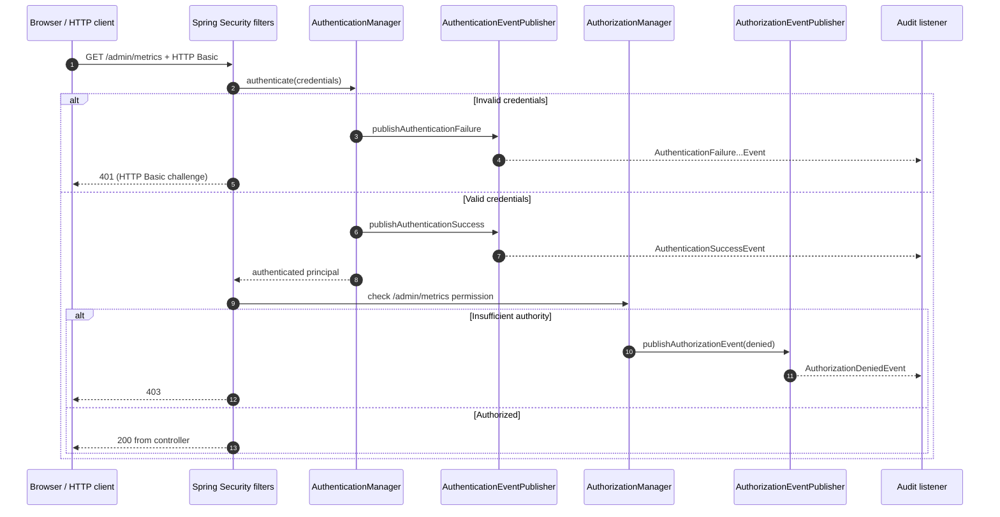
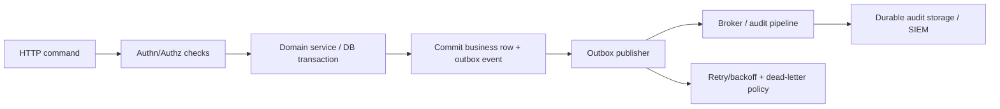

# AuthenticationEventPublisher, Authorization Events, and Audit Logs

> **Context:** Spring Security **Servlet** (Spring MVC / Spring Boot 3.3.0 / Spring Security 6.x, Java 17+). This article focuses on **publishing and listening to authentication events**, **authorization decision events**, and building an operationally useful **audit trail** without leaking credentials. Authentication events, authorization events, and audit logs **are not the same thing**, and not every HTTP request emits all of them.

## 1. Learning Objectives

After this lesson, you can:

1. Distinguish `AuthenticationEventPublisher`, `DefaultAuthenticationEventPublisher`, `AuthenticationSuccessEvent`, `AuthenticationFailure*Event` classes, and other events such as `InteractiveAuthenticationSuccessEvent`.
2. Describe when `AuthenticationManager`/`ProviderManager` publishes events, why some requests do not emit them, and the effect of declaring a publisher bean.
3. Understand `AuthorizationEventPublisher`, `SpringAuthorizationEventPublisher`, and `AuthorizationDeniedEvent`; distinguish **authentication failure**, **authorization denial**, and **CSRF filter rejection**.
4. Build a Spring Boot Servlet demo with `SecurityFilterChain`, HTTP Basic, two in-memory accounts, `@EventListener`, and MockMvc tests verifying events per case.
5. Keep logs safe, choose audit fields, prevent leaking `Authentication`/passwords/tokens, defend against log injection, and balance retention with privacy.
6. Design durable audit architecture with queues/outbox/idempotency when compliance requires **stored evidence**, rather than assuming default application events provide guaranteed delivery.
7. Write a test matrix detecting missing events, duplicated events, wrong principals, wrong 401/403 causes, or interference from `@WithMockUser`/`with(user())`.

## 2. Three Concepts to Distinguish

### 2.1. Authentication Event — What Happened During Credential Verification?

**Authentication** answers the question: "Does this credential authenticate a principal?" Examples: valid/invalid HTTP Basic password, an authentication provider validating a JWT, an authentication request rejected due to a locked account or bad credentials.

In Spring Security, an `AuthenticationManager` such as `ProviderManager` can invoke `AuthenticationEventPublisher` when authentication **succeeds or fails**. The common publisher is `DefaultAuthenticationEventPublisher`, which uses Spring's `ApplicationEventPublisher` to emit corresponding application events.

Crucial point: having an authentication object in `SecurityContextHolder` **does not prove an `AuthenticationSuccessEvent` was published**. A principal can come from a test helper, an existing session, or a filter/flow that does not call the manager/publisher along the path you assumed.

### 2.2. Authorization Event — Once Authenticated, Is It Permitted?

**Authorization** answers: "For this request/action/resource, does the known principal have permission?" For example, a user with `ROLE_READER` calling `GET /admin/metrics` is denied even when HTTP Basic authentication succeeded.

Spring Security supports `AuthorizationEventPublisher` to publish authorization decisions. `SpringAuthorizationEventPublisher` typically emits **`AuthorizationDeniedEvent`** when a decision is denied; **it does not publish every granted decision by default** to avoid flooding, unless the application intentionally configures a custom publisher.

Authentication success and authorization denial can happen **in the same HTTP request**: a reader account logs in successfully yet gets 403 accessing an admin page.

### 2.3. Audit Log — Who Did What, When, and With What Outcome?

An **audit trail** is intentional operational/compliance data: which user or workload requested which action on which resource, what decision was made, for which tenant, when it happened, from which request/correlation ID, and the final business outcome.

An application event is a **signal**; it does not yet guarantee:
- it was written to durable storage;
- it fired exactly once;
- it survives a process crash;
- it has enough normalized data for investigation;
- it qualifies as tamper-evident evidence;
- it reflects a business operation that **committed successfully**.

Durable auditing requires additional design for storage, schema, retention, read permissions, alerting, delivery/idempotency, and integrity controls.

### Quick Comparison Table

| Mechanism | When generated? | Meaning | When might it be missing? |
| --- | --- | --- | --- |
| `AuthenticationSuccessEvent` | Authentication manager/publisher announces successful authentication. | Credential/identity verified at one step. | Reused session; public request; fake test principal; flow not using the publisher. |
| `AuthenticationFailureBadCredentialsEvent` and failure events | Manager fails with a mapped exception. | Credential failure grouped by cause. | No authentication attempt; unmapped custom exception; earlier filter blocked request. |
| `AuthorizationDeniedEvent` | Authorization decision denied and publisher is wired into the pipeline. | Principal/request failed policy. | CSRF/CORS/filter blocked before authorization; publisher unconfigured; policy never reached decision step. |
| Business audit | Application records domain event per contract. | Create, update, delete, approve, revoke actions... | If relying solely on HTTP events before transaction commit or in async jobs. |
| Access log | HTTP server/proxy records request/response. | Observe traffic and status codes. | Lacks trusted reason/identity; risks leaking tokens if URLs/headers are logged uncontrolled. |

## 3. Where Events Sit in a Servlet Request

Suppose the request is:

```http
GET /admin/metrics HTTP/1.1
Host: localhost:8080
Authorization: Basic <BASE64_REDACTED>
```

Flow model:



This is an idealized model of an HTTP Basic request through a matching chain. Exact ordering among filters, exception handling, and publishers depends on configuration. If the request is blocked by `CsrfFilter` due to a missing token, **the authentication/authorization manager might never be called** — so seeing 403 alone does not mean an `AuthorizationDeniedEvent` occurred.

### Three Similar-Looking Scenarios with Different Events

1. **No credentials sent to an endpoint requiring authentication:** HTTP Basic may return 401 because anonymous access is blocked. An `AuthenticationFailureEvent` is not guaranteed, because **no failed authentication attempt** may have taken place.
2. **Wrong password sent:** `BasicAuthenticationFilter` submits an authentication request and the manager throws an error. If a publisher is configured, `AuthenticationFailureBadCredentialsEvent` can be emitted; response is typically 401.
3. **Valid password sent but missing role:** `AuthenticationSuccessEvent` followed by `AuthorizationDeniedEvent` may be emitted; response is typically 403.

Record both category and reason per policy rather than relying solely on `response.status`.

## 4. AuthenticationEventPublisher and DefaultAuthenticationEventPublisher

### 4.1. Publisher Interface

`AuthenticationEventPublisher` has core operations:

```java
void publishAuthenticationSuccess(Authentication authentication);

void publishAuthenticationFailure(
    AuthenticationException exception,
    Authentication authentication);
```

These are **conceptual signatures** shown side by side for study, not an interface class to copy directly into a project. A `ProviderManager` with a publisher invokes these two methods when authentication succeeds or fails.

`DefaultAuthenticationEventPublisher` turns outcomes into Spring application events, which listeners can receive via `@EventListener`, `ApplicationListener`, or other suitable mechanisms. Spring Boot often auto-configures a publisher if none exists; in the demo we **explicitly declare the bean** so test objectives do not depend on guessing environment fallbacks.

### 4.2. Authentication Event Types to Know

| Event | Typical meaning | Things to watch out for |
| --- | --- | --- |
| `AuthenticationSuccessEvent` | Authentication manager announces success. | Does not mean the user completed a browser login session or holds all privileges. |
| `AuthenticationFailureBadCredentialsEvent` | Wrong credential/password per mapped exception. | Never log raw passwords or the `Authentication` object. |
| `AuthenticationFailureLockedEvent` | Account locked in the corresponding provider/exception mechanism. | Do not reveal account-locked details to anonymous callers if it causes enumeration. |
| `AuthenticationFailureDisabledEvent` | Account disabled. | May return 401 externally while separating the reason internally in audit logs. |
| `AuthenticationFailureExpiredEvent` | Account expired. | Check exception mapping against the actual authentication provider. |
| `AuthenticationFailureCredentialsExpiredEvent` | Credentials expired. | Never treat unverified input as a confirmed user identity. |
| `AuthenticationFailureServiceExceptionEvent` | A mapped authentication system/service error group. | Distinguish infrastructure faults from bad passwords for accurate error metrics. |
| `InteractiveAuthenticationSuccessEvent` | Event tied to success via an interactive-style filter. | **Different** from manager-published `AuthenticationSuccessEvent`; not emitted by default on every HTTP Basic/JWT request. |

Do not assume **every subtype of `AuthenticationException`** emits a specific failure event. `DefaultAuthenticationEventPublisher` maps exception classes per configuration; custom providers/exceptions may require extra mappings or `setDefaultAuthenticationFailureEvent`. Never emit fake "bad password" events for token-endpoint timeouts just to simplify dashboard counts.

### 4.3. Why Might an Event Not Appear?

- The request is served from a previously authenticated `SecurityContext`/session; `AuthenticationManager.authenticate(...)` is not called again.
- The test uses `@WithMockUser` or `SecurityMockMvcRequestPostProcessors.user(...)` to inject a principal — bypassing password checks through the manager.
- Anonymous callers are rejected by `AuthorizationFilter` before presenting credentials; there is no authentication failure for a concrete credential.
- A Servlet filter handles authentication directly, a custom `AuthenticationManager`/`ProviderManager` has no publisher attached, or the active manager is not using your publisher bean.
- Two different managers exist (e.g., for API vs. web), and only one has a publisher.
- Failure happened **outside** the authentication provider (e.g., CSRF, malformed HTTP, proxy, service down).
- The event listener did not receive it due to the wrong Spring application context or async configuration dropping request metadata.

Practical check: write tests sending **real** credentials through the filter/provider, assert specific events, and distinguish events in the active context from events present only in a test profile.

## 5. AuthorizationEventPublisher and Authorization Events

### 5.1. This Is Not AuthenticationEventPublisher

`AuthorizationEventPublisher` belongs to the authorization API, not authentication. An `AuthorizationManager` makes a decision based on the principal and target/request, and the publisher can receive that decision. In Servlet apps, `AuthorizationFilter` and `authorizeHttpRequests` are a common enforcement point.

Example authorization rule:

```java
.authorizeHttpRequests(auth -> auth
    .requestMatchers("/public/ping").permitAll()
    .requestMatchers("/private/report").authenticated()
    .requestMatchers("/admin/metrics").hasRole("ADMIN")
    .anyRequest().denyAll())
```

This is a **snippet** inside `HttpSecurity`, not a complete class. A user with `ROLE_READER` calling `/admin/metrics` after authenticating successfully fails `hasRole("ADMIN")`.

### 5.2. Registering a Publisher for Denied Decisions

You can declare:

```java
@Bean
AuthorizationEventPublisher authorizationEventPublisher(
        ApplicationEventPublisher applicationEventPublisher) {
    return new SpringAuthorizationEventPublisher(
        applicationEventPublisher);
}
```

This is a **snippet**; full imports appear in the demo app in section 7. `SpringAuthorizationEventPublisher` focuses on emitting `AuthorizationDeniedEvent` and **does not emit every granted decision by default**. This matters for **performance/cardinality**: an application handling millions of successful requests per day should not push every granted decision into the same audit log unnecessarily.

With multiple chains or method security, verify **which pipeline uses which publisher**, instead of assuming adding a bean automatically logs every authorization decision across all layers. Tests must exercise real filters/method security.

### 5.3. Why Is AuthorizationDeniedEvent Missing Even When Response Is 403?

- `CsrfFilter` blocked a POST missing a CSRF token before authorization ran.
- An exception came from a controller/business service and an exception handler mapped it to 403, not an `AuthorizationManager` decision.
- A custom filter called `response.sendError(403)` directly.
- The request entered a different `SecurityFilterChain` without a registered publisher.
- Method-level authorization lacks `@EnableMethodSecurity`, or the service is mocked via Mockito so no real proxy runs.
- The event listener was not component-scanned into the test context.
- One request triggered multiple authorization decisions; an event was emitted, but the listener filtered the wrong type or the test checked the wrong context.

At minimum, separate the **valid credentials + missing role + HTTP GET** test from the **POST missing CSRF** test, and verify the exact events.

### 5.4. Should You Publish AuthorizationGrantedEvent?

Spring Security also has event types for granted decisions, but an audit trail recording **successful business actions** usually belongs in the **domain/application service** after the action commits. Flooding events saying "GET permitted" does not prove data was read, modified, or a transaction completed.

If you need granted events for observability, use a custom publisher with **sampling/rate limits**, select critical endpoints, and enforce privacy rules. Never turn on "log full principal, authorities, and `HttpServletRequest`" for every request.

## 6. When Do Event Listeners Run and What Should They Do?

Spring's `ApplicationEventPublisher` with the default multicaster typically invokes `@EventListener` **synchronously on the publishing thread**, unless an async listener/multicaster is configured. A listener making synchronous network calls to a SIEM can therefore increase login or authorization latency, and unhandled exceptions can even disrupt the request flow.

### Good Practices Inside a Listener

- Classify events by category (`authentication`/`authorization`), outcome (`success`/`failure`/`denied`), and a **normalized** reason.
- Extract a **trusted** principal identifier if allowed by policy, then convert it to an internal actor ID or hash per policy.
- Write lightweight, controlled audit records; push into a backpressure-aware outbox/buffer if high throughput is required.
- Increment low-cardinality counters/metrics; alert on brute-force bursts, account lockouts, or denial spikes.
- Attach a normalized correlation/request ID to link request logs with audit records.

### Things to Avoid

- Reading `Authentication.getCredentials()` and logging it for "debugging".
- Printing `event.getAuthentication()`, the full `SecurityContext`, raw Bearer JWTs, access/refresh tokens, session cookies, user profiles, or request headers.
- Calling a remote SIEM on every request without timeouts/backoff, causing cascading failures when the SIEM itself degrades.
- Throwing runtime exceptions into the authentication flow simply because the audit server is down, unless the product has an explicit, tested **fail-closed** design.
- Believing `@Async` solves everything: async listeners can lose `SecurityContext`/request context, and events can still be lost on process crash.
- Concatenating unsanitized event names, usernames, or HTTP paths into log lines or unbounded metric tags, causing log injection or high cardinality.

**If auditing is a mandatory compliance control**, do not rely solely on "best effort" `@EventListener` + logger. Make explicit architectural decisions on durability, failure modes, ordering, and retention.

## 7. Spring Boot 3.3.0 Example: Authentication + Authorization Events

This Java 17+ project includes:

- `GET /public/ping`: public.
- `GET /private/report`: requires authentication.
- `GET /admin/metrics`: requires `ROLE_ADMIN`.
- `POST /private/change`: requires authentication **and a CSRF token** due to default browser-style configuration; illustrates why CSRF rejection is not an authorization event.
- HTTP Basic for the demo with two users `reader` and `admin`; never use these accounts in production.
- `AuthenticationEventPublisher` and `AuthorizationEventPublisher` declared as beans.
- Listener logging only **event type and outcome**, never usernames/passwords/tokens.

### 7.1. Project Directory

```text
security-events-demo/
├── pom.xml
└── src/
    ├── main/
    │   └── java/demo/events/
    │       ├── EventsApplication.java
    │       ├── SecurityConfig.java
    │       ├── EventController.java
    │       └── SecurityEventListener.java
    └── test/
        └── java/demo/events/
            └── SecurityEventsTest.java
```

### 7.2. pom.xml

```xml
<project xmlns="http://maven.apache.org/POM/4.0.0"
         xmlns:xsi="http://www.w3.org/2001/XMLSchema-instance"
         xsi:schemaLocation="http://maven.apache.org/POM/4.0.0 https://maven.apache.org/xsd/maven-4.0.0.xsd">
    <modelVersion>4.0.0</modelVersion>
    <parent>
        <groupId>org.springframework.boot</groupId>
        <artifactId>spring-boot-starter-parent</artifactId>
        <version>3.3.0</version>
        <relativePath/>
    </parent>
    <groupId>demo</groupId>
    <artifactId>security-events-demo</artifactId>
    <version>0.0.1-SNAPSHOT</version>
    <properties>
        <java.version>17</java.version>
    </properties>
    <dependencies>
        <dependency>
            <groupId>org.springframework.boot</groupId>
            <artifactId>spring-boot-starter-web</artifactId>
        </dependency>
        <dependency>
            <groupId>org.springframework.boot</groupId>
            <artifactId>spring-boot-starter-security</artifactId>
        </dependency>
        <dependency>
            <groupId>org.springframework.boot</groupId>
            <artifactId>spring-boot-starter-test</artifactId>
            <scope>test</scope>
        </dependency>
        <dependency>
            <groupId>org.springframework.security</groupId>
            <artifactId>spring-security-test</artifactId>
            <scope>test</scope>
        </dependency>
    </dependencies>
    <build>
        <plugins>
            <plugin>
                <groupId>org.springframework.boot</groupId>
                <artifactId>spring-boot-maven-plugin</artifactId>
            </plugin>
        </plugins>
    </build>
</project>
```

### 7.3. Application Main

**`src/main/java/demo/events/EventsApplication.java`:**

```java
package demo.events;

import org.springframework.boot.SpringApplication;
import org.springframework.boot.autoconfigure.SpringBootApplication;

@SpringBootApplication
public class EventsApplication {
    public static void main(String[] args) {
        SpringApplication.run(EventsApplication.class, args);
    }
}
```

### 7.4. SecurityFilterChain, AuthenticationEventPublisher, AuthorizationEventPublisher

**`src/main/java/demo/events/SecurityConfig.java`:**

```java
package demo.events;

import org.springframework.context.ApplicationEventPublisher;
import org.springframework.context.annotation.Bean;
import org.springframework.context.annotation.Configuration;
import org.springframework.http.HttpMethod;
import org.springframework.security.authentication.AuthenticationEventPublisher;
import org.springframework.security.authentication.DefaultAuthenticationEventPublisher;
import org.springframework.security.authorization.AuthorizationEventPublisher;
import org.springframework.security.authorization.SpringAuthorizationEventPublisher;
import org.springframework.security.config.Customizer;
import org.springframework.security.config.annotation.web.builders.HttpSecurity;
import org.springframework.security.core.userdetails.User;
import org.springframework.security.core.userdetails.UserDetailsService;
import org.springframework.security.crypto.bcrypt.BCryptPasswordEncoder;
import org.springframework.security.crypto.password.PasswordEncoder;
import org.springframework.security.provisioning.InMemoryUserDetailsManager;
import org.springframework.security.web.SecurityFilterChain;

@Configuration
public class SecurityConfig {
    @Bean
    SecurityFilterChain securityFilterChain(HttpSecurity http)
            throws Exception {
        return http
            .authorizeHttpRequests(auth -> auth
                .requestMatchers("/public/ping").permitAll()
                .requestMatchers(HttpMethod.GET, "/private/report")
                    .authenticated()
                .requestMatchers(HttpMethod.GET, "/admin/metrics")
                    .hasRole("ADMIN")
                .requestMatchers(HttpMethod.POST, "/private/change")
                    .authenticated()
                .anyRequest().denyAll())
            .httpBasic(Customizer.withDefaults())
            // Keep default CSRF to test distinguishing CSRF rejection from authz.
            .build();
    }

    @Bean
    PasswordEncoder passwordEncoder() {
        return new BCryptPasswordEncoder();
    }

    @Bean
    UserDetailsService demoUsers(PasswordEncoder encoder) {
        return new InMemoryUserDetailsManager(
            User.withUsername("reader")
                .password(encoder.encode("reader-secret"))
                .roles("READER")
                .build(),
            User.withUsername("admin")
                .password(encoder.encode("admin-secret"))
                .roles("ADMIN")
                .build()
        );
    }

    @Bean
    AuthenticationEventPublisher authenticationEventPublisher(
            ApplicationEventPublisher publisher) {
        return new DefaultAuthenticationEventPublisher(publisher);
    }

    @Bean
    AuthorizationEventPublisher authorizationEventPublisher(
            ApplicationEventPublisher publisher) {
        return new SpringAuthorizationEventPublisher(publisher);
    }
}
```

**Reading the semantics accurately:**

1. Having an `AuthenticationEventPublisher` bean **does not mean** every custom `AuthenticationManager` has the publisher attached. For framework-managed managers, verify events via real tests; for manually constructed managers, wire the publisher explicitly via its API.
2. `DefaultAuthenticationEventPublisher` emits Spring application events from manager authentication attempts. Do not use it to count all HTTP requests.
3. `SpringAuthorizationEventPublisher` receives authorization decisions where the framework wires the publisher and typically emits denied events. Test real events on the exact `SecurityFilterChain`; do not trust a bean just because it is defined.
4. `hasRole("ADMIN")` checks for authority `ROLE_ADMIN`; `roles("READER")` creates `ROLE_READER`, so `reader` is denied access to `/admin/metrics`.
5. The configuration keeps default CSRF. `POST /private/change` **without a token** is rejected; in MockMvc, `with(csrf())` is needed to isolate authorization testing.
6. HTTP Basic can send credentials on every request. This is a demo mechanism; production must use TLS, password policies, rate limiting, and secret protection; never log the HTTP Basic header (it is just Base64 of `username:password`).
7. `anyRequest().denyAll()` rejects any request outside the declared routes, even when authenticated.

### 7.5. Controller

**`src/main/java/demo/events/EventController.java`:**

```java
package demo.events;

import org.springframework.web.bind.annotation.GetMapping;
import org.springframework.web.bind.annotation.PostMapping;
import org.springframework.web.bind.annotation.RestController;

@RestController
public class EventController {
    @GetMapping("/public/ping")
    public String ping() {
        return "pong";
    }

    @GetMapping("/private/report")
    public String report() {
        return "private-report";
    }

    @GetMapping("/admin/metrics")
    public String metrics() {
        return "admin-metrics";
    }

    @PostMapping("/private/change")
    public String change() {
        return "changed";
    }
}
```

The controller intentionally avoids reading `SecurityContext` or request headers; the event listener only observes framework signals. For real actions like updating personal information, emit a separate **business audit event** after the transaction succeeds rather than treating an authorization-granted event as "data changed".

### 7.6. Listener Without Secret Logging

**`src/main/java/demo/events/SecurityEventListener.java`:**

```java
package demo.events;

import org.slf4j.Logger;
import org.slf4j.LoggerFactory;
import org.springframework.context.event.EventListener;
import org.springframework.security.authentication.event.AbstractAuthenticationFailureEvent;
import org.springframework.security.authentication.event.AuthenticationSuccessEvent;
import org.springframework.security.authorization.event.AuthorizationDeniedEvent;
import org.springframework.stereotype.Component;

@Component
public class SecurityEventListener {
    private static final Logger log =
        LoggerFactory.getLogger(SecurityEventListener.class);

    @EventListener
    public void authenticationSucceeded(
            AuthenticationSuccessEvent event) {
        // Do not log Authentication object: it may contain credentials.
        log.info("security_event=authentication outcome=success");
    }

    @EventListener
    public void authenticationFailed(
            AbstractAuthenticationFailureEvent event) {
        // Use only the framework-standardized event class.
        String category = event.getClass().getSimpleName();
        log.warn("security_event=authentication outcome=failure event_type={}",
            category);
    }

    @EventListener
    public void authorizationDenied(
            AuthorizationDeniedEvent<?> event) {
        // Do not serialize event.getObject(), request, principal/token.
        log.warn("security_event=authorization outcome=denied");
    }
}
```

All log lines in the demo use static/controlled values from classes; there is no user input. In a real system, you may need **actor ID**, tenant, request ID, action, resource type, and reason code. Those fields must come from **trusted, sanitized** sources, never raw `Authentication.toString()` or all HTTP headers.

**Warning about event objects:** Spring application events often carry context/`Authentication` or request-related references. Even if your listener does not directly log credentials, a framework that auto-serializes the entire event to JSON for a queue can expose secrets. Build an **AuditRecord DTO with an explicit field allowlist** before sending anything out-of-process.

## 8. Trying It via HTTP

Use Java 17+ and Maven. In the project directory:

```bash
mvn test
mvn spring-boot:run
```

Call the public route:

```bash
curl -i http://localhost:8080/public/ping
```

Body:

```text
pong
```

Anonymous to protected:

```bash
curl -i http://localhost:8080/private/report
```

Usually returns **401** and `WWW-Authenticate` from HTTP Basic. There may be **no `AuthenticationFailureEvent`**, because the request sent no credentials for the manager to check.

Wrong password:

```bash
curl -i -u reader:wrong-password http://localhost:8080/private/report
```

Typically 401; when the authentication publisher is wired to the manager, the listener logs something like:

```text
security_event=authentication outcome=failure event_type=AuthenticationFailureBadCredentialsEvent
```

This is the **message portion** of the log, excluding timestamp, level, thread, and logger name since runtime formatters vary.

Right password, sufficient privileges:

```bash
curl -i -u reader:reader-secret http://localhost:8080/private/report
```

Returns **200** with body:

```text
private-report
```

For each authentication attempt through the manager, the listener may log:

```text
security_event=authentication outcome=success
```

Reader accessing admin:

```bash
curl -i -u reader:reader-secret http://localhost:8080/admin/metrics
```

Returns **403** due to missing `ROLE_ADMIN`. The authentication manager may have succeeded, followed by authorization denial — within the same request you can observe **both a success authentication event and a denied authorization event**.

Admin accessing admin:

```bash
curl -i -u admin:admin-secret http://localhost:8080/admin/metrics
```

Returns **200** with body:

```text
admin-metrics
```

With the default denial publisher configuration, there is **no `AuthorizationGrantedEvent` by default** simply because the API returned 200.

POST missing CSRF:

```bash
curl -i -u admin:admin-secret -X POST \
  http://localhost:8080/private/change
```

Returns **403** from `CsrfFilter` in this Servlet demo. Do not treat the absence of `AuthorizationDeniedEvent` as proof the authorization publisher is broken; CSRF may block the request before authorization runs. In a real application, use a browser session and a properly sourced CSRF token; `with(csrf())` exists only in Spring Security Test.

## 9. MockMvc + ApplicationEvents Testing

The test goal is to observe **events published in the application context** when requests travel through real filters/providers, rather than asserting only response statuses. Spring Test provides `@RecordApplicationEvents` and `ApplicationEvents` to record application events within test scope.

**`src/test/java/demo/events/SecurityEventsTest.java`:**

```java
package demo.events;

import org.junit.jupiter.api.Test;
import org.springframework.beans.factory.annotation.Autowired;
import org.springframework.boot.test.autoconfigure.web.servlet.AutoConfigureMockMvc;
import org.springframework.boot.test.context.SpringBootTest;
import org.springframework.security.authentication.event.AuthenticationFailureBadCredentialsEvent;
import org.springframework.security.authentication.event.AuthenticationSuccessEvent;
import org.springframework.security.authorization.event.AuthorizationDeniedEvent;
import org.springframework.test.context.event.ApplicationEvents;
import org.springframework.test.context.event.RecordApplicationEvents;
import org.springframework.test.web.servlet.MockMvc;

import static org.assertj.core.api.Assertions.assertThat;
import static org.springframework.security.test.web.servlet.request
    .SecurityMockMvcRequestPostProcessors.csrf;
import static org.springframework.security.test.web.servlet.request
    .SecurityMockMvcRequestPostProcessors.httpBasic;
import static org.springframework.security.test.web.servlet.request
    .SecurityMockMvcRequestPostProcessors.user;
import static org.springframework.test.web.servlet.request.MockMvcRequestBuilders.get;
import static org.springframework.test.web.servlet.request.MockMvcRequestBuilders.post;
import static org.springframework.test.web.servlet.result.MockMvcResultMatchers.content;
import static org.springframework.test.web.servlet.result.MockMvcResultMatchers.status;

@SpringBootTest
@AutoConfigureMockMvc
@RecordApplicationEvents
class SecurityEventsTest {
    @Autowired
    MockMvc mvc;

    @Autowired
    ApplicationEvents events;

    @Test
    void publicPingDoesNotRequireAuthentication() throws Exception {
        mvc.perform(get("/public/ping"))
            .andExpect(status().isOk())
            .andExpect(content().string("pong"));
    }

    @Test
    void correctBasicCredentialsCauseAuthenticationSuccess()
            throws Exception {
        mvc.perform(get("/private/report")
                .with(httpBasic("reader", "reader-secret")))
            .andExpect(status().isOk())
            .andExpect(content().string("private-report"));

        assertThat(events.stream(AuthenticationSuccessEvent.class).count())
            .isGreaterThan(0L);
    }

    @Test
    void badBasicPasswordCausesAuthenticationFailure()
            throws Exception {
        mvc.perform(get("/private/report")
                .with(httpBasic("reader", "wrong")))
            .andExpect(status().isUnauthorized());

        assertThat(events.stream(
            AuthenticationFailureBadCredentialsEvent.class).count())
            .isGreaterThan(0L);
    }

    @Test
    void validReaderCannotEnterAdminAndPublishesDenial()
            throws Exception {
        mvc.perform(get("/admin/metrics")
                .with(httpBasic("reader", "reader-secret")))
            .andExpect(status().isForbidden());

        assertThat(events.stream(AuthorizationDeniedEvent.class).count())
            .isGreaterThan(0L);
    }

    @Test
    void validAdminMayEnterAdmin() throws Exception {
        mvc.perform(get("/admin/metrics")
                .with(httpBasic("admin", "admin-secret")))
            .andExpect(status().isOk())
            .andExpect(content().string("admin-metrics"));
    }

    @Test
    void missingCsrfProducesForbiddenResponse() throws Exception {
        mvc.perform(post("/private/change")
                .with(httpBasic("admin", "admin-secret")))
            .andExpect(status().isForbidden());
    }

    @Test
    void validCsrfAllowsAdminPost() throws Exception {
        mvc.perform(post("/private/change")
                .with(httpBasic("admin", "admin-secret"))
                .with(csrf()))
            .andExpect(status().isOk())
            .andExpect(content().string("changed"));
    }

    @Test
    void fakePrincipalIsNotProofOfPasswordAuthentication()
            throws Exception {
        mvc.perform(get("/private/report")
                .with(user("reader").roles("READER")))
            .andExpect(status().isOk());

        // MockMvc user() sets SecurityContext directly.
        // This test does NOT assert that AuthenticationSuccessEvent occurred.
    }
}
```

**Reading the tests:**

- `@SpringBootTest` loads the **full context**; `@AutoConfigureMockMvc` runs simulated HTTP requests through Servlet filters.
- `httpBasic(...)` generates a Basic header; Spring Security verifies it using the demo's user details and encoder. **Unlike** `with(user(...))`: `user()` bypasses password verification.
- `@RecordApplicationEvents` captures events in the test context; `ApplicationEvents.stream(...)` lets tests look up specific event classes. Tests assert at least one event rather than an exact count; filters/providers may emit additional events depending on flow and config.
- The 403 test on GET `/admin/metrics` with valid `reader` credentials proves an **authorization denial**, distinct from a CSRF error.
- The 403 test on POST missing CSRF **asserts only status**; it should not assert an authorization-denied event.
- Tests using a mock principal help verify authorization rules but **do not prove** the authentication publisher ran.
- These tests verify in-process Spring application events; they **do not prove** a SIEM/queue/DB audit store persisted durable records.

If an event assertion fails in a real project, check whether **the publisher bean is actually wired to the active manager/authorization pipeline**, check chains/matchers, exception types, mocks, and test context scope. Never fix it by publishing fake events in tests to force assertions to pass.

### Additional Test Cases

1. Anonymous request rejected as unauthenticated: confirm 401 or expected redirect, yet **do not force** a bad-credential event when no credentials were sent.
2. Authenticated user missing role: verify denied event and that response body is not leaked before authorization.
3. POST with invalid CSRF: 403; verify this is `CsrfFilter`'s decision, not the authentication manager's.
4. Two different chains: test matching/order for API vs. web; which chain has a publisher?
5. Custom standalone `AuthenticationManager`: does it invoke the publisher on success/failure?
6. Locked/disabled/custom `AuthenticationException`: valid event mapping, public response does not leak user enumeration.
7. Multiple HTTP Basic requests: events can fire repeatedly; dashboards must not equate success event counts with **unique logins**.
8. Request with valid role rejected by business layer for tenant/resource rules: this may be a business auth denial bypassing the filter's `AuthorizationEventPublisher`.
9. Method security with `@EnableMethodSecurity` and unmocked service: observe how method-level authorization emits events.
10. Audit sink disabled, timed out, queue full, retries, duplicate delivery, and failover; decide fail-open/fail-closed per policy.

## 10. Designing Structured Audit Logs

To be operationally useful, separate access logs, authentication logs, authorization logs, and business audits. Instead of writing free-form text like "Login failed", design a versioned schema with standardized keys.

### 10.1. Suggested Schema

A conceptual record:

```json
{
  "schema_version": 1,
  "event_id": "evt-unique-id",
  "occurred_at": "2026-11-06T10:15:30Z",
  "category": "authorization",
  "action": "read_admin_metrics",
  "outcome": "denied",
  "reason_code": "insufficient_authority",
  "actor_id": "user-internal-42",
  "tenant_id": "tenant-17",
  "resource_type": "admin_metrics",
  "resource_id": null,
  "request_id": "req-7f3a",
  "service": "report-api",
  "environment": "production"
}
```

This is an **illustrative structure** with fake IDs and timestamps, not real data or a mandatory Spring Security schema. `event_id` must be generated and handled idempotently by design; `actor_id` is a verified internal ID, never raw user input from an untrusted Authentication token.

### 10.2. Field Classification

| Group | Fields to include | Notes |
| --- | --- | --- |
| Event identity | `event_id`, `schema_version`, `occurred_at` | UTC, trusted clock source, versioned schema for long-term downstream consumers. |
| Event type | `category`, `action`, `outcome`, `reason_code` | Controlled vocabulary; avoid high-cardinality arbitrary reason text. |
| Actor | `actor_id`, `service_principal_id` | Record only after trusted authentication/identity binding, respecting privacy policy. |
| Scope | `tenant_id`, `resource_type`, `resource_id` when needed | Never blindly trust tenant IDs from request headers or URLs. |
| Trace | `request_id`, `correlation_id`, `trace_id` | Normalize/sanitize; ensure tokens/raw paths with secrets are excluded. |
| Environment | `service`, `deployment`, `environment`, `region` | Aids multi-instance investigation and separating staging/prod. |
| Operations | `policy_version`, `auth_method`, `decision_source` | Record only if truly trustworthy and meaningful. |

Fields **not to store**: raw passwords, OTPs, session cookies, access/refresh/ID tokens, Authorization headers, raw recovery codes, secret keys, full claim payloads, full `HttpServletRequest`, `Authentication.toString()`, or unnecessary PII.

### 10.3. Protecting Audit Logs Against Tampering and Log Injection

Any client-supplied data — username typed at failed login, path, User-Agent, forwarded headers — can contain newlines, control characters, oversized strings, or values crafted to mislead dashboards. Always:

- Use **structured logging** with a standard encoder/serializer instead of string concatenation into log lines.
- Normalize/escape inputs and enforce length limits; never put user-controlled values into unbounded metric tags.
- Use allowlisted reason codes; never expose unsanitized exception messages as public audit reasons.
- Restrict audit read access and control edits/deletions: append-only/WORM/tamper-evident storage when required by obligations, with monitoring on audit access.
- Define retention, minimization, masking, and deletion/anonymization per legal and internal policy; auditing is not an excuse to store PII indefinitely.
- Consider separate keys/roles for audit writers, auditors, and operators; avoid letting one service both write and silently alter history.

**Do not equate "hashing an email" with absolute anonymization.** Emails have low entropy, and unsalted hashes are vulnerable to dictionary attacks; when correlating audits per user, prefer internal actor IDs with access controls, or keyed pseudonyms per policy.

## 11. Framework Events Do Not Replace Business Audits

### Common Pitfall

You record `AuthenticationSuccessEvent` and `AuthorizationDeniedEvent`, and the system has a money-transfer endpoint. An authenticated, authorized request runs, then the database transaction rolls back after checking the balance. If auditing relied on authorization granted, logs might claim "transfer succeeded" even though the transaction **never committed**.

Separate:

1. **Authentication audit:** credential attempt / identity verification.
2. **Authorization audit:** policy decision allowed/denied where policy is enforced.
3. **Business audit:** actual domain action accepted, processing, completed, or failed; tied to transaction/state machine.

If you need proof that "payment settled", that event must come from the committed domain transaction/business event or the settlement system, **never inferred from `AuthenticationSuccessEvent`**.

### Commit Boundaries and TransactionalEventListener

`@TransactionalEventListener(phase = AFTER_COMMIT)` is useful for domain events published inside an active transaction. However, authentication/authorization events in security filters **are not necessarily published while a Spring transaction is open**. Simply adding `@TransactionalEventListener` to a security listener can cause the listener **never to run** when no matching transaction exists.

For durable auditing of business actions, use the **transactional outbox** pattern or a mechanism with equivalent guarantees: write business state and the outbox record in the **same DB transaction**; a separate worker publishes events to a message broker/SIEM with retries and idempotency; consumers may need deduplication. No architecture guarantees "exactly once" across every hop via `@EventListener` alone.

### Outbox Model



This path is for domain audits tied to commits. Authentication failures occurring before business transactions may require a separate pipeline (durable audit writer/buffer) with an explicit failure policy.

## 12. Reliability: Synchronous, Async, and Failure Strategies

### 12.1. Synchronous Listeners and Latency Impact

With the default multicaster, listeners run synchronously inside the publish call. If a listener writes to a database for 500 ms on every authentication attempt, the login endpoint suffers that latency. If the audit DB goes down, authentication requests can be impacted.

How to handle this:

- Keep event listeners thin, extract **allowlisted fields**, and enqueue into infrastructure with timeouts/backpressure.
- If durable logging is mandatory before permitting an ultra-sensitive action, define an explicit **gating policy**, and test fail-closed behavior and user experience when the sink fails.
- For normal flows, fail-open vs. fail-closed decisions must follow security/compliance requirements, not accidental listener exceptions.
- Monitor queue depth, dropped events, failed writes, retry counts, consumer lag, alert thresholds, and retention.

### 12.2. Async Listeners Do Not Automatically Guarantee Delivery

Putting `@Async` on `@EventListener` offloads work to another thread, but requires `@EnableAsync`, an executor, an exception handler, and lifecycle awareness. The event still lives in process memory; if the process crashes before the worker runs, the event can be lost.

On an async thread, `SecurityContextHolder` **does not automatically carry the request thread's principal**; do not call the holder and assume it is the event actor. **Extract the verified actor ID on the publishing thread**, construct an immutable `AuditRecord`, and pass that record to the worker. Even if using `DelegatingSecurityContext*`, it only propagates context across submission boundaries—it does not turn an event into a durable message or keep revoked privileges valid forever.

### 12.3. Uniqueness and Idempotency

A single HTTP request can trigger multiple authentication attempts or authorization checks; browser/HTTP client retries multiply event counts further. Therefore:

- Do not use `AuthenticationSuccessEvent` counts as unique user logins.
- Do not treat a consumer-generated event ID as proof an event was processed only once.
- Assign event IDs/idempotency keys and deduplication policies at the point where business events are created.
- Audit sinks must handle **at-least-once delivery**, cross-partition reordering, timeouts/retries, and duplicate events.
- Do not drop valid events simply because they share actor + action + nearby timestamps; two genuinely distinct actions can happen within one second.

## 13. Pure Java 17 Example: Classifying Events Before Writing Audits

To see why an HTTP status cannot replace an event type, below is a **standalone** program with no Spring dependency. It maps classified outcome stages to short audit reason codes. This is a **value mapping** example; it **does not** verify credentials, publish Spring events, or prove relationships to controllers.

Save file **`AuditReasonDemo.java`**:

```java
public class AuditReasonDemo {
    enum Stage {
        AUTHN_SUCCESS,
        AUTHN_BAD_CREDENTIALS,
        AUTHZ_DENIED,
        CSRF_REJECTED
    }

    static String reason(Stage stage) {
        return switch (stage) {
            case AUTHN_SUCCESS -> "authentication_success";
            case AUTHN_BAD_CREDENTIALS -> "bad_credentials";
            case AUTHZ_DENIED -> "insufficient_authority";
            case CSRF_REJECTED -> "csrf_rejected";
        };
    }

    public static void main(String[] args) {
        System.out.println(reason(Stage.AUTHN_SUCCESS));
        System.out.println(reason(Stage.AUTHN_BAD_CREDENTIALS));
        System.out.println(reason(Stage.AUTHZ_DENIED));
        System.out.println(reason(Stage.CSRF_REJECTED));
    }
}
```

Run with Java 17+:

```bash
javac AuditReasonDemo.java
java AuditReasonDemo
```

**Exact stdout:**

```text
authentication_success
bad_credentials
insufficient_authority
csrf_rejected
```

Key distinction: both are HTTP 403, yet authorization denial and CSRF rejection get distinct reason codes when the pipeline knows the cause. Never guess reasons solely from status codes at a reverse proxy.

## 14. Which Events Belong on Dashboards and Alerts?

Usually useful to monitor:

| Signal | Possible indication | Do not jump to conclusions |
| --- | --- | --- |
| Spike in bad credentials | Brute force, credential stuffing, typos, bots. | Does not automatically prove an account was compromised. |
| Spike in locked/disabled | Abuse, account lifecycle changes, user store sync bug. | Never expose detailed user status to clients. |
| Spike in authorization denied | Wrong user roles, misdeployed rule, endpoint probing. | Never assume every 403 is an authorization denial. |
| Spike in 401 after deploy | Provider/config/password/expired token, upstream failure. | Never assume 401 means bad password; check the source. |
| Sudden drop in audit logs | Missing listener/publisher bean, broken queue, traffic drop. | Fewer events does not always mean fewer attacks. |
| Large gap between events and access logs | Missing instrumentation, retries, multi-hop, sampling. | Do not expect 1 request = 1 event across all paths. |
| Duplicated events | Multiple publishers/listeners, retries, at-least-once delivery. | Do not deduplicate with heuristics that risk dropping valid audits. |

Instrumentation should use controlled metric dimensions like `category`, `outcome`, `event_type`, `service`, `environment`; avoid tagging by raw username, email, IP, token, arbitrary request path, or unnormalized `kid`.

### Correlation IDs and Traces

A request may cross gateways, Servlet filters, controllers, DBs, and brokers. For correlation IDs:
- Generate/normalize at the **trusted edge**, restricting allowed characters and length.
- Use consistently across access logs, security audits, and domain audits.
- Across threads or async calls, propagate correlation IDs explicitly via context propagation; do not assume `SecurityContext` does it.
- Never use trace IDs as proof of principal authentication.
- During incident analysis, request IDs and audit event IDs can be joined, subject to RBAC permissions.

## 15. Distinguishing 401/403 Across Authentication Mechanisms

### HTTP Basic

- No Basic credentials on a URL requiring authentication: 401/challenge; may emit no failure event since no attempt occurred.
- Wrong Basic password: authentication failure event when publisher is wired; 401 response.
- Right Basic password but missing role: authentication success event + authorization denied event; 403 response.

### Form Login and Sessions

- User submits wrong username/password to the login processing URL: may emit a failure event and redirect to `/login?error`.
- User logs in successfully: may emit `AuthenticationSuccessEvent` from the manager **and** `InteractiveAuthenticationSuccessEvent` from the interactive authentication filter, depending on flow.
- Subsequent requests using the authenticated session: typically **no new authentication-success event** per request.
- POST without CSRF token: `CsrfFilter` may block before username/password authentication runs. Do not assume a password failure event occurred.

### OAuth2/OIDC Login

- Browser authorization code callback failing on `state`/token/provider can fail at different layers, not necessarily mapping to the same failure event as a bad password.
- A success redirect does not prove an audit was saved; filters or custom success handlers may need separate business/session audits.
- Never extract raw profile/JWT data and serialize it into logs.

### JWT Resource Server

- JWTs with invalid signatures, wrong issuer/audience, or expired timestamps may be rejected by `JwtDecoder`; how events appear depends on the specific pipeline/provider/publisher.
- Testing with `with(jwt())` simulates `JwtAuthenticationToken` without verifying signatures or firing authentication events equivalent to a real token traversing the Bearer filter.
- Missing-scope decisions may return 403 and emit an authorization-denied event if a publisher is wired; invalid credentials typically produce authentication failure/401.
- Do not treat JWT signature failures and `AuthenticationFailureBadCredentialsEvent` counts as interchangeable metrics.

## 16. Important Negative Tests and Traps

### 16.1. Tests Asserting Only Status Are Insufficient

Different configurations can all return 403:
- Authenticated user lacking authority;
- Sufficient authority yet POST missing CSRF;
- Custom filter blocking the request;
- Controller explicitly returning 403.

Document **inputs, failing stage, expected events**, and events that must not be assumed in tests. To be certain CSRF did not emit an authorization event, instrument the filter stage and actual decision rather than relying solely on event class counts.

### 16.2. Missing Event Listeners in @WebMvcTest

MVC slices typically **do not load all services/configs/component scans** and may exclude custom application listeners/publishers. `@WebMvcTest` is convenient for testing controllers, but to test production events across filters/providers, use:
- `@SpringBootTest` + `@AutoConfigureMockMvc` as a stronger baseline;
- or explicitly import `SecurityConfig`, publishers, listeners, and required dependencies, then verify the exact chain;
- **never** create a fake publisher in tests and claim the production pipeline is verified.

### 16.3. Mock Principals Are Not Authentication Attempts

`@WithMockUser` and `with(user("reader"))` build a test `SecurityContext`. They are great for testing `hasRole("ADMIN")` rules but bypass BCrypt password verification. Authentication event tests must exercise a real credential/provider path such as `httpBasic(...)` or IdP testing matching the flow under test.

### 16.4. Listeners Throwing Exceptions

Test unavailable audit backends or listener-thrown exceptions in test environments. Do not let listeners throw unintentionally in production as an accidental "fail closed". For systems requiring immutable audits before allowing operations, policy must explicitly define behavior when the sink is down, which transactions roll back, and what error is shown to users.

### 16.5. Multi-Session, Multi-Instance, and Retries

In distributed systems, semantically identical events may be emitted by multiple nodes or messages replayed after timeouts. Tests should check:
- Are event IDs/correlation IDs sufficient for tracing?
- Does the receiver enforce deduplication/idempotency?
- Are events lost during pod restarts?
- Can ordering between `authentication_success` and `business_action_completed` invert?
- Could clock skew between nodes distort timelines?
- Is tenant isolation preserved in audit queries and viewer permissions?

## 17. Runbook: When Audits Suddenly Disappear

1. **Verify traffic:** are authentication requests still occurring, or are clients using another session/token cache?
2. **Inspect filter chains:** which chain handles the requests? Did `securityMatcher` or `@Order` change after deploy?
3. **Inspect AuthenticationManager:** is the publisher bean actually attached to the manager processing credentials? Was a custom manager instantiated manually?
4. **Inspect AuthorizationEventPublisher:** is the bean in the right context and does the pipeline publish authorization decisions? Were denials triggered by policy or blocked earlier by CSRF/filters?
5. **Inspect listeners:** is the class component-scanned, did async config or a new exception handler change behavior? Is it filtering the wrong event subtype?
6. **Inspect sinks:** are structured loggers/agents, queues, outbox pollers, brokers, consumers, or SIEMs failing, slow, out of quota, or affected by retention changes?
7. **Cross-check:** correlate access logs, auth service logs, request metrics, and audit records by request ID; accept there is no fixed 1:1 ratio by default.
8. **Recover:** process backlogs/retries/dedupes carefully; never replay raw audit events into domain services with side effects.
9. **Prevent recurrence:** run real event tests in CI; add dashboards alerting on "audit pipeline unhealthy", SLOs, and failover tests.
10. **Protect data while debugging:** never turn on raw header/token logging, and never paste passwords or full security contexts into support channels.

## 18. Production Checklist

- [ ] Define exactly which events to capture: authentication attempts, authorization denials, business actions, or all three; never lump them together as "login logs".
- [ ] Attach `AuthenticationEventPublisher` to **every relevant authentication manager**, including custom managers in specialized chains.
- [ ] Wire `AuthorizationEventPublisher` wherever `AuthorizationManager` decisions require auditing; test denials with real paths/roles.
- [ ] Never assume every successful authorization emits an event or every 403 is an `AuthorizationDeniedEvent`.
- [ ] Listeners never log `Authentication` objects, credentials, tokens, cookies, request bodies containing secrets, or any non-allowlisted PII.
- [ ] Distinguish "authentication failed" from "no authentication attempt"; distinguish CSRF rejection from authorization denial.
- [ ] Audit schema is versioned, event IDs are reconcilable, timestamps are UTC, reason codes are standardized, and actor/tenant mappings come from trusted sources.
- [ ] Structured logging resists injection/high cardinality; audit storage enforces read/write/delete permissions and retention policies.
- [ ] If compliance requires durability, use queues/outbox/retries/idempotency and a sink-unavailable policy; never rely solely on in-memory application events.
- [ ] Full-context tests cover real credential paths, negative paths, role denials, CSRF, multi-chain setups, and method security (if used).
- [ ] Monitor dropped/duplicated events, queue lag, audit latency, SIEM failures, and traffic shifts.
- [ ] Business audits record "completed" only when data/transactions actually commit; never confuse authorization granted with commit.
- [ ] Maintain a secure investigation runbook that never leaks sensitive data via logs.

## 19. Review Questions

**1. Does `AuthenticationSuccessEvent` mean the request is permitted to read the resource?**

**No.** It indicates one authentication step via the manager/publisher succeeded. The request can still be denied by authorization due to missing roles, CSRF, or business policy.

**2. Why can a POST missing CSRF return 403 without an `AuthorizationDeniedEvent`?**

Because `CsrfFilter` can reject the request before `AuthorizationManager` runs. An HTTP status alone does not identify which filter made the decision.

**3. Does `@WithMockUser` emit an `AuthenticationSuccessEvent` from password verification?**

**No.** It mocks an authenticated principal without traversing the authentication provider's credential validation.

**4. Does having an `AuthenticationEventPublisher` bean in the Spring context guarantee every login method emits events?**

**No.** Inspect the active managers/filters and how the publisher is wired, especially custom managers and flows that do not call `authenticate` as expected.

**5. Why not serialize the raw `AuthenticationFailure` event to SIEM?**

The event can hold `Authentication` and exception details containing raw principals, credentials, or sensitive data. Send only an audit DTO with a controlled field allowlist.

**6. Should every `AuthorizationGrantedEvent` be counted as a successful business transaction?**

**No.** Permission to execute a request does not mean the business transaction committed. Emit domain audits at the business commit point.

**7. Is default `@EventListener` a guaranteed-delivery audit message queue?**

**No.** It is an in-process application event; durable auditing requires dedicated storage, retries, and idempotency architecture.

**8. When a Basic password fails because the account does not exist, should the browser receive a detailed "user missing" message?**

No, as that enables account enumeration. Log internal reasons per policy without disclosing them to unauthenticated callers.

## 20. Key Takeaways

- `AuthenticationEventPublisher` and `DefaultAuthenticationEventPublisher` emit Spring events for **authentication outcomes** on paths invoking a manager with a publisher; `AuthenticationSuccessEvent` does not mean authorization succeeded.
- `AuthorizationEventPublisher`/`SpringAuthorizationEventPublisher` provide **authorization decision events**, typically focusing on `AuthorizationDeniedEvent`; never treat every 403 as an `AuthorizationManager` denial event.
- `@EventListener` is a mechanism to observe events inside the **application context**, not by default a **durable, complete, or tamper-proof audit log**.
- Authentication/authorization events and **post-commit domain audits** have distinct responsibilities.
- For trustworthy tests, use `@SpringBootTest` + MockMvc sending credentials through real filters together with `@RecordApplicationEvents`; never use only `@WithMockUser`/`with(user())` and claim authentication events were tested.
- In operations, use audit records with allowlisted fields, UTC timestamps, event IDs, trusted actor/tenant IDs, correlation IDs, retention, access controls, SIEM/outbox policies, and log safety.

**Final principle:** *an HTTP status is only a surface observation; an event is only a signal at one point in the pipeline; an audit is evidence that must be intentionally designed and protected*. Explicitly document **what was verified**, **which policy made the decision**, and **which action actually completed** before building dashboards, alerts, or compliance reports.