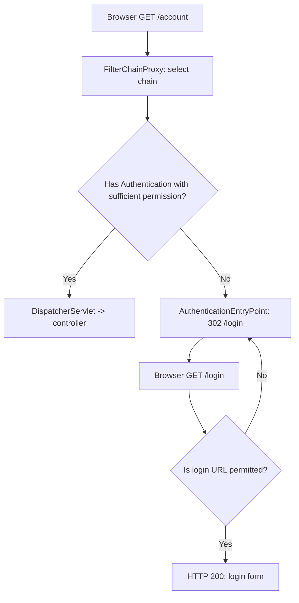
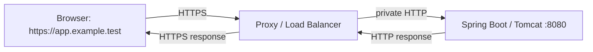

# Login Loops Caused by Matchers, Cookies, Proxies, or Error Pages

> **Scope:** diagnosing Spring Security **Servlet** in Spring Boot 3.x, Spring Security 6.x, Java 17+. Scenario: a user opens a protected resource, the app redirects to `/login`; after submitting credentials it still returns to login, or the browser reports `ERR_TOO_MANY_REDIRECTS`. This guide focuses on four root-cause groups: **request matchers**, **sessions/cookies**, **reverse proxies/HTTPS**, and **error pages/ERROR dispatches**. Every conclusion must rest on HTTP status, `Location`, `Set-Cookie`/`Cookie`, and the actual filter chain—not guesswork from the UI.

## 1. Recognizing a Login Loop

### 1.1. Redirecting to the Login Page Once Is Normal

In traditional form-login web apps:

```text
GET /account  → HTTP 302 Location: /login
GET /login    → HTTP 200 (login page)
```

This is normal resource protection, not a bug. A loop occurs when requests repeatedly return to the same point without reaching the destination page:

```text
GET /login → HTTP 302 Location: /login
GET /login → HTTP 302 Location: /login
GET /login → HTTP 302 Location: /login
...
```

Or:

```text
GET  /account → 302 /login
GET  /login   → 200
POST /login   → 302 /account
GET  /account → 302 /login
GET  /login   → 200
... user logs in again but keeps getting redirected back to login
```

The first pattern points toward **login matcher/routing**; the second points toward **cookies, session persistence, chain selection, or success handlers**. However, multiple faults can coexist, so always read the full trace.

### 1.2. Easily Confused Symptoms

| Observed HTTP Sequence | Cause Group to Check First |
| --- | --- |
| `GET /login → 302 /login` | `loginPage`/`permitAll`/request matcher/multiple chains |
| `POST /login → 302 /login?error` | Wrong credentials or authentication provider failure |
| `POST /login → 403` | Missing/invalid CSRF token; occasionally an access rule blocking |
| `POST /login → 302 /account`, then `GET /account → 302 /login` | Session cookie, unsaved auth, multi-node, chain match |
| `https://site/login → http://site/login → https://site/login` | Proxy, forwarded headers, HTTPS redirect |
| `GET /account → /error → /login → /error` | Error page or ERROR dispatch is protected |
| `GET /account → 401` | API/Basic entry point; not a redirect loop |
| `GET /admin → 403` even after logging in | Authenticated but lacking permission; not necessarily a loop |

**Takeaway:** HTTP 302, 401, 403, 404, and 500 carry different meanings. In particular, **403 after POST** must never be fixed by disabling CSRF without analyzing evidence.

## 2. How Does Spring Security Servlet Process a Request?

A request entering the container passes through `DelegatingFilterProxy` and `FilterChainProxy`. Spring Security selects the appropriate `SecurityFilterChain` (when multiple chains exist, **the first match** by `securityMatcher` and `@Order`). Inside the chosen chain, authentication filters, `SecurityContextHolderFilter`, `ExceptionTranslationFilter`, and `AuthorizationFilter` coordinate processing.



A loop where `GET /login` is blocked occurs **before the user even gets to enter a password**.

### 2.1. securityMatcher and requestMatchers Are Very Different

- `http.securityMatcher("/api/**")`: determines **which requests enter this entire chain**.
- `authorizeHttpRequests(auth -> auth.requestMatchers("/public").permitAll())`: applies policy **only inside an already-selected chain**.
- `formLogin().loginProcessingUrl("/login")`: requires the processing URL to actually be **matched by the authentication filter in that chain**.
- `permitAll("/login")` inside a chain with `securityMatcher("/api/**")` does not make `/login` enter that chain.
- `web.ignoring()` skips security filters for ignored routes; usually **unsuitable for login processing URLs**. Use `permitAll` when a URL should be public yet still traverse the chain.

Avoid the trap where a developer reads only `requestMatchers` and forgets the request was excluded earlier by `securityMatcher`.

## 3. Root Cause 1: Matchers Blocking the Login Page Itself

### 3.1. Custom Login Page Not Permitted

Intentionally **broken** configuration:

```java
@Bean
SecurityFilterChain incorrect(HttpSecurity http) throws Exception {
    return http
            .authorizeHttpRequests(auth -> auth
                    .anyRequest().authenticated())
            .formLogin(form -> form.loginPage("/login"))
            .build();
}
```

When declaring `loginPage("/login")`, you are responsible for providing the `GET /login` page (controller/template) and a policy allowing anonymous access. If every request requires authentication, `GET /login` can redirect back to itself.

Context-appropriate fix:

```java
@Bean
SecurityFilterChain web(HttpSecurity http) throws Exception {
    return http
            .authorizeHttpRequests(auth -> auth
                    .requestMatchers("/", "/login", "/error",
                            "/css/**", "/js/**", "/images/**")
                    .permitAll()
                    .anyRequest().authenticated())
            .formLogin(form -> form
                    .loginPage("/login")
                    .loginProcessingUrl("/login")
                    .permitAll())
            .build();
}
```

A controller/template serving `GET /login` is still required. `loginProcessingUrl("/login")` is handled by the filter for form POSTs; GET and POST can share the same path with distinct responsibilities. Do not open all of `/**` just to break the loop.

If no custom login page is needed, a shorter configuration is:

```java
return http
        .authorizeHttpRequests(auth -> auth
                .requestMatchers("/").permitAll()
                .anyRequest().authenticated())
        .formLogin(Customizer.withDefaults())
        .build();
```

Spring Security generates the default login page. You do not need a custom `GET /login` controller or custom `loginPage` without a specific UX requirement.

### 3.2. Two SecurityFilterChains Where /login Enters the Wrong Chain

Common pitfall:

```java
@Bean
@Order(1)
SecurityFilterChain api(HttpSecurity http) throws Exception {
    return http
            .securityMatcher("/api/**")
            .authorizeHttpRequests(auth -> auth.anyRequest().authenticated())
            .formLogin(form -> form.loginProcessingUrl("/login"))
            .build();
}
```

`POST /login` **does not match `/api/**`**, so the form-login processing filter in the API chain does not run for that URL. The request may be caught by another chain or have no filter handling it as a login.

Cleaner design: dedicated API chain for APIs, dedicated web chain for form login.

```java
@Bean
@Order(1)
SecurityFilterChain api(HttpSecurity http) throws Exception {
    return http
            .securityMatcher("/api/**")
            .authorizeHttpRequests(auth -> auth
                    .anyRequest().authenticated())
            .httpBasic(Customizer.withDefaults())
            .build();
}

@Bean
@Order(2)
SecurityFilterChain browserWeb(HttpSecurity http) throws Exception {
    return http
            .authorizeHttpRequests(auth -> auth
                    .requestMatchers("/", "/error").permitAll()
                    .anyRequest().authenticated())
            .formLogin(Customizer.withDefaults())
            .build();
}
```

These are two beans replacing the single-chain setup, not a mandate to use HTTP Basic for every API. In systems with JWT/opaque tokens, APIs can be stateless with Resource Server while browsers still have a separate chain for forms/sessions. Do not enable form login inside an API chain when the processing endpoint lies outside that chain's scope.

### 3.3. Context Path and Saved Request

If an application runs under `/portal`, the external login URL may be `/portal/login`. In Spring Security config, matchers normally evaluate the application/Servlet-relative path, whereas browsers see the public URL including context path. Ensure the app and proxy agree on prefixes.

After accessing a protected resource, `RequestCache` may store the saved request, and the success handler sends the user back there. If the saved URL is unavailable, lacks permission, or points to the wrong host/path, the browser can bounce back to login. `defaultSuccessUrl` or a custom `AuthenticationSuccessHandler` can also create a loop if it redirects to a misconfigured protected endpoint.

**Verification:** after `POST /login`, record `Location`, then GET that exact URL using the same cookie jar. If it still 302s to login, do not stop at a “login success” log; inspect the session and chain of the follow-up request.

## 4. Root Cause 2: Cookies or Sessions Do Not Persist Across Requests

### 4.1. Session Cookies and SecurityContext

For session-based Spring Security Servlet apps, the container may return:

```http
HTTP/1.1 200 OK
Set-Cookie: JSESSIONID=opaque-session-id; Path=/; HttpOnly; SameSite=Lax
```

The browser must store the valid cookie and send it back:

```http
GET /account HTTP/1.1
Host: app.example.test
Cookie: JSESSIONID=opaque-session-id
```

Spring Security can store `SecurityContext` in `HttpSession` via `SecurityContextRepository`. If the client fails to send the cookie properly, the server cannot recognize the session. If the cookie is sent yet the session is invalidated, lacks a saved context, or lives on another node without a shared session store, the user is still treated as anonymous.

**Having a cookie in `Set-Cookie` does not prove the browser stored it; sending a cookie in a request does not prove the server still holds authentication.** Check both sides.

### 4.2. Important Cookie Attributes

| Attribute | Meaning | Loop-Causing Bug |
| --- | --- | --- |
| `Path` | Browser sends cookie only for paths within scope | Cookie `Path=/portal` while redirecting to `/account` |
| `Domain` | Host/domain scope; omitting `Domain` makes it host-only | Login at `app.example.test`, resource at `api.example.test` |
| `Secure` | Cookie sent only over HTTPS per browser policy | Plain HTTP access after server sets `Secure` |
| `HttpOnly` | JavaScript cannot read `document.cookie` | Not the reason a browser omits a cookie |
| `SameSite=Lax` | Site-context cookie sending policy | Cross-site flows incompatible with navigation mode |
| `SameSite=Strict` | Stricter cross-site restriction | External callbacks/navigations may drop the cookie |
| `SameSite=None` | Allows cross-site contexts when permitted by browser; requires `Secure` | Missing `Secure` or third-party privacy restrictions |
| `Max-Age`/`Expires` | Cookie lifetime | Expired cookie or overwritten by server/proxy |
| `JSESSIONID` | Default Servlet session cookie name | Collisions across different apps/paths/domains |

**Never disable `HttpOnly` to “let the browser receive the cookie”.** `HttpOnly` does not stop browsers from sending cookies automatically; it only prevents JavaScript from reading cookies, reducing XSS exposure.

### 4.3. Same-Origin Is Not Same-Site

An origin consists of scheme + host + port. `https://app.example.test` and `https://api.example.test` have different origins, yet can be same-site depending on registrable domain and scheme. `SameSite` primarily governs site context, while cross-origin `fetch` remains governed by CORS.

If a frontend calls an API via:

```javascript
const response = await fetch("https://api.example.test/account", {
  credentials: "include"
});
```

evaluate all of the following together:

1. Do cookie `Domain`/`Path` match the host/path?
2. Do `SameSite`/`Secure` permit sending?
3. Does the browser block third-party cookies?
4. Does the API have a proper CORS policy for origin and credentials?
5. Do state-changing requests have CSRF protection?

`Access-Control-Allow-Origin: *` cannot serve as an allowlist for credentialed cross-origin browser requests. Never relax CORS, SameSite, or CSRF globally just to make one test pass.

### 4.4. Session Fixation: JSESSIONID Changes After Login

Spring Security includes session fixation protection. After successful login, the session ID **may change**, depending on container and configuration:

```text
GET /login       Set-Cookie: JSESSIONID=before
POST /login      Cookie: JSESSIONID=before
                 Set-Cookie: JSESSIONID=after
                 Location: /account
GET /account     Cookie: JSESSIONID=after
```

If a test client keeps sending the `before` ID instead of updating to `after`, post-login requests can bounce back to login even though the authentication filter succeeded. Never log real IDs; only verify the cookie jar updated from the POST's `Set-Cookie`.

### 4.5. SessionCreationPolicy and Saving SecurityContext

`SessionCreationPolicy.STATELESS` suits certain bearer-token APIs but **breaks** web form login that relies on an HTTP session to retain authentication:

```java
// Misconfiguration when applied to form login requiring a session:
.sessionManagement(session ->
        session.sessionCreationPolicy(SessionCreationPolicy.STATELESS))
```

Symptom: every request to `/account` becomes anonymous right after the user logs in. Check the policy on **the chain that actually matched**, and separate API vs. web if session requirements differ.

In custom authentication flows, merely calling:

```java
SecurityContextHolder.getContext().setAuthentication(authentication);
```

does not guarantee authentication persists on the next request. With `SecurityContextHolderFilter` and explicit saving, custom flows must persist the context via `SecurityContextRepository#saveContext(...)` according to its contract/lifecycle. With standard `formLogin()`, Spring Security handles this already. Do not build a custom login controller just to replace the standard flow.

### 4.6. Multiple Server Instances and Session Store

If a browser logs in on node A while the next request hits node B, an in-memory session on A will not exist on B. Options depend on architecture:

- Shared session store such as Spring Session + Redis/JDBC.
- Load-balancer sticky sessions under managed policy.
- Token-based stateless authentication for true APIs, **never treating switching to stateless as a free fix for a form-login session loop**.
- Health/readiness checks to remove misconfigured nodes lacking shared session access.

**Test** sequential requests across nodes or through the load balancer; do not test solely against one local server.

## 5. Root Cause 3: Proxy Generating Wrong Location, Scheme, or Host

### 5.1. HTTPS Outside, HTTP Inside

Typical topology:



The backend may see `http://app:8080` while the browser uses `https://app.example.test`. If Spring generates an absolute redirect from the backend scheme/host, it may emit:

```http
Location: http://app:8080/login
```

Or return `http://app.example.test/login`, which the edge forces back to HTTPS and loops. Backend URLs may be unreachable from browsers, `Secure` cookies are not sent over HTTP, and OIDC callbacks get mismatched base URLs.

### 5.2. Forwarded Headers and Trust

Proxies typically set:

```http
X-Forwarded-Proto: https
X-Forwarded-Host: app.example.test
X-Forwarded-Port: 443
X-Forwarded-For: 198.51.100.10
```

Spring Boot provides `server.forward-headers-strategy` (e.g., `none`, `native`, `framework` depending on stack/container). When using `framework`, Spring handles forwarded headers via mechanisms like `ForwardedHeaderFilter`. However, **trust only headers overwritten/sanitized by a trusted reverse proxy**, never raw headers sent directly by Internet clients.

Sample application config **behind a controlled TLS proxy**:

```yaml
server:
  forward-headers-strategy: framework
  servlet:
    session:
      cookie:
        secure: true
        http-only: true
        same-site: lax
```

`secure: true` is appropriate when browsers connect over public HTTPS, even if the backend hop is internal HTTP. Never remove `Secure` just because Tomcat does not terminate TLS directly.

Illustrative Nginx example:

```nginx
server {
    listen 443 ssl;
    server_name app.example.test;

    ssl_certificate /etc/nginx/tls/fullchain.pem;
    ssl_certificate_key /etc/nginx/tls/privkey.pem;

    location / {
        proxy_pass http://app:8080;
        proxy_set_header Host app.example.test;
        proxy_set_header X-Forwarded-Proto https;
        proxy_set_header X-Forwarded-Host app.example.test;
        proxy_set_header X-Forwarded-Port 443;
        proxy_set_header X-Forwarded-For $remote_addr;
        proxy_set_header Forwarded "";
    }
}
```

This is **not** a complete production Nginx configuration; certificate paths and domain are illustrative. The proxy must sanitize all forwarded headers the backend trusts and block direct backend access. Otherwise, attackers can spoof `X-Forwarded-Host` to cause open redirects, broken host links, or login loops.

### 5.3. Context Path and Prefix Rewrites

Suppose the public URL is `https://app.example.test/portal` while Nginx strips `/portal` before forwarding to the backend. If the app produces `Location: /login`, the browser navigates to the wrong path instead of `/portal/login`. A cookie with `Path=/portal` will also not be sent to `/login`.

Pick one consistent strategy:

- App uses `server.servlet.context-path=/portal` and proxy forwards the matching path.
- Or proxy strips the prefix, sets a trusted `X-Forwarded-Prefix`, and the framework handles prefixes as designed.
- Never double-apply the prefix in both proxy and app.
- Verify `loginPage`, `loginProcessingUrl`, logout URL, static assets, session cookie `Path`, and saved requests against the **public URL**.

Do not merely add a header and assume it is fixed. Inspect the actual `Location`, Request-URI, and browser cookie scope.

## 6. Root Cause 4: Error Page / ERROR Dispatch Is Protected

### 6.1. Application Errors Masked as a Login Loop

When a controller throws an exception, the Servlet container/Spring MVC may perform an **ERROR dispatch** to `/error`. If `/error` or the error dispatcher is intercepted by Spring Security for authentication, the client can be redirected to `/login`, fail again, and loop.

```text
GET /report       → exception
ERROR /error      → redirect /login
GET /login        → rendering failure or blocked by security
ERROR /error      → redirect /login
...
```

The root cause might be a down database, broken template, missing variable, or bean error—unrelated to passwords.

### 6.2. Explicitly Configuring Access for Error Dispatches

```java
import jakarta.servlet.DispatcherType;

http.authorizeHttpRequests(auth -> auth
        .dispatcherTypeMatchers(DispatcherType.ERROR).permitAll()
        .requestMatchers("/", "/login", "/error").permitAll()
        .anyRequest().authenticated()
);
```

This is a **snippet inside an `HttpSecurity` configuration method**, not a standalone Java class. If the app has a custom error page such as `/failure`, permit that exact path. Never open the entire app or turn off Spring Security.

Notes:

- `permitAll("/error")` does not fix the underlying exception; it merely prevents a new authentication redirect from hiding the error response.
- `@ControllerAdvice` usually covers exceptions inside MVC handlers, not all security filter exceptions.
- `ExceptionTranslationFilter` handles authentication/access-denied exceptions within Spring Security's model, not controller 500s.
- Do not blindly permit every `DispatcherType.FORWARD` unless you understand all internal forwards; scope ERROR/FORWARD permissions carefully.
- Error pages should hide stack traces and secrets while logging sanitized technical details and a correlation ID.

### 6.3. Distinguishing Failures

| HTTP Status | Typical Interpretation in Web Form/Login | Investigation Direction |
| --- | --- | --- |
| 302 `Location: /login` | Authentication entry point | Loop or valid initial redirect? |
| 302 `Location: /login?error` | Authentication failed | Username/password/provider and login error |
| 401 | API/Basic entry point | Not a form redirect loop |
| 403 | CSRF or AccessDenied | Check CSRF token, role/authority, filter |
| 404 | Missing route/template or wrong proxy prefix | Check controller/resource/URL |
| 500 | Controller/template/downstream exception | Inspect underlying exception and error dispatch |
| 502/503/504 | Proxy/backend unavailable | Check network/service/health |

A 403 on login POST is not necessarily role-related; form login enforces CSRF, and the token must belong to the **same session** as the browser submitting the form.

## 7. Effective Diagnostic Checklist in Order

1. Enable **Preserve log** in Browser DevTools → Network and reproduce from the very first request.
2. Record **method, URL, status, `Location`** for every response; distinguish looping immediately on `GET /login` vs. after `POST /login`.
3. Check whether `GET /login` returns 200 or 302; if 302 to itself, prioritize matchers/`loginPage`/chain.
4. Check whether POST returns 302 success, 302 error, 403, or 404; do not lump them together.
5. Check whether the browser received `Set-Cookie`, or blocked it due to `Secure`/`SameSite`/`Domain`/`Path` or browser policy.
6. Check whether the post-login request sent `Cookie` and whether the server still holds the session/context.
7. Check whether the cookie/session ID changed after login, especially due to session fixation protection.
8. Identify which chain the request entered, whether context persistence is stateless, and whether nodes A/B share a session store.
9. If `Location` has the wrong scheme/host/port/prefix, compare against the public HTTPS URL and proxy forwarded headers.
10. If `/error`/ERROR dispatch appears in the trace, inspect the root exception, custom error page, and dispatcher rules.
11. Verify the CSRF token and cookie jar on POST; never use `csrf.disable()` as a fix.
12. After fixing, run **negative tests**: anonymous users cannot access protected resources, unauthorized users still get 403, and missing CSRF is still rejected.

### 7.1. curl: Limiting Redirects

```bash
# Read the first response without following redirects automatically
curl -i http://localhost:8080/account
curl -i http://localhost:8080/login

# Follow redirects but stop after 5 hops
curl -sS -v -L --max-redirs 5 \
  -o /dev/null http://localhost:8080/account

# Save a local cookie jar for subsequent requests
curl -sS -i -c cookies-debug.txt \
  -b cookies-debug.txt http://localhost:8080/login
```

`curl -L` can hide intermediate responses if you only inspect the final result; use `-v`/`-i` and `--max-redirs` to avoid infinite loops. Cookie files can contain session credentials; **never commit or share them**.

### 7.2. Controlled Logging

```yaml
logging:
  level:
    org.springframework.security: DEBUG
    org.springframework.web: INFO
```

Use DEBUG in dev/staging for as long as needed to inspect filter chains, entry points, and authorization. Never enable broad TRACE in production; filter logs to omit raw passwords, session IDs, `Authorization`, `Cookie`, and OAuth codes/tokens. Use correlation IDs and sanitized request metadata to link traces across Nginx, Spring, and the session store.

## 8. Runnable Demo in Java 17 and Spring Boot 3.x

The sample project uses **Spring Boot 3.4.2 / Spring Security 6.4.x**, generated form-login, sessions, and permitted error dispatches. The goal is establishing a **loop-free** baseline before comparing against broken configurations. This is a Spring Java app and cannot be run with plain `javac`; it needs Gradle Wrapper/JDK 17 and dependencies.

### 8.1. Gradle and Structure

```text
login-loop-demo/
├── settings.gradle
├── build.gradle
└── src/
    ├── main/
    │   ├── java/com/example/loginloop/
    │   │   ├── LoginLoopApplication.java
    │   │   ├── SecurityConfig.java
    │   │   └── PageController.java
    │   └── resources/application.yml
    └── test/java/com/example/loginloop/
        └── LoginFlowHttpTest.java
```

`settings.gradle`:

```groovy
rootProject.name = 'login-loop-demo'
```

`build.gradle`:

```groovy
plugins {
    id 'java'
    id 'org.springframework.boot' version '3.4.2'
    id 'io.spring.dependency-management' version '1.1.7'
}

group = 'com.example'
version = '0.0.1-SNAPSHOT'

java {
    toolchain {
        languageVersion = JavaLanguageVersion.of(17)
    }
}

repositories {
    mavenCentral()
}

dependencies {
    implementation 'org.springframework.boot:spring-boot-starter-web'
    implementation 'org.springframework.boot:spring-boot-starter-security'
    testImplementation 'org.springframework.boot:spring-boot-starter-test'
}

tasks.named('test') {
    useJUnitPlatform()
}
```

Use Spring Boot's BOM to keep Spring Security and Spring MVC aligned. If your project uses another version, adjust through the same dependency management system rather than forcing an arbitrary Security version override.

### 8.2. Boot Application

File `src/main/java/com/example/loginloop/LoginLoopApplication.java`:

```java
package com.example.loginloop;

import org.springframework.boot.SpringApplication;
import org.springframework.boot.autoconfigure.SpringBootApplication;

@SpringBootApplication
public class LoginLoopApplication {
    public static void main(String[] args) {
        SpringApplication.run(LoginLoopApplication.class, args);
    }
}
```

### 8.3. SecurityConfig

File `src/main/java/com/example/loginloop/SecurityConfig.java`:

```java
package com.example.loginloop;

import jakarta.servlet.DispatcherType;
import org.springframework.context.annotation.Bean;
import org.springframework.context.annotation.Configuration;
import org.springframework.security.config.Customizer;
import org.springframework.security.config.annotation.web.builders.HttpSecurity;
import org.springframework.security.core.userdetails.User;
import org.springframework.security.core.userdetails.UserDetails;
import org.springframework.security.core.userdetails.UserDetailsService;
import org.springframework.security.crypto.PasswordEncoder;
import org.springframework.security.crypto.factory.PasswordEncoderFactories;
import org.springframework.security.provisioning.InMemoryUserDetailsManager;
import org.springframework.security.web.SecurityFilterChain;

@Configuration
public class SecurityConfig {
    @Bean
    PasswordEncoder passwordEncoder() {
        return PasswordEncoderFactories.createDelegatingPasswordEncoder();
    }

    @Bean
    UserDetailsService users(PasswordEncoder encoder) {
        UserDetails alice = User.withUsername("alice")
                .password(encoder.encode("alice-pass"))
                .roles("USER")
                .build();
        return new InMemoryUserDetailsManager(alice);
    }

    @Bean
    SecurityFilterChain securityFilterChain(HttpSecurity http)
            throws Exception {

        return http
                .authorizeHttpRequests(auth -> auth
                        .dispatcherTypeMatchers(DispatcherType.ERROR)
                        .permitAll()
                        .requestMatchers("/", "/error").permitAll()
                        .anyRequest().authenticated()
                )
                .formLogin(Customizer.withDefaults())
                .build();
    }
}
```

- The generated login page handles `/login` under default configuration, requiring no custom `@GetMapping("/login")`.
- `/account` is protected; `/` is public.
- `/error` and the `ERROR` dispatcher are permitted so 500 errors are not masked by login redirects.
- Form login uses sessions; do not set `STATELESS`.
- CSRF is not disabled; form login requires the `_csrf` token.
- User/password are **dummy test data**, never to be used outside localhost.

### 8.4. Controller

File `src/main/java/com/example/loginloop/PageController.java`:

```java
package com.example.loginloop;

import java.util.Map;
import org.springframework.security.core.Authentication;
import org.springframework.web.bind.annotation.GetMapping;
import org.springframework.web.bind.annotation.RestController;

@RestController
public class PageController {
    @GetMapping("/")
    public Map<String, String> home() {
        return Map.of("message", "public");
    }

    @GetMapping("/account")
    public Map<String, String> account(Authentication auth) {
        return Map.of("user", auth.getName());
    }

    @GetMapping("/broken")
    public Map<String, String> broken() {
        throw new IllegalStateException("Simulated failure");
    }
}
```

`/broken` is solely for verifying that an error responds as an application error (e.g. 500) rather than turning into a login loop. Never print stack traces or secrets in production responses.

### 8.5. Local HTTP Profile

`src/main/resources/application.yml`:

```yaml
server:
  port: 8080
  servlet:
    session:
      cookie:
        http-only: true
        same-site: lax
        secure: false
```

This configuration is **for HTTP localhost only**. Public HTTPS deployments must enforce `Secure` cookies and trusted proxy forwarding; never ship `secure: false` to production.

## 9. Real HTTP Test: Successful POST Login Must Retain the Session

`MockMvc` is great for verifying security filters and matchers, yet it opens no sockets and does not fully simulate cookie jars or browsers. `@SpringBootTest(webEnvironment = RANDOM_PORT)` starts a real embedded Servlet container, enabling tests via Java 17's `HttpClient` and `CookieManager`.

### 9.1. LoginFlowHttpTest.java

`src/test/java/com/example/loginloop/LoginFlowHttpTest.java`:

```java
package com.example.loginloop;

import java.net.CookieManager;
import java.net.CookiePolicy;
import java.net.URI;
import java.net.URLEncoder;
import java.net.http.HttpClient;
import java.net.http.HttpRequest;
import java.net.http.HttpResponse;
import java.nio.charset.StandardCharsets;
import java.util.regex.Matcher;
import java.util.regex.Pattern;

import org.junit.jupiter.api.Test;
import org.springframework.boot.test.context.SpringBootTest;
import org.springframework.boot.test.web.server.LocalServerPort;

import static org.assertj.core.api.Assertions.assertThat;

@SpringBootTest(webEnvironment = SpringBootTest.WebEnvironment.RANDOM_PORT)
class LoginFlowHttpTest {

    @LocalServerPort
    int port;

    private String url(String path) {
        return "http://localhost:" + port + path;
    }

    private HttpClient client() {
        CookieManager jar =
                new CookieManager(null, CookiePolicy.ACCEPT_ALL);
        return HttpClient.newBuilder()
                .cookieHandler(jar)
                .followRedirects(HttpClient.Redirect.NEVER)
                .build();
    }

    private HttpResponse<String> get(
            HttpClient browser, String path) throws Exception {

        HttpRequest req = HttpRequest.newBuilder(
                URI.create(url(path))).GET().build();
        return browser.send(req,
                HttpResponse.BodyHandlers.ofString());
    }

    private String csrfFromForm(String html) {
        Matcher tags = Pattern.compile(
                "<input\\b[^>]*>", Pattern.CASE_INSENSITIVE)
                .matcher(html);
        while (tags.find()) {
            String tag = tags.group();
            if (tag.contains("name=\"_csrf\"")) {
                Matcher value = Pattern.compile(
                        "value=\"([^\"]+)\"").matcher(tag);
                if (value.find()) {
                    return value.group(1);
                }
            }
        }
        throw new IllegalStateException("CSRF field missing");
    }

    @Test
    void loginPageIsPublic() throws Exception {
        HttpResponse<String> page = get(client(), "/login");
        assertThat(page.statusCode()).isEqualTo(200);
        assertThat(page.body()).contains("name=\"username\"");
        assertThat(page.body()).contains("name=\"password\"");
    }

    @Test
    void validLoginKeepsSessionAcrossHttpRequests() throws Exception {
        HttpClient browser = client();
        HttpResponse<String> page = get(browser, "/login");
        assertThat(page.statusCode()).isEqualTo(200);

        String form = "username=alice"
                + "&password=alice-pass"
                + "&_csrf=" + URLEncoder.encode(
                        csrfFromForm(page.body()), StandardCharsets.UTF_8);

        HttpRequest loginRequest = HttpRequest.newBuilder(
                        URI.create(url("/login")))
                .header("Content-Type",
                        "application/x-www-form-urlencoded")
                .POST(HttpRequest.BodyPublishers.ofString(form))
                .build();

        HttpResponse<String> login = browser.send(
                loginRequest,
                HttpResponse.BodyHandlers.ofString());
        assertThat(login.statusCode()).isEqualTo(302);

        HttpResponse<String> account = get(browser, "/account");
        assertThat(account.statusCode()).isEqualTo(200);
        assertThat(account.body()).contains("\"user\":\"alice\"");
    }

    @Test
    void anonymousGetsOneRedirectToLogin() throws Exception {
        HttpResponse<String> response = get(client(), "/account");
        assertThat(response.statusCode()).isEqualTo(302);
        assertThat(response.headers().firstValue("location").orElse(""))
                .contains("/login");
    }

    @Test
    void loginWithoutCsrfIsRejected() throws Exception {
        HttpClient browser = client();
        HttpRequest req = HttpRequest.newBuilder(
                        URI.create(url("/login")))
                .header("Content-Type",
                        "application/x-www-form-urlencoded")
                .POST(HttpRequest.BodyPublishers.ofString(
                        "username=alice&password=alice-pass"))
                .build();
        HttpResponse<String> response = browser.send(
                req, HttpResponse.BodyHandlers.ofString());
        assertThat(response.statusCode()).isEqualTo(403);
    }
}
```

**Test explanation:**

1. `loginPageIsPublic` directly verifies `GET /login → 200`, catching matchers that redirect login to itself.
2. `validLoginKeepsSessionAcrossHttpRequests` keeps the same cookie jar, extracts CSRF from the form, POSTs login, and then GETs the protected resource. Only this proves login created a usable session.
3. `anonymousGetsOneRedirectToLogin` verifies the entry point for a sessionless client.
4. `loginWithoutCsrfIsRejected` proves CSRF protection was not accidentally disabled.
5. `followRedirects(NEVER)` lets you inspect exact 302s instead of letting `HttpClient` follow and obscure the chain.
6. The form regex fits the simple generated login form, not arbitrary HTML. Custom pages may need another parser or an explicit CSRF endpoint.

Run when the project has Gradle Wrapper:

```bash
./gradlew test
```

All 4 tests are expected to pass with matching code and dependencies. This is **not a claim of execution** on the learner's machine. The test uses local HTTP and does not verify HTTPS proxies or real browser `SameSite` cookie enforcement.

## 10. Testing Proxy/Browser Behavior Once Local Passes

If local HTTP tests do not loop yet browsers in staging still loop, do not randomly tweak `@PreAuthorize` or password encoders. Reproduce the production topology.

### 10.1. Browser DevTools

- Network → Preserve log: observe **every status/`Location`**.
- Application/Storage → Cookies: check whether cookies are blocked by `Path`/`Domain`/`SameSite`/`Secure` or browser policy.
- Network → login POST: verify the request includes the session cookie and `_csrf` form field (do not copy secret values).
- Network → protected request: is the post-login cookie actually sent?
- Console/Issues: mixed content, third-party cookie restrictions, CORS.
- Watch whether the redirect chain flips between HTTPS and HTTP or changes hosts.
- An empty `document.cookie` does not prove an `HttpOnly` cookie is missing; `HttpOnly` is designed to hide cookies from JS.

### 10.2. Proxy/TLS Testing

A real test through Nginx/Traefik/load balancer must confirm:

- Public URL is HTTPS with a valid certificate (do not use `curl -k` in trust-verification tests).
- Absolute `Location` headers do not contain `http://app:8080` or internal hosts.
- Session cookies have `Secure` over HTTPS and appropriate `Domain`/`Path` scope.
- Forwarded headers are controlled by the proxy; attackers cannot inject their own host/proto.
- Login and accessing `/account` succeed through the same **public URL** and cookie jar.
- Context path/prefix is neither double-applied nor lost during rewrites.
- OAuth2/OIDC callbacks, state, and session cookies work properly if the app uses SSO.

### 10.3. Test Matrix and Expected Behavior

| Case | Where to Test | Expectation |
| --- | --- | --- |
| `GET /login` anonymous | Real HTTP / MockMvc | 200, no loop |
| `GET /account` anonymous | Real HTTP | 302 `/login` once |
| Valid POST login + CSRF + cookie | Real HTTP | 302 success and GET account 200 |
| POST login missing CSRF | Real HTTP | 403 |
| Client drops cookies | Real HTTP | Next request still requires login |
| Wrong password | Real HTTP | Redirect `login?error` or configured failure response |
| Custom login URL not permitted | MockMvc / negative config | Detects self-looping 302 |
| Web app misconfigured as STATELESS | Real HTTP / negative config | Does not retain session; test must catch |
| TLS proxy drops forwarded proto | Real proxy | `Location` has wrong scheme/host; fix before release |
| Wrong cookie `Secure`/`SameSite` | Real browser | Browser blocks or omits cookie |
| Protected ERROR dispatch | Real Servlet container | Errors do not turn into a login loop |
| Non-existent resource | Real Servlet container | 404 or clear error policy, never a login loop |
| Logged-in user lacking role | Real HTTP / MockMvc | 403, not forced to re-login |
| Multi-node missing session store | Load balancer integration | Node B loses auth; must be caught |

Not every case needs to run inside a fast PR unit suite; tier fast vs. slow tests, yet ensure every risk has **verification at the right layer**.

## 11. Mistakes When “Fixing” a Login Loop

| Wrong Change | Why It Is Wrong | Safe Approach |
| --- | --- | --- |
| `anyRequest().permitAll()` | Exposes all protected resources | Permit only exact login/public/error URLs |
| `csrf.disable()` for form login | Strips CSRF protection from session app | Send valid token with cookie/session |
| `web.ignoring("/login")` without understanding impact | May also bypass authentication processing filters | Keep URL in chain using `permitAll()` |
| `STATELESS` for web forms | Fails to persist auth as expected | Separate session-based web and stateless API |
| Removing `HttpOnly` because JS can't see cookie | Increases cookie theft risk via XSS | Inspect via DevTools Storage/Network |
| Removing `Secure` because backend is HTTP | Downgrades cookie protection off HTTPS | `Secure` cookie with TLS-terminating proxy |
| `SameSite=None` on every cookie | Widens cross-site exposure without necessarily fixing loops | Design proper site/cross-origin setup |
| Trusting all forwarded headers | Host spoofing / open redirect | Trusted proxy sanitization and private backend |
| Protecting `/error` like a sensitive URL | Masks root exceptions with login redirects | Proper ERROR dispatch policy |
| Testing only that POST returns 302 | Does not prove subsequent requests are authenticated | GET protected resource using same cookie jar |
| Testing only `with(user("alice"))` | Does not test real login/cookies | Real Servlet HTTP + browser/proxy where needed |
| Printing raw session IDs to logs | Session IDs are bearer credentials | Correlation IDs and sanitized logs |

## 12. Self-Check Questions

**1.** `GET /login` keeps returning `302 Location: /login`. What do you check first?  
**Answer:** whether the login route has proper `permitAll`, whether a custom `loginPage` has a controller/template, and whether `securityMatcher`/multiple chains routed the URL wrongly. It is not a password issue yet.

**2.** `POST /login` returns 302 `/account`, yet `GET /account` returns 302 `/login`. Why?  
**Answer:** the browser may not be storing `JSESSIONID`, the session ID rotated after login, context was not saved, another node lacks the session, cookie scope is wrong, or the chain is stateless.

**3.** The cookie has `HttpOnly`, so JavaScript sees nothing in `document.cookie`. Is the cookie lost?  
**Answer:** no. `HttpOnly` only blocks JS reads; inspect Network/Storage to verify the browser saved and sent the cookie.

**4.** Should an HTTP backend behind an HTTPS proxy set non-Secure cookies?  
**Answer:** no. Browsers connect over public HTTPS; session cookies should carry `Secure` appropriately, paired with verified forwarded scheme/host.

**5.** Does `permitAll("/login")` in a chain matching only `/api/**` cause `POST /login` to be processed?  
**Answer:** no. `/login` never enters that chain; fix the chain matcher or `loginProcessingUrl`.

**6.** When `POST /login` returns 403, should you disable CSRF to break the loop?  
**Answer:** no. Inspect the `_csrf` token and session cookie, and determine whether the 403 is CSRF or authorization.

**7.** Why can a controller error send the user back to login?  
**Answer:** an ERROR dispatch to `/error` or a custom error page can be blocked by security and trigger the entry point, hiding the original failure.

**8.** Why is a single `curl -L` insufficient for investigating?  
**Answer:** auto-following redirects obscures initial responses; limit hops and inspect status/`Location` at each hop.

**9.** Does `@SpringBootTest(RANDOM_PORT)` prove browsers accept a `SameSite` cookie?  
**Answer:** not yet. It uses a real Servlet container and `HttpClient`, which does not replace testing cookie policies in Chrome/Firefox/WebKit.

**10.** After fixing, what must you confirm besides “no more loop”?  
**Answer:** authentication, authorization, and CSRF remain intact; anonymous users cannot read protected resources, unauthorized users are still denied, and cookies/redirects align with the public URL.

## Conclusion

A login loop in Spring Security Servlet is a **symptom of the HTTP path**, not a single exception:

- **Loop immediately on `GET /login`:** inspect matchers, `loginPage`, `permitAll`, and security chains.
- **Login POST succeeds yet next request is anonymous:** inspect cookies, session fixation, security context persistence, stateless policies, and multi-node sessions.
- **HTTP/HTTPS/host/prefix bounce:** inspect reverse proxy, forwarded headers, and external URLs.
- **Loop via error page:** inspect ERROR dispatches, error pages, and the underlying exception.

**The right method** is recording the redirect chain, cross-checking `Location` and `Set-Cookie`/`Cookie`, and verifying against a real Servlet container as well as browsers/proxies when needed. Fix the right layer—**never disable CSRF, open all URLs, or trust unverified proxy headers**.
