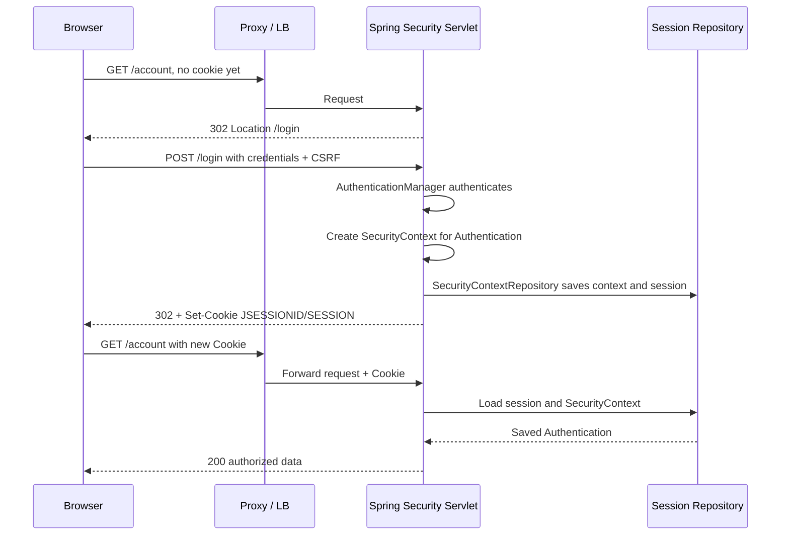

# Lost Login Due to Unsaved Context, Wrong Cookies, or Missing Sessions — Spring Security Servlet Diagnostics

## 1. Goal and Scenarios to Distinguish

In a **Spring Boot 3.x, Spring Security 6.x, Java 17+ Servlet/Spring MVC** application, a user signs in successfully yet the very next request redirects back to `/login`, returns `401 Unauthorized`, or appears logged out. Some systems fail only behind a proxy, when switching nodes/pods, after a logout, during an OAuth2/OIDC/SAML callback, or only on certain APIs.

The three root causes in the title live in three distinct layers:

1. **`SecurityContext` was not saved:** authentication code created an `Authentication` on the request thread but failed to persist it through `SecurityContextRepository`. Within the current request `SecurityContextHolder` sees the user; the next request does not.
2. **Cookies are wrong or ignored by the browser:** the server holds a valid session, yet the browser fails to store or send the ID due to `Secure`, `SameSite`, `Domain`, `Path`, host, HTTPS, `fetch` credentials, or cross-site policy.
3. **`HttpSession` does not exist or cannot be read:** the browser sends an ID, yet the session expired, was invalidated, rotated IDs after login, lives on another node, or Spring Session/Redis failed due to outages, namespaces, or incompatible serialization.

Another easily confused group: **the user is still logged in, yet the request is denied for lacking permissions or CSRF**, or a stateless Bearer-token API does not use session cookies at all. Never label every `401/403/302` as “lost `SecurityContext`”.

After this guide, you can trace the full chain:

```text
Authentication succeeds
  -> create SecurityContext
  -> save SecurityContext via repository
  -> create/maintain server-side session
  -> response emits Set-Cookie with session ID
  -> browser sends Cookie back per origin/path/policy
  -> receiving node finds the session
  -> SecurityContextHolder is populated with Authentication
  -> authorization decides 200 / 403 / redirect
```

**Fix only the broken link.** Disabling CSRF, dropping `Secure`, setting `SecurityContextHolder` to `MODE_GLOBAL`, or setting infinite timeouts are dangerous “fixes”.

## 2. Normal Post-Login Flow



This conceptual diagram reflects the **server-side session** model. In Spring Security Servlet, the context is typically loaded from a repository and placed into `SecurityContextHolder` on the request thread. At the end of the request, the framework clears the `ThreadLocal`; that is normal cleanup. The next request reloads it from the repository if the context was actually saved.

| Component | Responsibility | Common Mistake |
| --- | --- | --- |
| `Authentication` | Principal, authentication state, and `GrantedAuthority` | Seeing the object on the login request and assuming the session persisted |
| `SecurityContext` | Holds the current `Authentication` | Creating a context and setting it only on `ThreadLocal` |
| `SecurityContextHolder` | Per-request-thread context | Mistaking it for a global auth store across all requests |
| `SecurityContextRepository` | Reads/writes context across request boundaries | Saving to one repository and loading from another |
| `HttpSession` | Server-side session referenced by ID | Creating an empty session and assuming a user is stored |
| `JSESSIONID`/`SESSION` | Container or Spring Session cookie | Browser sends wrong name/ID/path/host |
| `SecurityFilterChain` | Authenticates and authorizes per matcher | Stateless API uses a different chain from web login |
| Redis / Spring Session | Shared session store across nodes | Node A and B use different namespaces or serializers |

**Key point:** the cookie is a bearer reference to the session. Never store raw `Authentication` or passwords directly in the `JSESSIONID`/`SESSION` cookie in this model. Never log or share real session IDs.

## 3. Rapid Diagnostic Workflow: Four Questions

With a test account, open DevTools → Network → **Preserve log**, capturing both the login request and the first request that appears logged out.

**Question A — Does the login response include the right `Set-Cookie`?** If not, check whether the flow needs a session, whether custom login saved the context, session creation policy, and response commit timing.

**Question B — Does the browser send that cookie on the next request?** If not, inspect `Domain`/`Path`/`Secure`/`SameSite`/host/scheme, blocked reasons, `fetch` credentials, and proxies. No need to touch Redis yet.

**Question C — When the backend receives the cookie, can it find the `HttpSession`?** If not, inspect expiration/invalidation/session ID rotation, node A vs. B, Spring Session, Redis TTL, namespace, and serialization. No need to disable `SecurityFilterChain`.

**Question D — If the session exists, does it contain an `Authentication`?** If not, inspect `SecurityContextRepository`, `saveContext`, custom auth/logout filters, and `SessionCreationPolicy.STATELESS`.

| Observation | Priority Investigation Area |
| --- | --- |
| Login response emits no cookie, yet flow needs a session | Context persistence / session creation |
| `Set-Cookie` present, subsequent request sends no `Cookie` | Browser cookie policy, request origin, proxy |
| `Cookie` sent, server finds no session | TTL, invalidation, node/store, stale cookie ID |
| Session exists, `SecurityContext` has no principal | `SecurityContextRepository` or custom handler |
| GET has principal, POST returns 403 | CSRF/authorization, not necessarily lost login |
| API `/api/**` returns 401 even after web login | Stateless/Bearer token chain; check matchers |

Collect **status, `Location`, cookie name and attributes, backend node, timestamp, and request ID**. Never paste cookie/token values, sensitive usernames, or serialized `SPRING_SECURITY_CONTEXT` payloads into logs or tickets.

## 4. Cause 1: Authentication Exists, Yet SecurityContext Was Not Saved

### 4.1. Why `setAuthentication` Alone Is Not Enough

Code in a custom login handler might do:

```java
Authentication verified = authenticationManager.authenticate(
    UsernamePasswordAuthenticationToken.unauthenticated(
        username, password));

SecurityContextHolder.getContext()
    .setAuthentication(verified);

// The current request can read verified.
// Yet the next request can be anonymous if the context was not persisted.
```

This is an **illustrative excerpt** requiring proper variables/imports and a controlled authentication flow. `SecurityContextHolder` normally uses `ThreadLocal`; when the request finishes, Spring Security clears the thread context. If it was never saved to the session repository, the next request has nothing to load.

In Spring Security 6, typical Servlet setups use **`SecurityContextHolderFilter` with explicit save**. This filter loads and clears the context, yet **does not automatically persist every mutation**. Custom authentication must explicitly call `SecurityContextRepository.saveContext(...)`. Standard `formLogin()` saves the context inside its authentication success flow; hand-rolled login endpoints that only mutate `ThreadLocal` easily miss this step.

### 4.2. Pattern for Saving Context in Custom Authentication

Minimal pattern **inside a custom authentication success handler**:

```java
// verified was returned by AuthenticationManager.authenticate(...).
// request/response are HttpServletRequest/HttpServletResponse.
// repository is the SecurityContextRepository used by the SecurityFilterChain.

SecurityContext context = SecurityContextHolder.createEmptyContext();
context.setAuthentication(verified);
SecurityContextHolder.setContext(context);
repository.saveContext(context, request, response);
```

**This is not a complete copy-paste login endpoint.** Beyond these four lines, production flows need credential verification, CSRF, session-fixation strategy, concurrent-session control, failure handling, events, remember-me, rate limiting, cookies, and response commit timing.

In custom flows with session fixation protection, invoke the appropriate `SessionAuthenticationStrategy.onAuthentication(...)` and save the context in the right order. Never treat `getSession(true)` as a substitute for `saveContext`: an empty session still contains no `Authentication`.

### 4.3. Choosing the Repository Matching Your Login Flow

| Repository | Purpose |
| --- | --- |
| `HttpSessionSecurityContextRepository` | Stores context in `HttpSession`, normally under key `SPRING_SECURITY_CONTEXT` |
| `RequestAttributeSecurityContextRepository` | Stores in request attributes, useful for dispatches/errors within **one request** |
| `DelegatingSecurityContextRepository` | Combines repositories, typically request attributes + `HttpSession` |
| `NullSecurityContextRepository` | Does not persist across requests; suits stateless authentication |

Spring Security Servlet 6 commonly uses `DelegatingSecurityContextRepository` by default, yet verify **the actual repository per chain** when customizing config. If custom login writes to `HttpSessionSecurityContextRepository` while subsequent requests read from `NullSecurityContextRepository`, the session may exist while the caller remains anonymous.

An **illustrative configuration inside `SecurityFilterChain`**:

```java
SecurityContextRepository repository =
    new DelegatingSecurityContextRepository(
        new RequestAttributeSecurityContextRepository(),
        new HttpSessionSecurityContextRepository()
    );

http.securityContext(context -> context
    .requireExplicitSave(true)
    .securityContextRepository(repository)
);
```

Requires imports from `org.springframework.security.web.context`; this snippet is not a standalone Java program. Do not override the default repository if standard login already works.

### 4.4. `SecurityContextPersistenceFilter` and Migration

In older applications, `SecurityContextPersistenceFilter` could auto-save during the request lifecycle; Spring Security 6 moves toward explicit saves via `SecurityContextHolderFilter`. After upgrading, a custom login controller that relied on auto-save may start showing “logged in, then immediately lost”.

Do not fix this by disabling security filters; write a two-request test, update custom authentication to save through the matching repository for your version, or use standard `formLogin`/OAuth2 Login/SAML Login.

### 4.5. `SessionCreationPolicy` Can Negate Persistence

| Policy | Primary Behavior |
| --- | --- |
| `IF_REQUIRED` | Creates a session when authentication or another mechanism needs one. Usually right for web form login |
| `ALWAYS` | Proactively creates a session; does not fix missing `saveContext` |
| `NEVER` | Does not create a session itself; may use an existing one |
| `STATELESS` | Spring Security neither creates nor uses sessions to retrieve `SecurityContext`; fits stateless Bearer-token APIs |

Example:

```java
http.sessionManagement(session -> session
    .sessionCreationPolicy(SessionCreationPolicy.STATELESS));
```

If web form login relies on a cookie session while its chain is `STATELESS`, `Authentication` from login cannot persist to the next request. When serving both stateless APIs and stateful web pages, design **two `SecurityFilterChain` beans with consistent `securityMatcher` and `@Order`**.

### 4.6. Clues That Context Was Not Saved

- Inside the success handler `authentication.getName()` is present, yet the very next request is anonymous.
- The browser still sends the right cookie and the session exists, yet `SPRING_SECURITY_CONTEXT` is missing or cannot load.
- Standard `formLogin` tests pass while the custom login endpoint fails.
- The issue began after upgrading to Spring Security 6 or changing `SecurityContextRepository`.
- Custom `clearContext`, `invalidate`, or response commit happens **before saving**.

Investigate with a **real two-request** integration test—never by calling the controller with Mockito or using `.with(user("alice"))` on the second request (which injects a fake principal and hides persistence bugs).

## 5. Cause 2: Cookies Do Not Come Back to the Server

Example **illustrative response**:

```http
HTTP/1.1 302 Found
Location: /account
Set-Cookie: JSESSIONID=opaque-id; Path=/; Secure; HttpOnly; SameSite=Lax
```

Real cookies must be randomly generated by the server; never hard-code IDs. With Spring Session Redis, the name is typically `SESSION`; with container sessions, it may be `JSESSIONID`. **Check the actual name in the response** rather than guessing.

### 5.1. `Secure` and HTTPS

`Secure` cookies are restricted by browsers to HTTPS contexts (with browser-specific exceptions for localhost). If login happens at `https://app.example.test` and redirects to `http://service:8080` or another hostname, the cookie will not travel as expected.

**Never disable `Secure` in production** to “work around” a broken HTTP redirect. Fix the public URL, TLS offloading, and proxy forwarded headers.

### 5.2. `HttpOnly`

An `HttpOnly` cookie **is still sent automatically by the browser** on policy-matching requests, even though `document.cookie` cannot read it. If JavaScript cannot see the session cookie while login works, that may simply be **correct security configuration**.

Never disable `HttpOnly` so frontend code can read the ID and inject it into headers. Session cookies are credentials and do not belong in `localStorage` or logs.

### 5.3. `SameSite` in Standard Login and SSO

| Value | Impact to Test |
| --- | --- |
| `Lax` | Usually fits top-level GET navigations, including many OAuth2 Authorization Code callbacks |
| `Strict` | Can block cookies on redirects arriving from an external IdP site |
| `None; Secure` | May be needed for cross-site POST/iframe/credentialed fetch; still subject to browser third-party cookie restrictions |

**SAML2 HTTP-POST binding** or OIDC `response_mode=form_post` can deliver callbacks via cross-site POST: correlation cookies fail to arrive under `SameSite=Lax`, failing before login completes. Solve this by designing compatible callback + cookie policies + protocol validation—**never disable `state`, `nonce`, or SAML signature checks**.

`SameSite` mitigates some CSRF risks, yet **does not replace CSRF tokens** for state-changing operations backed by session cookies.

### 5.4. `Domain`, `Path`, Host-Only, and Name Collisions

Cookies are sent only to matching hosts and paths. Examples:

- Login on `app.example.test` followed by redirect/callback to `www.example.test`: host-only cookies do not carry over.
- A cookie with `Path=/portal` is not sent to `/api/me`.
- An app behind a proxy has a context-path different from the public path.
- Two `JSESSIONID` cookies exist with different `Domain`/`Path` scopes; the server receives a different cookie from the one just issued at login.
- Login via `localhost` followed by a request via IP or another DNS name.

Prefer **omitting `Domain`** when subdomain sharing is unnecessary. A broad `Domain` exposes the cookie to more subdomains and increases session cookie collision risk.

### 5.5. Cross-Origin SPA Frontend

With cross-origin `fetch`:

```javascript
const response = await fetch("https://api.example.test/account", {
    method: "GET",
    credentials: "include"
});
console.log(response.status);
```

`credentials: "include"` tells the browser to send/receive credentials per policy—it **does not bypass** `Secure`/`SameSite`/`Domain`/`Path` or third-party cookie blocks. The backend needs CORS with **specific origins** and `Access-Control-Allow-Credentials: true` where permitted, never `Access-Control-Allow-Origin: *` for credentialed responses.

CORS governs whether JavaScript can read cross-origin responses; it is not authentication and does not replace CSRF. For cookie-based logins, evaluate CSRF separately for POST/PUT/PATCH/DELETE.

### 5.6. Proxy TLS Termination

The browser hits `https://app.example.test`, while the app speaks internal HTTP. If the app constructs redirects with the wrong public scheme/host, cookies break. Spring Boot provides:

```yaml
server:
  forward-headers-strategy: framework
```

**Use only when a trusted reverse proxy strips client-supplied forwarded headers and sets trusted ones.** Trusting raw `X-Forwarded-Host`/`X-Forwarded-Proto` from the Internet creates host-injection and open-redirect vulnerabilities. Inspect actual `Location`, `Set-Cookie`, and `Cookie` headers rather than inferring from YAML alone.

## 6. Cause 3: Cookie Is Sent, Yet the Session Does Not Exist

### 6.1. Expiration/Invalidation Is Expected Behavior

An HTTP session can disappear due to **idle timeout**, logout invalidation, eviction, or concurrent-session limits. A cookie can linger in the browser after the server session has expired.

`server.servlet.session.timeout` and the session store (such as Spring Session) govern effective timeout. Do not assume a cookie with a future `Expires` guarantees the server session is alive; conversely, a browser deleting a cookie does not prove the server invalidated the session.

`request.getSession(false)` inspects an existing session **without creating an empty one**:

```java
HttpSession existing = request.getSession(false);
boolean present = existing != null;
```

This is an **illustrative snippet inside a method having `HttpServletRequest request`**, not a standalone class. Avoid calling `request.getSession(true)` in diagnostic probes, as it creates a fresh session and destroys evidence.

### 6.2. Session ID Rotation After Login

Spring Security protects against **session fixation** by changing the session ID upon authentication. If an HTTP client or frontend keeps sending the **pre-login** cookie instead of the newly issued cookie from the login response, the server will not find the authenticated session.

Never disable `changeSessionId()` just to keep the old ID. Verify the login response emits a `Set-Cookie` with the new ID and the client updates its cookie jar.

### 6.3. Losing Login When a Load Balancer Switches Nodes

```text
Browser -> Load Balancer -> Node A: login -> session lives in A's RAM
Browser -> Load Balancer -> Node B: GET /account -> B has no session
Browser -> Load Balancer -> Node A: GET /account -> A still sees login
```

If each node uses **local in-memory** sessions, a session ID is valid only on A. Sticky sessions reduce occurrences yet fail on restarts or failovers. For sessions surviving across nodes, use a **shared session repository** such as Spring Session Redis or another shared/failover-capable store.

### 6.4. Spring Session Redis: What Must Stay Consistent

- Identical Redis backend/cluster, **namespace**, timeout, and serialization policy across all nodes in a deployment.
- Identical cookie name (`SESSION` in typical Spring Session defaults), `Domain`, `Path`, HTTPS, and security chains.
- Monitored Redis ACLs/credentials/TLS/private networking, memory/eviction/replication, and readiness.
- Never mix one node emitting container `JSESSIONID` and another emitting Spring Session Redis `SESSION`.
- Rolling upgrades must preserve deserialization compatibility for `Authentication`/principals/session attributes.

Example dependencies (in a Gradle Spring Boot 3.x project with plugins/versions managed by Initializr):

```groovy
dependencies {
    implementation 'org.springframework.boot:spring-boot-starter-web'
    implementation 'org.springframework.boot:spring-boot-starter-security'
    implementation 'org.springframework.boot:spring-boot-starter-data-redis'
    implementation 'org.springframework.session:spring-session-data-redis'
}
```

Illustrative **test-environment** configuration:

```yaml
server:
  servlet:
    session:
      timeout: 30m

spring:
  data:
    redis:
      host: ${REDIS_HOST:localhost}
      port: ${REDIS_PORT:6379}
  session:
    redis:
      namespace: login-diagnostics:sessions
```

Real systems must secure Redis, isolate namespaces per environment, and test serializer compatibility. If Redis is unavailable, the app **must never grant access based solely on a cookie ID**; return 503 or require re-authentication per design, never fail-open.

### 6.5. Session Exists, Yet Context Is Empty

Even when `HttpSession` exists, `SecurityContextHolder` may lack an `Authentication` because:

- A custom flow forgot `saveContext`.
- Saved to the request-attribute repo yet loaded from the HTTP session repo.
- An `/api/**` `SecurityFilterChain` uses `STATELESS`/`NullSecurityContextRepository`.
- The session was recreated, stored under the wrong attribute key, or cleared by logout/custom filters.
- Principal deserialization failed after a deployment, or concurrent saves raced/overwrote each other.

**An empty `HttpSession` does not prove a user is authenticated.** Verify context loading through a consistent repository.

## 7. Runnable Baseline: Spring Boot 3 Form Login and Session

This small project uses **standard Spring Security form login**, because the standard flow proves whether the system can persist `Authentication` across two requests. Once the baseline passes, compare it against your failing custom login, proxy, Redis, and filter chains.

### 7.1. Dependencies and Structure

Create a Spring Initializr project: Spring Boot 3.x, Java 17+, Spring Web, Spring Security, Gradle Groovy. In `build.gradle`:

```groovy
dependencies {
    implementation 'org.springframework.boot:spring-boot-starter-web'
    implementation 'org.springframework.boot:spring-boot-starter-security'
    testImplementation 'org.springframework.boot:spring-boot-starter-test'
    testImplementation 'org.springframework.security:spring-security-test'
}
```

Files:

```text
src/main/java/com/example/loginprobe/
  LoginProbeApplication.java
  SecurityConfig.java
  AccountController.java
src/test/java/com/example/loginprobe/
  LoginPersistenceTest.java
```

### 7.2. `LoginProbeApplication.java`

```java
package com.example.loginprobe;

import org.springframework.boot.SpringApplication;
import org.springframework.boot.autoconfigure.SpringBootApplication;

@SpringBootApplication
public class LoginProbeApplication {
    public static void main(String[] args) {
        SpringApplication.run(LoginProbeApplication.class, args);
    }
}
```

### 7.3. `SecurityConfig.java`

```java
package com.example.loginprobe;

import org.springframework.context.annotation.Bean;
import org.springframework.context.annotation.Configuration;
import org.springframework.security.config.Customizer;
import org.springframework.security.config.annotation.web.builders.HttpSecurity;
import org.springframework.security.config.http.SessionCreationPolicy;
import org.springframework.security.core.userdetails.User;
import org.springframework.security.core.userdetails.UserDetailsService;
import org.springframework.security.crypto.bcrypt.BCryptPasswordEncoder;
import org.springframework.security.crypto.password.PasswordEncoder;
import org.springframework.security.provisioning.InMemoryUserDetailsManager;
import org.springframework.security.web.SecurityFilterChain;

@Configuration
public class SecurityConfig {

    @Bean
    PasswordEncoder passwordEncoder() {
        return new BCryptPasswordEncoder();
    }

    @Bean
    UserDetailsService users(PasswordEncoder encoder) {
        return new InMemoryUserDetailsManager(
            User.withUsername("alice")
                .password(encoder.encode("test-only-password"))
                .roles("USER")
                .build()
        );
    }

    @Bean
    SecurityFilterChain web(HttpSecurity http) throws Exception {
        http
            .authorizeHttpRequests(auth -> auth
                .requestMatchers("/", "/error").permitAll()
                .anyRequest().authenticated()
            )
            .formLogin(Customizer.withDefaults())
            .logout(Customizer.withDefaults())
            .sessionManagement(session -> session
                .sessionCreationPolicy(SessionCreationPolicy.IF_REQUIRED)
                .sessionFixation(fixation -> fixation.changeSessionId())
            );

        return http.build();
    }
}
```

- `formLogin()` uses the standard login filter; no custom handler forgetting `saveContext`.
- `IF_REQUIRED` allows creating an HTTP session when needed. Do not use `STATELESS` for this web session model.
- `changeSessionId()` protects against session fixation.
- CSRF remains enabled (no `.csrf().disable()`). Spring Security's standard login form renders the token; tests supply it.
- User/password are for **learning environments only**; never ship test accounts to production. BCrypt demonstrates password hashing, though in-memory users do not replace a real database or IdP.

### 7.4. `AccountController.java`

```java
package com.example.loginprobe;

import java.util.Map;

import jakarta.servlet.http.HttpServletRequest;
import jakarta.servlet.http.HttpSession;
import org.springframework.security.core.Authentication;
import org.springframework.web.bind.annotation.GetMapping;
import org.springframework.web.bind.annotation.RestController;

@RestController
public class AccountController {

    @GetMapping("/")
    Map<String, String> home() {
        return Map.of("status", "public");
    }

    @GetMapping("/account")
    Map<String, Object> account(
            Authentication authentication,
            HttpServletRequest request) {

        HttpSession existing = request.getSession(false);
        return Map.of(
            "principal", authentication.getName(),
            "sessionPresent", existing != null,
            "idleSeconds",
            existing == null ? 0 : existing.getMaxInactiveInterval()
        );
    }
}
```

`/account` requires authentication via `SecurityFilterChain`, so the current request's valid `Authentication` can be injected safely. The endpoint never exposes `getId()` or raw cookies. Diagnostic fields like idle timeout should only be exposed in appropriate environments and scopes.

### 7.5. Running

```bash
./gradlew bootRun
```

Windows PowerShell: `.\gradlew.bat bootRun`.

Try local form login at `/login` with the test account. Production must use HTTPS and a real user store/IdP. If testing a browser over local HTTP while cookies have `Secure`, browser behavior can differ from production; do not draw conclusions from localhost alone.

## 8. Two-Request MockMvc Test: Proof of Real Persistence

File `src/test/java/com/example/loginprobe/LoginPersistenceTest.java`:

```java
package com.example.loginprobe;

import org.junit.jupiter.api.Test;
import org.springframework.beans.factory.annotation.Autowired;
import org.springframework.boot.test.autoconfigure.web.servlet.AutoConfigureMockMvc;
import org.springframework.boot.test.context.SpringBootTest;
import org.springframework.mock.web.MockHttpSession;
import org.springframework.test.web.servlet.MockMvc;
import org.springframework.test.web.servlet.MvcResult;

import static org.junit.jupiter.api.Assertions.assertNotNull;
import static org.springframework.security.test.web.servlet.request.SecurityMockMvcRequestPostProcessors.csrf;
import static org.springframework.test.web.servlet.request.MockMvcRequestBuilders.get;
import static org.springframework.test.web.servlet.request.MockMvcRequestBuilders.post;
import static org.springframework.test.web.servlet.result.MockMvcResultMatchers.jsonPath;
import static org.springframework.test.web.servlet.result.MockMvcResultMatchers.status;

@SpringBootTest
@AutoConfigureMockMvc
class LoginPersistenceTest {

    @Autowired
    MockMvc mvc;

    @Test
    void loginPersistsBetweenTwoRequests() throws Exception {
        MvcResult login = mvc.perform(post("/login")
                .param("username", "alice")
                .param("password", "test-only-password")
                .with(csrf()))
            .andExpect(status().is3xxRedirection())
            .andReturn();

        MockHttpSession session =
            (MockHttpSession) login.getRequest().getSession(false);
        assertNotNull(session);

        // Second request carrying the same session from login.
        mvc.perform(get("/account").session(session))
            .andExpect(status().isOk())
            .andExpect(jsonPath("$.principal").value("alice"))
            .andExpect(jsonPath("$.sessionPresent").value(true));

        // Without session: must require login.
        mvc.perform(get("/account"))
            .andExpect(status().is3xxRedirection());
    }

    @Test
    void loginWithoutCsrfIsForbidden() throws Exception {
        mvc.perform(post("/login")
                .param("username", "alice")
                .param("password", "test-only-password"))
            .andExpect(status().isForbidden());
    }
}
```

Run:

```bash
./gradlew test
```

These tests are **expected to pass** in a sample project with matching dependencies. They verify the filter chain and HTTP session inside MockMvc, not browser `SameSite` cookies, reverse proxies, or multi-node Redis. Separate integration/e2e tests are needed for those.

If a custom login only sets `ThreadLocal` without saving, the login request sees `alice`, yet the second request using the session has no `Authentication`. **Never “fix” the test with `.with(user("alice"))` or `@WithMockUser` on the second request**: that injects a synthetic `Authentication` and hides the session-persistence bug.

## 9. Multi-SecurityFilterChain Setup and the “Web Login OK, API 401” Symptom

Two-chain example (**illustrative Java inside a `@Configuration` class**, requiring API imports):

```java
@Bean
@Order(1)
SecurityFilterChain api(HttpSecurity http) throws Exception {
    http
        .securityMatcher("/api/**")
        .sessionManagement(s -> s
            .sessionCreationPolicy(SessionCreationPolicy.STATELESS))
        .authorizeHttpRequests(a -> a.anyRequest().authenticated())
        .oauth2ResourceServer(o -> o.jwt(Customizer.withDefaults()));
    return http.build();
}

@Bean
@Order(2)
SecurityFilterChain web(HttpSecurity http) throws Exception {
    http
        .authorizeHttpRequests(a -> a.anyRequest().authenticated())
        .formLogin(Customizer.withDefaults());
    return http.build();
}
```

The `/api/**` API expects a Bearer access token on every request; the web chain's login cookie **does not automatically** authenticate a stateless API. This may be intentional design rather than a lost session.

Verify **`securityMatcher` (selects chain)** versus `requestMatchers` (rules inside a chain). If `/login/oauth2/code/**`, `/login/saml2/sso/**`, or `/logout` is accidentally captured by the API chain, login/callback/cleanup flows can break.

## 10. OAuth2/OIDC/SAML: Correlation Loss vs. SecurityContext Loss

OAuth2 Authorization Code typically saves the authorization request + `state` in the session before redirecting the browser to the IdP. OIDC adds `nonce` when applicable, and SAML2 uses message/correlation state and signature validation.

If the browser omits the cookie on callback:

- OAuth2 can fail with `authorization_request_not_found` **before** creating an `Authentication`.
- OIDC can fail `nonce`/session matching, or `response_mode=form_post` callbacks can be blocked by `SameSite`.
- SAML HTTP-POST binding can lose session/correlation, leading to validation errors; it can also suffer binding/issuer/signature mismatches unrelated to cookies.

Distinguish:

1. Callback never finishes authenticating → check **cookie correlation, IdP redirect/binding/state**.
2. Login/callback succeeds, yet next request is anonymous → check **`SecurityContext` save, post-login cookie, and session store**.
3. Web is authenticated, yet calling a JWT API returns 401 → check the API token and security chain.
4. Fails only when callback hits another node → session correlation is not shared.

**Never disable `state`, `nonce`, SAML signatures, or `InResponseTo` checks** just to make callbacks pass; those protect against forgery and replay.

## 11. Standalone Java 17: Evidence-Based Triage

This program has no Spring dependency; it simply models triage logic from four observations. File `LoginFailureTriage.java`:

```java
public class LoginFailureTriage {

    record Evidence(
        boolean cookieIssued,
        boolean cookieReturned,
        boolean sessionFound,
        boolean contextLoaded
    ) {}

    static String diagnose(Evidence e) {
        if (!e.cookieIssued()) {
            return "check-context-save-or-stateless-flow";
        }
        if (!e.cookieReturned()) {
            return "check-browser-cookie-policy";
        }
        if (!e.sessionFound()) {
            return "check-session-store-or-expiry";
        }
        if (!e.contextLoaded()) {
            return "check-security-context-repository";
        }
        return "check-authorization-or-csrf";
    }

    public static void main(String[] args) {
        System.out.println(diagnose(
            new Evidence(false, false, false, false)));
        System.out.println(diagnose(
            new Evidence(true, false, false, false)));
        System.out.println(diagnose(
            new Evidence(true, true, false, false)));
        System.out.println(diagnose(
            new Evidence(true, true, true, false)));
        System.out.println(diagnose(
            new Evidence(true, true, true, true)));
    }
}
```

Compile and run:

```bash
javac LoginFailureTriage.java
java LoginFailureTriage
```

**Exact stdout:**

```text
check-context-save-or-stateless-flow
check-browser-cookie-policy
check-session-store-or-expiry
check-security-context-repository
check-authorization-or-csrf
```

This is a **diagnostic thinking aid**—real root cause cannot be proven solely from four booleans. For example, a stateless API intentionally emits no `Set-Cookie` by design.

## 12. Practical Diagnostics with DevTools, curl, and Logs

### 12.1. DevTools Checklist

1. Enable Preserve log, use a clean test browser profile, and initiate login.
2. Inspect the `POST /login`/callback response: status, `Location`, `Set-Cookie` name/attributes, and any blocked reasons.
3. Inspect the follow-up `/account` request: was the cookie **sent**; do host/scheme/path/cookie name match?
4. If the cookie was sent: on the server (without logging raw IDs), check session found/not found, session timeout, and receiving node.
5. If the session exists: check whether `SecurityContextRepository` loads an `Authentication`.
6. If `Authentication` exists: check for 403 due to CSRF or authorities rather than blaming session loss.

### 12.2. curl Cookie Jar for Test Accounts Only

```bash
curl -i -b test-cookies.txt -c test-cookies.txt \
  https://app.example.test/account
```

`test-cookies.txt` is a **valid cookie jar created in a test environment**. `curl` does not enforce browser cookie policies identically in all cases (`SameSite`/CORS), so `curl` succeeding while a browser fails often points to browser cookie policy. Never use `curl -k` as a production workaround, and never place real cookies into command lines or logs.

### 12.3. Temporary Logging (Controlled Environments)

```yaml
logging:
  level:
    org.springframework.security: DEBUG
    org.springframework.session: DEBUG
```

DEBUG can generate sensitive logs and high volume. Enable only in approved environments/incidents with redaction and an off switch. Never log `Cookie`, `Set-Cookie`, Bearer tokens, passwords, session IDs, or serialized `SecurityContext`.

Record request ID/trace ID, endpoint, backend instance, status, cookie **attributes**, session presence, whether `saveContext` ran, Redis errors, and matched security chain. A session ID is a credential; log a safe correlation ID instead of the raw ID.

## 13. Dual-Node and Timeout Test Matrix

| Test | Steps | Correct Result |
| --- | --- | --- |
| Same-node login | Login A, GET A with new cookie | Authenticated |
| Node switch | Login A, GET B under same public origin/cookie | Authenticated if shared session is configured properly |
| Pod restart | Login A, restart A, GET B | Session survives if Redis is healthy |
| Logout | Logout B then GET A with old ID | Unauthenticated |
| Idle expiry | Exceed idle timeout then GET | Unauthenticated |
| Fake ID | Send cookie with non-existent ID | Receives no `Authentication` |
| Redis outage | Shut down Redis in test environment | Never return protected data for unverified IDs |
| Mismatched name/namespace | A writes Redis namespace X, B reads Y | B misses session; config must be fixed |
| Incompatible serializer | Mix node versions A/B | Deserialization fails; rollout/migration must handle it |
| SameSite callback | Login via cross-site POST | Cookie/correlation must align with binding |
| CSRF | POST missing token in web chain | 403 even with valid session |
| Different chains | Web cookie sent to stateless `/api/**` | Expected 401 by design without Bearer token |

Use a test router capable of steering requests across A/B **under the same public host**. Sending to two different hostnames causes host-only browser cookies not to reach B—that tests cookie domains rather than shared session storage.

## 14. Failure Table and Remediation

| Symptom | Likely Cause | Remediation |
| --- | --- | --- |
| Login controller sees `alice`, next request anonymous | Custom login skipped `saveContext` | Explicitly save via matching repository; write two-request test |
| `HttpSession` exists, no `Authentication` | Mismatched repo/key/chain | Check `SecurityContextRepository` load/save |
| No `Set-Cookie` after custom login | No session created, stateless, early commit | Check auth success flow, session policy, and response timing |
| `Set-Cookie` sent, no `Cookie` afterward | `Secure`/`SameSite`/`Domain`/`Path`/proxy/`fetch` | Check browser blocked reasons and public URL |
| Login over HTTPS, then HTTP redirect | Wrong reverse-proxy forwarded headers | Fix trusted proxy config and public scheme |
| Old cookie ID invalid after login | Session fixation rotated ID | Use new ID; never disable fixation protection |
| GET A works, GET B loses login | Local sessions or Redis mismatch | Shared Spring Session store, aligned serializer/namespace |
| Logged out after rolling deploy | Incompatible principal/session serialization | Test dual-version/migration compatibility |
| Logged out after idle timeout | Session expired per policy | Re-authenticate; never set infinite TTL |
| OAuth2 callback `state` failure | Missing session correlation | Fix cookies, `SameSite`, redirects, and shared session |
| SAML POST callback failure | Cookie/IdP binding/signature/correlation | Check protocol and cookies; never strip validation |
| API 401 while web account 200 | Separate stateless API chain | Supply Bearer token with valid audience |
| GET 200 yet POST 403 | Missing CSRF or different authority | Check CSRF token and authorization policy |
| Async task sees no user | `ThreadLocal` not propagated | Use a security-aware executor |
| Session store down, protected API still serves data | Fail-open authentication | Fix to fail closed and alert on outage |
| Cookie name collision across apps | `Domain`/`Path` overlap | Scope paths or use distinct cookie names |
| No user yet `authentication != null` | `AnonymousAuthenticationToken` | Distinguish anonymous tokens from real users |

## 15. “Fixes” to Avoid

- Never drop `Secure`/`HttpOnly` in production just so browsers send or JavaScript reads session cookies.
- Never disable CSRF app-wide for cookie-based apps when POST returns 403.
- Never switch cookies to `SameSite=None` paired with wildcard CORS or missing CSRF.
- Never set `SecurityContextHolder.MODE_GLOBAL` to share one context across users.
- Never treat `request.getSession(true)` as proof that `Authentication` was persisted.
- Never disable session fixation ID rotation just because a client keeps sending an old cookie.
- Never place session IDs into URL queries or `localStorage` to bypass `Domain`/`Path`/third-party cookie policies.
- Never skip OAuth2 `state`, OIDC `nonce`, or SAML signature/correlation validation to make callbacks pass.
- Never serve protected data while Redis is down and the session cannot be verified.
- Never use `@WithMockUser` on the second request to “prove” login persisted.
- Never log raw session IDs or serialized `SecurityContext` to correlate requests.
- Never set infinite session TTL instead of diagnosing the root cause.

## 16. Acceptance Checklist

- [ ] Identify whether the flow is a web session or stateless token API and which security chain matches.
- [ ] Verify the login response includes `Set-Cookie` with the right name/flags/path/domain/scheme.
- [ ] Verify the next request sends the corresponding cookie (without recording cookie values).
- [ ] If the cookie arrives, verify the node loads the session; check timeout/Redis/namespace/serializer alignment.
- [ ] If the session exists, verify `SecurityContextRepository` loads `Authentication`; ensure custom logins call `saveContext` at the right moment.
- [ ] Align `SessionCreationPolicy`: `IF_REQUIRED` for cookie sessions, `STATELESS` for per-request Bearer token auth.
- [ ] Verify session fixation protection works; clients retain the new cookie and old cookies grant no access.
- [ ] Distinguish anonymous, missing authentication, missing authority, and missing CSRF.
- [ ] Test SSO callbacks with matching `SameSite`/binding/`state`/`nonce` and session correlation.
- [ ] Cover both two-request MockMvc tests and browser/proxy/multi-node e2e tests.
- [ ] Test Redis failover, TTL, node rotation, rolling upgrades, and logout.
- [ ] Preserve HTTPS, log redaction, cookie flags, CSRF, authorization, and fail-closed behavior.

**Conclusion:** when login is “lost”, trace **`save SecurityContext` → `create/find session` → `emit cookie` → `browser sends cookie` → `backend loads context` → `authorization`**. Each link has its own symptoms and verification checks. A `401`/`302` alone does not prove `SecurityContext` broke, and `403` may simply be CSRF or authorization. Layer-accurate diagnosis restores stable sessions without weakening security.
