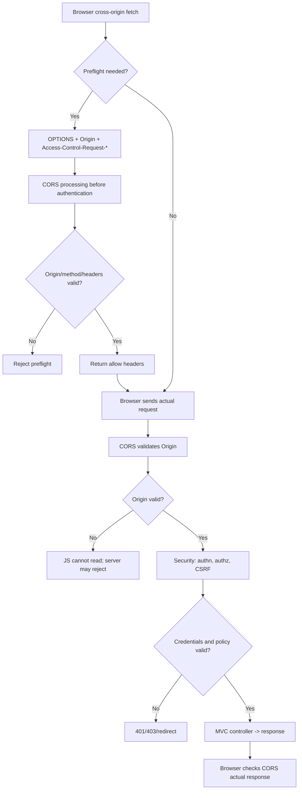

# CORS Blocked by the Browser Even Though Direct Endpoint Calls Succeed

> **Topic:** Diagnosing CORS errors on **Spring Security Servlet** (Spring MVC, Spring Boot 3.x, Spring Security 6.x). Symptom: calling the same URL with `curl`, Postman, or opening it directly in the address bar succeeds, yet JavaScript running from another origin is blocked from reading it by the browser, or `OPTIONS` preflight receives 401/403/redirect. This guide traces the request flow, configuring CORS before Spring Security authentication, and verifying with Java 17+, Spring Boot 3.3, MockMvc, DevTools, and curl.

## 1. Objectives

You will understand and be able to resolve:

1. **Same-origin policy**, the `scheme + host + port` components of an origin; why succeeding from a direct HTTP client does not prove browser `fetch` succeeds.
2. How an **actual request** differs from a **CORS preflight `OPTIONS`** request; which conditions typically trigger preflight.
3. Reading `Origin`, `Access-Control-Request-Method`, `Access-Control-Request-Headers` and response headers `Access-Control-Allow-Origin`, `-Methods`, `-Headers`, `-Credentials`, `-Max-Age`, and `Access-Control-Expose-Headers`.
4. Pinpointing causes of 401/403/redirects on preflight, missing ACAO on actual responses, origin mismatches, disallowed methods/headers, invalid wildcards with credentials, and proxy/CDN interference.
5. Configuring `SecurityFilterChain` with `CorsConfigurationSource` in the right place in a Spring Security Servlet application.
6. Separating CORS from **authentication**, **authorization**, **CSRF**, **`SameSite` cookies**, TLS/mixed content, and browser third-party cookie policies.
7. Writing automated tests for valid/invalid origins, credential-less `OPTIONS`, actual requests with/without credentials, and exposed headers.
8. Following a production runbook without disabling security or blindly reflecting `Origin`.

## 2. Why Does curl Get 200 While fetch Cannot Read the Data?

A frontend hosted at:

```text
https://app.example.test
```

calls an API:

```text
https://api.example.test/api/public/ping
```

Both addresses use HTTPS yet have **different hostnames**, so they are two different **origins**. Origin = **scheme + host + effective port**. Path, query, and fragment are not part of an origin.

| Frontend | Endpoint | Same Origin? |
| --- | --- | --- |
| `https://app.example.test` | `https://app.example.test/api/ping` | Yes. |
| `https://app.example.test` | `https://api.example.test/api/ping` | No: different host. |
| `http://localhost:5173` | `http://localhost:8080/api/ping` | No: different port. |
| `http://localhost:8080` | `https://localhost:8080/api/ping` | No: different scheme. |
| `https://app.example.test` | `https://app.example.test:443/api/ping` | Yes: 443 is the default HTTPS port. |
| `https://app.example.test` | `https://app.example.test:8443/api/ping` | No: different port. |

Browsers enforce the **same-origin policy** to restrict JavaScript from reading data across origins. **CORS (Cross-Origin Resource Sharing)** lets a server declare which origins may read responses from JavaScript.

Meanwhile, `curl` and Postman **are not subject to browser JavaScript read restrictions**. They can send requests and inspect HTTP status/body even when the response contains zero CORS headers. Opening an API URL in the address bar is **navigation**, not cross-origin `fetch` from a script; seeing JSON in a browser tab does not prove CORS works.

### Understanding CORS Error Messages

A DevTools error might read:

```text
Access to fetch at 'https://api.example.test/api/public/ping'
from origin 'https://app.example.test' has been blocked by
CORS policy: No 'Access-Control-Allow-Origin' header is present
on the requested resource.
```

This message **does not prove the controller failed to run**. The request may have reached the API and returned `200`, yet the browser refused to hand the body to JavaScript. JS sometimes sees only `TypeError: Failed to fetch` and cannot read the blocked response's status or body. DevTools Network can show further evidence.

**CORS is not authentication:** a user is not authorized merely because `Origin` matches. Nor does it block `curl` or bots; HTTP clients can forge the `Origin` header freely.

## 3. Actual Requests Without Preflight

A cross-origin `GET` using only CORS-safelisted methods and headers can go straight to an **actual request**:

```http
GET /api/public/ping HTTP/1.1
Host: api.example.test
Origin: https://app.example.test
Accept: */*
```

If the API allows that origin to read the response, it may return:

```http
HTTP/1.1 200 OK
Content-Type: text/plain
Access-Control-Allow-Origin: https://app.example.test
Vary: Origin

pong
```

If this response lacks `Access-Control-Allow-Origin`, even with HTTP `200` and body `pong`, the browser withholds the body from JavaScript on `https://app.example.test`. The failure can occur **after the server already did the work**.

A cross-origin `GET` does not always trigger an `OPTIONS` first. Preflight depends on method, headers, content type, and other Fetch rules; do not assume “one cross-origin request = two HTTP requests”.

## 4. What Is a CORS Preflight OPTIONS Request?

When frontend code intends to call an API with a non-CORS-safelisted method or header, the browser typically asks the server **first** using `OPTIONS`.

Suppose JavaScript intends to call:

```javascript
fetch("https://api.example.test/api/private/profile", {
  method: "GET",
  headers: {
    Authorization: "Bearer <access-token>"
  }
});
```

`<access-token>` is an illustrative placeholder; never place real tokens in source or logs. Because `Authorization` is not a safelisted request header, the browser typically sends:

```http
OPTIONS /api/private/profile HTTP/1.1
Host: api.example.test
Origin: https://app.example.test
Access-Control-Request-Method: GET
Access-Control-Request-Headers: authorization
```

The server may respond:

```http
HTTP/1.1 200 OK
Access-Control-Allow-Origin: https://app.example.test
Access-Control-Allow-Methods: GET
Access-Control-Allow-Headers: authorization
Access-Control-Allow-Credentials: true
Access-Control-Max-Age: 1800
Vary: Origin, Access-Control-Request-Method, Access-Control-Request-Headers
```

Either status 200 or 204 can be valid when satisfying the right CORS policy. Value ordering and exact sets in `Allow-Methods`/`Allow-Headers` depend on the processor; the lines above are examples.

If the browser accepts the preflight response, it **then sends the actual GET** with the `Authorization` header. Preflight is not login, issues no tokens, and **normally carries no user session cookies or HTTP authentication**. Therefore **do not force `OPTIONS` preflight requests through Basic/JWT authentication like actual requests**.

### Conditions Commonly Triggering Preflight

- Requests with `Authorization`, `X-Client-Trace`, or custom request headers.
- Methods `PUT`, `PATCH`, `DELETE`.
- `POST` with `Content-Type: application/json`.
- Other Fetch constraints depending on browser and API.

`GET`, `HEAD`, and `POST` are standard CORS-safelisted methods; `application/x-www-form-urlencoded`, `multipart/form-data`, and `text/plain` belong to content types that can be safelisted when meeting relevant constraints. Do not assume every POST triggers preflight, nor that no GET triggers preflight.

### Bare OPTIONS Is Not Automatically a Preflight

This command:

```bash
curl -i -X OPTIONS https://api.example.test/api/private/profile
```

**does not simulate a CORS preflight**, because it lacks at least `Origin` and `Access-Control-Request-Method`. Preflight tests must send the same headers a real browser sends; otherwise a 401/403/405 on a bare `OPTIONS` may be unrelated to the user's bug.

## 5. CORS in Spring Security Servlet: Processing Order Matters

In Spring MVC Servlet, a request traverses servlet filters, Spring Security `FilterChainProxy`/`SecurityFilterChain`, and then `DispatcherServlet`. If preflight is rejected by an authentication filter **before CORS is processed**, the browser stops at `OPTIONS` and never sends the actual request.



Typical configuration:

```java
return http
    .cors(Customizer.withDefaults())
    .authorizeHttpRequests(auth -> auth
        .requestMatchers("/api/public/**").permitAll()
        .requestMatchers("/api/private/**").authenticated()
        .anyRequest().denyAll())
    .httpBasic(Customizer.withDefaults())
    .build();
```

This is only a snippet inside `SecurityFilterChain`; the full example is in Section 8. `http.cors(...)` integrates CORS processing with Spring Security. An appropriate CORS policy source—such as a `CorsConfigurationSource` bean—is required.

### Why Permitting OPTIONS Alone Is Not Enough

```java
// NOT enough without proper CORS response headers.
.requestMatchers(HttpMethod.OPTIONS, "/**").permitAll()
```

This rule changes authorization yet **does not generate** `Access-Control-Allow-Origin`, `Allow-Methods`, or `Allow-Headers`. Preflight might bypass authentication and reach a controller, yet the browser still rejects it because the server omitted the CORS handshake. Prefer a CORS processor at the filter boundary and test behavior.

### Is `@CrossOrigin` on Controllers Enough?

`@CrossOrigin` operates in Spring MVC and is valid at controller scope. However, if Security blocks `OPTIONS` **before the request reaches MVC**, controller annotations cannot inform the filter of your origin policy. Spring Security can consume MVC CORS configuration when configured properly, yet in projects with multiple sources/chains/proxies, **a single explicit configuration source** is much easier to diagnose. Avoid stacking `@CrossOrigin`, `WebMvcConfigurer`, custom `CorsFilter`, security `cors`, and gateway headers without understanding precedence.

## 6. CORS, Authentication, Authorization, and CSRF Do Not Replace Each Other

| Layer | Question | Symptom on Failure |
| --- | --- | --- |
| CORS | Which origins' JS may consume cross-origin responses? | Browser blocks read / actual rejected; DevTools reports CORS. |
| Authentication | Did the user/client supply valid credentials? | 401 or login redirect per security entry point. |
| Authorization | Does the principal have permission for the endpoint/resource? | 403 when authenticated yet lacking permissions. |
| CSRF | Does an unsafe browser cookie/session action carry an anti-forgery token? | May 403 before reaching authorization or controller. |
| TLS/network | Are connection, certificate, DNS, and redirects secure and reachable? | Browser network/mixed-content/certificate errors; never solved by ACAO. |

An `OPTIONS` 401 does not mean a wrong password; preflight likely demanded authentication. An actual `GET` 401 after `OPTIONS` 200 does not prove CORS is broken; the frontend may have omitted credentials or sent an expired token. A `POST` 403 does not prove the origin is wrong; it may be CSRF.

**CORS does not prevent CSRF:** simple cross-origin requests can still reach the server and cause side effects even if the browser blocks JS from reading the response body. With cookie/session authentication, Spring Security CSRF must be evaluated and preserved for `POST`/`PUT`/`PATCH`/`DELETE`. Conversely, a pure Bearer-token API that does not rely on ambient credentials has a different CSRF threat model; never blindly copy `csrf.disable()` into session-based web apps.

### Credentials and Cookies

When frontend calls `fetch(url, { credentials: "include" })`, the CORS response must carry `Access-Control-Allow-Credentials: true` paired with **`Access-Control-Allow-Origin` set to a specific origin**, not a wildcard. Even so, valid CORS **does not guarantee cookies are sent**: `SameSite`, `Secure`, cookie type, browser third-party cookie restrictions, and HTTPS all still apply. Default `credentials: "same-origin"` does not send cross-origin cookies the way `include` allows. Never use CORS as a tool to “override” credential policies.

**Never embed raw Basic passwords or tokens in production JavaScript just to test CORS.** The demo below uses HTTP Basic to test the authorization filter independently, not to suggest hard-coding Basic credentials in real frontends.

## 7. Reading CORS Headers Accurately

| Header | Location | Meaning |
| --- | --- | --- |
| `Origin` | Request | Origin of the calling page; never trust it as client identity. |
| `Access-Control-Request-Method` | Preflight request | Method the browser intends to use in the actual request. |
| `Access-Control-Request-Headers` | Preflight request | Non-safelisted headers the browser wants to send. |
| `Access-Control-Allow-Origin` | Response | Origin allowed to read the response, or wildcard when valid. |
| `Access-Control-Allow-Methods` | Preflight response | Methods permitted by policy. |
| `Access-Control-Allow-Headers` | Preflight response | Request headers permitted by policy. |
| `Access-Control-Allow-Credentials` | Response | Enables credentialed CORS responses when appropriate; value `true`. |
| `Access-Control-Max-Age` | Preflight response | Suggested preflight cache duration, subject to browser limits. |
| `Access-Control-Expose-Headers` | Actual response | Non-safelisted response headers readable by JavaScript. |
| `Vary` | Response/cache | Signals caches that output depends on Origin/method/request headers. |

**Distinguish:** `Access-Control-Allow-Headers` lets clients **send request headers**; `Access-Control-Expose-Headers` lets JavaScript **read response headers**. They serve opposite directions.

Never return a comma-separated list of multiple origins in `Access-Control-Allow-Origin`. For credentialed responses, the server must return **the single specific matching origin** from the allowlist, not `*`.

### Wildcard Paired with Credentials Is a Classic Bug

```java
// WRONG for credentialed cross-origin requests:
cors.setAllowedOrigins(List.of("*"));
cors.setAllowCredentials(true);
```

Spring Framework can reject this configuration, and browsers refuse to expose credentialed responses carrying a wildcard ACAO to JS. Use an explicit allowlist instead:

```java
cors.setAllowedOrigins(List.of(
    "https://app.example.test",
    "https://admin.example.test"));
cors.setAllowCredentials(true);
```

`allowedOriginPatterns` can support patterns with credentials if needed, yet overly broad patterns widen the trust boundary dangerously; use them only after reviewing domain ownership, subdomain takeover risks, and tenant isolation.

## 8. Runnable Demo: Spring Boot 3.3 + Spring Security 6

This setup includes one public API and one private API, with a CORS policy permitting only `https://app.example.test`. The project uses **Java 17+, Maven, Spring Boot 3.3.0**, needing no database or real identity provider. Domain `example.test` is illustrative, **not a real server**. Locally, the API listens on `http://localhost:8080`; you can test `Origin` headers with curl/MockMvc before wiring a real frontend.

### 8.1. Project Structure

```text
cors-security-lab/
├── pom.xml
└── src/
    ├── main/
    │   ├── java/demo/cors/
    │   │   ├── CorsApplication.java
    │   │   ├── SecurityConfig.java
    │   │   └── DemoController.java
    │   └── resources/application.properties
    └── test/
        └── java/demo/cors/
            └── CorsSecurityTest.java
```

### 8.2. Maven pom.xml

```xml
<project xmlns="http://maven.apache.org/POM/4.0.0"
         xmlns:xsi="http://www.w3.org/2001/XMLSchema-instance"
         xsi:schemaLocation="http://maven.apache.org/POM/4.0.0 https://maven.apache.org/xsd/maven-4.0.0.xsd">
    <modelVersion>4.0.0</modelVersion>
    <parent>
        <groupId>org.springframework.boot</groupId>
        <artifactId>spring-boot-starter-parent</artifactId>
        <version>3.3.0</version>
        <relativePath/>
    </parent>
    <groupId>demo</groupId>
    <artifactId>cors-security-lab</artifactId>
    <version>0.0.1-SNAPSHOT</version>
    <properties>
        <java.version>17</java.version>
    </properties>
    <dependencies>
        <dependency>
            <groupId>org.springframework.boot</groupId>
            <artifactId>spring-boot-starter-web</artifactId>
        </dependency>
        <dependency>
            <groupId>org.springframework.boot</groupId>
            <artifactId>spring-boot-starter-security</artifactId>
        </dependency>
        <dependency>
            <groupId>org.springframework.boot</groupId>
            <artifactId>spring-boot-starter-test</artifactId>
            <scope>test</scope>
        </dependency>
        <dependency>
            <groupId>org.springframework.security</groupId>
            <artifactId>spring-security-test</artifactId>
            <scope>test</scope>
        </dependency>
    </dependencies>
    <build>
        <plugins>
            <plugin>
                <groupId>org.springframework.boot</groupId>
                <artifactId>spring-boot-maven-plugin</artifactId>
            </plugin>
        </plugins>
    </build>
</project>
```

**`src/main/resources/application.properties`:**

```properties
server.port=8080
```

**`src/main/java/demo/cors/CorsApplication.java`:**

```java
package demo.cors;

import org.springframework.boot.SpringApplication;
import org.springframework.boot.autoconfigure.SpringBootApplication;

@SpringBootApplication
public class CorsApplication {
    public static void main(String[] args) {
        SpringApplication.run(CorsApplication.class, args);
    }
}
```

### 8.3. SecurityFilterChain and CorsConfigurationSource

**`src/main/java/demo/cors/SecurityConfig.java`:**

```java
package demo.cors;

import java.util.List;
import org.springframework.context.annotation.Bean;
import org.springframework.context.annotation.Configuration;
import org.springframework.security.config.Customizer;
import org.springframework.security.config.annotation.web.builders.HttpSecurity;
import org.springframework.security.core.userdetails.User;
import org.springframework.security.core.userdetails.UserDetailsService;
import org.springframework.security.crypto.bcrypt.BCryptPasswordEncoder;
import org.springframework.security.crypto.password.PasswordEncoder;
import org.springframework.security.provisioning.InMemoryUserDetailsManager;
import org.springframework.security.web.SecurityFilterChain;
import org.springframework.web.cors.CorsConfiguration;
import org.springframework.web.cors.CorsConfigurationSource;
import org.springframework.web.cors.UrlBasedCorsConfigurationSource;

@Configuration
public class SecurityConfig {
    @Bean
    SecurityFilterChain securityFilterChain(HttpSecurity http)
            throws Exception {
        return http
            .cors(Customizer.withDefaults())
            .authorizeHttpRequests(auth -> auth
                .requestMatchers("/api/public/ping").permitAll()
                .requestMatchers("/api/private/profile").authenticated()
                .anyRequest().denyAll())
            .httpBasic(Customizer.withDefaults())
            // CSRF remains enabled by default; example uses GET only.
            .build();
    }

    @Bean
    CorsConfigurationSource corsConfigurationSource() {
        CorsConfiguration config = new CorsConfiguration();
        config.setAllowedOrigins(
            List.of("https://app.example.test"));
        config.setAllowedMethods(List.of("GET", "OPTIONS"));
        config.setAllowedHeaders(List.of(
            "Authorization", "Content-Type", "X-Client-Trace"));
        config.setExposedHeaders(List.of("X-Request-Id"));
        config.setAllowCredentials(true);
        config.setMaxAge(1800L);

        UrlBasedCorsConfigurationSource source =
            new UrlBasedCorsConfigurationSource();
        source.registerCorsConfiguration("/api/**", config);
        return source;
    }

    @Bean
    PasswordEncoder passwordEncoder() {
        return new BCryptPasswordEncoder();
    }

    @Bean
    UserDetailsService demoUsers(PasswordEncoder encoder) {
        return new InMemoryUserDetailsManager(
            User.withUsername("reader")
                .password(encoder.encode("reader-pass"))
                .roles("READER")
                .build());
    }
}
```

**Reading the configuration accurately:**

- `.cors(Customizer.withDefaults())` enables CORS handling integrated into the Spring Security Servlet chain.
- `CorsConfigurationSource` defines policy specifically for `/api/**`. If the frontend calls another path or a gateway rewrites paths, check **the path that the CORS source actually sees**.
- `allowedOrigins` contains **origins** without trailing slashes or paths. Rather than `*`, allow only trusted frontends.
- `allowedMethods` and `allowedHeaders` define preflight conditions. An allowed method/header **does not grant authorization** to access resources.
- `allowCredentials(true)` pairs with specific origins. Not all APIs need cross-origin credentials; enable only when the authentication contract requires it.
- `exposedHeaders` lets JS read `X-Request-Id`; it does not let the frontend send that header in requests (that is `allowedHeaders`).
- HTTP Basic and in-memory users are for demonstration only. Production uses proper auth providers and TLS; never store demo passwords in frontend code.
- The security chain still enforces authentication on `/api/private/profile`; a successful preflight never turns a private GET public.

### 8.4. Controller

**`src/main/java/demo/cors/DemoController.java`:**

```java
package demo.cors;

import org.springframework.http.ResponseEntity;
import org.springframework.security.core.Authentication;
import org.springframework.web.bind.annotation.GetMapping;
import org.springframework.web.bind.annotation.RestController;

@RestController
public class DemoController {
    @GetMapping("/api/public/ping")
    public ResponseEntity<String> ping() {
        return ResponseEntity.ok()
            .header("X-Request-Id", "req-demo-42")
            .body("pong");
    }

    @GetMapping("/api/private/profile")
    public String profile(Authentication authentication) {
        return "profile:" + authentication.getName();
    }
}
```

The controller does not handle preflight manually. The CORS processor runs first, and Spring Security blocks unauthenticated private requests before the controller is invoked.

## 9. MockMvc Tests: CORS and Security Together

**`src/test/java/demo/cors/CorsSecurityTest.java`:**

```java
package demo.cors;

import org.junit.jupiter.api.Test;
import org.springframework.beans.factory.annotation.Autowired;
import org.springframework.boot.test.autoconfigure.web.servlet.AutoConfigureMockMvc;
import org.springframework.boot.test.context.SpringBootTest;
import org.springframework.http.HttpHeaders;
import org.springframework.test.web.servlet.MockMvc;

import static org.hamcrest.Matchers.containsString;
import static org.springframework.security.test.web.servlet.request
    .SecurityMockMvcRequestPostProcessors.httpBasic;
import static org.springframework.test.web.servlet.request
    .MockMvcRequestBuilders.get;
import static org.springframework.test.web.servlet.request
    .MockMvcRequestBuilders.options;
import static org.springframework.test.web.servlet.result.MockMvcResultMatchers.content;
import static org.springframework.test.web.servlet.result.MockMvcResultMatchers.header;
import static org.springframework.test.web.servlet.result.MockMvcResultMatchers.status;

@SpringBootTest
@AutoConfigureMockMvc
class CorsSecurityTest {
    private static final String ORIGIN =
        "https://app.example.test";

    @Autowired
    MockMvc mvc;

    @Test
    void directGetWithoutOriginWorks() throws Exception {
        mvc.perform(get("/api/public/ping"))
            .andExpect(status().isOk())
            .andExpect(content().string("pong"))
            .andExpect(header().doesNotExist(
                HttpHeaders.ACCESS_CONTROL_ALLOW_ORIGIN));
    }

    @Test
    void allowedActualGetHasCorsHeaders() throws Exception {
        mvc.perform(get("/api/public/ping")
                .header(HttpHeaders.ORIGIN, ORIGIN))
            .andExpect(status().isOk())
            .andExpect(content().string("pong"))
            .andExpect(header().string(
                HttpHeaders.ACCESS_CONTROL_ALLOW_ORIGIN, ORIGIN))
            .andExpect(header().string(
                HttpHeaders.ACCESS_CONTROL_ALLOW_CREDENTIALS, "true"))
            .andExpect(header().string(
                HttpHeaders.ACCESS_CONTROL_EXPOSE_HEADERS,
                containsString("X-Request-Id")))
            .andExpect(header().string(
                "X-Request-Id", "req-demo-42"));
    }

    @Test
    void preflightSucceedsWithoutLogin() throws Exception {
        mvc.perform(options("/api/private/profile")
                .header(HttpHeaders.ORIGIN, ORIGIN)
                .header(HttpHeaders.ACCESS_CONTROL_REQUEST_METHOD, "GET")
                .header(HttpHeaders.ACCESS_CONTROL_REQUEST_HEADERS,
                    "authorization"))
            .andExpect(status().isOk())
            .andExpect(header().string(
                HttpHeaders.ACCESS_CONTROL_ALLOW_ORIGIN, ORIGIN))
            .andExpect(header().string(
                HttpHeaders.ACCESS_CONTROL_ALLOW_CREDENTIALS, "true"))
            .andExpect(header().string(
                HttpHeaders.ACCESS_CONTROL_ALLOW_METHODS,
                containsString("GET")))
            .andExpect(header().exists(
                HttpHeaders.ACCESS_CONTROL_ALLOW_HEADERS));
    }

    @Test
    void preflightFromUntrustedOriginDenied() throws Exception {
        mvc.perform(options("/api/private/profile")
                .header(HttpHeaders.ORIGIN,
                    "https://untrusted.example.test")
                .header(HttpHeaders.ACCESS_CONTROL_REQUEST_METHOD, "GET")
                .header(HttpHeaders.ACCESS_CONTROL_REQUEST_HEADERS,
                    "authorization"))
            .andExpect(status().isForbidden())
            .andExpect(header().doesNotExist(
                HttpHeaders.ACCESS_CONTROL_ALLOW_ORIGIN));
    }

    @Test
    void preflightWithUnknownHeaderDenied() throws Exception {
        mvc.perform(options("/api/public/ping")
                .header(HttpHeaders.ORIGIN, ORIGIN)
                .header(HttpHeaders.ACCESS_CONTROL_REQUEST_METHOD, "GET")
                .header(HttpHeaders.ACCESS_CONTROL_REQUEST_HEADERS,
                    "X-Not-Allowed"))
            .andExpect(status().isForbidden());
    }

    @Test
    void actualGetFromUntrustedOriginDenied() throws Exception {
        mvc.perform(get("/api/public/ping")
                .header(HttpHeaders.ORIGIN,
                    "https://untrusted.example.test"))
            .andExpect(status().isForbidden());
    }

    @Test
    void privateActualGetStillRequiresLogin() throws Exception {
        mvc.perform(get("/api/private/profile")
                .header(HttpHeaders.ORIGIN, ORIGIN))
            .andExpect(status().isUnauthorized())
            .andExpect(header().string(
                HttpHeaders.ACCESS_CONTROL_ALLOW_ORIGIN, ORIGIN));
    }

    @Test
    void privateGetWithValidCredentialWorks() throws Exception {
        mvc.perform(get("/api/private/profile")
                .header(HttpHeaders.ORIGIN, ORIGIN)
                .with(httpBasic("reader", "reader-pass")))
            .andExpect(status().isOk())
            .andExpect(content().string("profile:reader"))
            .andExpect(header().string(
                HttpHeaders.ACCESS_CONTROL_ALLOW_ORIGIN, ORIGIN));
    }

    @Test
    void wrongCredentialIsAuthenticationFailure() throws Exception {
        mvc.perform(get("/api/private/profile")
                .header(HttpHeaders.ORIGIN, ORIGIN)
                .with(httpBasic("reader", "wrong")))
            .andExpect(status().isUnauthorized());
    }
}
```

This is a full `@SpringBootTest` with `@AutoConfigureMockMvc`, so tests execute the application's security config; `httpBasic` sends a real Basic header through the filter/provider instead of mocking with `@WithMockUser`. The tests verify:

1. Requests without `Origin` access the public endpoint like a direct HTTP client; no ACAO required.
2. Actual requests from an allowed origin receive ACAO and exposed response headers.
3. **Preflight without Basic Authorization** succeeds—proving CORS runs before authentication.
4. Disallowed origins and disallowed headers are rejected by the CORS processor.
5. Private actual GETs still require credentials—**CORS does not disable authentication**.
6. Wrong passwords still yield 401 rather than turning into a CORS failure.

MockMvc tests **server-side policy and filter behavior**. It **does not run a real browser** and does not test cookie blocking, TLS, ingress redirects, or CDN caching. Issues appearing only at the public edge require browser/real HTTP testing outside MockMvc.

### Running the Project

Inside `cors-security-lab`:

```bash
mvn test
mvn spring-boot:run
```

Try public requests:

```bash
curl -i http://localhost:8080/api/public/ping
curl -i http://localhost:8080/api/public/ping \
  -H "Origin: https://app.example.test"
```

Both can return `200` and `pong`, yet only the request with an allowed `Origin` needs/receives CORS headers. Test preflight:

```bash
curl -i -X OPTIONS http://localhost:8080/api/private/profile \
  -H "Origin: https://app.example.test" \
  -H "Access-Control-Request-Method: GET" \
  -H "Access-Control-Request-Headers: authorization"
```

Expected success status (typically 200 in this Spring `CorsFilter` demo) and compatible headers:

```text
Access-Control-Allow-Origin: https://app.example.test
Access-Control-Allow-Methods: GET
Access-Control-Allow-Headers: authorization
Access-Control-Allow-Credentials: true
```

`Allow-Methods` may include additional configured methods and need not match the sample string verbatim. Test an actual private GET:

```bash
curl -i http://localhost:8080/api/private/profile \
  -H "Origin: https://app.example.test"
curl -i -u reader:reader-pass \
  http://localhost:8080/api/private/profile \
  -H "Origin: https://app.example.test"
```

The first returns 401, and the second returns 200 with body:

```text
profile:reader
```

`curl -i` lets you inspect response headers, yet **does not enforce CORS policy** like a browser.

## 10. Diagnosing with Chrome/Firefox DevTools

When users report CORS errors, a reliable sequence is:

### Step 1 — Determine the Frontend's Real Origin

In the application tab's Console:

```javascript
console.log(window.location.origin);
```

Example output:

```text
https://app.example.test
```

Compare against `allowedOrigins` by scheme, hostname, and port. Never include a trailing slash or path in an origin; `https://app.example.test/` is a URL with a slash, not a valid `Origin` header value.

### Step 2 — Open Network and Inspect the Real Requests

Observe:
- Did an `OPTIONS` request occur? (If the browser cached the preflight, it may not appear on the current call.)
- Did `OPTIONS` carry the expected `Origin`, `Access-Control-Request-Method`, and `Access-Control-Request-Headers`?
- Did `OPTIONS` return 200/204 or 301/302/401/403/404/405?
- Did an **actual request** appear after `OPTIONS`? If not, the failure is in preflight or networking.
- Did the actual request return 200/401/403/500? Do its response headers include ACAO/ACAC/Expose?
- Did the actual request headers include the `Authorization` or cookies expected by the app?
- Was the request redirected between HTTP/HTTPS, www/non-www, or to a login UI?

If Console reports only `TypeError: Failed to fetch`, do not assume the backend is down; Network may display the status and response headers that JavaScript is forbidden to access.

### Step 3 — Reproduce the Exact Preflight with curl

Target the exact public URL called by the browser:

```bash
curl -i -X OPTIONS "https://api.example.test/api/private/profile" \
  -H "Origin: https://app.example.test" \
  -H "Access-Control-Request-Method: GET" \
  -H "Access-Control-Request-Headers: authorization"
```

Do not run `curl -X OPTIONS` without CORS headers. When using DevTools **Copy as cURL**, strip credentials, cookies, `Authorization`, tokens, and PII before sharing or logging.

### Step 4 — Compare Against Effective CORS Policy

Check in order:
1. Which URL/path does the server actually see (are there proxy rewrites or a context path)?
2. Does `Origin` **match the allowlist exactly**?
3. Is the requested method permitted?
4. Are the requested headers permitted (e.g., `authorization`, `content-type`, `x-client-trace`)?
5. If credentials mode is `include`, is ACAO a specific origin and ACAC `true`?
6. Do both actual responses and error responses carry ACAO?

### Step 5 — Find Which Layer Actually Produced the Response

```text
Browser
  └─ CDN / WAF / reverse proxy
       └─ API gateway (auth, routing, rewrite)
            └─ Spring Boot Servlet filters
                 └─ Spring Security / MVC controller
```

If ingress returns 401/404 on `OPTIONS`, Spring Security in the app **never received the request**; editing `http.cors` in the app will not fix the public URL. If both the gateway and the app append ACAO, they can produce **duplicate headers** or invalid values. Pick one clear owner for CORS policy and verify at the public edge.

### Step 6 — Re-Verify in a Real Browser

After fixing, run the frontend from its **real origin** and check both preflight and actual calls. A 200 from curl is only partial evidence; the browser itself confirms JS can read the response, `credentials`/cookies work, and needed response headers are exposed.

## 11. Frontend fetch: Triggering a Controlled Preflight

This example calls the **public endpoint** and adds `X-Client-Trace` so the browser triggers a preflight (using no real passwords or tokens):

```javascript
async function checkApi() {
  const response = await fetch(
    "https://api.example.test/api/public/ping",
    {
      method: "GET",
      mode: "cors",
      headers: { "X-Client-Trace": "demo" }
    }
  );

  if (!response.ok) {
    throw new Error("HTTP " + response.status);
  }

  const body = await response.text();
  const requestId = response.headers.get("X-Request-Id");
  console.log(body, requestId);
}

checkApi().catch(error => console.error(error));
```

When running from `https://app.example.test`, the browser typically sends a preflight:

```http
OPTIONS /api/public/ping HTTP/1.1
Origin: https://app.example.test
Access-Control-Request-Method: GET
Access-Control-Request-Headers: x-client-trace
```

The demo's CORS policy allows this header, so the actual GET runs and JS can read `pong` along with `X-Request-Id` thanks to `Access-Control-Expose-Headers`.

**Never use `mode: "no-cors"` to “fix” the error:** the response becomes opaque, so JS still cannot read the body, status, or headers as intended. The real fix is making the server response satisfy CORS policy.

## 12. Tricky Failures: When OPTIONS Succeeds Yet Requests Are Still Blocked

### 12.1. Actual Response Missing ACAO

A gateway may answer `OPTIONS` properly yet omit CORS headers on `GET`/`POST`. The browser sends the actual request, the API returns 200, and JS still cannot read it. Inspect **both the actual response and the preflight**.

### 12.2. 401/403/500 Responses Lose CORS Headers

A custom filter or gateway may return an error response **before the CORS processor runs**; the browser reports a CORS error instead of exposing the status. Fix filter ordering or emit CORS headers at the layer generating the error. Never weaken authentication/authorization to turn errors into 200.

### 12.3. Duplicate ACAO or Multiple Origins in One Header

```http
Access-Control-Allow-Origin: https://app.example.test
Access-Control-Allow-Origin: https://another.example.test
```

Or a single header containing two comma-separated origins. Browsers reject this. Never return an origin list; when appropriate, **echo only the single matching allowed origin**. Check whether the app, proxy, and CDN are all writing the header.

### 12.4. CORS Cookies and Third-Party Cookie Restrictions

Preflight returns 200, yet the actual GET returns 401 because the browser omitted cookies due to `SameSite=Lax/Strict` or third-party cookie blocking. Adding ACAO/ACAC does not force cookies onto the wire. If cross-site cookies require `SameSite=None; Secure` and CSRF protection, verify with real browsers, identity providers, and gateways.

### 12.5. Redirects and Canonical URLs

`OPTIONS` receiving a 302 to a login page, another domain, or HTTP→HTTPS can fail preflight per browser/network rules. Call the canonical HTTPS endpoint directly, process preflight before auth, and avoid unnecessary redirects. Never rely on login cookies to authorize `OPTIONS`.

### 12.6. CDN Caching Wrong Origins

ACAO output can vary by `Origin`; handle `Vary: Origin`, `Access-Control-Request-Method`, and `Access-Control-Request-Headers` properly, and inspect **your CDN's cache key**. If origin A's response is cached and served to origin B, browsers can fail or policies can leak. `Access-Control-Max-Age` caches preflight only—**never user authentication**.

### 12.7. HTTPS and Mixed Content

An HTTPS page calling an HTTP API can be blocked by mixed-content rules before CORS even runs. Invalid certificates, DNS failures, and connection resets can also surface in JS as similar network errors. Never “fix” these by opening an origin wildcard; fix HTTPS, certificates, and URLs.

### 12.8. Unable to Read Custom Response Headers

If the body is readable yet `response.headers.get("X-Request-Id")` returns `null`, the header is likely missing from `Access-Control-Expose-Headers`. That is **not** a reason to open `Access-Control-Allow-Headers` to everything.

## 13. Anti-Patterns to Avoid

| Wrong Fix | Why It Is Wrong | Right Approach |
| --- | --- | --- |
| `allowedOrigins("*")` + `allowCredentials(true)` | Invalid for credentialed CORS; rejected by framework/browser. | Explicit origin allowlist + ACAC when needed. |
| Reflecting any `Origin` into ACAO | Lets attacker sites read cross-origin data when cookies/sessions apply. | Server-side origin allowlist plus tenant/resource controls. |
| `anyRequest().permitAll()` to make OPTIONS work | Strips authentication from private endpoints. | Process CORS preflight before auth; keep actual requests authenticated. |
| `OPTIONS /** permitAll` without ACAO | Browser still gets no CORS allow response. | Enable `http.cors` and configure policy. |
| Disabling CSRF on all URLs | Increases risk for cookie/session web routes. | Evaluate CSRF per security chain and credential model. |
| `fetch(..., {mode:"no-cors"})` | Response becomes opaque; JS cannot read body. | Fix CORS at the server source. |
| `@CrossOrigin("*")` on every controller | Does not cover filters/gateways/401 paths; widens trust excessively. | Centralized policy, tested through the filter chain. |
| Testing only `curl GET` without `Origin` | Does not reproduce browser preflight or actual CORS. | Test `curl` with `Origin` + `ACR` headers and browser tests. |
| Setting ACAO manually inside controllers | `OPTIONS`/errors may be blocked earlier; risks duplicate headers. | CORS processor before security; single policy owner. |
| Allowing arbitrary subdomains unchecked | Risks subdomain takeover or untrusted tenant origins. | Exact allowlists; patterns only after domain ownership review. |
| Treating every 403 as CORS | CSRF, authorization, and gateways also return 403. | Identify exact filter or response stage. |
| Enabling debug logs of raw HTTP headers | Leaks credentials, tokens, cookies, and PII. | Log sanitized request IDs/outcomes; disable debug afterward. |

### An Origin Is Not a Full URL

```text
Wrong: https://app.example.test/
Wrong: https://app.example.test/dashboard
Wrong: http://app.example.test (if the real frontend uses https)
Right: https://app.example.test
```

When a local frontend runs on `http://localhost:5173`, the server must allow that exact origin (per environment), not `http://localhost:8080` merely because the API runs on port 8080.

## 14. Advanced Testing: Negative Paths and Multiple Security Chains

With two chains:

```text
@Order(1) securityMatcher("/api/**") -> API Bearer
@Order(2) securityMatcher("/web/**") -> session/form login
```

each path requires the CORS and CSRF policies of the chain that actually selects it. A `CorsConfigurationSource` registered only for `/api/**` does not apply to `/web/**`; that may be right by design yet must be tested. `securityMatcher` selects the **chain**; `authorizeHttpRequests` sets **permissions inside the chain**.

Test matrix:

| Request | Expectation |
| --- | --- |
| Public GET without `Origin` | 200; no ACAO needed. |
| Public GET with allowed `Origin` | 200 + matching ACAO. |
| `OPTIONS` valid `Origin`/method/header | 200/204 + CORS allow headers; no login required. |
| `OPTIONS` disallowed `Origin` | CORS rejects; JS blocked from sending actual request. |
| `OPTIONS` disallowed method/header | CORS rejects / omits disallowed method/header. |
| Private GET missing credentials | 401 yet appropriate CORS headers for valid `Origin`. |
| Private GET valid credentials | 200 + ACAO. |
| Private GET wrong credentials | 401; CORS success does not imply auth success. |
| Browser cookie POST missing CSRF | CSRF can block with 403 even when CORS is valid. |
| 500 response from proxy | Investigate upstream and CORS headers on proxy error responses. |
| Allowed `Origin` through CDN | ACAO not mis-cached and no duplicate headers. |
| Frontend JS reads custom header | Header listed in `Expose-Headers`. |

When security filters are disabled in MockMvc (`@AutoConfigureMockMvc(addFilters=false)`), tests can return 200 while bypassing both CORS and authentication. **Never use such tests to claim the CORS security pipeline works**. Use `@SpringBootTest` with `@AutoConfigureMockMvc` as in the demo, or configure the filter chain explicitly.

## 15. Ordered Production Debugging Runbook

1. **Gather minimal facts:** frontend origin, API URL, method, requested headers, browser/network error, request ID. Never collect raw `Authorization`/cookies/tokens.
2. **Inspect DevTools Network:** `OPTIONS` first or actual; response statuses, headers, redirects; did actual run?
3. **Reproduce preflight cleanly:** `curl` with `Origin`, `Access-Control-Request-Method`, and `-Headers` against the **public URL**.
4. **Inspect actual response:** are ACAO/ACAC/Expose-Headers present on both 200 and error responses when policy permits?
5. **Compare effective config:** origin/method/headers, URL pattern, active Spring Security chain, `http.cors`, custom filter registrations.
6. **Pinpoint who blocked it:** app, WAF, ingress, gateway, CDN; did `OPTIONS` ever reach the app?
7. **Separate auth from CORS:** preflight 200 yet actual 401 → credentials/session; POST 403 → check CSRF or authorization; network fail → TLS/DNS/redirects.
8. **Fix at the right layer:** never disable security or reflect arbitrary `Origin`; allow only required origins, methods, and headers.
9. **Run regression tests:** allowed/disallowed origins, preflight, actual auth 401/200, error paths, and exposed headers.
10. **Verify in a real browser:** from the permitted frontend origin, confirm JS reads the post-deploy response, preflight cache behavior, and cookie constraints.

In test environments, you can temporarily enable logging:

```properties
logging.level.org.springframework.security=DEBUG
logging.level.org.springframework.web.cors=DEBUG
```

Use it to locate filter decisions, yet **never** print raw `Authorization` headers, cookies, passwords, tokens, or PII into logs or issue trackers. When CORS rejects before the controller, application business logs may not appear; inspect filter and edge logs.

## 16. Self-Check Questions

**1. Why does Postman return 200 while JavaScript is blocked?**

Postman does not enforce the browser same-origin policy. CORS requires valid response headers for the frontend origin's scripts; an endpoint returning 200 is not enough.

**2. Does `OPTIONS` 401 prove the user entered the wrong password?**

No. CORS preflight usually carries no credentials, so the failure likely means security demanded authentication before CORS ran. Move CORS processing ahead of authentication.

**3. Can we add `OPTIONS /** permitAll` and stop there?**

No. Browsers still require ACAO/ACAM/ACAH on preflight responses; an authorization rule does not generate those headers.

**4. Is `credentials: include` paired with ACAO `*` valid?**

No. ACAO must be a specific origin and `Access-Control-Allow-Credentials: true` when permitted.

**5. Does a 200 preflight make a private API public?**

No. The actual request still passes through authentication and authorization. CORS is a browser check, not an authentication bypass.

**6. Does `OPTIONS` always precede every cross-origin GET?**

No. A GET with safelisted headers may skip preflight. `Authorization` or custom headers typically trigger `OPTIONS`.

**7. A POST without a CSRF token returns 403—is CORS broken?**

Not necessarily. The CSRF filter and CORS are distinct layers; check whether preflight/actual CORS already succeeded and which filter emitted 403.

**8. Does `mode:"no-cors"` solve reading JSON?**

No. The response becomes opaque, preventing JS from reading the intended JSON, status, or headers.

**9. Is returning two ACAOs from both the app and the gateway better?**

No. Multiple ACAO values can cause browsers to reject the response. Establish one policy owner and ensure valid headers.

**10. Why check 401/403/500 responses?**

Because error responses produced by a filter or gateway can lack ACAO even when 200 responses have it. Browsers will report CORS instead of letting JS see the underlying error.

## 17. Conclusion and Short Checklist

- Origin is scheme + host + port. **curl/Postman/browser address-bar navigation do not test CORS like `fetch`.**
- Browsers may send **preflight `OPTIONS` before the actual request** when method/headers/content-type require it; `OPTIONS` usually carries no user credentials.
- **Spring Security Servlet:** integrate `http.cors(Customizer.withDefaults())` with `CorsConfigurationSource` or an explicit MVC CORS source so preflight runs before authentication.
- Compare `Origin`, requested method/headers, and ACAO/ACAM/ACAH/ACAC on **both preflight and actual responses**; inspect URL/port/scheme/path and proxy rewrites.
- CORS never replaces authentication, authorization, CSRF, TLS, or cookies. Never “fix CORS” by calling `permitAll` on private endpoints or disabling browser security.
- For credentialed cross-origin responses, **ACAO must be a specific origin**, and ACAC set appropriately per policy; never use `*` or reflect unchecked origins.
- Minimum tests: public GET without `Origin`, actual GET with allowed/disallowed `Origin`, `OPTIONS` with valid/invalid `Origin`/method/header, private GET 401/200, exposed headers, and tests via the public gateway/browser.
- Remember **MockMvc verifies server-side behavior**, whereas browser DevTools confirms real users can read responses under CORS policy.

**Diagnostic model:** identify **which request fails** → inspect **`Origin`/method/request headers/credential mode** → locate **which layer produced the response** → read **CORS headers on both preflight and actual responses** → fix **the exact policy/ordering/URL** without unintentionally loosening data access.