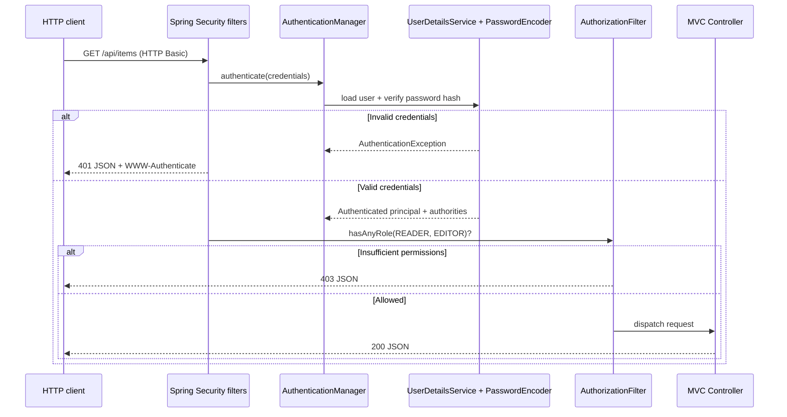
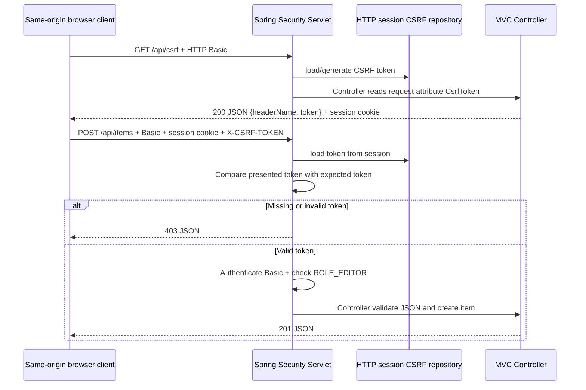

# REST API with HTTP Basic, JSON Responses, and Explained CSRF Policy

> **Module:** Spring Security — Servlet. **Integrated practice:** build a Spring Boot 3.3.0 / Spring Security 6.x / Java 17+ REST API using **HTTP Basic**, returning consistent **JSON** for both success and security error cases (401, 403), with **role-based authorization**, validation, and an **explicit CSRF policy**. Uses Maven, MockMvc, and `curl`, with no external database or identity server required.

## 1. Learning Outcomes

After completing this practice, you can:

1. Explain the HTTP Basic mechanism: `Authorization: Basic ...` header, Base64 is not encryption, `WWW-Authenticate`, mandatory HTTPS, credential verification via `AuthenticationManager`/`UserDetailsService`, and how Spring Security establishes `SecurityContext`.
2. Design a REST JSON contract: `200/201` for success, `400` for validation, `401` when unauthenticated/failed auth, `403` when missing permission or CSRF fails; without leaking passwords, tokens, or sensitive details in error messages.
3. Explain why `permitAll()`, `authenticated()`, `hasRole(...)`, and `SecurityFilterChain` each serve distinct roles.
4. Explain **CSRF** based on whether the browser automatically attaches credentials; HTTP Basic in a browser can also act as an **ambient credential** cached and resent by the browser. Do not confuse "JSON API" with "automatically exempt from CSRF".
5. Keep CSRF enabled in an example accessed by browser users, provide a token-issuing endpoint, perform POST with a session-bound CSRF token, and test both missing and invalid token cases.
6. Know when disabling CSRF **can be considered** for a purely non-browser, stateless API using explicitly attached per-request credentials; understand the risks of blindly copying `csrf.disable()`.
7. Use `AuthenticationEntryPoint`, `AccessDeniedHandler`, and `CsrfFilter` configuration for **consistent JSON responses** even when a filter blocks a request before the controller.
8. Write MockMvc tests using `httpBasic()` to verify the **demo's real credentials**, `csrf()` to test CSRF, and JSON/header response assertions.

## 2. Context and HTTP Contract of the Example

The API has two demo accounts:
- `reader` / `reader-pass` with `ROLE_READER`.
- `editor` / `editor-pass` with `ROLE_EDITOR`.

Endpoints used:

| Method/path | Policy | Success |
| --- | --- | --- |
| `GET /api/public/ping` | Public | `200` and JSON `{"message":"pong"}`. |
| `GET /api/items` | Authenticated, role `READER` or `EDITOR` | `200`, JSON list of items. |
| `POST /api/items` | Role `EDITOR` **and valid CSRF token** | `201`, newly created item as JSON. |
| `GET /api/csrf` | Authenticated | `200`, JSON containing the CSRF header name and token for the current session. |
| Other paths | `denyAll` | Blocked per security policy. |

These accounts/passwords are **lab data**, not a production user provisioning method. Use TLS/HTTPS for all Basic requests outside localhost; never hardcode credentials in a production frontend.

### Expectation Matrix

| Scenario | HTTP status | JSON error/body |
| --- | --- | --- |
| Public ping, anonymous | 200 | `{"message":"pong"}` |
| GET items, no credentials | 401 | `error=unauthorized` |
| GET items, wrong Basic password | 401 | `error=unauthorized` |
| GET items, valid reader Basic | 200 | JSON list |
| POST items, reader, **valid CSRF** | 403 | `error=forbidden` (missing role) |
| POST items, editor, **missing CSRF** | 403 | `error=forbidden` (CSRF) |
| POST items, editor, **invalid CSRF** | 403 | `error=forbidden` (CSRF) |
| POST items, editor, **valid CSRF** | 201 | JSON new item |
| POST items, editor, valid CSRF but blank `name` | 400 | `error=bad_request` |
| GET CSRF, authenticated editor | 200 | JSON containing `headerName` and `token` |

Do not attribute every `403` to "missing role": `CsrfFilter` can return 403 **before** the `hasRole` rule is even evaluated.

## 3. HTTP Basic Mechanism

HTTP Basic defines how a client sends a username-and-password credential pair:

```http
GET /api/items HTTP/1.1
Host: localhost:8080
Authorization: Basic <base64(username:password)>
```

The part after `Basic` is Base64 of `username:password`—it is **not encryption** and **not a signed token**. Anyone who captures the header can decode it back into credentials. **Only use Basic over HTTPS** across real networks. Never put Basic headers/cookies/tokens in application logs, reverse-proxy access logs, bug reports, or screenshots.

If an endpoint requires auth and no valid credential is provided, the server typically returns:

```http
HTTP/1.1 401 Unauthorized
WWW-Authenticate: Basic realm="demo-api", charset="UTF-8"
Content-Type: application/json;charset=UTF-8
Cache-Control: no-store

{"status":401,"error":"unauthorized","message":"Authentication required"}
```

The `WWW-Authenticate` header describes the HTTP Basic challenge. It can cause some browsers to show a native login dialog when hitting the URL directly; for SPAs, pick an appropriate authentication mechanism rather than trying to suppress UI dialogs by weakening security.

When the client sends credentials, `BasicAuthenticationFilter` passes the authentication request through `AuthenticationManager`/providers. With `DaoAuthenticationProvider`, the provider uses `UserDetailsService` to look up the user and `PasswordEncoder` to verify the password hash; the request's SecurityContext then holds the authenticated `Authentication`. Authorization then decides whether the user has the required role.



This is a conceptual diagram of a Basic request. A public request does not always trigger an authentication attempt; filters, CSRF, multiple chains, or other entry points can alter the flow.

### 401 and 403 Are Different

**401 Unauthorized** in HTTP actually represents missing or failed authentication. The server sends a Basic challenge if it wants the client to supply credentials. **403 Forbidden** usually means the user is already authenticated but lacks permission, or the request was rejected by a filter such as CSRF. Do not turn every error into 200 with JSON `{"success":false}`: that breaks HTTP client, reverse proxy, monitoring, and security test contracts.

## 4. JSON Responses Must Be Produced at the Right Layer

The sample returns JSON for:

- Success: Jackson serializes `Map`, `record`, and `List` from the MVC controller.
- Input validation (`400`): `@RestControllerAdvice`/`@ExceptionHandler`.
- Authentication failure (`401`): `AuthenticationEntryPoint` in the filter chain.
- Authorization denied (`403`): `AccessDeniedHandler`.
- CSRF failure (`403`): `CsrfFilter` with a custom `AccessDeniedHandler`.

### Why Isn't @RestControllerAdvice Enough for 401/403?

`@RestControllerAdvice` handles exceptions routed into **Spring MVC exception resolution**. Security filters execute **before DispatcherServlet** and can block the request directly without forwarding the exception to MVC advice. Therefore, writing an `@ExceptionHandler(AccessDeniedException.class)` in controller advice **does not guarantee** that every filter-level HTTP 403/401 produces JSON.

Handlers must be registered at the **corresponding security filter point**. This example produces a uniform JSON format while keeping the 401/403 status codes intact. The response body intentionally **does not return the exception message**, because exception messages can leak account identifiers, authentication provider details, or internal policy.

### Sample Error JSON

```json
{
  "status": 403,
  "error": "forbidden",
  "message": "Access denied"
}
```

When CSRF is missing, the same JSON status format can be returned for a consistent API contract. Internally, the server should log appropriate reason codes and metrics to distinguish `csrf_missing`, `csrf_invalid`, and `insufficient_authority`; detailed reasons do not need to be exposed to anonymous clients.

## 5. CSRF: Why REST JSON + HTTP Basic Is Not Exempt by Default

**Cross-Site Request Forgery (CSRF)** occurs when an attacker tricks a user's browser into making a request to a site/application where the browser **automatically attaches credentials**. The server sees valid credentials, yet the action was not intended by the account owner.

A scenario:

1. The user has logged in / sent HTTP Basic to `https://api.example.test`, and the browser may store/resend Basic credentials based on its protection space or authentication cache.
2. The user visits an attacker's page at `https://untrusted.example.test`.
3. The attacker's page triggers a state-changing request to the API; depending on the request type, the browser may automatically attach the API's credentials.
4. If the server only checks that the user is logged in and lacks proper CSRF defense, the operation can execute even though the attacker cannot read the response.

**HTTP Basic is not automatically exempt from CSRF just because it does not use cookies.** With browser-managed authentication state, Basic credentials can behave as ambient credentials. Similarly, a JSON-based SPA is not inherently safer if the app relies on cookies/sessions.

### Does CORS Solve CSRF?

**No.** CORS controls whether cross-origin JavaScript can read the response, along with certain preflight conditions; it does not prove that a cross-site state-changing request was authorized by the account owner. Some cross-site requests can still **be sent** even when the attacker cannot read the response. Thus CORS, SameSite, and CSRF tokens are distinct controls that must be evaluated independently.

### Two Contexts to Distinguish

| Context | Credential source | CSRF risk to consider | Approach |
| --- | --- | --- | --- |
| Browser, session cookie | Browser attaches cookie automatically | High if unsafe actions lack CSRF protection. | Enable CSRF + proper token, SameSite/Secure, origin checks. |
| Browser, cached HTTP Basic | Browser may auto-send Basic | CSRF surface still exists depending on browser behavior. | Do not disable CSRF just for Basic; test real browser behavior. |
| Backend-to-backend, per-request HTTP Basic | Client program intentionally sets Authorization | No "tricked user" via typical browser mechanics. | Can separate a pure non-browser API chain with a proven CSRF policy and clear threat model. |
| API using Bearer token from JS, only in app-set Authorization header | Not auto-sent like cookies unless app sets it | CSRF is usually less relevant; XSS/token theft is the primary risk. | Can consider stateless and CSRF exemption on the right chain; still protect against XSS and secure credential storage. |
| App using both cookie session and bearer | Has both ambient and explicit credentials | Cannot assume the whole API is safe from CSRF. | Split chains/paths, require tokens on cookie flows, test all entry points. |

**Demo decision:** keep **CSRF ON by default** for `POST /api/items`, using Spring Security's default `HttpSessionCsrfTokenRepository` to store the CSRF token in the HTTP session. `GET /api/csrf` forces token generation and returns JSON so same-origin clients can retrieve the token. This is an explicit example of a browser-usable Basic API, **not** a purely stateless API template.

## 6. CSRF Token, Session, and Request Flow



This diagram simplifies the ordering of certain filters. In practice, `CsrfFilter` can block a POST missing a token **before** Basic authentication runs; therefore, an anonymous POST without a token can also receive 403. To test roles/credentials independently, send a valid CSRF token first and then inspect the status.

**Binding:** with the default HttpSession-based CSRF repository, the token is tied to the session. Sending a token obtained from session A alongside cookie/session B will be rejected. Spring Security 6 uses deferred CSRF tokens and BREACH protection via the request attribute token handler, so do not manually compare the JSON value against a stored token in tests; follow the framework-provided flow.

### SameSite Cookies Do Not Replace CSRF Tokens

`SameSite=Lax` or `Strict` helps restrict certain cross-site cookie transmissions, but it is not a universal shield in all contexts, especially with redirects, same-site cross-origin setups, browser quirks, or configuration changes. A CSRF token for unsafe methods is an independent defense. If using `SameSite=None; Secure` for cross-site cookies, CSRF protection must be evaluated even more carefully.

### When Can csrf().disable() Be Justified?

Only for a **strictly scoped security chain**, such as a backend-to-backend API that does not use cookies/sessions and **does not** accept browser-managed ambient credentials, where credentials are attached intentionally by a real client. The decision depends on the threat model, not on whether a class is named "RestController" or returns JSON. With HTTP Basic used from browsers, **stateless does not automatically eliminate CSRF risk** if the browser resends cached Basic credentials.

Section 14 shows a conditional variant. The main example **does not disable CSRF**.

## 7. Java 17 + Spring Boot 3.3 Project Structure

```text
basic-json-csrf-lab/
├── pom.xml
└── src/
    ├── main/
    │   ├── java/demo/basic/
    │   │   ├── BasicApiApplication.java
    │   │   ├── SecurityConfig.java
    │   │   ├── JsonErrors.java
    │   │   ├── ApiError.java
    │   │   ├── ItemService.java
    │   │   ├── ItemController.java
    │   │   └── JsonValidationAdvice.java
    │   └── resources/application.properties
    └── test/
        └── java/demo/basic/
            └── BasicApiSecurityTest.java
```

All files are in package `demo.basic` so `@SpringBootApplication` component scanning discovers the beans. The project runs with Maven once dependencies are downloaded; no external DB is required, though an embedded HTTP server runs for the local lab.

### 7.1. pom.xml

```xml
<project xmlns="http://maven.apache.org/POM/4.0.0"
         xmlns:xsi="http://www.w3.org/2001/XMLSchema-instance"
         xsi:schemaLocation="http://maven.apache.org/POM/4.0.0 https://maven.apache.org/xsd/maven-4.0.0.xsd">
    <modelVersion>4.0.0</modelVersion>
    <parent>
        <groupId>org.springframework.boot</groupId>
        <artifactId>spring-boot-starter-parent</artifactId>
        <version>3.3.0</version>
        <relativePath/>
    </parent>
    <groupId>demo</groupId>
    <artifactId>basic-json-csrf-lab</artifactId>
    <version>0.0.1-SNAPSHOT</version>
    <properties>
        <java.version>17</java.version>
    </properties>
    <dependencies>
        <dependency>
            <groupId>org.springframework.boot</groupId>
            <artifactId>spring-boot-starter-web</artifactId>
        </dependency>
        <dependency>
            <groupId>org.springframework.boot</groupId>
            <artifactId>spring-boot-starter-security</artifactId>
        </dependency>
        <dependency>
            <groupId>org.springframework.boot</groupId>
            <artifactId>spring-boot-starter-validation</artifactId>
        </dependency>
        <dependency>
            <groupId>org.springframework.boot</groupId>
            <artifactId>spring-boot-starter-test</artifactId>
            <scope>test</scope>
        </dependency>
        <dependency>
            <groupId>org.springframework.security</groupId>
            <artifactId>spring-security-test</artifactId>
            <scope>test</scope>
        </dependency>
    </dependencies>
    <build>
        <plugins>
            <plugin>
                <groupId>org.springframework.boot</groupId>
                <artifactId>spring-boot-maven-plugin</artifactId>
            </plugin>
        </plugins>
    </build>
</project>
```

`spring-security-test` is required for `httpBasic()` and `csrf()` in MockMvc. `spring-boot-starter-validation` provides `@NotBlank` and `@Valid`.

### 7.2. Application and Port Configuration

**`src/main/resources/application.properties`**

```properties
server.port=8080
```

**`src/main/java/demo/basic/BasicApiApplication.java`**

```java
package demo.basic;

import org.springframework.boot.SpringApplication;
import org.springframework.boot.autoconfigure.SpringBootApplication;

@SpringBootApplication
public class BasicApiApplication {
    public static void main(String[] args) {
        SpringApplication.run(BasicApiApplication.class, args);
    }
}
```

## 8. JSON Error Contract: Shared Object and Writer

**`src/main/java/demo/basic/ApiError.java`**

```java
package demo.basic;

public record ApiError(int status, String error, String message) {
}
```

A record for Jackson to serialize into JSON with `status`, `error`, and `message` fields. Do not include stacktraces or exception details in public responses.

**`src/main/java/demo/basic/JsonErrors.java`**

```java
package demo.basic;

import com.fasterxml.jackson.databind.ObjectMapper;
import jakarta.servlet.http.HttpServletResponse;
import java.io.IOException;
import java.nio.charset.StandardCharsets;
import org.springframework.http.HttpHeaders;
import org.springframework.http.MediaType;

public final class JsonErrors {
    private JsonErrors() {
    }

    public static void write(
            HttpServletResponse response,
            ObjectMapper mapper,
            int status,
            String error,
            String message) throws IOException {
        response.setStatus(status);
        response.setCharacterEncoding(StandardCharsets.UTF_8.name());
        response.setContentType(MediaType.APPLICATION_JSON_VALUE);
        response.setHeader(HttpHeaders.CACHE_CONTROL, "no-store");
        mapper.writeValue(
            response.getOutputStream(),
            new ApiError(status, error, message));
    }
}
```

**Why use ObjectMapper:** avoid building JSON via string concatenation, prevent escaping bugs, and ensure a consistent contract. Clients should rely on `status`/`error`, while `message` may change across versions. `Cache-Control: no-store` on security errors reduces the risk of sensitive responses being cached; the CSRF endpoint below also sets no-store.

## 9. SecurityFilterChain Configuration: Basic, 401 JSON, 403 JSON, CSRF

**`src/main/java/demo/basic/SecurityConfig.java`**

```java
package demo.basic;

import com.fasterxml.jackson.databind.ObjectMapper;
import org.springframework.context.annotation.Bean;
import org.springframework.context.annotation.Configuration;
import org.springframework.http.HttpHeaders;
import org.springframework.http.HttpMethod;
import org.springframework.security.config.Customizer;
import org.springframework.security.config.annotation.ObjectPostProcessor;
import org.springframework.security.config.annotation.web.builders.HttpSecurity;
import org.springframework.security.core.userdetails.User;
import org.springframework.security.core.userdetails.UserDetailsService;
import org.springframework.security.crypto.bcrypt.BCryptPasswordEncoder;
import org.springframework.security.crypto.password.PasswordEncoder;
import org.springframework.security.provisioning.InMemoryUserDetailsManager;
import org.springframework.security.web.AuthenticationEntryPoint;
import org.springframework.security.web.SecurityFilterChain;
import org.springframework.security.web.access.AccessDeniedHandler;
import org.springframework.security.web.csrf.CsrfFilter;

@Configuration
public class SecurityConfig {
    @Bean
    SecurityFilterChain securityFilterChain(
            HttpSecurity http,
            ObjectMapper mapper) throws Exception {

        AuthenticationEntryPoint unauthorized =
            (request, response, exception) -> {
                response.setHeader(HttpHeaders.WWW_AUTHENTICATE,
                    "Basic realm=\"demo-api\", charset=\"UTF-8\"");
                JsonErrors.write(response, mapper, 401,
                    "unauthorized", "Authentication required");
            };

        AccessDeniedHandler forbidden =
            (request, response, exception) ->
                JsonErrors.write(response, mapper, 403,
                    "forbidden", "Access denied");

        return http
            .authorizeHttpRequests(auth -> auth
                .requestMatchers(
                    HttpMethod.GET, "/api/public/ping").permitAll()
                .requestMatchers(
                    HttpMethod.GET, "/api/csrf").authenticated()
                .requestMatchers(
                    HttpMethod.GET, "/api/items")
                    .hasAnyRole("READER", "EDITOR")
                .requestMatchers(
                    HttpMethod.POST, "/api/items")
                    .hasRole("EDITOR")
                .anyRequest().denyAll())
            .httpBasic(basic ->
                basic.authenticationEntryPoint(unauthorized))
            .exceptionHandling(ex -> ex
                .authenticationEntryPoint(unauthorized)
                .accessDeniedHandler(forbidden))
            .csrf(csrf -> csrf
                .withObjectPostProcessor(
                    new ObjectPostProcessor<CsrfFilter>() {
                        @Override
                        public <O extends CsrfFilter> O postProcess(
                                O filter) {
                            filter.setAccessDeniedHandler(forbidden);
                            return filter;
                        }
                    }))
            .build();
    }

    @Bean
    PasswordEncoder passwordEncoder() {
        return new BCryptPasswordEncoder();
    }

    @Bean
    UserDetailsService demoUsers(PasswordEncoder encoder) {
        return new InMemoryUserDetailsManager(
            User.withUsername("reader")
                .password(encoder.encode("reader-pass"))
                .roles("READER")
                .build(),
            User.withUsername("editor")
                .password(encoder.encode("editor-pass"))
                .roles("EDITOR")
                .build());
    }
}
```

**Step-by-step analysis:**

1. `requestMatchers` defines explicit policies by **method + path**. `GET /api/public/ping` is public; `GET /api/items` requires reader/editor; `POST /api/items` requires editor. Other HTTP methods are not implicitly permitted just because GET on the same path is permitted.
2. `httpBasic(...)` enables HTTP Basic and attaches the JSON entry point for **invalid credentials**; `exceptionHandling(...)` uses the same entry point for blocked anonymous access and the access-denied handler for missing roles.
3. When returning 401, the JSON writer **never exposes exception.getMessage()** to the client. The `WWW-Authenticate` header preserves the HTTP Basic challenge.
4. `.csrf(...)` **does not disable** CSRF. It attaches an `ObjectPostProcessor<CsrfFilter>` to replace the access-denied handler on `CsrfFilter` itself, ensuring missing/invalid CSRF responses also return **403 JSON**, rather than relying on the default `sendError`.
5. `CsrfFilter` can run before the Basic authentication filter; on a POST missing both CSRF and credentials, the 403 cause can be CSRF rather than "user authenticated but lacking role".
6. `BCryptPasswordEncoder` hashes both demo users' passwords before storing them in the in-memory store. Never store plaintext unhashed passwords in real applications. Production should use a proper user store/identity provider and secret management.
7. There is no `SessionCreationPolicy.STATELESS` because **the CSRF token requires a session** in this demo policy. Blindly setting stateless can break the token flow or create unpredictable behavior.
8. `anyRequest().denyAll()` prevents undesigned routes from accidentally being public. Non-API URLs (including `/error`) may also be blocked; in production projects, configure error dispatch, health endpoints, and security matchers appropriately.

### About ObjectPostProcessor<CsrfFilter>

This is an intentional technique for the Spring Security 6 demo to customize **`CsrfFilter`'s handler**. Do not rely on `@RestControllerAdvice` hoping to catch exceptions already handled by the filter. When upgrading Spring Security versions, run dedicated tests for the 403 JSON on missing CSRF, because behavior or extension points can change across releases. The authorization `AccessDeniedHandler` still handles rule-based denials once execution reaches the authorization stage.

There is no need to read `SecurityContextHolder` inside the JSON error writer; returning stable public information is sufficient. Any internal logger/audit recording reasons must be separate from the response and never log passwords or Authorization headers.

## 10. Business Service and JSON DTOs

**`src/main/java/demo/basic/ItemService.java`**

```java
package demo.basic;

import java.util.List;
import java.util.concurrent.CopyOnWriteArrayList;
import java.util.concurrent.atomic.AtomicLong;
import org.springframework.stereotype.Service;

@Service
public class ItemService {
    private final AtomicLong nextId = new AtomicLong(1);
    private final CopyOnWriteArrayList<ItemResponse> items =
        new CopyOnWriteArrayList<>();

    public ItemService() {
        items.add(new ItemResponse(
            nextId.getAndIncrement(), "guide", "system"));
    }

    public List<ItemResponse> findAll() {
        return List.copyOf(items);
    }

    public ItemResponse create(String name, String owner) {
        ItemResponse item =
            new ItemResponse(nextId.getAndIncrement(), name, owner);
        items.add(item);
        return item;
    }

    public record ItemResponse(long id, String name, String owner) {
    }
}
```

The demo uses an in-memory list; data is lost on server restart, which is unsuitable for multi-instance or production setups. `CopyOnWriteArrayList` fits low-write labs and is not recommended for heavy write workloads. The `create` operation does not replace transactions, repositories, business validation, tenant-based access control, or rate limiting.

**`src/main/java/demo/basic/ItemController.java`**

```java
package demo.basic;

import demo.basic.ItemService.ItemResponse;
import jakarta.servlet.http.HttpServletRequest;
import jakarta.validation.Valid;
import jakarta.validation.constraints.NotBlank;
import java.util.List;
import java.util.Map;
import org.springframework.http.CacheControl;
import org.springframework.http.HttpStatus;
import org.springframework.http.ResponseEntity;
import org.springframework.security.core.Authentication;
import org.springframework.security.web.csrf.CsrfToken;
import org.springframework.web.bind.annotation.GetMapping;
import org.springframework.web.bind.annotation.PostMapping;
import org.springframework.web.bind.annotation.RequestBody;
import org.springframework.web.bind.annotation.RestController;

@RestController
public class ItemController {
    private final ItemService items;

    public ItemController(ItemService items) {
        this.items = items;
    }

    @GetMapping("/api/public/ping")
    public Map<String, String> ping() {
        return Map.of("message", "pong");
    }

    @GetMapping("/api/items")
    public List<ItemResponse> all() {
        return items.findAll();
    }

    public record CreateItemRequest(@NotBlank String name) {
    }

    @PostMapping("/api/items")
    public ResponseEntity<ItemResponse> create(
            @Valid @RequestBody CreateItemRequest input,
            Authentication authentication) {
        ItemResponse created =
            items.create(input.name(), authentication.getName());
        return ResponseEntity.status(HttpStatus.CREATED).body(created);
    }

    @GetMapping("/api/csrf")
    public ResponseEntity<Map<String, String>> csrf(
            HttpServletRequest request) {
        CsrfToken token = (CsrfToken)
            request.getAttribute(CsrfToken.class.getName());

        if (token == null) {
            throw new IllegalStateException(
                "CSRF token not available in this security chain");
        }

        return ResponseEntity.ok()
            .cacheControl(CacheControl.noStore())
            .body(Map.of(
                "headerName", token.getHeaderName(),
                "parameterName", token.getParameterName(),
                "token", token.getToken()));
    }
}
```

- `@Valid` + `@NotBlank` validates the JSON request body; errors are converted to 400 by the advice.
- `Authentication` is the principal **verified by the filter**, rather than taking `owner` from a client-supplied request body. Resource/tenant authorization is still required if data belongs to different organizations.
- `/api/csrf` is restricted to authenticated clients; `CsrfToken` is retrieved from the request attribute populated by `CsrfFilter`/request handler. Calling `getToken()` triggers deferred token generation when needed. The no-store response prevents token caching.
- The CSRF endpoint must be protected from exposure via overly permissive CORS. Never treat it as a "public API to fetch secrets"; the anti-CSRF token belongs to a specific session and must be handled via a trusted frontend channel.

### 10.1. JSON Validation Error

**`src/main/java/demo/basic/JsonValidationAdvice.java`**

```java
package demo.basic;

import org.springframework.http.HttpStatus;
import org.springframework.http.ResponseEntity;
import org.springframework.web.bind.MethodArgumentNotValidException;
import org.springframework.web.bind.annotation.ExceptionHandler;
import org.springframework.web.bind.annotation.RestControllerAdvice;

@RestControllerAdvice
public class JsonValidationAdvice {
    @ExceptionHandler(MethodArgumentNotValidException.class)
    ResponseEntity<ApiError> invalid(
            MethodArgumentNotValidException ex) {
        return ResponseEntity.status(HttpStatus.BAD_REQUEST)
            .body(new ApiError(
                400, "bad_request", "Invalid request body"));
    }
}
```

The message omits raw `rejectedValue` or user-submitted field data, avoiding reflecting secrets/PII into errors. Only `MethodArgumentNotValidException` is handled by this class; other JSON parsing/mapping errors may receive Spring Boot/MVC default responses and need dedicated handling if the application contract requires uniform formatting across all 400 errors.

## 11. Full Integration Testing with MockMvc

**`src/test/java/demo/basic/BasicApiSecurityTest.java`**

```java
package demo.basic;

import com.fasterxml.jackson.databind.JsonNode;
import com.fasterxml.jackson.databind.ObjectMapper;
import org.junit.jupiter.api.Test;
import org.springframework.beans.factory.annotation.Autowired;
import org.springframework.boot.test.autoconfigure.web.servlet.AutoConfigureMockMvc;
import org.springframework.boot.test.context.SpringBootTest;
import org.springframework.http.MediaType;
import org.springframework.mock.web.MockHttpSession;
import org.springframework.test.web.servlet.MockMvc;
import org.springframework.test.web.servlet.MvcResult;

import static org.springframework.security.test.web.servlet.request
    .SecurityMockMvcRequestPostProcessors.csrf;
import static org.springframework.security.test.web.servlet.request
    .SecurityMockMvcRequestPostProcessors.httpBasic;
import static org.springframework.test.web.servlet.request
    .MockMvcRequestBuilders.get;
import static org.springframework.test.web.servlet.request
    .MockMvcRequestBuilders.post;
import static org.springframework.test.web.servlet.result.MockMvcResultMatchers
    .content;
import static org.springframework.test.web.servlet.result.MockMvcResultMatchers
    .header;
import static org.springframework.test.web.servlet.result.MockMvcResultMatchers
    .jsonPath;
import static org.springframework.test.web.servlet.result.MockMvcResultMatchers
    .status;

@SpringBootTest
@AutoConfigureMockMvc
class BasicApiSecurityTest {
    @Autowired
    MockMvc mvc;

    @Autowired
    ObjectMapper mapper;

    @Test
    void publicPingIsJsonWithoutAuthentication() throws Exception {
        mvc.perform(get("/api/public/ping"))
            .andExpect(status().isOk())
            .andExpect(content().contentTypeCompatibleWith(
                MediaType.APPLICATION_JSON))
            .andExpect(jsonPath("$.message").value("pong"));
    }

    @Test
    void missingCredentialsReturns401JsonAndBasicChallenge()
            throws Exception {
        mvc.perform(get("/api/items"))
            .andExpect(status().isUnauthorized())
            .andExpect(header().string(
                "WWW-Authenticate",
                "Basic realm=\"demo-api\", charset=\"UTF-8\""))
            .andExpect(jsonPath("$.status").value(401))
            .andExpect(jsonPath("$.error").value("unauthorized"));
    }

    @Test
    void wrongPasswordReturns401WithoutDetails() throws Exception {
        mvc.perform(get("/api/items")
                .with(httpBasic("reader", "wrong")))
            .andExpect(status().isUnauthorized())
            .andExpect(jsonPath("$.error").value("unauthorized"))
            .andExpect(jsonPath("$.message").value(
                "Authentication required"));
    }

    @Test
    void realReaderCanFetchItems() throws Exception {
        mvc.perform(get("/api/items")
                .with(httpBasic("reader", "reader-pass")))
            .andExpect(status().isOk())
            .andExpect(jsonPath("$[0].name").value("guide"));
    }

    @Test
    void readerPostWithValidCsrfStillHasNoEditorRole()
            throws Exception {
        mvc.perform(post("/api/items")
                .with(httpBasic("reader", "reader-pass"))
                .with(csrf())
                .contentType(MediaType.APPLICATION_JSON)
                .content("{\"name\":\"reader-attempt\"}"))
            .andExpect(status().isForbidden())
            .andExpect(jsonPath("$.status").value(403))
            .andExpect(jsonPath("$.error").value("forbidden"));
    }

    @Test
    void editorPostWithoutCsrfGets403Json()
            throws Exception {
        mvc.perform(post("/api/items")
                .with(httpBasic("editor", "editor-pass"))
                .contentType(MediaType.APPLICATION_JSON)
                .content("{\"name\":\"should-not-exist\"}"))
            .andExpect(status().isForbidden())
            .andExpect(jsonPath("$.status").value(403))
            .andExpect(jsonPath("$.error").value("forbidden"));
    }

    @Test
    void editorPostWithInvalidCsrfGets403Json()
            throws Exception {
        mvc.perform(post("/api/items")
                .with(httpBasic("editor", "editor-pass"))
                .with(csrf().useInvalidToken())
                .contentType(MediaType.APPLICATION_JSON)
                .content("{\"name\":\"should-not-exist\"}"))
            .andExpect(status().isForbidden())
            .andExpect(jsonPath("$.error").value("forbidden"));
    }

    @Test
    void editorPostWithValidCsrfReturns201Json()
            throws Exception {
        mvc.perform(post("/api/items")
                .with(httpBasic("editor", "editor-pass"))
                .with(csrf())
                .contentType(MediaType.APPLICATION_JSON)
                .content("{\"name\":\"new-item\"}"))
            .andExpect(status().isCreated())
            .andExpect(jsonPath("$.name").value("new-item"))
            .andExpect(jsonPath("$.owner").value("editor"));
    }

    @Test
    void invalidJsonFieldReturns400Json() throws Exception {
        mvc.perform(post("/api/items")
                .with(httpBasic("editor", "editor-pass"))
                .with(csrf())
                .contentType(MediaType.APPLICATION_JSON)
                .content("{\"name\":\"   \"}"))
            .andExpect(status().isBadRequest())
            .andExpect(jsonPath("$.status").value(400))
            .andExpect(jsonPath("$.error").value("bad_request"));
    }

    @Test
    void csrfTokenRoundTripWithinOneSession() throws Exception {
        MvcResult started = mvc.perform(get("/api/csrf")
                .with(httpBasic("editor", "editor-pass")))
            .andExpect(status().isOk())
            .andExpect(jsonPath("$.headerName").value("X-CSRF-TOKEN"))
            .andExpect(jsonPath("$.token").isNotEmpty())
            .andReturn();

        JsonNode payload = mapper.readTree(
            started.getResponse().getContentAsString());
        String csrfHeader = payload.get("headerName").asText();
        String csrfToken = payload.get("token").asText();
        MockHttpSession session = (MockHttpSession)
            started.getRequest().getSession(false);

        mvc.perform(post("/api/items")
                .session(session)
                .header(csrfHeader, csrfToken)
                .with(httpBasic("editor", "editor-pass"))
                .contentType(MediaType.APPLICATION_JSON)
                .content("{\"name\":\"session-csrf-item\"}"))
            .andExpect(status().isCreated())
            .andExpect(jsonPath("$.owner").value("editor"));
    }
}
```

### 11.1. Why Use httpBasic() Instead of user()?

`with(httpBasic("reader","reader-pass"))` injects an **Authorization header** into the MockMvc request. The real filter/provider reads the header, looks up the user in `InMemoryUserDetailsManager`, and uses the BCrypt password encoder, so the test verifies the demo application's **authentication pipeline**. `with(user("reader"))` or `@WithMockUser` injects a mock authentication directly, which is useful for policy tests but **does not verify credentials** or the HTTP Basic entry point.

`@SpringBootTest + @AutoConfigureMockMvc` loads the real application context and servlet filters in a **mock servlet environment**, not over a network socket. This test does not verify HTTPS, reverse proxies, load balancers, real browser credential caching, or deployment SameSite cookie behavior.

### 11.2. Two 403 Branches Must Be Separated

- **Missing role:** reader POST with valid `with(csrf())` → CSRF passes, then `hasRole("EDITOR")` denies → 403.
- **Missing CSRF:** editor POST without `csrf()` → `CsrfFilter` denies → 403 even with valid credentials.

If you test reader POST **without** sending CSRF, the 403 may only prove CSRF works, **without proving the missing-role authorization rule was evaluated**. That is a very common test design mistake.

### 11.3. Is the csrf() Test Helper a Real Token for Browsers?

No. `SecurityMockMvcRequestPostProcessors.csrf()` is a test helper that generates a valid CSRF token on the test request, allowing you to test filter policy with/without tokens. To prove the browser/session workflow, `csrfTokenRoundTripWithinOneSession` fetches the token via the GET endpoint, reuses the same `MockHttpSession`, and sends the real header on POST—closer to the actual client contract.

For real browsers, the same session cookie must persist across requests and the right CSRF token must be placed in the request header per policy. Never copy tokens from stdout/logs or send CSRF tokens to third-party analytics.

## 12. Running with Maven and Inspecting JSON Responses

From the `basic-json-csrf-lab` directory:

```bash
mvn test
mvn spring-boot:run
```

Requires JDK 17+ and Maven with downloaded dependencies. The expected Maven test outcome is a passing build; total test counts may vary if you add tests. Use a browser or HTTP client to call:

```bash
curl -i http://localhost:8080/api/public/ping
```

Example response (unrelated headers omitted):

```http
HTTP/1.1 200
Content-Type: application/json

{"message":"pong"}
```

Call a private endpoint without credentials:

```bash
curl -i http://localhost:8080/api/items
```

Expect `401`, `WWW-Authenticate`, and a JSON `ApiError` body. Use valid Basic credentials:

```bash
curl -i -u reader:reader-pass \
  http://localhost:8080/api/items
```

Expect `200` and a JSON array containing the `guide` item. Never capture requests containing raw credentials/passwords or enable verbose logging in real environments.

Try POST **without CSRF**:

```bash
curl -i -u editor:editor-pass \
  -X POST http://localhost:8080/api/items \
  -H "Content-Type: application/json" \
  -d '{"name":"demo"}'
```

Expect `403` and `{"status":403,"error":"forbidden","message":"Access denied"}` from the JSON handler, because CSRF is still enabled. **Do not "fix" this by adding `.csrf(AbstractHttpConfigurer::disable)` without verifying the client/browser threat model.**

### 12.1. Full curl Scenario: Fetch Token + Keep Session

To send a real POST from the shell with session-based CSRF, use a cookie jar to preserve the session between the two requests. Two steps:

```bash
curl -i -c cookies.txt -u editor:editor-pass \
  http://localhost:8080/api/csrf
```

The JSON response contains `headerName` and `token`. Copy the token value in your local lab environment into a safe shell variable (do not share with others). The example illustrates using the real issued token rather than a fake string:

```bash
curl -i -b cookies.txt -u editor:editor-pass \
  -X POST http://localhost:8080/api/items \
  -H "Content-Type: application/json" \
  -H "X-CSRF-TOKEN: <token-from-api-csrf>" \
  -d '{"name":"from-curl"}'
```

**Replace** `<token-from-api-csrf>` with the real token from the GET response, using the **same cookie jar**. In automated shell scripts, avoid leaking tokens/passwords into shell history or logs; in practice, parse JSON with an appropriate tool and pass secrets via standard input or a secure secret store. `-u` can also leave credentials in process arguments/history, so `curl` examples are for safe lab use only.

With a valid token and the editor role, the status is `201` and the body includes `id`, `name`, and `owner`. If you attempt to use a token from a different session, the backend must reject it per repository semantics. Calling GET CSRF without sending back the session cookie will cause a token mismatch on POST.

### 12.2. Can curl Be Used Without Carrying a Session?

Yes, for Basic GET requests or an API that has chosen an appropriate stateless policy. However, **the main example** stores the CSRF token in the session; POST requires keeping the session. Sending username/password on every HTTP Basic request does not prevent a session from being created **solely to manage the CSRF token**. Do not equate "Basic auth on every request" with "must have no HttpSession".

## 13. Same-Origin JavaScript Client and CSRF Token

Suppose the frontend is same-origin with the API (to avoid mixing in CORS) and the app lets the user authenticate via Basic in an appropriate way. Once the user has a credentialed session/challenge, the client can retrieve the CSRF token:

```javascript
async function createItem(name) {
  const tokenResponse = await fetch("/api/csrf", {
    credentials: "same-origin"
  });
  if (!tokenResponse.ok) {
    throw new Error("Cannot load CSRF token: HTTP " +
      tokenResponse.status);
  }
  const tokenData = await tokenResponse.json();

  const response = await fetch("/api/items", {
    method: "POST",
    credentials: "same-origin",
    headers: {
      "Content-Type": "application/json",
      [tokenData.headerName]: tokenData.token
    },
    body: JSON.stringify({ name })
  });

  const payload = await response.json();
  if (!response.ok) {
    throw new Error(payload.error || "Request failed");
  }
  return payload;
}
```

This is a **token-flow illustration**, not a complete frontend login mechanism. `credentials: "same-origin"` only governs how the browser decides to send credentials; it does not create Basic credentials or replace user sign-in. For a real SPA, consider a dedicated auth architecture (OIDC, secure session cookies, BFF, etc.) and avoid storing passwords or Basic tokens in localStorage or hardcoding them in JS.

**Never expose CSRF tokens to untrusted origins via CORS.** A CSRF token is proof against cross-site actions and must stay bound to the right session; `Access-Control-Allow-Origin: *` on the token endpoint combined with credentialed CORS can cause major issues. If the UI and API are cross-origin, design CORS, cookies, the CSRF request handler, and credential modes coherently rather than copying this fetch snippet.

## 14. Stateless API Variant: When Is CSRF Exempt?

Pure M2M systems or mobile/backend clients that only attach an explicit `Authorization` header—**without relying on cookies or browser Basic auth caches**—protected by TLS and proper authentication/authorization exist. In such proven cases, a CSRF token does not necessarily add value because no browser automatically attaches credentials under the same attack mechanism. A chain **isolated by a matcher** can use:

```java
// REFERENCE SNIPPET ONLY:
// Apply ONLY after verifying the API does NOT use ambient browser credentials.
// Requires importing AbstractHttpConfigurer, SessionCreationPolicy, ...
http.securityMatcher("/service/**")
    .sessionManagement(session -> session
        .sessionCreationPolicy(SessionCreationPolicy.STATELESS))
    .csrf(AbstractHttpConfigurer::disable)
    .authorizeHttpRequests(auth -> auth
        .anyRequest().authenticated())
    .httpBasic(Customizer.withDefaults());
```

**Do not copy this snippet into the demo chain.** It is **not** a complete standalone class and does not configure authentication providers or JSON handlers. `STATELESS` prevents Spring Security from managing a session for authentication, but it **does not stop browsers from auto-attaching cached Basic credentials**. A URL that a browser can still hit with cached Basic auth may remain vulnerable to CSRF; only apply a stateless/no-CSRF policy when the architecture guarantees no ambient browser credentials or provides equivalent controls.

For token-based APIs (Bearer tokens explicitly attached to headers by frontend code, not auto-sent in cross-site forms), `csrf.disable()` is more commonly considered. However, if the same domain also hosts cookie sessions, login/logout/session endpoints, or endpoints using automatic credentials, separate security chains and per-path tests are required. Never use the label "REST API" as the logical condition for disabling CSRF.

### Do Not Enable CORS as a Substitute for CSRF

CORS controls whether a browser can read responses from another origin and governs preflight checks; it does not verify that the user intended to POST. If a client needs cross-origin browser requests, configure specific origins, accurate credentials/cookies, CSRF tokens, and authentication. Never reflect arbitrary Origins or combine wildcard ACAO with credentialed requests.

## 15. Integrating Multiple SecurityFilterChains and Common Leaks

A larger application may have:
- `@Order(1)` non-browser API chain, Bearer token or M2M credentials, with its own CSRF policy.
- `@Order(2)` web UI chain using sessions, form login, and CSRF.
- A fallback chain that denies or explicitly handles URLs outside both groups.

`securityMatcher(...)` selects **the chain first**, and `authorizeHttpRequests(...)` decides **permissions inside that chain**. Disabling CSRF only in the `/service/**` chain does not affect `/web/**`. Path changes, proxy rewrites, or chain order edits can route requests into the wrong chain; regression tests are mandatory.

A common mistake is:
```java
// ANTI-PATTERN: disabling CSRF across the entire web app
http.csrf(AbstractHttpConfigurer::disable);
```

added just because one mobile API returned 403. If the same app has form login or cookie-based mutations, this change can strip CSRF protection from the entire system. Always diagnose **whether a 403 comes from a missing token or a missing role**, then fix it within the right scope.

## 16. Practical Testing Checklist

| Test | What You Need to Prove | Pitfalls to Avoid |
| --- | --- | --- |
| Anonymous GET public | Public rule returns 200 JSON. | Does not prove private endpoints are secure. |
| Anonymous GET private | 401 JSON + Basic challenge. | Do not reveal which accounts exist. |
| Wrong Basic password | 401, no details returned. | Never log raw credentials. |
| Reader GET items | Authentication succeeds and read role suffices. | Do not assume admin/mutation roles. |
| Reader POST with valid CSRF | 403 due to missing editor role. | Without CSRF, 403 may come from CsrfFilter. |
| Editor POST without CSRF | 403 JSON at CsrfFilter. | Do not claim all editor POSTs are denied. |
| Editor POST with invalid CSRF | 403 JSON, no side effects. | Do not assert only status while ignoring body/state. |
| Editor POST with valid CSRF | 201 JSON, owner from authenticated principal. | Never take owner from client JSON. |
| Validation blank name | 400 JSON. | Do not return raw exceptions/rejected values. |
| GET /api/csrf | Returns headerName/token, no-store. | Do not open endpoint to arbitrary anonymous origins. |
| Token from session A used in session B | Rejected. | Do not treat token as a global non-session secret. |
| HTTP response headers | 401 has WWW-Authenticate; 403 is not turned into 200. | Do not conflate 401 and 403. |
| Cross-origin frontend | Test CORS/credentials/cookie + CSRF separately. | MockMvc does not replace browser/network tests. |
| Multi-chain | API/web have proper matcher/order/CSRF policy. | Do not overlook POSTs outside `/api/**`. |
| Proxy/TLS | HTTPS, no Basic credential leakage. | MockMvc does not test transport security. |

Tests should also cover unknown Basic usernames, locked/disabled accounts, rate limiting, brute-force prevention, session timeouts, and concurrent mutations if the real product includes those features. Do not assume a Spring Boot demo comes with account lockout, MFA, or token revocation out of the box.

## 17. Debugging 403: The Right Sequence

When POST `/api/items` returns 403:

1. Check whether the HTTP method/path matches the POST route.
2. Check which security chain the request enters and whether CSRF is enabled on that filter chain.
3. Check whether the session and CSRF token match the expected header/parameter name.
4. Send a test **with a valid CSRF token** to see whether the role suffices; separate the two causes.
5. Inspect Authentication: which user is authenticated, and whether the actual authority is `ROLE_READER` or `ROLE_EDITOR`.
6. Verify that `hasRole("EDITOR")` expects `ROLE_EDITOR`; do not assign authority `EDITOR` and expect `hasRole` to match it.
7. If credentials are missing and CSRF blocks the request first, 403 does not prove the user was authenticated.
8. Verify whether the 403 JSON came from `CsrfFilter`/`AccessDeniedHandler`; the business controller/advice is not the source of every error.
9. Inspect the test response body and sanitized server logs; never log passwords, Authorization headers, or raw CSRF tokens.
10. After fixing, run both positive **and** negative tests; never keep just one passing POST command.

### Do Not Misinterpret 401

- Missing Basic credentials: `401` with Basic challenge; this is a prompt for authentication.
- Wrong credentials: `401`, and the application should not disclose whether the user exists.
- Authenticated but missing role: `403`, do not return 401 causing the client to retry passwords endlessly.
- POST missing both CSRF and Basic: `CsrfFilter` can return **403 before** authentication, depending on filter order. Do not force 401 across every overlapping-error condition.

## 18. Common Configuration Mistakes

| Mistake | Consequence | Resolution |
| --- | --- | --- |
| Sending Basic over HTTP without TLS | Base64 credentials easily read in transit. | Use HTTPS and restrict logs. |
| Storing plaintext passwords in DB | Direct exposure if DB is compromised. | BCrypt/Argon2id/PBKDF2 per policy and hashing config. |
| Using `{noop}` passwords in production | No password hashing at all. | Use a secure PasswordEncoder and manage migration. |
| `.anyRequest().permitAll()` to fix 403 | Private endpoints become public. | Keep proper request matchers/roles; find CSRF/auth root cause. |
| `.csrf().disable()` just because a client gets 403 | Browser forms/sessions may lose CSRF protection. | Identify the client credential model, split chains, and test. |
| `@RestControllerAdvice` to catch all 401/403 | Filter errors occur before MVC; advice never runs. | Use AuthenticationEntryPoint/AccessDeniedHandler/CsrfFilter handler. |
| No JSON Basic entry point configured | 401 may return a challenge/HTML/empty body per defaults. | Custom entry point returning JSON and WWW-Authenticate. |
| Reader POST without token | 403 comes from CSRF, proving nothing about role rules. | Supply a valid token in role tests. |
| Sending CSRF token from a different session | 403 even though the token string looks valid. | Preserve cookie/session continuity and proper token repository. |
| Assuming `STATELESS` removes all CSRF | Browsers can still cache and auto-send Basic. | Evaluate ambient credentials; do not judge by a flag alone. |
| Using `with(user())` to test passwords | Bypasses the Basic header and password provider. | Use `with(httpBasic())` in full-context MockMvc. |
| Returning passwords/raw tokens in error responses | Secrets leak via clients/logs/telemetry. | Use an error contract allowlist and opaque public messages. |
| CORS wildcard with cookie credentials | Browsers block reading or leak data if origin reflected. | Use exact origins and enforce browser CSRF controls. |
| No request body validation | Empty/invalid data enters the service. | Use `@Valid`, Bean Validation, and an error handler. |
| MockMvc with filters disabled | False 200 tests that never verify security. | Use `@AutoConfigureMockMvc` with filters enabled. |

## 19. Operations: Logs, Auditing, and Credential Hygiene

When an API uses HTTP Basic, some proxies/access logs may accidentally record the `Authorization` header. **Redact** and control logging across proxies, applications, APM/tracing, and HTTP clients. Never log raw `HttpServletRequest` or `Authentication` objects; Authentication can hold principal and credential details.

Log: request/correlation ID, HTTP method, normalized path, trusted principal ID (if policy permits), response status, elapsed time, normalized reason code (authentication failed, csrf missing, access denied), service/env. Do not log: raw passwords, Basic tokens, session cookies, CSRF tokens, recovery codes, or unnecessary personal data.

A 401/403 response is an operational signal. Monitor failed-password rates, rate limits, brute force, CSRF denials, and role-based 403s without exposing detailed reasons to attackers. HTTP Basic does not provide logout or credential revocation equivalent to bearer token revocation; changing a password removes access once the old credential becomes invalid, though browser caches and previously authenticated requests require separate consideration.

With session-based CSRF, multi-instance scaling requires an appropriate session repository/load-balancing policy; do not rely on sticky sessions as an implicit assumption if sessions are already distributed. Test failover and session expiry with the real CSRF token flow.

## 20. Review Questions

**Q1: Does HTTP Basic encrypt the password?**

No. Base64 only encodes credentials and can be decoded trivially. HTTPS/TLS protects credentials in transit; the server must still hash passwords properly in the user store.

**Q2: Why does Spring Security return 401 without running my `@RestControllerAdvice`?**

Because the error can occur in the filter chain before Spring MVC. An `AuthenticationEntryPoint` is needed to write the 401 JSON response directly at the filter layer.

**Q3: Reader POST gets 403; how do I know it was caused by the role?**

Send a valid CSRF token first, then check whether reader has `ROLE_EDITOR`. If the token is missing, `CsrfFilter` can block before authorization and return the same 403 status.

**Q4: Is a JSON-returning API automatically exempt from CSRF?**

No. CSRF depends on **ambient credentials** sent by browsers and cross-site request submission, not on the response content type.

**Q5: Is HTTP Basic completely stateless?**

Basic validates credentials per request, but the application can still create an `HttpSession` for the CSRF token or other state. In this demo, a session is used for the CSRF token, so do not claim the app is completely stateless.

**Q6: Does `with(user("editor"))` check editor's password?**

No. It sets a mock authentication. `httpBasic("editor","editor-pass")` tests the demo's Basic filter/provider when executed through MockMvc with security filters enabled.

**Q7: Does a valid CSRF token replace authorization?**

No. The token protects against cross-site request forgery per policy; the `EDITOR` role is still required to create items. Compare with the test where reader with a valid CSRF token receives 403.

**Q8: Why keep `WWW-Authenticate` in a 401 JSON response?**

It is the HTTP Basic protocol challenge telling clients which authentication scheme to use. The response can still return a machine-readable JSON body; the body does not replace the status or header.

**Q9: Why not use `csrf.disable()` to fix POST errors?**

Because it can strip away protection required for browser sessions or cached Basic credentials. Understand the client, credential model, and policy first, then configure each chain specifically.

**Q10: Should `GET /api/csrf` be public for all origins?**

No. The token must stay bound to a session and must not be exposed to untrusted cross-origins. In the demo, the endpoint requires authentication and does not open CORS arbitrarily.

## 21. Completion Checklist

- [ ] Java 17+, Spring Boot 3.x, and Web/Security/Validation/Test dependencies are in place.
- [ ] `SecurityFilterChain` has HTTP Basic, method/path request matchers, and a `denyAll` fallback.
- [ ] PasswordEncoder is used; no production credentials hardcoded or passwords logged.
- [ ] Public/private `GET` endpoints return JSON bodies with proper status codes; `POST` returns `201` on success.
- [ ] 401 JSON from Basic/exception entry point includes `WWW-Authenticate`; 403 JSON comes from both authz handler **and** CSRF filter handler.
- [ ] Validation errors map to 400 JSON without echoing sensitive data.
- [ ] CSRF policy documents browser/Basic credentials and the session-based token flow; not globally disabled just because the API returns JSON.
- [ ] `GET /api/csrf` returns headerName/token with `Cache-Control: no-store`; token is not leaked to untrusted origins.
- [ ] MockMvc tests cover anonymous, wrong Basic password, reader/editor roles, missing/invalid/valid CSRF, 400 validation, and 401/403 JSON.
- [ ] At least one GET-CSRF → POST test within the same session, without relying solely on the `csrf()` helper.
- [ ] When multiple chains exist, matcher/order are tested and CSRF bypass via another URL is prevented.
- [ ] When deploying, protect TLS, cookies, proxy logs, brute force, account lifecycle, rate limits, and auditing.

## 22. Conclusion

**HTTP Basic + JSON is a straightforward way to build a REST API**, but Base64 is not encryption, JSON responses do not imply CSRF exemption, and a 403 endpoint response can have multiple causes. Distinguish them accurately:
- **Authentication:** Are Basic credentials valid? If not, return `401` JSON and challenge.
- **Authorization:** Does the role/authority allow the action? If not, return `403` JSON.
- **CSRF:** Does a browser state-changing request carry valid anti-forgery proof for the session? If not, it may also return `403` before authorization.
- **MVC validation/business:** Is the input valid and does the operation succeed? On validation failure, return `400` JSON; on successful POST, return `201`.

In Spring Security Servlet, place JSON handlers at the **right filter points**, align the CSRF model with your **threat model**, and test each branch independently with real HTTP Basic credentials and valid CSRF tokens. A "correct" API has a clear HTTP contract, no accidental security relaxation, and tests proving why requests succeed or fail—not just nicely formatted responses.