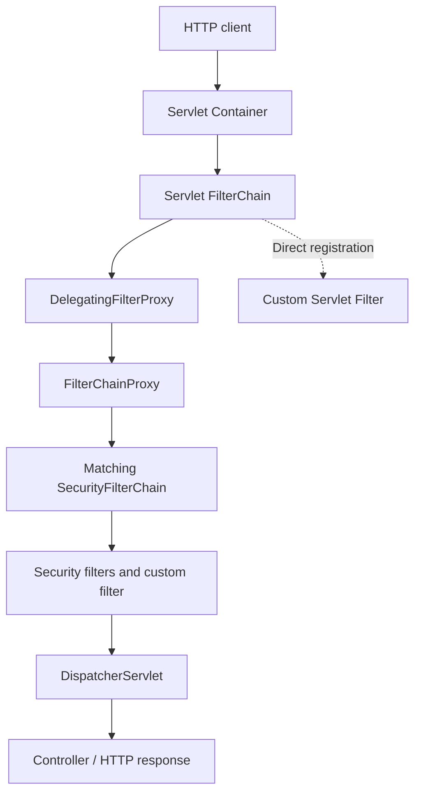

# Avoiding Double Filter Registration Across Servlet Container and SecurityFilterChain

> **Scope:** Spring Boot 3.x, Spring MVC, Spring Security 6.x, Jakarta Servlet, and Java 17+. This lesson focuses on the scenario where the same custom Servlet Filter is both registered by the container and inserted into `SecurityFilterChain`. The goal is to understand the mechanism, spot symptoms, fix the root cause, and verify after fixing. Spring WebFlux applications use a separate reactive filter mechanism.

## 1. Two different Filter chains

In a Servlet application, Tomcat (or another Servlet Container) receives the HTTP request first. The container traverses its Servlet Filters and delivers the request to Spring MVC's `DispatcherServlet`. Spring Security joins the Servlet Filter chain through a `DelegatingFilterProxy` pointing to the `springSecurityFilterChain` bean. This bean is typically `FilterChainProxy`, which selects a matching `SecurityFilterChain` and runs the security filters inside it.



| Component | Who registers/invokes it? | Meaning |
|---|---|---|
| **Servlet FilterChain** | Servlet Container | Contains `jakarta.servlet.Filter`s registered with the container, with URL patterns, order, and dispatcher types |
| **SecurityFilterChain** | Spring Security's `FilterChainProxy` | Contains security filters; `FilterChainProxy` picks the first matching chain in order |
| **DelegatingFilterProxy** | Container invokes, proxy delegates to Spring bean | Bridge between the two systems; normally present when using Spring Security |
| **HandlerInterceptor** | Spring MVC | Runs around handlers after the request reaches `DispatcherServlet`; not a Servlet Filter |

**Common misconception:** Jakarta Servlet's `FilterChain` and Spring Security's `SecurityFilterChain` are **two distinct layers**, not two names for the same registry. Calling `http.addFilterBefore(...)` only adds the filter to the Security layer; it does not stop a Spring `Filter` bean from being registered independently by the container.

## 2. How does a double-registration bug happen?

When Spring Boot runs on the servlet stack, a bean implementing `jakarta.servlet.Filter` created via `@Component` or `@Bean` can be **auto-registered** by Boot as a Servlet Filter in the embedded container. A `FilterRegistrationBean` declared by the application can also register a Filter directly.

Meanwhile, developers often add the same Filter to Security:

```java
http.addFilterBefore(traceFilter, AuthorizationFilter.class);
```

If `traceFilter` is simultaneously a bean Boot registers in the Servlet Container, there are **two invocation paths**:

1. The Servlet Container invokes the Filter as an independent member of the container filter list.
2. `DelegatingFilterProxy` forwards into `FilterChainProxy`; Spring Security invokes the same Filter again inside `SecurityFilterChain`.

Even the **exact same instance** can be invoked along both paths. Injecting a bean once does not guarantee its processing logic executes only once. Common names for this condition are *double registration* or *double invocation* of a custom Filter.

A suspicious configuration:

```java
@Component
public class TraceFilter extends GenericFilterBean {
    // doFilter(...) shown in the hands-on section
}
```

```java
@Bean
SecurityFilterChain securityFilterChain(HttpSecurity http, TraceFilter traceFilter)
        throws Exception {
    return http
            .authorizeHttpRequests(auth -> auth.anyRequest().authenticated())
            .addFilterBefore(traceFilter, AuthorizationFilter.class)
            .build();
}
```

These two snippets illustrate the concept rather than forming a standalone application. In the setup above, `@Component` creates a Filter bean that Boot can auto-register with the container; `addFilterBefore` puts that exact bean into Security.

**Observation note:** Two registrations do not mean *every* HTTP request will always print two log lines. A request blocked early by Security may not finish the Servlet FilterChain; dispatcher types can differ. Use a public endpoint allowed to proceed when testing and verifying the container registry.

## 3. Practical consequences

- **Duplicated audit/logs/metrics:** one request causes double logging, request counting, event emission, database writes, or notifications if the Filter has side effects.
- **Wrong security context position:** the container-level Filter can run before Spring Security authenticates, leaving `SecurityContextHolder.getContext().getAuthentication()` not yet reflecting the logged-in user as expected.
- **Repeated header edits:** a Filter generating correlation IDs, adding response headers, or manipulating response wrappers may overwrite or duplicate values.
- **Wider URL scope than intended:** the standalone container Filter can run for URLs not matching the Security chain's `http.securityMatcher("/api/**")`.
- **Hard to debug:** the controller still returns HTTP 200, yet Filter logic executes twice; tests asserting only the response can miss it.
- **Unpredictable ordering:** container Filter ordering and Security internal filter ordering are two different mechanisms; adjusting one side does not solve dual registration.

Do not jump to a double-registration conclusion merely from seeing two log lines. Browsers can request `/favicon.ico`, proxies can retry, requests can have `ASYNC`/`ERROR` dispatches, CORS has `OPTIONS` preflights, or the frontend may call twice. When checking, correlate **a single HTTP request**, URI, method, dispatcher type, and correlation ID.

## 4. Choosing the right owner for a Filter

If a custom Filter relates to authentication/authorization, needs to follow a security matcher, or must sit at a specific position in security filter order, let **SecurityFilterChain own it**. If it must be a Spring bean to inject dependencies, use two explicit configuration parts:

```java
http.addFilterBefore(traceFilter, AuthorizationFilter.class);
```

```java
@Bean
FilterRegistrationBean<TraceFilter> disableDirectServletRegistration(
        TraceFilter traceFilter) {
    FilterRegistrationBean<TraceFilter> registration =
            new FilterRegistrationBean<>(traceFilter);
    registration.setEnabled(false);
    return registration;
}
```

`setEnabled(false)` on the **custom Filter's own FilterRegistrationBean** prevents it from registering independently with the Servlet Container. The Filter remains a Spring bean and is still invoked by `FilterChainProxy` when a request matches `SecurityFilterChain`.

**Never disable `DelegatingFilterProxy`** just to reduce duplicate logs. The proxy is the required bridge for Spring Security to control HTTP requests. The goal is disabling the custom Filter's *direct* registration while keeping the Security mechanism intact.

If the Filter is simple and does not need to be a Spring bean, you can also instantiate it solely inside Security configuration:

```java
http.addFilterBefore(new TraceFilter(), AuthorizationFilter.class);
```

The condition is not also creating another Filter via `@Component`, `@Bean`, or `@WebFilter`. If the Filter needs service injection, the bean + disabled registration solution is usually clearer and easier to maintain.

Conversely, if the Filter must monitor all Servlet traffic independently of security, **register it at the container** (with appropriate order, URL patterns, and dispatcher types) and **do not add the same Filter again to SecurityFilterChain**.

## 5. Runnable Spring Boot 3.x example

Create a Spring Boot 3.x / Java 17+ project with Spring Initializr, selecting **Spring Web** and **Spring Security**; add **Spring Boot Starter Test** for runtime verification. The example uses Gradle and package `com.example.demo`. The `dependencies` block in `build.gradle` is as follows:

```groovy
dependencies {
    implementation 'org.springframework.boot:spring-boot-starter-web'
    implementation 'org.springframework.boot:spring-boot-starter-security'
    testImplementation 'org.springframework.boot:spring-boot-starter-test'
}
```

This is only the dependencies block, not a complete `build.gradle`; a project generated by Initializr must include plugins, repositories, and compatible versions.

Structure:

```text
src/
├── main/java/com/example/demo/
│   ├── FilterOwnershipApplication.java
│   ├── TraceFilter.java
│   ├── SecurityConfig.java
│   └── DemoController.java
└── test/java/com/example/demo/
    └── TraceFilterRegistrationTest.java
```

### 5.1. Spring Boot class

**`src/main/java/com/example/demo/FilterOwnershipApplication.java`**

```java
package com.example.demo;

import org.springframework.boot.SpringApplication;
import org.springframework.boot.autoconfigure.SpringBootApplication;

@SpringBootApplication
public class FilterOwnershipApplication {
    public static void main(String[] args) {
        SpringApplication.run(FilterOwnershipApplication.class, args);
    }
}
```

### 5.2. Filter to clearly observe each doFilter call

**`src/main/java/com/example/demo/TraceFilter.java`**

```java
package com.example.demo;

import java.io.IOException;
import jakarta.servlet.FilterChain;
import jakarta.servlet.ServletException;
import jakarta.servlet.ServletRequest;
import jakarta.servlet.ServletResponse;
import jakarta.servlet.http.HttpServletRequest;

import org.springframework.stereotype.Component;
import org.springframework.web.filter.GenericFilterBean;

@Component
public class TraceFilter extends GenericFilterBean {
    @Override
    public void doFilter(ServletRequest request, ServletResponse response,
                         FilterChain chain)
            throws IOException, ServletException {
        HttpServletRequest http = (HttpServletRequest) request;

        System.out.println("TRACE " + http.getDispatcherType()
                + " " + http.getMethod()
                + " " + http.getRequestURI());

        chain.doFilter(request, response);
    }
}
```

`GenericFilterBean` is used so every `doFilter` call prints a line. In production, use a logger and correlation ID, avoiding logging tokens/passwords. The code here deliberately omits business security logic so the experiment focuses on **registration count**.

### 5.3. SecurityConfig with the right fix

**`src/main/java/com/example/demo/SecurityConfig.java`**

```java
package com.example.demo;

import org.springframework.boot.web.servlet.FilterRegistrationBean;
import org.springframework.context.annotation.Bean;
import org.springframework.context.annotation.Configuration;
import org.springframework.http.HttpMethod;
import org.springframework.security.config.Customizer;
import org.springframework.security.config.annotation.web.builders.HttpSecurity;
import org.springframework.security.core.userdetails.User;
import org.springframework.security.core.userdetails.UserDetailsService;
import org.springframework.security.crypto.factory.PasswordEncoderFactories;
import org.springframework.security.crypto.password.PasswordEncoder;
import org.springframework.security.provisioning.InMemoryUserDetailsManager;
import org.springframework.security.web.SecurityFilterChain;
import org.springframework.security.web.access.intercept.AuthorizationFilter;

@Configuration
public class SecurityConfig {
    @Bean
    SecurityFilterChain securityFilterChain(
            HttpSecurity http, TraceFilter traceFilter
    ) throws Exception {
        return http
                .authorizeHttpRequests(auth -> auth
                        .requestMatchers(HttpMethod.GET, "/public").permitAll()
                        .anyRequest().authenticated())
                .httpBasic(Customizer.withDefaults())
                .addFilterBefore(traceFilter, AuthorizationFilter.class)
                .build();
    }

    @Bean
    FilterRegistrationBean<TraceFilter> disableDirectServletRegistration(
            TraceFilter traceFilter
    ) {
        FilterRegistrationBean<TraceFilter> registration =
                new FilterRegistrationBean<>(traceFilter);
        registration.setEnabled(false);
        return registration;
    }

    @Bean
    PasswordEncoder passwordEncoder() {
        return PasswordEncoderFactories.createDelegatingPasswordEncoder();
    }

    @Bean
    UserDetailsService userDetailsService(PasswordEncoder encoder) {
        var learner = User.withUsername("learner")
                .password(encoder.encode("demo-pass"))
                .roles("USER")
                .build();
        return new InMemoryUserDetailsManager(learner);
    }
}
```

- `addFilterBefore(traceFilter, AuthorizationFilter.class)` places the Filter at an explicit position **inside Security**, before the HTTP authorization decision step. For logic needing to read `SecurityContext`, choose the position based on the actual authentication mechanism.
- The `disableDirectServletRegistration(...)` bean references **the exact `TraceFilter` instance** injected into Security and turns off the container's independent registration path.
- `httpBasic(...)` enables sending credentials with `curl -u`, producing easily observable 401/200 outcomes.
- The in-memory `UserDetailsService` is solely for this lesson; sample passwords and HTTP Basic are unsuitable for production without HTTPS and proper identity management.

### 5.4. Controller

**`src/main/java/com/example/demo/DemoController.java`**

```java
package com.example.demo;

import java.security.Principal;
import org.springframework.web.bind.annotation.GetMapping;
import org.springframework.web.bind.annotation.RestController;

@RestController
public class DemoController {
    @GetMapping("/public")
    public String publicEndpoint() {
        return "PUBLIC_OK";
    }

    @GetMapping("/private")
    public String privateEndpoint(Principal principal) {
        return "PRIVATE_OK: " + principal.getName();
    }
}
```

Anonymous `GET /public` is allowed to proceed to MVC. `GET /private` requires authentication; without valid Basic credentials, Security usually returns 401 before the controller runs. Security decides access, while MVC decides the handler and response body.

## 6. Experiment to verify double-registration

### Step A — Observe the correct configuration

From the project directory with Gradle wrapper:

```bash
# macOS / Linux
./gradlew bootRun

# Windows PowerShell
.\gradlew.bat bootRun
```

Once the server starts and listens on default port 8080, use another terminal:

```bash
curl -i http://localhost:8080/public

# Windows PowerShell:
curl.exe -i http://localhost:8080/public
```

**Expected:** HTTP 200, body:

```text
PUBLIC_OK
```

The application console prints **one** line for a single `GET /public` request (dispatcher `REQUEST`):

```text
TRACE REQUEST GET /public
```

The lines here are **expected output when running the sample application**, not output pre-executed inside the documentation.

### Step B — Deliberately reproduce the bug

Temporarily comment out or delete **only the `disableDirectServletRegistration(...)` bean** in `SecurityConfig.java`. Keep `@Component` on `TraceFilter` and `addFilterBefore(traceFilter, AuthorizationFilter.class)`. Restart the server, and send **one** request:

```bash
curl -i http://localhost:8080/public
```

With the Filter bean auto-registered by Boot into the container **and** added to Security, `GenericFilterBean` usually prints twice for a public request traversing the full pipeline:

```text
TRACE REQUEST GET /public
TRACE REQUEST GET /public
```

The HTTP response can still be 200 with body `PUBLIC_OK`. This is a classic example of why **a right response does not guarantee right filter ownership**. If container filter order changes or another filter blocks the request, the number of lines seen in logs may vary.

### Step C — Restore

Add the `disableDirectServletRegistration(...)` bean back with `registration.setEnabled(false)` and restart. Send `GET /public` again; expect only one TRACE line. Run the runtime test in section 8 to verify the configuration from the registry rather than relying solely on logs.

| Configuration | Registered in Servlet Container | In SecurityFilterChain | Typical observation for public REQUEST |
|---|---|---|---|
| `@Component` + `addFilterBefore`; registration not disabled | Yes | Yes | Two invocations of `GenericFilterBean#doFilter` |
| `@Component` + `addFilterBefore` + disabled `FilterRegistrationBean` | No | Yes | One invocation |
| Filter used only at Servlet Container | Yes | No | One invocation |
| Only `new TraceFilter()` in Security; no other bean/registration | No | Yes | One invocation |

The table describes a `REQUEST` allowed through the full chain, excluding errors, retries, or secondary dispatches.

## 7. Testing 200/401 responses and relationship with the Filter

After restoring the right configuration:

```bash
# Public anonymous
curl -i http://localhost:8080/public

# Private anonymous
curl -i http://localhost:8080/private

# Private with valid HTTP Basic
curl -i -u learner:demo-pass http://localhost:8080/private
```

| Request | Expected status | Mechanism |
|---|---:|---|
| `GET /public` | **200** | Security permits via `permitAll()`, MVC returns `PUBLIC_OK` |
| `GET /private` without credentials | **401** | HTTP Basic requires authentication, MVC controller not called |
| `GET /private` with `learner:demo-pass` | **200** | Security authenticates, MVC returns `PRIVATE_OK: learner` |

**Do not rely solely on logs from a 401 request to judge registration count.** When Security rejects early, filters outside or behind the proxy may not have been invoked yet. A `permitAll()` request lets you observe the full path; checking the registry is even more definitive.

`permitAll()` differs from "skipping filters": public URLs still run the selected `SecurityFilterChain`. `web.ignoring()` is the mechanism that skips certain Security filters, and must be weighed carefully because it also bypasses the chain's HTTP protections.

## 8. Registration test with a real embedded Servlet Container

`MockMvc` can often execute Security inside a test context without booting a Servlet Container like production. A test checking only `andExpect(status().isOk())` does not verify whether a custom Filter was auto-registered with Tomcat. To check **both layers**, use `@SpringBootTest(webEnvironment = RANDOM_PORT)` and `ServletContext.getFilterRegistrations()`.

**`src/test/java/com/example/demo/TraceFilterRegistrationTest.java`**

```java
package com.example.demo;

import jakarta.servlet.ServletContext;

import org.junit.jupiter.api.Test;
import org.springframework.beans.factory.annotation.Autowired;
import org.springframework.boot.test.context.SpringBootTest;
import org.springframework.security.web.SecurityFilterChain;

import static org.junit.jupiter.api.Assertions.assertFalse;
import static org.junit.jupiter.api.Assertions.assertTrue;

@SpringBootTest(webEnvironment = SpringBootTest.WebEnvironment.RANDOM_PORT)
class TraceFilterRegistrationTest {

    @Autowired
    private ServletContext servletContext;

    @Autowired
    private SecurityFilterChain securityFilterChain;

    @Autowired
    private TraceFilter traceFilter;

    @Test
    void traceFilterOnlyBelongsToSecurity() {
        boolean inSecurity =
                securityFilterChain.getFilters().stream()
                        .anyMatch(filter -> filter == traceFilter);

        boolean registeredDirectly =
                servletContext.getFilterRegistrations().values().stream()
                        .anyMatch(registration ->
                                TraceFilter.class.getName()
                                        .equals(registration.getClassName()));

        assertTrue(inSecurity, "TraceFilter must be in SecurityFilterChain");
        assertFalse(registeredDirectly,
                "TraceFilter must not also be a Servlet Container filter");
    }
}
```

Run from project root:

```bash
# macOS / Linux
./gradlew test

# Windows PowerShell
.\gradlew.bat test
```

**Expected:** the test PASSES in the fixed configuration. If the disabled registration is removed, the Servlet registration assertion is expected to FAIL. This is the expected outcome on the sample project; the article does not claim to have executed the test in the current environment.

Checking the registration's class name suits this example where `TraceFilter` is registered directly. If an application uses wrappers/proxies, multiple instances, or other registration mechanisms, adjust the check accordingly. Observing a real request and inspecting the registry should still be used together.

## 9. Fixes that do not solve the root cause

### Only adding @Order or changing addFilterBefore/addFilterAfter

`@Order` or `FilterRegistrationBean#setOrder(...)` adjusts **container filter order**. `addFilterBefore`/`addFilterAfter` adjusts **security filter position**. They do not remove the other registration. They may make the bug surface earlier or later, yet two invocation paths remain.

### Only switching to OncePerRequestFilter

`OncePerRequestFilter` has a request-attribute mechanism to prevent repeated execution of `doFilterInternal` in some cases within the same dispatch. However, it **does not eliminate double-registration**. If there are two instances with different names/attributes, or `ERROR`/`ASYNC` dispatches, behavior can differ. A single log line does not prove a single registration.

### Removing @Component while still injecting the Filter

If the Filter was only created from `@Component` and you remove the annotation, Security configuration injecting `TraceFilter` will fail with a missing bean error. For Filters needing dependencies, keeping the bean and disabling Servlet registration is clean. If you choose `new TraceFilter()` inside Security, ensure no other registrations exist simultaneously.

### Mixing @WebFilter, @Component, and FilterRegistrationBean

`@WebFilter` with `@ServletComponentScan` is a separate container registration path. `@Component`/`@Bean` and `FilterRegistrationBean` are different paths; enabling multiple mechanisms can create multiple registrations or distinct instances. Disabling a `FilterRegistrationBean` for a bean does not automatically remove an independently scanned `@WebFilter`.

### Registering DelegatingFilterProxy a second time

Spring Boot/Spring Security Servlet normally already creates the required bridge to `springSecurityFilterChain`. Registering a duplicate proxy can cause the entire security pipeline to execute twice. Never disable the Security proxy to work around a custom Filter bug.

### Assuming every filter in Security runs on every endpoint

When configuring multiple `SecurityFilterChain`s with `securityMatcher("/api/**")`, only the first matching chain is chosen. A custom Filter inside the API chain does not automatically run outside `/api/**`, whereas a direct container Filter may run more broadly. This matters when designing dedicated chains for API, admin, or health endpoints.

## 10. How to investigate an existing system

1. Identify the Filter's class, bean name, and creation method (`@Component`, `@Bean`, `@WebFilter`, or `new`).
2. Find every `FilterRegistrationBean`, `@ServletComponentScan`, and `http.addFilterBefore/After/At` call referencing that Filter.
3. Decide ownership: Servlet Container for general cross-cutting tasks, or SecurityFilterChain for security-coupled tasks.
4. If the Filter is a Spring bean **intended solely for Security**, declare a disabled `FilterRegistrationBean` for **that exact instance**.
5. Send a `curl` request to a public endpoint, inspect URI and dispatcher type, avoiding confusion with retries, preflights, or other requests.
6. Inspect the filter list inside `SecurityFilterChain` and the registration list in `ServletContext`.
7. Re-verify 200/401/403 responses, logs, and side effects: no duplicate events or unintended shifts in authorization order.
8. Account for `ASYNC`/`ERROR` dispatches if the application uses them; a separate dispatch can legitimately invoke a Filter an additional time.

Avoid placing non-idempotent data-mutating side effects inside a Filter until you have clearly verified request lifecycle and invocation counts. In real production systems, a duplicated audit entry can be far more serious than a repeated console line.

## 11. Reinforcement exercises

**Exercise 1.** Remove `disableDirectServletRegistration(...)`, keeping `@Component` and `addFilterBefore`. Run `GET /public`, observe TRACE, then restore the method and compare.

**Exercise 2.** Switch the example to `OncePerRequestFilter`. Why is counting `doFilterInternal` invocations insufficient to prove the Filter has only one registration? Answer using `ServletContext`.

**Exercise 3.** Place the Filter only inside a Security chain matching `/api/**`. Explain why other URLs do not traverse that Security Filter, and why a container registration would still run.

**Exercise 4.** A Filter needs to read `SecurityContextHolder.getContext().getAuthentication()`. Explain why a container-level copy can observe a different state than the copy inside Security, and which authentication mechanism dictates filter placement.

## 12. Key points to remember

- **Servlet FilterChain** and **SecurityFilterChain** are two separate layers; `DelegatingFilterProxy` is Spring Security's standard bridge.
- Spring Boot Servlet can auto-register a `Filter`-typed bean with the Servlet Container, even when you also add that same bean to Security.
- When a Filter is a Spring bean **yet must run only inside Security**, use `FilterRegistrationBean<CustomFilter>` with `setEnabled(false)` and add that exact bean to `SecurityFilterChain`.
- `@Order`, `permitAll()`, or switching to `OncePerRequestFilter` does not remove the root cause of double-registration.
- Verify with an **HTTP request through a real Servlet Container** and **runtime registrations**, not merely HTTP 200 or simple MVC tests.

**Principle:** Clearly assign one owner for each custom Filter and create only the registrations that are genuinely needed.