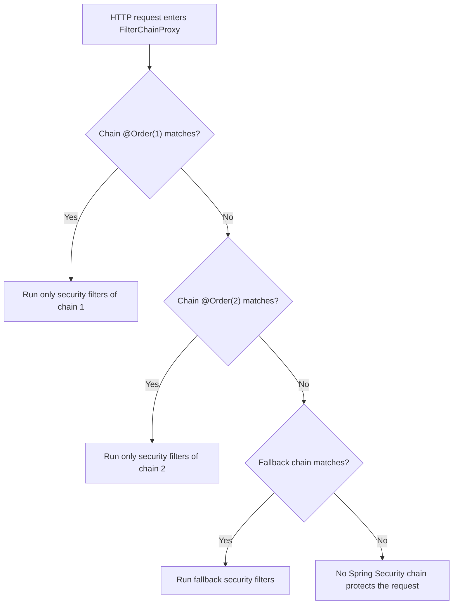

# Placement of Login and Logout Endpoints Within Each `SecurityFilterChain` Scope

**Module:** Spring Security – Servlet · **Parent topic:** Security Configuration  
**Objective:** Understand precisely why `GET /login`, `POST /login`, or `POST /logout` sometimes stop working when using multiple `SecurityFilterChain`s, and how to place login/logout URLs within the appropriate chain's scope.

This article uses **Java 17**, **Spring Boot 3.3.5**, **Spring Security 6.x**, and **Spring MVC/Servlet**. This knowledge applies to `HttpSecurity` and `SecurityFilterChain` on the Servlet stack; WebFlux uses `ServerHttpSecurity` and `SecurityWebFilterChain` with a different mechanism.

## 1. Root rule: an endpoint only works when requests enter the right chain

In a Servlet application, Spring Security's `FilterChainProxy` can contain multiple `SecurityFilterChain` beans. Each chain includes:

1. **The chain's request matcher**, configured via `http.securityMatcher(...)`.
2. **Security filters** created from `HttpSecurity`: authentication, authorization, form login, logout, CSRF, exception handling…
3. **Authorization rules**, typically configured with `http.authorizeHttpRequests(...requestMatchers(...))`.

When an HTTP request enters `FilterChainProxy`, Spring Security **evaluates chains in order and uses the first chain whose matcher matches**. It does not merge all matching chains into one. Filters created by form login/logout configuration live inside the chain that configured them; they only receive a request if **that chain is selected**.



**Points to distinguish:**

| Configuration | Question it answers | Effect |
| --- | --- | --- |
| `http.securityMatcher("/web/**")` | Is this request **selected into the chain**? | Determines whether the chain's filters get a chance to run at all. |
| `authorizeHttpRequests(a -> a.requestMatchers("/web/login").permitAll())` | Once the request **has entered the chain**, does this URL require authorization? | Allows or denies; does not expand the chain's matcher. |
| `formLogin(f -> f.loginProcessingUrl("/web/login"))` | Which **POST URL** does `UsernamePasswordAuthenticationFilter` process? | Provides login handling *inside the chain*; does not automatically add the URL to `securityMatcher`. |
| `logout(l -> l.logoutUrl("/web/logout"))` | Where does `LogoutFilter` accept logout requests? | Effective only if requests are routed into the chain containing that filter. |

A `permitAll()` URL does not automatically become a valid handled endpoint. `permitAll()` is an **access permission**; the endpoint still needs a controller or a security filter to handle it.

## 2. Why can default configuration make login/logout "disappear"?

Consider a snippet meant **only to illustrate a bug**, not a complete program:

```java
@Bean
SecurityFilterChain privateChain(HttpSecurity http) throws Exception {
    http.securityMatcher("/private/**")
        .authorizeHttpRequests(a -> a.anyRequest().authenticated())
        .formLogin(Customizer.withDefaults())
        .logout(Customizer.withDefaults());
    return http.build();
}
```

With default form login, Spring Security provides the standard paths `GET /login` (filter-generated login page) and `POST /login` (processes credentials). Default logout uses `/logout`; when CSRF is enabled, the actual logout action requires a **POST with a valid CSRF token**, whereas `GET /logout` may render a confirmation page under the default configuration.

However, `securityMatcher("/private/**")` **does not match** `/login` or `/logout`:

- An unauthenticated request to `/private/report` is handled by this chain and may be redirected to `/login`.
- When the browser visits `/login`, that request **does not fall inside the `/private/**` chain**, so that chain's login-page-generating filter and login processing filter do not run.
- Likewise, `POST /logout` does not pass through this chain's `LogoutFilter`.
- Another chain or Spring MVC may handle those URLs in its own way: `404`, `403`, a redirect, or another page. **A single general status cannot be assumed** without knowing the remaining chains.

This is an **endpoint scope** problem, not merely a missing `permitAll()`. If you change the rule to `requestMatchers("/login").permitAll()` while keeping `securityMatcher("/private/**")`, requests to `/login` still do not select that chain.

## 3. Distinguishing types of login/logout endpoints

### 3.1. Form-based login

| Typical URL + method | Who handles it? | Conditions |
| --- | --- | --- |
| `GET /login` | Filter generating the default page, **or** a controller if using a custom page | Request must enter the right chain; custom pages must have an MVC handler/view. |
| `POST /login` | `UsernamePasswordAuthenticationFilter` | Request enters the chain with `formLogin`, matches login processing URL, valid credentials, and valid CSRF if CSRF is enabled. |
| `GET /login?error` | Login page displaying an error | Query parameter only changes presentation; still needs a GET handler/page. |
| `POST /logout` | `LogoutFilter` | Request enters the chain with the logout filter, matches the matcher, and has valid CSRF if enabled. |
| `GET /logout` | May be a logout confirmation page under default configuration | **Do not treat GET as a logout action** while CSRF is enabled. |

These are **common defaults**; an application can customize `loginPage`, `loginProcessingUrl`, `logoutUrl`, entry points, and logout success URLs.

### 3.2. Page URL and processing URL are not the same concept

- `form.loginPage("/web/login")` specifies the **login page**. When declaring a custom page, the application must implement a handler/view for `GET /web/login`; Spring Security does not generate custom HTML automatically.
- `form.loginProcessingUrl("/web/login")` creates a matcher for **POST /web/login** handled by the security filter; **no `@PostMapping` controller is needed** for that URL.
- `form.failureUrl("/web/login?error")` and `form.defaultSuccessUrl("/web/home", true)` specify **post-processing destinations**. Destination URLs must also be permitted/handled by an appropriate chain.
- `logout.logoutUrl("/web/logout")` specifies the logout processing endpoint for `LogoutFilter`. With CSRF enabled, send a `POST` carrying a CSRF token. No `@PostMapping("/web/logout")` is needed.
- `logout.logoutSuccessUrl("/web/login?logout")` specifies the post-logout destination; the browser issues a **new GET** to the login page. That URL must also be accessible.

Setting `loginProcessingUrl` and `logoutUrl` to the same path is a bad choice: the same POST can be intercepted by whichever filter comes first, causing unpredictable behavior. Choose separate endpoints with clear roles.

### 3.3. HTTP Basic and APIs do not need a form login endpoint

A chain configured solely with `httpBasic(...)` can return `401` with `WWW-Authenticate` so the client sends an `Authorization` header. **HTTP Basic does not create `GET /login`/`POST /login`**. APIs using token/Bearer authentication do not naturally have a servlet form login endpoint either. Only configure a login page when the authentication flow requires one.

## 4. Safe URL design strategies

### Approach A — Put all endpoints managed by a chain under that chain's prefix

Example:

| Chain | `securityMatcher` | Endpoints inside |
| --- | --- | --- |
| API | `/api/**` | `GET /api/me`, HTTP Basic; no HTML form login/logout. |
| Web | `/web/**` | `GET/POST /web/login`, `GET /web/home`, `POST /web/logout`. |
| Fallback | All remaining requests | Explicitly denies undesigned URLs. |

Because `/web/login` and `/web/logout` both match `/web/**`, requests can properly run `UsernamePasswordAuthenticationFilter` or `LogoutFilter`. This is easy to inspect visually and easy to write integration tests for.

### Approach B — Keep default URLs while adding them to the chain's scope

If a chain must protect `/private/**` while using `/login` and `/logout` at the root, let that chain match all three path groups:

```java
// Illustrative fragment; place inside an appropriate @Bean SecurityFilterChain.
http.securityMatcher("/private/**", "/login", "/logout")
    .authorizeHttpRequests(auth -> auth
        .requestMatchers("/login", "/logout").permitAll()
        .anyRequest().authenticated())
    .formLogin(Customizer.withDefaults())
    .logout(Customizer.withDefaults());
```

`securityMatcher(String...)` combines patterns with **OR**. With default form login configuration, `/login` and `/logout` now have a chance to be received by their corresponding security filters. CSRF protection remains active for POST. Ensure no higher-priority chain captures `/login` or `/logout` first.

This snippet is an **`HttpSecurity` fragment**, not a standalone compilable Java class; the complete runnable example below uses Approach A.

### Approach C — Use a catch-all chain holding a shared login mechanism

A final chain without a dedicated `securityMatcher` can host shared login/processing URLs for requests not matched by other chains. However, protected requests in a **previously selected** chain do not automatically jump to another chain to authenticate. You must design the entry point, login processor, and session/security context policy accordingly; never think chains automatically call one another. For new projects, keeping login/logout URLs inside the chain that needs them is usually easier to understand.

## 5. Complete example: one application, three security chains

The sample project contains an **API chain** (`/api/**`), a **web chain** (`/web/**`), and a **fallback chain**. The web chain owns `GET/POST /web/login` and `POST /web/logout`. Form login uses sessions and CSRF tokens; the API chain only illustrates Basic authentication for GET.

Create the project with these files:

```text
chain-endpoints/
├── pom.xml
└── src/
    ├── main/
    │   ├── java/demo/chains/
    │   │   ├── ChainEndpointsApplication.java
    │   │   ├── SecurityConfig.java
    │   │   ├── ApiController.java
    │   │   └── WebController.java
    │   └── resources/templates/
    │       ├── login.html
    │       └── home.html
    └── test/
        └── java/demo/chains/
            └── ChainEndpointsApplicationTests.java
```

### 5.1. `pom.xml`

```xml
<?xml version="1.0" encoding="UTF-8"?>
<project xmlns="http://maven.apache.org/POM/4.0.0"
         xmlns:xsi="http://www.w3.org/2001/XMLSchema-instance"
         xsi:schemaLocation="http://maven.apache.org/POM/4.0.0 https://maven.apache.org/xsd/maven-4.0.0.xsd">
    <modelVersion>4.0.0</modelVersion>

    <parent>
        <groupId>org.springframework.boot</groupId>
        <artifactId>spring-boot-starter-parent</artifactId>
        <version>3.3.5</version>
        <relativePath/>
    </parent>

    <groupId>demo</groupId>
    <artifactId>chain-endpoints</artifactId>
    <version>0.0.1-SNAPSHOT</version>

    <properties>
        <java.version>17</java.version>
    </properties>

    <dependencies>
        <dependency>
            <groupId>org.springframework.boot</groupId>
            <artifactId>spring-boot-starter-web</artifactId>
        </dependency>
        <dependency>
            <groupId>org.springframework.boot</groupId>
            <artifactId>spring-boot-starter-security</artifactId>
        </dependency>
        <dependency>
            <groupId>org.springframework.boot</groupId>
            <artifactId>spring-boot-starter-thymeleaf</artifactId>
        </dependency>
        <dependency>
            <groupId>org.springframework.boot</groupId>
            <artifactId>spring-boot-starter-test</artifactId>
            <scope>test</scope>
        </dependency>
        <dependency>
            <groupId>org.springframework.security</groupId>
            <artifactId>spring-security-test</artifactId>
            <scope>test</scope>
        </dependency>
    </dependencies>

    <build>
        <plugins>
            <plugin>
                <groupId>org.springframework.boot</groupId>
                <artifactId>spring-boot-maven-plugin</artifactId>
            </plugin>
        </plugins>
    </build>
</project>
```

Versions of Spring Security, Thymeleaf, and other libraries are managed by the Spring Boot BOM. No separate versions are needed for each starter. `spring-boot-starter-thymeleaf` is only used to render login/home pages in the web example; the security filters themselves do not require Thymeleaf.

### 5.2. `src/main/java/demo/chains/ChainEndpointsApplication.java`

```java
package demo.chains;

import org.springframework.boot.SpringApplication;
import org.springframework.boot.autoconfigure.SpringBootApplication;

@SpringBootApplication
public class ChainEndpointsApplication {
    public static void main(String[] args) {
        SpringApplication.run(ChainEndpointsApplication.class, args);
    }
}
```

Place `SecurityConfig`, controllers, and tests in the same `demo.chains` package so `@SpringBootApplication` scans beans by default.

### 5.3. `src/main/java/demo/chains/SecurityConfig.java`

```java
package demo.chains;

import org.springframework.context.annotation.Bean;
import org.springframework.context.annotation.Configuration;
import org.springframework.core.annotation.Order;
import org.springframework.security.config.Customizer;
import org.springframework.security.config.annotation.web.builders.HttpSecurity;
import org.springframework.security.core.userdetails.User;
import org.springframework.security.core.userdetails.UserDetails;
import org.springframework.security.core.userdetails.UserDetailsService;
import org.springframework.security.crypto.bcrypt.BCryptPasswordEncoder;
import org.springframework.security.crypto.password.PasswordEncoder;
import org.springframework.security.provisioning.InMemoryUserDetailsManager;
import org.springframework.security.web.SecurityFilterChain;

@Configuration
public class SecurityConfig {

    @Bean
    @Order(1)
    SecurityFilterChain apiChain(HttpSecurity http) throws Exception {
        http.securityMatcher("/api/**")
            .authorizeHttpRequests(auth -> auth
                .anyRequest().authenticated())
            .httpBasic(Customizer.withDefaults());

        // This sample uses only GET APIs. Do not infer HTTP Basic disables CSRF automatically.
        return http.build();
    }

    @Bean
    @Order(2)
    SecurityFilterChain webChain(HttpSecurity http) throws Exception {
        http.securityMatcher("/web/**")
            .authorizeHttpRequests(auth -> auth
                .requestMatchers("/web/login").permitAll()
                .anyRequest().authenticated())
            .formLogin(form -> form
                .loginPage("/web/login")
                .loginProcessingUrl("/web/login")
                .defaultSuccessUrl("/web/home", true)
                .failureUrl("/web/login?error")
                .permitAll())
            .logout(logout -> logout
                .logoutUrl("/web/logout")
                .logoutSuccessUrl("/web/login?logout")
                .permitAll());

        // Default CSRF remains enabled: POST login/logout require a valid token.
        return http.build();
    }

    @Bean
    @Order(3)
    SecurityFilterChain fallbackChain(HttpSecurity http) throws Exception {
        http.authorizeHttpRequests(auth -> auth
            .requestMatchers("/error").permitAll()
            .anyRequest().denyAll());
        return http.build();
    }

    @Bean
    PasswordEncoder passwordEncoder() {
        return new BCryptPasswordEncoder();
    }

    @Bean
    UserDetailsService users(PasswordEncoder encoder) {
        UserDetails learner = User.withUsername("learner")
            .password(encoder.encode("demo-secret"))
            .roles("USER")
            .build();

        return new InMemoryUserDetailsManager(learner);
    }
}
```

**Explanation chain by chain:**

- **`apiChain`** at `@Order(1)` matches only `/api/**`, requires authentication, and enables HTTP Basic. No form login/logout is configured here, so `/web/login` and `/web/logout` **are not endpoints of the API chain**. The example does not declare the API stateless: Basic authentication by itself does not guarantee no session exists, and default CSRF has not been disabled.
- **`webChain`** at `@Order(2)` matches only `/web/**`, yet all login, login processing, logout, and redirect URLs lie inside that prefix. `requestMatchers("/web/login").permitAll()` allows GET on the login page; `formLogin(...permitAll())` also permits related URLs managed by the configurer. CSRF still protects POSTs.
- **`fallbackChain`** at `@Order(3)` has no restricting `securityMatcher`, so it matches requests that did not enter the first two chains. It proactively denies undesigned endpoints; `/error` is permitted so MVC can handle errors. Placing the fallback at a **higher** priority than API/web would capture all requests ahead of the specialized chains.
- **Account `learner/demo-secret`** is created in memory and hashed with BCrypt **for learning only**; real applications need an appropriate user store, secret management, and authentication policy.

A subtle point: even though three separate chains are declared, they still belong to the same Servlet application and can share resources such as the session cookie or user store. **Splitting chains does not automatically create three completely isolated session stores.** Logging out of a web session can affect authentication in a shared session; logout does not automatically revoke every bearer token on other clients.

### 5.4. `src/main/java/demo/chains/ApiController.java`

```java
package demo.chains;

import org.springframework.http.MediaType;
import org.springframework.security.core.Authentication;
import org.springframework.web.bind.annotation.GetMapping;
import org.springframework.web.bind.annotation.RestController;

@RestController
public class ApiController {

    @GetMapping(value = "/api/me", produces = MediaType.TEXT_PLAIN_VALUE)
    public String me(Authentication authentication) {
        return "api:" + authentication.getName();
    }
}
```

There is no controller handling `/api/login` or `/api/logout`: the illustrative API only needs HTTP Basic for `GET /api/me`.

### 5.5. `src/main/java/demo/chains/WebController.java`

```java
package demo.chains;

import org.springframework.security.core.Authentication;
import org.springframework.stereotype.Controller;
import org.springframework.ui.Model;
import org.springframework.web.bind.annotation.GetMapping;

@Controller
public class WebController {

    @GetMapping("/web/login")
    public String loginPage() {
        return "login";
    }

    @GetMapping("/web/home")
    public String home(Authentication authentication, Model model) {
        model.addAttribute("username", authentication.getName());
        return "home";
    }
}
```

The controller **only serves GET for login/home pages**. Do not declare `@PostMapping("/web/login")` or `@PostMapping("/web/logout")` because those two POSTs are processed by **security filters** before reaching Spring MVC.

### 5.6. `src/main/resources/templates/login.html`

```html
<!DOCTYPE html>
<html lang="en" xmlns:th="http://www.thymeleaf.org">
<head>
    <meta charset="UTF-8">
    <title>Sign in</title>
</head>
<body>
    <h1>Web Area Login</h1>
    <p th:if="${param.error}">Invalid username or password.</p>
    <p th:if="${param.logout}">You have been logged out.</p>

    <form action="/web/login" method="post">
        <label>
            Username
            <input type="text" name="username" autocomplete="username">
        </label>
        <label>
            Password
            <input type="password" name="password" autocomplete="current-password">
        </label>
        <input type="hidden"
               th:name="${_csrf.parameterName}"
               th:value="${_csrf.token}">
        <button type="submit">Sign in</button>
    </form>
</body>
</html>
```

The `username` and `password` fields use the default parameter names read by `UsernamePasswordAuthenticationFilter`. The `_csrf` variable is attached to the request by Spring Security so the template can render a hidden field carrying a **valid CSRF token**. Because the form uses a root-absolute `action` `/web/login`, the example assumes the app runs at context path `/`; if deployed under a different context path, construct the action with the view's URL builder.

### 5.7. `src/main/resources/templates/home.html`

```html
<!DOCTYPE html>
<html lang="en" xmlns:th="http://www.thymeleaf.org">
<head>
    <meta charset="UTF-8">
    <title>Web Home</title>
</head>
<body>
    <h1>Logged-in Area</h1>
    <p th:text="|Hello ${username}|">Hello</p>

    <form action="/web/logout" method="post">
        <input type="hidden"
               th:name="${_csrf.parameterName}"
               th:value="${_csrf.token}">
        <button type="submit">Sign out</button>
    </form>
</body>
</html>
```

Clicking **Sign out** submits `POST /web/logout` with the token, handled by `webChain`'s `LogoutFilter`, redirecting to `/web/login?logout`. Do not use an `<a href="/web/logout">` link as a logout trigger when CSRF is enabled, because ordinary links send **GET**.

## 6. Tracing requests across the three chains

Under the configuration in section 5, we get:

| Request | First matching chain | Processing component | Expected result |
| --- | --- | --- | --- |
| `GET /api/me` without credentials | `apiChain` | HTTP Basic entry point | `401 Unauthorized`, does not enter controller. |
| `GET /api/me` with valid Basic | `apiChain` | Security → `ApiController` | `200 OK`, body `api:learner`. |
| `GET /web/login` | `webChain` | Authorization `permitAll` → `WebController` → Thymeleaf | `200 OK`, form contains CSRF token. |
| `GET /web/home` unauthenticated | `webChain` | Form login entry point | Redirect `302` to `/web/login`. |
| `POST /web/login` missing CSRF | `webChain` | `CsrfFilter` | `403 Forbidden`, username/password not processed yet. |
| `POST /web/login` with CSRF and valid credentials | `webChain` | `UsernamePasswordAuthenticationFilter` | Redirect `302` to `/web/home`. |
| `POST /web/logout` missing CSRF | `webChain` | `CsrfFilter` | `403 Forbidden`, not logged out. |
| `POST /web/logout` with CSRF | `webChain` | `LogoutFilter` | Clears auth context/session per logout config and redirects `302` to `/web/login?logout`. |
| `GET /login` | `fallbackChain` | Fallback authorization | Not `webChain`'s login page; request is denied in this example. |
| `POST /logout` | `fallbackChain` | Fallback authorization/CSRF | Not `webChain`'s logout endpoint. |

**Do not infer from this table that every `GET /logout` in every app returns `404` or `403`:** the default logout confirmation page and GET handling depend on configuration. In this example, the intentional logout URL is `/web/logout` and the form sends only POST.

## 7. Running the application and observing HTTP

Inside the directory containing `pom.xml`:

```bash
mvn clean test
mvn spring-boot:run
```

Once Tomcat is running on `localhost:8080`, test with these commands in another terminal (on Windows PowerShell, use `curl.exe` if `curl` is an alias):

```bash
# Unauthenticated: API rejects.
curl -s -o /dev/null -w '%{http_code}\n' \
  -H 'Accept: application/json' \
  http://localhost:8080/api/me

# Valid HTTP Basic: API returns principal info.
curl -s -u learner:demo-secret http://localhost:8080/api/me

# GET login page inside the right web chain.
curl -s -o /dev/null -w '%{http_code}\n' http://localhost:8080/web/login

# GET protected page unauthenticated: redirects to form login.
curl -s -o /dev/null -w '%{http_code}\n' \
  -H 'Accept: text/html' http://localhost:8080/web/home

# POST login form without CSRF token: rejected.
curl -s -o /dev/null -w '%{http_code}\n' \
  -d 'username=learner&password=demo-secret' \
  http://localhost:8080/web/login
```

Matching each command in order, the **printed body or status** is:

```text
401
api:learner
200
302
403
```

These are **five separate results**; `GET /api/me` with Basic returns body `api:learner` without a trailing newline. With `curl -i` there are also the HTTP status line and headers, so do not take the block above as full `curl -i` output.

To log in end-to-end with a browser, open `http://localhost:8080/web/login`, enter `learner` / `demo-secret`, click **Sign in**, observe `/web/home`; click **Sign out** to return to `/web/login?logout`. The browser sends the session cookie along with the form CSRF token. If scripting `curl` for POST login/logout yourself, you must manage both a cookie jar **and** the CSRF token extracted from the page/form or configured repository; sending username/password alone is not enough.

## 8. Integration testing: proving which chain an endpoint belongs to

### `src/test/java/demo/chains/ChainEndpointsApplicationTests.java`

```java
package demo.chains;

import org.junit.jupiter.api.Test;
import org.springframework.beans.factory.annotation.Autowired;
import org.springframework.boot.test.autoconfigure.web.servlet.AutoConfigureMockMvc;
import org.springframework.boot.test.context.SpringBootTest;
import org.springframework.http.MediaType;
import org.springframework.test.web.servlet.MockMvc;

import static org.hamcrest.Matchers.containsString;
import static org.springframework.security.test.web.servlet.request.SecurityMockMvcRequestPostProcessors.csrf;
import static org.springframework.security.test.web.servlet.request.SecurityMockMvcRequestPostProcessors.httpBasic;
import static org.springframework.security.test.web.servlet.request.SecurityMockMvcRequestPostProcessors.user;
import static org.springframework.test.web.servlet.request.MockMvcRequestBuilders.get;
import static org.springframework.test.web.servlet.request.MockMvcRequestBuilders.post;
import static org.springframework.test.web.servlet.result.MockMvcResultMatchers.content;
import static org.springframework.test.web.servlet.result.MockMvcResultMatchers.header;
import static org.springframework.test.web.servlet.result.MockMvcResultMatchers.status;

@SpringBootTest
@AutoConfigureMockMvc
class ChainEndpointsApplicationTests {

    @Autowired
    MockMvc mvc;

    @Test
    void apiWithoutCredentialsReturns401() throws Exception {
        mvc.perform(get("/api/me").accept(MediaType.APPLICATION_JSON))
            .andExpect(status().isUnauthorized());
    }

    @Test
    void apiWithBasicWorks() throws Exception {
        mvc.perform(get("/api/me")
                .with(httpBasic("learner", "demo-secret")))
            .andExpect(status().isOk())
            .andExpect(content().string("api:learner"));
    }

    @Test
    void webLoginPageExistsInsideWebChain() throws Exception {
        mvc.perform(get("/web/login"))
            .andExpect(status().isOk())
            .andExpect(content().string(containsString("name=\"username\"")));
    }

    @Test
    void webHomeRedirectsAnonymousToLoginPage() throws Exception {
        mvc.perform(get("/web/home").accept(MediaType.TEXT_HTML))
            .andExpect(status().is3xxRedirection())
            .andExpect(header().string("Location", containsString("/web/login")));
    }

    @Test
    void loginPostWithoutCsrfIsForbidden() throws Exception {
        mvc.perform(post("/web/login")
                .param("username", "learner")
                .param("password", "demo-secret"))
            .andExpect(status().isForbidden());
    }

    @Test
    void loginPostWithCsrfUsesWebAuthenticationFilter() throws Exception {
        mvc.perform(post("/web/login")
                .with(csrf())
                .param("username", "learner")
                .param("password", "demo-secret"))
            .andExpect(status().is3xxRedirection())
            .andExpect(header().string("Location", containsString("/web/home")));
    }

    @Test
    void logoutPostWithoutCsrfIsForbidden() throws Exception {
        mvc.perform(post("/web/logout")
                .with(user("learner")))
            .andExpect(status().isForbidden());
    }

    @Test
    void logoutPostWithCsrfUsesWebLogoutFilter() throws Exception {
        mvc.perform(post("/web/logout")
                .with(user("learner"))
                .with(csrf()))
            .andExpect(status().is3xxRedirection())
            .andExpect(header().string("Location",
                    containsString("/web/login?logout")));
    }
}
```

Run:

```bash
mvn test
```

With the right files/config, **all eight tests are expected to PASS**. Helpers `.with(csrf())`, `.with(httpBasic(...))`, and `.with(user(...))` come from `spring-security-test`. Tests send requests through MockMvc with Spring Security filters integrated, genuinely exercising the security chains rather than invoking controller methods directly.

`user("learner")` in the logout test simulates an already-authenticated security principal; it does not perform a prior form login. To verify sessions across multiple requests, add a test retaining a `MockHttpSession` across POST login, GET home, and POST logout, or run a browser/integration test.

## 9. Layer-by-layer error diagnosis

### Bug A — Login page returns `404` or `403`

**First question:** does `GET` on the login page fall inside the `securityMatcher` of the chain configuring form login?

- If `securityMatcher("/admin/**")` yet `loginPage("/login")`, the page URL lies outside `/admin/**`.
- If choosing `loginPage("/admin/login")`, there must be a handler/template for `GET /admin/login` and a rule allowing anonymous access.
- If using the default page and wanting `/login`, ensure `/login` is received by a chain **that actually has the default-login-page-generating filter**.
- Check whether a higher-priority chain captures `/login` first.

Never patch a scope bug by adding `permitAll("/login")` to a chain that only matches `/admin/**`.

### Bug B — GET login renders, but POST login does not authenticate

**Check the processing URL:** HTML form `action`, HTTP method `POST`, `loginProcessingUrl`, and `username`/`password` fields must match. The controller's GET handler only renders the page; POST must reach `UsernamePasswordAuthenticationFilter` in the **right chain**. If the POST URL lies outside `securityMatcher`, that filter is never invoked. If CSRF is missing, `403` can happen before the authentication filter gets a chance to run.

### Bug C — Logout seems not to run, yet throws no exception

Verify the form/logout button sends **POST to the exact `logoutUrl`** with a CSRF token. An ordinary GET link does not replace POST logout when CSRF is enabled. Check whether the request hits the web chain or is intercepted earlier by the API/fallback chain. Verify after logout that the client can no longer reach protected endpoints with the old session; merely seeing a redirect does not prove every token was revoked.

### Bug D — Confusing `302`, `401`, and `403`

| Symptom | What to compare |
| --- | --- |
| `302` to login | Form login entry point or success/failure redirect; is the target URL permitted by a chain? |
| `401` with Basic challenge | API chain uses HTTP Basic; are credentials missing/wrong or is the entry point wrong? |
| `403` on POST | Missing/invalid CSRF token, or authorization/access denied; check which filter rejected it. |
| `404` on GET login | Is there a controller/custom page or default login page generating filter in the selected chain? |
| Redirect loop after login | Does the login processing URL enter the right chain; are session/cookie/context preserved; does the target URL match and pass authorization? |

### Bug E — Reversed chain order

If a catch-all chain is placed at `@Order(1)`, its matcher matches **every request** ahead of chains for `/api/**` or `/web/**`. As a result, login/logout filters configured in the web chain never get a chance to handle requests. Place specific chains first and catch-all last; write tests per method + URL.

### Bug F — Assuming each chain has an independent login session

Multiple chains separate **authentication methods and rules per URL group**, yet session cookies, the security context repository, remember-me, or the user store may be shared components. If real isolation between zones or identity providers is needed, design session/authentication repositories and logout semantics deliberately. `logout()` in the web chain also does not automatically revoke client-side JWT/Bearer tokens or sessions at an authorization server.

## 10. Checklist for designing endpoints in a multi-chain system

Before considering login/logout complete, answer sequentially:

1. Explicitly list every `SecurityFilterChain` with `@Order` and `securityMatcher`. Is there a fallback? Are any URLs unmatched by any chain?
2. For **each** of `GET login page`, `POST login processing`, `POST logout`, failure redirect, and logout success redirect: which chain does that URL select? Does it select the **right chain owning the needed filter/handler**?
3. Does `loginPage` have a GET controller/view, unless using Spring Security's generated default page?
4. Are `loginProcessingUrl` and `logoutUrl` inside the `securityMatcher` of the chain containing `UsernamePasswordAuthenticationFilter`/`LogoutFilter`?
5. Are anonymous-accessible endpoints granted `permitAll`? Remember `permitAll` does not expand chain scope.
6. With CSRF enabled, do login/logout POST forms submit valid tokens? Did you accidentally use a GET link for logout?
7. Are there integration tests for `GET login`, `POST login` (missing/valid CSRF), `POST logout` (missing/valid CSRF), post-login/logout redirects, and API entry points?
8. Do session, cookies, HTTPS, secrets, and logout behavior meet the real authentication model?

**Easy rule to remember:** First check whether the request **enters the `SecurityFilterChain` that owns that endpoint** (`securityMatcher` and `@Order`); only then check access rules (`requestMatchers`/`permitAll`), processing URLs (`loginProcessingUrl`/`logoutUrl`), and CSRF. Putting login/logout endpoints under the chain's own prefix makes design and testing far more predictable.