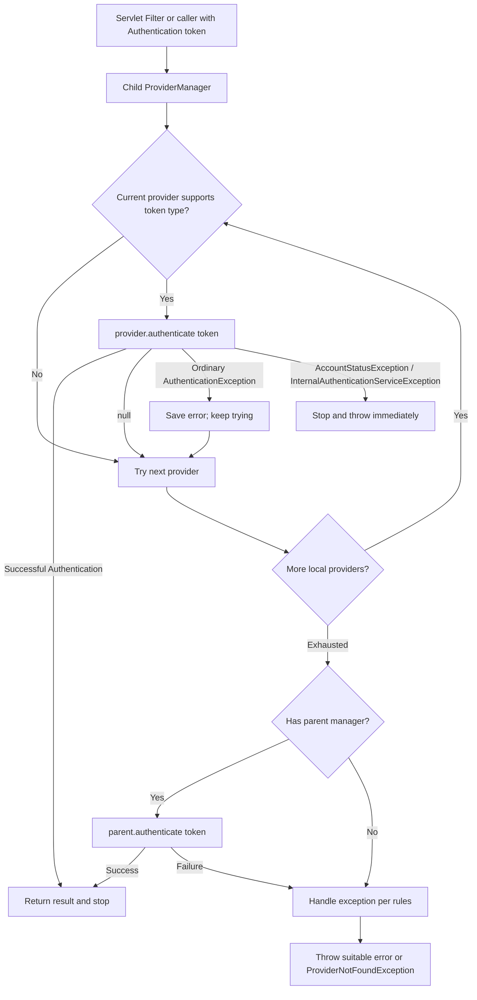
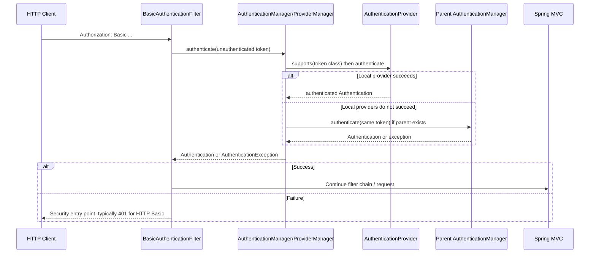

# ProviderManager: Selecting an AuthenticationProvider and Delegating to a Parent Manager

> **Context:** Spring Security 6.x with Spring Boot 3.x applications on the Servlet stack, Java 17+. This lesson explains how `ProviderManager` orchestrates `AuthenticationProvider`s, the selection condition via `supports(...)`, when it tries the next provider, when it calls a parent `AuthenticationManager`, and which exceptions halt processing immediately. The runnable example in the hands-on section uses Spring Security Core to observe the exact algorithm; the final section connects those results to HTTP filters in a Servlet application.

## 1. Role in the Authentication Flow

**Authentication** is the object representing authentication-related data (principal, credentials, authorities, `authenticated` state). For example, a Servlet filter handling HTTP Basic can create an unauthenticated `UsernamePasswordAuthenticationToken` with username/password.

**AuthenticationManager** is the interface that receives an `Authentication` and attempts to authenticate it:

```java
Authentication authenticate(Authentication authentication)
        throws AuthenticationException;
```

**ProviderManager** is a common implementation of `AuthenticationManager`. It **does not compare passwords itself** and does not query databases directly. Instead, it holds a list of `AuthenticationProvider` instances and dispatches to providers compatible with the `Authentication` type.

**AuthenticationProvider** is where a specific authentication mechanism is performed or delegated to suitable dependencies (for example, `DaoAuthenticationProvider` coordinating `UserDetailsService` and `PasswordEncoder`). Each provider has two core methods:

```java
Authentication authenticate(Authentication authentication)
        throws AuthenticationException;

boolean supports(Class<?> authentication);
```

- `supports(type) == false`: the provider does not handle this **token type**, so `ProviderManager` skips it without calling `authenticate(...)`.
- `supports(type) == true`: the provider *can* handle the token type; `ProviderManager` attempts to call `authenticate(...)`.
- `authenticate(...)` returns a non-`null` `Authentication`: authentication succeeds and searching for providers stops.
- `authenticate(...)` returns `null`: the provider could not decide or declined to handle this specific case; the manager continues trying other providers.
- `authenticate(...)` throws `AuthenticationException`: an authentication failure; whether to continue or stop immediately depends on the **exception type** (details in section 3).

**Important distinction:** `supports(...)` checks the **token class**, not whether the username exists in a database or whether the password is correct. Two providers can both return true for `UsernamePasswordAuthenticationToken` while only handling separate sets of accounts.

## 2. Visualizing Provider Selection Order and Parent Manager



When multiple providers exist, `ProviderManager` iterates through them **in configured order**. It does not reorder them by "strength", bean name, username, or guessing which provider will succeed.

When all local providers fail to produce a valid `Authentication`, the manager **may** call `parent.authenticate(authentication)` if a parent is configured. The **parent** is simply another `AuthenticationManager`; it can be another `ProviderManager` or another implementation. A parent is **not required** to exist.

If a parent is present, forwarding happens only when the child manager has not obtained a successful authentication result, unless a severe error triggers immediate short-circuiting. The parent **is never called again after a successful result** from a local provider.

## 3. How ProviderManager Handles Each Outcome

| Outcome at current provider | What happens next? | Meaning |
|---|---|---|
| `supports(token.getClass()) == false` | Skip provider, try next provider | Provider does not support this token type |
| `supports(...) == true` and `authenticate(...)` returns `null` | Try next provider; at end of list may call parent | Provider chose not to handle this case |
| Returns successful `Authentication` | Stop immediately, return result; do not call subsequent providers/parent | Authentication succeeded |
| Throws `BadCredentialsException` or ordinary `AuthenticationException` | Save latest exception, continue trying remaining providers; may try parent | One provider failing does not necessarily end the entire chain |
| Throws `AccountStatusException`, e.g. `DisabledException` | Stop immediately and throw; do not continue to other providers/parent | Invalid account status needs to block fallback |
| Throws `InternalAuthenticationServiceException` | Stop immediately and throw; do not continue / do not fall back to parent | Internal error in the authentication service |
| Exhausted providers, no result, has parent | Try `parent.authenticate(...)` | Give parent mechanism a chance to authenticate |
| No provider/parent authenticated and no meaningful `AuthenticationException` | Throw `ProviderNotFoundException` | No provider produced a result for the token |
| Parent throws `ProviderNotFoundException` | Child manager may ignore this "provider not found" error and retain the earlier local error | Avoid masking a specific local authentication error |

**An easily overlooked detail:** If the first provider throws `BadCredentialsException` but the second provider (also supporting the token type) authenticates successfully, `ProviderManager` returns the second provider's success. Conversely, for `DisabledException` (a subclass of `AccountStatusException`), the manager stops immediately; other providers and the parent manager are not tried. Depending on the mechanism, this is an intentional security decision to prevent bypassing locked or disabled accounts.

In a final failure case, the exception thrown is usually the **most recent meaningful exception**. If no exception occurred and every provider returned `null` or `supports == false`, `ProviderNotFoundException` indicates no way to authenticate the token was found. Production logic should not assume every failure is `BadCredentialsException`.

## 4. Parent Is Fallback Authentication, Not a "Superior That Always Runs"

Suppose there are two managers:

- **Child manager:** tries `LocalAccountProvider` and `PartnerAccountProvider`; serves internal/partner accounts.
- **Parent manager:** tries `ParentAccountProvider`; serves a shared account directory.

When a request uses token `UsernamePasswordAuthenticationToken("parent-user", "...")`:

1. The first local provider has `supports(UsernamePasswordAuthenticationToken.class) == true`, but the username is outside the directory it manages, so it returns `null`.
2. The partner provider also supports the token type but does not recognize that account, so it returns `null`.
3. Having exhausted local providers without success, the child manager calls `parent.authenticate(sameToken)`.
4. The parent's provider recognizes the account and returns an authenticated `Authentication`.
5. The child manager receives the parent's result and returns it to the caller. No additional local providers are called.

**When is the parent not called?** As soon as local success occurs, or when a provider throws `AccountStatusException`/`InternalAuthenticationServiceException` in the immediate-stop group. For ordinary errors like wrong passwords, the parent may still be tried. This requires clear policy: if you want to **forbid** all fallback on wrong passwords for an account domain, you cannot rely on `BadCredentialsException` alone to block the parent automatically.

The parent does not automatically "inherit" the child's providers; it is a separate manager. Avoid creating parent/child cycles. With multiple `SecurityFilterChain`s, there may be multiple managers at distinct levels or scopes; verify the exact manager being used by a given filter.

## 5. Runnable Java 17+ Example: Three Providers and One Parent Manager

The following example intentionally places the algorithm inside a Spring Boot console application to remove HTTP factors. It uses **Spring Security Core**; once you understand the output cleanly, it becomes much easier to see how Servlet authentication filters invoke `AuthenticationManager`.

### 5.1. Project Setup

Create a Gradle project with Spring Boot 3.x and Java 17+ via Spring Initializr, keeping the Java/Boot plugins and repositories generated by Initializr. In `build.gradle`, add this dependencies block (this is *part* of the file, not a standalone Gradle file):

```groovy
dependencies {
    implementation 'org.springframework.boot:spring-boot-starter'
    implementation 'org.springframework.security:spring-security-core'
}
```

Spring Boot dependency management selects the Spring Security Core version matching Boot 3.x. The example does not need embedded Tomcat because it focuses on `ProviderManager`.

### 5.2. Complete Source Code

Create **`src/main/java/com/example/demo/ProviderManagerLabApplication.java`**:

```java
package com.example.demo;

import java.util.List;

import org.springframework.boot.CommandLineRunner;
import org.springframework.boot.SpringApplication;
import org.springframework.boot.WebApplicationType;
import org.springframework.boot.autoconfigure.SpringBootApplication;
import org.springframework.context.annotation.Bean;
import org.springframework.security.authentication.AuthenticationProvider;
import org.springframework.security.authentication.BadCredentialsException;
import org.springframework.security.authentication.ProviderManager;
import org.springframework.security.authentication.TestingAuthenticationToken;
import org.springframework.security.authentication.UsernamePasswordAuthenticationToken;
import org.springframework.security.core.Authentication;
import org.springframework.security.core.AuthenticationException;
import org.springframework.security.core.GrantedAuthority;
import org.springframework.security.core.authority.SimpleGrantedAuthority;

@SpringBootApplication
public class ProviderManagerLabApplication {

    public static void main(String[] args) {
        SpringApplication app = new SpringApplication(ProviderManagerLabApplication.class);
        app.setWebApplicationType(WebApplicationType.NONE);
        app.run(args).close();
    }

    @Bean
    CommandLineRunner runLab() {
        return args -> {
            ProviderManager parent = new ProviderManager(List.of(
                    new NamedAccountProvider(
                            "parent", "parent-user", "parent-pass", "ROLE_PARENT")
            ));

            ProviderManager child = new ProviderManager(List.of(
                    new NamedAccountProvider(
                            "local", "alice", "alice-pass", "ROLE_USER"),
                    new NamedAccountProvider(
                            "partner", "bob", "bob-pass", "ROLE_PARTNER")
            ), parent);

            attempt(child, "alice", "alice-pass");
            attempt(child, "bob", "bob-pass");
            attempt(child, "parent-user", "parent-pass");
            attempt(child, "alice", "wrong-pass");
            attempt(child, "guest", "unknown-pass");

            System.out.println("--- unsupported token type ---");
            try {
                child.authenticate(new TestingAuthenticationToken("alice", "alice-pass"));
            } catch (AuthenticationException ex) {
                System.out.println("FAIL type=" + ex.getClass().getSimpleName());
            }
        };
    }

    private static void attempt(ProviderManager manager, String username,
                                String password) {
        System.out.println("--- " + username + " ---");

        Authentication request =
                UsernamePasswordAuthenticationToken.unauthenticated(
                        username, password);
        try {
            Authentication result = manager.authenticate(request);
            List<String> roles = result.getAuthorities().stream()
                    .map(GrantedAuthority::getAuthority)
                    .toList();
            System.out.println("OK " + result.getName() + " " + roles);
        } catch (AuthenticationException ex) {
            System.out.println("FAIL " + username + " "
                    + ex.getClass().getSimpleName());
        }
    }

    private static final class NamedAccountProvider
            implements AuthenticationProvider {

        private final String label;
        private final String expectedUser;
        private final String expectedPassword;
        private final String authority;

        private NamedAccountProvider(String label, String expectedUser,
                                     String expectedPassword, String authority) {
            this.label = label;
            this.expectedUser = expectedUser;
            this.expectedPassword = expectedPassword;
            this.authority = authority;
        }

        @Override
        public boolean supports(Class<?> authenticationType) {
            return UsernamePasswordAuthenticationToken.class
                    .isAssignableFrom(authenticationType);
        }

        @Override
        public Authentication authenticate(Authentication authentication)
                throws AuthenticationException {
            System.out.println("TRY " + label + " " + authentication.getName());

            if (!expectedUser.equals(authentication.getName())) {
                return null; // Account does not belong to this provider's scope
            }

            if (!expectedPassword.equals(authentication.getCredentials())) {
                throw new BadCredentialsException("Bad credentials");
            }

            return UsernamePasswordAuthenticationToken.authenticated(
                    authentication.getName(),
                    null,
                    List.of(new SimpleGrantedAuthority(authority))
            );
        }
    }
}
```

**Why are there three providers?** Two providers are in the child manager and one provider is in the parent manager; their order in `List.of(...)` reflects the exact trial order. All three return `supports(...) == true` for `UsernamePasswordAuthenticationToken`; each provider decides on its own to handle only one specific username. If the username is outside its scope, the provider returns `null` so other providers get a chance.

**Why return an authenticated token?** The provider has verified the authentication condition, so it returns an object with `authenticated=true` and authorities. The initial request token was created via the `unauthenticated(...)` factory, carrying no access permissions. This is the core API demonstration pattern.

**Demo limitations:** Passwords are compared directly only to observe the algorithm, never for production use. In real applications, use `DaoAuthenticationProvider` + `PasswordEncoder`, an identity provider, or a suitable mechanism; avoid hardcoding passwords, logging credentials, or building custom unreviewed authentication systems.

### 5.3. Running the Program

In the project directory with the Gradle wrapper:

```bash
# Linux/macOS
./gradlew bootRun

# Windows PowerShell
.\gradlew.bat bootRun
```

The lines **produced directly by `System.out.println` in the code**, ignoring Boot's banner/startup and shutdown logs, have the following expected order:

```text
--- alice ---
TRY local alice
OK alice [ROLE_USER]
--- bob ---
TRY local bob
TRY partner bob
OK bob [ROLE_PARTNER]
--- parent-user ---
TRY local parent-user
TRY partner parent-user
TRY parent parent-user
OK parent-user [ROLE_PARENT]
--- alice ---
TRY local alice
TRY partner alice
TRY parent alice
FAIL alice BadCredentialsException
--- guest ---
TRY local guest
TRY partner guest
TRY parent guest
FAIL guest ProviderNotFoundException
--- unsupported token type ---
FAIL type=ProviderNotFoundException
```

This is the **expected output when running the source code**; the program is not claimed to have been executed in the reader's environment. This sequence illustrates the workflow most clearly:

| Input | Local provider 1 | Local provider 2 | Parent provider | Outcome |
|---|---|---|---|---|
| `alice / alice-pass` | Succeeds | Not called | Not called | `ROLE_USER` |
| `bob / bob-pass` | Returns `null` | Succeeds | Not called | `ROLE_PARTNER` |
| `parent-user / parent-pass` | Returns `null` | Returns `null` | Succeeds | `ROLE_PARENT` |
| `alice / wrong-pass` | Throws `BadCredentialsException` | Returns `null` | Returns `null` | Throws `BadCredentialsException` |
| `guest / unknown-pass` | Returns `null` | Returns `null` | Returns `null` | `ProviderNotFoundException` |
| `TestingAuthenticationToken` | `supports == false` | `supports == false` | `supports == false` | `ProviderNotFoundException` |

**Key observation:** Even though the `local` provider throws `BadCredentialsException` for `alice` with a wrong password, the manager still tries `partner` and the parent, because this is an ordinary exception. The parent receives a token with the **same initial principal/credentials**; forwarding does not automatically transform the token into another type.

## 6. Case Requiring Immediate Stop: Disabled Account

The example above handled `BadCredentialsException`. Now consider a provider determining that user `alice` is disabled and throwing:

```java
throw new DisabledException("Account disabled");
```

`DisabledException` extends `AccountStatusException`. When a provider throws an exception in this group, `ProviderManager` **does not continue** to the next provider or the parent manager. The same applies to `InternalAuthenticationServiceException`, avoiding fallback cycles when the authentication service is experiencing severe failures.

In an application with multiple identity providers, do not let an inconsistent account-status check in one provider allow a locked user to re-authenticate through another provider. If you want a policy such as "when a local-domain account enters a wrong password, forbid fallback", you must **explicitly design token/provider scoping and manager selection rules**, rather than assuming `BadCredentialsException` automatically blocks fallback.

A provider should return `null` when it genuinely does not handle that case. If the provider is responsible for the account and the password is wrong, it should normally throw `BadCredentialsException`. Do not use `null` to hide infrastructure errors or disabled states, as doing so can open a path to authenticate through another provider.

## 7. Fitting into the Spring Security Servlet Flow

For an HTTP Basic request on the Servlet stack, the high-level flow is as follows:



The conditions in the diagram assume the filter is not blocked earlier and HTTP Basic is enabled. Specifically:

1. `BasicAuthenticationFilter` reads the HTTP Basic header, creates an unauthenticated `UsernamePasswordAuthenticationToken`, and calls the manager it is configured to use.
2. If the manager is `ProviderManager`, it selects providers based on `supports`, order, and exception handling as described above.
3. The manager returns a successful `Authentication`; the filter can establish the `SecurityContext` and continue the `FilterChain`. Downstream authorization filters then decide access permissions.
4. If authentication fails, Security handles the exception via the appropriate entry point/handler (HTTP Basic typically returns 401), and the request never reaches the controller.
5. After authentication, **authorization** checks roles/authorities as configured. `ProviderManager` returns the verified identity but does not decide which endpoints can be called.

**Do not confuse responsibilities:** `ProviderManager` does not parse HTTP `Authorization` headers, does not write HTTP responses, does not select MVC `@GetMapping`s, and does not automatically save `Authentication` into a session. It is an orchestrator at the authentication layer, invoked by filters or services.

### Configuring the Manager in a Servlet Application

In a real system, `HttpSecurity` and authentication filters are wired by Spring Security. With custom providers, you can configure them to participate in the corresponding chain's authentication manager, or supply a specific manager to a filter. Confirm **which manager the filter actually uses**; merely declaring a `@Bean ProviderManager` does not guarantee every security chain and every authentication filter automatically switches to that manager.

An **illustrative snippet**, placed inside a `SecurityFilterChain` configuration method once the manager is created:

```java
http.authenticationManager(childProviderManager)
    .authorizeHttpRequests(auth -> auth
        .anyRequest().authenticated())
    .httpBasic(Customizer.withDefaults());
```

This is a **configuration snippet**, not a standalone class; include appropriate imports for `HttpSecurity`, `Customizer`, and `AuthenticationManager`. Avoid wiring duplicate providers or providers incompatible with the token produced by the filter. Spring Boot has its own auto-configuration and parent manager mechanisms depending on wiring; do not infer ordering merely from bean names.

## 8. Notes on Credentials, Events, and Context

### 8.1. Erasing Credentials After Success

`ProviderManager` sets `eraseCredentialsAfterAuthentication = true` by default. If the resulting `Authentication` implements `CredentialsContainer`, the manager calls `eraseCredentials()` after authentication succeeds. This reduces how long credentials remain in memory. The example returns a `UsernamePasswordAuthenticationToken` with `null` credentials from the start, so passwords need not be printed to observe behavior.

If a principal or credentials object is shared via a cache and that object gets erased, understand the impact on the cache: subsequent authentications may lack required data. The solution should be proper object/caching design; do not hastily disable erasure system-wide just to treat the symptom.

### 8.2. Authentication Events

`ProviderManager` provides an `AuthenticationEventPublisher` mechanism to publish success/failure events. When instantiating a manager with `new ProviderManager(...)` outside auto-configuration, remember to wire an event publisher if events need to be observed. If the parent is also a `ProviderManager`, inconsistent event publisher configuration can cause missed or duplicate events.

In standard implementations, if the parent manager produces the successful result, the child does not publish a success event again for that same parent result. Observability and auditing must be verified at runtime against the real topology rather than assuming every manager emits events identically.

### 8.3. SecurityContext and Callers

A returned successful `Authentication` **is not automatically stored in `SecurityContextHolder` just because you called `ProviderManager.authenticate(...)` directly in Java**. The caller is responsible for updating the context appropriately. In an HTTP request flow, the authentication filter typically does this according to Security's lifecycle. In the console lab, the example intentionally inspects only the return value and exceptions, without a Servlet request/session.

## 9. Debugging Authentication Failures by Layer

| Symptom | Check First | Common Cause |
|---|---|---|
| `ProviderNotFoundException` | Actual token class and each provider's `supports(Class)` | No provider supports it or all returned `null` |
| Expected provider did not run | Provider list order; did an earlier provider return success? | Stopped at an earlier provider or `supports` returned false |
| Parent manager was not called | Did a local provider return `Authentication`? Was there a short-circuit exception? | Local success or `AccountStatusException`/`InternalAuthenticationServiceException` |
| Parent manager called despite local wrong password | Exception type and fallback policy | `BadCredentialsException` normally does not halt the entire chain |
| HTTP returns 401 and controller code never runs | Authentication filter, manager, entry point, Basic header | Authentication failed before MVC |
| Authenticated yet receives 403 | Authorities and HTTP/method authorization | Identity exists but lacks permission; not a provider selection issue |
| Unexpected authentication success | Multiple providers support the same token, parent has a more permissive provider | A later provider accepted even though an earlier one failed |
| Missing authentication events | Publisher and how managers were created/wired | Custom manager lacks a configured publisher |

**Investigation rule:** log safe metadata such as token class, provider label, outcome, exception class, and chain name; **never log passwords, Basic Authorization values, or Bearer tokens**. Use appropriate Spring Security DEBUG/TRACE logging during development, and disable sensitive log levels in production.

When using multiple `SecurityFilterChain`s (e.g., `/api/**` and `/admin/**`), check both **which chain is selected** and **which manager the filter inside that chain uses**. Having an `AuthenticationProvider` bean present in the application context is not sufficient proof that the active manager uses it.

## 10. Common Misconceptions

1. **"If `supports(...)` returns true, the provider must authenticate successfully."** No: it only means the provider supports the token class; `authenticate(...)` can still return `null` or throw an exception.
2. **"A wrong password at the first provider stops the manager immediately."** Not true for ordinary `BadCredentialsException`; subsequent providers and the parent may still be tried.
3. **"Any exception triggers fallback to the parent."** No: `AccountStatusException` and `InternalAuthenticationServiceException` halt processing immediately.
4. **"The parent is called before or after every local success to double-check."** No: the parent is a fallback when local providers have not produced success.
5. **"ProviderManager looks up users in the database itself."** No: that logic belongs to the provider and its dependencies.
6. **"Provider names determine priority."** No: the order of providers inside the manager and filter/chain configuration determine the path.
7. **"No provider found means the password is wrong."** No: `ProviderNotFoundException` usually relates to token type or no provider claiming to handle it.
8. **"Just defining an AuthenticationProvider bean makes every filter use it."** No: proper wiring into the `AuthenticationManager` used by the filter is required.
9. **"Successful authentication means access to all endpoints."** No: the authorization step may still deny access for lacking authorities.
10. **"Calling authenticate automatically updates the session/SecurityContext."** No: the manager provides a result or exception; the caller handles the subsequent lifecycle.

## 11. Self-Check Questions

**Question 1.** Two providers both return `supports(UsernamePasswordAuthenticationToken.class) == true`. The first provider returns `null`; the second returns a successful `Authentication`. What happens?  
**Answer:** The manager tries the second provider and returns success without calling the parent.

**Question 2.** The first provider throws `BadCredentialsException`, and the second provider succeeds. What is the outcome?  
**Answer:** It can succeed via the second provider because this exception type is normally saved while trying continues.

**Question 3.** The first provider throws `DisabledException`; the parent has an account with the same username. Is the parent called?  
**Answer:** No. `DisabledException` is an `AccountStatusException`, causing `ProviderManager` to stop immediately.

**Question 4.** All local providers return `null`, and the parent succeeds. Who supplies the final `Authentication`?  
**Answer:** The parent manager; the child returns that result to the caller.

**Question 5.** None of the providers (including the parent) support the token type. Which exception may occur?  
**Answer:** `ProviderNotFoundException`, because no mechanism can handle the token.

**Question 6.** In a Servlet application using HTTP Basic, which component creates the token from the request and which selects the provider?  
**Answer:** The HTTP Basic authentication filter creates the token and calls `AuthenticationManager`; `ProviderManager` selects the provider; the Security filter proceeds to update the context and handle the HTTP flow.

**Remember:** **ProviderManager selects by token type → iterates providers in order → stops on a successful Authentication → tries the parent manager if local providers did not succeed and no immediate-stop error occurred → returns the result or throws AuthenticationException.** This is the authentication orchestration mechanism; HTTP Servlet filters and the authorization step handle the rest of the request.