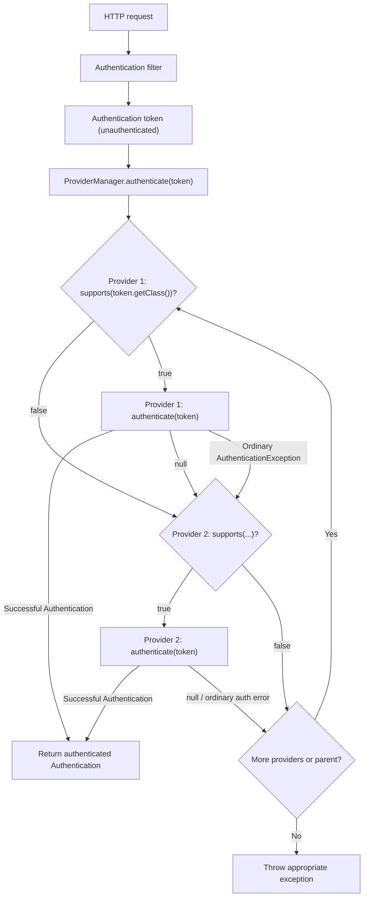

# `AuthenticationProvider.supports()` and Return Outcomes When Unsupported

**Topic:** Spring Security – Servlet · **Group:** Authentication Flow.  
**Goal:** Explain accurately how `ProviderManager` selects an `AuthenticationProvider`, the meaning of `supports(Class<?>)`, the difference between `false`, `null`, and exceptions, and the behavior when no provider can handle an `Authentication`.

Examples use **Java 17**, **Spring Boot 3.3.5**, and Spring Security 6.x. The core behavior is demonstrated by running `ProviderManager` standalone in a Java program; the final section connects to the HTTP filter chain in a Servlet application.

## 1. Placing `AuthenticationProvider` in the Authentication Flow

In a Spring Security Servlet application, an authentication filter receives data from the HTTP request, creates an `Authentication` object representing the authentication request, and calls `AuthenticationManager.authenticate(authentication)`. The standard implementation of `AuthenticationManager` is **`ProviderManager`**, which holds a list of `AuthenticationProvider` instances.



*The diagram shows the conceptual path; in practice, `ProviderManager` walks the provider list in order, remembers the latest authentication error, and has certain exceptions that halt processing immediately (see section 3). There is no loop back to an already-checked provider.*

What must be distinguished are **two different selection layers**:

- **`FilterChainProxy`** selects a `SecurityFilterChain` based on the HTTP request/path/dispatcher and chain ordering. A request typically executes through the **first matching chain**.
- **`ProviderManager`** selects `AuthenticationProvider`s based on the **Java class of the `Authentication` object** (and runtime handling capability), not directly on URL or controller order.

For example, a form login filter can create a `UsernamePasswordAuthenticationToken`; a username/password provider typically accepts this token type. If the request uses another mechanism, a filter can create a different token type, requiring a corresponding provider.

## 2. Contract of the Two Methods

`AuthenticationProvider` has two primary methods:

```java
public interface AuthenticationProvider {
    Authentication authenticate(Authentication authentication)
            throws AuthenticationException;

    boolean supports(Class<?> authentication);
}
```

This is an **API signature for explanation**, not a source file you need to redeclare in your project. In Spring Security, the real interface lives in package `org.springframework.security.authentication.AuthenticationProvider`.

### 2.1. `supports(Class<?>)`: Filtering by Token Type

`supports()` takes a `Class<?>` representing the **`Authentication` type** and reports whether the provider can consider that type:

```java
@Override
public boolean supports(Class<?> authentication) {
    return UsernamePasswordAuthenticationToken.class
            .isAssignableFrom(authentication);
}
```

This snippet is an illustrative method used **inside an `AuthenticationProvider` class**; the required import is `org.springframework.security.authentication.UsernamePasswordAuthenticationToken`.

- Returns `false`: `ProviderManager` **skips the provider** and does not call its `authenticate()` method for the current token.
- Returns `true`: the provider is **permitted to attempt** `authenticate()`; **it does not guarantee** that the username/password is correct or that the provider will succeed.
- Returning `true` only confirms capability to handle the **token type**, not that every instance of that type is valid.

`Class.isAssignableFrom(...)` allows accepting subclasses of `UsernamePasswordAuthenticationToken` if appropriate. If you use `authentication == UsernamePasswordAuthenticationToken.class`, subclasses are excluded; use exact class equality only when you genuinely need that restriction.

**Common mistake:** passing `User.class`, a login DTO, `HttpServletRequest.class`, or `String.class` into `supports()`. `ProviderManager` passes **`authentication.getClass()`**, i.e., the class of the token object passed to `authenticate()`, not the class of the principal or credentials.

### 2.2. `authenticate(Authentication)`: Actual Outcomes

By Spring Security's contract, this method has three outcome categories:

| Result | Meaning | Standard `ProviderManager` Behavior |
| --- | --- | --- |
| Returns non-`null` `Authentication` | Provider authenticated successfully and supplied principal/authorities | **Stop** trying remaining providers; return the successful result. |
| Returns `null` | Provider cannot produce an authentication result for this token and **defers to other providers** | Try the next provider (if any); not treated as success. |
| Throws `AuthenticationException` | Provider evaluated and detected an authentication error (bad credentials, locked account, service failure...) | Depending on exception type: may remember the error and try subsequent providers, or stop immediately. |

Exception examples:

- `BadCredentialsException`: invalid credentials, a subclass of `AuthenticationException`.
- `DisabledException`, `LockedException`: account status does not allow authentication; these belong to the `AccountStatusException` branch.
- `InternalAuthenticationServiceException`: internal error in the authentication service that must be handled as an infrastructure failure.

Do not return an `Authentication` marked `authenticated=true` without verifying credentials/policy. Do not use `null` to silently let a wrong password succeed at a subsequent provider without explicit design intent.

## 3. When Unsupported: How `false` Differs from `null` and Exceptions

Consider a `ProviderManager` with three providers listed in order:

```text
Provider A → Provider B → Provider C
```

### Case A — `supports(...)` returns `false`

If A does not support the token's class, `ProviderManager` **does not call `A.authenticate(...)`**. It moves on to B, then C in order.

For example, A handles `UsernamePasswordAuthenticationToken`, but the filter sends a `TestingAuthenticationToken` or a different Bearer token type. A is skipped completely. That is why you should not call `authenticate()` manually and assume the same behavior as `ProviderManager`: the manager also checks `supports()`.

### Case B — `supports(...)` returns `true`, yet `authenticate(...)` returns `null`

A says "I can examine this token type", but after inspecting the specific instance, A declines to decide. `ProviderManager` tries B. This is an **abstain** pattern, useful when multiple providers support the same `Authentication` class while each handles a separate account type or identity realm.

```java
@Override
public Authentication authenticate(Authentication token) {
    if (!isAccountInMyRealm(token.getName())) {
        return null; // Another provider may handle it.
    }
    return verifyCredentialsAndBuildAuthentication(token);
}
```

The methods `isAccountInMyRealm` and `verifyCredentialsAndBuildAuthentication` above are **pseudocode**, not part of the Java/Spring Security API. This example illustrates the **semantics of returning `null`**, while the complete program in section 5 has real classes and methods.

Do not use `return null` as a way to ignore every credential error. If a provider **has identified** its own account but the password is wrong, it should normally throw `BadCredentialsException`, avoiding unintended fallback authentication through another provider.

### Case C — `authenticate(...)` throws `AuthenticationException`

Provider A may throw `BadCredentialsException`; `ProviderManager` typically **saves the exception and tries B**. If B succeeds, the successful result is returned. If no provider succeeds and the parent manager cannot handle it either, the saved authentication exception is thrown (usually the last relevant exception).

**Important exception to that rule:** `AccountStatusException` (e.g., locked/disabled account) and `InternalAuthenticationServiceException` are handled by `ProviderManager` by **stopping immediately** without asking subsequent providers. Do not oversimplify by claiming *every* `AuthenticationException` allows fallback.

### Case D — Every provider is unsupported or returns `null`

If all providers are skipped due to `supports(...) == false`, or the tried providers all return `null`, and no parent manager succeeds, `ProviderManager` throws:

```text
ProviderNotFoundException
```

`ProviderNotFoundException` is a subtype of `AuthenticationException`. It reports that **no provider produced an authentication result for the token type/request**; it does not mean the password was wrong. The detailed exception message may include the token class name and vary by version, so tests should assert the **exception type** rather than hardcoding the full message text.

### Quick Decision Table

| Scenario | Is `authenticate()` called? | Is the next provider tried? | Outcome if none succeed |
| --- | --- | --- | --- |
| `supports()` = `false` | No | Yes | `ProviderNotFoundException` if all skip. |
| `supports()` = `true`, `authenticate()` = `null` | Yes | Yes | `ProviderNotFoundException` if all abstain. |
| `supports()` = `true`, returns successful token | Yes | No | Returns the authenticated `Authentication`. |
| `supports()` = `true`, throws `BadCredentialsException` | Yes | Usually yes | Authentication error is retained if none succeed. |
| Throws `AccountStatusException` or `InternalAuthenticationServiceException` | Yes | No (halts) | Immediately throws the respective exception. |

If a **parent `AuthenticationManager`** is configured, `ProviderManager` may also consult the parent when local providers yield no result. In that case, the result/exception from the parent must be considered before determining the final error.

## 4. How `ProviderManager` Performs Selection

The following pseudocode intentionally omits event publishing, parent/exception details, and credential erasure to emphasize the role of `supports()`:

```java
// Pseudocode, not verbatim Spring Security source code.
Authentication result = null;

for (AuthenticationProvider provider : providers) {
    if (!provider.supports(authentication.getClass())) {
        continue;
    }

    try {
        result = provider.authenticate(authentication);
        if (result != null) {
            break;
        }
    } catch (AuthenticationException ex) {
        // Some types must halt immediately; ordinary errors
        // can be remembered while trying the next provider.
    }
}
```

**Four design points to remember:**

1. The order of `AuthenticationProvider`s in `ProviderManager` matters when multiple providers support the same token type: the first provider returning success wins. Later providers might never be called.
2. `supports(true)` does not authenticate the user; it only answers **class compatibility**. Implement it lightly and reliably—do not query databases or networks to check passwords inside `supports()`.
3. `authenticate(null)` is not a valid call meaning "skip". In `authenticate(Authentication)`, a **`null` return value** is what means deferring to the next provider. Do not confuse the argument with the return value.
4. On successful authentication, `ProviderManager` may copy request info (`details`) onto the result and erase credentials on the result if it implements `CredentialsContainer`. Credential erasure logic must also be considered if you write a custom `AuthenticationManager`/provider.

## 5. Runnable Java 17 Example: All Four Outcomes

The following example runs **`ProviderManager` directly** to demonstrate provider selection order without needing a server or browser. Section 7 connects how servlet filters use this mechanism.

### 5.1. Project Structure

```text
provider-supports-demo/
├── pom.xml
└── src/
    ├── main/java/demo/
    │   └── ProviderSelectionDemo.java
    └── test/java/demo/
        └── ProviderSelectionDemoTest.java
```

### 5.2. `pom.xml`

```xml
<?xml version="1.0" encoding="UTF-8"?>
<project xmlns="http://maven.apache.org/POM/4.0.0"
         xmlns:xsi="http://www.w3.org/2001/XMLSchema-instance"
         xsi:schemaLocation="http://maven.apache.org/POM/4.0.0 https://maven.apache.org/xsd/maven-4.0.0.xsd">
    <modelVersion>4.0.0</modelVersion>

    <parent>
        <groupId>org.springframework.boot</groupId>
        <artifactId>spring-boot-starter-parent</artifactId>
        <version>3.3.5</version>
        <relativePath/>
    </parent>

    <groupId>demo</groupId>
    <artifactId>provider-supports-demo</artifactId>
    <version>1.0.0</version>

    <properties>
        <java.version>17</java.version>
    </properties>

    <dependencies>
        <dependency>
            <groupId>org.springframework.boot</groupId>
            <artifactId>spring-boot-starter-security</artifactId>
        </dependency>
        <dependency>
            <groupId>org.springframework.boot</groupId>
            <artifactId>spring-boot-starter-test</artifactId>
            <scope>test</scope>
        </dependency>
    </dependencies>

    <build>
        <plugins>
            <plugin>
                <groupId>org.codehaus.mojo</groupId>
                <artifactId>exec-maven-plugin</artifactId>
                <version>3.5.0</version>
            </plugin>
        </plugins>
    </build>
</project>
```

The Spring Boot BOM provides compatible Spring Security dependency versions. `exec-maven-plugin` lets you run the `main` class via Maven. The Security starter in this example provides the **authentication API**; without `spring-boot-starter-web`, this program **does not start a Servlet container**. That lets you observe `ProviderManager` logic in isolation.

### 5.3. `src/main/java/demo/ProviderSelectionDemo.java`

```java
package demo;

import java.util.List;
import java.util.Objects;

import org.springframework.security.authentication.AuthenticationProvider;
import org.springframework.security.authentication.BadCredentialsException;
import org.springframework.security.authentication.ProviderManager;
import org.springframework.security.authentication.ProviderNotFoundException;
import org.springframework.security.authentication.TestingAuthenticationToken;
import org.springframework.security.authentication.UsernamePasswordAuthenticationToken;
import org.springframework.security.core.Authentication;
import org.springframework.security.core.authority.SimpleGrantedAuthority;

public final class ProviderSelectionDemo {

    // Supports username/password type but defers to another provider.
    public static final class AbstainingProvider
            implements AuthenticationProvider {

        @Override
        public boolean supports(Class<?> type) {
            return UsernamePasswordAuthenticationToken.class
                    .isAssignableFrom(type);
        }

        @Override
        public Authentication authenticate(Authentication token) {
            return null;
        }
    }

    // Actually authenticates username/password.
    public static final class PasswordProvider
            implements AuthenticationProvider {

        @Override
        public boolean supports(Class<?> type) {
            return UsernamePasswordAuthenticationToken.class
                    .isAssignableFrom(type);
        }

        @Override
        public Authentication authenticate(Authentication token) {
            boolean userMatches = "lan".equals(token.getName());
            boolean passwordMatches =
                    Objects.equals("s3cr3t", token.getCredentials());

            if (!userMatches || !passwordMatches) {
                throw new BadCredentialsException("Invalid credentials");
            }

            return UsernamePasswordAuthenticationToken.authenticated(
                    token.getName(),
                    null,
                    List.of(new SimpleGrantedAuthority("ROLE_USER"))
            );
        }
    }

    public static void main(String[] args) {
        AuthenticationProvider abstain = new AbstainingProvider();
        AuthenticationProvider password = new PasswordProvider();
        ProviderManager manager =
                new ProviderManager(List.of(abstain, password));

        System.out.println("supports UsernamePassword: "
                + password.supports(UsernamePasswordAuthenticationToken.class));
        System.out.println("supports TestingAuthentication: "
                + password.supports(TestingAuthenticationToken.class));

        Authentication authenticated = manager.authenticate(
                UsernamePasswordAuthenticationToken.unauthenticated(
                        "lan", "s3cr3t"));

        System.out.println("success: " + authenticated.getName()
                + " authenticated=" + authenticated.isAuthenticated());

        try {
            manager.authenticate(
                    UsernamePasswordAuthenticationToken.unauthenticated(
                            "lan", "wrong"));
        } catch (BadCredentialsException exception) {
            System.out.println("wrong password: "
                    + exception.getClass().getSimpleName());
        }

        try {
            manager.authenticate(
                    new TestingAuthenticationToken("lan", "s3cr3t"));
        } catch (ProviderNotFoundException exception) {
            System.out.println("wrong token type: "
                    + exception.getClass().getSimpleName());
        }

        ProviderManager onlyAbstains =
                new ProviderManager(List.of(abstain));

        try {
            onlyAbstains.authenticate(
                    UsernamePasswordAuthenticationToken.unauthenticated(
                            "lan", "s3cr3t"));
        } catch (ProviderNotFoundException exception) {
            System.out.println("all abstain: "
                    + exception.getClass().getSimpleName());
        }
    }
}
```

**Why does the example have two providers that both return `supports(true)`?** `AbstainingProvider` accepts inspecting the token type yet always returns `null`, giving the next provider a chance. `PasswordProvider` marks authentication successful only when username and password match and returns a token with `ROLE_USER`; if invalid, it throws `BadCredentialsException`.

`TestingAuthenticationToken` comes from Spring Security Core and is used here as a **different token type**. Neither provider supports it (they only support `UsernamePasswordAuthenticationToken`), so neither provider is invoked to authenticate `TestingAuthenticationToken`.

**Security note:** the user and password in the example are hardcoded solely for explanation. This is not a production password storage mechanism: real applications need `UserDetailsService`/identity providers, a proper `PasswordEncoder`, HTTPS transport, and secret management. Never log `getCredentials()` values.

### 5.4. Running and Output

Requires JDK 17+, Maven, and access to download dependencies. Inside `provider-supports-demo`:

```bash
mvn -q test
mvn -q compile exec:java -Dexec.mainClass=demo.ProviderSelectionDemo
```

Output **printed by `main`**, excluding auxiliary build tool messages, is:

```text
supports UsernamePassword: true
supports TestingAuthentication: false
success: lan authenticated=true
wrong password: BadCredentialsException
wrong token type: ProviderNotFoundException
all abstain: ProviderNotFoundException
```

Matching line by line:

1. `PasswordProvider.supports(UsernamePasswordAuthenticationToken.class)` is `true`.
2. `PasswordProvider.supports(TestingAuthenticationToken.class)` is `false`.
3. With valid credentials, `AbstainingProvider.authenticate()` returns `null`, `PasswordProvider` authenticates successfully, and the manager returns a token with `isAuthenticated() == true`.
4. With a wrong password, the final provider throws `BadCredentialsException`; with no other providers remaining, the manager reports this error.
5. An unsupported token type produces `ProviderNotFoundException` even though its internal data matches valid username/password values.
6. A manager whose only provider always abstains also produces `ProviderNotFoundException`, **even though `supports()` returns `true`**.

No test case checks whether a wrong password "falls through to a controller", because this example has no Servlet/HTTP server.

### 5.5. `src/test/java/demo/ProviderSelectionDemoTest.java`

```java
package demo;

import java.util.List;

import org.junit.jupiter.api.Test;
import org.springframework.security.authentication.BadCredentialsException;
import org.springframework.security.authentication.ProviderManager;
import org.springframework.security.authentication.ProviderNotFoundException;
import org.springframework.security.authentication.TestingAuthenticationToken;
import org.springframework.security.authentication.UsernamePasswordAuthenticationToken;
import org.springframework.security.core.Authentication;

import static org.junit.jupiter.api.Assertions.assertEquals;
import static org.junit.jupiter.api.Assertions.assertFalse;
import static org.junit.jupiter.api.Assertions.assertThrows;
import static org.junit.jupiter.api.Assertions.assertTrue;

class ProviderSelectionDemoTest {

    private ProviderManager managerWithFallback() {
        return new ProviderManager(List.of(
                new ProviderSelectionDemo.AbstainingProvider(),
                new ProviderSelectionDemo.PasswordProvider()));
    }

    @Test
    void supportsChecksAuthenticationTokenClass() {
        var provider = new ProviderSelectionDemo.PasswordProvider();
        assertTrue(provider.supports(UsernamePasswordAuthenticationToken.class));
        assertFalse(provider.supports(TestingAuthenticationToken.class));
    }

    @Test
    void nullFromFirstProviderLetsSecondSucceed() {
        Authentication result = managerWithFallback().authenticate(
                UsernamePasswordAuthenticationToken.unauthenticated(
                        "lan", "s3cr3t"));

        assertTrue(result.isAuthenticated());
        assertEquals("lan", result.getName());
        assertEquals("ROLE_USER", result.getAuthorities()
                .iterator().next().getAuthority());
    }

    @Test
    void badPasswordIsAuthenticationFailure() {
        assertThrows(BadCredentialsException.class, () ->
                managerWithFallback().authenticate(
                        UsernamePasswordAuthenticationToken.unauthenticated(
                                "lan", "wrong")));
    }

    @Test
    void allUnsupportedProvidersCauseProviderNotFound() {
        assertThrows(ProviderNotFoundException.class, () ->
                managerWithFallback().authenticate(
                        new TestingAuthenticationToken("lan", "s3cr3t")));
    }

    @Test
    void allAbstainingProvidersCauseProviderNotFound() {
        ProviderManager manager = new ProviderManager(List.of(
                new ProviderSelectionDemo.AbstainingProvider()));

        assertThrows(ProviderNotFoundException.class, () ->
                manager.authenticate(
                        UsernamePasswordAuthenticationToken.unauthenticated(
                                "lan", "s3cr3t")));
    }
}
```

Run `mvn test` so the Spring Boot Maven parent configures Surefire/JUnit 5 and executes **five tests**. The tests verify `supports` values, success after the first provider returns `null`, and the distinction between `BadCredentialsException` and `ProviderNotFoundException`. Here, the tests do not evaluate the Servlet filter chain or HTTP responses.

## 6. When a Parent `AuthenticationManager` Exists

A `ProviderManager` can be designed with a **parent manager**. If no local provider authenticates successfully, it may delegate to the parent. Therefore:

- "Every local provider returned `null`" is **not enough** to conclude the request ultimately receives `ProviderNotFoundException` if a parent can handle it.
- The parent can successfully authenticate tokens that local providers do not handle.
- If the parent also fails to authenticate, the final exception depends on the trial flow and the exceptions encountered.

Do not rely on a parent as an accidental "rescue": when configuring, know exactly which providers are installed and the fallback order. A system with multiple `SecurityFilterChain`s can also share or separate `AuthenticationManager` instances depending on configuration; **do not equate** each chain with a single provider.

## 7. Connecting to Spring Security Servlet: Where Do Errors Appear?

A typical form login or HTTP Basic flow looks like:

```text
HttpServletRequest
   ↓
UsernamePasswordAuthenticationFilter / BasicAuthenticationFilter
   ↓
UsernamePasswordAuthenticationToken
   ↓
AuthenticationManager (typically ProviderManager)
   ↓
AuthenticationProvider.supports(UsernamePasswordAuthenticationToken.class)
   ├─ false → try another provider
   ├─ true  → provider.authenticate(token)
   │           ├─ Successful Authentication
   │           ├─ null → try another provider
   │           └─ AuthenticationException → handle per type
   ↓
Success: authentication/security context is handled by the filter
Failure: security filter invokes corresponding failure/entry point mechanism
```

`AuthenticationProvider` **does not directly decide HTTP status codes**. It returns a result or throws an exception at the authentication layer. Filters and components such as `AuthenticationEntryPoint` and `AuthenticationFailureHandler` determine the HTTP response: `401` for HTTP Basic, redirect to a login/failure page, or a custom error format matching configuration. Never equate `ProviderNotFoundException` with a single fixed HTTP status across all applications.

Scenario comparison table:

| Servlet Scenario | What May Be Wrong | How to Check |
| --- | --- | --- |
| Added a custom `AuthenticationProvider` yet `authenticate()` never runs | `supports()` returns `false` for the token created by the filter, or the provider was not registered on the manager actually used by the filter | Log `authentication.getClass()`, inspect the provider list/manager and `supports` boolean. |
| Valid form login returns provider not found error | Manager receives a token that no provider supports or all providers return `null` | Check `UsernamePasswordAuthenticationToken`, `DaoAuthenticationProvider`/custom provider beans, and parent manager. |
| Custom provider always returns `null` on wrong password | Fallback design may let another provider try those credentials | Distinguish "outside my authentication realm" from "checked and password was wrong". |
| First provider throws `BadCredentialsException`, later provider still runs | Manager allows trying another provider after ordinary authentication failure | Check provider order and intended policy. |
| Account is locked yet later provider does not run | `AccountStatusException` blocks fallback | Investigate account status root cause; do not work around by changing `supports`. |
| Switched filter chain yet error persists | Another chain uses a different `AuthenticationManager`/provider or matches the URL first | Check `securityMatcher`, `@Order`, filters, and manager of the **selected chain**. |

### Choosing the Right Token Type

`supports()` typically compares `Authentication` subtypes, such as:

- `UsernamePasswordAuthenticationToken`: commonly used in form login or HTTP Basic; providers supporting username/password can handle it.
- `BearerTokenAuthenticationToken`: appears in OAuth2 Resource Server bearer authentication flows when corresponding dependencies/configurations are present. Resource server JWT or opaque-token providers handle it per mechanism.
- `AnonymousAuthenticationToken`: represents anonymous authentication in the security context; should not be treated as a username/password login request.
- Custom `Authentication` type: requires a provider declaring `supports()` for that exact class when building a new authentication mechanism.

Do not broaden `supports()` to `return true` for every class and then blindly cast to `UsernamePasswordAuthenticationToken`: other filters may create incompatible tokens, leading to `ClassCastException` or misrouted authentication logic.

## 8. Wiring a Provider into the Application: Things to Watch

In modern Spring Security, you can configure an `AuthenticationProvider` via `HttpSecurity.authenticationProvider(...)`, or build an `AuthenticationManager` with a list of providers/parent according to the application's architecture. The snippet below is **only a fragment** inside a Servlet configuration bean (requiring a custom provider bean, imports, and a Spring Boot/MVC application):

```java
@Bean
SecurityFilterChain webSecurity(
        HttpSecurity http,
        AuthenticationProvider customProvider) throws Exception {

    http.authenticationProvider(customProvider);

    http.authorizeHttpRequests(auth -> auth
            .requestMatchers("/public").permitAll()
            .anyRequest().authenticated());

    http.formLogin(Customizer.withDefaults());

    return http.build();
}
```

Meaning: adds the custom provider to the manager built for that `HttpSecurity` configuration. This is **not** a way to automatically replace all providers across every chain; with multiple `SecurityFilterChain`s, verify which manager is actually used. `Customizer` belongs to `org.springframework.security.config.Customizer`; this is a fragment illustrating placement rather than a standalone runnable program.

A custom provider should not perform HTTP logic itself (redirects, setting cookies, writing `HttpServletResponse`). Let filters and failure/success handlers handle the Servlet layer. The provider focuses on inspecting `Authentication`, verifying credentials, and returning the verified principal/authorities.

## 9. Common Implementation Mistakes and Fixes

### Mistake 1 — `supports()` always returns `false` due to checking the wrong class

```java
// Wrong if the manager receives UsernamePasswordAuthenticationToken:
return authentication.equals(String.class);
```

More accurately, compare against the class of the **token** created by the filter, typically using `isAssignableFrom` if subclasses must be supported.

### Mistake 2 — `supports()` returns `true`, then `authenticate()` casts without checking

This easily causes `ClassCastException` when handling multiple authentication types. Keep the contract of `supports()` and `authenticate()` consistent. If using custom tokens, test parent/child classes and unrelated tokens.

### Mistake 3 — Returning `null` for all wrong-password cases

If a provider has taken responsibility for verifying an account and authentication fails, report an error via an appropriate `AuthenticationException`. `null` should express "this provider cannot decide for this request". Fallback among providers supporting the same token type must be designed intentionally.

### Mistake 4 — Manually throwing `ProviderNotFoundException` for a wrong password

Normally throw `BadCredentialsException` for invalid credentials. `ProviderNotFoundException` reflects that **no provider produced a result** after selection and is usually thrown by the manager. The wrong exception type makes diagnostics harder.

### Mistake 5 — Treating `supports(true)` as password verification

`supports()` only receives `Class<?>`, with no username or password. You cannot rely on `supports()` to check per-user credentials. That logic belongs in `authenticate(Authentication)` or a service it calls.

### Mistake 6 — Forgetting to handle locked/disabled accounts

Do not use `return null` to skip an account already identified as locked. The provider should throw an appropriate status exception; `ProviderManager` stops per contract on `AccountStatusException`.

### Mistake 7 — Testing only the provider class, not the manager or filter

Directly unit testing `provider.authenticate()` **does not prove** `ProviderManager` will invoke that provider. Test `supports`, fallback order, and the case where no provider handles the token. For real web applications, use MockMvc/integration tests to verify routes, authentication filters, entry points, and responses. Never infer HTTP statuses from core Java units alone.

## 10. Checklist When Debugging `ProviderNotFoundException`

1. **Identify the exact token class:** read `authentication.getClass().getName()` in safe code or structured logging; never log credentials, `Authorization` headers, cookies, or raw tokens.
2. **Identify the actual filter/manager:** which `SecurityFilterChain` does the request hit, and which `AuthenticationManager` does the filter call?
3. **Check each `supports(token.getClass())`:** does any provider return `true`? If not, register the right provider or construct the right token type.
4. **If `true`, check if `authenticate()` returns `null`:** is the provider legitimately abstaining due to a different realm/account type?
5. **Check ordering and parent manager:** which provider runs first? Does any provider succeed or throw an early-stop exception?
6. **Test all four paths:** success, bad credentials, unsupported token class, and supported type where all return `null`.
7. **Security:** do not print credentials/secrets, do not `return true` for all token classes, and do not build a successful `Authentication` before actually verifying credentials.

## 11. Self-Practice Questions

**Question 1.** A returns `supports(false)`, B returns `supports(true)` and `authenticate(null)`, C returns a successful result. Which ones are called?  
**Answer:** Only B and C get to run `authenticate()`. A is skipped. C succeeds, so the manager returns C's result.

**Question 2.** Both A and B return `supports(false)`, with no parent. What happens?  
**Answer:** No provider handles the token → `ProviderNotFoundException`.

**Question 3.** A `supports(true)` yet returns `null`; B `supports(true)` yet also returns `null`. Is authentication successful?  
**Answer:** No. If no parent handles it, `ProviderNotFoundException`.

**Question 4.** A throws `BadCredentialsException`, and B can authenticate successfully. Does ProviderManager stop immediately at A?  
**Answer:** Not necessarily. For ordinary authentication errors, it can proceed to B. Only errors such as `AccountStatusException` or `InternalAuthenticationServiceException` cause it to stop immediately.

**Question 5.** Does `supports(false)` directly produce HTTP `403`?  
**Answer:** No. It only causes the provider to be skipped. The manager may try other providers; only upon failure do exceptions handled by the authentication layer/Servlet filters per configuration produce an HTTP response.

**Remember:** `supports(false)` = *skip provider before calling*; `authenticate()` returning `null` = *inspected but abstained*; `AuthenticationException` = *report authentication failure*; valid `Authentication` = *success*. When no provider produces a result and no parent handles it, `ProviderManager` reports `ProviderNotFoundException`.