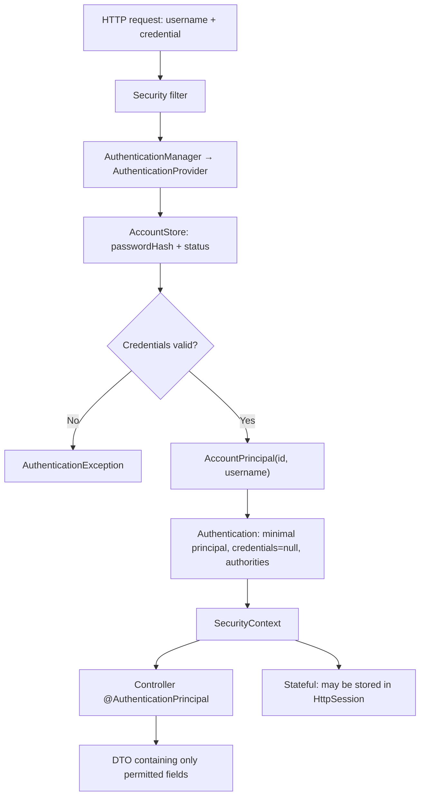

# Designing a Custom Principal and Limiting Stored Sensitive Data

**Module:** Spring Security – Servlet · **Topic:** Accounts  
**Goal:** Design `Authentication.getPrincipal()` to hold only the necessary identity, separate authentication information from account data, and avoid leaking passwords, password hashes, tokens, and PII through `SecurityContext`, sessions, caches, logs, or JSON.

This lesson uses **Java 17, Spring Boot 3.3.5, Spring Security 6.x**. The runnable example uses HTTP Basic and a custom `AuthenticationProvider` to demonstrate the principle; the end of the lesson further explains the impact of form login and `HttpSession`.

## 1. Distinguishing the Principal from the Database Account

`Authentication` represents an authentication request or an authentication result. After successful authentication, it has key parts:

| API | Function | Risk if designed poorly |
| --- | --- | --- |
| `getPrincipal()` | Caller's identity; may be `UserDetails`, a name, `Jwt`, or a custom type | Carries a full entity with password hashes/PII into context, sessions, and logs |
| `getCredentials()` | Proof, e.g., password from the request; usually needs clearing after authentication | Secret lives too long or gets serialized |
| `getAuthorities()` | Granted permissions, such as `ROLE_USER` | Stale permissions may remain in session after revocation |
| `getDetails()` | Additional metadata about the authentication call | Accidentally stores request headers or tokens in context |
| `isAuthenticated()` | Authentication status of the token | Creating an "authenticated" token before verifying the password is a vulnerability |

In the Servlet stack, the security filter extracts credentials from the HTTP request, passes an unauthenticated token to `AuthenticationManager` (usually `ProviderManager`), and a provider checks the account source. The result can be held in the request's `SecurityContext`. If the application uses sessions, that result can be saved to restore on subsequent requests.



**Principle:** The principal is the **trusted post-authentication identifier**, not a full copy of the `users` row. Reading emails, addresses, phone numbers, contracts, or business data must go through services with appropriate permission checks.

## 2. Choosing Minimal Fields

| Data | Where should it live? | Explanation |
| --- | --- | --- |
| Immutable account ID, e.g., `42` | Can live on principal | ID serves lookup and auditing, avoiding reliance on mutable names |
| Alias-style username `learner` | Can live on principal if genuinely needed | If username is an email/phone number, that is PII; consider keeping only an opaque ID |
| Authorities like `ROLE_USER` | `Authentication.getAuthorities()` | No need to duplicate another role list inside the principal |
| Raw password | Only during the authentication step | Never put in principal, session, logs, DTOs, or exceptions |
| Encoded password hash | Account store / authentication layer | Hashes are still secrets vulnerable to offline guessing; never a field on principal |
| Access/refresh tokens, API keys, OTP seeds | Secret/token storage with dedicated scope and lifecycle | Never embed in principal, never log |
| Email, phone, ID documents, DOB, address | Authorized business services | Read only when needed, do not auto-cache into context |
| JPA entities with lazy relations | Persistence layer | Never attach entities/collections to principal due to session serialization, field exposure, and coupling |
| Session ID, CSRF token, request body | Appropriate context/request storage | Do not turn into principal properties |

A principal should have **few fields, immutability, and simple types**. "Hiding" a field with `@JsonIgnore` or overriding `toString()` does not remove it from heap memory, Java serialization, debuggers, or session stores.

### 2.1. `UserDetails` Differs from the Post-Authentication Principal

A typical `DaoAuthenticationProvider` calls `UserDetailsService.loadUserByUsername` to fetch `UserDetails`; `UserDetails.getPassword()` provides the **encoded password** for matching. After authentication, the result may use that `UserDetails` itself as the principal. Therefore, if a custom `UserDetails` holds a hash, you must understand credential erasure, caching, and which object actually remains in `SecurityContext`.

By default, `ProviderManager` can run `eraseCredentialsAfterAuthentication` on results supporting `CredentialsContainer`; however, **do not rely on assuming every custom token/provider supports it**. With a cache sharing `UserDetails` instances, erasing credentials on the shared object can even leave subsequent logins without a hash. Manage object lifecycles and caches explicitly.

One way to reduce risk is **separating the account/hash storage object** from the **principal on the successful token**, as in Section 4's example. Do not set `getPassword() == null` in `UserDetails` expecting default `DaoAuthenticationProvider` to still verify passwords; that provider needs the hash during authentication.

## 3. Writing a Custom Principal in Java 17

The object below is a record with no password or hash. It implements `java.security.Principal` so `Authentication.getName()` returns the username cleanly:

```java
package demo.principal;

import java.io.Serial;
import java.io.Serializable;
import java.security.Principal;

public record AccountPrincipal(long id, String username)
        implements Principal, Serializable {

    @Serial
    private static final long serialVersionUID = 1L;

    @Override
    public String getName() {
        return username;
    }
}
```

- `record` provides component accessors `id()`, `username()`, `equals`, `hashCode`, and `toString`, with no setters. Immutability makes it hard for the object to change identity mid-processing.
- `Principal.getName()` returns a clean name. With a plain record not implementing `Principal`/`UserDetails`/`AuthenticatedPrincipal`, `AbstractAuthenticationToken.getName()` may fall back to `toString()`, which is poor for naming and auditing.
- `Serializable` is only useful if the application must serialize the principal in sessions. It does **not** create sessions on its own or change `SecurityContext` storage policy.
- The record's `toString()` will include both `id` and `username`. Therefore only place acceptable fields in the record; even usernames need care when they constitute PII.

**Stable identifiers:** Some projects only need `record AccountPrincipal(long id)` and define `getName()` by policy. Avoid using email as a data-linking key if emails can change.

## 4. Runnable Example: Minimal Principal in a Servlet Application

The example creates `/public/ping` (public) and `/api/me` (requires HTTP Basic). `AccountStore` holds a BCrypt hash in memory; a custom provider verifies the password and returns a new principal with `credentials=null`. The controller builds a dedicated DTO rather than serializing `Authentication` or an entity.

**Structure:**

```text
minimal-principal-demo/
├── pom.xml
└── src/
    ├── main/java/demo/principal/
    │   ├── MinimalPrincipalApplication.java
    │   ├── AccountPrincipal.java
    │   ├── AccountStore.java
    │   ├── AccountAuthenticationProvider.java
    │   ├── SecurityConfig.java
    │   └── ApiController.java
    └── test/java/demo/principal/
        └── MinimalPrincipalApplicationTests.java
```

### 4.1. `pom.xml`

```xml
<?xml version="1.0" encoding="UTF-8"?>
<project xmlns="http://maven.apache.org/POM/4.0.0"
         xmlns:xsi="http://www.w3.org/2001/XMLSchema-instance"
         xsi:schemaLocation="http://maven.apache.org/POM/4.0.0 https://maven.apache.org/xsd/maven-4.0.0.xsd">
    <modelVersion>4.0.0</modelVersion>
    <parent>
        <groupId>org.springframework.boot</groupId>
        <artifactId>spring-boot-starter-parent</artifactId>
        <version>3.3.5</version>
        <relativePath/>
    </parent>
    <groupId>demo</groupId>
    <artifactId>minimal-principal-demo</artifactId>
    <version>0.0.1-SNAPSHOT</version>
    <properties>
        <java.version>17</java.version>
    </properties>
    <dependencies>
        <dependency>
            <groupId>org.springframework.boot</groupId>
            <artifactId>spring-boot-starter-web</artifactId>
        </dependency>
        <dependency>
            <groupId>org.springframework.boot</groupId>
            <artifactId>spring-boot-starter-security</artifactId>
        </dependency>
        <dependency>
            <groupId>org.springframework.boot</groupId>
            <artifactId>spring-boot-starter-test</artifactId>
            <scope>test</scope>
        </dependency>
        <dependency>
            <groupId>org.springframework.security</groupId>
            <artifactId>spring-security-test</artifactId>
            <scope>test</scope>
        </dependency>
    </dependencies>
    <build>
        <plugins>
            <plugin>
                <groupId>org.springframework.boot</groupId>
                <artifactId>spring-boot-maven-plugin</artifactId>
            </plugin>
        </plugins>
    </build>
</project>
```

The Spring Boot BOM manages compatible library versions. The example uses Spring MVC/Servlet rather than WebFlux.

### 4.2. `src/main/java/demo/principal/MinimalPrincipalApplication.java`

```java
package demo.principal;

import org.springframework.boot.SpringApplication;
import org.springframework.boot.autoconfigure.SpringBootApplication;

@SpringBootApplication
public class MinimalPrincipalApplication {
    public static void main(String[] args) {
        SpringApplication.run(MinimalPrincipalApplication.class, args);
    }
}
```

### 4.3. `src/main/java/demo/principal/AccountPrincipal.java`

```java
package demo.principal;

import java.io.Serial;
import java.io.Serializable;
import java.security.Principal;

public record AccountPrincipal(long id, String username)
        implements Principal, Serializable {
    @Serial
    private static final long serialVersionUID = 1L;

    @Override
    public String getName() {
        return username;
    }
}
```

### 4.4. `src/main/java/demo/principal/AccountStore.java`

```java
package demo.principal;

import java.util.Map;
import java.util.Optional;

import org.springframework.security.crypto.password.PasswordEncoder;
import org.springframework.stereotype.Component;

@Component
public class AccountStore {
    private final Map<String, StoredAccount> byUsername;

    public AccountStore(PasswordEncoder encoder) {
        byUsername = Map.of(
                "learner",
                new StoredAccount(
                        42L, "learner", encoder.encode("demo-pass"), true)
        );
    }

    public Optional<StoredAccount> findByUsername(String username) {
        return Optional.ofNullable(byUsername.get(username));
    }

    // Internal to the authentication layer; do not return StoredAccount from APIs.
    public record StoredAccount(
            long id, String username, String passwordHash, boolean enabled) {}
}
```

`StoredAccount` **holds the hash** for verification, yet is managed separately. The fake in-memory store is strictly for learning. Real apps replace it with a repository/identity provider; passwords are stored using salted password hashing with an appropriate work factor (BCrypt/Argon2id), never raw SHA-256.

### 4.5. `src/main/java/demo/principal/AccountAuthenticationProvider.java`

```java
package demo.principal;

import java.util.List;

import org.springframework.security.authentication.AuthenticationProvider;
import org.springframework.security.authentication.BadCredentialsException;
import org.springframework.security.authentication.DisabledException;
import org.springframework.security.authentication.UsernamePasswordAuthenticationToken;
import org.springframework.security.core.Authentication;
import org.springframework.security.core.authority.SimpleGrantedAuthority;
import org.springframework.security.crypto.password.PasswordEncoder;
import org.springframework.stereotype.Component;

@Component
public class AccountAuthenticationProvider implements AuthenticationProvider {
    private final AccountStore accounts;
    private final PasswordEncoder encoder;

    public AccountAuthenticationProvider(AccountStore accounts,
                                         PasswordEncoder encoder) {
        this.accounts = accounts;
        this.encoder = encoder;
    }

    @Override
    public boolean supports(Class<?> type) {
        return UsernamePasswordAuthenticationToken.class
                .isAssignableFrom(type);
    }

    @Override
    public Authentication authenticate(Authentication input) {
        String supplied = input.getCredentials() instanceof String value
                ? value : "";

        AccountStore.StoredAccount stored = accounts
                .findByUsername(input.getName())
                .orElseThrow(() ->
                        new BadCredentialsException("Invalid credentials"));

        if (!encoder.matches(supplied, stored.passwordHash())) {
            throw new BadCredentialsException("Invalid credentials");
        }
        if (!stored.enabled()) {
            throw new DisabledException("Account disabled");
        }

        AccountPrincipal principal =
                new AccountPrincipal(stored.id(), stored.username());

        return UsernamePasswordAuthenticationToken.authenticated(
                principal, null,
                List.of(new SimpleGrantedAuthority("ROLE_USER")));
    }
}
```

**Explanation of the result:** If credentials are wrong, the provider throws `BadCredentialsException` without creating a trusted principal. If right, the provider constructs a **new object** `AccountPrincipal(42,"learner")`, grants demo `ROLE_USER`, and returns an `Authentication` with `credentials == null`. Raw passwords and password hashes are not fields of the principal. In production, authorities must come from each account's actual permission source.

The condensed example does not yet address timing-based user enumeration defenses, lockout/rate limiting, credential stuffing, or secret management; handle those separately in real deployments. Never log `input` or `getCredentials()`.

### 4.6. `src/main/java/demo/principal/SecurityConfig.java`

```java
package demo.principal;

import org.springframework.context.annotation.Bean;
import org.springframework.context.annotation.Configuration;
import org.springframework.http.HttpMethod;
import org.springframework.security.config.Customizer;
import org.springframework.security.config.annotation.web.builders.HttpSecurity;
import org.springframework.security.config.http.SessionCreationPolicy;
import org.springframework.security.crypto.bcrypt.BCryptPasswordEncoder;
import org.springframework.security.crypto.password.PasswordEncoder;
import org.springframework.security.web.SecurityFilterChain;

@Configuration
public class SecurityConfig {
    @Bean
    PasswordEncoder passwordEncoder() {
        return new BCryptPasswordEncoder();
    }

    @Bean
    SecurityFilterChain securityFilterChain(
            HttpSecurity http,
            AccountAuthenticationProvider provider) throws Exception {
        http.authenticationProvider(provider);

        http.authorizeHttpRequests(auth -> auth
                .requestMatchers(HttpMethod.GET, "/public/ping").permitAll()
                .anyRequest().authenticated());

        http.httpBasic(Customizer.withDefaults());

        http.sessionManagement(session -> session
                .sessionCreationPolicy(SessionCreationPolicy.STATELESS));

        return http.build();
    }
}
```

With a custom `AuthenticationProvider` bean, Boot does not need to generate a default `user` account for the sample app. HTTP Basic provides a demo way to send credentials; `SessionCreationPolicy.STATELESS` avoids using a session to store `SecurityContext` across requests. The code **does not disable CSRF**; the demo endpoints only use GET, and when adding POST/PUT/DELETE you should evaluate CSRF depending on the client mechanism.

**Stateless does not mean secrets disappear:** Basic resends credentials on every request, so you must use TLS outside localhost and avoid logging the `Authorization` header.

### 4.7. `src/main/java/demo/principal/ApiController.java`

```java
package demo.principal;

import org.springframework.security.core.annotation.AuthenticationPrincipal;
import org.springframework.web.bind.annotation.GetMapping;
import org.springframework.web.bind.annotation.RestController;

@RestController
public class ApiController {

    @GetMapping("/public/ping")
    public String ping() {
        return "pong";
    }

    @GetMapping("/api/me")
    public MeResponse me(@AuthenticationPrincipal AccountPrincipal principal) {
        return new MeResponse(principal.id(), principal.username());
    }

    public record MeResponse(long id, String username) {}
}
```

`@AuthenticationPrincipal` receives the request's **authenticated principal**, not `StoredAccount`. Even though the principal currently only has two fields, returning `MeResponse` keeps the API contract independent of the security class. If internal fields are added to the principal later, the DTO will not automatically expose them.

## 5. Running the Application and Reading Responses

With JDK 17+ and Maven installed, inside `minimal-principal-demo/`:

```bash
mvn clean test
mvn spring-boot:run
```

In another terminal (older PowerShell should use `curl.exe`):

```bash
# Public GET:
curl -s http://localhost:8080/public/ping

# Private GET without credentials:
curl -s -o /dev/null -w '%{http_code}\n' \
  -H 'Accept: application/json' http://localhost:8080/api/me

# Private GET with valid HTTP Basic:
curl -s -u learner:demo-pass http://localhost:8080/api/me

# Private GET with wrong password:
curl -s -o /dev/null -w '%{http_code}\n' \
  -u learner:wrong http://localhost:8080/api/me
```

The body/status values returned by **each command**, in order:

```text
pong
401
{"id":42,"username":"learner"}
401
```

`curl -s` does not automatically append a newline after the body; JSON property order may vary, yet must only include the two defined fields. Use `curl -i` when you want to inspect response headers and status lines. The `learner/demo-pass` credentials are dummy accounts not for real projects; when passing real passwords on the command line, watch out for shell history and process listings.

## 6. Testing Data Safety and the HTTP Flow

### `src/test/java/demo/principal/MinimalPrincipalApplicationTests.java`

```java
package demo.principal;

import org.junit.jupiter.api.Test;
import org.springframework.beans.factory.annotation.Autowired;
import org.springframework.boot.test.autoconfigure.web.servlet.AutoConfigureMockMvc;
import org.springframework.boot.test.context.SpringBootTest;
import org.springframework.http.MediaType;
import org.springframework.security.authentication.BadCredentialsException;
import org.springframework.security.authentication.UsernamePasswordAuthenticationToken;
import org.springframework.security.core.Authentication;
import org.springframework.test.web.servlet.MockMvc;

import static org.junit.jupiter.api.Assertions.assertEquals;
import static org.junit.jupiter.api.Assertions.assertFalse;
import static org.junit.jupiter.api.Assertions.assertInstanceOf;
import static org.junit.jupiter.api.Assertions.assertNull;
import static org.junit.jupiter.api.Assertions.assertThrows;
import static org.springframework.security.test.web.servlet.request.SecurityMockMvcRequestPostProcessors.httpBasic;
import static org.springframework.test.web.servlet.request.MockMvcRequestBuilders.get;
import static org.springframework.test.web.servlet.result.MockMvcResultMatchers.content;
import static org.springframework.test.web.servlet.result.MockMvcResultMatchers.jsonPath;
import static org.springframework.test.web.servlet.result.MockMvcResultMatchers.status;

@SpringBootTest
@AutoConfigureMockMvc
class MinimalPrincipalApplicationTests {
    @Autowired
    MockMvc mvc;

    @Autowired
    AccountAuthenticationProvider provider;

    @Test
    void publicEndpointWorksWithoutCredentials() throws Exception {
        mvc.perform(get("/public/ping"))
                .andExpect(status().isOk())
                .andExpect(content().string("pong"));
    }

    @Test
    void privateEndpointRequiresCredentials() throws Exception {
        mvc.perform(get("/api/me").accept(MediaType.APPLICATION_JSON))
                .andExpect(status().isUnauthorized());
    }

    @Test
    void responseContainsOnlyWhitelistedFields() throws Exception {
        mvc.perform(get("/api/me")
                .with(httpBasic("learner", "demo-pass")))
                .andExpect(status().isOk())
                .andExpect(jsonPath("$.id").value(42))
                .andExpect(jsonPath("$.username").value("learner"))
                .andExpect(jsonPath("$.password").doesNotExist())
                .andExpect(jsonPath("$.passwordHash").doesNotExist())
                .andExpect(jsonPath("$.credentials").doesNotExist());
    }

    @Test
    void wrongCredentialsAreRejected() throws Exception {
        mvc.perform(get("/api/me")
                .with(httpBasic("learner", "wrong")))
                .andExpect(status().isUnauthorized());
    }

    @Test
    void providerBuildsSafePrincipalAndErasesCredentialOnResult() {
        Authentication result = provider.authenticate(
                UsernamePasswordAuthenticationToken.unauthenticated(
                        "learner", "demo-pass"));

        AccountPrincipal p = assertInstanceOf(
                AccountPrincipal.class, result.getPrincipal());

        assertEquals(42L, p.id());
        assertEquals("learner", p.getName());
        assertEquals("learner", result.getName());
        assertNull(result.getCredentials());
        assertFalse(p.toString().contains("demo-pass"));
        assertFalse(p.toString().contains("passwordHash"));
    }

    @Test
    void providerRejectsIncorrectPassword() {
        assertThrows(BadCredentialsException.class, () ->
                provider.authenticate(
                        UsernamePasswordAuthenticationToken.unauthenticated(
                                "learner", "wrong")));
    }
}
```

With the right configuration, **6 tests are expected to PASS** when running `mvn test`. `MockMvc` in `@SpringBootTest` + `@AutoConfigureMockMvc` runs through Spring Security filters to verify HTTP 200/401 and JSON. Testing the provider directly inspects the **object inside Authentication**, complementing the JSON test: JSON lacking hashes is **not enough** to prove the security context does not retain hashes.

There is no need to add meaningless tests that "only assert a getter equals a field"; here, checking both the HTTP pipeline and credentials inside the authentication result guards two distinct boundaries.

## 7. If the Application Stores `SecurityContext` in `HttpSession`

The example above uses `SessionCreationPolicy.STATELESS`, but many Servlet applications use form login with sessions. After login, Spring Security may store `SecurityContext` and the principal in the session through `SecurityContextRepository` per the active mechanism/configuration.

This changes the risk profile:

- The principal can live longer than a single request and be serialized into a distributed session store or replication layer. If it holds a `UserEntity` containing `passwordHash`, data risk spreads into session infrastructure.
- Granted roles can become **stale** when database permissions change. You need refresh policies, session invalidation, permission versions, or re-checks for sensitive actions.
- `Serializable` only indicates the object can be serialized by Java's mechanism; it does not confirm every nested object is safe. Keeping a small record with `long`/`String` reduces reliance on Hibernate proxies and object graphs.
- Logout must handle invalidation/session cleanup properly per design; separate JWTs/refresh tokens are not automatically revoked solely by session logout.
- Session cookies require HTTPS and attributes like `HttpOnly`, `Secure`, and `SameSite` depending on the model. Never log cookies, session IDs, or CSRF tokens.

`@JsonIgnore` only controls JSON on certain serialization paths; it does not remove fields from memory/sessions. Similarly, `transient` only affects certain serialization mechanisms and does not replace the rule **never hold secrets in the principal**.

### So What Does `CredentialsContainer.eraseCredentials()` Do?

Spring Security supports stripping credentials after success, e.g. via `ProviderManager.eraseCredentialsAfterAuthentication`. Custom results wanting credential erasure must implement the contract properly; child objects such as principal/details can also be erased accordingly if they implement `CredentialsContainer`. However, if a `UserDetails` object is simultaneously cached for future authentications, erasing the hash on that cached object itself can cause failures. Therefore, design account, credential, and authentication-result storage separately, or ensure appropriate cloning/lifecycles.

In the example, the custom provider explicitly returns `null` credentials so it does not rely on erasing passwords on the principal object.

## 8. Common Design Mistakes

### A. Using a JPA Entity Directly as the Principal

```java
// Illustrative anti-pattern, not a standalone runnable program:
return UsernamePasswordAuthenticationToken.authenticated(
        userEntity, null, userEntity.getAuthorities());
```

`userEntity` typically has a password hash, email, lazy relationships, and ORM state. When it appears in `SecurityContext`, logs, or sessions, any serializer/debugger can see far more data than authentication needs. **Fix:** map to `AccountPrincipal` holding only the required identity.

### B. Keeping the Raw Password for Services to "Reuse"

There is no valid reason for a principal to carry a raw password after authentication succeeds. If the system must talk to external services, use dedicated tokens with their own scopes and lifetimes stored under secret-management policies, rather than reusing user passwords.

### C. Thinking Password Hashes Need No Protection

Password hashes can still be brute-forced offline. Store hashes with proper password-hashing algorithms; never send them in JSON, audits, principals, or token claims. Never use raw SHA-256 message digests as a password-hashing scheme.

### D. Returning `Authentication` Directly from a Controller

`Authentication` can hold principal, `details`, authorities, and implementation-specific fields; JSON serialization or error logging can leak unintended content. Return a dedicated DTO, check permissions, and select exact fields per endpoint.

### E. Using Only `@JsonIgnore` to "Protect" Fields in a Principal

This annotation does not change what sits in `SecurityContext`, heap dumps, Java serialization, or logs. The safest step is **never putting sensitive fields into the principal** in the first place.

### F. Relying on `getName()` Generated from `toString()`

A record that does not implement `Principal`/`UserDetails`/`AuthenticatedPrincipal` can cause `AbstractAuthenticationToken.getName()` to rely on `toString()`; if `toString()` includes email/PII, audits and logs leak it too. Explicitly implement `Principal.getName()` or a compatible interface.

### G. Retaining Expired Roles

Authorities in sessions or tokens can outlive current permission policies. When privileges must be revoked immediately, consider revalidation or session/token invalidation. Never treat the principal as an always-fresh source of business data.

### H. Ignoring the Credential Input Channel

Even if responses contain no passwords, HTTP Basic resends credentials repeatedly. Use HTTPS, never log `Authorization`/cookies, rate-limit failed attempts, and guard against secrets in error traces. `STATELESS` is not a substitute for TLS.

## 9. Review Checklist and Practice Exercises

1. Is every field in the principal genuinely needed for authentication/authorization/the current request? If it is PII, is there an option to store only an opaque account ID?
2. Does the raw password only enter `PasswordEncoder.matches` and never get logged? Do hashes remain solely in the server-side account source?
3. Does `Authentication.getCredentials()` still contain data after success? Test provider output and real manager/filter behavior.
4. Is the principal immutable, free of references to JPA entities, lazy proxies, or caches holding secrets?
5. Is `Authentication.getName()` clear, stable, and free from accidentally printing object `toString()`?
6. Do REST APIs use field-selected DTOs instead of principals/entities? Are PII fields gated by authorization?
7. Do session stores, caches, JWT claims, audit logs, or APM/tracing expose unnecessary data?
8. When an account is locked or permissions change, what is the mechanism to refresh/revoke old `Authentication` instances?
9. Have you tested unauthenticated requests, wrong credentials, valid results, and JSON free of forbidden fields?
10. Are HTTPS, session cookies, CSRF (where applicable), logout, rate limiting, and secret management in place?

**Exercises:** (1) Add `email` to `StoredAccount` while keeping `AccountPrincipal` unchanged; verify JSON and `toString` do not contain email. (2) Remove `implements Principal`, observe how `Authentication.getName()` can change to the record representation; restore `getName()`. (3) Switch to stateful form login, identify where the principal/session is stored, and test serializability. (4) Add a private field to the principal, write a test that catches the risk, then move that field back to a properly scoped service and DTO.

**Takeaway:** The principal is the **minimal trusted identity after authentication**. Passwords/hashes belong to the authentication layer; authorities live in `Authentication` with a refresh policy; client responses belong to controlled DTOs. Designing this way reduces sensitive data sitting in `SecurityContext`, sessions, logs, and responses.