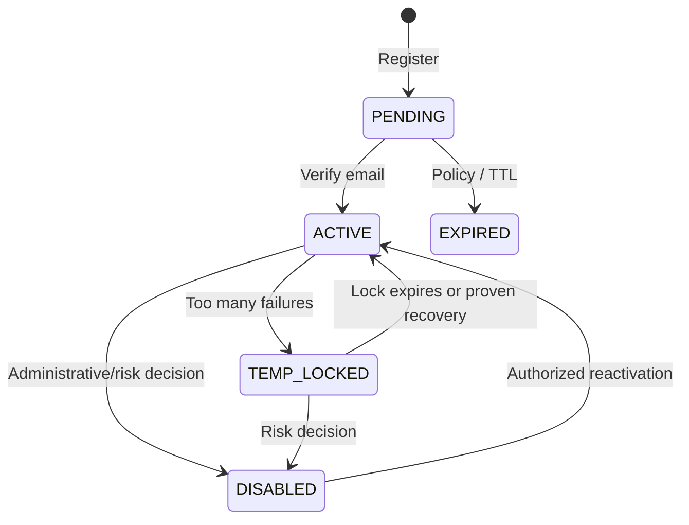
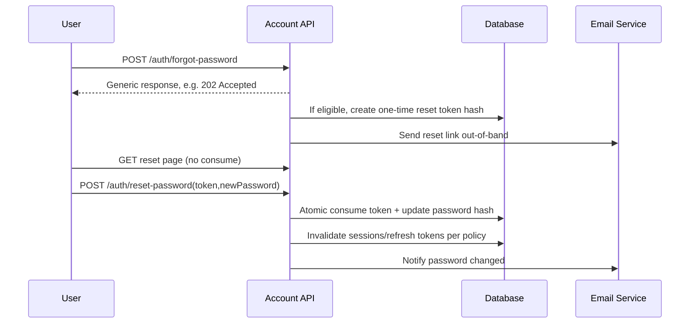

# Registration, Account Recovery, and Temporary Lockout: The Application's Responsibility

> **Context:** Spring Boot 3.x, Spring Security 6.x, Spring MVC/Servlet stack, Java 17+. This lesson distinguishes what Spring Security provides out of the box from the workflows the application itself must build in the **account lifecycle**: registration, email verification, password recovery, and temporary login lockout. The runnable example below illustrates via memory/console, not a production-ready identity system.

## 1. Responsibility Boundaries

Spring Security supplies **primitives** for authentication and authorization: servlet filters, `AuthenticationManager`/`AuthenticationProvider`, `DaoAuthenticationProvider`, `UserDetailsService`, `PasswordEncoder`, `SecurityContext`, account status checks, session integration, and hooks for authentication success/failure.

However, **merely adding the Spring Security starter does not automatically create signup, email activation, forgot password, reset token generation, sending emails, counting failed attempts, or a 15-minute lockout**. Those workflows must be implemented by the **application** or explicitly delegated to an identity provider (IdP).

| Problem | Spring Security Provides | Application or IdP Must Build |
|---|---|---|
| Password login | Provider, PasswordEncoder, filters | User/hash store; account policies and abuse detection |
| Registration | Encoder and HTTP security primitives | API, validation, uniqueness, pending profile, email verification |
| Email verification | Can help check account flags | Verification token, sending links, TTL, single-use, updating `emailVerifiedAt` |
| Forgot/reset password | PasswordEncoder, session/token hooks | Separate reset token, delivery, updating hash, notifications, revoking access |
| Lockout on wrong passwords | `isAccountNonLocked()`, `LockedException` | Failed-login counter, `lockedUntil`, unlock policy, rate limiting |
| Account disabling | `isEnabled()`, `DisabledException` | Disable reason/workflow, who may reactivate |
| Session and token revocation | Session/logout features | Refresh token revocation, invalidation, JWT versioning |

**Distinction:** Spring Security governs requests reaching controllers; the application is responsible for account lifecycle correctness and state persistence. If using OIDC/IdP, signup/reset steps may live in the IdP; the application still must understand boundaries, resource permissions, and session handling.

## 2. State and Data Model



**PENDING** should not be treated as an account that has proven email ownership. **TEMP_LOCKED** from wrong passwords is time-bounded; **DISABLED** from fraud/admin action may require separate handling. A password reset may be permitted to clear a temporary lock, yet should not automatically re-enable an account disabled for risk.

### Fields to Include

| Field | Purpose | Constraints |
|---|---|---|
| `id`, `emailNormalized`, `emailVerifiedAt` | Identity and verification | **UNIQUE in the database**, not just `existsByEmail` |
| `passwordHash`, `passwordChangedAt` | Login and password change | Never store plaintext or reversible encryption |
| `enabled`/`status`, `disabledReason` | Account state | Do not collapse all reasons into one confusing boolean |
| `failedLoginCount`, `lockedUntil` | Temporary lockout | Atomic updates across multiple threads/replicas |
| `tokenHash`, `purpose`, `expiresAt`, `consumedAt` | Verify/reset | High-entropy token, TTL, purpose, and single-use |
| `securityVersion`/`passwordChangedAt` | Revoke old access | Coordinate sessions and bearer/refresh tokens |

Illustrative migration example (adapt per DBMS):

```sql
CREATE TABLE app_users (
    id BIGINT GENERATED ALWAYS AS IDENTITY PRIMARY KEY,
    email_normalized VARCHAR(320) NOT NULL UNIQUE,
    password_hash VARCHAR(255) NOT NULL,
    email_verified_at TIMESTAMP NULL,
    enabled BOOLEAN NOT NULL DEFAULT TRUE,
    failed_login_count INTEGER NOT NULL DEFAULT 0,
    locked_until TIMESTAMP NULL,
    password_changed_at TIMESTAMP NOT NULL,
    security_version BIGINT NOT NULL DEFAULT 0
);

CREATE TABLE account_grants (
    id BIGINT GENERATED ALWAYS AS IDENTITY PRIMARY KEY,
    user_id BIGINT NOT NULL REFERENCES app_users(id),
    purpose VARCHAR(32) NOT NULL,
    token_hash CHAR(64) NOT NULL UNIQUE,
    expires_at TIMESTAMP NOT NULL,
    consumed_at TIMESTAMP NULL
);
```

This is conceptual DDL, not a complete production migration. Email normalization must follow a clear, consistent policy; do not arbitrarily strip dots/aliases assuming a specific mail provider. A UNIQUE index is the line of defense against two concurrent registration requests using the same email.

## 3. Registration and Email Verification

### Recommended Workflow

1. `POST /auth/register` receives email/password over **HTTPS**. Validate format, body size, password policy, appropriate breach screening, and rate limits. Never skip server-side validation.
2. Normalize email; create a **PENDING** account, storing `PasswordEncoder.encode(password)`. Never grant sensitive business permissions before email verification.
3. Generate a verification token with `SecureRandom` (typically **256 bits of entropy**), store the **token hash** along with `VERIFY_EMAIL`, account ID, and `expiresAt`. The raw token is used solely to build the link/OTP sent to that email.
4. Send the email via a provider. Use transactions paired with an outbox/queue and proper retries to avoid recording a token without sending the email. Never log the token.
5. The user opens the verification page and explicitly confirms via **POST**; the backend checks purpose, TTL, single-use, and state, then atomically consumes the token and updates `emailVerifiedAt`.
6. Reject invalid, expired, or already-used tokens without modifying the account. Resend tokens per policy with cooldown/rate limiting.
7. Once email is verified, account state can transition to ACTIVE; only from this point does the authentication provider allow login per policy.

**Why shouldn't a GET link auto-consume?** Email scanners, browser prefetchers, and security gateways may "click" URLs before the user. GET should display a confirmation form, while POST changes state. Never put raw tokens into logs, analytics, or third-party `Referer` headers; use `Referrer-Policy: no-referrer` where appropriate.

### Preventing User Enumeration

When registering an existing email or requesting a resend, responses can use a generic message like "If valid, instructions will be sent". A system returning identical status/messages yet differing in timing or rate limits can still leak account existence. Balance UX, anti-abuse, and threat model together.

**Role of `UserDetails.isEnabled()`:** the application can return true when the account is enabled **and** email-verified. `DaoAuthenticationProvider` checks this flag, but does not send emails, issue tokens, or update the DB itself.

## 4. Password Recovery: Never Send the Old Password



Core requirements:

- `POST /auth/forgot-password` returns the **same response class** for existing and nonexistent emails, such as `202 Accepted`, without exposing accounts.
- Reset tokens must be **separate** from verification tokens/access tokens, sufficiently random, bound to `RESET_PASSWORD` and account ID, short-lived (e.g., 20 minutes), and single-use. Store only the token's digest in the DB.
- Rate-limit reset emails per IP/email/device/account; never emit new passwords, old passwords, or tokens in logs.
- GET may open a form, while **POST** consumes the token and changes the password. For cookie/session flows, enforce appropriate CSRF protection.
- **Within one transaction/atomic operation**, verify the token is unexpired, unused, and matches purpose, mark it consumed, and update `passwordHash` + `passwordChangedAt`. Two concurrent requests using the same token must never both succeed.
- After reset, revoke sessions/refresh tokens per policy, increment `securityVersion` if the system checks versions, and send a secret-free notification to the verified channel.
- Resetting may clear a **temporary wrong-password lock** if policy allows; never auto-reactivate accounts disabled for risk.
- For high-value accounts, single-channel email recovery may not suffice: require MFA/recovery codes, step-up checks, additional proof of ownership, or support workflows.

**Why SHA-256 for reset tokens yet bcrypt/Argon2 for passwords?** A reset token is a server-generated secret with 256 bits of entropy; a fast hash of a random token prevents storing plaintext tokens in the DB. Human-chosen passwords are far more predictable and need a slow, salted password KDF. Never use plain SHA-256 for passwords. A token for one purpose must never be accepted at an endpoint for another purpose.

## 5. Temporary Account Lockout After Failed Logins

An example policy: after **5 consecutive wrong passwords**, set `lockedUntil = now + 15 minutes`. While `now < lockedUntil`, reject logins even if the user enters the right password. Once expired, retries are allowed per policy. Success resets the failed count; a valid password reset may clear the lock if permitted.

Spring Security only supplies the status flags and enforcement hooks:

```java
boolean isEnabled();
boolean isAccountNonLocked();
boolean isAccountNonExpired();
boolean isCredentialsNonExpired();
```

`DaoAuthenticationProvider` checks `isAccountNonLocked()` and can throw `LockedException`. **It does not count failed logins or set unlock timestamps itself.** The application owns `failedLoginCount`/`lockedUntil` and how they are updated.

### Connecting State to Servlet Authentication

- Form login: can use `AuthenticationFailureHandler`/`AuthenticationSuccessHandler` or a properly configured `AuthenticationEventPublisher`/listener.
- HTTP Basic/custom auth: may use different hooks depending on filters and managers; ensure you count **one authentication attempt** accurately.
- Do not count every `401`: a missing Authorization header, expired token, or different scheme is not necessarily a wrong password attempt.
- `403` may come from missing roles/CSRF, not a password failure.
- `LockedException`/`DisabledException` should not keep incrementing the failed-password counter.
- If already using a failure handler, do not accidentally double-count via an event listener.
- For nonexistent usernames, apply source-based rate limiting/monitoring and anti-enumeration rather than having an account ID to lock.

### Preventing Lockout from Being Abused as DoS

If an attacker can lock out any user with just 5 bad requests, the application suffers account-lockout DoS. Combine adaptive rate limiting by IP, account, device/network, risk signals, CAPTCHA/MFA at suitable thresholds, telemetry, and reliable recovery paths. Consider not revealing whether an account exists or is currently locked in public responses.

`401` usually fits missing/bad credentials, and `429 Too Many Requests` fits API rate limits; `423 Locked` can leak account status. Choose HTTP contracts per threat model rather than equating "locked" with a specific HTTP status.

## 6. Designing Servlet Endpoints

| Illustrative Endpoint | Prior Authentication Required | Essential Additions |
|---|---|---|
| `POST /auth/register` | Public | Validation, uniqueness, hashing, pending state, rate limit |
| `POST /auth/resend-verification` | Public or limited session | Generic response, cooldown, token TTL |
| `GET /auth/verify-email` | Public | Display form only, do not consume token |
| `POST /auth/verify-email` | One-time token | Purpose/TTL/atomic consume |
| `POST /auth/forgot-password` | Public | Anti-enumeration, reset token, throttling |
| `GET /auth/reset-password` | Public | Password-reset page, no-referrer |
| `POST /auth/reset-password` | One-time token | Atomic reset and session revocation |
| `POST /auth/login` | Public | Authenticate, count failures, lockout |
| `POST /auth/logout` | Session/auth per mechanism | Invalidate/revoke |
| `GET /me` | Authenticated | Authorization and sensitive-field filtering |

Public does **not** mean skipping CSRF protection, rate limiting, input validation, or HTTP security filters. If using cookie-based browser login, keep CSRF; pure bearer APIs have a different threat model. Never disable CSRF application-wide just to make public POSTs "work".

The authorization configuration snippet below **only illustrates inside a `SecurityFilterChain` method**, not a standalone application:

```java
@Bean
SecurityFilterChain securityFilterChain(HttpSecurity http) throws Exception {
    return http
            .authorizeHttpRequests(auth -> auth
                    .requestMatchers(HttpMethod.POST,
                            "/auth/register",
                            "/auth/resend-verification",
                            "/auth/verify-email",
                            "/auth/forgot-password",
                            "/auth/reset-password").permitAll()
                    .requestMatchers(HttpMethod.GET,
                            "/auth/verify-email",
                            "/auth/reset-password").permitAll()
                    .anyRequest().authenticated())
            .formLogin(Customizer.withDefaults())
            .build();
}
```

Imports for `@Bean`, `HttpSecurity`, `SecurityFilterChain`, `HttpMethod`, and `Customizer` are required. `permitAll()` does not automatically create controllers or execute registration or recovery. `formLogin` defaults to `POST /login`; if choosing `POST /auth/login`, configure `loginProcessingUrl("/auth/login")` and matching hooks instead of assuming permitAll creates that endpoint.

## 7. Runnable Java 17+ Example: Lifecycle in a Single JVM

The example uses **Spring Boot 3.x console** and `spring-security-crypto`. We observe: hashing passwords with BCrypt, pending-verification registration, 256-bit verify/reset tokens, token hashing/TTL/single-use, temporary lock after 3 wrong attempts, and unlocking upon valid reset. There is no real email, DB, HTTP server, or session.

### 7.1. Setup

Create a Spring Boot 3.x Java 17+ Gradle project from Spring Initializr. Keep the plugins/repositories/Boot version generated by Initializr; the `dependencies` block of `build.gradle`:

```groovy
dependencies {
    implementation 'org.springframework.boot:spring-boot-starter'
    implementation 'org.springframework.security:spring-security-crypto'
}
```

Spring Web is unnecessary because of `WebApplicationType.NONE`. Create **`src/main/java/com/example/demo/AccountLifecycleLabApplication.java`** as shown below.

### 7.2. Complete Source Code

```java
package com.example.demo;

import java.nio.charset.StandardCharsets;
import java.security.MessageDigest;
import java.security.NoSuchAlgorithmException;
import java.security.SecureRandom;
import java.time.Clock;
import java.time.Duration;
import java.time.Instant;
import java.util.ArrayList;
import java.util.Base64;
import java.util.HashMap;
import java.util.HexFormat;
import java.util.List;
import java.util.Locale;
import java.util.Map;

import org.springframework.boot.CommandLineRunner;
import org.springframework.boot.SpringApplication;
import org.springframework.boot.WebApplicationType;
import org.springframework.boot.autoconfigure.SpringBootApplication;
import org.springframework.context.annotation.Bean;
import org.springframework.security.crypto.bcrypt.BCryptPasswordEncoder;
import org.springframework.security.crypto.password.PasswordEncoder;

@SpringBootApplication
public class AccountLifecycleLabApplication {
    public static void main(String[] args) {
        SpringApplication app =
                new SpringApplication(AccountLifecycleLabApplication.class);
        app.setWebApplicationType(WebApplicationType.NONE);
        app.run(args).close();
    }

    @Bean
    CommandLineRunner exercise() {
        return args -> {
            DemoInbox inbox = new DemoInbox();
            AccountService accounts = new AccountService(
                    new BCryptPasswordEncoder(), new SecureRandom(),
                    Clock.systemUTC(), inbox);
            String email = "learner@example.test";

            System.out.println("register=" +
                    accounts.register(email, "StartPassword#2026"));
            System.out.println("loginBeforeVerify=" +
                    accounts.login(email, "StartPassword#2026"));

            String verifyToken = inbox.latest(Kind.VERIFY);
            System.out.println("verify=" + accounts.verify(verifyToken));
            System.out.println("verifyReuse=" + accounts.verify(verifyToken));
            System.out.println("loginCorrect=" +
                    accounts.login(email, "StartPassword#2026"));

            for (int n = 1; n <= 3; n++) {
                System.out.println("wrong" + n + "=" +
                        accounts.login(email, "wrong-pass"));
            }
            System.out.println("locked=" + accounts.isLocked(email));
            System.out.println("correctDuringLock=" +
                    accounts.login(email, "StartPassword#2026"));

            System.out.println("forgot=" + accounts.forgot(email));
            String resetToken = inbox.latest(Kind.RESET);
            System.out.println("reset=" +
                    accounts.reset(resetToken, "ChangedPassword#2026"));
            System.out.println("resetReuse=" +
                    accounts.reset(resetToken, "AnotherPassword#2026"));
            System.out.println("lockedAfterReset=" +
                    accounts.isLocked(email));
            System.out.println("oldPassword=" +
                    accounts.login(email, "StartPassword#2026"));
            System.out.println("newPassword=" +
                    accounts.login(email, "ChangedPassword#2026"));
            System.out.println("forgotUnknown=" +
                    accounts.forgot("unknown@example.test"));
        };
    }

    enum Kind { VERIFY, RESET }
    record Grant(String email, Kind purpose, Instant expiresAt) {}
    record Mail(String email, Kind purpose, String rawToken) {}

    static final class DemoInbox {
        private final List<Mail> messages = new ArrayList<>();

        void send(String email, Kind purpose, String rawToken) {
            messages.add(new Mail(email, purpose, rawToken));
        }

        String latest(Kind purpose) {
            for (int i = messages.size() - 1; i >= 0; i--) {
                if (messages.get(i).purpose() == purpose) {
                    return messages.get(i).rawToken();
                }
            }
            throw new IllegalStateException("No message in demo inbox");
        }
    }

    static final class Account {
        final String email;
        String passwordHash;
        boolean verified;
        boolean enabled = true;
        int failedAttempts;
        Instant lockedUntil;

        Account(String email, String passwordHash) {
            this.email = email;
            this.passwordHash = passwordHash;
        }
    }

    static final class AccountService {
        private final Map<String, Account> users = new HashMap<>();
        private final Map<String, Grant> grants = new HashMap<>();
        private final PasswordEncoder encoder;
        private final SecureRandom random;
        private final Clock clock;
        private final DemoInbox inbox;

        AccountService(PasswordEncoder encoder, SecureRandom random,
                       Clock clock, DemoInbox inbox) {
            this.encoder = encoder;
            this.random = random;
            this.clock = clock;
            this.inbox = inbox;
        }

        synchronized String register(String rawEmail, String password) {
            String email = normalize(rawEmail);
            if (!users.containsKey(email)) {
                Account account = new Account(email, encoder.encode(password));
                users.put(email, account);
                issue(account, Kind.VERIFY, Duration.ofHours(24));
            }
            return "accepted";
        }

        synchronized boolean verify(String rawToken) {
            Grant grant = consume(rawToken, Kind.VERIFY);
            if (grant == null) return false;

            Account account = users.get(grant.email());
            if (account == null || !account.enabled) return false;
            account.verified = true;
            return true;
        }

        synchronized String forgot(String rawEmail) {
            Account account = users.get(normalize(rawEmail));
            if (account != null && account.enabled && account.verified) {
                issue(account, Kind.RESET, Duration.ofMinutes(20));
            }
            return "accepted";
        }

        synchronized boolean reset(String rawToken, String newPassword) {
            Grant grant = consume(rawToken, Kind.RESET);
            if (grant == null) return false;

            Account account = users.get(grant.email());
            if (account == null || !account.enabled || !account.verified) {
                return false;
            }
            account.passwordHash = encoder.encode(newPassword);
            account.failedAttempts = 0;
            account.lockedUntil = null;
            // Production: revoke sessions/refresh tokens transactionally.
            return true;
        }

        synchronized boolean login(String rawEmail, String password) {
            Account account = users.get(normalize(rawEmail));
            if (account == null || !account.enabled || !account.verified) {
                return false;
            }
            if (lockedNow(account)) return false;

            if (account.lockedUntil != null) {
                account.lockedUntil = null; // Lock expired
                account.failedAttempts = 0;
            }
            if (encoder.matches(password, account.passwordHash)) {
                account.failedAttempts = 0;
                return true;
            }
            account.failedAttempts++;
            if (account.failedAttempts >= 3) {
                account.lockedUntil =
                        clock.instant().plus(Duration.ofMinutes(15));
            }
            return false;
        }

        synchronized boolean isLocked(String rawEmail) {
            Account account = users.get(normalize(rawEmail));
            return account != null && lockedNow(account);
        }

        private boolean lockedNow(Account account) {
            return account.lockedUntil != null &&
                    clock.instant().isBefore(account.lockedUntil);
        }

        private void issue(Account account, Kind purpose, Duration ttl) {
            // One live token per account and purpose in this demo.
            grants.entrySet().removeIf(entry ->
                    entry.getValue().email().equals(account.email) &&
                    entry.getValue().purpose() == purpose);

            byte[] randomBytes = new byte[32]; // 256-bit token
            random.nextBytes(randomBytes);
            String rawToken = Base64.getUrlEncoder()
                    .withoutPadding().encodeToString(randomBytes);
            grants.put(digest(rawToken), new Grant(account.email, purpose,
                    clock.instant().plus(ttl)));
            inbox.send(account.email, purpose, rawToken);
        }

        private Grant consume(String rawToken, Kind expectedPurpose) {
            if (rawToken == null || rawToken.length() > 200) return null;
            String tokenHash = digest(rawToken);
            Grant grant = grants.get(tokenHash);
            if (grant == null || grant.purpose() != expectedPurpose ||
                    !clock.instant().isBefore(grant.expiresAt())) {
                return null;
            }
            grants.remove(tokenHash); // single-use within a JVM
            return grant;
        }

        private static String normalize(String email) {
            return email.trim().toLowerCase(Locale.ROOT);
        }

        private static String digest(String rawToken) {
            try {
                byte[] hash = MessageDigest.getInstance("SHA-256")
                        .digest(rawToken.getBytes(StandardCharsets.UTF_8));
                return HexFormat.of().formatHex(hash);
            } catch (NoSuchAlgorithmException ex) {
                throw new IllegalStateException(ex);
            }
        }
    }
}
```

**Brief explanation of methods:**

- `register` hashes the password with BCrypt, creates a pending account, and issues a verify token; returns the same message even for an existing email.
- `verify` accepts only an unexpired `VERIFY` token once; `verifyReuse=false` proves single-use.
- `forgot` only generates a reset token for accounts with a verified email and enabled status, yet returns `"accepted"` for both existing and nonexistent emails.
- `reset` consumes the `RESET` token, hashes the new password, and clears the temporary lock **per demo policy**. It does not auto-enable disabled accounts.
- `login` rejects unverified, disabled, or locked accounts. After three consecutive wrong passwords, it locks for 15 minutes; the right password during this window is still rejected.
- `SecureRandom` creates a 256-bit token and `digest` stores the SHA-256 token hash; the raw token lives only in `DemoInbox` for learning. **Never create endpoints or public logs exposing tokens** in real systems.

In real Servlet applications, use `AuthenticationManager`/`DaoAuthenticationProvider` for login and attach lifecycle hooks; **do not copy the demo's `login` method as a competing auth system alongside Spring Security**. A `HashMap` + `synchronized` store only fits one JVM; production needs atomic DB/Redis updates, a real mail provider, token revocation, auditing, validation, rate limits, and CSRF/session design.

### 7.3. Running and Checking Stdout

From the directory containing the Gradle wrapper:

```bash
# macOS / Linux
./gradlew bootRun

# Windows PowerShell
.\gradlew.bat bootRun
```

Ignoring Spring Boot's banner and logs, the lines printed by `System.out.println` in the demo are **expected to be**:

```text
register=accepted
loginBeforeVerify=false
verify=true
verifyReuse=false
loginCorrect=true
wrong1=false
wrong2=false
wrong3=false
locked=true
correctDuringLock=false
forgot=accepted
reset=true
resetReuse=false
lockedAfterReset=false
oldPassword=false
newPassword=true
forgotUnknown=accepted
```

This is **expected output**, not an actual run in the documentation environment. The sequence demonstrates: cannot log in before verification; verify and reset tokens are single-use; 3 wrong attempts trigger lockout; the right password does not bypass lockout; a valid reset updates the password and clears lockout; the old password ceases to work.

## 8. Bringing the Demo to a Production Servlet App: Checklist

1. **Persistence and atomicity:** account unique index, token grants table with TTL/purpose/consumedAt, transactions or compare-and-set. Two concurrent reset requests must allow at most one to consume the token.
2. **Email service:** delivery/retries, verified sender, queue/outbox, never log raw tokens, never email passwords.
3. **Input validation:** request size, email normalization, password policy, breached password screening, account uniqueness.
4. **Abuse prevention:** multi-dimensional rate limits on signup/resend/forgot/login, risk detection/challenges, avoiding lockout DoS.
5. **Security integration:** `UserDetailsService` loads the account, `PasswordEncoder`/provider verifies passwords, `isEnabled()` and `isAccountNonLocked()` reflect the latest state.
6. **Authentication event handling:** count actual password attempts once, never count 401 missing credentials or 403 CSRF; avoid duplicate handlers/event listeners.
7. **Access revocation:** after reset update `passwordChangedAt`/`securityVersion`, invalidate sessions, refresh tokens, or log out all devices per policy. Self-contained JWTs do not expire just because the hash changed.
8. **Browser security:** HTTPS, CSRF for cookies/sessions, proper `Secure`/`HttpOnly`/`SameSite`, Referrer-Policy, clickjacking protection.
9. **Audit/notifications:** password changed, reset requested, account verified/locked/unlocked, safe retention, never recording secrets.
10. **High-risk recovery:** MFA, recovery codes, step-up checks, or manual support when email is compromised or an account was disabled by fraud policy.

## 9. Important Testing Matrix

| Scenario | Expectation |
|---|---|
| Two concurrent registrations with same normalized email | DB UNIQUE prevents two records |
| Unverified user attempts login | Rejected or restricted onboarding permissions per policy |
| Expired / wrong / reused verify token | Does not update emailVerifiedAt |
| Email scanner auto-opens GET verify link | Does not auto-consume token |
| Forgot password with existing/nonexistent email | Generic response, no account-existence leak |
| Verify token submitted at reset | Rejected due to purpose mismatch |
| Two concurrent POST resets | Only one atomic consume succeeds |
| Valid password reset | New hash, token invalidated, sessions/tokens handled |
| Consecutive wrong passwords | Counter increments accurately, threshold sets `lockedUntil` |
| Right password while still locked | Still rejected per policy |
| Lockout expires | Retries allowed per policy; counter handled consistently |
| Disabled account | Never auto-reopens via TTL or password reset |
| Multi-instance login failures | Counter stays accurate even across two replicas |
| 401 / 403 / 429 | Never miscounted as wrong password attempts and never causes enumeration |

Inject `Clock` into services to test expiration/unlocking instead of long `Thread.sleep` calls. Test transactions under real concurrency; never assume a unit test on a `HashMap` guarantees correctness on a cluster.

## 10. Common Misconceptions

- "The Spring Security starter includes signup/forgot-password APIs." **False:** those are application or IdP workflows.
- "`PasswordEncoder` checks whether a password is strong or weak." **False:** it encodes/matches; password policy is separate.
- "`isAccountNonLocked()` counts failures and unlocks automatically." **False:** the app updates counters and deadlines.
- "Every 401/403 is a failed login." **False:** 403 is often authorization/CSRF; 401 can be missing credentials.
- "An email verification token can double as a password reset token." **False:** separate purposes and verify explicitly.
- "Password hashes should use SHA-256 because reset tokens use SHA-256." **False:** passwords need a slow password KDF; high-entropy random tokens can use a digest.
- "A GET verification link should change state immediately." **Bad idea:** link scanners may prefetch.
- "Resetting a password automatically invalidates all JWTs." **False:** session/token revocation or versioning is needed.
- "Hard-locking after 5 failures is always safe." **Insufficient:** easily turned into account-lockout DoS by attackers.
- "`synchronized`/Map is enough for production." **False:** does not protect across multiple processes/replicas.

## 11. Self-Check

**Question 1.** After a user registers, does Spring Security automatically send the verification email?  
**Answer:** No. The application/IdP must issue tokens, send emails, manage lifetimes, consume once, and verify.

**Question 2.** Why store a reset token hash yet use BCrypt for passwords?  
**Answer:** Server-generated 256-bit tokens are infeasible to guess; user passwords can be weak so they need a slow KDF, salt, and policy.

**Question 3.** What if the password is correct while `lockedUntil` has not yet expired?  
**Answer:** Under a temporary-lockout policy, it is still rejected. Unlock via TTL or sufficiently trusted recovery.

**Question 4.** Why not count every 403 response toward `failedLoginCount`?  
**Answer:** 403 can mean missing permissions or CSRF failure, not a failed password check.

**Question 5.** After a reset, what happens to old refresh tokens/JWTs?  
**Answer:** The application needs revocation/versioning/expiration mechanisms; changing the password hash does not automatically destroy all tokens.

**Question 6.** Two concurrent reset requests use the same token?  
**Answer:** The database needs atomic consumption so only one succeeds.

## 12. Summary

**Registration:** validate -> pending account + password hash -> separate verify token -> email verification -> active.  
**Recovery:** generic public response -> high-entropy, short-TTL, single-use reset token -> atomic password update -> revoke/notify.  
**Lockout:** count true password failures -> `lockedUntil` -> unlock per policy -> combine with rate limiting, monitoring, and recovery.

**Principle:** Spring Security provides authentication/authorization mechanisms; **the application is responsible for safely designing and operating the entire account lifecycle**.