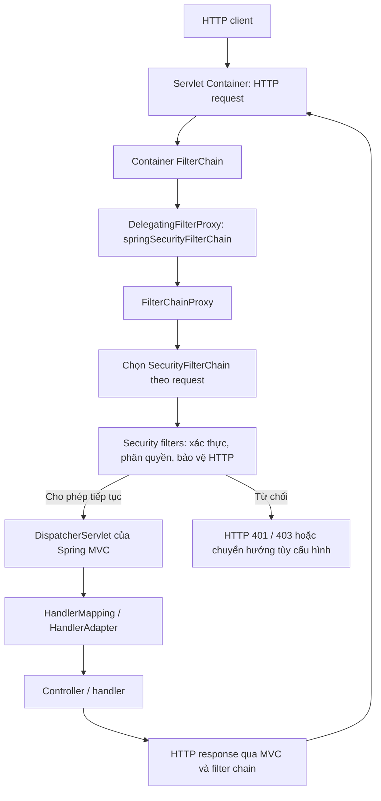

# Quan hệ giữa Spring Security, Spring MVC, Servlet Container và Spring Boot

> **Phạm vi:** Ứng dụng web **Servlet** dùng Spring Boot 3.x, Spring Framework 6.x và Spring Security 6.x. Mục tiêu là hiểu từng thành phần chịu trách nhiệm gì, chúng kết nối ra sao khi ứng dụng khởi động và khi một HTTP request đi qua hệ thống. Đây là kiến trúc Servlet; ứng dụng WebFlux sử dụng cơ chế lọc reactive khác.

## 1. Bốn thành phần, bốn trách nhiệm

| Thành phần | Trách nhiệm chính | Dấu hiệu thường gặp |
|---|---|---|
| **Servlet Container** (ví dụ embedded Tomcat, Jetty) | Lắng nghe và xử lý HTTP, tạo `HttpServletRequest`/`HttpServletResponse`, quản lý lifecycle Servlet, Filter, session, luồng xử lý và gọi Servlet phù hợp. | `Filter`, `FilterChain`, `HttpServlet`, `HttpSession` |
| **Spring MVC** | Xử lý tầng web: ánh xạ URL và HTTP method tới handler/controller, bind input, kiểm tra dữ liệu, gọi controller và chuyển kết quả thành HTTP response. | `DispatcherServlet`, `@GetMapping`, `@RestController`, `HandlerMapping` |
| **Spring Security** | Xác thực người gọi (**authentication**), thực thi quyền truy cập (**authorization**) và các bảo vệ HTTP như CSRF, security headers, session handling tùy cấu hình. Với Servlet, tích hợp chủ yếu thông qua **Servlet Filter**. | `DelegatingFilterProxy`, `FilterChainProxy`, `SecurityFilterChain`, `SecurityContext` |
| **Spring Boot** | Khởi tạo/đóng gói ứng dụng, tự cấu hình theo dependencies và beans, tạo Spring `ApplicationContext`, cấu hình/khởi động embedded server và đăng ký các thành phần tích hợp. | `@SpringBootApplication`, các starter và auto-configuration |

Hai khái niệm **container** khác nhau cần phân biệt: *Servlet Container* chạy các Servlet/Filter theo hợp đồng Jakarta Servlet; *Spring IoC Container* (`ApplicationContext`) tạo và quản lý Spring beans. Boot kết nối hai thế giới này. Spring MVC và Spring Security là những thư viện nằm trong ứng dụng Spring; chúng không tự thay thế HTTP server.

Một ứng dụng dùng `spring-boot-starter-web` có thể phục vụ HTTP bằng MVC mà **không dùng Spring Security**. Chỉ khi thêm và cấu hình Spring Security thì pipeline HTTP mới có lớp bảo vệ của framework này. Ngược lại, Spring Security cũng có thể bảo vệ Servlet endpoint không do Spring MVC xử lý.

## 2. Một HTTP request đi qua đâu?

Sơ đồ sau mô tả đường đi điển hình cho request khớp một `SecurityFilterChain` trong ứng dụng Boot Servlet:



**Diễn tiến từng bước:**

1. **Boot khởi động:** tạo `ApplicationContext`, cấu hình embedded Servlet Container, đăng ký `DispatcherServlet` của MVC. Khi có Spring Security, một Servlet Filter proxy được đăng ký để chuyển việc xử lý tới bean bảo mật tên `springSecurityFilterChain`.
2. **Container nhận request:** tạo request/response và gọi các Servlet Filter đã đăng ký theo thứ tự của container. Các filter khác (logging, compression, v.v.) có thể nằm trước hoặc sau filter bảo mật.
3. **`DelegatingFilterProxy` chuyển tiếp:** Servlet Container chỉ biết filter theo Servlet API; proxy tìm bean Spring tương ứng. Bean `springSecurityFilterChain` thực tế là `FilterChainProxy`.
4. **`FilterChainProxy` chọn chain:** xét các `SecurityFilterChain` đã cấu hình theo thứ tự; **chain khớp đầu tiên** được chọn. Mỗi chain gồm các security filters. Quy tắc chọn chain khác với quy tắc phân quyền bên trong chain.
5. **Security filters xử lý:** có thể nạp `SecurityContext`, xử lý cơ chế xác thực, kiểm tra CSRF, áp security headers và quyết định quyền truy cập. Nếu không được phép, Security có thể tạo response ngay; controller **không được gọi**.
6. **Được phép thì chuyển tiếp:** sau khi các filter gọi tiếp `FilterChain`, request tới `DispatcherServlet`. MVC tìm handler qua `HandlerMapping`, chọn adapter, bind tham số, gọi controller và serialize kết quả.
7. **Response đi ngược ra ngoài:** MVC trả response; các filter có thể xử lý thêm trước khi container gửi về client. Ngữ cảnh bảo mật gắn với request được dọn dẹp đúng lifecycle, tránh rò trạng thái giữa các request.

**Lưu ý:** Không có một danh sách filter cố định đúng cho mọi ứng dụng. Số lượng, thứ tự và hành vi của chúng thay đổi theo cấu hình và phiên bản. Request không khớp chain nào có thể đi tiếp mà **không được Spring Security bảo vệ**; ứng dụng thông thường nên có chain bao phủ các endpoint cần bảo vệ.

## 3. Các “chain” thường bị nhầm lẫn

| Tên | Ai sở hữu? | Chứa gì? | Hoạt động khi nào? |
|---|---|---|---|
| **Servlet `FilterChain`** | Servlet Container | Các Servlet Filter được container đăng ký, bao gồm `DelegatingFilterProxy` khi có Security | Trước khi request tới Servlet đích |
| **Spring Security `SecurityFilterChain`** | Spring Security, được `FilterChainProxy` điều phối | Các security filters áp dụng cho request đã khớp chain | Bên trong Servlet Filter của Security |
| **Spring MVC interceptor chain** | Spring MVC | `HandlerInterceptor` quanh handler của MVC | Sau khi `DispatcherServlet` đã nhận request và xác định handler |

Một `HandlerInterceptor` chỉ tham gia luồng xử lý MVC; nó không phải tầng bảo vệ thay thế cho Servlet Filter. Ví dụ, một request bị chặn vì thiếu xác thực sẽ không tới `preHandle` của interceptor dành cho controller đó. Tương tự, xử lý lỗi bằng `@ControllerAdvice` có phạm vi là lỗi trong quá trình MVC xử lý, không mặc nhiên “bắt” mọi lỗi xảy ra trong security filters.

`SecurityFilterChain` không phải cùng một đối tượng với `FilterChain` của Servlet API: cái thứ nhất là **danh sách filter được Spring Security chọn**, cái thứ hai là **cơ chế container dùng để nối các Servlet Filter với Servlet đích**.

## 4. Ba mối quan hệ then chốt

### 4.1. Spring Security ↔ Servlet Container

Spring Security hiện diện trong pipeline của Servlet Container thông qua `DelegatingFilterProxy`, nhưng phần lớn cấu hình và dependency của nó là **Spring beans**. Cách này cho phép một Filter do container gọi ủy quyền sang đối tượng do Spring IoC quản lý. `FilterChainProxy` chịu trách nhiệm chọn `SecurityFilterChain` phù hợp, áp dụng các security filters và tiếp tục request.

Ví dụ nếu người dùng chưa đăng nhập gọi một endpoint buộc xác thực, Security có thể trả HTTP 401 (với HTTP Basic) **ngay tại tầng filter**, trước khi MVC dispatch request. Nếu sử dụng form login, cùng tình huống có thể dẫn tới redirect tới trang đăng nhập. Kết quả phụ thuộc cơ chế xác thực đã bật, không phải chỉ phụ thuộc URL.

### 4.2. Spring Security ↔ Spring MVC

Security kiểm soát **ai được phép tiếp tục**; MVC quyết định **request đó gọi handler nào**. Hai việc có liên quan nhưng không trùng nhau.

- `authorizeHttpRequests` đưa ra quy tắc phân quyền ở tầng HTTP filter. Các `requestMatchers` xác định request nào chịu từng quy tắc; thứ tự quy tắc ảnh hưởng tới kết quả.
- Nếu dùng Spring MVC, semantics của path matching, servlet path và các servlet bổ sung cần được xét đồng nhất giữa Security và MVC. Không nên mặc định mọi kiểu matcher đều giống hoàn toàn `@RequestMapping`, nhất là khi ứng dụng có nhiều servlet.
- Sau khi MVC đã xác định handler, method security như `@PreAuthorize` có thể kiểm tra thêm lúc gọi phương thức **nếu** ứng dụng bật `@EnableMethodSecurity` và lời gọi đi qua Spring proxy tương ứng. Đây là lớp kiểm tra khác với URL authorization.
- Một `Principal` hoặc `Authentication` có thể được controller sử dụng để biết danh tính người gọi; danh tính này được Security thiết lập trong ngữ cảnh phù hợp. Controller không cần tự parse header `Authorization` cho luồng HTTP Basic do framework xử lý.

Một request được phép ở URL không đồng nghĩa mọi thao tác nghiệp vụ đều được phép. Quy tắc HTTP và method security cần phù hợp chính sách ứng dụng.

### 4.3. Spring Boot ↔ cả ba thành phần

Với ứng dụng Servlet, Boot đọc dependencies, properties và beans để tự cấu hình web server, `DispatcherServlet` và các integration cần thiết.

- Có `spring-boot-starter-web`: Boot thường cấu hình Spring MVC cùng embedded Tomcat mặc định.
- Thêm `spring-boot-starter-security`: Boot/Spring Security cấu hình tích hợp Servlet Filter và có các mặc định bảo vệ khi ứng dụng chưa cung cấp security chain riêng.
- Nếu chưa định nghĩa `SecurityFilterChain`, mặc định điển hình trong Boot 3.x là yêu cầu xác thực cho HTTP requests với các cơ chế đăng nhập mặc định. Boot có thể tạo user phát triển và in mật khẩu ngẫu nhiên vào log lúc khởi động; không xem đó là chính sách production.
- Khi khai báo bean `SecurityFilterChain` riêng, bạn **định nghĩa chính sách HTTP của mình**; việc thêm bean này khiến cấu hình web security mặc định tương ứng nhường chỗ. Cấu hình nguồn user (ví dụ `UserDetailsService` hoặc nhà cung cấp identity khác) là mối quan tâm riêng.
- `@SpringBootApplication` khởi động wiring và auto-configuration; nó **không thay thế** `DispatcherServlet`, Servlet Container hoặc các security filters.

Không cần tự tay đăng ký `DelegatingFilterProxy` bằng `@WebFilter` trong ứng dụng Boot Servlet thông thường khi tích hợp Security theo starter. Tự đăng ký nhầm có thể làm filter chạy lặp hoặc sai thứ tự.

## 5. Ví dụ chạy được: public endpoint và protected endpoint

Giả sử có dự án **Spring Boot 3.x, Java 17+** dùng Gradle, với hai dependency `spring-boot-starter-web` và `spring-boot-starter-security`. Dùng các file dưới package `com.example.demo`.

**`src/main/java/com/example/demo/SecurityMvcDemoApplication.java`**

```java
package com.example.demo;

import org.springframework.boot.SpringApplication;
import org.springframework.boot.autoconfigure.SpringBootApplication;

@SpringBootApplication
public class SecurityMvcDemoApplication {
    public static void main(String[] args) {
        SpringApplication.run(SecurityMvcDemoApplication.class, args);
    }
}
```

**`src/main/java/com/example/demo/SecurityConfig.java`**

```java
package com.example.demo;

import org.springframework.context.annotation.Bean;
import org.springframework.context.annotation.Configuration;
import org.springframework.security.config.Customizer;
import org.springframework.security.config.annotation.web.builders.HttpSecurity;
import org.springframework.security.core.userdetails.User;
import org.springframework.security.core.userdetails.UserDetailsService;
import org.springframework.security.crypto.factory.PasswordEncoderFactories;
import org.springframework.security.crypto.password.PasswordEncoder;
import org.springframework.security.provisioning.InMemoryUserDetailsManager;
import org.springframework.security.web.SecurityFilterChain;

@Configuration
public class SecurityConfig {
    @Bean
    SecurityFilterChain securityFilterChain(HttpSecurity http) throws Exception {
        return http
                .authorizeHttpRequests(auth -> auth
                        .requestMatchers("/public").permitAll()
                        .anyRequest().authenticated())
                .httpBasic(Customizer.withDefaults())
                .build();
    }

    @Bean
    PasswordEncoder passwordEncoder() {
        return PasswordEncoderFactories.createDelegatingPasswordEncoder();
    }

    @Bean
    UserDetailsService userDetailsService(PasswordEncoder encoder) {
        var learner = User.withUsername("learner")
                .password(encoder.encode("demo-pass"))
                .roles("USER")
                .build();
        return new InMemoryUserDetailsManager(learner);
    }
}
```

**`src/main/java/com/example/demo/DemoController.java`**

```java
package com.example.demo;

import java.security.Principal;
import org.springframework.web.bind.annotation.GetMapping;
import org.springframework.web.bind.annotation.RestController;

@RestController
public class DemoController {
    @GetMapping("/public")
    public String publicPage() {
        return "public";
    }

    @GetMapping("/private")
    public String privatePage(Principal principal) {
        return "hello " + principal.getName();
    }
}
```

Chạy ứng dụng từ thư mục dự án đã có Gradle wrapper:

```bash
./gradlew bootRun
# Trên Windows PowerShell: .\gradlew.bat bootRun
```

Trong terminal khác, lần lượt gửi request:

```bash
curl -i http://localhost:8080/public
curl -i http://localhost:8080/private
curl -i -u learner:demo-pass http://localhost:8080/private
```

Kết quả kỳ vọng (phần status/body; các HTTP headers khác có thể thay đổi):

| Request | Kết quả dự kiến | Lý do |
|---|---|---|
| `GET /public`, không gửi credentials | **200 OK**, body `public` | URL khớp `permitAll()`, Security cho request tới MVC |
| `GET /private`, không gửi credentials | **401 Unauthorized** và challenge HTTP Basic | URL buộc xác thực; Security chặn trước controller |
| `GET /private` với HTTP Basic `learner:demo-pass` | **200 OK**, body `hello learner` | Security xác thực user; MVC nhận `Principal` và gọi controller |

**Đọc ví dụ theo từng tầng:** Boot dựng server và beans; Servlet Container tiếp nhận cả ba request; `FilterChainProxy` áp chain được cấu hình; `/public` được đi tiếp, `/private` cần danh tính; `DispatcherServlet` chỉ gọi `DemoController` sau khi Security cho phép. `UserDetailsService` ở đây là user trong bộ nhớ phục vụ học tập; HTTP Basic phải dùng **HTTPS** khi có dữ liệu thật, và credentials hard-code không phù hợp production.

**CSRF chưa bị tắt trong ví dụ.** Đây là ba request `GET` nên không phát sinh yêu cầu CSRF token theo mặc định. Nếu thêm `POST`/`PUT`/`DELETE`, cần xem lại CSRF phù hợp với cách ứng dụng xác thực và lưu session; đừng dùng `csrf.disable()` theo thói quen chỉ để tránh lỗi 403.

## 6. Điều gì xảy ra khi Security từ chối?

| Tình huống | Điểm kiểm tra thường xảy ra | Kết quả thường gặp |
|---|---|---|
| Người dùng chưa xác thực truy cập URL yêu cầu đăng nhập | HTTP authorization trong security filters | `401` với HTTP Basic; form login có thể redirect |
| Người dùng đã xác thực nhưng thiếu quyền | HTTP authorization hoặc method security | Thường `403 Forbidden` |
| Request thay đổi trạng thái thiếu CSRF token khi CSRF đang bật | CSRF filter | Thường `403 Forbidden` |
| Controller ném exception sau khi Security cho request đi tiếp | MVC/controller | `@ExceptionHandler` / `@ControllerAdvice` có thể xử lý |
| Request không khớp bất cứ `SecurityFilterChain` nào | Trước khi chạy security filters | Không được chain của Spring Security bảo vệ; cần rà cấu hình |

Về mặt khái niệm, `AuthenticationException` và `AccessDeniedException` ở tầng Security thường được xử lý bởi cơ chế như `ExceptionTranslationFilter` và các handler/entry point tương ứng. Đừng suy ra rằng chỉ cần một `@ControllerAdvice` là bao phủ được lỗi xác thực hoặc phân quyền xảy ra trước `DispatcherServlet`.

HTTP `401` nghĩa là request cần thông tin xác thực hợp lệ; `403` nghĩa là server từ chối quyền thực hiện request (và có thể do CSRF). Cơ chế cụ thể, response body và redirect còn tùy cấu hình.

## 7. Phân biệt chọn chain với kiểm tra quyền

Hai API dễ nhầm vì cùng nhận dạng request:

- `http.securityMatcher("/api/**")` giới hạn **khi nào toàn bộ SecurityFilterChain này được chọn**.
- `authorizeHttpRequests(auth -> auth.requestMatchers("/public").permitAll()...)` xác định **quy tắc phân quyền bên trong chain đã được chọn**.

Khi có nhiều `SecurityFilterChain`, `FilterChainProxy` xét thứ tự (có thể thiết lập bằng `@Order`) và chạy **chain đầu tiên khớp**; nó không ghép tất cả các chain khớp. Một chain có `securityMatcher("/api/**")` sẽ không bảo vệ `/admin`, trừ khi có chain khác nhận `/admin`. Với ứng dụng nhỏ, một chain có `anyRequest().authenticated()` ở cuối thường dễ hiểu và hạn chế sót endpoint hơn.

**`permitAll()` khác `web.ignoring()`.** `permitAll()` vẫn để request đi qua Spring Security filter chain nhưng cho phép về mặt authorization. `web.ignoring()` bỏ qua filter chain cho request được match; điều đó cũng bỏ qua các chức năng bảo vệ HTTP do chain áp dụng. Khi chỉ muốn endpoint công khai, thường ưu tiên `permitAll()`.

## 8. Phân biệt xác thực, phân quyền và xử lý nghiệp vụ

- **Authentication:** “Người gửi request là ai?” Ví dụ HTTP Basic cung cấp username/password; bộ lọc xác thực và authentication provider xác lập `Authentication`.
- **Authorization:** “Người đó được vào URL này hoặc gọi method này không?” Ví dụ `anyRequest().authenticated()` yêu cầu danh tính; `hasRole("ADMIN")` yêu cầu role thích hợp.
- **MVC business handling:** “Khi request hợp lệ, xử lý dữ liệu và tạo kết quả thế nào?” Ví dụ `DemoController.privatePage` sinh response.

Thông tin người dùng thường được gắn với `SecurityContext` cho request. Khi MVC có thể truy cập `Principal`/`Authentication`, đó là kết quả của tích hợp hai tầng. Không nên tự xem `HttpSession` đồng nghĩa với `SecurityContext`: có lưu trạng thái qua session hay không phụ thuộc cấu hình `SecurityContextRepository`, session management và cơ chế xác thực (ví dụ stateless API).

Một request đi qua một số filter không đồng nghĩa tất cả filter đều xác thực người dùng; behavior phụ thuộc loại request, matcher và security configuration.

## 9. Debug đường đi của request

Khi gặp hành vi trái mong đợi, kiểm tra theo đúng thứ tự:

1. **Request có đến container không?** Kiểm tra cổng, context path, HTTP method và đường dẫn.
2. **Request khớp `SecurityFilterChain` nào?** Kiểm tra `securityMatcher`, `@Order` và log Security; xác nhận có chain bao phủ endpoint.
3. **Bị dừng ở xác thực hay phân quyền?** Kiểm tra `Authorization` header, user store/provider, roles và CSRF. `401` không có cùng nguyên nhân với `403`.
4. **Có tới MVC chưa?** Kiểm tra `DispatcherServlet`, `@RequestMapping`/`@GetMapping` và handler. `404` có thể là lỗi routing; không mặc định là lỗi Security.
5. **Nếu controller chạy rồi mới lỗi,** kiểm tra binding, validation, nghiệp vụ, exception handler và method security.

Trong môi trường phát triển có thể bật:

```properties
logging.level.org.springframework.security=DEBUG
```

Log hữu ích để nhìn chain và quyết định bảo mật; chỉ dùng chi tiết log phù hợp trong môi trường phát triển, không ghi credentials/token hoặc thông tin bí mật vào log.

Nếu viết integration test với `MockMvc`, nên kiểm tra cả ba trường hợp **public OK**, **protected anonymous bị chặn**, **protected authenticated OK**. Có thể dùng `spring-security-test` với `httpBasic(...)` hoặc `@WithMockUser` khi mục đích test phù hợp. Test controller bằng cách gọi trực tiếp Java method sẽ **không đi qua servlet security filters**, nên không thay thế integration test về bảo vệ HTTP.

## 10. Những hiểu nhầm phổ biến

1. **“Spring MVC tự kiểm tra quyền trước controller.”** Sai trong kiến trúc này: Security áp phần lớn kiểm tra HTTP qua Servlet Filter, còn MVC đảm nhiệm dispatch. Method security có thể bổ sung kiểm tra về sau.
2. **“Spring Boot chính là server hoặc framework bảo mật.”** Boot khởi tạo và kết nối; embedded Servlet Container xử lý HTTP, Spring MVC dispatch, Spring Security bảo vệ.
3. **“Có `@PreAuthorize` là đã chặn tất cả request.”** Chỉ có hiệu lực khi method security được bật và lời gọi đi qua đối tượng/proxy được bảo vệ; không thay thế bảo vệ HTTP cho mọi đường vào.
4. **“`permitAll()` nghĩa là không chạy filter bảo mật.”** Request vẫn đi qua chain được chọn; chỉ quy tắc authorization cho phép truy cập.
5. **“`@ControllerAdvice` xử lý được mọi lỗi 401/403.”** Lỗi xảy ra trước MVC có cơ chế xử lý khác. Cần xác định lỗi phát sinh ở filter hay handler.
6. **“Thêm hai `SecurityFilterChain` thì cả hai lần lượt chạy.”** `FilterChainProxy` chọn chain đầu tiên khớp. Phải thiết kế matcher và thứ tự nhất quán.
7. **“Cứ gặp 403 thì tắt CSRF.”** 403 có thể do quyền hoặc CSRF; cần xác định nguyên nhân và bảo vệ đúng theo mô hình session/cookie/token.
8. **“Filter do Spring quản lý thì không liên quan Servlet Container.”** `DelegatingFilterProxy` chính là cầu nối: container gọi proxy, proxy ủy quyền cho bean Spring.

## 11. Tự kiểm tra hiểu biết

**Câu 1.** `GET /private` không có credentials trong ví dụ sẽ vào `DemoController.privatePage` không?  
**Đáp án:** Không. HTTP Basic entry point đáp ứng 401 từ tầng Security trước MVC.

**Câu 2.** Đổi `/public` sang `permitAll()` có bỏ qua `DelegatingFilterProxy` không?  
**Đáp án:** Không. Security chain vẫn chạy và quy tắc authorization cho qua.

**Câu 3.** Ai tìm `@GetMapping("/private")`?  
**Đáp án:** Spring MVC qua `DispatcherServlet` và hệ thống `HandlerMapping`; Servlet Container đưa request đến Servlet, Security quyết định có được đi tiếp không.

**Câu 4.** Nếu tự khai báo `SecurityFilterChain`, Boot có tự giữ nguyên toàn bộ quy tắc URL bảo vệ mặc định không?  
**Đáp án:** Không. Bean chain của ứng dụng trở thành nơi cấu hình chính sách HTTP; phải tự xác định đường dẫn công khai và được bảo vệ.

**Câu 5.** Một request không khớp bất cứ security chain nào có an toàn chỉ vì dự án dùng `spring-boot-starter-security` không?  
**Đáp án:** Không. Cần đảm bảo các endpoint cần bảo vệ khớp chain thích hợp.

**Ghi nhớ đường đi:** **Client → Servlet Container → Servlet Filter chain → Spring Security (nếu chain khớp) → DispatcherServlet/Spring MVC → Controller → response.** **Spring Boot** khởi động, cấu hình và kết nối những thành phần này; nó không thay vai trò của từng thành phần.