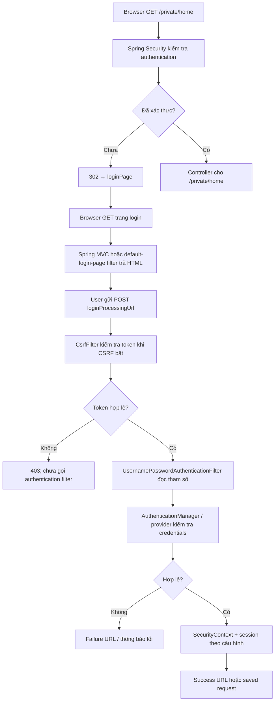

# `formLogin`, `loginPage`, `loginProcessingUrl` và tên tham số biểu mẫu

**Chủ đề:** Spring Security – Servlet · **Nhóm:** Đăng nhập biểu mẫu  
**Môi trường ví dụ:** Java 17, Spring Boot 3.3.5, Spring Security 6.x, Spring MVC với embedded Tomcat và Thymeleaf.

Bài này giải thích cách cấu hình **form login** trong một ứng dụng Spring Security chạy trên Servlet: ai tạo trang đăng nhập, ai xử lý request gửi biểu mẫu, cách đổi URL và tên trường `username`/`password`, cơ chế redirect khi đăng nhập thành công hoặc thất bại, cùng những vấn đề liên quan tới CSRF và `SecurityFilterChain`. Phần 6 cung cấp project Maven có thể dựng và chạy, không chỉ là đoạn cấu hình rời.

## 1. Phân biệt trang đăng nhập và điểm xử lý đăng nhập

Khi ứng dụng bảo vệ một URL, người dùng chưa xác thực có thể bị chuyển tới một **trang đăng nhập**. Trang đó gửi một biểu mẫu `POST` về **điểm xử lý đăng nhập**. Hai URL có thể trùng nhau hoặc khác nhau, nhưng **trách nhiệm xử lý hoàn toàn khác**.

| Khái niệm | Method + URL mặc định điển hình | Ai xử lý? |
| --- | --- | --- |
| Trang đăng nhập (login page) | `GET /login` | Spring Security có thể tạo HTML mặc định bằng filter; nếu chọn trang riêng thì Spring MVC/controller/view của ứng dụng phải cung cấp GET. |
| Điểm xử lý credentials (login processing URL) | `POST /login` | `UsernamePasswordAuthenticationFilter` của Spring Security đọc tham số từ request rồi yêu cầu xác thực. |
| Tên trường user | `username` | `UsernamePasswordAuthenticationFilter` đọc request parameter này, trừ khi cấu hình lại. |
| Tên trường mật khẩu | `password` | Tương tự, có thể thay bằng `passwordParameter(...)`. |
| Đăng nhập sai | Điểm đến mặc định liên quan `/login?error` | Failure handler chuyển người dùng tới URL lỗi; trang GET phải hiển thị được. |
| Đăng nhập thành công | Thường về request đã lưu hoặc URL đích cấu hình | Success handler thực hiện redirect/forward theo cấu hình; không phải controller POST login. |

**Điểm mấu chốt:** `GET /login` không xác minh mật khẩu; `POST /login` mặc định do **security filter** xử lý trước `DispatcherServlet`. Với form login chuẩn, **không tạo `@PostMapping("/login")` để tự check password**. Bạn chỉ viết controller cho `GET` của trang login tùy chỉnh và cho nội dung sau đăng nhập.



Sơ đồ trình bày luồng **form login thông dụng** trên Servlet; nhiều chi tiết như saved request, session fixation, security context repository hoặc success handler có thể được cấu hình khác. Đừng đồng nhất `302`/`401`/`403`: `302` thường là chuyển hướng cho trình duyệt, `401` có thể là challenge từ cơ chế khác như HTTP Basic, còn `403` ở POST form thường khiến ta cần kiểm tra CSRF hoặc quyền truy cập.

## 2. `formLogin()` bật cơ chế gì?

Cách ngắn để bật form login theo mặc định trong một bean `SecurityFilterChain`:

```java
@Bean
SecurityFilterChain securityFilterChain(HttpSecurity http) throws Exception {
    http.authorizeHttpRequests(auth -> auth
            .anyRequest().authenticated());
    http.formLogin(Customizer.withDefaults());
    return http.build();
}
```

Đây là **fragment cấu hình**, cần các import, `@Configuration` và ứng dụng Spring Boot/Servlet để chạy. `Customizer` thuộc package `org.springframework.security.config.Customizer`. Ví dụ hoàn chỉnh có đủ các file ở phần 6.

Khi form login được bật và không khai báo trang riêng, Spring Security thường cung cấp **trang login mặc định**. Với cấu hình mặc định phổ biến:

- `GET /login`: HTML do Spring Security tạo ra khi login page generator thích hợp được bật.
- `POST /login`: yêu cầu đăng nhập được `UsernamePasswordAuthenticationFilter` xử lý.
- Các trường biểu mẫu có tên `username` và `password`.
- Một session có thể giữ xác thực qua các request nếu dùng policy mặc định hỗ trợ phiên.
- Request thay đổi trạng thái như `POST /login` vẫn phải đáp ứng cơ chế **CSRF** nếu CSRF bật.

**Không nhầm:** `formLogin()` là một thành phần xây chuỗi security filter, không phải một API tự tạo controller nghiệp vụ. Nếu có nhiều `SecurityFilterChain`, request phải được chọn vào đúng chain chứa cấu hình login mới có filter xử lý tương ứng.

### 2.1. Vì sao không nên dùng `WebSecurityConfigurerAdapter`?

Ở các dự án Spring Security 6, cách khuyến nghị là khai báo `@Bean SecurityFilterChain` với `HttpSecurity`, không kế thừa `WebSecurityConfigurerAdapter` đã bị loại bỏ khỏi dòng API này. Tương tự, Spring Boot 3 dùng `jakarta.servlet.*` thay cho `javax.servlet.*`. Với bài này, mọi cấu hình đều theo kiểu bean hiện đại.

## 3. Các lựa chọn `loginPage`, `loginProcessingUrl`, `usernameParameter` và `passwordParameter`

Ví dụ cấu hình tùy chỉnh:

```java
http.formLogin(form -> form
        .loginPage("/auth/sign-in")
        .loginProcessingUrl("/auth/process")
        .usernameParameter("account")
        .passwordParameter("passcode")
        .defaultSuccessUrl("/private/home", true)
        .failureUrl("/auth/sign-in?error")
        .permitAll());
```

### 3.1. `.loginPage("/auth/sign-in")`

Chỉ định **URL để người dùng mở trang login bằng GET**. Khi dùng trang tùy chỉnh:

1. Ứng dụng phải có controller/handler cho `GET /auth/sign-in` và template hoặc view tương ứng.
2. Request anonymous phải được phép truy cập trang này; `.permitAll()` trên form login và rule `authorizeHttpRequests` phù hợp giúp tránh redirect vòng lặp.
3. Các tài nguyên mà trang cần như CSS, JS, ảnh hoặc favicon cũng cần được phục vụ và có chính sách truy cập đúng.
4. Việc tự đặt `loginPage(...)` không khiến Spring Security tự tạo một template HTML mới. Trang login mặc định do framework tạo thường không còn được sử dụng.

Nếu browser vào `/private/home` rồi nhận redirect tới `/auth/sign-in`, nhưng `GET /auth/sign-in` trả `404`, hãy kiểm tra **handler/view**. Nếu login page bị redirect ngược về chính nó, hãy kiểm tra **quyền anonymous và matcher của chain**.

### 3.2. `.loginProcessingUrl("/auth/process")`

Chỉ định nơi security filter **nhận POST chứa credentials**. Bạn **không cần** `@PostMapping("/auth/process")`; `UsernamePasswordAuthenticationFilter` xử lý trước MVC. Theo cấu hình thông dụng, filter chỉ chấp nhận phương thức POST cho login processing.

- Form phải khai báo `method="post"`.
- Thuộc tính `action` phải trỏ đúng `/auth/process` (có xét context path của ứng dụng).
- Nếu gọi `GET /auth/process`, đó **không phải** một request đăng nhập hợp lệ và không được xử lý như form POST.
- Khi dùng `securityMatcher(...)` giới hạn phạm vi chain, URL processing **phải nằm trong phạm vi chain** chứa filter này.
- Nếu CSRF bật, POST phải kèm **CSRF token**; thiếu token có thể trả `403` trước khi filter thử username/password.

Đừng dựa vào suy đoán “đổi `loginPage` nhưng `loginProcessingUrl` vẫn luôn là `/login`”. Các default của form configurer có thể phụ thuộc URL trang đã cấu hình. **Khai báo tường minh cả hai URL** khi muốn chúng khác nhau như bài này, đồng thời test đúng method + path.

### 3.3. `.usernameParameter("account")`

Thay tên **request parameter** mà filter đọc từ mặc định `username` thành `account`. Form HTML lúc đó phải có `name="account"`.

```html
<input type="text" name="account" autocomplete="username">
```

Giá trị `id`, `placeholder`, nhãn hiển thị hoặc biến Java phía server **không quyết định tên parameter**. Ví dụ dưới đây không hoạt động như ý nếu filter đang đợi `account`:

```html
<!-- Sai theo cấu hình trên: id đúng nhưng name sai. -->
<input type="text" id="account" name="username">
```

Khi tên không khớp, filter thường nhận giá trị rỗng/không có từ request và xác thực thất bại, dù người dùng đã nhập đúng mật khẩu. Hãy nhìn payload thực sự của request (chỉ trên dữ liệu demo; **không log mật khẩu thật**).

### 3.4. `.passwordParameter("passcode")`

Thay tên parameter mặc định `password` thành `passcode`:

```html
<input type="password" name="passcode" autocomplete="current-password">
```

Thay tên trường **không phải biện pháp bảo mật**. Việc che mật khẩu trên màn hình do `type="password"` thực hiện, nhưng credential vẫn đi qua request; hệ thống thật phải dùng **HTTPS**, password hashing an toàn và không log request body/header chứa credential.

Bộ lọc form login đọc **request parameters**, thường từ `application/x-www-form-urlencoded`. Không thể giả định gửi một JSON body như `{"account":"...","passcode":"..."}` tới `loginProcessingUrl` sẽ tự được `UsernamePasswordAuthenticationFilter` mặc định xử lý. Với REST JSON login riêng, cần thiết kế filter/endpoint và authentication flow phù hợp, không nhầm với form login.

### 3.5. Tên username gửi tới provider là gì?

Dù HTML dùng field `name="account"`, `UsernamePasswordAuthenticationFilter` vẫn tạo một `UsernamePasswordAuthenticationToken` với giá trị của field đó làm **principal chưa xác thực**. Bên dưới, `AuthenticationManager`/`AuthenticationProvider` hoặc `UserDetailsService` xác minh tài khoản dựa trên chuỗi được nhận.

Vì vậy việc đổi `usernameParameter("account")` **không cần đổi** API của `UserDetailsService.loadUserByUsername(...)`; nó chỉ đổi cách filter trích dữ liệu từ HTTP request.

## 4. URL và redirect khi đăng nhập thành công hoặc thất bại

| Config | Ý nghĩa | Ghi chú |
| --- | --- | --- |
| `loginPage("/auth/sign-in")` | Trang GET login | Cần handler/view nếu là trang riêng |
| `loginProcessingUrl("/auth/process")` | URL POST để thử xác thực | Do security filter xử lý |
| `usernameParameter("account")` | Tên parameter cho username | Phải khớp `name` trong form |
| `passwordParameter("passcode")` | Tên parameter cho password | Phải khớp `name` trong form |
| `failureUrl("/auth/sign-in?error")` | Nơi chuyển hướng sau khi xác thực sai | Login page cần hiển thị thông báo nếu muốn |
| `defaultSuccessUrl("/private/home", true)` | Chuyển tới URL sau khi xác thực thành công | `true` buộc luôn dùng URL này, không ưu tiên saved request |
| `formLogin(...permitAll())` | Cho phép anonymous truy cập URL liên quan form login | Không cho phép toàn bộ app và không tắt CSRF |

### 4.1. Saved request và `defaultSuccessUrl`

Nếu người dùng truy cập một URL protected trước khi đăng nhập, Spring Security có thể lưu request đó. Với success handler mặc định, khi không yêu cầu luôn dùng URL cố định, kết quả đăng nhập có thể trở lại **request đã lưu** thay vì `defaultSuccessUrl` — đó là hành vi hữu ích cho trải nghiệm người dùng.

Trong ví dụ ở phần 6, dùng:

```java
.defaultSuccessUrl("/private/home", true)
```

`true` nghĩa là sau khi đăng nhập thành công, luôn chuyển tới `/private/home`, giúp test có kết quả ổn định. Nếu muốn điều hướng trở lại URL user định truy cập, dùng overload `defaultSuccessUrl("/private/home")` hoặc tham số `false` tùy cấu hình và kiểm thử request cache.

### 4.2. `failureUrl` là GET tới trang hiển thị lỗi

Nếu mật khẩu sai, failure handler có thể redirect tới `/auth/sign-in?error`. Query `error` chỉ là **tín hiệu cho template**, không tự tạo thông báo tiếng Việt. Ví dụ Thymeleaf:

```html
<p th:if="${param.error}">Tên tài khoản hoặc mật khẩu không hợp lệ.</p>
```

Không đưa password, stack trace hoặc thông báo phân biệt “tài khoản có tồn tại hay không” ra client. Thông báo chung giúp hạn chế lộ thông tin về tài khoản.

### 4.3. Tránh “redirect loop”

Một lỗi rất phổ biến là `/auth/sign-in` bị yêu cầu đăng nhập:

```java
// Anti-pattern minh họa:
http.authorizeHttpRequests(a -> a.anyRequest().authenticated())
    .formLogin(f -> f.loginPage("/auth/sign-in"));
```

Nếu không permit login page, request anonymous tới `/auth/sign-in` có thể tiếp tục bị redirect về chính URL đó. Hãy đảm bảo cấu hình cho phép anonymous truy cập login page, dùng `.permitAll()` trong form login và/hoặc matcher rõ ràng.

## 5. CSRF, session và SecurityFilterChain ảnh hưởng form login như thế nào?

### 5.1. CSRF không tự tắt khi `permitAll()`

`permitAll()` nghĩa là **không cần authorization** ở endpoint tương ứng; nó **không bỏ** kiểm tra CSRF. Form login gửi POST phải có CSRF token hợp lệ khi CSRF bật. Nếu token thiếu/sai, `CsrfFilter` có thể chặn request `403` trước `UsernamePasswordAuthenticationFilter`.

Với Spring MVC và Thymeleaf, khi render form qua `th:action`, tích hợp `RequestDataValueProcessor` có thể tự thêm hidden input CSRF vào HTML. Ví dụ project bên dưới dùng cách này:

```html
<form th:action="@{/auth/process}" method="post">
    <input name="account" type="text">
    <input name="passcode" type="password">
    <button type="submit">Đăng nhập</button>
</form>
```

Trong ứng dụng chạy đúng với Thymeleaf/Spring MVC/Spring Security, form POST được bổ sung CSRF field tương ứng. Nếu sử dụng JSP, HTML thuần hoặc frontend bên ngoài, **phải tự tích hợp cách đưa token** vào request theo `CsrfTokenRepository` đang dùng. Không hardcode một token cố định.

**Lưu ý quan trọng:** Đừng vô hiệu hóa CSRF toàn cục chỉ để làm POST login chạy. Đặc biệt trong ứng dụng browser sử dụng session cookie, CSRF là một phần quan trọng của mô hình bảo vệ. Nếu ứng dụng API thực sự stateless, cần đánh giá cơ chế credential/cookie và threat model trước khi thay đổi chính sách.

### 5.2. Form login thường cần session để ghi nhớ danh tính

Sau khi xác thực, Spring Security thường thiết lập `Authentication` vào `SecurityContext`, đồng thời có thể lưu context qua `HttpSession` để browser được nhận diện ở các request sau nhờ session cookie. Trong dự án demo, chúng ta **không** bật `SessionCreationPolicy.STATELESS` vì form login chuẩn phục vụ browser với session.

Nếu vô tình bật stateless ở một app form login cần session, user có thể thấy login POST thành công nhưng GET protected ngay sau đó lại yêu cầu đăng nhập. Để debug, kiểm tra `SecurityContextRepository`, session policy, cookie, reverse proxy, domain và HTTPS.

`SecurityContext` không nên chứa password hoặc thông tin nhạy cảm ngoài nhu cầu xử lý. Login success sẽ có `Authentication` đã được xác thực; việc xóa credentials phụ thuộc provider/token/manager theo cơ chế được cấu hình.

### 5.3. Khi có nhiều `SecurityFilterChain`

Một `SecurityFilterChain` chỉ được chạy nếu request khớp `securityMatcher` của chain và chain không bị chain có `@Order` cao hơn bắt trước. Giả sử cấu hình:

```java
// Chỉ minh họa vấn đề phạm vi; không phải project hoàn chỉnh:
http.securityMatcher("/private/**")
    .formLogin(form -> form
        .loginPage("/auth/sign-in")
        .loginProcessingUrl("/auth/process"));
```

Nếu matcher của chain chỉ nhận `/private/**` thì `GET /auth/sign-in` và `POST /auth/process` **không vào chain đó**. Filter xử lý login của chain không có cơ hội chạy. `requestMatchers(...).permitAll()` bên trong authorization **không mở rộng** `securityMatcher`.

Cách giải quyết là để cả login page và login processing URL nằm trong phạm vi chain sở hữu form login, hoặc thiết kế matcher/chain riêng phù hợp. Ví dụ ở phần 6 dùng **một catch-all chain**, vì vậy không gặp vấn đề scope này.

## 6. Project Maven đầy đủ: trang login riêng, field tùy chỉnh

Project gồm:

```text
form-login-demo/
├── pom.xml
└── src/
    ├── main/
    │   ├── java/demo/formlogin/
    │   │   ├── FormLoginApplication.java
    │   │   ├── SecurityConfig.java
    │   │   └── PageController.java
    │   └── resources/templates/
    │       ├── sign-in.html
    │       └── home.html
    └── test/java/demo/formlogin/
        └── FormLoginApplicationTests.java
```

Có thể tạo project Spring Initializr với **Spring Web**, **Spring Security**, **Thymeleaf** và JDK 17, sau đó bổ sung các file dưới đây. Để bảo đảm version khớp nhau, `pom.xml` cố định Spring Boot 3.3.5 và dùng BOM của Spring Boot.

### 6.1. `pom.xml`

```xml
<?xml version="1.0" encoding="UTF-8"?>
<project xmlns="http://maven.apache.org/POM/4.0.0"
         xmlns:xsi="http://www.w3.org/2001/XMLSchema-instance"
         xsi:schemaLocation="http://maven.apache.org/POM/4.0.0 https://maven.apache.org/xsd/maven-4.0.0.xsd">
    <modelVersion>4.0.0</modelVersion>

    <parent>
        <groupId>org.springframework.boot</groupId>
        <artifactId>spring-boot-starter-parent</artifactId>
        <version>3.3.5</version>
        <relativePath/>
    </parent>

    <groupId>demo</groupId>
    <artifactId>form-login-demo</artifactId>
    <version>1.0.0</version>

    <properties>
        <java.version>17</java.version>
    </properties>

    <dependencies>
        <dependency>
            <groupId>org.springframework.boot</groupId>
            <artifactId>spring-boot-starter-web</artifactId>
        </dependency>
        <dependency>
            <groupId>org.springframework.boot</groupId>
            <artifactId>spring-boot-starter-security</artifactId>
        </dependency>
        <dependency>
            <groupId>org.springframework.boot</groupId>
            <artifactId>spring-boot-starter-thymeleaf</artifactId>
        </dependency>
        <dependency>
            <groupId>org.springframework.boot</groupId>
            <artifactId>spring-boot-starter-test</artifactId>
            <scope>test</scope>
        </dependency>
        <dependency>
            <groupId>org.springframework.security</groupId>
            <artifactId>spring-security-test</artifactId>
            <scope>test</scope>
        </dependency>
    </dependencies>

    <build>
        <plugins>
            <plugin>
                <groupId>org.springframework.boot</groupId>
                <artifactId>spring-boot-maven-plugin</artifactId>
            </plugin>
        </plugins>
    </build>
</project>
```

`spring-boot-starter-web` dùng Spring MVC và Servlet container (Tomcat mặc định); `spring-boot-starter-security` cung cấp Spring Security; `spring-boot-starter-thymeleaf` tạo HTML views. Hai dependency test hỗ trợ JUnit 5, MockMvc và security request post-processors. Không tự đặt version Spring Security rời khi không cần thiết.

### 6.2. `src/main/java/demo/formlogin/FormLoginApplication.java`

```java
package demo.formlogin;

import org.springframework.boot.SpringApplication;
import org.springframework.boot.autoconfigure.SpringBootApplication;

@SpringBootApplication
public class FormLoginApplication {
    public static void main(String[] args) {
        SpringApplication.run(FormLoginApplication.class, args);
    }
}
```

Đặt các class dưới `demo.formlogin` để component scanning mặc định tìm thấy bean cấu hình và controller.

### 6.3. `src/main/java/demo/formlogin/SecurityConfig.java`

```java
package demo.formlogin;

import org.springframework.context.annotation.Bean;
import org.springframework.context.annotation.Configuration;
import org.springframework.http.HttpMethod;
import org.springframework.security.config.annotation.web.builders.HttpSecurity;
import org.springframework.security.crypto.bcrypt.BCryptPasswordEncoder;
import org.springframework.security.crypto.password.PasswordEncoder;
import org.springframework.security.core.userdetails.User;
import org.springframework.security.core.userdetails.UserDetails;
import org.springframework.security.core.userdetails.UserDetailsService;
import org.springframework.security.provisioning.InMemoryUserDetailsManager;
import org.springframework.security.web.SecurityFilterChain;

@Configuration
public class SecurityConfig {

    @Bean
    SecurityFilterChain securityFilterChain(HttpSecurity http)
            throws Exception {

        http.authorizeHttpRequests(auth -> auth
                .requestMatchers(HttpMethod.GET,
                        "/auth/sign-in", "/public/ping").permitAll()
                .anyRequest().authenticated());

        http.formLogin(form -> form
                .loginPage("/auth/sign-in")
                .loginProcessingUrl("/auth/process")
                .usernameParameter("account")
                .passwordParameter("passcode")
                .defaultSuccessUrl("/private/home", true)
                .failureUrl("/auth/sign-in?error")
                .permitAll());

        http.logout(logout -> logout
                .logoutUrl("/auth/logout")
                .logoutSuccessUrl("/auth/sign-in?logout")
                .permitAll());

        return http.build();
    }

    @Bean
    PasswordEncoder passwordEncoder() {
        return new BCryptPasswordEncoder();
    }

    @Bean
    UserDetailsService users(PasswordEncoder encoder) {
        UserDetails student = User.withUsername("student")
                .password(encoder.encode("change-me"))
                .roles("USER")
                .build();

        return new InMemoryUserDetailsManager(student);
    }
}
```

**Giải thích chính xác từng cấu hình:**

- **`loginPage("/auth/sign-in")`**: URL trang hiển thị biểu mẫu GET, được `PageController` trả về bằng Thymeleaf.
- **`loginProcessingUrl("/auth/process")`**: nơi filter nhận POST credentials; không viết `@PostMapping` trong controller.
- **`usernameParameter("account")`** và **`passwordParameter("passcode")`**: tên các field **`name`**, không phải `id`. Được phản ánh chính xác trong `sign-in.html`.
- **`defaultSuccessUrl("/private/home", true)`**: sau khi credentials đúng, redirect tới `/private/home`, kể cả khi có saved request.
- **`failureUrl("/auth/sign-in?error")`**: khi xác thực sai, redirect tới trang login với query `error`.
- **`.permitAll()` của form login**: cho anonymous đi tới URL login/form processing/failure phù hợp. Rule `GET /auth/sign-in` trong `authorizeHttpRequests` được đặt rõ để dễ nhìn khi học.
- **`logoutUrl("/auth/logout")`** và logout success URL là phần hỗ trợ thử chu trình session đầy đủ; với CSRF đang bật, form gửi POST tới logout URL.
- **Không tắt CSRF**, không bật stateless; cách này thích hợp demo login bằng browser/session.
- **`PasswordEncoder` BCrypt** lưu encoded password trong `UserDetails`; `change-me` chỉ là mật khẩu demo, không sao chép vào production.

**Không mặc định HTTP Basic cùng hoạt động**: cấu hình ví dụ chỉ bật form login; không gọi `http.httpBasic(...)`. Đăng nhập bằng browser/form chứ không phải `curl -u` trong project này.

### 6.4. `src/main/java/demo/formlogin/PageController.java`

```java
package demo.formlogin;

import org.springframework.http.MediaType;
import org.springframework.security.core.Authentication;
import org.springframework.stereotype.Controller;
import org.springframework.ui.Model;
import org.springframework.web.bind.annotation.GetMapping;
import org.springframework.web.bind.annotation.ResponseBody;

@Controller
public class PageController {

    @GetMapping("/auth/sign-in")
    public String loginPage() {
        return "sign-in";
    }

    @GetMapping("/private/home")
    public String home(Authentication authentication, Model model) {
        model.addAttribute("username", authentication.getName());
        return "home";
    }

    @GetMapping(value = "/public/ping",
                produces = MediaType.TEXT_PLAIN_VALUE)
    @ResponseBody
    public String ping() {
        return "pong";
    }
}
```

`@Controller` trả tên view tương ứng với `src/main/resources/templates/`. `@ResponseBody` trên `/public/ping` trả một response text `"pong"`. Chỉ có hai GET page và một GET public; **không khai báo POST login/logout trong controller**.

### 6.5. `src/main/resources/templates/sign-in.html`

```html
<!DOCTYPE html>
<html lang="vi" xmlns:th="http://www.thymeleaf.org">
<head>
    <meta charset="UTF-8">
    <title>Đăng nhập</title>
</head>
<body>
    <h1>Đăng nhập</h1>

    <p th:if="${param.error}">
        Tên tài khoản hoặc mật khẩu không hợp lệ.
    </p>
    <p th:if="${param.logout}">
        Bạn đã đăng xuất.
    </p>

    <form th:action="@{/auth/process}" method="post">
        <label for="account-input">Tài khoản</label>
        <input id="account-input"
               type="text"
               name="account"
               autocomplete="username"
               required>

        <label for="passcode-input">Mật khẩu</label>
        <input id="passcode-input"
               type="password"
               name="passcode"
               autocomplete="current-password"
               required>

        <button type="submit">Đăng nhập</button>
    </form>
</body>
</html>
```

**Ba vị trí bắt buộc phải khớp cấu hình:**

1. `th:action="@{/auth/process}"` khớp `.loginProcessingUrl("/auth/process")`.
2. `name="account"` khớp `.usernameParameter("account")`.
3. `name="passcode"` khớp `.passwordParameter("passcode")`.

`th:action` tạo URL xét context path khi ứng dụng đặt dưới một prefix và giúp tích hợp xử lý dữ liệu form. Với Thymeleaf trên Spring MVC/Spring Security, POST form có thể được bổ sung **hidden CSRF field** bởi `RequestDataValueProcessor`. Nếu dùng HTML thuần hoặc tự dựng view khác, cần đảm bảo CSRF token được thêm theo đúng cách. Không copy nguyên HTML đã render kèm một token cũ sang request khác.

### 6.6. `src/main/resources/templates/home.html`

```html
<!DOCTYPE html>
<html lang="vi" xmlns:th="http://www.thymeleaf.org">
<head>
    <meta charset="UTF-8">
    <title>Trang cá nhân</title>
</head>
<body>
    <h1>Trang đã đăng nhập</h1>
    <p th:text="|Xin chào ${username}|">Xin chào</p>

    <form th:action="@{/auth/logout}" method="post">
        <button type="submit">Đăng xuất</button>
    </form>
</body>
</html>
```

GET `/private/home` cần authentication; sau khi login thành công, controller điền biến `username` vào view. Biểu mẫu logout sử dụng **POST**; đây là cách đúng khi CSRF bật. Liên kết `<a href="/auth/logout">` thông thường gửi GET và không tương đương lệnh POST logout.

## 7. Quan sát bằng browser và `curl`

### 7.1. Chạy bằng Maven

Cần JDK 17+, Maven và kết nối tải dependency ở lần chạy đầu tiên. Từ thư mục `form-login-demo/`:

```bash
mvn clean test
mvn spring-boot:run
```

Ứng dụng chạy tại `http://localhost:8080` nếu chưa cấu hình cổng khác.

### 7.2. Dùng browser để kiểm tra luồng có session

1. Mở `http://localhost:8080/private/home` trong trình duyệt chưa đăng nhập.
2. Trình duyệt được chuyển tới `http://localhost:8080/auth/sign-in`.
3. Nhập **Tài khoản:** `student`; **Mật khẩu:** `change-me`.
4. Nhấn **Đăng nhập**. Browser gửi `POST /auth/process` kèm các form parameters và CSRF token tương ứng.
5. Khi xác thực thành công, trình duyệt tới `/private/home`, hiển thị `Xin chào student`.
6. Nhấn **Đăng xuất** để gửi `POST /auth/logout`; success handler chuyển về `/auth/sign-in?logout`.

Ở luồng browser, session cookie giúp hệ thống khôi phục danh tính giữa POST login và GET home. Browser không tự lưu mật khẩu vào `SecurityContext`; Spring Security giữ một `Authentication` đại diện cho user đã xác thực theo policy.

### 7.3. Kiểm tra GET, redirect và CSRF bằng `curl`

Mở terminal khác (với PowerShell cũ, dùng `curl.exe` để tránh nhầm alias):

```bash
# GET public: trả body "pong".
curl -s http://localhost:8080/public/ping

# GET trang đăng nhập công khai: 200.
curl -s -o /dev/null -w '%{http_code}\n' \
  http://localhost:8080/auth/sign-in

# GET trang bảo vệ khi chưa có session: redirect 302.
curl -s -o /dev/null -w '%{http_code}\n' \
  -H 'Accept: text/html' \
  http://localhost:8080/private/home

# POST login thiếu CSRF token: bị từ chối 403.
curl -s -o /dev/null -w '%{http_code}\n' \
  -d 'account=student&passcode=change-me' \
  http://localhost:8080/auth/process
```

Từng lệnh, theo thứ tự, có nội dung in ra:

```text
pong
200
302
403
```

`curl -s` không tự thêm newline sau body `"pong"`; đây là kết quả **bốn lệnh riêng**. Để xem `Location` và `Set-Cookie`, dùng `curl -i` cho request tương ứng; giá trị header/cookie thay đổi tùy môi trường.

**Không thể gửi POST đăng nhập hợp lệ chỉ bằng password khi CSRF được bật.** Nếu muốn thử bằng client tự viết, hãy lấy CSRF token và session cookie từ một GET form đúng cách rồi gửi lại cùng POST. Cách đơn giản để trải nghiệm chức năng là dùng browser; phần tiếp theo dùng MockMvc có helper CSRF dành cho **môi trường test**.

## 8. Kiểm thử `formLogin` bằng MockMvc

`spring-boot-starter-test` cung cấp JUnit 5, Spring Test và MockMvc. `spring-security-test` cung cấp `csrf()` và `user()` để giả lập request bảo mật. Bộ test dưới đây xác minh **sự khác nhau giữa GET login page và POST login processing**, tên tham số tùy chỉnh, redirect thành công/thất bại và việc CSRF từ chối POST không hợp lệ.

### `src/test/java/demo/formlogin/FormLoginApplicationTests.java`

```java
package demo.formlogin;

import org.junit.jupiter.api.Test;
import org.springframework.beans.factory.annotation.Autowired;
import org.springframework.boot.test.autoconfigure.web.servlet.AutoConfigureMockMvc;
import org.springframework.boot.test.context.SpringBootTest;
import org.springframework.http.MediaType;
import org.springframework.test.web.servlet.MockMvc;

import static org.hamcrest.Matchers.containsString;
import static org.springframework.security.test.web.servlet.request.SecurityMockMvcRequestPostProcessors.csrf;
import static org.springframework.security.test.web.servlet.request.SecurityMockMvcRequestPostProcessors.user;
import static org.springframework.test.web.servlet.request.MockMvcRequestBuilders.get;
import static org.springframework.test.web.servlet.request.MockMvcRequestBuilders.post;
import static org.springframework.test.web.servlet.result.MockMvcResultMatchers.content;
import static org.springframework.test.web.servlet.result.MockMvcResultMatchers.header;
import static org.springframework.test.web.servlet.result.MockMvcResultMatchers.status;

@SpringBootTest
@AutoConfigureMockMvc
class FormLoginApplicationTests {

    @Autowired
    MockMvc mvc;

    @Test
    void publicPingDoesNotRequireLogin() throws Exception {
        mvc.perform(get("/public/ping"))
                .andExpect(status().isOk())
                .andExpect(content().string("pong"));
    }

    @Test
    void customLoginPageIsAccessibleAndUsesCustomFieldNames()
            throws Exception {
        mvc.perform(get("/auth/sign-in"))
                .andExpect(status().isOk())
                .andExpect(content().string(containsString("name=\"account\"")))
                .andExpect(content().string(containsString("name=\"passcode\"")))
                .andExpect(content().string(containsString("/auth/process")));
    }

    @Test
    void protectedPageRedirectsAnonymousToCustomLogin()
            throws Exception {
        mvc.perform(get("/private/home")
                .accept(MediaType.TEXT_HTML))
                .andExpect(status().is3xxRedirection())
                .andExpect(header().string("Location",
                        containsString("/auth/sign-in")));
    }

    @Test
    void postLoginWithoutCsrfIsForbidden() throws Exception {
        mvc.perform(post("/auth/process")
                .param("account", "student")
                .param("passcode", "change-me"))
                .andExpect(status().isForbidden());
    }

    @Test
    void correctLoginWithCsrfRedirectsToHome() throws Exception {
        mvc.perform(post("/auth/process")
                .with(csrf())
                .param("account", "student")
                .param("passcode", "change-me"))
                .andExpect(status().is3xxRedirection())
                .andExpect(header().string("Location",
                        containsString("/private/home")));
    }

    @Test
    void wrongPasswordWithCsrfRedirectsToFailurePage()
            throws Exception {
        mvc.perform(post("/auth/process")
                .with(csrf())
                .param("account", "student")
                .param("passcode", "wrong"))
                .andExpect(status().is3xxRedirection())
                .andExpect(header().string("Location",
                        containsString("/auth/sign-in?error")));
    }

    @Test
    void wrongFieldNamesCannotAuthenticate() throws Exception {
        mvc.perform(post("/auth/process")
                .with(csrf())
                .param("username", "student")
                .param("password", "change-me"))
                .andExpect(status().is3xxRedirection())
                .andExpect(header().string("Location",
                        containsString("/auth/sign-in?error")));
    }

    @Test
    void authenticatedUserCanViewHome() throws Exception {
        mvc.perform(get("/private/home").with(user("student")))
                .andExpect(status().isOk())
                .andExpect(content().string(
                        containsString("Xin chào student")));
    }

    @Test
    void logoutPostWithoutCsrfIsForbidden() throws Exception {
        mvc.perform(post("/auth/logout")
                .with(user("student")))
                .andExpect(status().isForbidden());
    }

    @Test
    void logoutPostWithCsrfReturnsToLoginPage() throws Exception {
        mvc.perform(post("/auth/logout")
                .with(user("student"))
                .with(csrf()))
                .andExpect(status().is3xxRedirection())
                .andExpect(header().string("Location",
                        containsString("/auth/sign-in?logout")));
    }
}
```

Chạy:

```bash
mvn test
```

**Dự kiến cả 10 test PASS** với đúng source/config. Các test không cần khởi động một server ở cổng `8080` vì MockMvc đi qua Spring MVC/Spring Security trong test context.

Lưu ý quan trọng:

- `.with(csrf())` chỉ là **test request post-processor** hỗ trợ CSRF token hợp lệ cho MockMvc. Một client thật không thể gửi literal `csrf()`.
- `.with(user("student"))` gắn một security principal giả lập cho request test; test `authenticatedUserCanViewHome` không chứng minh login form trước đó đã lập session qua hai request. Nếu cần chứng minh session xuyên request, phải viết integration test duy trì `MockHttpSession` và cookie/CSRF giữa các bước hoặc browser test.
- `wrongFieldNamesCannotAuthenticate` chứng minh filter không tự suy ra `username`/`password` mặc định khi đã đổi tên thành `account`/`passcode`.
- Test chỉ so sánh `Location` có path cụ thể, tránh phụ thuộc việc redirect URL được trả ở dạng relative hay absolute trong từng môi trường.

## 9. Lỗi phổ biến và cách phân loại

### 9.1. Trang login custom trả 404

Kiểm tra có `@GetMapping("/auth/sign-in")` và template `templates/sign-in.html` không. `.loginPage(...)` **không tự viết controller**; `.loginProcessingUrl(...)` cũng không sinh view GET. Với Thymeleaf, tên trả từ controller phải tương ứng đúng template.

### 9.2. Truy cập login page lại bị redirect tới chính nó

Kiểm tra quyền truy cập anonymous của GET login page: `.permitAll()` trong form login và authorization matcher. Nếu `GET /auth/sign-in` vẫn yêu cầu authenticated, có thể tạo redirect loop. Với nhiều chain, kiểm tra `securityMatcher` và `@Order` của chain nhận request trước.

### 9.3. GET login thành công nhưng POST login không chạy

Kiểm tra:

1. `<form method="post">` có đúng method không?
2. `action` sau render có đúng `/auth/process` và context path không?
3. `UsernamePasswordAuthenticationFilter` đang được cài trong **chain nhận POST URL** không?
4. Có một chain khác bắt `/auth/process` trước không?
5. CSRF token có hợp lệ không? Thiếu token có thể `403` trước khi gọi provider.
6. Nếu thấy `404/405`, có thể request không đi vào đúng filter và rơi xuống MVC.

Không viết controller POST để chữa lỗi khi thực ra processing URL nằm ngoài security chain.

### 9.4. Đúng tài khoản và mật khẩu nhưng vẫn quay về `?error`

Đối chiếu đúng **thuộc tính `name`**, không chỉ `id` hoặc label. `usernameParameter("account")`/`passwordParameter("passcode")` phải khớp tên trong form; request form-encoded không giống JSON. Kiểm tra `UserDetailsService`, `PasswordEncoder` và user store nếu tên đã đúng. Phân biệt failure handler redirect với controller validation; form login filter xử lý credentials.

### 9.5. POST login trả 403 dù endpoint đã `permitAll()`

`permitAll()` là chính sách authorization, còn CSRF xử lý yêu cầu POST theo nguyên tắc riêng. Với trang Thymeleaf, bảo đảm đã render qua Spring MVC để có CSRF token và browser giữ session/cookie tương ứng. Với HTML thuần, tạo hidden input theo `CsrfToken` được cấp. Không dùng token hardcode hoặc tắt toàn bộ CSRF chỉ vì demo.

### 9.6. Login thành công nhưng vào protected page vẫn bị yêu cầu login

Kiểm tra session, `JSESSIONID`, `SecurityContextRepository`, session creation policy, redirect target và reverse proxy. `SessionCreationPolicy.STATELESS` không thích hợp cho luồng browser form login muốn ghi nhớ danh tính qua session nếu không có cơ chế khác. Test POST thành công + 302 riêng lẻ chưa chứng minh cookie được gửi trong GET tiếp theo.

### 9.7. Nhầm `loginPage`, `loginProcessingUrl` và `defaultSuccessUrl`

- **`loginPage`**: GET hiển thị form.
- **`loginProcessingUrl`**: POST được filter tiêu thụ.
- **`defaultSuccessUrl`**: nơi client được redirect sau thành công.
- **`failureUrl`**: nơi client được redirect sau thất bại.

Không tự tạo `@PostMapping` cho `loginProcessingUrl`, không mong `GET` tại processing URL tự hiện form, và không đặt URL success vào nơi chưa được authorization hoặc controller phục vụ.

### 9.8. Tưởng `formLogin()` luôn được dùng cho API clients

Form login thường phục vụ **browser/session**. API dùng HTTP Basic, bearer token hoặc OAuth2/OIDC sẽ có authentication entry point và token khác. Chỉ bật form login ở những chain/client cần browser form; nếu nhiều chain, xác định rõ matcher, thứ tự và URL thuộc mỗi chain.

### 9.9. Lộ password qua debug

Không log toàn bộ request body, raw `Authentication`, header `Authorization` hoặc input của password field; không đặt credentials trong URL query. Để debug, log tối thiểu đường dẫn/method, selected chain, status và loại exception ở mức kiểm soát. Ngoài localhost, luôn dùng HTTPS và quản lý password trong kho tài khoản bằng hashing phù hợp.

## 10. Checklist cấu hình form login

1. **Trang GET:** Có `loginPage` rõ ràng và GET controller/template nếu là trang custom? Anonymous có vào được không?
2. **Processing POST:** `loginProcessingUrl` có khớp `form action`, method POST và phạm vi `securityMatcher` không?
3. **Tên tham số:** `usernameParameter`/`passwordParameter` có khớp `name` của các input thực sự được submit không?
4. **CSRF:** POST form login/logout có token đúng? Trường hợp không có token đã được test `403` chưa?
5. **Redirect:** `failureUrl`, `defaultSuccessUrl` và saved request có được thiết kế rõ và test không?
6. **Chính sách session:** `SecurityContext` được lưu/khôi phục thế nào; có bật stateless không đúng chỗ không?
7. **Tài khoản:** `UserDetailsService`, password hash/`PasswordEncoder` và trạng thái tài khoản đã được cấu hình đúng chưa?
8. **Chain:** Nếu nhiều chain, URL GET login và POST processing có được chain sở hữu filter chọn không? Có chain ưu tiên cao bắt trước không?
9. **HTML thực tế:** `th:action` xét context path, field `name` đúng, lỗi không tiết lộ danh tính, tài nguyên CSS/JS được phục vụ.
10. **Kiểm thử:** Test GET login, POST có/không CSRF, password đúng/sai, tên trường sai, GET protected và redirect/logout.

## 11. Câu hỏi tự luyện

**1.** `loginPage("/signin")` nhưng form gửi `POST /login`. Có chắc đúng không?  
**Đáp án:** Không. Phải kiểm tra processing URL thực sự của `UsernamePasswordAuthenticationFilter`; nếu muốn tách GET `/signin` và POST `/login`, khai báo rõ `loginProcessingUrl("/login")` rồi test.

**2.** Đổi `usernameParameter("email")` nhưng HTML vẫn có `name="username"`. Điều gì xảy ra?  
**Đáp án:** Filter không nhận giá trị đúng ở parameter `email`; thường xác thực thất bại dù người dùng nhập tài khoản hợp lệ.

**3.** POST có credentials đúng nhưng không có CSRF token, `.permitAll()` có cho qua không?  
**Đáp án:** Không. Khi CSRF bật, POST thiếu/sai token có thể bị từ chối `403` trước khi kiểm tra credentials.

**4.** Có cần `@PostMapping("/auth/process")` trong controller?  
**Đáp án:** Không. Form login processing URL là endpoint do `UsernamePasswordAuthenticationFilter` xử lý trong security filter chain.

**5.** Vì sao sau login thành công nhưng trình duyệt lại tới URL người dùng vừa yêu cầu, không tới trang mặc định?  
**Đáp án:** Success handler có thể ưu tiên saved request. Có thể dùng `.defaultSuccessUrl("/private/home", true)` nếu nghiệp vụ muốn luôn về URL đó.

**6.** `securityMatcher("/private/**")` với loginProcessing URL `/auth/process` có vấn đề gì?  
**Đáp án:** `/auth/process` không khớp chain; filter xử lý login trong chain đó không nhận request. Phải sửa phạm vi chain hoặc kiến trúc URL.

**Ghi nhớ:** `formLogin` kích hoạt luồng đăng nhập qua security filters; `loginPage` là **GET hiển thị form**, `loginProcessingUrl` là **POST xác thực**, còn `usernameParameter`/`passwordParameter` xác định **tên trường HTTP** phải khớp `name` trong HTML. Đặt đúng URL, cho anonymous xem trang, gửi CSRF token và kiểm thử redirect/session là bốn điều thiết yếu để form login hoạt động đáng tin cậy.