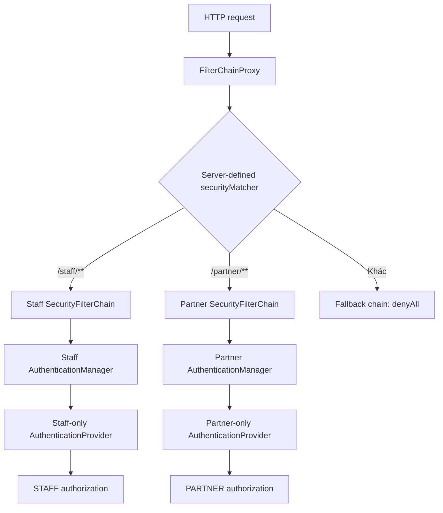

# Chọn AuthenticationManager theo yêu cầu với ranh giới tin cậy rõ ràng

> **Ngữ cảnh:** Spring Boot 3.x + Spring Security 6.x, Spring MVC/Servlet stack và Java 17+. Bài học này giải thích cách chọn đúng `AuthenticationManager` theo phạm vi request mà **không để dữ liệu do client tự khai báo quyết định một cách thiếu kiểm soát nơi xác thực danh tính**. Trọng tâm là lựa chọn theo `SecurityFilterChain` và, khi thật sự cần, `AuthenticationManagerResolver<HttpServletRequest>`; xác định trust boundary, tránh fallback sang cơ chế yếu, bảo vệ ngữ cảnh xác thực và kiểm chứng bằng các test âm tính (negative tests).

## 1. Vì sao cần nhiều AuthenticationManager?

`AuthenticationManager` nhận một `Authentication` chưa xác thực và trả `Authentication` đã xác thực hoặc ném `AuthenticationException`. Spring Security thường dùng `ProviderManager` để thử các `AuthenticationProvider` phù hợp. Ví dụ `DaoAuthenticationProvider` dùng `UserDetailsService` + `PasswordEncoder` để kiểm tra username/password.

Một ứng dụng có thể có **nhiều miền xác thực** với mức tin cậy và nguồn danh tính khác nhau:

- `/staff/**`: nhân viên nội bộ đăng nhập bằng store dành riêng cho nhân viên; có quyền `ROLE_STAFF`.
- `/partner/**`: đối tác đăng nhập bằng store đối tác; có quyền `ROLE_PARTNER`.
- `/admin/**`: cổng quản trị có thể yêu cầu MFA hoặc IdP riêng.
- API nhận bearer tokens từ nhiều issuer: mỗi issuer cần khóa xác minh, audience, thuật toán và policy riêng.

Nếu chỉ gộp các nguồn credentials vào một manager “dùng chung cho tất cả” mà không phân định phạm vi, một danh tính hợp lệ tại cổng A có thể vô tình được chấp nhận ở cổng B. **Chọn đúng manager** là bước đầu tiên, nhưng **authorization** và kiểm tra tài nguyên/tenant sau xác thực vẫn phải chặt chẽ.

### Ba khái niệm phải tách bạch

| Khái niệm | Câu hỏi | Ai phụ trách? |
|---|---|---|
| **Authentication routing** | Request này được phép sử dụng cơ chế/kho danh tính nào? | Security chain hoặc resolver với policy do server sở hữu |
| **Authentication** | Credentials/token có thực sự thuộc danh tính hợp lệ ở miền ấy? | `AuthenticationManager`/`AuthenticationProvider` |
| **Authorization** | Danh tính đã xác thực có quyền với URL, thao tác và bản ghi này không? | `authorizeHttpRequests`, method security, domain/service checks |

Ví dụ client có thể **tự chọn URL** `/partner/private`, nhưng việc gọi URL đó không có nghĩa client **được phép quyết định** rằng server phải sử dụng staff provider để xác thực. Server đặt chính sách: URL thuộc zone `/partner/**` chỉ qua partner manager; nếu client gửi staff credentials, partner manager từ chối.

## 2. Ranh giới tin cậy (trust boundary) là gì?

Một trust boundary là nơi dữ liệu/tuyên bố từ bên ít tin cậy hơn được chuyển vào quyết định bảo mật ở bên tin cậy hơn. Với HTTP request:

- **Không đáng tin mặc định:** query string, request body, header `X-Tenant`/`X-Auth-Provider`, username, token chưa xác minh, `Host` hoặc `X-Forwarded-*` nếu chưa có proxy policy phù hợp.
- **Cấu hình do server kiểm soát:** security matchers và chain order, danh sách cho phép của identity providers, credentials stores, key material, tenant mapping đã được xác minh và các yêu cầu authorization.
- **Dữ liệu có thể trở thành tin cậy theo điều kiện:** issuer/audience/subject được **xác minh bằng chữ ký và validator thích hợp**, hoặc tenant thuộc một principal đã xác thực và được phép truy cập.

Điểm mấu chốt không phải “đường dẫn request là dữ liệu tuyệt đối tin cậy”: client vẫn có thể chọn đường dẫn. Điều đáng tin là **quy tắc ánh xạ tài nguyên → cơ chế được phép** do server định nghĩa và được áp dụng độc lập với khai báo tùy tiện của client.

### Các cách làm nguy hiểm

```java
// SAI Ý TƯỞNG: client muốn manager nào thì server tin theo.
String provider = request.getHeader("X-Auth-Provider");
if ("staff".equals(provider)) {
    return staffManager;
}
return partnerManager;
```

Nếu header này quyết định xác thực cho cùng một tài nguyên mà không có kiểm tra ràng buộc khác, attacker có thể chọn cơ chế dễ hơn. Tương tự, không chọn manager chỉ vì username có hậu tố `@company.example` hay JWT payload có `"iss"` mà **chưa xác minh**. Tên miền email và JWT claim chỉ là lời tự khai cho tới khi được kiểm chứng.

**Không tự động fallback sang manager yếu hơn** khi provider mạnh từ chối credentials. Ví dụ: staff MFA không thành công thì đừng thử partner password để thay thế cho cùng tài nguyên admin. Fallback, nếu có, phải là chính sách đã định nghĩa rõ và không làm yếu authentication assurance.

## 3. Hai cách chọn manager phổ biến trên Servlet stack

### Cách A — Nhiều SecurityFilterChain, mỗi chain có manager riêng

Phù hợp khi các nhóm URL có boundary rõ, ví dụ `/staff/**` và `/partner/**`. `FilterChainProxy` nhận request, tìm **SecurityFilterChain khớp đầu tiên** theo `@Order`; chain được chọn cấu hình manager và quy tắc authorization tương ứng.



Với cách này, chọn chain theo request diễn ra **trước** khi gọi authentication manager của chain đó. Client có thể gửi staff credentials tới `/partner/**` nhưng không thể vì vậy làm `staffManager` được chọn.

### Cách B — AuthenticationManagerResolver theo request

`AuthenticationManagerResolver<C>` có phương thức `resolve(C context)`, trả về manager phù hợp. Trên Servlet, thường dùng `AuthenticationManagerResolver<HttpServletRequest>`. Một số cơ chế như OAuth2 Resource Server có điểm tích hợp resolver; **không phải mọi authentication filter tự dùng mọi resolver bean**.

Nếu đang xây custom authentication filter, bạn phải gắn resolver vào filter và xử lý đầy đủ lifecycle: trích credentials, tạo token chưa xác thực, gọi manager được chọn, kiểm tra kết quả, thiết lập/clear `SecurityContext` và chuyển exception sang entry point/failure handler. Chỉ khai báo một `@Bean AuthenticationManagerResolver` không tự thay đổi cách `BasicAuthenticationFilter` hay toàn bộ `HttpSecurity` chọn manager.

**Chọn A trước** khi boundary là những URL prefix ổn định; dùng B khi một filter thực sự cần chọn manager động theo request context đã được kiểm soát.

## 4. Mô hình “fail closed” cho mọi đường không được phân loại

Mỗi tài nguyên nhạy cảm phải có một security policy. Đừng để một request không khớp chain chuyên dụng rơi sang cấu hình mở do framework hoặc application vô tình tạo.

Ví dụ:

| Request | Chain phải chọn | Manager được phép | Kết quả khi credentials sai miền |
|---|---|---|---|
| `GET /staff/private` | Staff chain | Staff manager | **401**, không chuyển sang partner manager |
| `GET /partner/private` | Partner chain | Partner manager | **401**, không chuyển sang staff manager |
| `GET /staff/admin` | Staff chain | Staff manager | Nếu staff thường đã xác thực nhưng thiếu role → **403** |
| `GET /staff/public` | Staff chain | Staff manager khi Basic được gửi | Không credentials → 200; gửi Basic sai có thể → 401 |
| `GET /unknown` | Deny-all fallback | Không xác thực thay để hợp thức hóa đường lạ | Phải từ chối, không thành public do thiếu matcher |

Đừng suy ra URL không tồn tại sẽ luôn trả 404: nếu fallback chain chủ động `denyAll` thì Security có thể từ chối request **trước khi MVC tìm handler**. Quan trọng là không rơi vào lỗ hổng phân quyền.

## 5. Ví dụ chạy được: hai vùng xác thực độc lập

Mục tiêu của ví dụ:

1. Staff và partner dùng **hai kho người dùng tách biệt** với `PasswordEncoder`.
2. Hai `AuthenticationManager` được xây dựng **độc lập bằng `ProviderManager`**, mỗi manager có đúng `DaoAuthenticationProvider` của zone đó, **không có parent/fallback manager**.
3. Mỗi `SecurityFilterChain` tự gắn manager bằng `http.authenticationManager(...)` và bật `httpBasic(...)`.
4. `SessionCreationPolicy.STATELESS` giúp mỗi HTTP request phải xác thực bằng credentials của chính nó, tránh dùng lại `SecurityContext` từ session của zone khác trong ví dụ.
5. Fallback chain từ chối toàn bộ URL không thuộc zone nào.
6. Test chứng minh cross-zone credentials bị từ chối, không chỉ test luồng thành công.

### 5.1. Chuẩn bị Gradle / Spring Initializr

Tạo Spring Boot **3.x**, Java **17+** và Gradle project, dependencies: Spring Web, Spring Security, Spring Boot Starter Test, Spring Security Test. Phần `dependencies` của `build.gradle` tương ứng:

```groovy
dependencies {
    implementation 'org.springframework.boot:spring-boot-starter-web'
    implementation 'org.springframework.boot:spring-boot-starter-security'
    testImplementation 'org.springframework.boot:spring-boot-starter-test'
    testImplementation 'org.springframework.security:spring-security-test'
}
```

Đây là block dependencies, không phải file `build.gradle` đầy đủ. Project Initializr còn có plugins, repositories và Spring Boot version; giữ Gradle wrapper đi cùng project.

Cấu trúc project:

```text
src/
├── main/java/com/example/routing/
│   ├── AuthenticationRoutingApplication.java
│   ├── ZoneSecurityConfig.java
│   └── ZoneController.java
└── test/java/com/example/routing/
    └── ZoneIsolationTest.java
```

### 5.2. Lớp khởi động

**`src/main/java/com/example/routing/AuthenticationRoutingApplication.java`**

```java
package com.example.routing;

import org.springframework.boot.SpringApplication;
import org.springframework.boot.autoconfigure.SpringBootApplication;

@SpringBootApplication
public class AuthenticationRoutingApplication {
    public static void main(String[] args) {
        SpringApplication.run(AuthenticationRoutingApplication.class, args);
    }
}
```

### 5.3. Cấu hình hai SecurityFilterChain riêng biệt

**`src/main/java/com/example/routing/ZoneSecurityConfig.java`**

```java
package com.example.routing;

import java.util.List;

import org.springframework.beans.factory.annotation.Qualifier;
import org.springframework.context.annotation.Bean;
import org.springframework.context.annotation.Configuration;
import org.springframework.core.annotation.Order;
import org.springframework.http.HttpMethod;
import org.springframework.security.authentication.AuthenticationManager;
import org.springframework.security.authentication.ProviderManager;
import org.springframework.security.authentication.dao.DaoAuthenticationProvider;
import org.springframework.security.config.Customizer;
import org.springframework.security.config.annotation.web.builders.HttpSecurity;
import org.springframework.security.config.http.SessionCreationPolicy;
import org.springframework.security.core.userdetails.User;
import org.springframework.security.core.userdetails.UserDetailsService;
import org.springframework.security.crypto.factory.PasswordEncoderFactories;
import org.springframework.security.crypto.password.PasswordEncoder;
import org.springframework.security.provisioning.InMemoryUserDetailsManager;
import org.springframework.security.web.SecurityFilterChain;

@Configuration
public class ZoneSecurityConfig {

    @Bean
    PasswordEncoder passwordEncoder() {
        return PasswordEncoderFactories.createDelegatingPasswordEncoder();
    }

    @Bean("staffUsers")
    UserDetailsService staffUsers(PasswordEncoder encoder) {
        return new InMemoryUserDetailsManager(
                User.withUsername("staff")
                        .password(encoder.encode("staff-pass"))
                        .roles("STAFF")
                        .build(),
                User.withUsername("staff-admin")
                        .password(encoder.encode("admin-pass"))
                        .roles("STAFF", "STAFF_ADMIN")
                        .build()
        );
    }

    @Bean("partnerUsers")
    UserDetailsService partnerUsers(PasswordEncoder encoder) {
        return new InMemoryUserDetailsManager(
                User.withUsername("partner")
                        .password(encoder.encode("partner-pass"))
                        .roles("PARTNER")
                        .build()
        );
    }

    // Mỗi manager nhận đúng UserDetailsService của zone mình.
    // Không cấu hình parent manager hoặc provider của zone khác.
    private AuthenticationManager managerFor(
            UserDetailsService users, PasswordEncoder encoder
    ) {
        DaoAuthenticationProvider provider = new DaoAuthenticationProvider();
        provider.setUserDetailsService(users);
        provider.setPasswordEncoder(encoder);
        return new ProviderManager(List.of(provider));
    }

    @Bean
    @Order(1)
    SecurityFilterChain staffChain(
            HttpSecurity http,
            @Qualifier("staffUsers") UserDetailsService staffUsers,
            PasswordEncoder encoder
    ) throws Exception {
        AuthenticationManager staffManager = managerFor(staffUsers, encoder);

        return http
                .securityMatcher("/staff/**")
                .authenticationManager(staffManager)
                .authorizeHttpRequests(auth -> auth
                        .requestMatchers(HttpMethod.GET, "/staff/public")
                            .permitAll()
                        .requestMatchers(HttpMethod.GET, "/staff/admin")
                            .hasRole("STAFF_ADMIN")
                        .anyRequest()
                            .hasRole("STAFF")
                )
                .sessionManagement(session -> session
                        .sessionCreationPolicy(SessionCreationPolicy.STATELESS))
                .httpBasic(Customizer.withDefaults())
                .build();
    }

    @Bean
    @Order(2)
    SecurityFilterChain partnerChain(
            HttpSecurity http,
            @Qualifier("partnerUsers") UserDetailsService partnerUsers,
            PasswordEncoder encoder
    ) throws Exception {
        AuthenticationManager partnerManager =
                managerFor(partnerUsers, encoder);

        return http
                .securityMatcher("/partner/**")
                .authenticationManager(partnerManager)
                .authorizeHttpRequests(auth -> auth
                        .anyRequest().hasRole("PARTNER")
                )
                .sessionManagement(session -> session
                        .sessionCreationPolicy(SessionCreationPolicy.STATELESS))
                .httpBasic(Customizer.withDefaults())
                .build();
    }

    // Bắt mọi request không thuộc hai vùng trên.
    @Bean
    @Order(3)
    SecurityFilterChain denyUnknownRoutes(HttpSecurity http)
            throws Exception {
        return http
                .authorizeHttpRequests(auth -> auth
                        .anyRequest().denyAll())
                .build();
    }
}
```

**Giải thích thiết kế:**

- `securityMatcher("/staff/**")` và `securityMatcher("/partner/**")` phân định **vùng tài nguyên**. `FilterChainProxy` chọn chain khớp đầu tiên; `@Order(1)`/`@Order(2)` giúp thứ tự tường minh. Không cần cho hai manager thử cùng một request.
- `managerFor(...)` tạo `DaoAuthenticationProvider` với **đúng** `UserDetailsService` của zone. `ProviderManager(List.of(provider))` ở ví dụ **không khai báo parent**. Vì vậy nó không có lối fallback sang provider khác sau một authentication failure.
- `http.authenticationManager(staffManager)` là cấu hình **trên chính staff chain**; Basic authentication filter của chain ấy dùng manager tương ứng. `partnerChain` làm tương tự.
- `hasRole("STAFF")` yêu cầu authority `ROLE_STAFF`, còn `hasRole("PARTNER")` yêu cầu `ROLE_PARTNER`. `roles("STAFF","STAFF_ADMIN")` tạo cả hai authorities cho `staff-admin`.
- `staff/admin` được kiểm tra **trước** `anyRequest()`; staff thường qua authentication rồi vẫn bị 403 khi thiếu `STAFF_ADMIN`.
- `SessionCreationPolicy.STATELESS` giảm nguy cơ reuse security context trong phiên giữa các zone của ví dụ HTTP Basic. Nếu ứng dụng cần session, phải thiết kế thêm session isolation, CSRF, context lifecycle và tenant binding; **manager riêng không tự cô lập session**.
- Fallback chain `denyAll` từ chối URL không match staff/partner. Không thêm endpoint công khai trong fallback mà chưa xét lại threat model.
- Code chạy trên Servlet stack và dùng Spring Security 6.x; API `DaoAuthenticationProvider` dạng constructor rỗng + setters được dùng trong ví dụ vì có ở các phiên bản Security 6.x phổ biến. Với bản mới hơn, có thể ưu tiên constructor nhận `UserDetailsService` nếu API/phiên bản hỗ trợ.

**Giới hạn demo:** Các mật khẩu mẫu chỉ phục vụ localhost. Trong production, dùng identity provider/data store, chính sách mật khẩu, MFA/rate limiting và HTTPS. Không copy plain demo credentials lên môi trường mạng ngoài.

### 5.4. Controller

**`src/main/java/com/example/routing/ZoneController.java`**

```java
package com.example.routing;

import java.security.Principal;

import org.springframework.web.bind.annotation.GetMapping;
import org.springframework.web.bind.annotation.RestController;

@RestController
public class ZoneController {

    @GetMapping("/staff/public")
    public String staffPublic() {
        return "STAFF_PUBLIC";
    }

    @GetMapping("/staff/private")
    public String staffPrivate(Principal principal) {
        return "STAFF_OK: " + principal.getName();
    }

    @GetMapping("/staff/admin")
    public String staffAdmin(Principal principal) {
        return "STAFF_ADMIN_OK: " + principal.getName();
    }

    @GetMapping("/partner/private")
    public String partnerPrivate(Principal principal) {
        return "PARTNER_OK: " + principal.getName();
    }
}
```

Controller không tự quyết định manager được dùng; việc này đã diễn ra trong Security filter chain trước khi gọi handler. `Principal` trong các endpoint private/admin phản ánh danh tính đã được xác thực trong zone phù hợp.

## 6. Chạy và so sánh requests

Mở terminal tại root project có Gradle wrapper:

```bash
# macOS / Linux
./gradlew bootRun

# Windows PowerShell
.\gradlew.bat bootRun
```

Với port mặc định, request tới `http://localhost:8080`. Trên Windows PowerShell có thể dùng `curl.exe` thay vì alias `curl`. **Các status/body dưới đây là kỳ vọng khi chạy đúng mã ví dụ; tài liệu không khẳng định đã thực thi test trong môi trường của người đọc.**

### 6.1. Staff zone

```bash
# Public, không cần credentials
curl -i http://localhost:8080/staff/public

# Staff hợp lệ
curl -i -u staff:staff-pass http://localhost:8080/staff/private

# Staff thường truy cập admin (thiếu role)
curl -i -u staff:staff-pass http://localhost:8080/staff/admin

# Admin của staff zone
curl -i -u staff-admin:admin-pass http://localhost:8080/staff/admin
```

**Kỳ vọng lần lượt:** 200 body `STAFF_PUBLIC`; 200 body `STAFF_OK: staff`; 403; 200 body `STAFF_ADMIN_OK: staff-admin`.

Ở request 403, manager staff **đã xác thực** principal. Việc thiếu `ROLE_STAFF_ADMIN` là lỗi **authorization**, không phải bằng chứng đã chọn sai manager.

### 6.2. Partner zone

```bash
# Partner hợp lệ
curl -i -u partner:partner-pass http://localhost:8080/partner/private

# Không có credentials
curl -i http://localhost:8080/partner/private
```

**Kỳ vọng:** partner hợp lệ → 200 body `PARTNER_OK: partner`. Không gửi Basic credentials → 401 với `WWW-Authenticate` của Basic challenge.

### 6.3. Quan trọng nhất: xác thực chéo phải thất bại

```bash
# Credentials của staff KHÔNG được dùng ở partner zone
curl -i -u staff:staff-pass http://localhost:8080/partner/private

# Credentials của partner KHÔNG được dùng ở staff zone
curl -i -u partner:partner-pass http://localhost:8080/staff/private

# Đường lạ không thuộc zone
curl -i http://localhost:8080/unknown
```

**Kỳ vọng:** hai request xác thực chéo trả **401** vì manager của vùng nhận request không biết credentials thuộc vùng kia. Request `/unknown` bị fallback chain **từ chối** (không thành 200 công khai); mã cụ thể phụ thuộc entry point/exception handling của fallback. Trong cấu hình này không có controller cho đường lạ.

**Không tự “cứu” xác thực bằng cách thử manager thứ hai** sau khi manager đầu trả lỗi. Như vậy ranh giới giữa hai kho danh tính đã bị phá vỡ.

### 6.4. Ma trận kết quả

| URL | Credentials | Manager mong đợi | Status mong đợi | Lý do |
|---|---|---|---:|---|
| `/staff/public` | Không | Staff chain (không gọi authenticate vì anonymous được phép) | **200** | `permitAll` |
| `/staff/private` | `staff:staff-pass` | Staff | **200** | Staff principal hợp lệ + `ROLE_STAFF` |
| `/staff/private` | `partner:partner-pass` | Staff | **401** | Partner credentials không thuộc staff store |
| `/staff/admin` | `staff:staff-pass` | Staff | **403** | Đã xác thực, thiếu `ROLE_STAFF_ADMIN` |
| `/staff/admin` | `staff-admin:admin-pass` | Staff | **200** | Có cả staff và admin authorities |
| `/partner/private` | `partner:partner-pass` | Partner | **200** | Partner principal + `ROLE_PARTNER` |
| `/partner/private` | `staff:staff-pass` | Partner | **401** | Staff credentials không thuộc partner store |
| `/partner/private` | Không | Partner | **401** | Thiếu Basic credentials |
| `/unknown` | Không | Deny fallback | **4xx** | Không có zone hợp lệ |

Đừng lấy response body của 401 làm cơ sở kiểm chứng vì Boot/error handlers có thể định dạng khác nhau. Với Basic authentication, quan tâm tới **status**, `WWW-Authenticate` và việc **không có quyền truy cập chéo**.

## 7. MockMvc: test cả thành công lẫn từ chối chéo

Để chứng minh đúng trust boundary, test “staff đúng thì 200” là chưa đủ. Cần test rằng **staff credentials ở partner zone phải 401**, **partner credentials ở staff zone phải 401** và user đã authenticated nhưng thiếu role nhận **403**.

**`src/test/java/com/example/routing/ZoneIsolationTest.java`**

```java
package com.example.routing;

import org.junit.jupiter.api.Test;
import org.springframework.beans.factory.annotation.Autowired;
import org.springframework.boot.test.autoconfigure.web.servlet.AutoConfigureMockMvc;
import org.springframework.boot.test.context.SpringBootTest;
import org.springframework.http.HttpHeaders;
import org.springframework.test.web.servlet.MockMvc;

import static org.junit.jupiter.api.Assertions.assertTrue;
import static org.springframework.security.test.web.servlet.request.SecurityMockMvcRequestPostProcessors.httpBasic;
import static org.springframework.test.web.servlet.request.MockMvcRequestBuilders.get;
import static org.springframework.test.web.servlet.result.MockMvcResultMatchers.content;
import static org.springframework.test.web.servlet.result.MockMvcResultMatchers.header;
import static org.springframework.test.web.servlet.result.MockMvcResultMatchers.status;

@SpringBootTest
@AutoConfigureMockMvc
class ZoneIsolationTest {

    @Autowired
    MockMvc mvc;

    @Test
    void publicStaffEndpointAllowsAnonymous() throws Exception {
        mvc.perform(get("/staff/public"))
                .andExpect(status().isOk())
                .andExpect(content().string("STAFF_PUBLIC"));
    }

    @Test
    void staffWithoutCredentialsGetsBasicChallenge() throws Exception {
        mvc.perform(get("/staff/private"))
                .andExpect(status().isUnauthorized())
                .andExpect(header().exists(HttpHeaders.WWW_AUTHENTICATE));
    }

    @Test
    void partnerWithoutCredentialsGetsBasicChallenge() throws Exception {
        mvc.perform(get("/partner/private"))
                .andExpect(status().isUnauthorized())
                .andExpect(header().exists(HttpHeaders.WWW_AUTHENTICATE));
    }

    @Test
    void validStaffCredentialsWorkOnlyInStaffZone() throws Exception {
        mvc.perform(get("/staff/private")
                        .with(httpBasic("staff", "staff-pass")))
                .andExpect(status().isOk())
                .andExpect(content().string("STAFF_OK: staff"));

        mvc.perform(get("/partner/private")
                        .with(httpBasic("staff", "staff-pass")))
                .andExpect(status().isUnauthorized());
    }

    @Test
    void validPartnerCredentialsWorkOnlyInPartnerZone() throws Exception {
        mvc.perform(get("/partner/private")
                        .with(httpBasic("partner", "partner-pass")))
                .andExpect(status().isOk())
                .andExpect(content().string("PARTNER_OK: partner"));

        mvc.perform(get("/staff/private")
                        .with(httpBasic("partner", "partner-pass")))
                .andExpect(status().isUnauthorized());
    }

    @Test
    void staffWithoutAdminRoleGets403() throws Exception {
        mvc.perform(get("/staff/admin")
                        .with(httpBasic("staff", "staff-pass")))
                .andExpect(status().isForbidden());
    }

    @Test
    void staffAdminCanAccessAdminEndpoint() throws Exception {
        mvc.perform(get("/staff/admin")
                        .with(httpBasic("staff-admin", "admin-pass")))
                .andExpect(status().isOk())
                .andExpect(content().string("STAFF_ADMIN_OK: staff-admin"));
    }

    @Test
    void wrongPasswordIsRejected() throws Exception {
        mvc.perform(get("/staff/private")
                        .with(httpBasic("staff", "wrong")))
                .andExpect(status().isUnauthorized());
    }

    @Test
    void unknownRouteIsNotAccidentallyPublic() throws Exception {
        mvc.perform(get("/unknown"))
                .andExpect(result -> assertTrue(
                        result.getResponse().getStatus() >= 400));
    }
}
```

Chạy:

```bash
# macOS / Linux
./gradlew test

# Windows PowerShell
.\gradlew.bat test
```

**Kỳ vọng khi chạy project:** các test đều PASS với cấu hình và controllers ở trên. Đây là kết quả thiết kế dự kiến, không phải kết quả đã thực thi sẵn trong bài. Hai test **xác thực chéo** quan trọng hơn cả: chúng chứng minh một vùng không âm thầm sử dụng manager của vùng khác.

`MockMvc` rất hữu ích để kiểm tra Security filter behavior trong application context. Khi có reverse proxy, URL rewriting, forwarded headers hoặc session configuration phức tạp, cần thêm **integration test qua server thật** và đường vào gateway để kiểm chứng ranh giới không thay đổi ngoài ý muốn.

## 8. AuthenticationManagerResolver<HttpServletRequest> khi thật sự cần routing động

Nếu một custom Servlet authentication filter hoặc một cơ chế tích hợp có hỗ trợ `AuthenticationManagerResolver` phải chọn manager theo request, có thể viết một resolver theo policy server-side.

### 8.1. Mẫu resolver giới hạn rõ vùng

Đoạn dưới đây là **snippet minh họa**, chưa phải một class độc lập; `staffManager` và `partnerManager` phải là các manager đã xây và được cấp đúng chỗ. Việc tạo resolver **không tự nối nó** vào `httpBasic`. Import tương ứng: `jakarta.servlet.http.HttpServletRequest`, `org.springframework.security.authentication.AuthenticationManagerResolver`, `org.springframework.security.authentication.AuthenticationManager` và `org.springframework.security.authentication.BadCredentialsException`.

```java
AuthenticationManager deny = authentication -> {
    throw new BadCredentialsException("Unsupported authentication zone");
};

AuthenticationManagerResolver<HttpServletRequest> resolver = request -> {
    String path = request.getServletPath();

    if (path.startsWith("/staff/")) {
        return staffManager;
    }
    if (path.startsWith("/partner/")) {
        return partnerManager;
    }

    return deny; // fail closed; không fallback sang manager mặc định
};
```

Lưu ý quan trọng:

- Hai prefixes phải là policy do server định nghĩa và **khớp với routing của Servlet/MVC**; không tự dùng `contains("staff")` hoặc prefix không có dấu `/` khiến `/staff-other` bị nhận nhầm.
- `getServletPath()` là đường dẫn đã được Servlet Container diễn giải; cần thống nhất với `contextPath`, mapping và reverse proxy. Nếu gateway rewrite URL, kiểm thử **cả trước và sau gateway**; đừng tin `X-Original-URL`/`X-Rewrite-URL` do client tự thêm.
- Một resolver **chỉ chọn manager**, không tự thực hiện authentication, không tự kiểm tra quyền, không tự gửi 401 hoặc cập nhật `SecurityContext`. Filter tích hợp phải thực hiện đúng các bước ấy.
- `deny` là manager từ chối, tránh việc resolver trả `null` rồi filter vô tình rơi sang default dễ dãi. Cách phản hồi HTTP cụ thể thuộc failure handling của filter; không để exception chưa xử lý làm rò stack trace.
- Nếu dùng cùng request path phân vùng có khả năng nhận nhiều loại credentials, phải xác định trước **loại token** và trust boundary; không chọn manager tùy ý theo claim/username chưa được xác minh.

### 8.2. Resolver dựa trên issuer/token: khi nào an toàn?

Đối với nhiều JWT issuers, một số integration của Spring Security có thể chọn `AuthenticationManager` theo issuer. Nhưng có một ranh giới tinh tế:

1. Giá trị `iss` trong JWT **trước khi xác minh chữ ký chỉ là dữ liệu chưa tin cậy**. Có thể đọc nó như *gợi ý định tuyến tới validator đã được allowlist*, **không** coi nó là bằng chứng issuer hợp lệ.
2. Server chỉ chấp nhận issuers nằm trong **allowlist** do mình cấu hình; không tự tải JWKS từ URL `iss` do client cung cấp nếu không kiểm soát, tránh SSRF và trust expansion.
3. Manager tương ứng phải **xác minh chữ ký**, thuật toán/kid được cho phép, issuer khớp, audience, thời gian và policy cần thiết. Nếu validation thất bại, **từ chối**, không thử issuer yếu hơn cho cùng token.
4. Sau khi xác thực, kiểm tra subject được phép dùng API/tenant đích; một token hợp lệ của issuer A **không mặc nhiên có quyền với tài nguyên B**.
5. Với mTLS/service identity, danh tính đáng tin phải đến từ TLS handshake hoặc proxy boundary được bảo vệ, không phải chuỗi header `X-Client-Cert` tự khai của caller.

Vì vậy trong các hệ multi-issuer nên dùng các **cơ chế resolver/decoder/validator do Spring Security hỗ trợ**, với issuers allowlist và cấu hình kiểm chứng đầy đủ. Không tự viết một “JWT router” dựa vào Base64 payload rồi cho qua authorization.

## 9. Ranh giới session, security context và tenant data

### Manager riêng không đồng nghĩa session riêng

Trong HTTP Basic stateless demo, mỗi request mang credentials; `SessionCreationPolicy.STATELESS` không cho Security sử dụng HTTP session để lấy `SecurityContext`. Nhưng trong ứng dụng có form login/session, một principal có thể đã được đặt trong session từ request trước; request sau có thể không gọi lại authentication manager mà vẫn mang principal ấy.

**Hệ quả:** Tách `AuthenticationManager` theo URL **chưa đủ** nếu cùng session được chia sẻ giữa nhiều security chains. Cần kiểm tra session isolation, authorization theo zone, session fixation/cookie settings và lifecycle của `SecurityContextRepository`; đừng dựa vào “request tới zone B chắc chắn gọi manager B” khi session đã xác thực sẵn.

### Chọn manager đúng vẫn phải kiểm tra quyền theo tenant

Ngay cả khi principal đã qua đúng provider:

- `staff` có `ROLE_STAFF` nhưng không mặc nhiên được xem mọi hồ sơ nhân viên.
- `partner` có `ROLE_PARTNER` nhưng không được truy cập đơn hàng của partner khác.
- Nếu request chứa `tenantId` trong path/body, phải ràng buộc nó với tenant/organizations được gắn trên **principal đã xác thực** và quyền trên từng resource. Không tin `tenantId` chỉ vì nó trùng header do client gửi.
- Khi dùng method security (`@PreAuthorize`) hoặc domain-level authorization, kiểm tra object ownership/tenant membership ở service/data access, tránh IDOR/BOLA.
- Không xem `SecurityContextHolder` như dữ liệu tự động chuyển đúng giữa async threads hoặc custom executors; dùng cơ chế context propagation được Security hỗ trợ khi cần.

## 10. Những lỗi thường gặp và cách xử lý

| Triệu chứng | Nguyên nhân có thể | Cách kiểm tra |
|---|---|---|
| Staff credentials truy cập partner endpoint thành công | Chain/manager dùng chung; parent/fallback; session context cũ; authorization quá rộng | Test cross-zone 401, log chain/provider an toàn, kiểm tra stateful session |
| Request ngoài `/staff/**`/`/partner/**` trả 200 | Không có fallback hoặc có `permitAll` ngoài ý muốn | Kiểm tra mọi `SecurityFilterChain`, thứ tự `@Order`, policy deny fallback |
| `/staff/private` trả 401 dù credentials staff đúng | Chọn nhầm chain/manager, password encoder sai, user không có trong store | Xác nhận matcher, provider của manager và credential store |
| Trả 403 thay vì 401 | Principal đã xác thực nhưng thiếu role; CSRF trên POST | Phân biệt authentication và authorization; kiểm tra authorities, method |
| Resolver đổi manager vì `X-Auth-Provider` | Tin user-controlled request metadata | Đưa lựa chọn về server policy/allowlist và tenant binding |
| JWT từ issuer lạ vẫn được dùng | Dynamic manager/JWKS từ unverified `iss`; thiếu allowlist | Pin issuers, validate signature/iss/aud, reject unknown |
| Parent manager xác thực thay staff provider | `ProviderManager` có parent hoặc fallback chủ đích không rõ | Xác định manager instance, providers và parent của mỗi chain |
| Controller bị lộ dù đã đặt matcher | Matcher không bao phủ path, prefix rewrite hoặc chain ưu tiên sai | So URL thực tế/`servletPath`, gateway mapping và order |
| Một user thấy dữ liệu tenant khác | Authentication đúng nhưng thiếu object-level authorization | Xác minh subject-tenant binding và resource ownership |
| MockMvc pass, production sai | Proxy rewrite, cookies/session, forwarded headers, container filters | Integration test qua embedded server/gateway, log dữ liệu an toàn |

### Vì sao không dùng username hoặc role để chọn manager trước authentication?

Username là input do client gửi; không có bảo đảm đó là danh tính thật. Authority/role chỉ đáng tin khi được provider xác thực và sinh ra trong `Authentication`. Nếu chọn provider dựa trên “tài khoản này là ADMIN vì username bắt đầu bằng admin” rồi áp dụng chính sách yếu, attacker có thể điều khiển đường đi. **Manager selection cần policy về nguồn tin cậy; role/permission enforcement cần principal đã xác thực.**

### Có thể cố ý cho một provider chấp nhận nhiều loại tài khoản không?

Có, nếu đó là thiết kế business rõ ràng và **vẫn bảo đảm** những accounts thuộc các miền khác nhau không được dùng để vượt một boundary. Khi cần federation, nên có mapping nội bộ, issuer trust, audience/scope, tenant membership, session assurance và audit; không phải thử tất cả providers cho đến khi một nơi bất kỳ nói OK.

## 11. Checklist bảo mật trước khi triển khai

1. **Liệt kê các vùng tài nguyên** và các authentication mechanisms/issuers được phép với từng vùng.
2. **Gắn manager đúng chỗ:** per-chain bằng `http.authenticationManager(...)` hoặc per-filter resolver được tích hợp thật, không chỉ khai báo bean.
3. **Không để client chọn manager tùy ý** qua header/query/username/unverified token. Cấu hình allowlist, trust validation và mapping server-side.
4. **Fail closed** cho request không thuộc vùng hoặc token/issuer lạ; không fallback sang cơ chế yếu, không tạo public-by-default.
5. **Không dùng chung credential stores/parent manager** ngoài ý muốn; nếu có liên thông identity, viết policy và negative tests cho từng hướng.
6. **Tách authentication và authorization:** authenticated principal còn phải có roles, scopes, tenant membership và quyền trên bản ghi.
7. **Kiểm tra session isolation:** hai chains có manager khác nhau chưa chắc tránh reuse `SecurityContext`; policy stateless/stateful phải explicit.
8. **Kiểm soát URL rewriting:** gateway/proxy, `contextPath`, servletPath, case sensitivity, encoded path; từ chối các đường đi mập mờ.
9. **Kiểm tra và vận hành an toàn:** không log password, Authorization header, JWT; ghi chain ID, provider/issuer đã xác minh và outcome ở mức cần thiết.
10. **HTTPS/MFA/rate limiting:** credentials có giá trị cần TLS, kiểm soát brute-force, session/token revocation và step-up cho thao tác nhạy cảm.
11. **Test âm tính hai chiều:** credentials zone A dùng tại B và B tại A phải bị từ chối; test không header, sai password, role thiếu và unknown route.
12. **Test production-like:** HTTP qua Servlet Container thật, gateway path rewriting, cookies/sessions, đồng thời và cấu hình proxy khác biệt với môi trường dev.

## 12. Bài tập củng cố

**Bài 1 — Chọn đúng chain.** Trong cấu hình hiện tại, giả sử client gửi Basic credentials `staff:staff-pass` tới `/partner/private`. Vì sao server không thử staff manager sau partner manager thất bại?  
**Đáp án:** `FilterChainProxy` đã chọn partner chain bằng matcher; chain ấy có provider/manager chỉ dành cho partner, không parent/fallback sang staff.

**Bài 2 — Authorization riêng.** `staff:staff-pass` truy cập `/staff/admin`. Authentication có thành công không, tại sao HTTP vẫn 403?  
**Đáp án:** Manager staff xác thực user, nhưng user chỉ có `ROLE_STAFF`, không có `ROLE_STAFF_ADMIN`.

**Bài 3 — Sửa sai trust boundary.** Developer định chọn manager bằng request header `X-Auth-Provider: staff`. Hãy nêu rủi ro và sửa.  
**Đáp án:** Header do client kiểm soát; dùng policy route/chain do server định nghĩa hoặc resolver dựa vào metadata đã được kiểm chứng và có allowlist.

**Bài 4 — Resolver không tự hoạt động.** Tạo bean `AuthenticationManagerResolver<HttpServletRequest>` nhưng Basic vẫn dùng manager cũ. Vì sao?  
**Đáp án:** Resolver phải được một authentication filter/Configurer hỗ trợ và gọi `resolve(request)`; không có auto-wire tổng quát vào mọi Basic filter.

**Bài 5 — Session.** User đăng nhập staff ở một endpoint, sau đó mở partner URL cùng session cookie và không gửi credentials. Bạn phải test gì?  
**Đáp án:** Có reuse `SecurityContext` không, liệu chain khác có cho qua bằng principal cũ không, và authorization có enforce zone/tenant không. Demo dùng `STATELESS` để loại reuse context qua session; hệ stateful cần thêm policy.

**Bài 6 — JWT multi-issuer.** JWT payload tự khai `iss=https://evil.example`. Có thể tải JWK từ URL này rồi chấp nhận sau khi verify chữ ký không?  
**Đáp án:** Không tự mở rộng trust theo issuer do attacker khai. Chỉ dùng issuer allowlist, kiểm tra chữ ký/issuer/audience/algorithm phù hợp rồi kiểm tra quyền của subject.

## 13. Tổng kết

- Chọn `AuthenticationManager` là quyết định về **miền xác thực**; không phải quyết định authorization cuối cùng.
- Với phân vùng theo URL trên Servlet stack, **nhiều `SecurityFilterChain` + `securityMatcher` + manager riêng + `@Order` + deny-all fallback** là mô hình rõ ràng, dễ kiểm thử.
- **`AuthenticationManagerResolver<HttpServletRequest>`** phù hợp cho filter/integration thực sự cần routing động, nhưng không tự được mọi authentication filter sử dụng.
- **Trust boundary:** user-controlled header, username, unverified JWT claim hoặc forwarded metadata không được phép âm thầm chọn một manager tin cậy hơn/yếu hơn.
- Không fallback sang manager khác sau thất bại trừ khi có policy rõ ràng, không để token/tenant chưa xác minh quyết định phạm vi quyền.
- Tách **authentication manager routing**, **credential verification**, **roles/permissions** và **object-level authorization**. Tách manager không đồng nghĩa tách session.
- **Kiểm chứng tốt nhất** gồm cả positive cases và negative cross-zone cases; không chỉ test một request thành công.

**Nguyên tắc cuối:** Request có thể chỉ ra tài nguyên muốn truy cập; **server quyết định cơ chế được phép xác thực vào tài nguyên đó**. Xác thực đúng miền là điều kiện cần, không thay thế việc kiểm tra quyền và ranh giới dữ liệu sau xác thực.