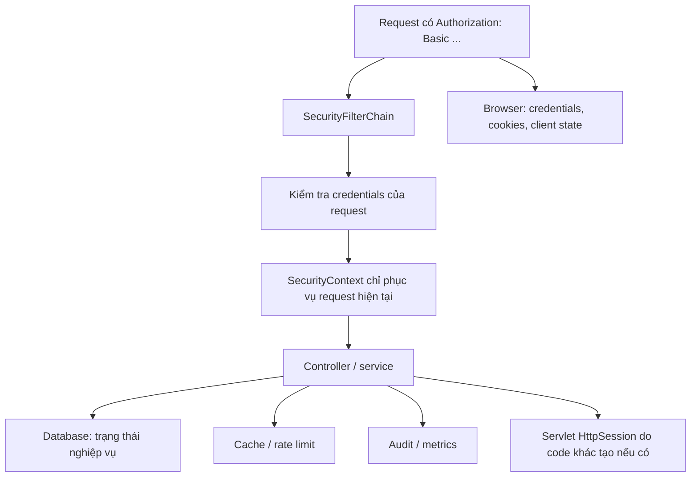

# Không tạo phiên không đồng nghĩa với không có trạng thái ở mọi thành phần

**Chủ đề:** Spring Security – Servlet  
**Nhóm:** Quản lý phiên  
**Môi trường ví dụ:** Java 17, Spring Boot 3.3.5, Spring Security 6.x, Spring MVC và embedded Tomcat.

## Mục tiêu học tập

Khi cấu hình `SessionCreationPolicy.STATELESS`, nhiều người kết luận rằng ứng dụng “hoàn toàn không có trạng thái”. Đây là sự nhầm lẫn giữa **chính sách lưu trạng thái xác thực của Spring Security** và **mọi loại trạng thái trong hệ thống**. Sau bài học, bạn cần:

1. Phân biệt trạng thái xác thực trong `SecurityContext` với `HttpSession`, database, cache, CSRF token, request cache, HTTP client và ứng dụng frontend.
2. Hiểu chính xác bốn lựa chọn `SessionCreationPolicy`: `ALWAYS`, `IF_REQUIRED`, `NEVER` và `STATELESS`.
3. Giải thích vì sao `STATELESS` không phải lệnh cấm chung khiến mọi code Servlet, MVC hoặc thư viện không thể tạo `HttpSession`.
4. Phân biệt “không dùng session để **khôi phục authentication**” với “không có bất kỳ state nào trong quá trình xử lý request”.
5. Biết cách kiểm chứng bằng request thực tế, `MockMvc`, `HttpServletRequest.getSession(false)` và việc gửi lại session cũ mà không có credential.
6. Thiết kế API không tạo phiên xác thực nhưng vẫn có database, cache, counters hoặc audit logs — đồng thời nắm rủi ro CSRF, token, cookie và logout.

**Quy tắc bao trùm:** *Stateless authentication* nói về cách request chứng minh danh tính và cách security context được lưu giữa các request; nó **không** hàm ý business data, trình duyệt, server memory hay hệ thống khác phải stateless.

## 1. “State” có nhiều phạm vi, không chỉ `HttpSession`

Trong một ứng dụng web, từ “trạng thái” có thể chỉ những thứ rất khác nhau.

| Loại trạng thái | Ví dụ | Nơi lưu hoặc thời gian sống | `STATELESS` có tự xóa/cấm không? |
| --- | --- | --- | --- |
| Authentication của request | `SecurityContextHolder.getContext().getAuthentication()` | Trong vòng đời xử lý request, có thể gắn với thread/request | **Không.** Request vẫn cần biết người gọi là ai. |
| Authentication giữa các request | `SPRING_SECURITY_CONTEXT` trong `HttpSession` | Session/repository được cấu hình | **Có ảnh hưởng:** Spring Security không dùng `HttpSession` để lấy/lưu authentication như phiên stateful. |
| Servlet session được tạo bởi ứng dụng | `request.getSession(true)`, `@SessionAttributes` | Servlet container hoặc distributed session store | **Không phải lệnh cấm tổng quát.** Code khác vẫn có thể tạo session. |
| CSRF state | CSRF token trong session hoặc cookie | `CsrfTokenRepository`, browser và server | **Không tự quyết định.** Phụ thuộc CSRF configurer và repository. |
| Request cache | Saved request trước khi login | `RequestCache`, có thể là session | **Không đồng nghĩa mọi cache khác bị xóa**; policy có thể đổi cách Spring Security dùng request cache. |
| Dữ liệu nghiệp vụ | User, đơn hàng, thanh toán | Database/transaction log | **Không.** Ứng dụng cần state nghiệp vụ bền vững. |
| Cache, rate limit, idempotency | Redis, in-memory map, counters | Server, Redis, key-value store | **Không.** Có thể phục vụ nhiều request cùng lúc. |
| Client state | Browser cookie, `localStorage`, HTTP Basic auth cache | Trình duyệt/HTTP client | **Không.** Server không tự xóa dữ liệu client qua `STATELESS`. |
| Token/claims | JWT bearer token và token ở client | Token gửi trong request | **Không.** Token bản thân mang dữ liệu; refresh/revocation có thể còn state server. |
| Quan sát vận hành | Audit, tracing, metrics, logs | Hệ thống logging/telemetry | **Không.** Không thuộc security session policy. |

Giả sử bạn gọi một API dùng HTTP Basic cho mỗi request, Spring Security không lấy `Authentication` từ session; nhưng controller tăng bộ đếm trong `AtomicLong`, database ghi đơn hàng và gateway duy trì rate-limit counter. **Authentication có thể stateless trong khi toàn bộ hệ thống vẫn có trạng thái.**



Sơ đồ minh họa các nơi **có thể** giữ trạng thái, không khẳng định tất cả được dùng trong mọi ứng dụng.

## 2. Phân biệt `HttpSession` và `SecurityContext`

### 2.1. `HttpSession` là gì?

`HttpSession` là một cơ chế của Servlet API để giữ dữ liệu qua nhiều request từ một client. Ví dụ:

```java
// Fragment trong controller/servlet có HttpServletRequest request:
HttpSession current = request.getSession(false); // Không tạo mới.
HttpSession created = request.getSession(true);   // Cho phép tạo nếu chưa có.
created.setAttribute("theme", "dark");
```

Đây là **fragment**, không phải chương trình Java độc lập. Các import Servlet là `jakarta.servlet.http.HttpServletRequest` và `jakarta.servlet.http.HttpSession` với Spring Boot 3.

- `request.getSession(false)` trả session hiện có hoặc `null`, **không** tự tạo session.
- `request.getSession()` tương đương cho phép tạo mới; `getSession(true)` cũng có thể tạo `HttpSession`.
- `session.setAttribute(...)` lưu dữ liệu phiên ở container hoặc implementation session phù hợp.
- Client thông thường nhận cookie chứa session ID, thường là `JSESSIONID`; cookie là **định danh**, không chứa toàn bộ attribute trong session.
- Session có thể do Spring MVC, controller, framework khác hoặc custom code sử dụng, không chỉ Spring Security.

**Chú ý:** `HttpSession` không phải database cho trạng thái nghiệp vụ lâu dài. Session có TTL, có thể hết hạn, bị invalidate hoặc phụ thuộc hạ tầng replication. Không đưa dữ liệu nguồn duy nhất của giao dịch quan trọng vào session.

### 2.2. `SecurityContext` là gì?

`SecurityContext` chứa `Authentication` mô tả danh tính/quyền đã được xác thực của request. Spring Security sử dụng `SecurityContextHolder` làm điểm truy cập context theo chiến lược cấu hình, thường gắn với thread xử lý request.

```java
Authentication authentication =
        SecurityContextHolder.getContext().getAuthentication();
```

Dòng trên là fragment, import `org.springframework.security.core.Authentication` và `org.springframework.security.core.context.SecurityContextHolder`.

`STATELESS` **không vô hiệu hóa việc có `Authentication` trong request**. Nếu không có `Authentication` tại thời điểm authorization, API không biết ai đang gọi. Ngược lại, với HTTP Basic/Bearer, filter có thể xác minh credential **từ request hiện tại**, dựng `Authentication`, đưa nó vào context cho controller/service, rồi dọn context theo vòng đời filter.

**Phân biệt ba câu:**

1. “Không tạo session để ghi nhớ login” — một quyết định quản lý xác thực giữa các request.
2. “Không có `HttpSession` nào tồn tại” — mệnh đề mạnh hơn; phải kiểm tra **tất cả thành phần** có thể tạo session.
3. “Ứng dụng không có trạng thái” — thường sai nếu vẫn có database, cache, message queues, logs hoặc dữ liệu phía client.

### 2.3. Cơ chế khôi phục context giữa các request

Spring Security dùng một `SecurityContextRepository` để xác định nơi nạp/lưu security context. Các implementation cần nhận diện:

- `HttpSessionSecurityContextRepository`: làm việc với `HttpSession`; chính sách tạo session và lưu context cần cấu hình phù hợp.
- `RequestAttributeSecurityContextRepository`: lưu context trong request attributes để phục vụ phạm vi dispatch thích hợp; **không** làm authentication tồn tại qua nhiều HTTP request độc lập.
- `NullSecurityContextRepository`: không lưu hoặc nạp context giữa request; phù hợp với cơ chế xác thực mỗi request.
- `DelegatingSecurityContextRepository`: có thể kết hợp nhiều repository; **Spring Security 6** có cấu hình mặc định liên quan request attribute và session trong những chế độ stateful, nhưng không nên suy luận repository cụ thể của dự án nếu chưa xem cấu hình.

Không nên tự suy ra mọi cấu hình Spring Security 6 đều dùng cùng một repository. `SessionCreationPolicy`, custom `SecurityContextRepository`, filter chain và code authentication thủ công có thể ảnh hưởng kết quả.

## 3. Bốn giá trị `SessionCreationPolicy`

`SessionCreationPolicy` ở package `org.springframework.security.config.http`.

| Chính sách | Ý nghĩa đối với Spring Security | Có thể sử dụng `HttpSession` đã có? | Phù hợp với |
| --- | --- | --- | --- |
| `ALWAYS` | Spring Security chủ động tạo `HttpSession` | Có | Luồng thật sự cần session và chủ động chọn policy này. |
| `IF_REQUIRED` | Chỉ tạo session khi Spring Security cần | Có | Browser form login/session trong nhiều ứng dụng. |
| `NEVER` | Spring Security **không tự tạo** session nhưng có thể **dùng session đã tồn tại** | **Có** | Khi muốn tránh tạo mới từ Spring Security nhưng vẫn chấp nhận state hiện có. |
| `STATELESS` | Spring Security không tạo session và **không dùng session để nhận `SecurityContext`** | **Không dùng để khôi phục context xác thực** | API tự xác thực từng request bằng Basic/Bearer, theo thiết kế phù hợp. |

Với code Servlet thông thường, cả `NEVER` lẫn `STATELESS` **không trở thành một bộ lọc chặn `request.getSession(true)` của mọi thư viện**. Chúng điều khiển hành vi quản lý phiên **của Spring Security** theo phạm vi cấu hình tương ứng.

### 3.1. `NEVER` và `STATELESS` không tương đương

Đây là khác biệt quan trọng nhất:

```java
// Nếu session đã có từ trước, Spring Security có thể sử dụng nó.
http.sessionManagement(session -> session
        .sessionCreationPolicy(SessionCreationPolicy.NEVER));
```

So với:

```java
// Không dùng HttpSession để lấy SecurityContext giữa request.
http.sessionManagement(session -> session
        .sessionCreationPolicy(SessionCreationPolicy.STATELESS));
```

Hai đoạn code là **fragment** bên trong cấu hình `HttpSecurity`, không phải class có thể biên dịch độc lập. Với `NEVER`, session được tạo bởi controller/thành phần khác vẫn có thể được Spring Security sử dụng theo repository/flow phù hợp. Với `STATELESS`, nếu browser mang `JSESSIONID` của lần trước nhưng **không mang chứng thực mới**, riêng session cookie đó không nên được dùng để khôi phục authentication khi SecurityContext repository/chain vẫn theo chính sách stateless.

**Cần test thực tế:** Một browser vẫn có thể tự gửi `Authorization: Basic ...` cho request kế tiếp; khi đó request vẫn được xác thực **nhờ header mới**, không phải nhờ `JSESSIONID`. Đừng nhầm hai con đường này.

### 3.2. `IF_REQUIRED` không có nghĩa mọi request đều sinh session

Với `IF_REQUIRED`, không phải mỗi request công khai đều phải tạo session. Tạo hay không phụ thuộc nhu cầu của authentication, request cache, CSRF, login flow và các component khác. Ngược lại, `STATELESS` không chứng minh không có thành phần nào khác tạo session.

### 3.3. `ALWAYS` không thay cho kiểm tra logic authorization

Tạo session không tự biến một người dùng anonymous thành authenticated. Vẫn cần credential hợp lệ hoặc cơ chế đăng nhập và policy phân quyền. Session chỉ là nơi có thể lưu dữ liệu giữa request.

## 4. Những nguồn state vẫn tồn tại khi Spring Security stateless

### 4.1. Code Servlet hoặc MVC gọi `getSession(true)`

Ví dụ một controller bảo vệ bởi Basic và `STATELESS` vẫn có thể chạy:

```java
@PostMapping("/api/session-demo")
public Map<String, Boolean> createSession(HttpServletRequest request) {
    request.getSession(true).setAttribute("marker", "created");
    return Map.of("created", true);
}
```

Đây là fragment minh họa; phương thức đầy đủ có trong project bên dưới. Nó chủ động tạo Servlet session hoặc dùng session hiện có, trong khi Spring Security vẫn có thể **không dùng session để nhớ authentication**.

**Không trả `session.getId()` qua API** chỉ để debug: session ID là một bearer secret cho phiên, không nên in vào log hoặc JSON công khai.

### 4.2. `@SessionAttributes` và Spring MVC

Một MVC controller dùng `@SessionAttributes` có thể lưu model attributes giữa các request nhờ session cơ chế riêng của Spring MVC. Tương tự, một ứng dụng có thể tạo session cho shopping cart hoặc UI preferences. Các flow này không bị thay thế bằng `STATELESS` trong security policy.

Nếu yêu cầu hệ thống là **hoàn toàn không được tạo `HttpSession`**, hãy đặt ra policy cấp ứng dụng, review các component, đo bằng integration test và audit các chỗ gọi `getSession()`, session-scoped beans và `@SessionAttributes`. Chỉ đặt một enum ở `HttpSecurity` không đủ.

### 4.3. CSRF token và `CsrfTokenRepository`

CSRF là một khía cạnh quan trọng vì một số repository lưu token ở `HttpSession`:

- `HttpSessionCsrfTokenRepository` gắn CSRF token với session khi cần.
- `CookieCsrfTokenRepository` dùng cookie; việc lưu ở client và cách JavaScript đọc token tùy cấu hình bảo mật.
- Các implementation tùy chỉnh có thể sử dụng storage khác.

Khi bật CSRF và request buộc repository sinh/lưu token, **session có thể xuất hiện vì lý do CSRF**, mặc dù application dùng `SessionCreationPolicy.STATELESS` cho authentication. Trong Spring Security 6, deferred CSRF token loading có thể làm việc tạo token diễn ra khi thực sự cần; vì vậy một GET đơn giản **không nhất thiết** tạo session, còn request liên quan form/CSRF có thể có hành vi khác.

**Đừng tắt CSRF mù quáng** chỉ vì hệ thống “stateless”. Nếu browser tự gửi cookie hoặc HTTP Basic credentials, state-changing requests có thể có rủi ro CSRF. Việc cấu hình CSRF phải dựa trên authentication mechanism, browser behavior và threat model. CORS không thay thế CSRF protection.

### 4.4. Saved request / `RequestCache`

Khi người dùng anonymous truy cập một URL protected trong ứng dụng form login, `RequestCache` có thể lưu request để chuyển họ trở lại sau khi đăng nhập. Một implementation là `HttpSessionRequestCache`, có thể sử dụng session.

Một API stateless với Basic hoặc Bearer thường không cần saved-request redirect. Nhưng nếu hệ thống còn component khác tạo/session-cache request, điều đó phải được kiểm tra riêng. **“Không lưu SecurityContext vào session” không tự suy ra mọi request cache đều rỗng** trong mọi cấu hình tùy chỉnh.

### 4.5. Database và transaction

Ngay cả khi API hoàn toàn không dùng cookie, mỗi `POST /orders` có thể tạo một hàng database. Database là **state dùng chung giữa request**, và đây là hành vi bình thường, không vi phạm mô hình stateless authentication.

“Stateless service” trong kiến trúc phân tán thường có nghĩa **không giữ phiên client trên một instance cụ thể**, để request có thể xử lý trên nhiều instance. Nó **không** có nghĩa service không được dùng database. Persistent business state được lưu ở hệ thống chuyên dụng.

### 4.6. Cache, Redis, rate limit, idempotency keys

Một API được xác thực bằng JWT hoặc HTTP Basic có thể dùng:

- Redis để rate limit theo IP/account.
- Cache các quyền hoặc profile với TTL/invalidation.
- Idempotency key để chống tạo giao dịch trùng.
- In-memory counter hoặc distributed counter.
- Revocation list/token version cho các token đã thu hồi.

Các giá trị này tồn tại qua nhiều request và **không phải** authentication session trong `HttpSession`. Trong production, phải xét đồng bộ giữa nhiều instance, cache expiry, quyền thay đổi, security of stored secrets và consistency.

### 4.7. State ở client: cookies, password manager, HTTP Basic cache

Client có thể giữ:

- Cookie session do container hoặc ứng dụng khác cấp.
- HTTP Basic credentials được browser gửi lại.
- Access/refresh token trong memory hoặc cơ chế lưu trữ được thiết kế.
- `localStorage`, `sessionStorage`, service-worker caches, IndexedDB.
- Form inputs và các state của SPA.

Không có cấu hình `STATELESS` phía server nào tự xóa những dữ liệu đó. **Logout** phải định nghĩa rõ thứ cần thu hồi/xóa; ví dụ, xóa server session không khiến browser chắc chắn quên HTTP Basic password.

### 4.8. JWT không có nghĩa toàn hệ thống phi trạng thái

JWT dạng JWS chứa signed claims và có thể được kiểm tra mà không cần lookup session mỗi request, nhưng:

- Client vẫn giữ token và gửi trong request.
- Resource server có thể cache JWKS hoặc policy.
- Refresh token rotation, token revocation, security events hoặc user disable có thể cần database/Redis.
- Nếu quyền user đã đổi, claim trong token chưa hết hạn có thể cũ.
- JWT **được ký** không mặc nhiên được **mã hóa**; không đưa secret/PII không cần thiết vào claim.
- Stateless authentication không đồng nghĩa logout/revocation tức thì được bảo đảm.

## 5. Luồng hai request: dấu hiệu nhận biết đúng

Xét một API với Basic và `STATELESS`:

```text
Request A:
GET /api/me
Authorization: Basic ... (đúng)
→ UsernamePasswordAuthenticationToken được xác thực
→ SecurityContext có Authentication cho request A
→ 200 OK

Request B:
GET /api/me
Cookie: JSESSIONID=... (có thể do phần khác sinh)
Không có Authorization
→ Không khôi phục Authentication từ session theo policy stateless
→ 401 Unauthorized

Request C:
GET /api/me
Authorization: Basic ... (đúng)
Cookie: JSESSIONID=...
→ Lại xác thực được từ Basic header của request C
→ 200 OK
```

**Lưu ý:** Đây là sơ đồ điều kiện của một chain đã thiết kế đúng `STATELESS`/repository tương ứng, không phải bảo đảm mọi ứng dụng có thêm custom filter đều hoạt động y hệt. Một custom filter tự tin vào session hoặc thiết lập authentication từ cookie sẽ tạo con đường xác thực mới, cần kiểm tra riêng.

Đặt cạnh một hoạt động nghiệp vụ:

```text
POST /api/counter (Basic đúng, CSRF đúng) -> AtomicLong từ 0 thành 1
GET /api/counter  (Basic đúng)           -> vẫn thấy 1
```

Counter tồn tại trong **service singleton** qua hai request, dù authentication của request thứ hai không được khôi phục từ HTTP session. Khi restart process, in-memory counter mất; một API production cần database/Redis nếu counter phải durable hoặc chia sẻ giữa nhiều instance.

## 6. Ví dụ Maven chạy được: xác thực stateless, vẫn có state ở nơi khác

Ví dụ này có **một** Spring Security Servlet chain. Authentication dùng HTTP Basic với `SessionCreationPolicy.STATELESS`. Các endpoint:

- `GET /public/ping`: không cần authentication.
- `GET /api/me`: yêu cầu Basic, trả username và `sessionPresent` từ `getSession(false)`.
- `GET /api/counter`: trả counter trong service singleton.
- `POST /api/counter`: tăng counter trong service singleton; vẫn yêu cầu Basic **và CSRF token** trong cấu hình demo.
- `POST /api/session-demo`: cố ý gọi `getSession(true)` để chứng minh Servlet/MVC vẫn có thể dùng session. Đây là endpoint minh họa để học, **không phải mẫu thiết kế API production**.

Dự án giữ **CSRF mặc định bật** nhằm không tạo thói quen tắt CSRF chỉ vì Basic/STATELESS. Các lệnh `curl` bên dưới chỉ gọi GET; test POST dùng helper `.with(csrf())` trong MockMvc.

### 6.1. Cấu trúc thư mục

```text
session-state-demo/
├── pom.xml
└── src/
    ├── main/java/demo/session/
    │   ├── SessionStateApplication.java
    │   ├── SecurityConfig.java
    │   ├── BusinessCounter.java
    │   └── DemoController.java
    └── test/java/demo/session/
        └── SessionStateApplicationTests.java
```

Yêu cầu JDK 17+, Maven, và dependency repository khi chạy lần đầu.

### 6.2. `pom.xml`

```xml
<?xml version="1.0" encoding="UTF-8"?>
<project xmlns="http://maven.apache.org/POM/4.0.0"
         xmlns:xsi="http://www.w3.org/2001/XMLSchema-instance"
         xsi:schemaLocation="http://maven.apache.org/POM/4.0.0 https://maven.apache.org/xsd/maven-4.0.0.xsd">
    <modelVersion>4.0.0</modelVersion>
    <parent>
        <groupId>org.springframework.boot</groupId>
        <artifactId>spring-boot-starter-parent</artifactId>
        <version>3.3.5</version>
        <relativePath/>
    </parent>

    <groupId>demo</groupId>
    <artifactId>session-state-demo</artifactId>
    <version>1.0.0</version>
    <properties>
        <java.version>17</java.version>
    </properties>

    <dependencies>
        <dependency>
            <groupId>org.springframework.boot</groupId>
            <artifactId>spring-boot-starter-web</artifactId>
        </dependency>
        <dependency>
            <groupId>org.springframework.boot</groupId>
            <artifactId>spring-boot-starter-security</artifactId>
        </dependency>
        <dependency>
            <groupId>org.springframework.boot</groupId>
            <artifactId>spring-boot-starter-test</artifactId>
            <scope>test</scope>
        </dependency>
        <dependency>
            <groupId>org.springframework.security</groupId>
            <artifactId>spring-security-test</artifactId>
            <scope>test</scope>
        </dependency>
    </dependencies>

    <build>
        <plugins>
            <plugin>
                <groupId>org.springframework.boot</groupId>
                <artifactId>spring-boot-maven-plugin</artifactId>
            </plugin>
        </plugins>
    </build>
</project>
```

Spring Boot BOM quản lý version Spring Security và các dependency liên quan. Project có `spring-boot-starter-web` nên dùng **Spring MVC/Servlet** chứ không phải WebFlux.

### 6.3. `src/main/java/demo/session/SessionStateApplication.java`

```java
package demo.session;

import org.springframework.boot.SpringApplication;
import org.springframework.boot.autoconfigure.SpringBootApplication;

@SpringBootApplication
public class SessionStateApplication {
    public static void main(String[] args) {
        SpringApplication.run(SessionStateApplication.class, args);
    }
}
```

### 6.4. `src/main/java/demo/session/SecurityConfig.java`

```java
package demo.session;

import org.springframework.context.annotation.Bean;
import org.springframework.context.annotation.Configuration;
import org.springframework.http.HttpMethod;
import org.springframework.security.config.Customizer;
import org.springframework.security.config.annotation.web.builders.HttpSecurity;
import org.springframework.security.config.http.SessionCreationPolicy;
import org.springframework.security.core.userdetails.User;
import org.springframework.security.core.userdetails.UserDetails;
import org.springframework.security.core.userdetails.UserDetailsService;
import org.springframework.security.crypto.bcrypt.BCryptPasswordEncoder;
import org.springframework.security.crypto.password.PasswordEncoder;
import org.springframework.security.provisioning.InMemoryUserDetailsManager;
import org.springframework.security.web.SecurityFilterChain;

@Configuration
public class SecurityConfig {

    @Bean
    SecurityFilterChain securityFilterChain(HttpSecurity http)
            throws Exception {

        http.authorizeHttpRequests(auth -> auth
                .requestMatchers(HttpMethod.GET, "/public/ping").permitAll()
                .anyRequest().authenticated());

        http.httpBasic(Customizer.withDefaults());

        http.sessionManagement(session -> session
                .sessionCreationPolicy(SessionCreationPolicy.STATELESS));

        // CSRF giữ mặc định; POST phải có token theo policy CSRF.
        return http.build();
    }

    @Bean
    PasswordEncoder passwordEncoder() {
        return new BCryptPasswordEncoder();
    }

    @Bean
    UserDetailsService users(PasswordEncoder encoder) {
        UserDetails learner = User.withUsername("learner")
                .password(encoder.encode("demo-secret"))
                .roles("USER")
                .build();

        return new InMemoryUserDetailsManager(learner);
    }
}
```

`httpBasic` làm filter xác minh credentials được gửi ở **mỗi** request. `STATELESS` không lấy security context từ session để nhận diện user qua request khác. `BCryptPasswordEncoder` chỉ lưu hash trong account store demo, không giữ plaintext password ở session.

**Giới hạn an toàn:** Tài khoản `learner/demo-secret` là dữ liệu thử nghiệm, chỉ dùng trên localhost. Basic phải dùng HTTPS khi gửi credential thật. Không ghi log `Authorization`. Với ứng dụng thêm mutation endpoints, đánh giá CSRF phù hợp thay vì tắt mặc định.

### 6.5. `src/main/java/demo/session/BusinessCounter.java`

```java
package demo.session;

import java.util.concurrent.atomic.AtomicLong;

import org.springframework.stereotype.Service;

@Service
public class BusinessCounter {
    private final AtomicLong counter = new AtomicLong(0);

    public long current() {
        return counter.get();
    }

    public long increment() {
        return counter.incrementAndGet();
    }
}
```

`BusinessCounter` là singleton Spring bean trong ví dụ, vì vậy `AtomicLong` có thể duy trì giá trị qua nhiều request. Nó **không** lưu state theo user, không sử dụng session và không liên quan trực tiếp tới authentication. Khi process restart hoặc triển khai nhiều JVM không chia sẻ memory, giá trị có thể reset/khác nhau; production cần storage phù hợp.

### 6.6. `src/main/java/demo/session/DemoController.java`

```java
package demo.session;

import jakarta.servlet.http.HttpServletRequest;
import jakarta.servlet.http.HttpSession;

import org.springframework.http.MediaType;
import org.springframework.security.core.Authentication;
import org.springframework.web.bind.annotation.GetMapping;
import org.springframework.web.bind.annotation.PostMapping;
import org.springframework.web.bind.annotation.RestController;

@RestController
public class DemoController {

    private final BusinessCounter counter;

    public DemoController(BusinessCounter counter) {
        this.counter = counter;
    }

    @GetMapping(value = "/public/ping",
                produces = MediaType.TEXT_PLAIN_VALUE)
    public String ping() {
        return "pong";
    }

    @GetMapping("/api/me")
    public MeResponse me(Authentication authentication,
                         HttpServletRequest request) {
        boolean hasSession = request.getSession(false) != null;
        return new MeResponse(authentication.getName(), hasSession);
    }

    @GetMapping("/api/counter")
    public CounterResponse readCounter() {
        return new CounterResponse(counter.current());
    }

    @PostMapping("/api/counter")
    public CounterResponse incrementCounter() {
        return new CounterResponse(counter.increment());
    }

    @PostMapping("/api/session-demo")
    public SessionResponse demonstrateSession(
            HttpServletRequest request) {
        HttpSession session = request.getSession(true);
        session.setAttribute("lessonMarker", "created");
        // Tuyệt đối không trả session ID trong body.
        return new SessionResponse(
                session != null,
                String.valueOf(session.getAttribute("lessonMarker")));
    }

    public record MeResponse(String username, boolean sessionPresent) {}

    public record CounterResponse(long value) {}

    public record SessionResponse(boolean present, String marker) {}
}
```

Các điểm cần quan sát:

- `me` chỉ đọc `request.getSession(false)`: không tạo session chỉ để kiểm tra.
- `counter` sống trong service `@Service`, không thuộc `SecurityContext`/`HttpSession`.
- `demonstrateSession` **chủ động tạo hoặc lấy** Servlet session, bất kể authentication policy của Spring Security là stateless.
- Endpoint POST cần Basic **và** CSRF token phù hợp. Khi CSRF repository dùng session, bản thân quy trình token còn có thể động tới session trước khi controller chạy.
- Không trả `JSESSIONID`, mật khẩu, raw `Authentication` hay secret ra JSON.

**Quan trọng:** `SessionCreationPolicy.STATELESS` không làm cho `request.getSession(true)` ném lỗi. Đó là API Servlet riêng. Việc dùng `getSession(true)` ở đây là phép thử có chủ đích, không phải khuyến khích mọi stateless API tạo session cho business logic.

## 7. Chạy và kiểm tra GET bằng `curl`

Trong thư mục `session-state-demo`:

```bash
mvn clean test
mvn spring-boot:run
```

Mặc định Spring Boot nghe tại `http://localhost:8080` nếu chưa đổi cổng. Chạy local trên HTTP với credential giả chỉ để học, **không** dùng HTTP Basic với credential thật qua HTTP thuần.

```bash
# Endpoint công khai:
curl -s http://localhost:8080/public/ping

# Không cung cấp Basic credential:
curl -s -o /dev/null -w '%{http_code}\n' \
  http://localhost:8080/api/me

# Có Basic credential hợp lệ:
curl -s -u learner:demo-secret http://localhost:8080/api/me

# Counter ban đầu, trước khi có POST:
curl -s -u learner:demo-secret http://localhost:8080/api/counter
```

Kết quả các lệnh riêng (khi vừa khởi động app, chưa tăng counter):

```text
pong
401
{"username":"learner","sessionPresent":false}
{"value":0}
```

Các body có thể không tự thêm newline. JSON nên được đối chiếu bằng field/value, không phụ thuộc thứ tự key nếu app thay serializer. Trong project mới không có component nào cố ý tạo session trên các GET này; nếu thêm filter/CSRF token rendering/custom code, trường `sessionPresent` **có thể** thành `true` mà authentication vẫn stateless.

**Vì sao không đưa `curl -X POST` chỉ có username/password?** CSRF mặc định bật: POST chưa có CSRF token thường trả `403` trước khi controller chạy. Test phía dưới dùng `.with(csrf())` của `spring-security-test` để tập trung vào các ranh giới state. Client thật phải dùng cách lấy/gửi CSRF token theo repository/config hiện hành và giữ cookie phù hợp, không hardcode một token giả.

Trên Windows PowerShell, có thể phải dùng `curl.exe` nếu `curl` là alias; trên terminal khác, `curl -u` với password thật có thể làm lộ credential qua command history/process listing. Demo chỉ dùng dữ liệu giả.

## 8. Kiểm thử MockMvc: request stateless, service có state, Servlet có session

Các test dùng `@SpringBootTest` và `@AutoConfigureMockMvc`, giúp request đi qua Spring Security filter chain và Spring MVC. Test **không mở network port** và không dùng browser.

### `src/test/java/demo/session/SessionStateApplicationTests.java`

```java
package demo.session;

import com.fasterxml.jackson.databind.ObjectMapper;
import jakarta.servlet.http.HttpSession;
import org.junit.jupiter.api.Test;
import org.springframework.beans.factory.annotation.Autowired;
import org.springframework.boot.test.autoconfigure.web.servlet.AutoConfigureMockMvc;
import org.springframework.boot.test.context.SpringBootTest;
import org.springframework.http.MediaType;
import org.springframework.mock.web.MockHttpSession;
import org.springframework.test.web.servlet.MockMvc;
import org.springframework.test.web.servlet.MvcResult;

import static org.junit.jupiter.api.Assertions.assertEquals;
import static org.junit.jupiter.api.Assertions.assertNotNull;
import static org.junit.jupiter.api.Assertions.assertNull;
import static org.springframework.security.test.web.servlet.request.SecurityMockMvcRequestPostProcessors.csrf;
import static org.springframework.security.test.web.servlet.request.SecurityMockMvcRequestPostProcessors.httpBasic;
import static org.springframework.test.web.servlet.request.MockMvcRequestBuilders.get;
import static org.springframework.test.web.servlet.request.MockMvcRequestBuilders.post;
import static org.springframework.test.web.servlet.result.MockMvcResultMatchers.content;
import static org.springframework.test.web.servlet.result.MockMvcResultMatchers.jsonPath;
import static org.springframework.test.web.servlet.result.MockMvcResultMatchers.status;

@SpringBootTest
@AutoConfigureMockMvc
class SessionStateApplicationTests {

    @Autowired
    MockMvc mvc;

    @Autowired
    ObjectMapper json;

    @Test
    void publicEndpointWorksWithoutAuthentication() throws Exception {
        mvc.perform(get("/public/ping"))
                .andExpect(status().isOk())
                .andExpect(content().string("pong"));
    }

    @Test
    void protectedEndpointWithoutCredentialsReturns401()
            throws Exception {
        mvc.perform(get("/api/me")
                .accept(MediaType.APPLICATION_JSON))
                .andExpect(status().isUnauthorized());
    }

    @Test
    void basicAuthenticationHasContextWithoutSession() throws Exception {
        MvcResult result = mvc.perform(get("/api/me")
                .with(httpBasic("learner", "demo-secret")))
                .andExpect(status().isOk())
                .andExpect(jsonPath("$.username").value("learner"))
                .andExpect(jsonPath("$.sessionPresent").value(false))
                .andReturn();

        assertNull(result.getRequest().getSession(false));
    }

    @Test
    void incorrectBasicPasswordIsRejected() throws Exception {
        mvc.perform(get("/api/me")
                .with(httpBasic("learner", "wrong")))
                .andExpect(status().isUnauthorized());
    }

    @Test
    void postWithoutCsrfIsDeniedEvenWithValidBasicAuth()
            throws Exception {
        mvc.perform(post("/api/counter")
                .with(httpBasic("learner", "demo-secret")))
                .andExpect(status().isForbidden());
    }

    @Test
    void counterPersistsAcrossAuthenticatedRequests() throws Exception {
        MvcResult initial = mvc.perform(get("/api/counter")
                .with(httpBasic("learner", "demo-secret")))
                .andExpect(status().isOk())
                .andReturn();

        long before = json.readTree(
                initial.getResponse().getContentAsString())
                .path("value").asLong();

        mvc.perform(post("/api/counter")
                .with(httpBasic("learner", "demo-secret"))
                .with(csrf()))
                .andExpect(status().isOk())
                .andExpect(jsonPath("$.value").value(before + 1));

        mvc.perform(get("/api/counter")
                .with(httpBasic("learner", "demo-secret")))
                .andExpect(status().isOk())
                .andExpect(jsonPath("$.value").value(before + 1));
    }

    @Test
    void servletCanHaveSessionDespiteStatelessAuthentication()
            throws Exception {
        MvcResult result = mvc.perform(post("/api/session-demo")
                .with(httpBasic("learner", "demo-secret"))
                .with(csrf()))
                .andExpect(status().isOk())
                .andExpect(jsonPath("$.present").value(true))
                .andExpect(jsonPath("$.marker").value("created"))
                .andReturn();

        HttpSession existing = result.getRequest().getSession(false);
        assertNotNull(existing);
        assertEquals("created", existing.getAttribute("lessonMarker"));
    }

    @Test
    void existingServletSessionAloneDoesNotAuthenticateNextRequest()
            throws Exception {
        MvcResult created = mvc.perform(post("/api/session-demo")
                .with(httpBasic("learner", "demo-secret"))
                .with(csrf()))
                .andExpect(status().isOk())
                .andReturn();

        MockHttpSession session =
                (MockHttpSession) created.getRequest().getSession(false);
        assertNotNull(session);

        mvc.perform(get("/api/me").session(session))
                .andExpect(status().isUnauthorized());

        mvc.perform(get("/api/me")
                .session(session)
                .with(httpBasic("learner", "demo-secret")))
                .andExpect(status().isOk())
                .andExpect(jsonPath("$.username").value("learner"));
    }
}
```

Dự kiến **8 test PASS** với đúng source/config và JDK 17, nhưng đây là kết quả dự kiến theo phân tích mã, không phải log đã chạy trong môi trường của người học. Chạy:

```bash
mvn test
```

**Điểm cần giải thích kết quả:**

- Test thứ ba chứng minh một GET với Basic hợp lệ có `Authentication` trong request nhưng không cần `HttpSession` trong cấu hình demo.
- Test CSRF chứng minh `STATELESS` **không tự tắt** kiểm tra POST.
- Test counter chứng minh state trong singleton Spring bean tồn tại qua nhiều request dù authentication độc lập.
- Test tạo session chứng minh Servlet vẫn có thể lưu attribute sau khi controller gọi `getSession(true)`.
- Test cuối truyền lại `MockHttpSession` ở request mới nhưng **không** gửi Basic credentials; nó vẫn bị từ chối. Khi thêm Basic header, request được chấp nhận lại. Tức là **session tồn tại không đồng nghĩa session xác thực**.
- `.with(csrf())` là helper chỉ có trong `spring-security-test`; client thật không thể gửi literal `csrf()`. Helper có thể liên quan repository/session trong test; chính sách CSRF cần đánh giá riêng.

**Giới hạn:** MockMvc không kiểm chứng TLS handshake, session cookie được browser lưu thế nào, restart JVM hoặc Redis replication. Cần integration test network/browser và hạ tầng thực cho các yêu cầu đó.

## 9. Một sự khác biệt nữa: request-scoped state không phải session state

Với `STATELESS`, trong cùng một request các filter vẫn cần truyền dữ liệu cho nhau: authentication, authorization decision, exception context, CSRF token nếu có và request attributes. Tất cả là **trạng thái tạm** phục vụ xử lý request. Không cần giữ chúng trong `HttpSession` để endpoint hoạt động.

Ví dụ service kiểm tra quyền từ `Authentication` hiện hành:

```java
// Fragment bên trong service được gọi trong một request đã xác thực:
Authentication current =
        SecurityContextHolder.getContext().getAuthentication();

String name = current.getName();
```

Điều này **không** chứng minh Spring Security đã lưu authentication cho request tiếp theo. Context được filter thiết lập/clear theo vòng đời; tránh truy cập thread-local từ background thread mà không có context propagation được thiết kế an toàn.

Nếu ứng dụng sử dụng asynchronous request, task executor hoặc `@Async`, cần xem cách context được truyền sang worker thread; không dùng giả định request thread-local mặc nhiên hiện diện ở bất kỳ task nào. `STATELESS` và context propagation là hai vấn đề riêng.

## 10. Hành vi trạng thái theo từng phương án đăng nhập

### HTTP Basic

Client có thể gửi username/password trên **mỗi request**. Browser có thể ghi nhớ credentials ở HTTP auth cache và gửi lại tự động. Server không cần lưu authentication session, nhưng:

- Browser vẫn giữ state.
- Kho user/password hash vẫn ở server.
- Audit logs/rate limit/caches vẫn có state.
- `SecurityContext` vẫn được dựng cho request.
- Xóa `HttpSession` không buộc browser quên Basic credentials; logout Basic không có API chuẩn chung buộc mọi browser quên password.

Phải dùng **HTTPS** vì Base64 trong Basic header không mã hóa mật khẩu.

### Bearer JWT

Resource server xác minh chữ ký, issuer, audience, expiry và các quy tắc phù hợp trên mỗi request. Nó có thể không cần session, nhưng:

- Client phải lưu/gửi token.
- JWKS/public key và cấu hình có thể được cache.
- Token revocation, refresh token, scope thay đổi, user disable có thể cần server-side state.
- Claims không tự cập nhật sau khi token được phát hành.
- JWT dạng JWS là **ký**, không mặc nhiên mã hóa thông tin nhạy cảm.

**Stateless JWT validation** khác với “không có bất kỳ dữ liệu lưu ở server”.

### Form login có session

Form login thường hợp với browser và có session để ghi nhớ authenticated user qua requests. Nếu đặt `STATELESS` mà vẫn mong browser chỉ gửi `JSESSIONID` để được nhận diện, hành vi có thể thất bại vì context không được khôi phục từ session theo policy đó. Khi dùng form login thực sự, chọn session policy phù hợp (`IF_REQUIRED` thường hợp lý), cấu hình cookie, CSRF, session fixation protection, timeout và logout.

Không nên dùng `STATELESS` như một “tối ưu hiệu năng” chung mà không xem UX và authentication flow.

## 11. Rủi ro nếu hiểu nhầm `STATELESS`

### 11.1. Tin rằng ứng dụng tuyệt đối không sinh `JSESSIONID`

`STATELESS` quản lý cách Spring Security sử dụng session để lưu context. Một thư viện MVC, CSRF repository hoặc chính controller có thể tạo `HttpSession`. Nếu requirement là “không gửi cookie session”, cần test response `Set-Cookie`, `getSession(false)` và tìm nguồn tạo session thực tế.

**Không dùng việc không thấy `Set-Cookie` ở một response duy nhất** để kết luận toàn bộ API không bao giờ tạo session: behavior có thể khác giữa GET/POST, error, redirect, các endpoint hoặc các filter.

### 11.2. Tin rằng xóa session = logout mọi cơ chế

Xóa `HttpSession` có thể chấm dứt session login stateful đúng cách, nhưng:

- HTTP Basic client vẫn có thể gửi credentials hợp lệ.
- Bearer access token chưa hết hạn có thể còn được chấp nhận trừ khi policy/revocation xử lý.
- Refresh token và phiên identity provider có vòng đời riêng.
- Client còn cookie/token trong storage nếu không xóa đúng loại.
- Distributed caches/session stores có thể cần invalidation ở nhiều nơi.

Logout phải được thiết kế theo **loại credential** và phạm vi thu hồi thực tế.

### 11.3. Tin rằng một request stateless không thể dùng cache

Spring bean singleton, Redis, database và rate limiter hoàn toàn có thể giữ state. Vấn đề khác là **tính nhất quán và lifecycle**: bộ nhớ JVM không bền vững, Redis cần expiration, database cần transaction, cache quyền cần invalidation. Không gán mọi vấn đề state vào session policy.

### 11.4. Tin rằng CSRF chỉ áp dụng khi Spring Security có session

CSRF liên quan tới việc browser **tự đính kèm credentials** và người dùng bị lừa gửi yêu cầu đổi trạng thái. Basic credentials browser tự gửi hoặc cookie của ứng dụng khác đều có thể tạo nguy cơ. Có những API không dùng ambient browser credentials có thể có policy CSRF khác; nhưng quyết định phải dựa trên **client + authentication mechanism**, không chỉ `SessionCreationPolicy`.

### 11.5. Tin rằng một ứng dụng có tên “stateless” không thể có transaction

Một dịch vụ stateless có thể đọc/ghi database. Tính stateless trong mô hình API thường nhấn mạnh request không phụ thuộc vào **trạng thái phiên riêng lưu ở instance**; transaction và dữ liệu bền vững vẫn thiết yếu. Đừng xóa state nghiệp vụ để ép một danh xưng kiến trúc.

### 11.6. Tin rằng request không có `JSESSIONID` luôn vô danh

Nếu request có `Authorization: Bearer ...` hoặc `Authorization: Basic ...`, filter có thể xác thực hợp lệ. Cookie session không phải cách duy nhất cung cấp danh tính.

## 12. Checklist review cấu hình quản lý phiên

Khi bạn thấy `.sessionCreationPolicy(SessionCreationPolicy.STATELESS)`, hãy kiểm tra:

1. **Cơ chế authentication:** HTTP Basic, Bearer hay custom filter? Mỗi request có chứng thực riêng không?
2. **SecurityContext repository:** Có custom `SecurityContextRepository`, save context thủ công hay cách nạp authentication từ session khác không?
3. **Session APIs khác:** Có controller, interceptor, MVC `@SessionAttributes`, JSP, filter hoặc library gọi `getSession(true)` không?
4. **CSRF:** Dùng repository nào? Token có thể được lưu trong `HttpSession` hoặc cookie không? GET/POST có khác nhau không?
5. **Saved request:** Có `RequestCache` hoặc redirect login lưu state trong session không?
6. **Frontend:** Browser có giữ Basic credentials, cookie, bearer token, `localStorage`, service worker state không?
7. **Business state:** Database, cache, queue, rate limit, idempotency và counters có storage/consistency phù hợp không?
8. **Logout:** Xóa session nào, token nào, ở thiết bị nào? Những credentials khác có tiếp tục hợp lệ không?
9. **Observability:** Log/trace có lộ `Authorization`, cookies, raw credentials, session ID hoặc JWT không?
10. **Security testing:** Test cả request mới không header, request có Basic, request mang session cũ, POST thiếu/đúng CSRF và trạng thái từ business service.
11. **Infra:** Redis/Spring Session, load balancer, distributed caching hoặc sticky session có đang giữ state không?
12. **Trường hợp `NEVER`:** Session có sẵn có thể vẫn được dùng, khác `STATELESS`; đừng đổi enum mà không test.
13. **Production hardening:** HTTPS, mật khẩu băm, token expiry/rotation, secure cookies, session fixation, audit và authorization được kiểm tra theo flow thực.
14. **Không nhầm mục tiêu:** “Không dùng session cho xác thực” khác “không phát bất kỳ cookie nào” và khác “không lưu bất kỳ trạng thái nào”.

## 13. Bài tập củng cố

**Bài 1 — Đổi `STATELESS` sang `NEVER`:** Chạy lại bộ test, đặc biệt test mang `MockHttpSession` cũ vào request mới. Giải thích tại sao không được suy từ enum đơn lẻ rằng manager nhất định sẽ khôi phục authentication; còn phụ thuộc repository và việc context được lưu thực tế.

**Bài 2 — Thêm cookie phía MVC:** Viết controller trả một cookie UI preference sau GET. Quan sát rằng Spring Security vẫn có thể dùng stateless authentication trong khi browser có cookie. Phân biệt cookie UI và session authentication.

**Bài 3 — Thêm Redis counter:** Thay `AtomicLong` bằng Redis/in-memory test service tùy môi trường. Giải thích vì sao API có thể xử lý request không phụ thuộc session trên từng instance mà vẫn có shared state.

**Bài 4 — So sánh `HttpSessionCsrfTokenRepository` và `CookieCsrfTokenRepository`:** Với một form/browser cần CSRF, quan sát token được lưu ở đâu, request nào tạo token, và vì sao không thể tắt CSRF chỉ vì authentication không dùng session.

**Bài 5 — Xác thực lại với Basic:** Sau request thành công, gửi request mới chỉ mang session cookie nhưng không có Basic header; sau đó gửi request có Basic header. Phân biệt “browser tự nhớ credential” với “server khôi phục authentication từ session”.

**Bài 6 — Đánh giá JWT logout:** Giả sử JWT sống 15 phút, user bấm Logout và frontend xóa token. Phân tích token cũ nếu đã bị sao chép còn được API chấp nhận tới khi hết hạn hay không; nêu yêu cầu nếu phải revoke ngay.

## Kết luận

`SessionCreationPolicy.STATELESS` **không có nghĩa “toàn ứng dụng không có trạng thái”**. Nó chủ yếu quyết định Spring Security không dùng `HttpSession` để duy trì `SecurityContext` giữa các request. Trong khi đó, **Servlet/MVC vẫn có thể tạo session**, CSRF và request cache có storage riêng, browser giữ cookies/credentials, còn database, Redis và service singleton vẫn lưu business state.

Khi kiểm tra thiết kế, hãy luôn hỏi **“Trạng thái nào, thuộc thành phần nào, tồn tại trong bao lâu, và ai được quyền đọc/xóa nó?”** trước khi gọi một hệ thống là stateless. Việc xác thực mỗi request độc lập và việc lưu trạng thái nghiệp vụ qua nhiều request hoàn toàn có thể cùng tồn tại mà không mâu thuẫn.