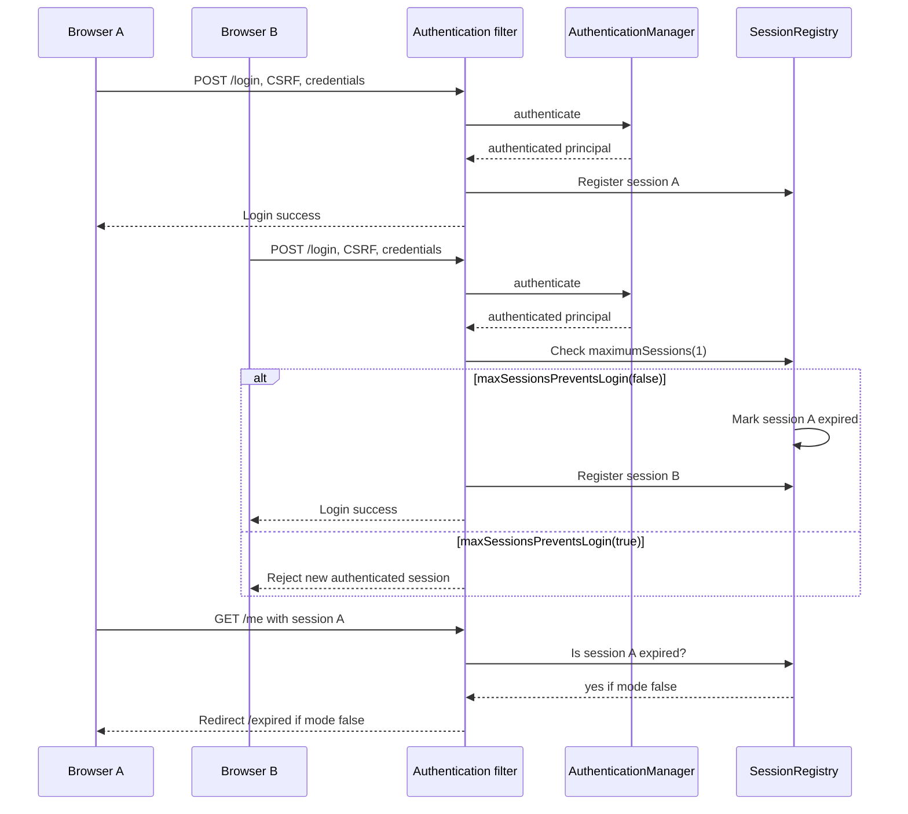

# Giới hạn phiên đồng thời với maximumSessions

> **Phạm vi:** Spring Boot 3.x, Spring Security 6.x trên **Servlet stack** (Spring MVC), Java 17 trở lên. Bài này giải thích cách dùng `maximumSessions` để giới hạn số **HTTP sessions đã xác thực đồng thời cho từng principal**: lựa chọn “phiên mới thay phiên cũ” hoặc “giữ phiên hiện tại, từ chối đăng nhập mới”, cách thiết lập `SessionRegistry`/listener, kiểm thử bằng hai phiên riêng và các giới hạn khi chạy multi-node hoặc dùng JWT. Ví dụ chọn form login vì đây là cơ chế gắn với servlet HTTP session.

## 1. Hiểu chính xác “giới hạn phiên đồng thời”

Một người dùng có thể đăng nhập ở hai trình duyệt, hai browser profiles hoặc hai thiết bị. Mỗi lần login với một cookie jar riêng thường tạo **một phiên HTTP khác nhau**, được nhận diện bằng cookie như `JSESSIONID`. Spring Security có thể quản lý **số phiên đã xác thực cùng gắn với một principal** thông qua `SessionRegistry`.

Khi cấu hình:

```java
http.sessionManagement(session -> session
        .sessionConcurrency(concurrency -> concurrency
                .maximumSessions(1)
        )
);
```

ý định là mỗi principal được phép có nhiều nhất **một session đang hoạt động** trong phạm vi registry và authentication mechanisms áp dụng chính sách. `maximumSessions(2)` là tối đa hai phiên. Nó không tự biến mọi cơ chế xác thực thành stateful và không thể suy ra chính xác số thiết bị từ số session IDs.

| Thứ đang đếm | Có phải thứ `maximumSessions` đếm không? | Ví dụ |
|---|---|---|
| Sessions đã xác thực của cùng principal | **Đúng** | Chrome profile A + Firefox profile B login cùng account |
| Tabs trong cùng browser profile | **Không trực tiếp** | Ba tab gửi cùng cookie `JSESSIONID` → một session |
| Requests đang chạy đồng thời | **Không** | Một session có thể gửi nhiều requests cùng lúc |
| Số user đang online trên toàn website | **Không** | Giới hạn được đánh giá **theo principal**, không phải một quota toàn cục |
| Số lần login sai trong một phút | **Không** | Cần rate limit, brute-force detection |
| Số JWT/Bearer tokens chưa hết hạn | **Không tự động** | Token stateless thường không có `HttpSession` |
| Số phiên trên nhiều instances | **Phụ thuộc registry** | `SessionRegistryImpl` chỉ biết local JVM |
| Số thiết bị vật lý | **Không chính xác** | Một điện thoại có nhiều browsers/profiles |

Vì vậy hãy dùng thuật ngữ **concurrent authenticated HTTP sessions**, tránh gọi ngắn là “một thiết bị duy nhất”. Cơ chế này không thay thế MFA, giới hạn đăng nhập sai, phát hiện phiên bất thường hay bảo vệ cookie.

## 2. Hai chính sách khi có phiên đăng nhập mới

### 2.1. `maxSessionsPreventsLogin(false)` — phiên mới thay phiên cũ

```java
.maximumSessions(1)
.maxSessionsPreventsLogin(false)
```

Đây là chính sách cho **lần login mới thành công** và làm **hết hiệu lực phiên cũ** khi vượt ngưỡng. Với cùng người dùng `learner`:

1. Browser A login, có session A đang hoạt động.
2. Browser B có cookie jar khác, login cùng username/password, tạo session B.
3. Spring Security đánh dấu session A là **expired** trong registry; session B được đăng ký.
4. **Khi A gửi HTTP request tiếp theo**, `ConcurrentSessionFilter` thấy trạng thái expired, xử lý session A và có thể redirect tới `/expired`.
5. B vẫn truy cập các endpoint được bảo vệ bằng session B.

**Tinh tế:** “A hết hạn” không có nghĩa trình duyệt A lập tức nhận được thông báo push. Nếu tab A đang đứng yên không gửi request, màn hình cũ có thể vẫn hiển thị. Kết nối WebSocket/SSE/tác vụ kéo dài cần cơ chế thu hồi riêng nếu muốn ngắt tức thì.

### 2.2. `maxSessionsPreventsLogin(true)` — chặn login mới

```java
.maximumSessions(1)
.maxSessionsPreventsLogin(true)
```

Với chính sách này, A login trước và giữ session A. Khi B thử đăng nhập **từ một session khác** bằng chính tài khoản đó, Spring Security từ chối đăng ký session B đã xác thực. Trong flow form login mặc định, kết quả thường là redirect `/login?error`. A tiếp tục dùng session hiện tại.

Ngay cả khi password B nhập đúng, login B vẫn có thể bị từ chối do **quá số phiên**, không phải do password không hợp lệ. Đây là một `SessionAuthenticationException` ở bước quản lý phiên. Nếu A logout hoặc session thực sự bị hủy/timeout và registry được dọn đúng cách, B mới có cơ hội login.

| Yếu tố | `false` — thay phiên cũ | `true` — giữ phiên cũ |
|---|---|---|
| A login trước | Thành công | Thành công |
| B login cùng user từ session khác | Thành công | **Bị từ chối** |
| Session A sau khi B thử login | Được đánh dấu **expired** | Còn hợp lệ |
| Session B | Hoạt động | Không được xác thực |
| A gửi request tiếp theo | Bị xử lý hết hạn; có thể tới `/expired` | Vẫn vào endpoint |
| Tình huống UX phù hợp | Người dùng muốn chuyển thiết bị thuận tiện | Chính sách ưu tiên bảo vệ phiên đã có |
| Nguy cơ cần xử lý | Session cũ bị thay mà người dùng không biết ngay | User bị chặn nếu session cũ không được cleanup |

Cả hai đều có giới hạn: chúng không chứng minh session nào thuộc “chủ tài khoản thật”. Nếu attacker biết password, mode false có thể đá chủ tài khoản; mode true có thể bị lạm dụng để từ chối chủ tài khoản đăng nhập ở nơi khác. Cần MFA, thông báo, quản lý phiên và support/recovery phù hợp.

## 3. Luồng nội bộ của concurrent session control

`SessionRegistry` là registry theo dõi các session IDs gắn với principal. `SessionRegistryImpl` là implementation phổ biến trong một ứng dụng Servlet chạy **một JVM**.



Các bước cần nhớ:

1. **Authentication filter** như `UsernamePasswordAuthenticationFilter` xử lý form login và gọi `AuthenticationManager`. Manager xác minh credentials, không tự quyết định số phiên.
2. Sau xác thực thành công, **session authentication strategy** kiểm tra concurrency limit theo principal; có thể hết hạn các session cũ hoặc từ chối lần login hiện tại.
3. Nếu cho phép login, session fixation protection có thể thay session ID; strategy đăng ký **session ID cuối cùng** vào registry.
4. `ConcurrentSessionFilter` kiểm tra session hiện tại trên các requests tiếp theo, cập nhật last-request và nhận biết phiên bị đánh dấu expired.
5. **Logout, timeout, invalidate** phải làm registry bỏ những session IDs không còn hoạt động để số phiên đếm không bị sai.

`expiredUrl("/expired")` dùng cho phiên bị concurrency control đánh dấu hết hạn. Nó **không giống** `invalidSessionUrl(...)` (dành cho request với session ID không còn hợp lệ như sau timeout) và cũng không phải URL xử lý login mới bị từ chối ở mode true.

### HttpSessionEventPublisher có vai trò gì?

`HttpSessionEventPublisher` lắng nghe vòng đời session của Servlet Container rồi xuất các sự kiện Spring tương ứng, giúp `SessionRegistryImpl` nhận thông tin hủy/đổi session ID và cleanup.

Trong Spring Boot Servlet embedded, có thể tạo listener bean:

```java
@Bean
HttpSessionEventPublisher httpSessionEventPublisher() {
    return new HttpSessionEventPublisher();
}
```

Cần bảo đảm listener **thực sự được đăng ký với Servlet Container** trên môi trường triển khai. Nếu không nhận sự kiện `sessionDestroyed` khi timeout/logout, mode true có thể tiếp tục từ chối login mới vì registry vẫn nghĩ phiên cũ còn sống. Tạo `SessionRegistryImpl` nhưng không quan tâm lifecycle là cấu hình chưa hoàn chỉnh.

## 4. Ví dụ runnable Spring Boot 3.x / Java 17+

Ví dụ sử dụng **form login mặc định**, bảo vệ URL `/me` và có trang `/expired`. Property `demo.prevent-second-login` cho phép chạy cả hai modes mà không sửa code.

### 4.1. Chuẩn bị Gradle project

Tạo project từ Spring Initializr với Java 17+, Spring Boot 3.x, Gradle Groovy, chọn **Spring Web**, **Spring Security**, **Spring Boot Starter Test**, **Spring Security Test**. Phần `dependencies` của `build.gradle`:

```groovy
dependencies {
    implementation 'org.springframework.boot:spring-boot-starter-web'
    implementation 'org.springframework.boot:spring-boot-starter-security'
    testImplementation 'org.springframework.boot:spring-boot-starter-test'
    testImplementation 'org.springframework.security:spring-security-test'
}
```

Đây chỉ là block dependencies; giữ plugins, repositories và phiên bản Boot trong project do Initializr tạo.

Cấu trúc mã nguồn:

```text
src/
├── main/java/com/example/concurrent/
│   ├── ConcurrentSessionApplication.java
│   ├── SecurityConfig.java
│   └── DemoController.java
└── test/java/com/example/concurrent/
    ├── ExpireOldSessionTest.java
    └── RejectSecondLoginTest.java
```

### 4.2. Main application

**`src/main/java/com/example/concurrent/ConcurrentSessionApplication.java`**

```java
package com.example.concurrent;

import org.springframework.boot.SpringApplication;
import org.springframework.boot.autoconfigure.SpringBootApplication;

@SpringBootApplication
public class ConcurrentSessionApplication {
    public static void main(String[] args) {
        SpringApplication.run(ConcurrentSessionApplication.class, args);
    }
}
```

### 4.3. SecurityConfig — cấu hình maximumSessions(1)

**`src/main/java/com/example/concurrent/SecurityConfig.java`**

```java
package com.example.concurrent;

import org.springframework.context.annotation.Bean;
import org.springframework.context.annotation.Configuration;
import org.springframework.core.env.Environment;
import org.springframework.security.config.annotation.web.builders.HttpSecurity;
import org.springframework.security.core.session.SessionRegistry;
import org.springframework.security.core.session.SessionRegistryImpl;
import org.springframework.security.core.userdetails.User;
import org.springframework.security.core.userdetails.UserDetails;
import org.springframework.security.core.userdetails.UserDetailsService;
import org.springframework.security.crypto.bcrypt.BCryptPasswordEncoder;
import org.springframework.security.crypto.password.PasswordEncoder;
import org.springframework.security.provisioning.InMemoryUserDetailsManager;
import org.springframework.security.web.SecurityFilterChain;
import org.springframework.security.web.session.HttpSessionEventPublisher;

@Configuration
public class SecurityConfig {

    @Bean
    PasswordEncoder passwordEncoder() {
        return new BCryptPasswordEncoder();
    }

    @Bean
    UserDetailsService users(PasswordEncoder encoder) {
        UserDetails learner = User.withUsername("learner")
                .password(encoder.encode("demo-pass"))
                .roles("USER")
                .build();
        return new InMemoryUserDetailsManager(learner);
    }

    @Bean
    SessionRegistry sessionRegistry() {
        return new SessionRegistryImpl();
    }

    @Bean
    HttpSessionEventPublisher httpSessionEventPublisher() {
        return new HttpSessionEventPublisher();
    }

    @Bean
    SecurityFilterChain securityFilterChain(
            HttpSecurity http,
            SessionRegistry registry,
            Environment environment
    ) throws Exception {
        boolean rejectNewLogin = Boolean.parseBoolean(
                environment.getProperty("demo.prevent-second-login", "false"));

        return http
                .authorizeHttpRequests(auth -> auth
                        .requestMatchers("/expired").permitAll()
                        .anyRequest().authenticated()
                )
                .formLogin(form -> form.permitAll())
                .sessionManagement(session -> session
                        .sessionConcurrency(concurrency -> concurrency
                                .maximumSessions(1)
                                .maxSessionsPreventsLogin(rejectNewLogin)
                                .expiredUrl("/expired")
                                .sessionRegistry(registry)
                        )
                )
                .build();
    }
}
```

**Đọc các thành phần:**

- `maximumSessions(1)` là giới hạn trên mỗi principal. Đổi thành `maximumSessions(2)` nếu cho tối đa hai sessions.
- `maxSessionsPreventsLogin(rejectNewLogin)` đặt mode từ property: mặc định `false`, đặt `true` để chặn phiên mới.
- `SessionRegistryImpl` lưu thông tin principal/session trong một JVM; `SessionRegistry` đã được truyền rõ vào concurrency DSL, tránh dùng nhầm một registry khác.
- `HttpSessionEventPublisher` hỗ trợ nhận sự kiện session destroyed/ID changed, quan trọng khi logout và timeout.
- `expiredUrl("/expired")` chuyển hướng một phiên **đã bị đánh dấu expired**; endpoint được `permitAll()` để tránh redirect loop.
- `formLogin(form -> form.permitAll())` dùng trang login do Spring Security tạo; `POST /login` được Security filter xử lý, không cần viết controller login.
- `BCryptPasswordEncoder` lưu password đã băm; chỉ dùng tài khoản `learner/demo-pass` trên localhost.
- Không gọi `csrf.disable()`. POST form login mặc định được bảo vệ CSRF; form generated có hidden CSRF token.

**Phạm vi:** cấu hình có một `SecurityFilterChain` cho ứng dụng Servlet. Với nhiều chains/session repositories, phải xét các sessions được đăng ký ở manager/registry nào. `maximumSessions` không tự tạo cơ chế thu hồi JWT.

### 4.4. Controller để quan sát hiệu lực session

**`src/main/java/com/example/concurrent/DemoController.java`**

```java
package com.example.concurrent;

import org.springframework.security.core.Authentication;
import org.springframework.web.bind.annotation.GetMapping;
import org.springframework.web.bind.annotation.RestController;

@RestController
public class DemoController {

    @GetMapping("/me")
    public String me(Authentication auth) {
        return "HELLO " + auth.getName();
    }

    @GetMapping("/expired")
    public String expired() {
        return "SESSION_EXPIRED";
    }
}
```

`GET /me` yêu cầu login do `anyRequest().authenticated()`. `GET /expired` không yêu cầu login, cho phép browser nhận thông báo sau khi một session bị thay.

## 5. Thực nghiệm trong trình duyệt với hai cookie jars

Chạy ứng dụng trong thư mục có Gradle wrapper:

```bash
# macOS / Linux
./gradlew bootRun

# Windows PowerShell
.\gradlew.bat bootRun
```

Mặc định mở tại `http://localhost:8080`. Để thử đúng, hãy dùng **hai browser profiles độc lập** (hoặc hai trình duyệt riêng) với hai bộ cookies khác nhau. Hai tabs cùng browser profile thường chia sẻ một cookie `JSESSIONID`, nên không tạo hai sessions.

### Mode A — Cho B login và làm A expired

Khi property `demo.prevent-second-login` là `false` (mặc định):

1. Browser A vào `http://localhost:8080/me`. Spring Security chuyển tới form login. Đăng nhập `learner` / `demo-pass`, trang `/me` trả `HELLO learner`.
2. Browser B (profile khác) vào `/me` và login cùng account. B login thành công.
3. A refresh lại `/me`. **Kỳ vọng:** HTTP redirect sang `/expired`; khi browser theo redirect sẽ thấy `SESSION_EXPIRED`.
4. B refresh `/me`. **Kỳ vọng:** vẫn thấy `HELLO learner`.

A chưa chắc đổi giao diện ngay tại lúc B login; sự hết hiệu lực của A được xử lý khi A gửi request tiếp.

### Mode B — Giữ A, từ chối B

Tạo `src/main/resources/application.properties` (nếu chưa có) với dòng:

```properties
demo.prevent-second-login=true
```

Khởi động lại ứng dụng, dùng hai profiles độc lập:

1. A login `learner` thành công.
2. B điền **đúng** `learner/demo-pass` và submit.
3. **Kỳ vọng:** B không được tạo một authenticated session; form login failure redirect thường sang `/login?error`.
4. A vẫn truy cập được `/me`.
5. A logout hoặc session hết hạn trong container; sau khi registry cập nhật, B có thể thử lại.

Đừng gọi đây là “mật khẩu của B sai”: ở bước authentication password có thể đã đúng, nhưng session authentication strategy không cho phép session mới.

Nếu muốn chạy mode B bằng command line thay cho file property:

```bash
./gradlew bootRun --args='--demo.prevent-second-login=true'
```

Cách truyền argument trên phù hợp shell hỗ trợ cú pháp đó; trên Windows có thể dùng file properties để đơn giản.

## 6. MockMvc: kiểm thử thực sự hai lần form login

Test concurrent session **phải đi qua authentication filter và session strategy thật**. Dùng `@WithMockUser` hoặc tự đặt `SecurityContextHolder` rồi gọi controller không kiểm chứng `maximumSessions`.

Spring Security Test cung cấp `formLogin()` để tạo request login qua security filters, với CSRF token phù hợp. Các test dưới đây dùng hai HTTP sessions độc lập, lấy session sau login bằng `MvcResult`.

### 6.1. Kiểm thử mode false: session trước bị expired

**`src/test/java/com/example/concurrent/ExpireOldSessionTest.java`**

```java
package com.example.concurrent;

import org.junit.jupiter.api.Test;
import org.springframework.beans.factory.annotation.Autowired;
import org.springframework.boot.test.autoconfigure.web.servlet.AutoConfigureMockMvc;
import org.springframework.boot.test.context.SpringBootTest;
import org.springframework.mock.web.MockHttpSession;
import org.springframework.test.web.servlet.MockMvc;
import org.springframework.test.web.servlet.MvcResult;

import static org.junit.jupiter.api.Assertions.assertNotEquals;
import static org.junit.jupiter.api.Assertions.assertNotNull;
import static org.springframework.security.test.web.servlet.request.SecurityMockMvcRequestBuilders.formLogin;
import static org.springframework.test.web.servlet.request.MockMvcRequestBuilders.get;
import static org.springframework.test.web.servlet.result.MockMvcResultMatchers.content;
import static org.springframework.test.web.servlet.result.MockMvcResultMatchers.redirectedUrl;
import static org.springframework.test.web.servlet.result.MockMvcResultMatchers.status;

@SpringBootTest(properties = "demo.prevent-second-login=false")
@AutoConfigureMockMvc
class ExpireOldSessionTest {

    @Autowired
    MockMvc mvc;

    @Test
    void secondLoginExpiresPreviousSession() throws Exception {
        MvcResult first = mvc.perform(
                formLogin().user("learner").password("demo-pass"))
                .andExpect(status().is3xxRedirection())
                .andReturn();

        MockHttpSession sessionA =
                (MockHttpSession) first.getRequest().getSession(false);
        assertNotNull(sessionA);

        MvcResult second = mvc.perform(
                formLogin().user("learner").password("demo-pass"))
                .andExpect(status().is3xxRedirection())
                .andReturn();

        MockHttpSession sessionB =
                (MockHttpSession) second.getRequest().getSession(false);
        assertNotNull(sessionB);
        assertNotEquals(sessionA.getId(), sessionB.getId());

        mvc.perform(get("/me").session(sessionA))
                .andExpect(status().is3xxRedirection())
                .andExpect(redirectedUrl("/expired"));

        mvc.perform(get("/me").session(sessionB))
                .andExpect(status().isOk())
                .andExpect(content().string("HELLO learner"));
    }
}
```

**Giải thích:** formLogin lần thứ hai dùng cùng username nhưng một session khác, khiến phiên A bị registry đánh dấu expired. Chỉ trên request tiếp theo của A, `ConcurrentSessionFilter` mới redirect sang `/expired`; B vẫn hợp lệ.

### 6.2. Kiểm thử mode true: login mới bị từ chối

**`src/test/java/com/example/concurrent/RejectSecondLoginTest.java`**

```java
package com.example.concurrent;

import org.junit.jupiter.api.Test;
import org.springframework.beans.factory.annotation.Autowired;
import org.springframework.boot.test.autoconfigure.web.servlet.AutoConfigureMockMvc;
import org.springframework.boot.test.context.SpringBootTest;
import org.springframework.mock.web.MockHttpSession;
import org.springframework.test.web.servlet.MockMvc;
import org.springframework.test.web.servlet.MvcResult;

import static org.junit.jupiter.api.Assertions.assertNotNull;
import static org.springframework.security.test.web.servlet.request.SecurityMockMvcRequestBuilders.formLogin;
import static org.springframework.test.web.servlet.request.MockMvcRequestBuilders.get;
import static org.springframework.test.web.servlet.result.MockMvcResultMatchers.content;
import static org.springframework.test.web.servlet.result.MockMvcResultMatchers.redirectedUrl;
import static org.springframework.test.web.servlet.result.MockMvcResultMatchers.status;

@SpringBootTest(properties = "demo.prevent-second-login=true")
@AutoConfigureMockMvc
class RejectSecondLoginTest {

    @Autowired
    MockMvc mvc;

    @Test
    void newLoginIsRejectedWhileCurrentSessionWorks() throws Exception {
        MvcResult first = mvc.perform(
                formLogin().user("learner").password("demo-pass"))
                .andExpect(status().is3xxRedirection())
                .andReturn();

        MockHttpSession sessionA =
                (MockHttpSession) first.getRequest().getSession(false);
        assertNotNull(sessionA);

        mvc.perform(formLogin()
                    .user("learner").password("demo-pass"))
                .andExpect(status().is3xxRedirection())
                .andExpect(redirectedUrl("/login?error"));

        mvc.perform(get("/me").session(sessionA))
                .andExpect(status().isOk())
                .andExpect(content().string("HELLO learner"));
    }
}
```

**Kỳ vọng:** B đăng nhập không thành công vì vượt số phiên; A vẫn active. Nếu application thay failure handler/failure URL, assertion redirect phải theo contract mới. Đừng kết luận rằng mọi kiểu authentication đều trả cùng status/URL khi đạt ngưỡng.

### 6.3. Chạy test và đọc kết quả

```bash
# macOS / Linux
./gradlew test

# Windows PowerShell
.\gradlew.bat test
```

Với project/configuration đúng như trên, **kỳ vọng** hai tests PASS, mỗi class dùng `@SpringBootTest(properties=...)` với mode tương ứng. Đây là kết quả dự kiến khi người học thực thi, **không phải lời khẳng định mã đã được chạy trong môi trường của tài liệu**.

Nếu test fail, kiểm tra `formLogin()` có thực sự đi qua filter không, CSRF token có hợp lệ không, hai sessions có IDs khác nhau không, registry được dùng trong concurrency DSL có phải bean đã khai báo không và có context/test state nào bị tái sử dụng ngoài ý muốn không.

## 7. Những chi tiết quyết định tính đúng

### 7.1. Principal equality

`SessionRegistryImpl` nhóm sessions dựa trên principal. Với Spring Security `User` trong ví dụ, equality được định nghĩa tương thích theo username. Nhưng `CustomUserDetails` tự viết có thể dùng equality mặc định theo **object identity**: mỗi lần load account từ DB là một object mới, dẫn đến registry không nhận ra hai sessions thuộc cùng account.

Nếu principal tùy biến, định nghĩa `equals`/`hashCode` theo định danh **ổn định, bất biến**, đúng phạm vi tenant, không dùng session ID, password hash, object reference hoặc thuộc tính có thể đổi giữa các lần login. Không gộp hai user khác nhau chỉ vì email giống nhau ở các tenants độc lập.

### 7.2. Session lifecycle, timeout và logout

Đóng tab/browser không đảm bảo container lập tức invalidate session; server thường chờ timeout. Logout thông qua Spring Security có thể invalidate session, nhưng để registry cleanup chính xác vẫn cần listener/cơ chế lifecycle phù hợp. Nếu mode true chặn login mãi sau khi A tưởng đã logout, hãy kiểm tra `HttpSessionEventPublisher` và sự kiện hủy session.

`ConcurrentSessionFilter` xử lý dấu expired trong `SessionRegistry`. Session đã bị invalidate vì timeout/logout là trường hợp khác; đừng gộp mọi session lỗi thành “đăng nhập nơi khác”.

### 7.3. Session fixation protection

Form login có thể đổi session ID khi xác thực để phòng session fixation. Vì vậy test cần lấy session object/ID **sau** thành công login, không lưu một session ID trước login rồi giả định nó vẫn giống hệt.

### 7.4. Maximum sessions lớn hơn một

Nếu `maximumSessions(2)` và mode false, A và B có thể cùng active. Khi C login, registry chọn session cũ hơn theo thông tin last request để đánh dấu expired, rồi cấp session C. Không dựa vào giả định “session được đăng nhập đầu tiên” sẽ luôn là session bị thay trong mọi trường hợp: last-request và concurrency có thể ảnh hưởng lựa chọn.

Ở mode true, khi đã đủ hai sessions, C bị từ chối cho tới khi còn chỗ trống. Việc thay đổi property/giới hạn sau khi ứng dụng đang chạy không có nghĩa mọi phiên cũ được thu hồi tức thì; cần chính sách migration/revocation nếu đổi số phiên cho user đang hoạt động.

## 8. Khi nào maximumSessions không thể thay thế các cơ chế khác?

### API stateless và JWT/Bearer

Nếu API dùng `SessionCreationPolicy.STATELESS` và JWT xác thực trên mỗi request mà không tạo HTTP session, registry không tự biết số JWT đã cấp. Các access tokens cũ vẫn có thể hoạt động tới khi hết hạn; `maximumSessions(1)` không tự thu hồi Bearer tokens.

Nếu sản phẩm cần “một thiết bị đăng nhập” với JWT, phải thiết kế ở authorization server hoặc token/session store: refresh token rotation, revocation, `jti`/token version, expiry ngắn và validation phù hợp. Không chỉ thêm maximumSessions vào resource server rồi khẳng định đã chặn đăng nhập từ máy khác.

### Nhiều ứng dụng hoặc nhiều JVM replicas

`SessionRegistryImpl` lưu trong bộ nhớ **một JVM**. Một login vào node A và một login vào node B có thể được đếm độc lập, dù cùng username. Sticky sessions chỉ cố định mỗi client vào node, không tạo registry toàn cục.

Với hệ phân tán, Spring Session có thể cung cấp `SpringSessionBackedSessionRegistry` dựa trên session repository chung (ví dụ Redis/JDBC) hỗ trợ truy vấn theo principal. Cần cấu hình đúng version, index principal, lifecycle, cleanup và cơ chế đồng bộ. Kiểm thử login qua **hai nodes khác nhau**, timeout, logout và hai lần login gần đồng thời; chỉ “có Redis” chưa tự đảm bảo mọi race đều được giải quyết.

### Custom authentication hoặc nhiều authentication flows

Giới hạn phiên được áp dụng khi authentication success path gọi **session authentication strategy**. Form login của ví dụ tích hợp đường này. Một custom controller gọi `AuthenticationManager.authenticate(...)` rồi tự đặt `SecurityContextHolder` có thể **bỏ qua** concurrency strategy và session registry registration.

Với OAuth2 Login, SAML, custom authentication filters hoặc remember-me, cần kiểm tra cụ thể cơ chế nào tạo server-side session và đăng ký vào registry. Đừng đánh đồng một `Authentication` đặt vào `SecurityContext` với việc đã đăng ký một concurrent session.

### WebSocket, SSE, background jobs

HTTP session expired không đồng nghĩa mọi kết nối đã mở lập tức ngắt. Nếu cần force logout ngay trên WebSocket/SSE, cần theo dõi trạng thái phiên/token và cơ chế đóng kết nối ngoài Servlet HTTP filters. Đối với các tác vụ background, kiểm tra quyền ở thời điểm thích hợp thay vì tin context cũ mãi mãi.

## 9. Troubleshooting: lỗi phổ biến

| Triệu chứng | Nguyên nhân thường gặp | Cách chẩn đoán |
|---|---|---|
| B login nhưng A vẫn truy cập bình thường | Hai tabs cùng cookie, session khác chưa thực sự tạo; filter/registry không tích hợp | Dùng hai browser profiles, kiểm tra session IDs |
| A không bị redirect `/expired` ngay khi B login | Chưa gửi request mới | Refresh `/me` ở A |
| B bị từ chối sau khi A đóng tab | Đóng tab không phải logout; session còn tồn tại đến timeout | Logout thật hoặc chờ timeout, kiểm tra cleanup |
| Mode true không ngăn B login | Principal equality lỗi, session strategy bypass, registry khác nhau, nhiều nodes | Kiểm tra `equals/hashCode`, auth flow và registry |
| POST /login nhận 403 | Thiếu/sai CSRF token | Dùng generated login form hoặc `formLogin()` helper |
| Request nhận redirect `/login` thay vì `/expired` | Session đã invalid/timeout hoặc filter config khác | Phân biệt concurrency expiry với invalid session |
| `@WithMockUser` test pass nhưng kiểm soát phiên sai | Test không chạy login/strategy thật | Test bằng hai `formLogin()` độc lập |
| Chỉ đúng trên một server | `SessionRegistryImpl` local | Test cross-node và Spring Session registry |
| JWT còn dùng được sau khi session expired | JWT không do concurrent HttpSession registry quản lý | Kiểm tra revoke/refresh/access-token policy |
| WebSocket còn nhận thông điệp sau khi session expired | Kết nối không bị chặn bởi Servlet request filter | Thiết kế đóng/revoke WebSocket riêng |
| Mode true từ chối mãi sau timeout | Registry không nhận session-destroy event | Kiểm tra listener đăng ký và cleanup |
| Giới hạn dường như áp dụng chung cho mọi user | Custom registry đếm toàn cục thay vì theo principal | Kiểm tra grouping và equality |

### Phân biệt ba nhánh HTTP

- **Old session expired:** A bị concurrency control đánh dấu expired vì B login ở mode false; request tiếp theo vào `ConcurrentSessionFilter` và có thể redirect `/expired`.
- **Invalid session:** client dùng cookie cho session đã timeout hoặc logout; nếu thiết lập `invalidSessionUrl`, hành vi có thể chuyển sang trang khác, không chứng minh có login trên thiết bị mới.
- **New login refused:** ở mode true, lần login B không tạo authenticated session; form failure handler thường redirect `/login?error`. Không dùng `expiredUrl` để xử lý trường hợp này.

## 10. Checklist production

1. Định nghĩa giới hạn theo principal/account/tenant nào và các loại login nào phải được tính.
2. Quyết định policy **false/true** dựa trên UX và rủi ro; cung cấp thông báo và cách logout/thu hồi phiên hợp lệ.
3. Chọn đúng `SessionRegistry`; không dùng hai registries khác nhau cho việc đếm và lọc sessions.
4. Với principal tùy biến, viết `equals/hashCode` ổn định để group sessions đúng.
5. Đảm bảo `HttpSessionEventPublisher`/lifecycle listener thực sự chạy; test logout và timeout.
6. Kiểm thử authentication success path có gọi session strategy và đăng ký session (không chỉ đặt `SecurityContext`).
7. Với nhiều replicas, triển khai registry/session repository phân tán và kiểm thử cross-node cũng như concurrent login races.
8. Giữ HTTPS, cookie `HttpOnly`/`Secure`/`SameSite`, CSRF, session fixation protection và inactivity timeout phù hợp.
9. Không log raw `JSESSIONID`, CSRF token, password, cookie hay bearer token; dùng audit sự kiện login/expire/reject an toàn.
10. Không dùng maximumSessions thay cho giới hạn login attempts, MFA, authorization hay thu hồi JWT.
11. Kiểm tra cả browser tabs chung cookie và browser profiles khác cookie để tránh false positives.
12. Nếu cần logout tức thời trên WebSocket/mobile token, bổ sung revoke/push/close theo thiết kế.

## 11. Câu hỏi tự kiểm tra

**Câu 1.** Hai tabs trong cùng Chrome profile có `JSESSIONID` giống nhau. `maximumSessions(1)` có bắt buộc khóa một tab không?  
**Đáp án:** Không, chúng chia sẻ một HTTP session.

**Câu 2.** A login, B login cùng user với mode false. Vì sao A chưa thấy thay đổi ngay nhưng refresh lại bị chuyển tới `/expired`?  
**Đáp án:** Registry đánh dấu A expired; `ConcurrentSessionFilter` phát hiện và xử lý khi A gửi request tiếp theo.

**Câu 3.** Với mode true, B nhập đúng password nhưng nhận login failure. Đây là lỗi gì?  
**Đáp án:** Vi phạm concurrent session policy, không nhất thiết là sai credentials.

**Câu 4.** Vì sao `HttpSessionEventPublisher` liên quan trực tiếp đến việc B có thể login sau khi A logout?  
**Đáp án:** Session destroy events giúp registry bỏ session A không còn hợp lệ, giải phóng hạn mức.

**Câu 5.** Custom `UserDetails` không override `equals/hashCode` và mỗi lần login tạo object mới: hậu quả?  
**Đáp án:** Registry có thể coi chúng là những principals khác nhau, làm giới hạn không hiệu quả.

**Câu 6.** App có hai replicas và dùng `SessionRegistryImpl` ở từng node. Tại sao `maximumSessions(1)` chưa đủ?  
**Đáp án:** Registry in-memory ở mỗi JVM không thấy sessions node khác; cần cơ chế phân tán.

**Câu 7.** Truy cập API bằng JWT stateless, vì sao maximumSessions không thu hồi JWT cũ?  
**Đáp án:** Các bearer tokens không tự là HTTP sessions trong registry; cần token revocation/expiry policy.

## 12. Ghi nhớ

- **`maximumSessions(n)`** giới hạn số **authenticated HTTP sessions theo principal** trong phạm vi registry.
- **`maxSessionsPreventsLogin(false)`:** cho login mới, đánh dấu **phiên cũ expired**; phiên cũ bị xử lý trên request tiếp theo.
- **`maxSessionsPreventsLogin(true)`:** từ chối login mới, giữ session đang active.
- **`SessionRegistryImpl`** theo dõi phiên trong một JVM; **`HttpSessionEventPublisher`** hỗ trợ cleanup khi session hủy/timeout.
- Form login có CSRF và session fixation protection; test concurrency bằng **hai lần form login và hai sessions khác nhau**, không chỉ dùng `@WithMockUser`.
- JWT stateless, multi-node, WebSocket và các custom authentication flows cần kiểm soát lifecycle ngoài mặc định.

**Nguyên tắc cuối:** giới hạn phiên chỉ có hiệu lực đúng khi authentication path, registry và session lifecycle được cấu hình nhất quán. Nó là một lớp bảo vệ quản lý phiên, không thay thế xác thực mạnh hoặc phân quyền.