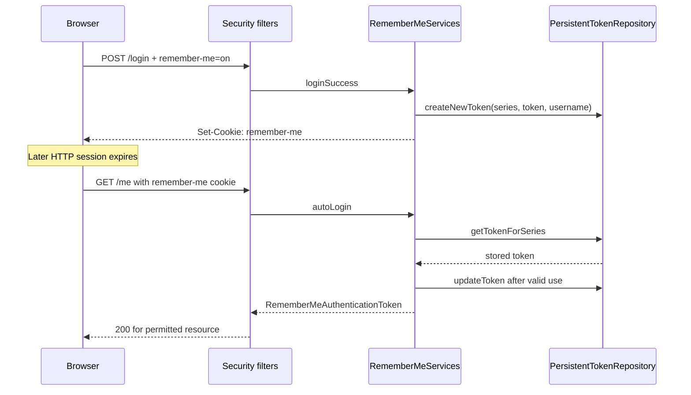

# Thu hồi remember-me khi đăng xuất, đổi mật khẩu hoặc nghi lộ thông tin

> **Môi trường học:** Java 17+, Spring Boot 3.x, Spring Security 6.x trên Servlet stack (Spring MVC). Bài tập trung vào **thu hồi khả năng tự đăng nhập từ remember-me cookie**, không đồng nhất với xóa phiên HTTP, đổi password, thu hồi JWT hay mọi thiết bị. Ví dụ có code đầy đủ và test bằng MockMvc với H2/JDBC để quan sát một credential còn hoặc mất hiệu lực; tài khoản, khóa và database in-memory chỉ dành cho localhost.

## 1. Vì sao remember-me cần có chính sách thu hồi?

Khi login form thông thường, Spring Security đặt `Authentication` trong `SecurityContext`, có thể lưu vào `HttpSession`. Cookie `JSESSIONID` cho browser mang cùng session ở request tiếp theo. Với remember-me, người dùng chủ động chọn “Ghi nhớ đăng nhập”; ngoài session cookie, server cấp một **credential lưu lâu hơn** trong cookie riêng. Khi session cũ hết hạn, `RememberMeAuthenticationFilter` có thể nhận diện cookie này và cho user tự đăng nhập trở lại.

Tình huống thực tế: Alice login trên laptop và bật remember-me; sau đó mất laptop, password bị lộ hoặc cần logout toàn bộ thiết bị. Nếu ứng dụng chỉ xóa `JSESSIONID` hoặc chỉ gỡ cookie trong tab đang mở, **bản sao remember-me cookie** trên máy khác hoặc trong tay attacker vẫn có thể tái xác thực.

Nguyên tắc cần hiểu: **xóa cookie trên client không tự chứng minh credential đã bị thu hồi ở server**. Để một bản sao không còn hữu ích, phương thức xác thực cookie phải **không chấp nhận nó** nữa.

Các trường hợp trong đề bài:

- **Đăng xuất:** kết thúc phiên HTTP hiện tại; xử lý remember-me cookie và server-side token theo chính sách “thiết bị hiện tại” hay “mọi thiết bị”.
- **Đổi/đặt lại mật khẩu:** sau khi tài khoản chứng minh quyền thay đổi, cập nhật password hash và chủ động thu hồi remembered logins. Đồng thời cân nhắc các session và refresh token khác.
- **Nghi lộ thông tin:** thu hồi ngay những credentials có thể bị phát lại, không chờ thời hạn hết hiệu lực; ghi audit, thông báo và điều tra nguyên nhân.

## 2. Năm thành phần trong luồng remember-me

| Thành phần | Vai trò | Không nên nhầm với |
|---|---|---|
| `HttpSession`/`JSESSIONID` | Giữ đăng nhập trong phiên HTTP thông thường | Remember-me cookie dài hạn |
| `RememberMeAuthenticationFilter` | Thử tự xác thực bằng remember-me khi chưa có auth trong context | Provider kiểm tra mật khẩu khi user login |
| `RememberMeServices` | Cấp cookie, auto-login, xử lý logout | Nơi tự quản lý mọi refresh tokens/JWT |
| `TokenBasedRememberMeServices` | Kiểm tra remember-me cookie theo chữ ký, expiry và dữ liệu user | Persistent token được lưu một dòng/thiết bị |
| `PersistentTokenBasedRememberMeServices` | Kiểm tra **series/token** bằng server-side `PersistentTokenRepository` và xoay token | Token ký stateless hoặc session cookie |

Có hai cách triển khai khác nhau mà quyết định cách thu hồi:

### 2.1. Token-based remember-me: cookie ký, không có per-token record

`TokenBasedRememberMeServices` dùng dữ liệu gồm username/thời hạn/chữ ký dựa trên key và dữ liệu password được tải từ `UserDetails`. Vì không có bản ghi per-cookie trong một bảng token, muốn hủy **một** cookie đã cấp thường cần bổ sung cơ chế trạng thái hoặc đổi thiết kế. Nếu password hash của user thay đổi và user details luôn được tải mới, chữ ký cũ **thường** sẽ không còn hợp lệ. Tuy nhiên không nên khẳng định “đổi password đã logout mọi thứ”: các HTTP sessions, JWT/refresh tokens và một số custom remember-me implementations không tự biến mất.

Đổi signing key làm những cookie phụ thuộc key cũ vô hiệu hàng loạt; đây là thay đổi phạm vi rộng, phải chuẩn bị UX và kế hoạch vận hành. Không thể kỳ vọng chỉ xóa cookie tại một thiết bị sẽ bảo vệ khỏi cookie đã bị sao chép.

### 2.2. Persistent remember-me: có series/token ở server

`PersistentTokenBasedRememberMeServices` phát remember-me cookie chứa thông tin về một **series** và secret token. Server lưu bản ghi qua `PersistentTokenRepository` (thường `JdbcTokenRepositoryImpl` dùng bảng `persistent_logins`). Khi cookie hợp lệ được dùng để auto-login, token có thể được **rotate** và cả cookie lẫn record được cập nhật.



`PersistentTokenRepository` cung cấp `createNewToken(...)`, `updateToken(...)`, `getTokenForSeries(...)` và, quan trọng cho đề bài, **`removeUserTokens(username)`**. API cuối cùng thu hồi **tất cả persistent-token records của user** trong repository đó. Một cookie cũ sẽ không tìm được series hợp lệ nên không thể dùng làm credential để tự đăng nhập.

Đổi password hash **không tự xóa** hàng persistent token. Vì vậy với cơ chế persistent phải gọi revoke một cách có chủ đích.

**Cẩn thận về replay:** do token được rotate, gửi lại một bản cookie cũ sau lần auto-login thành công có thể tạo kết quả thất bại hoặc tín hiệu `CookieTheftException`. Không suy diễn rằng một lỗi token mismatch chứng minh chắc chắn bị tấn công; các requests đồng thời hoặc hai clients dùng cookie sao chép cũng có thể tạo race. Nhưng hãy coi đây là sự kiện bảo mật đáng theo dõi.

## 3. Xác định phạm vi thu hồi trước khi viết code

| Sự kiện | Chính sách khả thi | Cơ chế cần có |
|---|---|---|
| Người dùng logout ở máy A | Chỉ máy A, hoặc **toàn bộ remembered devices** | Clear cookie + revoke đúng token/series hoặc tất cả user tokens |
| Người dùng bấm “Logout all devices” | Thu hồi tất cả remember-me tokens và xử lý active sessions | `removeUserTokens(username)` + session registry/invalidation |
| Người dùng đổi password | Thu hồi remembered logins trên tất cả thiết bị | Update hash rồi revoke server-side theo transaction/policy |
| Forgot-password reset | Thu hồi remembered logins sau khi reset token được kiểm chứng | Central account recovery service, không bỏ qua proof-of-ownership |
| Nghi lộ cookie hoặc mất thiết bị | Thu hồi ngay tất cả remembered logins | Trusted security service, audit, MFA và session/token revocation |
| Tài khoản bị disable | Không cho tự đăng nhập lại | Disable account và revoke tokens/active access theo chính sách |

**Ví dụ của bài chọn policy “all-device remember-me revoke” cho cả logout, password change và incident.** Điều đó nghĩa là logout ở một browser làm remembered login ở browser khác cùng account cũng bị thu hồi. Đây là lựa chọn minh họa rõ ràng, **không phải luật bắt buộc của mọi sản phẩm**.

Nếu yêu cầu “logout riêng thiết bị này”, giao diện chuẩn `PersistentTokenRepository` **không có phương thức xóa theo series**; cần mở rộng repository/DAO hoặc xây device-token registry riêng. Chỉ xóa series thuộc chính user đã xác thực; tuyệt đối không nhận series/username do client tự khai rồi xóa vô điều kiện.

## 4. Logout: xóa session khác với thu hồi remembered credentials

Trong ứng dụng form/session, `LogoutFilter` phối hợp các `LogoutHandler` để dọn `SecurityContext`, session, cookies và remember-me tùy cấu hình. Nhưng muốn policy all-device độc lập với những mặc định cụ thể, hãy gắn một handler **explicit**:

```java
.logout(logout -> logout
    .addLogoutHandler((request, response, authentication) -> {
        if (authentication != null) {
            persistentTokenRepository.removeUserTokens(
                authentication.getName());
        }
    })
)
```

Đoạn này **là snippet của `SecurityFilterChain`**, không phải class độc lập. Username lấy từ `Authentication` server đã tin cậy, **không phải** `request.getParameter("username")`. Revoke phải idempotent; gọi lại nhiều lần không nên tạo side effect xấu.

Cần giữ **POST /logout với CSRF** cho ứng dụng dùng cookie/session. Không biến GET thành thao tác logout state-changing để tránh trình duyệt/prefetch/cross-site lạm dụng. Đừng nghĩ xóa `JSESSIONID` là đã xóa token series; cũng đừng nghĩ xóa `persistent_logins` khiến mọi HTTP session đang hoạt động tự invalid.

## 5. Đổi mật khẩu: revoke trong cùng luồng nghiệp vụ

Một workflow đúng cho user tự đổi password:

1. Yêu cầu **full/fresh authentication** và có thể step-up/MFA. Spring Security phân biệt `fullyAuthenticated()` với remember-me authentication thông thường.
2. User gửi **password hiện tại** và password mới qua HTTPS, dưới endpoint POST có CSRF nếu dùng cookie/session.
3. Service xác nhận password cũ bằng `PasswordEncoder.matches(...)`, validate password mới, hash bằng encoder.
4. Cập nhật credential store và **xóa tất cả persistent remember-me tokens** của account; đảm bảo nhất quán bằng transaction hoặc cơ chế fail-closed/retry phù hợp trong production.
5. Kết thúc session hiện tại, clear remember-me cookie; thu hồi các phiên/refresh tokens còn hiệu lực theo chính sách, không chỉ token remember-me.
6. Gửi notification đổi password qua kênh đã xác minh và audit không chứa secret.

Một trường hợp dễ quên: user dùng **quên mật khẩu** thay vì biết password cũ. Endpoint reset phải kiểm chứng *một lần* reset token riêng, có TTL, purpose và single-use, rồi sử dụng **cùng bước revoke** sau khi đổi password hash. Nếu admin reset password hoặc IdP đồng bộ mật khẩu, cũng cần nối policy vào domain/service event chung. Không chỉ đặt revoke trong một controller dễ bị bypass bởi đường cập nhật khác.

Trong hệ phân tán, đổi hash và xóa tokens qua hai nơi lưu khác nhau cần xử lý lỗi: đừng trả thành công rồi lặng lẽ bỏ qua việc revoke thất bại. Nếu không thể dùng một database transaction chung, thiết kế outbox/retry, khóa account tạm hay một global security version check để các token cũ không được chấp nhận trong thời gian khắc phục.

## 6. Khi nghi lộ: ưu tiên thu hồi server-side

Nếu có dấu hiệu mất thiết bị, cookie/headers lọt vào log, extension độc hại, XSS hoặc hành vi đăng nhập bất thường:

- Xác định user/account có thẩm quyền và gọi `removeUserTokens(username)` ngay từ một **trusted security workflow**.
- Invalid sessions còn active; revoke refresh tokens, API keys hoặc credentials khác theo độ nghiêm trọng.
- Có thể yêu cầu đổi password, MFA, step-up hoặc khóa tạm nếu thông tin xác thực mạnh có nguy cơ lộ.
- Ghi thời điểm, actor, lý do, outcome và mức độ, **không log raw Cookie/remember-me token**.
- Thông báo người dùng và cung cấp quy trình phục hồi qua kênh tin cậy.
- Xác định nguồn lộ để sửa triệt để: cookie scope, TLS termination, XSS, analytics, reverse-proxy logging, endpoint debug.
- Kiểm tra độc lập rằng **bản sao cookie trước revoke không còn tự xác thực được**.

**Không công khai API `POST /revoke?username=otherUser`** cho người chưa được xác thực. Kẻ xấu có thể gây denial-of-service bằng cách đăng xuất hàng loạt tài khoản khác. Nếu sản phẩm có chức năng “logout all devices”, account scope phải đến từ principal hoặc một quyền admin rõ ràng, có CSRF/MFA/audit.

## 7. Thực hành với Spring Boot 3.x, Java 17+ và H2

Mẫu sau dùng:
- Spring Security form login có checkbox `remember-me`;
- `PersistentTokenBasedRememberMeServices` qua `PersistentTokenRepository`;
- JDBC `persistent_logins` để server có chỗ thu hồi tokens;
- 4 tài khoản in-memory để các tests độc lập;
- một service chung cho đổi password và xử lý sự cố;
- `MockMvc` để tách “dùng session đã đăng nhập” với “tự đăng nhập lại bằng remember-me cookie”.

**Giới hạn:** Đây là demo local. Các passwords mẫu, key và H2 ephemeral không phù hợp production. Code không làm session revocation trên thiết bị khác; chỉ xóa remembered credentials. Chúng ta sẽ chỉ rõ ranh giới đó.

### 7.1. Gradle dependencies

Tạo project qua Spring Initializr với Java 17+, Spring Boot 3.x, Gradle Groovy, dependencies Spring Web, Security, JDBC, H2 và hai test starters. Phần `dependencies` của `build.gradle`:

```groovy
dependencies {
    implementation 'org.springframework.boot:spring-boot-starter-web'
    implementation 'org.springframework.boot:spring-boot-starter-security'
    implementation 'org.springframework.boot:spring-boot-starter-jdbc'
    runtimeOnly 'com.h2database:h2'
    testImplementation 'org.springframework.boot:spring-boot-starter-test'
    testImplementation 'org.springframework.security:spring-security-test'
}
```

Đây là một **block**, không phải file Gradle độc lập. Giữ plugin Boot, repositories, versions và Gradle wrapper được Initializr cấp.

Các file:

```text
src/main/java/com/example/remember/
  RememberMeLabApplication.java
  SecurityConfig.java
  AccountSecurityService.java
  AccountController.java
src/main/resources/
  application.properties
  schema.sql
src/test/java/com/example/remember/
  RememberMeRevocationTest.java
```

### 7.2. Bảng JDBC persistent token

**`src/main/resources/schema.sql`**

```sql
CREATE TABLE persistent_logins (
    username VARCHAR(64) NOT NULL,
    series VARCHAR(64) PRIMARY KEY,
    token VARCHAR(64) NOT NULL,
    last_used TIMESTAMP NOT NULL
);
```

`JdbcTokenRepositoryImpl` mặc định dùng bảng `persistent_logins` với các cột này. `series` là identifier cho một dòng remember-me, `token` chứa giá trị bí mật để đối chiếu, `last_used` thể hiện lần sử dụng gần đây. Không log hoặc trả các giá trị này qua API.

**`src/main/resources/application.properties`**

```properties
spring.sql.init.mode=always
demo.remember.key=local-dev-only-change-me-to-a-long-secret
```

H2 có trên classpath nên Boot có thể tạo datasource in-memory. `schema.sql` khởi tạo bảng lúc start; sau restart H2 mất dữ liệu. `demo.remember.key` là **key demo không được dùng trong production**. Với production, lấy secret từ môi trường/secrets manager và không có default không an toàn; kiểm tra cookie Secure/HttpOnly, TLS và database migration.

### 7.3. Main application

**`src/main/java/com/example/remember/RememberMeLabApplication.java`**

```java
package com.example.remember;

import org.springframework.boot.SpringApplication;
import org.springframework.boot.autoconfigure.SpringBootApplication;

@SpringBootApplication
public class RememberMeLabApplication {
    public static void main(String[] args) {
        SpringApplication.run(RememberMeLabApplication.class, args);
    }
}
```

### 7.4. SecurityConfig: persistent remember-me và logout all-device

**`src/main/java/com/example/remember/SecurityConfig.java`**

```java
package com.example.remember;

import javax.sql.DataSource;

import org.springframework.beans.factory.annotation.Value;
import org.springframework.context.annotation.Bean;
import org.springframework.context.annotation.Configuration;
import org.springframework.http.HttpMethod;
import org.springframework.security.config.annotation.web.builders.HttpSecurity;
import org.springframework.security.core.userdetails.User;
import org.springframework.security.crypto.bcrypt.BCryptPasswordEncoder;
import org.springframework.security.crypto.password.PasswordEncoder;
import org.springframework.security.provisioning.InMemoryUserDetailsManager;
import org.springframework.security.web.SecurityFilterChain;
import org.springframework.security.web.authentication.rememberme.JdbcTokenRepositoryImpl;
import org.springframework.security.web.authentication.rememberme.PersistentTokenRepository;

@Configuration
public class SecurityConfig {

    @Bean
    PasswordEncoder passwordEncoder() {
        return new BCryptPasswordEncoder();
    }

    @Bean
    InMemoryUserDetailsManager users(PasswordEncoder encoder) {
        return new InMemoryUserDetailsManager(
            User.withUsername("alice").password(encoder.encode("alice-pass"))
                .roles("USER").build(),
            User.withUsername("bob").password(encoder.encode("bob-pass"))
                .roles("USER").build(),
            User.withUsername("carol").password(encoder.encode("carol-pass"))
                .roles("USER").build(),
            User.withUsername("dave").password(encoder.encode("dave-pass"))
                .roles("USER").build()
        );
    }

    @Bean
    PersistentTokenRepository persistentTokenRepository(DataSource dataSource) {
        JdbcTokenRepositoryImpl repo = new JdbcTokenRepositoryImpl();
        repo.setDataSource(dataSource);
        return repo;
    }

    @Bean
    SecurityFilterChain securityFilterChain(
            HttpSecurity http,
            InMemoryUserDetailsManager users,
            PersistentTokenRepository repository,
            @Value("${demo.remember.key}") String rememberKey
    ) throws Exception {
        return http
            .authorizeHttpRequests(auth -> auth
                .requestMatchers(HttpMethod.POST, "/account/password")
                    .fullyAuthenticated()
                .anyRequest().authenticated()
            )
            .formLogin(form -> form.permitAll())
            .rememberMe(remember -> remember
                .key(rememberKey)
                .userDetailsService(users)
                .tokenRepository(repository)
                .tokenValiditySeconds(7 * 24 * 60 * 60)
            )
            .logout(logout -> logout
                .addLogoutHandler((request, response, authentication) -> {
                    if (authentication != null) {
                        repository.removeUserTokens(
                                authentication.getName());
                    }
                })
            )
            .build();
    }
}
```

**Tại sao cấu hình như vậy?** `.tokenRepository(repository)` kích hoạt persistent token storage và `userDetailsService(users)` giúp tra cứu user ở lần auto-login. `tokenValiditySeconds` giới hạn cookie khoảng 7 ngày trong demo. `formLogin(...permitAll())` cung cấp form `GET /login` và filter xử lý `POST /login`. Không cần tự viết controller kiểm tra password.

`.fullyAuthenticated()` đặt yêu cầu xác thực **không chỉ từ remember-me** đối với endpoint đổi mật khẩu. `logout.addLogoutHandler(...)` lấy username từ `Authentication` đáng tin, xóa **mọi remembered sessions của account** trong repository. Các logout handlers của Spring Security tiếp tục xử lý session/context/cookies. **Không tắt CSRF**, vì login/logout/change-password đều là các hành động POST.

Nếu sản phẩm chỉ muốn logout một device, thay thiết kế bằng per-series server-side revocation có xác minh ownership. Đừng dùng `removeUserTokens` cho “chỉ browser này”.

### 7.5. Service đổi mật khẩu và thu hồi khi có sự cố

**`src/main/java/com/example/remember/AccountSecurityService.java`**

```java
package com.example.remember;

import org.springframework.http.HttpStatus;
import org.springframework.security.core.userdetails.User;
import org.springframework.security.core.userdetails.UserDetails;
import org.springframework.security.crypto.password.PasswordEncoder;
import org.springframework.security.provisioning.InMemoryUserDetailsManager;
import org.springframework.security.web.authentication.rememberme.PersistentTokenRepository;
import org.springframework.stereotype.Service;
import org.springframework.web.server.ResponseStatusException;

@Service
public class AccountSecurityService {
    private final InMemoryUserDetailsManager users;
    private final PasswordEncoder encoder;
    private final PersistentTokenRepository repository;

    public AccountSecurityService(
            InMemoryUserDetailsManager users, PasswordEncoder encoder,
            PersistentTokenRepository repository) {
        this.users = users;
        this.encoder = encoder;
        this.repository = repository;
    }

    public synchronized void changePassword(
            String username, String currentPassword, String newPassword) {
        UserDetails oldUser = users.loadUserByUsername(username);
        if (!encoder.matches(currentPassword, oldUser.getPassword())) {
            throw new ResponseStatusException(
                    HttpStatus.UNAUTHORIZED, "Invalid current password");
        }
        if (newPassword == null || newPassword.length() < 12) {
            throw new ResponseStatusException(
                    HttpStatus.BAD_REQUEST, "New password too short");
        }

        UserDetails updated = User.withUserDetails(oldUser)
                .password(encoder.encode(newPassword))
                .build();
        users.updateUser(updated);
        repository.removeUserTokens(username);
    }

    // Call ONLY from an authorized security incident workflow.
    public void revokeForIncident(String username) {
        repository.removeUserTokens(username);
    }
}
```

**Production warning:** `synchronized` ở đây chỉ dành cho một JVM và **không** tạo transaction giữa InMemoryUserDetailsManager và H2 token database. Khi đưa vào sản phẩm, dùng persistent user repository và phối hợp update password/revoke cùng transaction, hoặc fail-closed/retry workflow được audit. Thao tác admin reset/forgot password cần reuse logic revoke nhưng phải thực hiện kiểm chứng quyền thay đổi password trước khi gọi.

### 7.6. Controller: đổi password, invalidate session và clear cookie

**`src/main/java/com/example/remember/AccountController.java`**

```java
package com.example.remember;

import jakarta.servlet.http.Cookie;
import jakarta.servlet.http.HttpServletRequest;
import jakarta.servlet.http.HttpServletResponse;

import org.springframework.http.ResponseEntity;
import org.springframework.security.core.Authentication;
import org.springframework.security.web.authentication.logout.SecurityContextLogoutHandler;
import org.springframework.web.bind.annotation.GetMapping;
import org.springframework.web.bind.annotation.PostMapping;
import org.springframework.web.bind.annotation.RequestParam;
import org.springframework.web.bind.annotation.RestController;

@RestController
public class AccountController {
    private final AccountSecurityService security;

    public AccountController(AccountSecurityService security) {
        this.security = security;
    }

    @GetMapping("/me")
    public String me(Authentication authentication) {
        return "HELLO " + authentication.getName();
    }

    @PostMapping("/account/password")
    public ResponseEntity<String> changePassword(
            Authentication authentication,
            @RequestParam String currentPassword,
            @RequestParam String newPassword,
            HttpServletRequest request,
            HttpServletResponse response) {

        security.changePassword(authentication.getName(),
                currentPassword, newPassword);

        new SecurityContextLogoutHandler()
                .logout(request, response, authentication);

        Cookie clear = new Cookie("remember-me", "");
        clear.setPath(request.getContextPath().isEmpty()
                ? "/" : request.getContextPath());
        clear.setHttpOnly(true);
        clear.setSecure(request.isSecure());
        clear.setMaxAge(0);
        response.addCookie(clear);
        return ResponseEntity.ok("PASSWORD_CHANGED");
    }
}
```

Controller không nhận `username` do client tự khai; chỉ thay mật khẩu cho principal đang full-authenticated. `SecurityContextLogoutHandler` đóng phiên hiện tại và clear context; cookie `remember-me` được clear để browser không tiếp tục gửi credential cũ. **Chính** việc xóa repository tokens trong service đã làm bản cookie bị sao chép không thể auto-login. Trong production, phải kiểm tra cookie name/path/domain trùng chính sách phát cookie và HTTPS reverse proxy, đồng thời thu hồi các sessions khác nếu muốn logout-all-devices thật.

Một endpoint trả 200 sau thay password không được coi là bằng chứng mọi thiết bị đã logout. Những session đang hoạt động khác có thể vẫn truy cập ứng dụng; chúng cần `SessionRegistry`/session repository, session invalidation hoặc security versioning riêng.

## 8. MockMvc: chứng minh token hoạt động trước và bị vô hiệu sau revoke

Bài test dùng **POST form login thật** với `.with(csrf())`, tham số `remember-me=on`, lấy remember-me cookie từ `Set-Cookie`. Khi thử cookie, test **không truyền HTTP session**: vì thế kết quả chỉ đến từ remember-me auto-login chứ không phải session login cũ.

**`src/test/java/com/example/remember/RememberMeRevocationTest.java`**

```java
package com.example.remember;

import java.util.Arrays;
import jakarta.servlet.http.Cookie;

import org.junit.jupiter.api.Test;
import org.springframework.beans.factory.annotation.Autowired;
import org.springframework.boot.test.autoconfigure.web.servlet.AutoConfigureMockMvc;
import org.springframework.boot.test.context.SpringBootTest;
import org.springframework.mock.web.MockHttpSession;
import org.springframework.test.web.servlet.MockMvc;
import org.springframework.test.web.servlet.MvcResult;

import static org.junit.jupiter.api.Assertions.assertNotNull;
import static org.springframework.security.test.web.servlet.request.SecurityMockMvcRequestPostProcessors.csrf;
import static org.springframework.test.web.servlet.request.MockMvcRequestBuilders.get;
import static org.springframework.test.web.servlet.request.MockMvcRequestBuilders.post;
import static org.springframework.test.web.servlet.result.MockMvcResultMatchers.content;
import static org.springframework.test.web.servlet.result.MockMvcResultMatchers.status;

@SpringBootTest
@AutoConfigureMockMvc
class RememberMeRevocationTest {
    @Autowired MockMvc mvc;
    @Autowired AccountSecurityService accounts;

    private record Login(MockHttpSession session, Cookie remember) {}

    private Login rememberLogin(String username, String password)
            throws Exception {
        MvcResult r = mvc.perform(post("/login")
                        .with(csrf())
                        .param("username", username)
                        .param("password", password)
                        .param("remember-me", "on"))
                .andExpect(status().is3xxRedirection())
                .andReturn();

        MockHttpSession session =
                (MockHttpSession) r.getRequest().getSession(false);
        assertNotNull(session);

        Cookie remember = Arrays.stream(r.getResponse().getCookies())
                .filter(c -> "remember-me".equals(c.getName()))
                .findFirst()
                .orElseThrow(() ->
                    new AssertionError("Missing remember-me cookie"));
        return new Login(session, remember);
    }

    @Test
    void cookieAutoLoginWorksWithoutHttpSession() throws Exception {
        Login carol = rememberLogin("carol", "carol-pass");
        mvc.perform(get("/me").cookie(carol.remember()))
                .andExpect(status().isOk())
                .andExpect(content().string("HELLO carol"));
    }

    @Test
    void logoutRevokesAllRememberedDevicesForUser() throws Exception {
        Login laptop = rememberLogin("alice", "alice-pass");
        Login phone = rememberLogin("alice", "alice-pass");

        mvc.perform(post("/logout")
                        .session(laptop.session())
                        .with(csrf()))
                .andExpect(status().is3xxRedirection());

        mvc.perform(get("/me").cookie(laptop.remember()))
                .andExpect(status().is3xxRedirection());
        mvc.perform(get("/me").cookie(phone.remember()))
                .andExpect(status().is3xxRedirection());
    }

    @Test
    void passwordChangeInvalidatesOldRememberCookie() throws Exception {
        Login bob = rememberLogin("bob", "bob-pass");
        mvc.perform(post("/account/password")
                        .session(bob.session())
                        .with(csrf())
                        .param("currentPassword", "bob-pass")
                        .param("newPassword", "bob-rotated-2026"))
                .andExpect(status().isOk())
                .andExpect(content().string("PASSWORD_CHANGED"));

        mvc.perform(get("/me").cookie(bob.remember()))
                .andExpect(status().is3xxRedirection());
    }

    @Test
    void authorizedIncidentActionRevokesRememberCookie() throws Exception {
        Login dave = rememberLogin("dave", "dave-pass");
        accounts.revokeForIncident("dave");

        mvc.perform(get("/me").cookie(dave.remember()))
                .andExpect(status().is3xxRedirection());
    }
}
```

Chạy test:

```bash
# macOS / Linux
./gradlew test

# Windows PowerShell
.\gradlew.bat test
```

**Kỳ vọng khi triển khai đúng các file:** bốn tests PASS. Đây là **kết quả dự kiến**, không phải lời khẳng định code đã chạy trong môi trường tài liệu. Test thứ nhất chứng minh một remember-me cookie có thể tạo Authentication mới không cần session; ba test còn lại chứng minh logout, password change và incident action khiến cookie cũ bị từ chối. Các tài khoản alice/bob/carol/dave tách biệt để trạng thái mỗi test không vô tình ảnh hưởng test khác.

**Lưu ý token rotation:** test không dùng một remember-me cookie cũ để auto-login **nhiều lần liên tục** rồi mặc định mọi lần đều phải thành công. Cookie hợp lệ có thể được rotate sau lần auto-login đầu, làm bản trước đó stale và có thể kích hoạt phát hiện replay. Khi kiểm thử trình duyệt thật, phải dùng cookie mới do server trả về sau khi rotate.

### 8.1. Chạy và thử bằng browser

```bash
# macOS / Linux
./gradlew bootRun

# Windows PowerShell
.\gradlew.bat bootRun
```

Mở `http://localhost:8080/login`, đăng nhập với `alice/alice-pass` hoặc `bob/bob-pass` và tick **Remember me**. Browser giữ remember-me cookie; HTTP session có thể hết trước cookie đó. Khi logout qua form/POST có CSRF, app xóa tokens của username theo demo policy.

Project không cung cấp trang HTML đổi password; người học có thể dùng `MockMvc` ở trên để thực hiện đầy đủ POST có CSRF và session. Nếu tự bổ sung form, phải có CSRF token, validation và logic full authentication. **Không gửi password thật qua HTTP ngoài localhost; production luôn HTTPS**.

## 9. Vì sao phải test “không gửi session cũ”?

Một lỗi kiểm thử phổ biến:

```java
// Không chứng minh remember-me vì đã gửi session đăng nhập:
mvc.perform(get("/me").session(oldSession))
        .andExpect(status().isOk());
```

Request này có thể được cho qua chỉ vì `SecurityContext` nằm trong session, ngay cả khi remember-me cookie đã bị revoke. Test đúng gửi **chỉ remembered cookie** và **không có HTTP session authenticated**; nếu `GET /me` là protected, sau revoke sẽ redirect tới `/login` hoặc nhận 401 tùy entry point. Vì vậy test ở trên assert HTTP redirect thay vì kiểm tra body trang lỗi.

Để chứng minh “logout toàn thiết bị” thật, ngoài remember-me còn cần:
- Hai sessions đã hoạt động trước đó bị invalid hoặc bị Security từ chối trên request sau;
- refresh tokens của các clients khác bị revoked;
- JWT/access tokens có policy expiry/version phù hợp;
- những WebSocket/SSE connections nhạy cảm được đóng/kiểm tra quyền lại.

`PersistentTokenRepository.removeUserTokens` **không làm các việc đó**. Bài học này thu hẹp vào lớp remembered credentials và chỉ rõ phạm vi để tránh kết luận sai.

## 10. Bảng kiểm thử và xử lý sự cố

| Thử nghiệm hoặc triệu chứng | Giải thích/cách chẩn đoán |
|---|---|
| Không tick remember-me khi login | Không nên có persistent remember-me cookie |
| Tick remember-me, nhận cookie | Kho `persistent_logins` cần có series/token cho principal |
| Session hết hạn nhưng remember cookie còn | Có thể tự login lại; đây là mục tiêu của tính năng |
| Revoke xong, cookie cũ vẫn vào `/me` | Kiểm tra có gửi session cũ/JWT khác không, DB/repository có bị chọn sai không |
| Logout A mà remember-me B vẫn hoạt động | Policy không revoke toàn user hoặc repo/config khác |
| Password change nhưng persistent token còn | Đã quên `removeUserTokens` ở một đường cập nhật hash |
| Remember cookie bị từ chối trước khi hết hạn | Có thể bị revoke, rotate, replay, key/username đổi, account disabled |
| Nhiều requests dùng chung cookie stale | Có thể tạo mismatch/replay detection; cần test concurrency và rotation |
| Session khác vẫn hoạt động sau revoke | Đúng nếu chưa áp dụng session invalidation policy riêng |
| JWT cũ còn quyền sau password change | JWT không thuộc remember-me repo; cần version/expiry/revoke |
| Error 403 ở `POST /login` hoặc logout | Thiếu hoặc sai CSRF token |
| Không thấy `persistent_logins` | Check schema.sql, datasource, rememberMe.tokenRepository wiring và checkbox |
| Restart H2 khiến cookie cũ bị từ chối | DB in-memory mất series, đây là hành vi demo |
| Đổi cookie Path/Domain khiến clear không tác dụng | Tên/path/domain của cookie xóa phải khớp cookie đã phát |
| Thiết bị bị mất, account không có session hiện tại | Trusted incident workflow vẫn có thể revoke all tokens theo user |
| Multi-node server A/B khác hành vi | Kiểm tra dùng chung repository/DB, caching, các session/JWT stores khác |

### Khác biệt của token-based và persistent khi change password

Đừng nhầm cơ chế:

- Token-based: cookie ký có thể bị vô hiệu sau password change vì chữ ký kiểm chứng với dữ liệu password mới. Nhưng phải biết custom implementation và khóa ký có gì khác.
- Persistent: một row series/token có thể vẫn tồn tại độc lập với hash password; **hãy gọi removeUserTokens** và kiểm tra DB theo policy.
- Dù là loại nào: một HTTP session đã authenticated vẫn có thể hoạt động cho đến khi bị hủy/expire/kiểm tra version. Xóa remember tokens không tự ngắt WebSocket hoặc toàn bộ phiên.

## 11. Checklist production

1. Xác nhận `rememberMe(...)` được bật ở SecurityFilterChain nào, loại service nào thực sự xử lý cookie và tên/path/domain của cookie.
2. Chọn rõ policy logout current-device, logout all remembered devices, password change và incident response; ghi tài liệu cho UX.
3. Với persistent tokens, kiểm soát `PersistentTokenRepository` cùng database cho mọi instance; xét schema, indexes, cleanup, TTL.
4. Đặt revoke logic ở service chung cho change/reset/admin-reset password, không chỉ một controller.
5. Phối hợp transaction/fail-closed giữa password update và token revoke; test race với auto-login/rotation.
6. Login form, logout và password change cần CSRF đúng cho browser; không tắt CSRF toàn ứng dụng chỉ để chạy test.
7. Cookie phải `Secure`/`HttpOnly` qua HTTPS, có `SameSite`/domain/path hợp lý. Không lưu cookies/tokens trong analytics, error reports hoặc public logs.
8. Thao tác nhạy cảm yêu cầu `fullyAuthenticated()` hoặc MFA/step-up; remembered cookie không chứng minh password vừa được nhập.
9. Sau incident, thu hồi sessions/JWT/refresh tokens và API keys theo mức độ rủi ro; remember-me revoke không thay thế.
10. Không mở endpoint revoke arbitrary username hoặc series cho người không có quyền; mọi revoke phải có actor, ownership, audit.
11. Kiểm thử copy cookie từ browser A sang browser B **trước và sau revoke**, không kèm session authenticated.
12. Với nhiều replicas, kiểm tra nhất quán database/cache, auto-login rotation, concurrent requests và transaction races.
13. Có thông báo login/credential change bất thường và quy trình recovery khi thiết bị bị mất.
14. Không cho token tồn tại quá lâu; chọn `tokenValiditySeconds` theo threat model và giới hạn thời gian có thể khai thác khi chưa revoke.

## 12. Câu hỏi tự kiểm tra

**1.** Xóa `JSESSIONID` khi logout có chắc xóa credential remember-me không?  
**Đáp án:** Không. Remember-me cookie/token có vòng đời riêng, phải clear và revoke theo loại service.

**2.** Vì sao xóa browser cookie không bảo vệ nếu attacker đã sao chép trước đó?  
**Đáp án:** Bản copy vẫn có thể auto-login nếu server chưa từ chối; cần invalidate chữ ký hoặc persistent token.

**3.** Cách thu hồi toàn bộ persistent remember-me tokens của user bằng API nào?  
**Đáp án:** `PersistentTokenRepository.removeUserTokens(authenticatedUsername)`.

**4.** Sau update password hash, persistent series/token luôn tự bị xóa?  
**Đáp án:** Không nên giả định. Cần revoke explicit và kiểm chứng.

**5.** Tại sao đổi password cần `fullyAuthenticated()` và kiểm tra password cũ?  
**Đáp án:** Remember-me là chứng cứ đăng nhập lâu dài có thể bị đánh cắp; thao tác nhạy cảm cần xác minh mới/đủ mạnh.

**6.** Sau logout all remembered devices, một thiết bị có session còn sống vẫn gọi API được. Vì sao?  
**Đáp án:** Session còn active không phụ thuộc repository remember-me; cần session revocation khác.

**7.** Client gửi remember cookie cũ hai lần, lần sau fail. Có nhất thiết bug?  
**Đáp án:** Không; persistent token có thể rotate, bản cũ thành stale/replay.

**8.** Có thể viết API public nhận `username` rồi gọi `removeUserTokens` không?  
**Đáp án:** Không. Nó cho phép người lạ cưỡng bức logout/DoS account khác.

## 13. Tổng kết

- **Remember-me là credential có thể tự xác thực trở lại**, khác với `HttpSession` và JWT.
- **TokenBasedRememberMeServices** và **PersistentTokenBasedRememberMeServices** có cơ chế thu hồi khác nhau; persistent token có `PersistentTokenRepository` để xóa series/token server-side.
- Với policy all-device, logout, password change và nghi lộ đều có thể gọi **`removeUserTokens(username)`** từ workflow có thẩm quyền.
- Revoke cần phối hợp với dọn session/cookie và các credentials khác. Xóa cookie local chỉ hỗ trợ UX, không vô hiệu bản sao đã bị lộ.
- Test hiệu quả phải gửi **remember-me cookie cũ nhưng không mang authenticated HTTP session**; sau revoke, resource protected không được truy cập.
- Triển khai thật phải giải quyết transaction, distributed storage, CSRF, cookie security, MFA, audit và cơ chế thu hồi các loại token khác.

**Nguyên tắc cuối:** thành công của thao tác thu hồi được đo bằng việc **server từ chối credential remember-me đã cấp**, chứ không chỉ bằng việc browser không còn hiển thị cookie.