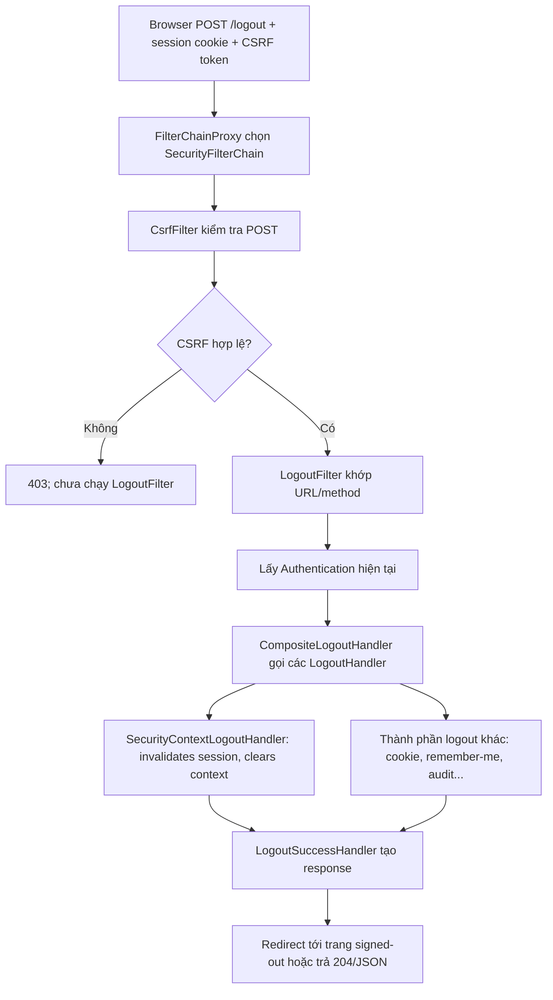

# `LogoutFilter`, `LogoutHandler` và `LogoutSuccessHandler` trong Spring Security Servlet

**Module:** Spring Security – Servlet  
**Nhóm:** Đăng xuất  
**Áp dụng:** Java 17, Spring Boot 3.3.5, Spring Security 6.x, Spring MVC/Servlet, trình duyệt dùng form login và `HttpSession`.

## 1. Mục tiêu

Đăng xuất không chỉ là điều hướng người dùng về trang đăng nhập. Spring Security tổ chức việc đăng xuất thành ba trách nhiệm: **phát hiện request đăng xuất** (`LogoutFilter`), **dọn dẹp trạng thái/credential** (`LogoutHandler`) và **quyết định HTTP response sau khi dọn dẹp** (`LogoutSuccessHandler`).

Sau bài này bạn có thể:

1. Mô tả vị trí của `LogoutFilter` trong Spring Security filter chain và lý do một POST `/logout` thông thường **không cần controller**.
2. Phân biệt `LogoutHandler.logout(...)` với `LogoutSuccessHandler.onLogoutSuccess(...)`, tham số và mục đích của từng API.
3. Giải thích `SecurityContextLogoutHandler`, vô hiệu `HttpSession`, xóa `SecurityContext`, xóa cookie, xử lý remember-me và sự kiện logout.
4. Hiểu tương tác với `CsrfFilter`: khi CSRF bật, logout thường yêu cầu **POST kèm CSRF token**, còn GET `/logout` có thể được dùng để hiển thị trang xác nhận.
5. Cấu hình URL, logout handlers, success redirect và `permitAll` trong một `SecurityFilterChain` của **Servlet**.
6. Viết một custom `LogoutHandler` an toàn, một custom `LogoutSuccessHandler` và test thứ tự kết quả, session invalidation, CSRF, không cần `@PostMapping("/logout")`.
7. Đánh giá giới hạn của logout với remember-me token, HTTP Basic, Bearer/JWT, OIDC, nhiều phiên/thiết bị và nhiều security chains.

**Nguyên tắc:** **Dọn dẹp trước, trả response sau**. Việc browser nhận redirect hoặc status 200/204 **chưa chứng minh** mọi credential đã được thu hồi; phải xác định rõ cơ chế đăng nhập đang dùng và phạm vi logout.

## 2. Nhìn tổng thể luồng đăng xuất

Trong ứng dụng form login có session, một trình duyệt đã xác thực thường mang cookie `JSESSIONID`. Khi user bấm nút Đăng xuất, trình duyệt gửi POST tới URL logout. Luồng khái niệm:



**Thứ tự mang tính khái niệm:** Trước khi gọi success handler, `LogoutFilter` gọi tập hợp các `LogoutHandler`. Thứ tự cụ thể của từng handler mặc định và handler thêm vào phụ thuộc cấu hình; không nên viết logic nghiệp vụ dựa trên giả định không được bảo đảm rằng audit handler luôn chạy trước hoặc sau một handler cụ thể. Điều chắc chắn về hợp đồng tổng thể là `LogoutSuccessHandler` chỉ được gọi sau khi pipeline handler hoàn tất bình thường.

### 2.1. Vì sao URL `/logout` có thể không đi qua MVC?

`FilterChainProxy` và `SecurityFilterChain` xử lý request **trước** khi đến `DispatcherServlet`. `LogoutFilter` có một `RequestMatcher` nhận diện logout request. Nếu matcher khớp, filter chạy các handlers, gọi success handler và **kết thúc xử lý**, không chuyển request tới `@PostMapping`.

Vì vậy cấu hình chuẩn:

```java
http.logout(logout -> logout
        .logoutUrl("/logout")
        .logoutSuccessUrl("/sign-in?logout"));
```

là fragment bên trong cấu hình `HttpSecurity`; **không** cần:

```java
// Không viết controller này chỉ để thay cho LogoutFilter.
@PostMapping("/logout")
public String logout() {
    return "redirect:/sign-in";
}
```

Nếu bạn tự viết controller POST logout và tự redirect mà quên cleanup, người dùng có thể còn được xác thực bằng `SecurityContext`/session cũ. Khi cần custom logic, ưu tiên mở rộng đúng `LogoutHandler` hoặc `LogoutSuccessHandler` thay vì lặp lại quá trình đăng xuất ở controller.

## 3. Ba thành phần: vai trò và chữ ký phương thức

| Thành phần | Nhiệm vụ | Khi nào chạy? | Nên chịu trách nhiệm |
| --- | --- | --- | --- |
| `LogoutFilter` | Nhận diện logout request theo method/path/request matcher; điều phối luồng | Khi request khớp và đến chain có filter | Gọi handler rồi gọi success handler |
| `LogoutHandler` | Thực hiện cleanup: invalid session, clear security context, xóa cookie/token, audit an toàn | Trong composite logout handlers | Thay đổi trạng thái cần thiết, không điều khiển response thành công cuối cùng |
| `LogoutSuccessHandler` | Quyết định response sau logout: redirect, 204, JSON... | Sau khi các logout handlers hoàn thành | HTTP response/UX, không thay thế cleanup |

### 3.1. `LogoutFilter`

Class nằm trong `org.springframework.security.web.authentication.logout.LogoutFilter`. Ở phiên bản Spring Security Servlet hiện đại, `LogoutFilter` tham gia chain trước bước authorization cuối (`AuthorizationFilter` trong cấu hình thông thường). Do đó, request logout được filter nhận diện không nhất thiết phải qua rule `authorizeHttpRequests` mới được xử lý.

Tuy vậy, dùng `.logout(...permitAll())` vẫn có ích để làm rõ ý định, đặc biệt với URL logout success, hoặc khi có custom chain/matcher. Nó không vô hiệu CSRF.

**Phạm vi chain là bắt buộc:** Nếu chain có `.securityMatcher("/app/**")` nhưng `.logoutUrl("/logout")` ở ngoài phạm vi `/app/**`, request `/logout` sẽ **không vào chain đó**, nên logout filter không thể xử lý. `requestMatchers(...).permitAll()` chỉ là rule authorization bên trong chain, không mở rộng matcher chọn chain.

### 3.2. `LogoutHandler`

Interface ở `org.springframework.security.web.authentication.logout.LogoutHandler` có phương thức chính:

```java
void logout(
    HttpServletRequest request,
    HttpServletResponse response,
    Authentication authentication
);
```

Imports là `jakarta.servlet.http.HttpServletRequest`, `jakarta.servlet.http.HttpServletResponse` và `org.springframework.security.core.Authentication` trong Spring Boot 3.

`authentication` là authentication được filter lấy tại thời điểm logout request, **có thể `null`** nếu request anonymous hoặc người dùng đã mất phiên. Custom handler phải kiểm tra `null`; không coi logout là lúc còn chắc chắn user đăng nhập.

**Quy tắc cho handler:**

- Tập trung cleanup và side effects cần thiết, không phát redirect khi chưa kết thúc toàn bộ handlers.
- Viết **idempotent** khi có thể; request lặp lại không nên tạo lỗi khó phục hồi hoặc làm rò secret.
- Tránh ném exception làm gián đoạn chuỗi handlers. Framework kỳ vọng logout handlers thực hiện cleanup an toàn; lỗi audit phụ trợ nên được ghi nhận theo policy mà không phá hỏng logout.
- Không log raw `Authentication`, session ID, cookie, token, mật khẩu, header `Authorization`, CSRF token.
- Tránh phụ thuộc vào việc security context còn trong holder sau khi một handler khác đã dọn; nếu cần nhận dạng người dùng, sử dụng tham số `authentication` được cung cấp nhưng không tiết lộ dữ liệu nhạy cảm.
- Với tác vụ cần độ tin cậy cao như thu hồi token ở DB, thiết kế giao dịch, retry, monitoring và failure policy riêng; không âm thầm tuyên bố mọi token đã revoke nếu thao tác thất bại.

### 3.3. `LogoutSuccessHandler`

Interface ở `org.springframework.security.web.authentication.logout.LogoutSuccessHandler` có phương thức:

```java
void onLogoutSuccess(
    HttpServletRequest request,
    HttpServletResponse response,
    Authentication authentication
) throws IOException, ServletException;
```

Tạo response sau khi cleanup hoàn tất. Có thể:

- Redirect tới `/signed-out`.
- Trả status `204 No Content` cho API client.
- Trả JSON không chứa secret cho SPA/API client.
- Chọn redirect có kiểm soát theo nhu cầu UI.

**Không dùng success handler làm nơi duy nhất invalidate session.** Nếu custom success handler thay hoàn toàn handler mặc định mà không có cleanup handler đúng, redirect sẽ chỉ tạo ấn tượng logout. Trong ví dụ bên dưới, custom success handler chỉ gửi redirect; cleanup được bảo đảm bởi logout configuration/handlers.

Tránh **open redirect**: không chuyển hướng theo `next` hay `returnUrl` do client cung cấp nếu không có allowlist/validation. URL cố định hoặc relative path nội bộ là lựa chọn an toàn cho bài học.

### 3.4. Nhớ phân biệt handler với success handler

Có nhiều tên tương tự nhau:

- `SecurityContextLogoutHandler` là **LogoutHandler** dọn `SecurityContext`/session.
- `CookieClearingLogoutHandler` là **LogoutHandler** xóa cookie theo policy.
- `CsrfLogoutHandler` xử lý thông tin CSRF theo repository được cấu hình.
- `LogoutSuccessEventPublishingLogoutHandler` có thể phát sự kiện logout cho các listeners khi được cấu hình/tích hợp.
- `SimpleUrlLogoutSuccessHandler` là **LogoutSuccessHandler** chuyển hướng tới URL.
- `HttpStatusReturningLogoutSuccessHandler` là **LogoutSuccessHandler** trả mã HTTP.
- `DelegatingLogoutSuccessHandler` có thể chọn success handler theo request matcher.
- `CompositeLogoutHandler` phối hợp nhiều `LogoutHandler`, **không** thay thế `LogoutFilter`.

Tên lớp “Logout” giống nhau nhưng **trách nhiệm khác nhau**. Tránh thêm handler phát cookie hoặc event như một success handler chỉ vì tên có chữ *logout*.

## 4. Spring Security làm gì khi logout mặc định?

Với form login/session thông thường và `http.logout(...)`, Spring Security đã có các thao tác logout mặc định phù hợp. Tùy version và tính năng đang bật, pipeline có thể có:

1. **`SecurityContextLogoutHandler`**: vô hiệu hóa `HttpSession` nếu có theo policy, clear `Authentication` trong `SecurityContext`, clear `SecurityContextHolder` và lưu context rỗng khi cần theo repository.
2. **`CsrfLogoutHandler`**: xóa thông tin/token CSRF đã lưu theo repository, khi tích hợp với CSRF configurer.
3. **Remember-me cleanup** nếu có remember-me service: xóa cookie remember-me và có thể xử lý token repository tùy chiến lược.
4. **Cookie clearing** bổ sung theo `.deleteCookies(...)`, ví dụ `JSESSIONID` khi path/domain thích hợp.
5. **Sự kiện** logout khi có event-publishing handler.
6. **Success response** theo logout success handler, thường redirect tới URL đăng nhập có query `logout` khi dùng cấu hình mặc định.

Không phải mỗi ứng dụng đều có mọi mục kể trên. **Đừng tự giả định** việc logout một phiên sẽ đồng thời revoke mọi remember-me token, JWT, refresh token, phiên tại identity provider hay phiên ở thiết bị khác.

### 4.1. `SecurityContextLogoutHandler` và `HttpSession`

Một cấu hình rõ ràng:

```java
http.logout(logout -> logout
        .invalidateHttpSession(true)
        .clearAuthentication(true)
        .deleteCookies("JSESSIONID"));
```

- `invalidateHttpSession(true)`: yêu cầu invalidation session hiện hành nếu có.
- `clearAuthentication(true)`: clear authentication trong security context.
- `deleteCookies("JSESSIONID")`: thêm cơ chế yêu cầu browser loại bỏ cookie tương ứng.
- `SecurityContextRepository`/filter setup quyết định cách context được khôi phục/lưu trong các request khác.

**Xóa session server-side và xóa cookie client-side là hai hành động khác nhau.** Server-side invalidation làm session ID cũ không còn đại diện cho một phiên hợp lệ; gửi `Set-Cookie` hết hạn giúp browser bỏ cookie. Nếu cookie domain/path không khớp, cookie cũ có thể còn ở browser, nhưng session đã invalidated vẫn phải bị server từ chối.

### 4.2. Điều gì xảy ra nếu `HttpSession` vốn đã hết hạn?

Một request `POST /logout` vẫn có thể được nhận diện ở `LogoutFilter`, nhưng `Authentication` truyền vào có thể `null`. Logout handlers phải chịu được tình trạng này. `CsrfFilter` vẫn có thể yêu cầu token cho POST, và client thiếu token có thể nhận `403` trước khi tới logout logic.

Nếu request là anonymous và cấu hình cho phép POST logout, success handler có thể vẫn điều hướng tới trang đăng xuất. **Không xem success redirect là bằng chứng session trước đó có tồn tại.**

### 4.3. Có cần `.deleteCookies("JSESSIONID")` nếu invalidate session?

Không phải lúc nào cũng bắt buộc: container và security configuration có thể có cơ chế cookie/session cleanup. Tuy vậy, khai báo thêm khi cần làm rõ browser cleanup. Kiểm thử `Set-Cookie`, context path, cookie domain/path, reverse proxy và đặc tính của container; `.deleteCookies` không thể thu hồi một bearer token đã bị sao chép.

### 4.4. `permitAll` không tương đương bỏ CSRF

`logout.permitAll()` giúp các URL liên quan logout/logout success được cho phép truy cập phù hợp, nhưng **không** thay đổi CSRF policy. Với CSRF bật, `POST /logout` cần CSRF token hợp lệ; request không có token có thể bị `CsrfFilter` từ chối **403** trước khi logout handlers chạy. Đây là lý do nên dùng HTML **form POST**, không dùng link GET làm nút logout thực sự.

## 5. Method và URL: `GET /logout`, `POST /logout`, custom paths

### 5.1. Default behavior thông dụng

Khi CSRF đang bật, Spring Security dùng **POST** làm method xử lý logout theo cấu hình thông thường. Trên một số cấu hình, GET `/logout` có thể hiển thị **trang xác nhận logout** do framework tạo ra; nó **không phải** thao tác tương đương với POST logout.

Đừng viết test kết luận “GET `/logout` luôn có status 200 trong mọi ứng dụng”, vì login page generator, CSRF và cấu hình filter có thể khác. Điều bất biến cần test là **chỉ request khớp logout matcher thực sự** mới kích hoạt cleanup.

### 5.2. Custom URL

```java
http.logout(logout -> logout
        .logoutUrl("/auth/logout")
        .logoutSuccessUrl("/sign-in?logout"));
```

Form browser phải gửi:

```html
<form action="/auth/logout" method="post">
    <!-- Kèm CSRF token của request/form nếu CSRF bật. -->
    <button type="submit">Đăng xuất</button>
</form>
```

Snippet HTML này chỉ minh họa cấu trúc; template Thymeleaf đầy đủ ở phần 7 dùng `th:action` để hỗ trợ context path và CSRF integration.

Nếu dùng custom `logoutRequestMatcher(...)`, cần hiểu rõ matcher nhận những method/path nào. **Đừng mở logout qua GET** chỉ để dễ làm `<a href>`, nhất là khi browser dùng cookie authentication. GET nên không gây side effects, và việc cho phép logout qua GET có thể dẫn đến logout CSRF hoặc hành vi ngoài ý muốn.

### 5.3. Nhiều security chains

Ví dụ fragment dưới đây có vấn đề:

```java
// Minh họa sai phạm vi; chưa phải cấu hình runnable đầy đủ.
http.securityMatcher("/api/**")
    .logout(logout -> logout.logoutUrl("/logout"));
```

Vì `/logout` **không khớp** `/api/**`, filter của chain đó không nhận POST `/logout`. Cần đặt logout URL trong phạm vi chain (ví dụ `/api/logout`), mở rộng matcher đúng hoặc thiết kế chain khác rõ ràng.

Trong nhiều chain có `@Order`, chain đầu tiên khớp request được chọn. Nếu chain trước chiếm logout URL nhưng không có filter logout phù hợp, request có thể rơi vào MVC hoặc bị từ chối. `authorizeHttpRequests.requestMatchers("/logout").permitAll()` **không sửa** sai chain matcher.

## 6. Các kiểu custom logout và thứ tự trách nhiệm

### 6.1. Thêm một `LogoutHandler` phụ trợ

Một trường hợp phù hợp là audit sự kiện logout:

```java
http.logout(logout -> logout
        .addLogoutHandler(auditLogoutHandler));
```

Với một handler an toàn, việc thiếu `Authentication` không gây lỗi, không log secret, và không tự điều khiển HTTP response. Một custom handler khác có thể thu hồi refresh token ở server, xóa một application cookie hoặc yêu cầu dọn dẹp dữ liệu liên quan tài khoản.

**Quan trọng với exception:** Logout handlers được thiết kế cho cleanup; không để một lỗi logging/metrics thứ cấp làm hỏng logout. Với thao tác revoke token thật, phải quyết định hành vi khi remote service thất bại — retry/outbox, báo trạng thái cho client, hoặc fail closed theo threat model. Không nuốt lỗi thu hồi credential rồi khẳng định token đã bị thu hồi.

### 6.2. Thay `LogoutSuccessHandler`

Đối với trình duyệt:

```java
http.logout(logout -> logout
        .logoutSuccessHandler((request, response, authentication) ->
                response.sendRedirect(
                        request.getContextPath() + "/signed-out")));
```

Với API client muốn response không có body:

```java
// Biến thể thay thế, không áp dụng cùng lúc trong project form login.
http.logout(logout -> logout
        .logoutUrl("/api/logout")
        .logoutSuccessHandler((request, response, authentication) ->
                response.setStatus(204)));
```

`204 No Content` chỉ nói server hoàn tất logout handler pipeline và trả HTTP response; **không** tự thu hồi JWT đã phát hành hoặc token sống ở client. Nếu cần JSON có status/body, có thể đặt content type, ghi DTO an toàn và chọn status thích hợp nhưng đừng đưa `authentication.getCredentials()` ra response.

### 6.3. Có thể dùng success handler dựng sẵn

Trong nhiều tình huống, `.logoutSuccessUrl("/signed-out")` là đủ, không cần custom code. `SimpleUrlLogoutSuccessHandler` hỗ trợ cơ chế redirect. `HttpStatusReturningLogoutSuccessHandler` hữu ích cho API chỉ cần status, và `DelegatingLogoutSuccessHandler` phù hợp khi một chain phải đáp ứng nhiều dạng client có quy tắc rõ.

Chỉ viết custom handler khi thực sự có logic cần thêm. Mục tiêu không phải “càng nhiều handlers càng tốt” mà là **phân trách nhiệm chính xác**.

### 6.4. Không nhầm với `AuthenticationSuccessHandler`

`AuthenticationSuccessHandler` được gọi **sau đăng nhập thành công**; `LogoutSuccessHandler` được gọi **sau xử lý đăng xuất**. Hai interface khác nhau về ngữ nghĩa và thời điểm dù đều có thể redirect. Đừng tái sử dụng nhầm success handler login cho logout.

## 7. Project runnable: custom `LogoutHandler` + custom `LogoutSuccessHandler`

Project dưới đây dùng form login/session với JDK 17, Spring Boot 3.3.5, Thymeleaf và MockMvc. Nó minh họa chính xác:

- Tài khoản demo `learner / demo-pass` có encoded BCrypt hash trong `InMemoryUserDetailsManager`.
- `GET /sign-in` hiển thị form login.
- `POST /perform-login` được Spring Security xử lý, không có MVC POST login.
- `GET /private/home` chỉ dành cho user authenticated, hiển thị tên và nút logout POST có CSRF.
- `POST /logout` được `LogoutFilter` xử lý, gọi handler audit, default cleanup, rồi custom success handler redirect.
- `GET /signed-out` công khai, chỉ để thể hiện trang sau logout.
- `POST /logout` không kèm CSRF phải bị từ chối, custom audit handler không được chạy.

**Lưu ý:** Audit counter chỉ ở RAM, phục vụ bài học; production dùng audit service có bảo vệ dữ liệu, persistence và failure policy thích hợp. Không dùng demo password ở môi trường public.

### 7.1. Cấu trúc

```text
logout-pipeline-demo/
├── pom.xml
└── src/
    ├── main/
    │   ├── java/demo/logout/
    │   │   ├── LogoutPipelineApplication.java
    │   │   ├── SecurityConfig.java
    │   │   ├── AuditLogoutHandler.java
    │   │   ├── RedirectLogoutSuccessHandler.java
    │   │   └── PageController.java
    │   └── resources/templates/
    │       ├── sign-in.html
    │       └── home.html
    └── test/java/demo/logout/
        └── LogoutPipelineApplicationTests.java
```

Yêu cầu JDK 17+, Maven 3.6.3+ và internet để Maven tải dependencies lần đầu.

### 7.2. `pom.xml`

```xml
<?xml version="1.0" encoding="UTF-8"?>
<project xmlns="http://maven.apache.org/POM/4.0.0"
         xmlns:xsi="http://www.w3.org/2001/XMLSchema-instance"
         xsi:schemaLocation="http://maven.apache.org/POM/4.0.0 https://maven.apache.org/xsd/maven-4.0.0.xsd">
    <modelVersion>4.0.0</modelVersion>
    <parent>
        <groupId>org.springframework.boot</groupId>
        <artifactId>spring-boot-starter-parent</artifactId>
        <version>3.3.5</version>
        <relativePath/>
    </parent>
    <groupId>demo</groupId>
    <artifactId>logout-pipeline-demo</artifactId>
    <version>1.0.0</version>
    <properties>
        <java.version>17</java.version>
    </properties>
    <dependencies>
        <dependency>
            <groupId>org.springframework.boot</groupId>
            <artifactId>spring-boot-starter-web</artifactId>
        </dependency>
        <dependency>
            <groupId>org.springframework.boot</groupId>
            <artifactId>spring-boot-starter-security</artifactId>
        </dependency>
        <dependency>
            <groupId>org.springframework.boot</groupId>
            <artifactId>spring-boot-starter-thymeleaf</artifactId>
        </dependency>
        <dependency>
            <groupId>org.springframework.boot</groupId>
            <artifactId>spring-boot-starter-test</artifactId>
            <scope>test</scope>
        </dependency>
        <dependency>
            <groupId>org.springframework.security</groupId>
            <artifactId>spring-security-test</artifactId>
            <scope>test</scope>
        </dependency>
    </dependencies>
    <build>
        <plugins>
            <plugin>
                <groupId>org.springframework.boot</groupId>
                <artifactId>spring-boot-maven-plugin</artifactId>
            </plugin>
        </plugins>
    </build>
</project>
```

Project dùng Servlet/MVC chứ không phải WebFlux; code có `jakarta.servlet.*` tương thích Spring Boot 3. Không cần thêm version Spring Security riêng vì Spring Boot BOM quản lý tương thích.

### 7.3. `src/main/java/demo/logout/LogoutPipelineApplication.java`

```java
package demo.logout;

import org.springframework.boot.SpringApplication;
import org.springframework.boot.autoconfigure.SpringBootApplication;

@SpringBootApplication
public class LogoutPipelineApplication {
    public static void main(String[] args) {
        SpringApplication.run(LogoutPipelineApplication.class, args);
    }
}
```

### 7.4. `src/main/java/demo/logout/AuditLogoutHandler.java`

```java
package demo.logout;

import java.util.concurrent.atomic.AtomicInteger;

import jakarta.servlet.http.HttpServletRequest;
import jakarta.servlet.http.HttpServletResponse;

import org.springframework.security.core.Authentication;
import org.springframework.security.web.authentication.logout.LogoutHandler;
import org.springframework.stereotype.Component;

@Component
public class AuditLogoutHandler implements LogoutHandler {

    private final AtomicInteger successfulRequests = new AtomicInteger();

    @Override
    public void logout(HttpServletRequest request,
                       HttpServletResponse response,
                       Authentication authentication) {

        // Chỉ đếm requests có Authentication; không log secrets.
        if (authentication != null && authentication.isAuthenticated()) {
            successfulRequests.incrementAndGet();
        }

        // Không dùng response.sendRedirect ở LogoutHandler.
        // Không ném exception cho chức năng audit demo.
    }

    public int count() {
        return successfulRequests.get();
    }
}
```

Trong ví dụ, “successfulRequests” là số lần **handler nhận logout request có authentication**, **không phải** số phiên hay token đã chắc chắn bị thu hồi ở tất cả thiết bị. Tham số `Authentication` có thể `null`; bởi vậy đoạn `if` kiểm tra trước.

Với ứng dụng thật, một handler có thể gửi audit event hoặc yêu cầu revoke refresh token; không log access token, cookie hoặc mật khẩu. Nếu audit bên ngoài thất bại, không ném exception vô kiểm soát khiến các logout handlers sau chưa được chạy.

**Vì sao `AtomicInteger`?** Handler là bean singleton, có thể được gọi đồng thời từ nhiều request. Counter atomic tránh race ở ví dụ, nhưng vẫn mất khi restart và không đồng bộ nhiều instance; audit production cần storage/queue riêng.

### 7.5. `src/main/java/demo/logout/RedirectLogoutSuccessHandler.java`

```java
package demo.logout;

import java.io.IOException;

import jakarta.servlet.http.HttpServletRequest;
import jakarta.servlet.http.HttpServletResponse;

import org.springframework.security.core.Authentication;
import org.springframework.security.web.authentication.logout.LogoutSuccessHandler;
import org.springframework.stereotype.Component;

@Component
public class RedirectLogoutSuccessHandler implements LogoutSuccessHandler {

    @Override
    public void onLogoutSuccess(HttpServletRequest request,
                                HttpServletResponse response,
                                Authentication authentication)
            throws IOException {

        // Đường dẫn nội bộ cố định; tránh open redirect từ input client.
        response.sendRedirect(request.getContextPath() + "/signed-out");
    }
}
```

Success handler không sửa `SecurityContext` hoặc gọi `session.invalidate()`: logout pipeline đã xử lý cleanup trước đó. Redirect path dùng `request.getContextPath()` để hoạt động khi ứng dụng được deploy dưới context path khác `/`. Đừng nhận URL redirect tùy ý từ query parameter.

### 7.6. `src/main/java/demo/logout/SecurityConfig.java`

```java
package demo.logout;

import org.springframework.context.annotation.Bean;
import org.springframework.context.annotation.Configuration;

import org.springframework.http.HttpMethod;
import org.springframework.security.config.annotation.web.builders.HttpSecurity;
import org.springframework.security.core.userdetails.User;
import org.springframework.security.core.userdetails.UserDetails;
import org.springframework.security.core.userdetails.UserDetailsService;
import org.springframework.security.crypto.bcrypt.BCryptPasswordEncoder;
import org.springframework.security.crypto.password.PasswordEncoder;
import org.springframework.security.provisioning.InMemoryUserDetailsManager;
import org.springframework.security.web.SecurityFilterChain;

@Configuration
public class SecurityConfig {

    @Bean
    PasswordEncoder passwordEncoder() {
        return new BCryptPasswordEncoder();
    }

    @Bean
    UserDetailsService users(PasswordEncoder encoder) {
        UserDetails learner = User.withUsername("learner")
                .password(encoder.encode("demo-pass"))
                .roles("USER")
                .build();
        return new InMemoryUserDetailsManager(learner);
    }

    @Bean
    SecurityFilterChain securityFilterChain(
            HttpSecurity http,
            AuditLogoutHandler auditHandler,
            RedirectLogoutSuccessHandler successHandler)
            throws Exception {

        http.authorizeHttpRequests(auth -> auth
                .requestMatchers(HttpMethod.GET,
                        "/sign-in", "/signed-out").permitAll()
                .anyRequest().authenticated());

        http.formLogin(form -> form
                .loginPage("/sign-in")
                .loginProcessingUrl("/perform-login")
                .defaultSuccessUrl("/private/home", true)
                .failureUrl("/sign-in?error")
                .permitAll());

        http.logout(logout -> logout
                .logoutUrl("/logout")
                .addLogoutHandler(auditHandler)
                .invalidateHttpSession(true)
                .clearAuthentication(true)
                .deleteCookies("JSESSIONID")
                .logoutSuccessHandler(successHandler)
                .permitAll());

        // CSRF mặc định bật; không tắt CSRF cho form login/logout.
        return http.build();
    }
}
```

**Giải thích:**

- `logoutUrl("/logout")` đăng ký URL xử lý logout của filter. Với CSRF bật, request logout thực tế phải là POST hợp lệ.
- `addLogoutHandler(auditHandler)` thêm custom audit handler vào logout pipeline, **không thay** default cleanup.
- `invalidateHttpSession(true)` và `clearAuthentication(true)` yêu cầu dọn session/security context.
- `deleteCookies("JSESSIONID")` giúp browser bỏ session cookie khi path/domain phù hợp; session invalidation phía server vẫn là biện pháp cốt lõi.
- `logoutSuccessHandler(successHandler)` thay response mặc định bằng redirect cố định `/signed-out`.
- `.permitAll()` giúp URL logout/success được cho phép; **không tắt `CsrfFilter`**.
- `formLogin` dùng `HttpSession` theo policy thông thường; **không bật `SessionCreationPolicy.STATELESS`** trong bài demo để session login hoạt động qua request.
- Không có bean controller `POST /logout` hay `POST /perform-login`, vì cả hai thuộc trách nhiệm của security filters.
- Tài khoản và mật khẩu demo chỉ dùng localhost. Với production phải có HTTPS, password store an toàn, session cookie flags và monitoring thích hợp.

**Chi tiết về handler order:** Đừng tự thêm một `SecurityContextLogoutHandler` mới mà không cần, vì cấu hình logout tiêu chuẩn đã tạo cleanup handler. Gắn thêm nhiều bản có thể gây invalidation lặp, lỗi khi dùng session đã invalid hoặc khó truy vết.

### 7.7. `src/main/java/demo/logout/PageController.java`

```java
package demo.logout;

import org.springframework.security.core.Authentication;
import org.springframework.stereotype.Controller;
import org.springframework.ui.Model;
import org.springframework.web.bind.annotation.GetMapping;
import org.springframework.web.bind.annotation.ResponseBody;

@Controller
public class PageController {

    @GetMapping("/sign-in")
    public String signIn() {
        return "sign-in";
    }

    @GetMapping("/private/home")
    public String home(Authentication authentication, Model model) {
        model.addAttribute("username", authentication.getName());
        return "home";
    }

    @GetMapping("/signed-out")
    @ResponseBody
    public String signedOut() {
        return "Logged out";
    }
}
```

`GET /private/home` chỉ được truy cập khi có authentication. `GET /signed-out` công khai để browser tới được sau khi session đã bị hủy. Controller không có `@PostMapping("/logout")`: Spring Security xử lý request đó trực tiếp.

### 7.8. `src/main/resources/templates/sign-in.html`

```html
<!DOCTYPE html>
<html lang="vi" xmlns:th="http://www.thymeleaf.org">
<head>
    <meta charset="UTF-8">
    <title>Đăng nhập</title>
</head>
<body>
    <h1>Đăng nhập</h1>

    <p th:if="${param.error}">
        Tài khoản hoặc mật khẩu không hợp lệ.
    </p>

    <form th:action="@{/perform-login}" method="post">
        <label for="username">Tài khoản</label>
        <input id="username" name="username"
               type="text" autocomplete="username" required>

        <label for="password">Mật khẩu</label>
        <input id="password" name="password"
               type="password" autocomplete="current-password" required>

        <button type="submit">Đăng nhập</button>
    </form>
</body>
</html>
```

Form login được gửi tới `POST /perform-login` với `username` và `password`. `th:action` cùng tích hợp Thymeleaf/Spring MVC/Spring Security có thể thêm hidden CSRF field qua `RequestDataValueProcessor` khi render form. Với template engine hoặc HTML khác, phải đưa token theo repository hiện dùng; đừng hardcode CSRF token.

### 7.9. `src/main/resources/templates/home.html`

```html
<!DOCTYPE html>
<html lang="vi" xmlns:th="http://www.thymeleaf.org">
<head>
    <meta charset="UTF-8">
    <title>Trang cá nhân</title>
</head>
<body>
    <h1>Trang cá nhân</h1>
    <p th:text="|Xin chào ${username}|">Xin chào</p>

    <form th:action="@{/logout}" method="post">
        <button type="submit">Đăng xuất</button>
    </form>
</body>
</html>
```

Đây là nút logout đúng dạng **form POST**, không phải `<a href="/logout">`. Browser gửi cookie session và CSRF token hợp lệ kèm form. Khi xử lý thành công, custom success handler redirect tới `/signed-out`.

Nếu dùng HTML thô, cần thêm hidden field CSRF theo `CsrfTokenRepository` và bảo đảm token/cookie đi cùng session; không chỉ copy form rồi bỏ token.

## 8. Kiểm thử bằng `MockMvc`: handler, session, CSRF và redirect

Bộ test đặt cùng package `demo.logout` để kiểm tra counter của custom handler. `@SpringBootTest` nạp cấu hình thật; `@AutoConfigureMockMvc` chạy Spring MVC + Spring Security filters. Không cần mở cổng HTTP khi chạy tests.

### 8.1. `src/test/java/demo/logout/LogoutPipelineApplicationTests.java`

```java
package demo.logout;

import org.junit.jupiter.api.Test;
import org.springframework.beans.factory.annotation.Autowired;
import org.springframework.boot.test.autoconfigure.web.servlet.AutoConfigureMockMvc;
import org.springframework.boot.test.context.SpringBootTest;
import org.springframework.http.MediaType;
import org.springframework.mock.web.MockHttpSession;
import org.springframework.test.web.servlet.MockMvc;
import org.springframework.test.web.servlet.MvcResult;

import static org.hamcrest.Matchers.containsString;
import static org.junit.jupiter.api.Assertions.assertEquals;
import static org.junit.jupiter.api.Assertions.assertFalse;
import static org.junit.jupiter.api.Assertions.assertNotNull;
import static org.junit.jupiter.api.Assertions.assertTrue;
import static org.springframework.security.test.web.servlet.request.SecurityMockMvcRequestPostProcessors.csrf;
import static org.springframework.test.web.servlet.request.MockMvcRequestBuilders.get;
import static org.springframework.test.web.servlet.request.MockMvcRequestBuilders.post;
import static org.springframework.test.web.servlet.result.MockMvcResultMatchers.content;
import static org.springframework.test.web.servlet.result.MockMvcResultMatchers.header;
import static org.springframework.test.web.servlet.result.MockMvcResultMatchers.status;

@SpringBootTest
@AutoConfigureMockMvc
class LogoutPipelineApplicationTests {

    @Autowired
    MockMvc mvc;

    @Autowired
    AuditLogoutHandler audit;

    private MockHttpSession logInAndGetSession() throws Exception {
        MvcResult login = mvc.perform(post("/perform-login")
                        .with(csrf())
                        .param("username", "learner")
                        .param("password", "demo-pass"))
                .andExpect(status().is3xxRedirection())
                .andExpect(header().string("Location",
                        containsString("/private/home")))
                .andReturn();

        MockHttpSession session =
                (MockHttpSession) login.getRequest().getSession(false);
        assertNotNull(session);
        return session;
    }

    @Test
    void loginPageIsAvailableAnonymously() throws Exception {
        mvc.perform(get("/sign-in"))
                .andExpect(status().isOk())
                .andExpect(content().string(
                        containsString("/perform-login")));
    }

    @Test
    void protectedHomeRedirectsAnonymousUser() throws Exception {
        mvc.perform(get("/private/home")
                        .accept(MediaType.TEXT_HTML))
                .andExpect(status().is3xxRedirection())
                .andExpect(header().string("Location",
                        containsString("/sign-in")));
    }

    @Test
    void authenticatedSessionCanOpenProtectedHome() throws Exception {
        MockHttpSession session = logInAndGetSession();
        mvc.perform(get("/private/home").session(session))
                .andExpect(status().isOk())
                .andExpect(content().string(
                        containsString("Xin chào learner")))
                .andExpect(content().string(
                        containsString("/logout")));
    }

    @Test
    void loginWithoutCsrfIsRejected() throws Exception {
        mvc.perform(post("/perform-login")
                        .param("username", "learner")
                        .param("password", "demo-pass"))
                .andExpect(status().isForbidden());
    }

    @Test
    void logoutWithoutCsrfDoesNotRunHandler() throws Exception {
        MockHttpSession session = logInAndGetSession();
        int countBefore = audit.count();

        mvc.perform(post("/logout").session(session))
                .andExpect(status().isForbidden());

        assertEquals(countBefore, audit.count());
        assertFalse(session.isInvalid());
    }

    @Test
    void logoutWithCsrfInvalidatesSessionAndRedirects() throws Exception {
        MockHttpSession session = logInAndGetSession();
        int countBefore = audit.count();

        mvc.perform(post("/logout")
                        .session(session)
                        .with(csrf()))
                .andExpect(status().is3xxRedirection())
                .andExpect(header().string("Location", "/signed-out"));

        assertTrue(session.isInvalid());
        assertEquals(countBefore + 1, audit.count());
    }

    @Test
    void signedOutPageIsPublic() throws Exception {
        mvc.perform(get("/signed-out"))
                .andExpect(status().isOk())
                .andExpect(content().string("Logged out"));
    }

    @Test
    void wrongPasswordCannotCreateLoggedInSession() throws Exception {
        mvc.perform(post("/perform-login")
                        .with(csrf())
                        .param("username", "learner")
                        .param("password", "wrong"))
                .andExpect(status().is3xxRedirection())
                .andExpect(header().string("Location",
                        containsString("/sign-in?error")));
    }
}
```

Chạy:

```bash
mvn test
```

**Tám test dự kiến PASS** nếu source/config được tạo đúng. Đây là dự đoán dựa trên kiểm tra tĩnh; không phải tuyên bố đã chạy Maven trong bài.

**Điều mỗi nhóm test xác nhận:**

- GET login/GET protected xác minh đúng cấu hình authorization và form login.
- Login thật trong MockMvc tạo session phù hợp; GET home dùng session thấy nội dung authenticated.
- Login thiếu CSRF bị `403`.
- Logout thiếu CSRF bị `403`, custom audit handler **không tăng counter**, session vẫn hợp lệ.
- Logout có CSRF chạy pipeline: `MockHttpSession` bị invalidate, audit nhận một request hợp lệ và `LogoutSuccessHandler` redirect `/signed-out`.
- Trang `/signed-out` công khai; người dùng đã mất session vẫn xem được thông báo.
- Password sai chuyển về trang lỗi; không tự có authenticated session.

`.with(csrf())` là helper của **`spring-security-test`**, không phải dữ liệu một browser có thể gửi dưới dạng chuỗi `"csrf()"`. Browser nhận token thực từ form/repository. Nếu muốn kiểm tra cookie được xóa đúng `Path`/`Domain`, cần thêm integration test theo servlet container và browser/network thực tế; MockMvc không thay thế hoàn toàn.

**Cần thận trọng với counter singleton trong test:** Test này so sánh `countBefore` với `countBefore+1` thay vì kỳ vọng tổng luôn bằng một hằng số. Không bật thực thi song song cùng một Spring context mà không kiểm soát chia sẻ state nếu dùng counter để assert.

## 9. Chạy trong browser và quan sát request

Từ thư mục `logout-pipeline-demo`:

```bash
mvn clean test
mvn spring-boot:run
```

Khi chưa đổi cổng, app thường chạy tại `http://localhost:8080`. Credentials demo `learner/demo-pass` chỉ dùng ở localhost để học. Khi có dữ liệu thật, phải dùng HTTPS và cấu hình cookies/session phù hợp.

1. Mở `http://localhost:8080/sign-in`.
2. Đăng nhập với `learner / demo-pass`.
3. Browser gửi `POST /perform-login` (kèm CSRF) và chuyển tới `/private/home`.
4. Trang home có form logout gửi **`POST /logout`** kèm CSRF token và session cookie.
5. `LogoutFilter` chạy các `LogoutHandler`, vô hiệu session và xóa context; custom success handler trả redirect tới `/signed-out`.
6. Trình duyệt theo redirect; trang `/signed-out` trả `"Logged out"`.
7. Thử mở lại `/private/home` **không có credential độc lập khác**: bạn phải được chuyển tới trang sign-in, thay vì thấy authentication của session cũ.

### 9.1. Phân biệt status và redirect

Khi logout thành công, network tab thường thấy response ban đầu **302** với `Location: /signed-out`, sau đó browser gửi GET mới và nhận `200` với body. Đây là **hai HTTP requests**, không phải `LogoutSuccessHandler` vừa trả `200` vừa redirect trong một response.

Một custom success handler cho API có thể trả `204` không redirect. Khi dùng Spring Security form login, redirect là lựa chọn UI dễ quan sát.

### 9.2. Kiểm tra CSRF bằng `curl`

Không dùng `curl -X POST` đơn độc làm “đăng xuất thành công” trong ứng dụng bật CSRF. Ví dụ:

```bash
# Không có CSRF token; thông thường nhận 403:
curl -s -o /dev/null -w '%{http_code}\n' \
  -X POST http://localhost:8080/logout

# Trang đã logout là GET công khai:
curl -s http://localhost:8080/signed-out
```

Dự kiến:

```text
403
Logged out
```

Đây là kết quả của **hai lệnh riêng**, body text có thể không thêm newline. Để gọi POST logout hợp lệ từ HTTP client, phải có session cookie và CSRF token tương ứng, thường lấy từ GET trang đã được render và gửi lại cùng POST. Không hardcode token hoặc gửi password trong query string.

Nếu thử `GET /logout`, có thể thấy trang xác nhận do framework tạo tùy cấu hình; điều đó **không chứng minh** logout handlers đã chạy. Quan sát method, status, redirects và state session thay vì chỉ kiểm tra URL.

## 10. Vấn đề bảo mật khi customize logout

### 10.1. CSRF của logout

**Logout CSRF** có thể xảy ra nếu attacker khiến browser người dùng gửi request logout không mong muốn. Việc cưỡng ép user bị đăng xuất có thể phá UX hoặc làm gián đoạn nghiệp vụ; ở một số hệ thống, nó còn kết hợp các tấn công khác.

Với ứng dụng dùng session cookie, dùng form POST kèm CSRF token. Không đổi logout sang GET chỉ vì UI muốn đặt hyperlink. `logout.permitAll()` không bypass `CsrfFilter`, và `POST` không token nên được kiểm thử từ chối.

### 10.2. Session fixation, multiple sessions và cookie scope

Logout một `HttpSession` không đồng nghĩa logout **mọi thiết bị**. Nếu user đăng nhập trên hai trình duyệt với hai session IDs, logout ở A thường chỉ invalidate session hiện hành ở A; B có thể vẫn hoạt động.

Muốn “đăng xuất khỏi tất cả thiết bị”, cần quản lý sessions qua session registry/store hoặc giải pháp tương ứng, phát tín hiệu invalidation cho từng phiên và kiểm thử concurrency/replication. Chỉ gọi `invalidateHttpSession(true)` cho request hiện tại không làm việc đó tự động.

Đừng đưa session IDs vào log, URL hoặc response API. Cookie cần `Secure`, `HttpOnly`, `SameSite` theo threat model, HTTPS và path/domain đúng. Xóa cookie phải dùng các thuộc tính phù hợp với cookie gốc để browser chấp nhận cleanup.

### 10.3. Remember-me

Nếu bật remember-me, Spring Security có thể gắn thêm remember-me logout cleanup để xóa cookie/token tương ứng. Tuy nhiên:

- Với token-based signed cookie, **xóa cookie trên browser không thu hồi bản sao đã bị đánh cắp** nếu token vẫn hợp lệ.
- Với persistent token repository, có thể xóa token record ở server theo implementation; cần biết thao tác xóa theo user hay device và khả năng revocation thực tế.
- Không giả định `.deleteCookies("JSESSIONID")` tự xóa **remember-me cookie**.
- Kiểm thử request chỉ mang remember-me token sau khi session đã bị xóa, đặc biệt nếu nghiệp vụ yêu cầu token cũng bị vô hiệu.

### 10.4. HTTP Basic

HTTP Basic là username/password được client gửi lại trong `Authorization` header. Với browser native Basic prompt, browser có thể **tiếp tục tự gửi lại credentials**, ngay cả sau khi server invalidates `HttpSession`. Do đó **logout handler không thể buộc mọi browser quên mật khẩu Basic** theo một cơ chế chuẩn tin cậy.

Nếu cần nút Logout theo thiết bị, cân nhắc session login hoặc một credential riêng có revocation/expiry rõ, không chỉ redirect tới trang logged-out.

### 10.5. Bearer/JWT và refresh token

Với Bearer JWT, server có thể verify token ở mỗi request, không cần `HttpSession`. Chỉ clear `SecurityContext` và session không làm access token tự mất hiệu lực. Client có thể tiếp tục gửi token hợp lệ cho tới expiry, trừ khi có chính sách revocation/version/introspection phù hợp.

Nếu app phát refresh token, logout có thể cần revoke refresh token ở identity provider/token store, xử lý refresh-token rotation, bảo vệ chống replay và xóa client storage theo cơ chế phù hợp. Với stateless access token, “logout tức thì” cần thiết kế thêm state hoặc token lifetime rất ngắn phù hợp; **không hứa** token đã ký biến mất khi nhận một response 204.

### 10.6. OAuth2/OIDC

Đăng xuất khỏi local application session chưa chắc đăng xuất khỏi phiên **SSO tại identity provider**. OIDC RP-initiated logout hoặc back-channel logout có protocol/endpoint riêng. Logout handler/SuccessHandler trong ứng dụng có thể được phối hợp với flow OIDC phù hợp, nhưng không tự đồng nghĩa IdP session bị xóa. Cần hiểu supported client registration và logout semantics của nhà cung cấp.

### 10.7. Thứ tự và lỗi trong handlers

Hãy xem các handlers như một pipeline cleanup cần có hành vi khi gặp lỗi. `LogoutSuccessHandler` chạy sau pipeline hoàn thành; nếu một custom `LogoutHandler` ném runtime exception, các handlers tiếp theo và success response có thể không chạy như dự kiến.

Thiết kế handler audit đơn giản, không ném exception; với external revocation service, cần xác định fail-open hay fail-closed theo security requirements, trả response trung thực và telemetry riêng. Không bắt tất cả lỗi rồi trả “logged out everywhere” nếu thực tế DB/token service thất bại.

## 11. Bảng lựa chọn vị trí custom logic

| Yêu cầu | Nên đặt ở đâu? | Vì sao |
| --- | --- | --- |
| Invalidate session, clear authentication | `SecurityContextLogoutHandler` / logout config | Cleanup security state, đã có thành phần framework |
| Xóa application cookie riêng | `CookieClearingLogoutHandler` hoặc custom `LogoutHandler` | Cleanup phía browser |
| Thu hồi persistent remember-me token | RememberMeServices / custom `LogoutHandler` hợp lý | Sửa trạng thái credential |
| Gửi audit event/logout metric | `LogoutHandler` hoặc event listener | Quan sát sự kiện, không điều khiển redirect |
| Redirect `/signed-out` | `LogoutSuccessHandler` hoặc `logoutSuccessUrl` | HTTP response sau cleanup |
| Trả `204 No Content` cho API | `HttpStatusReturningLogoutSuccessHandler` | Response phù hợp API, không HTML redirect |
| Chọn success response theo client | `DelegatingLogoutSuccessHandler` hoặc chain tách biệt | Chính sách HTTP response dựa trên request |
| Logout mọi thiết bị | Session/token registry + cleanup service được thiết kế | Vượt phạm vi invalidation của session request hiện tại |
| OIDC IdP logout | OIDC logout integration/protocol | Không phải chỉ dọn local SecurityContext |

## 12. Troubleshooting

### 12.1. `POST /logout` trả 403

**Khả năng cao:** CSRF token thiếu, hết hạn, sai session hoặc sai repository. Kiểm tra POST form đã render qua Thymeleaf/Spring MVC, token hidden và cookie/session tương ứng. Đừng tắt CSRF chỉ để request chạy.

### 12.2. `GET /logout` không logout

Với CSRF bật, logout filter thường xử lý POST; GET có thể chỉ hiển thị trang xác nhận hoặc không khớp. Đổi UI sang form POST có CSRF token. Không nới matcher để chấp nhận GET tùy tiện.

### 12.3. Success handler chạy nhưng user vẫn truy cập protected URL

Kiểm tra request có session cookie còn hợp lệ, remember-me cookie, HTTP Basic credentials hoặc Bearer token. Session invalidation có thể đúng nhưng client **xác thực lại bằng credential khác** ở request mới. Đừng kết luận cleanup fail chỉ từ redirect UX.

### 12.4. Handler tự viết không chạy

Kiểm tra `.addLogoutHandler(...)` có nằm trong `SecurityFilterChain` nhận request logout không, path/method matcher có khớp không, CSRF có chặn trước không, và có chain `@Order` khác bắt URL trước không.

### 12.5. Đã `.permitAll()` nhưng vẫn 403

`permitAll` không bypass CSRF. Nếu logout filter không được chọn và request rơi vào MVC/authorization, kiểm tra chain scope. Nếu đúng POST nhưng token sai, `CsrfFilter` chặn trước khi handler xử lý.

### 12.6. Đã xóa cookie nhưng browser vẫn thấy `JSESSIONID`

Có thể cookie xóa khác `Path`/`Domain`, reverse proxy sửa attributes, hoặc ứng dụng khác tạo session mới. Invalidation server-side là điều cốt lõi để session ID cũ vô hiệu; browser cleanup là phần bổ trợ. Không chỉ nhìn vào việc cookie còn hiển thị mà kết luận session vẫn có quyền.

### 12.7. `logoutSuccessUrl` không còn tác dụng

Nếu đã cấu hình `.logoutSuccessHandler(customHandler)`, handler tùy chỉnh quyết định response. Đừng cấu hình hai cách rồi mong framework luôn kết hợp redirects; hãy chọn một cách rõ ràng và viết test HTTP `Location`.

### 12.8. Trả JSON trong handler nhưng sau đó bị redirect

Bạn đang viết response từ `LogoutHandler`, rồi `LogoutSuccessHandler` vẫn chạy. Để trả JSON/status, custom **`LogoutSuccessHandler`**, để `LogoutHandler` chỉ cleanup.

### 12.9. Audit handler ném lỗi khiến logout dở dang

Custom handler phải an toàn và được thiết kế idempotent. Với audit/metrics phụ trợ, dùng cơ chế không chặn cleanup khi phù hợp. Với revocation quan trọng, failure policy phải thể hiện đúng thực tế; không tạo success giả.

### 12.10. Xóa `SecurityContextHolder` nhưng session vẫn chứa authentication

Nếu bạn tự làm logout và chỉ gọi `SecurityContextHolder.clearContext()`, một repository/session khác có thể khôi phục context ở request sau. Hãy dùng pipeline logout chuẩn và `SecurityContextLogoutHandler` tương thích repository.

## 13. Checklist QA trước khi đưa logout vào production

1. **URL và method:** Biết chính xác request matcher của `LogoutFilter`, thường POST với CSRF bật.
2. **CSRF:** Có token đúng cho POST; test thiếu/sai token bị 403.
3. **Chain:** Logout URL thực sự nằm trong `securityMatcher` và đúng `@Order`.
4. **Cleanup:** `SecurityContext` được clear; session hiện hành bị invalidate; cookie cleanup phù hợp.
5. **Success handler:** Response có status/redirect đúng, không tạo open redirect và không leak credentials.
6. **Custom handler:** Chịu được `authentication == null`, không ném lỗi không cần thiết, không log secrets.
7. **Remember-me:** Có strategy clear/revoke cookie và token persistent nếu dùng.
8. **Bearer/JWT:** Không xem clear session là JWT revocation; token/refresh token có policy riêng.
9. **Multiple sessions:** Logout hiện tại hay logout mọi thiết bị? Có cơ chế revoke phần còn lại không?
10. **OIDC/SSO:** Cần local logout, IdP logout hay cả hai?
11. **Bảo vệ cookie:** HTTPS, `Secure`, `HttpOnly`, `SameSite`, path/domain, trusted proxy.
12. **Sau logout:** Request không có credential hợp lệ phải trở lại trạng thái unauthenticated; request có credential độc lập khác cần được đánh giá theo policy.
13. **Audit:** Log tối thiểu, không ghi password/cookie/token; có monitoring cho failure quan trọng.
14. **Kiểm thử:** MockMvc pipeline, integration browser/session/cookie, logout repeated/anonymous, concurrency và error behavior.
15. **Không duplicate:** Tránh tự viết `@PostMapping("/logout")` hoặc tạo nhiều cleanup handlers khi framework đã có sẵn.

## 14. Bài tập và câu hỏi kiểm tra

**Câu 1.** Tại sao custom `@PostMapping("/logout")` chỉ redirect không bảo đảm user đã logout?  
**Trả lời:** Nó có thể bỏ qua cleanup `SecurityContext`, session và cookie; còn logout thông thường phải qua `LogoutFilter` + handlers.

**Câu 2.** Nếu `POST /logout` không có CSRF token và app bật CSRF, custom audit handler có chạy không?  
**Trả lời:** Không trong chuỗi mặc định nếu `CsrfFilter` từ chối trước với `403`. Test phải xác nhận audit counter không đổi.

**Câu 3.** Vì sao `LogoutHandler` không nên tự gửi redirect?  
**Trả lời:** Pipeline còn các handlers khác; `LogoutSuccessHandler` mới là nơi quyết định HTTP response sau cleanup.

**Câu 4.** Nếu `LogoutSuccessHandler` trả 302, có khẳng định mọi refresh token đã revoke không?  
**Trả lời:** Không. Redirect chỉ chứng minh HTTP response; cần kết quả của token revocation logic và policy tương ứng.

**Câu 5.** Vì sao `GET /logout` khác `POST /logout` khi CSRF bật?  
**Trả lời:** GET có thể hiện trang xác nhận hoặc không khớp matcher, còn POST hợp lệ mới kích hoạt cleanup trong cấu hình logout chuẩn.

**Câu 6.** Logout ở trình duyệt A có tự logout trình duyệt B không?  
**Trả lời:** Thường không; cần quản lý/invalidate các session hoặc tokens còn lại theo cơ chế all-devices logout.

**Câu 7.** Khi đã cấu hình `logoutSuccessHandler`, `.logoutSuccessUrl` có còn điều khiển redirect không?  
**Trả lời:** Không nên coi hai phương thức được cộng dồn; custom success handler chịu trách nhiệm tạo response.

**Câu 8.** Nếu browser gửi lại `Authorization: Basic` hợp lệ sau logout, chuyện gì xảy ra?  
**Trả lời:** Server có thể xác thực lại request, vì logout session không xóa HTTP Basic credentials trong browser.

**Câu 9.** Khi dùng `STATELESS` Bearer JWT, gọi `SecurityContextHolder.clearContext()` có thu hồi token không?  
**Trả lời:** Không. JWT còn hợp lệ vẫn có thể được gửi lại; cần policy expiry/revocation/rotation riêng.

**Câu 10.** Tại sao phải kiểm tra `securityMatcher` khi custom `/auth/logout`?  
**Trả lời:** Logout filter chỉ chạy trong security chain được chọn; một URL ngoài phạm vi chain sẽ không được handler của chain đó xử lý.

## Kết luận

`LogoutFilter` là **điểm điều phối**, `LogoutHandler` là **nơi dọn dẹp**, còn `LogoutSuccessHandler` là **nơi tạo HTTP response sau cleanup**. Khi dùng Spring Security Servlet với form login, hãy giữ POST + CSRF, để framework invalidates session/clears context, thêm handler phụ trợ có trách nhiệm rõ ràng và test redirect hoặc 204 phù hợp client. Cuối cùng, luôn phân biệt **logout phiên hiện tại** với **thu hồi remember-me token, HTTP Basic credentials, JWT, refresh token hoặc phiên SSO trên nhiều thiết bị**. Chỉ khi phạm vi credential được xác định rõ mới có thể tuyên bố một chức năng logout đúng và an toàn.