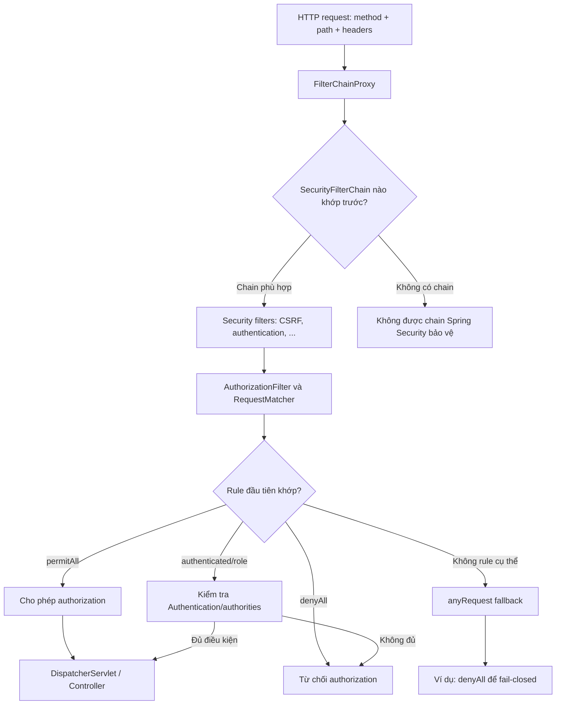

# `permitAll`, `denyAll` và quy tắc dự phòng `anyRequest` trong phân quyền HTTP

**Module:** Spring Security – Servlet  
**Chủ đề cha:** Phân quyền HTTP  
**Môi trường minh họa:** Java 17, Spring Boot 3.3.5, Spring Security 6.x, Spring MVC trên Servlet container.

## Mục tiêu

Bài này đi sâu vào ba lựa chọn quan trọng của DSL `authorizeHttpRequests`:

- `permitAll()`: cho phép request phù hợp mà **không yêu cầu authorization** đối với người dùng.
- `denyAll()`: từ chối authorization của request phù hợp, kể cả khi người dùng đã đăng nhập hoặc có role cao.
- `anyRequest()`: matcher dự phòng cho tất cả request **chưa khớp các quy tắc trước đó trong cùng security chain**.

Điểm then chốt không phải thuộc lòng ba API, mà là hiểu **thứ tự rule**, **scope của `SecurityFilterChain`**, sự khác nhau giữa **authentication và authorization**, cùng lựa chọn **fail-closed** khi xuất hiện endpoint mới.

Sau bài học, bạn có thể thiết kế policy rõ ràng, tránh vô tình công khai API, phân biệt `401`/`403`, không dùng `permitAll` để bỏ qua CSRF hoặc các security filters, và kiểm thử policy bằng một project Java 17 chạy được.

## 1. Phân quyền HTTP nằm ở đâu?

Một request đi qua Servlet filter chain trước khi tới Spring MVC controller. Với ứng dụng có Spring Security, `FilterChainProxy` chọn `SecurityFilterChain` phù hợp; các filter xác thực có thể thiết lập `Authentication` vào `SecurityContext`; `AuthorizationFilter` đánh giá quy tắc của `authorizeHttpRequests`.



Các đoạn này là luồng khái niệm, không phải bảo đảm tất cả filters sẽ chạy theo đúng thứ tự vẽ trong mọi cấu hình tùy chỉnh. Quan trọng:

1. **Chọn chain trước:** Một request không khớp `securityMatcher` của chain thì các rule bên trong chain đó không chạy.
2. **Chọn rule trong chain:** Quy tắc đầu tiên phù hợp với request quyết định authorization, không cộng dồn vô điều kiện các rule ở dưới.
3. **Giá trị `permitAll`/`denyAll` chỉ điều khiển quyết định authorization.** Request vẫn đi qua những filters khác nếu thuộc chain.
4. **Controller chạy sau authorization** nếu request được cho phép; `permitAll` không bảo đảm path thực sự có controller, vì route không tồn tại vẫn có thể trả `404`.

### 1.1. Một ví dụ lỗi do thứ tự matcher

```java
// Anti-pattern: rule rộng đặt trước, vô tình cho mọi GET /admin/** vào.
http.authorizeHttpRequests(auth -> auth
        .requestMatchers(HttpMethod.GET, "/**").permitAll()
        .requestMatchers("/admin/**").hasRole("ADMIN")
        .anyRequest().denyAll());
```

Với `GET /admin/secret`, matcher `GET /**` đã khớp trước, nên `.hasRole("ADMIN")` phía sau không được dùng để siết quyền. **`anyRequest` ở cuối cũng không sửa được một rule trước đó đã quá rộng.**

Cách làm đúng: đặt matcher cụ thể có tính bảo vệ cao trước matcher bao quát, và **tránh** các rule công khai quá rộng.

```java
http.authorizeHttpRequests(auth -> auth
        .requestMatchers("/admin/**").hasRole("ADMIN")
        .requestMatchers(HttpMethod.GET, "/docs/**").permitAll()
        .anyRequest().denyAll());
```

Đây là đoạn minh họa cần các import và cấu hình Spring Boot phù hợp; project hoàn chỉnh ở phần 7.

## 2. `permitAll()`: mở quyền truy cập, không tắt bảo mật

`permitAll()` trả kết quả **cho phép authorization** cho request phù hợp, bất kể hiện có người dùng xác thực hay không.

Ví dụ:

```java
http.authorizeHttpRequests(auth -> auth
        .requestMatchers(HttpMethod.GET, "/healthz", "/docs/intro")
            .permitAll()
        .anyRequest().denyAll());
```

Trong ví dụ này:

- `GET /healthz`: công khai.
- `GET /docs/intro`: công khai.
- `POST /docs/intro`: **không** được công khai theo rule GET; nếu request vượt qua các filters khác, fallback `denyAll` sẽ chặn.
- `GET /api/me`: không có rule riêng nên cũng bị fallback chặn trong cấu hình rút gọn này.

### 2.1. `permitAll()` không có nghĩa “bỏ qua Spring Security”

Một request được `permitAll` vẫn có thể chịu ảnh hưởng của:

- `CsrfFilter` đối với các method cần CSRF protection.
- `BasicAuthenticationFilter` hoặc filter xác thực khác khi request mang credentials sai.
- HTTP security headers và các filter quan sát/chính sách khác.
- Rules của infrastructure nằm trước hoặc ngoài app, ví dụ reverse proxy.
- Hành vi `DispatcherServlet` khi route không tồn tại hoặc controller trả lỗi.

Ví dụ, nếu client gửi `Authorization: Basic ...` **sai** tới public endpoint trong chain có `httpBasic`, filter xác thực có thể trả `401` trước khi tới bước `permitAll`. Ngược lại, một public GET không gửi credentials có thể được cho phép. Đừng nghĩ `permitAll` đồng nghĩa “bất kỳ request nào cũng chắc chắn HTTP 200”.

### 2.2. `permitAll` khác `web.ignoring()`

| Cách tiếp cận | Có đi qua Spring Security filter chain? | Khi nào dùng? |
| --- | --- | --- |
| `requestMatchers("/public/**").permitAll()` | **Có**, nếu request khớp security chain | Mặc định nên chọn khi cần public URL nhưng vẫn muốn security headers/filter processing |
| `web.ignoring().requestMatchers(...)` | **Bỏ qua** Spring Security filter chain cho các request tương ứng | Rất hiếm khi cần; phải hiểu ảnh hưởng lên security headers, CSRF, authentication và logging |
| `securityMatcher(...)` | Giới hạn **phạm vi** một chain | Dùng khi có nhiều chain với chính sách riêng, không phải rule cấp quyền |
| `anyRequest().permitAll()` | Có, nhưng mở mọi request chưa match trong chain | Dễ tạo lỗ hổng nếu dùng như fallback không suy nghĩ |

Với tài nguyên CSS/JS công khai, `permitAll` thường dễ kiểm soát hơn `web.ignoring`, nhất là khi bạn muốn các response vẫn nhận security headers nhất quán.

### 2.3. Chỉ định method khi có lý do

`requestMatchers("/public/**").permitAll()` áp dụng cho **mọi HTTP method** phù hợp pattern, không chỉ GET. Nếu controller mới thêm POST thay đổi dữ liệu trong cùng prefix, rule quá rộng có thể vô tình cấp quyền.

Để thể hiện ý định chỉ công khai truy vấn không thay đổi trạng thái:

```java
.requestMatchers(HttpMethod.GET, "/public/info").permitAll()
```

Lưu ý `HEAD` không tự được tính là `GET` ở tất cả matcher; thiết kế/test method nào được hỗ trợ, thay vì dựa vào phỏng đoán. `OPTIONS` cho CORS preflight cần cấu hình CORS phù hợp nếu có frontend cross-origin; không giải quyết bằng cách mặc định công khai mọi URL/method.

## 3. `denyAll()`: rào chắn từ chối authorization

`denyAll()` khiến rule được match **không cấp quyền cho bất kỳ authentication nào**, kể cả account có `ROLE_ADMIN` hoặc `isAuthenticated() == true`.

Ví dụ:

```java
http.authorizeHttpRequests(auth -> auth
        .requestMatchers("/internal/**").denyAll()
        .anyRequest().authenticated());
```

Dù user đã đăng nhập, URL `/internal/audit` vẫn bị từ chối. Dùng `denyAll` cho:

- Endpoint đã vô hiệu hóa tạm thời.
- Legacy URL không được cho phép phục vụ nữa.
- Prefix dành riêng cho mạng/quản trị khác, không nên public ở chain hiện tại.
- Quy tắc fallback fail-closed cho endpoint chưa được phân loại.

**`denyAll()` không xóa mapping của Spring MVC.** Controller vẫn có thể tồn tại và được gọi bằng một filter chain khác nếu chain chính không áp dụng. Muốn đảm bảo chặn tuyệt đối ở toàn ứng dụng, hãy xem toàn bộ chain, matcher, reverse proxy và configuration, không chỉ một rule.

### 3.1. Vì sao `denyAll` không đồng nghĩa lúc nào HTTP cũng là 403?

Đây là điểm dễ bị sai trong debug:

- Người dùng **đã xác thực**, nhưng authorization bị từ chối: thường nhận **`403 Forbidden`**.
- Người dùng **chưa xác thực** và authorization bị từ chối: `ExceptionTranslationFilter` có thể gọi `AuthenticationEntryPoint`, dẫn tới **`401 Unauthorized`** với HTTP Basic hoặc redirect tới form login.
- CSRF token không hợp lệ có thể tạo `403` **trước cả** bước `denyAll`.

Vì vậy `denyAll` là **quyết định authorization**, không phải API “trả đúng status 403 trong mọi hoàn cảnh”. Test trạng thái trong cùng cơ chế client/authentication và với CSRF phù hợp.

### 3.2. `denyAll` có chặn một request dù rule trước đã cho phép không?

**Không.** Với mô hình first-match-wins:

```java
// Sai: GET /api/internal/audit khớp rule đầu, rule deny sau vô tác dụng.
http.authorizeHttpRequests(auth -> auth
        .requestMatchers(HttpMethod.GET, "/api/**").permitAll()
        .requestMatchers("/api/internal/**").denyAll()
        .anyRequest().denyAll());
```

Sửa bằng cách đưa rule deny cụ thể lên trước **và** giảm độ rộng của rule public:

```java
http.authorizeHttpRequests(auth -> auth
        .requestMatchers("/api/internal/**").denyAll()
        .requestMatchers(HttpMethod.GET, "/api/public/**").permitAll()
        .anyRequest().denyAll());
```

Hãy cố thiết kế để mỗi URL có policy dễ hiểu. Khi một rule `permitAll` rộng có thể “nuốt” rule deny, đó là dấu hiệu cấu hình cần tái cấu trúc.

## 4. `anyRequest()`: quy tắc dự phòng ở cuối

`anyRequest()` là matcher tổng quát cho **mọi request còn lại trong chain**. Thường nó được đặt cuối `authorizeHttpRequests`:

```java
http.authorizeHttpRequests(auth -> auth
        .requestMatchers(HttpMethod.GET, "/healthz").permitAll()
        .requestMatchers("/admin/**").hasRole("ADMIN")
        .anyRequest().denyAll());
```

Khi đó:

- `/healthz` GET không cần authentication.
- `/admin/**` yêu cầu quyền admin.
- Mọi URL/method khác **khớp chain** nhưng chưa match rule trước đều bị từ chối, kể cả endpoint mới do lập trình viên thêm sau này.

`anyRequest` không tự biết endpoint nào sẽ được tạo trong tương lai; nó hoạt động như **default policy** nếu không có rule chi tiết.

### 4.1. Ba lựa chọn fallback và mức rủi ro

| Fallback | Tác động tới endpoint mới chưa khai báo | Đánh giá |
| --- | --- | --- |
| `.anyRequest().permitAll()` | Có thể công khai route mới ngoài ý muốn | Rất nguy hiểm làm mặc định cho API chứa dữ liệu nhạy cảm |
| `.anyRequest().authenticated()` | Cho bất kỳ user đã xác thực truy cập route mới, kể cả route đáng ra chỉ dành admin | Tốt hơn public rộng nhưng chưa đạt least privilege |
| `.anyRequest().denyAll()` | Chặn route mới cho tới khi có rule cho phép tường minh | **Fail-closed**, là lựa chọn mạnh khi API phải được xét duyệt quyền từng endpoint |

Lựa chọn fallback không có một đáp án tuyệt đối cho mọi hệ thống. Một trang tài liệu công khai có thể dùng fallback public ở chain cực kỳ giới hạn; API admin và dữ liệu người dùng nhạy cảm nên ưu tiên default deny hoặc policy yêu cầu role rõ ràng. Điều quan trọng là biết **phạm vi chain và chủ đích của default**.

### 4.2. `anyRequest()` không được đặt trước các rule khác

Không viết:

```java
// Sai ý tưởng và có thể bị DSL từ chối khi cấu hình.
http.authorizeHttpRequests(auth -> auth
        .anyRequest().authenticated()
        .requestMatchers("/admin/**").hasRole("ADMIN"));
```

`anyRequest` phải là fallback cuối. Những quy tắc sau đó không thể áp dụng như dự định; DSL Spring Security 6 có thể báo lỗi nếu cố thêm matcher sau `anyRequest`.

### 4.3. “Default deny” là một quy ước kiểm soát thay đổi

Một nhóm có thể thống nhất:

1. Mọi route mới phải được nhận diện là public, authenticated, role-specific hoặc denied.
2. Pull request thêm endpoint phải đi kèm security rule và test positive/negative.
3. Fallback `.anyRequest().denyAll()` giữ hệ thống từ chối route quên khai báo.
4. CI chạy MockMvc/HTTP integration tests để phát hiện route mới trả `403` dù đã login.
5. Một route public phải được **mở tường minh**, không sửa fallback thành `permitAll` chỉ để test qua.

Thiết kế này hỗ trợ principle of least privilege và review dễ hơn, nhưng cần chấp nhận tăng công việc khai báo/kiểm thử.

## 5. Thứ tự matcher quyết định hành vi

Spring Security thường dùng `RequestMatcherDelegatingAuthorizationManager` cho rules của `authorizeHttpRequests`. Nó xét các mapping rule theo **thứ tự được khai báo**, rule đầu tiên có `RequestMatcher` khớp quyết định `AuthorizationManager` sẽ được dùng.

### 5.1. Rule cụ thể trước, rule tổng quát sau

**Sai:**

```java
http.authorizeHttpRequests(auth -> auth
        .requestMatchers("/api/**").authenticated()
        .requestMatchers("/api/admin/**").hasRole("ADMIN")
        .anyRequest().denyAll());
```

Một user bình thường đã login có thể vào `/api/admin/report` vì khớp `.authenticated()` trước. Role rule phía sau bị che khuất.

**Đúng:**

```java
http.authorizeHttpRequests(auth -> auth
        .requestMatchers("/api/admin/**").hasRole("ADMIN")
        .requestMatchers("/api/**").authenticated()
        .anyRequest().denyAll());
```

Nhưng để kiểm soát chi tiết hơn, tốt nhất phân nhóm endpoint theo method và use case thay vì đặt một rule `/api/**` mở quá rộng.

### 5.2. Matcher theo HTTP method

Đường dẫn giống nhau không có nghĩa các method được phép giống nhau:

```java
http.authorizeHttpRequests(auth -> auth
        .requestMatchers(HttpMethod.GET, "/api/reports/**")
            .hasAnyRole("USER", "ADMIN")
        .requestMatchers(HttpMethod.POST, "/api/reports/**")
            .hasRole("ADMIN")
        .anyRequest().denyAll());
```

- `GET /api/reports/summary`: đọc được với `ROLE_USER` hoặc `ROLE_ADMIN`.
- `POST /api/reports/summary`: chỉ admin, **đồng thời cần CSRF token nếu CSRF bật**.
- `DELETE /api/reports/summary`: fallback deny, không phải “tự suy ra admin có đủ quyền”.

### 5.3. Matcher path không thay thế policy đối tượng

HTTP authorization chủ yếu kiểm soát request theo method/path và authentication. Nó **không tự kiểm tra ownership** của từng tài nguyên:

```text
GET /api/invoices/1001
GET /api/invoices/1002
```

Dù cả hai match `.authenticated()`, bạn vẫn cần kiểm tra user nào được xem invoice 1001/1002 ở service hoặc method authorization như `@PreAuthorize` với policy phù hợp. Đừng coi `permitAll`/`authenticated` trên path là đủ để ngăn **IDOR/BOLA**.

### 5.4. Pattern syntax và context path

Với Spring MVC Servlet, `requestMatchers(...)` sẽ lựa chọn/request matcher theo API và configuration của phiên bản Spring Security. Không tự giả định mọi pattern luôn hoạt động theo một kiểu Ant path matcher, nhất là khi dự án có nhiều servlet, servlet path tùy chỉnh hoặc thay đổi major version.

Hãy kiểm thử **URL thực tế** sau khi tính context path, servlet path, trailing slash, encoded path và method. Đừng dùng pattern quá rộng như `"/**"` công khai rồi kỳ vọng một số prefix được bảo vệ bằng rule phía sau.

## 6. `permitAll`, `denyAll`, CSRF và AuthenticationEntryPoint

### 6.1. Authentication khác authorization

- **Authentication**: Có biết người gọi là ai không? Credentials có hợp lệ không?
- **Authorization**: Người gọi có được thực hiện request này không?
- **`permitAll`**: không yêu cầu user có quyền cụ thể để vượt **authorization rule** đang match.
- **`denyAll`**: không cho phép qua **authorization rule** đang match.
- **`authenticated()`**: yêu cầu identity đã xác thực; nhớ rằng remember-me authentication có thể được coi authenticated trong nhiều flow.
- **`fullyAuthenticated()`**: trong Spring Security trust semantics, loại trừ remember-me; không tự bảo đảm MFA hoặc reauthentication “trong vòng 5 phút”.

Ví dụ, với HTTP Basic, một protected endpoint cần `.authenticated()` mà không có header có thể trả **401 + `WWW-Authenticate`**. Khi user có credentials đúng nhưng thiếu `ROLE_ADMIN`, endpoint `.hasRole("ADMIN")` thường trả **403**.

### 6.2. CSRF không bị bypass bởi `permitAll`

Với Spring Security Servlet, `CsrfFilter` có thể yêu cầu CSRF token cho POST/PUT/DELETE theo cấu hình. Một endpoint được `permitAll` **vẫn có thể nhận 403** nếu CSRF token sai/thiếu.

Ví dụ:

```java
http.authorizeHttpRequests(auth -> auth
        .requestMatchers(HttpMethod.POST, "/public/contact").permitAll()
        .anyRequest().denyAll());
```

Không có nghĩa mọi anonymous POST sẽ thành công. Nếu CSRF bật, browser form phải gửi token hợp lệ hoặc bạn cần một thiết kế CSRF khác phù hợp threat model. **`permitAll()` không phải cách tắt CSRF**, cũng không nên `.csrf(csrf -> csrf.disable())` chỉ để làm test POST chạy.

Ngược lại, POST có CSRF token hợp lệ **vẫn có thể** bị `denyAll` từ chối do authorization. Hai lớp kiểm tra giải quyết hai câu hỏi khác nhau.

### 6.3. Status lỗi là kết quả của nhiều lớp

| Tình huống | Kết quả thường gặp | Nguyên nhân |
| --- | --- | --- |
| Public GET match `permitAll`, request hợp lệ | `200` hoặc status của controller | Authorization cho qua, MVC quyết định response |
| Public GET match `permitAll` nhưng URL không tồn tại | `404` | Authorization cho qua, MVC không có handler |
| Protected GET không có credentials, HTTP Basic enabled | `401` | AuthenticationEntryPoint challenge |
| Protected GET với user hợp lệ nhưng thiếu role | `403` | Access denied bởi AuthorizationFilter |
| POST thiếu CSRF token | `403` | Có thể bị CsrfFilter từ chối trước authorization |
| Authenticated request match `denyAll` | `403` | Authorization bị từ chối ngay cả khi đã login |
| Anonymous request match `denyAll` | Có thể `401`, redirect hoặc `403` tùy chain | AuthenticationEntryPoint/error handling quyết định HTTP response |
| Endpoint mới không match rule cụ thể, fallback `denyAll` | Thường từ chối trước controller | Không phải bằng chứng controller không tồn tại |

Đừng debug dựa trên status một mình. Xem **method, path, chain, matcher đầu tiên, credentials và CSRF**.

## 7. Project Maven đầy đủ: fail-closed với `anyRequest().denyAll()`

Project dùng Spring Boot 3.3.5 Java 17 và HTTP Basic để các bài test authorization rõ ràng, không phải hướng dẫn xây browser login bằng HTTP Basic. **Trong triển khai thật phải dùng HTTPS**, còn local dùng credential demo và `localhost`.

Các route minh họa:

| Method và path | Chính sách | Kết quả với tài khoản demo |
| --- | --- | --- |
| `GET /healthz` | `permitAll` | Anonymous được phép |
| `GET /docs/intro` | `permitAll` | Anonymous được phép |
| `GET /api/me` | `authenticated` | `student` hoặc `admin` được phép |
| `GET /api/reports/summary` | `hasAnyRole("USER", "ADMIN")` | `student` và `admin` được phép |
| `POST /api/reports/summary` | `hasRole("ADMIN")` | Chỉ `admin`, khi có CSRF token hợp lệ |
| `GET /internal/audit` | `denyAll` | Cả admin cũng bị chặn |
| `GET /not-listed` | fallback `denyAll` | Authenticated user bị chặn, không vào MVC |
| `POST /docs/intro` | fallback `denyAll` | Không được cấp quyền nhờ rule GET public |

**Hai user giả:** `student/student-pass` có `ROLE_USER`, `admin/admin-pass` có `ROLE_ADMIN`. Password demo được lưu dưới dạng BCrypt hash trong memory user store, không đặt plaintext password trong principal.

### 7.1. Cấu trúc thư mục

```text
http-authorization-demo/
├── pom.xml
└── src/
    ├── main/java/demo/policy/
    │   ├── AuthorizationApplication.java
    │   ├── SecurityConfig.java
    │   └── ApiController.java
    └── test/java/demo/policy/
        └── AuthorizationApplicationTests.java
```

### 7.2. `pom.xml`

```xml
<?xml version="1.0" encoding="UTF-8"?>
<project xmlns="http://maven.apache.org/POM/4.0.0"
         xmlns:xsi="http://www.w3.org/2001/XMLSchema-instance"
         xsi:schemaLocation="http://maven.apache.org/POM/4.0.0 https://maven.apache.org/xsd/maven-4.0.0.xsd">
    <modelVersion>4.0.0</modelVersion>

    <parent>
        <groupId>org.springframework.boot</groupId>
        <artifactId>spring-boot-starter-parent</artifactId>
        <version>3.3.5</version>
        <relativePath/>
    </parent>

    <groupId>demo</groupId>
    <artifactId>http-authorization-demo</artifactId>
    <version>1.0.0</version>

    <properties>
        <java.version>17</java.version>
    </properties>

    <dependencies>
        <dependency>
            <groupId>org.springframework.boot</groupId>
            <artifactId>spring-boot-starter-web</artifactId>
        </dependency>
        <dependency>
            <groupId>org.springframework.boot</groupId>
            <artifactId>spring-boot-starter-security</artifactId>
        </dependency>
        <dependency>
            <groupId>org.springframework.boot</groupId>
            <artifactId>spring-boot-starter-test</artifactId>
            <scope>test</scope>
        </dependency>
        <dependency>
            <groupId>org.springframework.security</groupId>
            <artifactId>spring-security-test</artifactId>
            <scope>test</scope>
        </dependency>
    </dependencies>

    <build>
        <plugins>
            <plugin>
                <groupId>org.springframework.boot</groupId>
                <artifactId>spring-boot-maven-plugin</artifactId>
            </plugin>
        </plugins>
    </build>
</project>
```

Spring Boot BOM quản lý các phiên bản Spring Security và JUnit phù hợp. Đây là **Spring MVC/Servlet** (`spring-boot-starter-web`), không phải WebFlux.

### 7.3. `src/main/java/demo/policy/AuthorizationApplication.java`

```java
package demo.policy;

import org.springframework.boot.SpringApplication;
import org.springframework.boot.autoconfigure.SpringBootApplication;

@SpringBootApplication
public class AuthorizationApplication {
    public static void main(String[] args) {
        SpringApplication.run(AuthorizationApplication.class, args);
    }
}
```

### 7.4. `src/main/java/demo/policy/SecurityConfig.java`

```java
package demo.policy;

import org.springframework.context.annotation.Bean;
import org.springframework.context.annotation.Configuration;
import org.springframework.http.HttpMethod;
import org.springframework.security.config.Customizer;
import org.springframework.security.config.annotation.web.builders.HttpSecurity;
import org.springframework.security.config.http.SessionCreationPolicy;
import org.springframework.security.core.userdetails.User;
import org.springframework.security.core.userdetails.UserDetails;
import org.springframework.security.core.userdetails.UserDetailsService;
import org.springframework.security.crypto.bcrypt.BCryptPasswordEncoder;
import org.springframework.security.crypto.password.PasswordEncoder;
import org.springframework.security.provisioning.InMemoryUserDetailsManager;
import org.springframework.security.web.SecurityFilterChain;

@Configuration
public class SecurityConfig {

    @Bean
    PasswordEncoder passwordEncoder() {
        return new BCryptPasswordEncoder();
    }

    @Bean
    UserDetailsService users(PasswordEncoder encoder) {
        UserDetails student = User.withUsername("student")
                .password(encoder.encode("student-pass"))
                .roles("USER")
                .build();

        UserDetails admin = User.withUsername("admin")
                .password(encoder.encode("admin-pass"))
                .roles("ADMIN")
                .build();

        return new InMemoryUserDetailsManager(student, admin);
    }

    @Bean
    SecurityFilterChain securityFilterChain(HttpSecurity http)
            throws Exception {

        http.authorizeHttpRequests(auth -> auth
                .requestMatchers(HttpMethod.GET,
                        "/healthz", "/docs/intro").permitAll()

                .requestMatchers("/internal/**").denyAll()

                .requestMatchers(HttpMethod.GET, "/api/reports/**")
                    .hasAnyRole("USER", "ADMIN")

                .requestMatchers(HttpMethod.POST, "/api/reports/**")
                    .hasRole("ADMIN")

                .requestMatchers("/api/me").authenticated()

                // Mọi endpoint/method khác: từ chối theo nguyên tắc fail-closed.
                .anyRequest().denyAll());

        http.httpBasic(Customizer.withDefaults());

        http.sessionManagement(session -> session
                .sessionCreationPolicy(SessionCreationPolicy.STATELESS));

        // CSRF giữ mặc định; POST admin cần token hợp lệ.
        return http.build();
    }
}
```

**Review cấu hình trước khi chạy:**

- **GET công khai được xác định rõ** bằng method/path, không mở rộng cho POST.
- `"/internal/**"` luôn bị deny trong chain này, cả với admin.
- GET và POST báo cáo có policy riêng. `hasAnyRole("USER", "ADMIN")` kiểm tra `ROLE_USER` hoặc `ROLE_ADMIN`.
- `/api/me` chấp nhận bất kỳ người dùng authenticated; muốn bảo vệ dữ liệu riêng từng user, service phải xác minh ownership.
- `anyRequest().denyAll()` **cuối cùng** chặn các URL/method chưa phân loại.
- `httpBasic` để thử nghiệm authentication trong MockMvc và `curl`; `STATELESS` giúp API không dùng `HttpSession` để khôi phục security context. Đây **không** phải thiết lập cần có cho `permitAll`/`denyAll`; authorization policy hoạt động với form login/session hoặc Bearer đúng cấu hình.
- Không tắt CSRF. Đối với browser tự gửi credentials, đánh giá CSRF riêng; demo POST dùng helper CSRF trong môi trường test.
- Không có `securityMatcher` nên chain này áp dụng như một catch-all ở phạm vi cấu hình demo. Nếu production có chain khác, cần kiểm tra lại thứ tự và scope.

`hasRole("ADMIN")` kiểm tra authority `ROLE_ADMIN`; đừng vừa lưu role `"ROLE_ADMIN"` vào `.roles(...)` vừa thêm prefix lần nữa. Với `.roles("ADMIN")`, Spring Security tạo authority có `ROLE_` đúng chuẩn.

### 7.5. `src/main/java/demo/policy/ApiController.java`

```java
package demo.policy;

import org.springframework.http.MediaType;
import org.springframework.security.core.Authentication;
import org.springframework.web.bind.annotation.GetMapping;
import org.springframework.web.bind.annotation.PostMapping;
import org.springframework.web.bind.annotation.RestController;

@RestController
public class ApiController {

    @GetMapping(value = "/healthz",
                produces = MediaType.TEXT_PLAIN_VALUE)
    public String health() {
        return "ok";
    }

    @GetMapping(value = "/docs/intro",
                produces = MediaType.TEXT_PLAIN_VALUE)
    public String intro() {
        return "public-guide";
    }

    @GetMapping("/api/me")
    public MeResponse me(Authentication authentication) {
        return new MeResponse(authentication.getName());
    }

    @GetMapping(value = "/api/reports/summary",
                produces = MediaType.TEXT_PLAIN_VALUE)
    public String readReport() {
        return "report-summary";
    }

    @PostMapping(value = "/api/reports/summary",
                 produces = MediaType.TEXT_PLAIN_VALUE)
    public String regenerateReport() {
        return "report-regenerated";
    }

    @GetMapping(value = "/internal/audit",
                produces = MediaType.TEXT_PLAIN_VALUE)
    public String internalAudit() {
        return "not-for-public-access";
    }

    public record MeResponse(String username) {}
}
```

Tuy controller có `GET /internal/audit`, policy `denyAll` chặn request **trước khi method chạy**. Việc ghi một controller không tự làm URL công khai. Ngược lại, `GET /not-listed` không có controller nhưng fallback deny có thể khiến authenticated client nhận `403` **thay vì 404**: authorization chặn trước khi Spring MVC quyết định route tồn tại hay không.

### 7.6. `src/test/java/demo/policy/AuthorizationApplicationTests.java`

```java
package demo.policy;

import org.junit.jupiter.api.Test;
import org.springframework.beans.factory.annotation.Autowired;
import org.springframework.boot.test.autoconfigure.web.servlet.AutoConfigureMockMvc;
import org.springframework.boot.test.context.SpringBootTest;
import org.springframework.http.MediaType;
import org.springframework.test.web.servlet.MockMvc;

import static org.hamcrest.Matchers.containsString;
import static org.springframework.security.test.web.servlet.request.SecurityMockMvcRequestPostProcessors.csrf;
import static org.springframework.security.test.web.servlet.request.SecurityMockMvcRequestPostProcessors.httpBasic;
import static org.springframework.test.web.servlet.request.MockMvcRequestBuilders.get;
import static org.springframework.test.web.servlet.request.MockMvcRequestBuilders.post;
import static org.springframework.test.web.servlet.result.MockMvcResultMatchers.content;
import static org.springframework.test.web.servlet.result.MockMvcResultMatchers.header;
import static org.springframework.test.web.servlet.result.MockMvcResultMatchers.jsonPath;
import static org.springframework.test.web.servlet.result.MockMvcResultMatchers.status;

@SpringBootTest
@AutoConfigureMockMvc
class AuthorizationApplicationTests {

    @Autowired
    MockMvc mvc;

    @Test
    void healthEndpointAllowsAnonymous() throws Exception {
        mvc.perform(get("/healthz"))
                .andExpect(status().isOk())
                .andExpect(content().string("ok"));
    }

    @Test
    void docsIntroAllowsAnonymous() throws Exception {
        mvc.perform(get("/docs/intro"))
                .andExpect(status().isOk())
                .andExpect(content().string("public-guide"));
    }

    @Test
    void badBasicCredentialsCanStillBeRejectedOnPublicUrl()
            throws Exception {
        mvc.perform(get("/healthz")
                .with(httpBasic("student", "incorrect")))
                .andExpect(status().isUnauthorized());
    }

    @Test
    void privateApiRequiresAuthentication() throws Exception {
        mvc.perform(get("/api/me")
                .accept(MediaType.APPLICATION_JSON))
                .andExpect(status().isUnauthorized())
                .andExpect(header().string("WWW-Authenticate",
                        containsString("Basic")));
    }

    @Test
    void privateApiAllowsAuthenticatedUser() throws Exception {
        mvc.perform(get("/api/me")
                .with(httpBasic("student", "student-pass")))
                .andExpect(status().isOk())
                .andExpect(jsonPath("$.username").value("student"));
    }

    @Test
    void wrongPasswordGetsAuthenticationChallenge() throws Exception {
        mvc.perform(get("/api/me")
                .with(httpBasic("student", "wrong")))
                .andExpect(status().isUnauthorized());
    }

    @Test
    void userCanReadReport() throws Exception {
        mvc.perform(get("/api/reports/summary")
                .with(httpBasic("student", "student-pass")))
                .andExpect(status().isOk())
                .andExpect(content().string("report-summary"));
    }

    @Test
    void adminCanAlsoReadReport() throws Exception {
        mvc.perform(get("/api/reports/summary")
                .with(httpBasic("admin", "admin-pass")))
                .andExpect(status().isOk());
    }

    @Test
    void userCannotPostReportEvenWithValidCsrf() throws Exception {
        mvc.perform(post("/api/reports/summary")
                .with(httpBasic("student", "student-pass"))
                .with(csrf()))
                .andExpect(status().isForbidden());
    }

    @Test
    void adminCanPostReportWithCsrf() throws Exception {
        mvc.perform(post("/api/reports/summary")
                .with(httpBasic("admin", "admin-pass"))
                .with(csrf()))
                .andExpect(status().isOk())
                .andExpect(content().string("report-regenerated"));
    }

    @Test
    void adminPostWithoutCsrfIsForbidden() throws Exception {
        mvc.perform(post("/api/reports/summary")
                .with(httpBasic("admin", "admin-pass")))
                .andExpect(status().isForbidden());
    }

    @Test
    void evenAdminCannotAccessDenyAllPrefix() throws Exception {
        mvc.perform(get("/internal/audit")
                .with(httpBasic("admin", "admin-pass")))
                .andExpect(status().isForbidden());
    }

    @Test
    void fallbackDeniesUnknownUrlForAuthenticatedUser()
            throws Exception {
        mvc.perform(get("/not-listed")
                .with(httpBasic("admin", "admin-pass")))
                .andExpect(status().isForbidden());
    }

    @Test
    void publicGetRuleDoesNotAllowPostToSamePath()
            throws Exception {
        mvc.perform(post("/docs/intro")
                .with(httpBasic("admin", "admin-pass"))
                .with(csrf()))
                .andExpect(status().isForbidden());
    }
}
```

**Dự kiến 14 test PASS** khi chạy đúng project. Đây là đánh giá dựa trên mã ví dụ; không phải xác nhận đã chạy Maven.

Các test bảo vệ hai ranh giới: **rule phân quyền** (`permitAll`/`denyAll`/`anyRequest`/role/method) và **filter độc lập** (HTTP Basic credentials sai, CSRF). Test dùng `.with(csrf())` chỉ tồn tại trong `spring-security-test`; client thật phải lấy/gửi CSRF token theo repository hiện hành.

Test `evenAdminCannotAccessDenyAllPrefix` đảm bảo `denyAll` **không** được hiểu nhầm là “chặn anonymous nhưng cho phép admin”. Test `fallbackDeniesUnknownUrlForAuthenticatedUser` chứng minh fail-closed theo chain. Test `publicGetRuleDoesNotAllowPostToSamePath` chứng minh method-scoped public rule không công khai mọi method.

### 7.7. Chạy thử và xem HTTP status

Trong thư mục project:

```bash
mvn clean test
mvn spring-boot:run
```

Với cấu hình mặc định, server chạy trên `localhost:8080`. Trong terminal khác:

```bash
# GET public:
curl -s http://localhost:8080/healthz

# GET public:
curl -s http://localhost:8080/docs/intro

# API private không credentials: 401:
curl -s -o /dev/null -w '%{http_code}\n' \
  http://localhost:8080/api/me

# API private với Basic đúng:
curl -s -u student:student-pass \
  http://localhost:8080/api/me

# Chặn cả admin:
curl -s -o /dev/null -w '%{http_code}\n' \
  -u admin:admin-pass \
  http://localhost:8080/internal/audit

# URL chưa liệt kê, authenticated: 403 do anyRequest deny:
curl -s -o /dev/null -w '%{http_code}\n' \
  -u admin:admin-pass \
  http://localhost:8080/not-listed
```

Output (từng lệnh riêng):

```text
ok
public-guide
401
{"username":"student"}
403
403
```

Các lệnh in body `ok` và JSON không nhất thiết thêm newline; `-w` in newline sau status. Trên PowerShell cũ có thể dùng `curl.exe` để tránh alias khác cú pháp. Đừng dùng credentials thật trong command line, shell history hoặc script chia sẻ.

**Không dùng `curl -X POST` thiếu CSRF để khẳng định authorization rule POST đúng/sai.** POST có thể bị `403` ngay ở `CsrfFilter`; MockMvc phía trên dùng `csrf()` để phân biệt CSRF với authorization. Với browser dùng HTTP Basic tự gửi credentials, cần đánh giá CSRF riêng trước khi đưa mutation API vào production.

## 8. Những lỗi cấu hình phổ biến

### 8.1. Đặt `anyRequest()` ở đầu

```java
// Anti-pattern: fallback trước rule chi tiết.
http.authorizeHttpRequests(auth -> auth
        .anyRequest().authenticated()
        .requestMatchers("/api/admin/**").hasRole("ADMIN"));
```

Mọi request đã match fallback; rule admin không có hiệu lực và DSL có thể báo lỗi cấu hình. **Sửa:** `anyRequest()` cuối cùng.

### 8.2. Dùng `permitAll` rộng để “sửa lỗi 403”

```java
// Không nên mở toàn bộ API chỉ vì chưa xác định được lỗi.
.requestMatchers("/api/**").permitAll()
```

Cần xem log/status/request method, CSRF, `SecurityFilterChain`, authentication và rule cụ thể. Nếu bật `permitAll` quá rộng, route mới có thể lộ dữ liệu. Dùng matcher chỉ cho path/method cần public.

### 8.3. Tưởng `.anyRequest().authenticated()` tương đương least privilege

Một người dùng đã login có thể được truy cập endpoint mới chưa gắn `hasRole`/ownership policy. Với tài nguyên nhạy cảm, **`denyAll` fallback** hỗ trợ fail-closed. Nếu nghiệp vụ chọn authenticated fallback, bắt buộc có quy trình review và test cho endpoint mới.

### 8.4. Tưởng `denyAll` chỉ chặn người chưa login

`denyAll` phủ định authorization bất kể vai trò. Dùng `.hasRole("ADMIN")` nếu muốn admin được truy cập. Phải đặt đúng thứ tự để rule này không bị matcher bao quát trước đó “nuốt”.

### 8.5. Dùng `web.ignoring()` cho API công khai

`web.ignoring` bỏ qua security filter chain, có thể mất security headers và các filter bảo vệ. Với public URL cần lọc bình thường, dùng `permitAll` trong chain. Đừng dùng ignoring để giải quyết nhầm lỗi CSRF.

### 8.6. Tưởng `.permitAll()` vô hiệu CSRF

POST/PUT/DELETE có thể cần CSRF token khi CSRF bật dù authorization cho phép anonymous. Không tắt CSRF chỉ để POST trả 200; thay vào đó dùng form/token đúng hoặc phân tích threat model non-browser clients.

### 8.7. Tưởng mọi `denyAll` trả `403`

Anonymous + HTTP Basic có thể nhận `401`; browser form login có thể redirect. Authenticated user với `denyAll` thường nhận `403`; thiếu CSRF cũng có thể `403`. Phải test trước/sau xác thực.

### 8.8. `anyRequest` ở một chain không che phủ toàn bộ ứng dụng

Một chain giới hạn `/api/**` không có quyền gì đối với request `/admin/**` **nếu request không khớp chain**. Với nhiều chains, chain **đầu tiên match** được chọn; matcher trong chain đó quyết định, chứ không “rơi qua chain sau” nếu bị deny.

Ví dụ minh họa, không phải project hoàn chỉnh:

```java
@Bean
@Order(1)
SecurityFilterChain api(HttpSecurity http) throws Exception {
    http.securityMatcher("/api/**")
        .authorizeHttpRequests(a -> a.anyRequest().authenticated());
    return http.build();
}

@Bean
@Order(2)
SecurityFilterChain other(HttpSecurity http) throws Exception {
    http.authorizeHttpRequests(a -> a.anyRequest().denyAll());
    return http.build();
}
```

Hai bean này cần các imports như `org.springframework.core.annotation.Order` và có cấu hình authentication/CSRF phù hợp để chạy thật. Ý nghĩa: API chain có fallback riêng cho `/api/**`; catch-all chain sau có fallback riêng cho mọi request còn lại. Nếu không có chain match một URL, URL đó có thể **không được Spring Security filter chain bảo vệ**. Đó là lý do cần xem policy toàn app, không chỉ một `authorizeHttpRequests` fragment.

### 8.9. `requestMatchers` không đồng nghĩa kiểm tra dữ liệu của user

Một route `/api/accounts/{id}` match `.authenticated()` không chứng minh người gọi có quyền trên `id` tương ứng. Cần authorization ở service/domain hoặc method security, tránh BOLA/IDOR. Các role/path rules là lớp đầu, không thay thế object-level checks.

### 8.10. Error dispatch và forwards bị chặn do fallback

Trong một số ứng dụng Spring MVC, request được forward hoặc dispatch tới `/error`, template view hay error page. Nếu fallback `denyAll` chặn dispatcher tương ứng, user có thể thấy lỗi thứ cấp, ví dụ lỗi thực lẽ ra `404` nhưng kết quả hiển thị bị security filter chặn.

Tùy cấu hình, bạn có thể cần cho phép một số `DispatcherType.ERROR` hoặc `DispatcherType.FORWARD` **theo phạm vi và nguy cơ đã xét**, chẳng hạn `dispatcherTypeMatchers(DispatcherType.ERROR).permitAll()`. Đừng mở toàn bộ forward/error dispatch bừa bãi trong ứng dụng phức tạp; test với controller, view resolver và error handler thực tế.

### 8.11. Trộn chính sách CORS vào `permitAll` mà không hiểu preflight

Frontend cross-origin có thể phát `OPTIONS` preflight trước request POST. Nếu không có CORS policy/filters đúng, browser sẽ chặn từ phía client hoặc server từ chối preflight. `anyRequest().denyAll()` có thể từ chối OPTIONS nếu bạn chưa xử lý. Cách sửa là cấu hình CORS rõ ràng cho origin/method/header, không mặc định `.requestMatchers("/**").permitAll()`.

### 8.12. Test chỉ dùng admin và bỏ qua người dùng thường

Nếu chỉ test admin success, bạn có thể không phát hiện được rule `/api/**.authenticated()` đặt trước admin role rule. Phải có **negative test với user thường** cho endpoint admin, và test với anonymous cho protected endpoint.

## 9. Thiết kế ma trận kiểm thử an toàn

Một ma trận nhỏ giúp QA rule ordering và fail-closed:

| Request | Anonymous | `ROLE_USER` | `ROLE_ADMIN` | Ý đồ |
| --- | --- | --- | --- | --- |
| `GET /healthz` | Allow | Allow | Allow | `permitAll` |
| `GET /docs/intro` | Allow | Allow | Allow | `permitAll` |
| `GET /api/me` | Deny/challenge | Allow | Allow | `authenticated` |
| `GET /api/reports/summary` | Deny/challenge | Allow | Allow | `hasAnyRole` |
| `POST /api/reports/summary` | Deny/challenge | Deny | Allow nếu CSRF đúng | `hasRole("ADMIN")` |
| `GET /internal/audit` | Deny/challenge | Deny | Deny | `denyAll` |
| `GET /not-listed` | Deny/challenge | Deny | Deny | `anyRequest().denyAll()` |
| `POST /docs/intro` | Deny/challenge | Deny | Deny | Rule GET public không áp dụng |

Từ “allow/deny” trong bảng là **quyết định authorization**, không phải cam kết HTTP status cố định. HTTP 200 còn phụ thuộc controller, còn POST có thể gặp CSRF trước; response của anonymous phụ thuộc authentication entry point.

Một test tốt cần đối chiếu **ba chiều**: HTTP method, path matcher và loại người dùng/authorities. Với dữ liệu riêng tư, thêm chiều thứ tư là **ownership/tài nguyên cụ thể**.

## 10. Quy trình review một `SecurityFilterChain` thực tế

Khi review code có `authorizeHttpRequests`, thực hiện theo thứ tự:

1. **Liệt kê chains và `@Order`:** Chain nào nhận request trước? Có `securityMatcher` giới hạn scope không?
2. **Liệt kê endpoints và methods:** Bao gồm controller, Actuator, servlet mappings, static assets, error endpoints, API versions.
3. **Đọc rule từ trên xuống:** Rule nào là match đầu tiên cho từng URL/method?
4. **Xác nhận public endpoints:** Dùng `permitAll` tường minh, tránh pattern `"/**"` vô tình rộng.
5. **Xác nhận deny paths:** Có path legacy/internal cần `denyAll` cụ thể không? Có bị rule trước che khuất không?
6. **Kiểm tra fallback:** `anyRequest` cuối cùng chọn `denyAll`, `authenticated` hay `permitAll` theo yêu cầu; ghi lý do trong code review.
7. **Kiểm tra nguồn role:** `hasRole("ADMIN")` tương ứng authority nào? Có claims/JWT authority converter hay prefix tùy chỉnh không?
8. **Đối chiếu CSRF và CORS:** Không chẩn đoán bằng status 403 đơn thuần; test POST có và không có CSRF, OPTIONS preflight nếu cần.
9. **Kiểm tra security filters:** `permitAll` vẫn đi qua chain, còn `web.ignoring` thì không.
10. **Kiểm tra domain ownership:** URL rule không thay cho kiểm tra user có quyền trên record cụ thể.
11. **Test errors/forward:** Fallback có làm các error dispatch hoặc view forwards bị từ chối ngoài ý muốn không?
12. **Test negative cases:** Anonymous, role thường, admin, route chưa khai báo, method sai, credential sai và URL không tồn tại.
13. **Không mở toàn app để chữa một endpoint:** Nếu test fail vì fallback, sửa rule đúng path/method thay vì đổi tất cả sang `permitAll`.
14. **Đặt quy ước:** Route mới phải đi kèm security test và owner review; dùng fail-closed nếu tổ chức yêu cầu mỗi API được phê duyệt rõ.

## 11. Bài tập tự luyện

### Bài 1. Vì sao thứ tự quan trọng?

Với:

```java
.requestMatchers("/api/**").authenticated()
.requestMatchers("/api/admin/**").hasRole("ADMIN")
.anyRequest().denyAll()
```

**Hỏi:** User có `ROLE_USER` nhưng không có `ROLE_ADMIN` truy cập `/api/admin/users` có thể được cho phép không?  
**Đáp án:** Có thể, vì `/api/**` match trước và chỉ yêu cầu authenticated. **Sửa:** Rule `/api/admin/**` lên trước, hoặc tránh matcher rộng có thể che role policy.

### Bài 2. `permitAll` có tắt CSRF?

```java
.requestMatchers(HttpMethod.POST, "/public/contact").permitAll()
.anyRequest().denyAll()
```

**Hỏi:** Anonymous POST không có CSRF token có chắc thành công không?  
**Đáp án:** Không. Nếu CSRF bật, `CsrfFilter` có thể từ chối `403` trước authorization.

### Bài 3. Vì sao authenticated request vẫn có thể bị từ chối?

```java
.requestMatchers("/internal/**").denyAll()
.anyRequest().authenticated()
```

**Hỏi:** Admin đăng nhập đầy đủ gọi `/internal/debug` có được không?  
**Đáp án:** Không, rule `denyAll` match trước, không cấp quyền cho bất kỳ user nào.

### Bài 4. Fallback nào an toàn hơn cho API nhạy cảm?

**Hỏi:** Route mới `/api/payments/refund` được thêm nhưng không có rule riêng. Với `anyRequest().authenticated()`, mọi user đã login có thể qua authorization chung; với `anyRequest().denyAll()`, route bị chặn cho tới khi mở tường minh. Cách nào hỗ trợ fail-closed?  
**Đáp án:** `anyRequest().denyAll()`, phối hợp test và review đường dẫn.

### Bài 5. Rule GET có cấp quyền POST không?

**Hỏi:** `.requestMatchers(HttpMethod.GET, "/docs/intro").permitAll()` có làm `POST /docs/intro` công khai không?  
**Đáp án:** Không. Method không khớp, request đi tới các rule sau/fallback; CSRF có thể chặn trước.

### Bài 6. `denyAll` có chắc trả 403 với anonymous không?

**Đáp án:** Không. AuthenticationEntryPoint có thể trả HTTP Basic `401` hoặc redirect login; `denyAll` chỉ nêu kết quả authorization.

### Bài 7. Hai chains có hai `anyRequest` khác nhau được không?

**Đáp án:** Có, nếu mỗi chain có phạm vi/ưu tiên rõ. `anyRequest` thuộc **mỗi** chain, không phải policy toàn app. Chain chọn trước không “thử tiếp chain sau” nếu deny.

### Bài 8. `permitAll` và `web.ignoring` có giống nhau không?

**Đáp án:** Không. `permitAll` cho phép authorization trong chain; `web.ignoring` bỏ qua chain bảo mật. Trừ trường hợp đặc biệt, public URL nên dùng `permitAll`.

### Bài 9. Vì sao admin có thể nhận 403 khi POST đã có role đúng?

**Đáp án:** Có thể thiếu/sai CSRF token, bị rule trước che khuất, thuộc chain khác hoặc lỗi policy khác. Dùng test POST kèm `csrf()` để tách vấn đề CSRF khỏi authorization.

### Bài 10. Bảo vệ tài nguyên riêng bằng `.authenticated()` đã đủ chưa?

**Đáp án:** Chưa. Cần kiểm tra quyền truy cập từng bản ghi/đối tượng ở service hoặc method-level authorization để ngăn IDOR/BOLA.

## Kết luận

`permitAll()` **cho phép authorization** đối với request phù hợp; `denyAll()` **từ chối authorization** đối với tất cả user; `anyRequest()` là **rule dự phòng cuối cùng** trong **SecurityFilterChain đang xử lý request**. Trong Spring Security Servlet, **thứ tự matcher quyết định policy thực sự**, còn authentication, CSRF, security filter chain scope và MVC quyết định các kết quả HTTP khác.

Một thiết kế dễ kiểm soát là công khai **đúng endpoint/method cần thiết**, đặt rule đặc biệt/nhạy cảm trước matcher bao quát, và chọn **`anyRequest().denyAll()` khi cần fail-closed**. Hãy dùng cả positive và negative tests — với anonymous, user thường, admin, method không được cấp, URL mới và CSRF — để bảo đảm policy vận hành đúng thay vì chỉ “trông có vẻ an toàn” trong cấu hình.