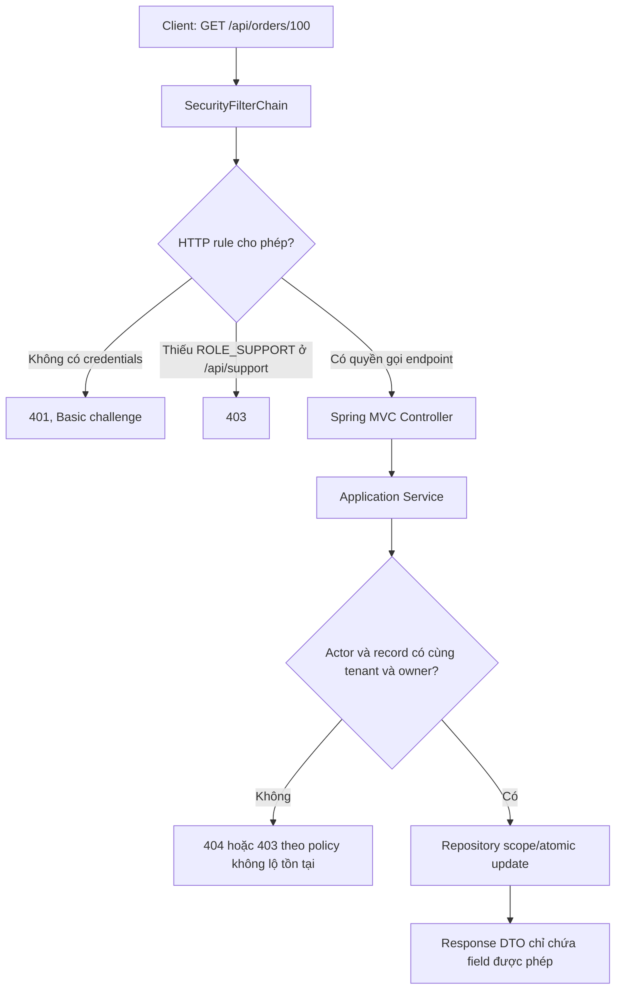

# Phân biệt bảo vệ endpoint với bảo vệ dữ liệu nghiệp vụ bên trong

> **Bối cảnh học:** Spring Boot 3.x, Spring Security 6.x trên Servlet stack (Spring MVC), Java 17+. Chủ đề này thuộc **Phân quyền HTTP** nhưng điểm quan trọng nhất là: **một HTTP request được phép đi qua `SecurityFilterChain` không có nghĩa người gọi được phép đọc hoặc sửa mọi bản ghi mà request chỉ tới**. Bài học minh họa cách kết hợp `authorizeHttpRequests`, method security, kiểm tra quyền sở hữu/tenant trong service và truy vấn DB có ràng buộc để chống IDOR/BOLA. Ví dụ runnable dùng kho dữ liệu trong bộ nhớ; test bằng `MockMvc` qua bộ lọc bảo mật thật.

## 1. Hai câu hỏi bảo mật hoàn toàn khác nhau

Giả sử API cho khách hàng xem đơn hàng:

```http
GET /api/orders/100 HTTP/1.1
Authorization: Basic <credentials-cua-alice>
```

Cấu hình:

```java
.authorizeHttpRequests(auth -> auth
        .requestMatchers("/api/orders/**").authenticated()
        .anyRequest().denyAll())
```

đảm bảo người gọi `/api/orders/**` **đã xác thực**. Nhưng nếu người gọi là Bob và ID `100` thuộc đơn hàng của Alice, rule `authenticated()` **không trả lời** câu hỏi Bob có quyền đọc order 100 hay không.

Đây là phân biệt cốt lõi:

- **Endpoint/request-level authorization:** người gọi có được sử dụng *loại chức năng/URL/HTTP method này* không? Ví dụ chỉ role `SUPPORT` vào `/api/support/**`, hoặc ai đã login được gọi `GET /api/orders/{id}`.
- **Object-level/domain authorization:** với **bản ghi cụ thể**, người gọi có quyền thao tác **đọc, sửa, hủy, duyệt, xuất dữ liệu** không? Ví dụ order 100 thuộc `alice` ở tenant `acme`; `bob` dù đã login cũng không được xem.
- **Field-level authorization:** ngay cả khi được xem order 100, người gọi có được nhận **giá vốn, thông tin thanh toán, email riêng tư, ghi chú nội bộ** hoặc thay đổi `ownerId`/`approved` không?
- **Query/list-level authorization:** API trả danh sách phải lọc tất cả bản ghi theo principal và phạm vi quyền, không chỉ kiểm tra một ID sau khi đã truy vấn cả bảng.

Lỗi truy cập đối tượng bằng cách đoán/chỉnh ID thường gọi là **IDOR (Insecure Direct Object Reference)** hoặc **BOLA (Broken Object Level Authorization)**. Các mã UUID khó đoán chỉ giảm khả năng khám phá, **không phải bằng chứng quyền truy cập**.

### Ma trận trách nhiệm

| Lớp | Câu hỏi nên hỏi | Ví dụ cơ chế |
|---|---|---|
| Servlet filter / SecurityFilterChain | Request này có authentication hợp lệ? URL/method yêu cầu role gì? | `httpBasic`, `authorizeHttpRequests`, `hasRole` |
| Controller | Parse đầu vào, xác định action, lấy principal từ Security | `@PathVariable`, `Authentication`; không tin client-supplied owner |
| Application/domain service | Principal có quyền với đối tượng và action này? | Owner/tenant/member/role/state policy, `@PreAuthorize` hoặc code kiểm tra |
| Repository/DB | Chỉ trả/cập nhật dữ liệu nằm trong phạm vi quyền | WHERE tenant + owner, row-level security, conditional UPDATE |
| DTO/serializer | Field nào được phép đưa ra response? | DTO riêng, projection, masking, không trả JPA entity vô điều kiện |
| Audit/observability | Có ghi được ai thử truy cập gì mà không lộ secret? | Audit principal/action/decision, correlation id |

**Một lớp không thay cho lớp khác.** URL role check có thể đúng mà object ownership vẫn sai; query đã scope đúng nhưng endpoint quản trị vẫn có thể bị gọi bởi role không hợp lệ nếu HTTP authorization bị cấu hình thiếu.

## 2. Tình huống khai thác dễ bị bỏ sót

Một controller không an toàn:

```java
// VÍ DỤ CỐ Ý KHÔNG AN TOÀN — không dùng trong sản phẩm.
@GetMapping("/api/orders/{id}")
public OrderEntity get(@PathVariable long id) {
    return orderRepository.findById(id).orElseThrow();
}
```

Nếu `/api/orders/**` chỉ yêu cầu `authenticated()`, Bob có thể gọi ID `100`, `101`, `102` để đọc đơn hàng của Alice hoặc tenant khác. Việc controller không nhìn thấy password không làm endpoint này an toàn: Bob đã **xác thực đúng**, nhưng truy cập **sai đối tượng**.

Một cách sửa sơ bộ:

```java
@GetMapping("/api/orders/{id}")
public OrderView get(Authentication authentication, @PathVariable long id) {
    return orderService.getForOwner(authentication.getName(), id);
}
```

Trong service, phải lấy chủ thể từ **principal đã được Spring Security xác thực**, tìm record và chỉ trả khi chủ thể có quyền. Không nhận tham số `?user=alice` hoặc header `X-User: alice` rồi tin đó là danh tính.

Một sửa khác *cũng không đủ*:

```java
.requestMatchers("/api/orders/**").hasRole("USER")
```

Rule này yêu cầu role USER nhưng **mọi user có role USER** vẫn có thể đoán ID của nhau nếu service/repository chưa giới hạn theo owner/tenant. Role là quyền **loại chức năng**, không phải chứng nhận sở hữu mọi bản ghi.

## 3. Từ request tới dữ liệu: đặt kiểm tra ở đâu?



**Vị trí khuyến nghị:**

1. Ở **HTTP layer**, enforce authentication, role/scope thô và giới hạn các routes ngoài phạm vi. Đây là tuyến phòng thủ đầu.
2. Ở **service/domain layer**, enforce quyền với từng object theo principal, tenant, relationship, thời điểm, trạng thái nghiệp vụ và action. Đây là tuyến không được bỏ vì cùng service còn có thể được gọi từ scheduler, message consumer hoặc GraphQL.
3. Ở **data access layer**, đưa ràng buộc quyền vào query/UPDATE để giảm nguy cơ lấy nhầm dữ liệu và ngăn **time-of-check/time-of-use (TOCTOU)** khi nhiều requests cùng thay đổi dữ liệu.
4. Ở **response layer**, chỉ trả các trường được phép. Có quyền đọc order không đồng nghĩa được thấy raw payment tokens hay dữ liệu nội bộ.
5. Trong **test**, thử cả cases hợp lệ và những cases **đã xác thực nhưng không sở hữu**. Test duy nhất “login đúng rồi nhận 200” không chứng minh chống BOLA.

## 4. Ví dụ quyền truy cập: user, tenant và support

Ta có dữ liệu học tập:

| Principal | Tenant | Role | Quyền mẫu |
|---|---|---|---|
| `alice` | `acme` | `ROLE_USER` | Xem/hủy **đơn của Alice** trong acme |
| `charlie` | `acme` | `ROLE_USER` | Xem/hủy **đơn của Charlie**, không phải đơn Alice dù cùng tenant |
| `bob` | `beta` | `ROLE_USER` | Xem/hủy **đơn Bob** trong beta |
| `support-a` | Phạm vi hỗ trợ `acme` | `ROLE_SUPPORT` | Xem đơn trong tenant acme qua **support endpoint**, không tự động truy cập beta |

Các đơn hàng mẫu:

| Order ID | Tenant | Owner | State | Số tiền (đơn vị cents) |
|---|---|---|---|---:|
| `100` | acme | alice | OPEN | 120000 |
| `101` | acme | charlie | OPEN | 76000 |
| `102` | acme | alice | OPEN | 45000 |
| `200` | beta | bob | OPEN | 99000 |

Các test bảo vệ quan trọng:

- Alice `GET /api/orders/100` → **200**; Charlie hoặc Bob gọi cùng URL → **404**, dù đã xác thực.
- Bob có thể gửi `X-Tenant: acme` hoặc `X-User: alice` nhưng server **không dùng** các headers đó để mở quyền.
- Alice `GET /api/orders` → chỉ danh sách 100 và 102, không có 101 của Charlie hoặc 200 của Bob.
- Alice `POST /api/orders/102/cancel` → có thể **200** nếu CSRF và policy OK. Bob thử cùng action với CSRF hợp lệ → **404**; gửi thiếu CSRF (nếu browser cookie-based flow) → **403** trước khi xử lý business.
- `support-a` qua `/api/support/tenants/acme/orders/100` → **200**. Cùng principal thử tenant beta → **404**. Alice thử support endpoint → **403** do thiếu role SUPPORT.

Đây là policy minh họa, không phải một chuẩn nghiệp vụ. Hệ thống thật có thể có organizations, delegates, managers, shared orders hoặc roles phức tạp; phải mô hình hóa quyền trên resource thay vì suy diễn mọi thứ từ username.

## 5. Dự án Spring Boot 3.x / Java 17+ chạy được

Ví dụ gồm một lớp main, một Security config, một service chứa *nguồn sự thật* của quyền và order, controller mỏng, cộng các integration-style tests bằng MockMvc.

**Lưu ý phạm vi:** data store là `ConcurrentHashMap` nhằm tập trung vào authorization, không phải database production. Tài khoản và password được tạo trong bộ nhớ; request mẫu chỉ dùng trên `localhost`. Về production phải dùng persistent data store, HTTPS, token/session policy, auditing và transaction phù hợp.

### 5.1. Khởi tạo project

Trong Spring Initializr, chọn Java 17+, **Spring Boot 3.x**, Gradle Groovy DSL và dependencies Spring Web, Spring Security, Spring Boot Starter Test, Spring Security Test. Block `dependencies` trong `build.gradle`:

```groovy
dependencies {
    implementation 'org.springframework.boot:spring-boot-starter-web'
    implementation 'org.springframework.boot:spring-boot-starter-security'
    testImplementation 'org.springframework.boot:spring-boot-starter-test'
    testImplementation 'org.springframework.security:spring-security-test'
}
```

Đây chỉ là khối dependencies; giữ phần plugins, repositories và wrapper từ Initializr. File layout:

```text
src/
├── main/java/com/example/objectauth/
│   ├── ObjectAuthApplication.java
│   ├── SecurityConfig.java
│   ├── OrderService.java
│   └── OrderController.java
└── test/java/com/example/objectauth/
    └── OrderAuthorizationTest.java
```

### 5.2. Main application

**`src/main/java/com/example/objectauth/ObjectAuthApplication.java`**

```java
package com.example.objectauth;

import org.springframework.boot.SpringApplication;
import org.springframework.boot.autoconfigure.SpringBootApplication;

@SpringBootApplication
public class ObjectAuthApplication {
    public static void main(String[] args) {
        SpringApplication.run(ObjectAuthApplication.class, args);
    }
}
```

Class ở package gốc `com.example.objectauth` giúp component scanning tìm SecurityConfig, OrderService và Controller.

### 5.3. SecurityConfig: bảo vệ đường đi, nhưng không giả vờ bảo vệ từng order

**`src/main/java/com/example/objectauth/SecurityConfig.java`**

```java
package com.example.objectauth;

import jakarta.servlet.DispatcherType;

import org.springframework.context.annotation.Bean;
import org.springframework.context.annotation.Configuration;
import org.springframework.http.HttpMethod;
import org.springframework.security.config.Customizer;
import org.springframework.security.config.annotation.method.configuration.EnableMethodSecurity;
import org.springframework.security.config.annotation.web.builders.HttpSecurity;
import org.springframework.security.config.http.SessionCreationPolicy;
import org.springframework.security.core.userdetails.User;
import org.springframework.security.core.userdetails.UserDetailsService;
import org.springframework.security.crypto.factory.PasswordEncoderFactories;
import org.springframework.security.crypto.password.PasswordEncoder;
import org.springframework.security.provisioning.InMemoryUserDetailsManager;
import org.springframework.security.web.SecurityFilterChain;

@Configuration
@EnableMethodSecurity
public class SecurityConfig {

    @Bean
    PasswordEncoder passwordEncoder() {
        return PasswordEncoderFactories.createDelegatingPasswordEncoder();
    }

    @Bean
    UserDetailsService users(PasswordEncoder encoder) {
        return new InMemoryUserDetailsManager(
                User.withUsername("alice")
                    .password(encoder.encode("alice-pass"))
                    .roles("USER").build(),
                User.withUsername("charlie")
                    .password(encoder.encode("charlie-pass"))
                    .roles("USER").build(),
                User.withUsername("bob")
                    .password(encoder.encode("bob-pass"))
                    .roles("USER").build(),
                User.withUsername("support-a")
                    .password(encoder.encode("support-pass"))
                    .roles("SUPPORT").build()
        );
    }

    @Bean
    SecurityFilterChain securityFilterChain(HttpSecurity http)
            throws Exception {
        return http
                .authorizeHttpRequests(auth -> auth
                    // Cho phép container xử lý trang lỗi, không cho
                    // exception dispatch thay đổi kết quả 404/409.
                    .dispatcherTypeMatchers(DispatcherType.ERROR).permitAll()

                    // Chỉ SUPPORT được gọi loại endpoint này.
                    .requestMatchers(HttpMethod.GET,
                            "/api/support/tenants/*/orders/*")
                        .hasRole("SUPPORT")

                    // User đã login được dùng chức năng orders;
                    // KHÔNG có nghĩa họ được truy cập mọi order ID.
                    .requestMatchers("/api/orders", "/api/orders/**")
                        .authenticated()

                    // Những đường khác bị từ chối rõ ràng.
                    .anyRequest().denyAll()
                )
                .httpBasic(Customizer.withDefaults())
                .sessionManagement(session -> session
                    .sessionCreationPolicy(SessionCreationPolicy.STATELESS))
                // KHÔNG tắt CSRF toàn ứng dụng.
                .build();
    }
}
```

**Tại sao dùng Basic và stateless?** Để test request này độc lập với request khác, tránh kết quả “Bob đã có session Alice” làm mờ quyền sở hữu. Trong ứng dụng browser form/cookie thực tế, session và CSRF càng cần được thiết kế rõ. Basic trên mạng thật vẫn phải qua TLS: Base64 không mã hóa password.

**Điểm cần đọc trong config:**

- `authenticated()` chỉ xác nhận đã đăng nhập, không hiểu `orderId`/`owner`.
- `hasRole("SUPPORT")` tạo tuyến bảo vệ HTTP cho chức năng tra cứu hỗ trợ; role tương ứng authority `ROLE_SUPPORT`.
- `dispatcherTypeMatchers(DispatcherType.ERROR).permitAll()` cho phép **ERROR dispatch của Servlet** xử lý lỗi trả về do MVC; không chủ ý biến một endpoint business thành public. Việc này cần kiểm soát thêm nếu ứng dụng có error controller lộ dữ liệu nhạy cảm.
- `anyRequest().denyAll()` là lựa chọn fail closed với những routes chưa được định nghĩa policy.
- `@EnableMethodSecurity` kích hoạt `@PreAuthorize` ở service layer cho chức năng support ở bước kế tiếp.
- `SessionCreationPolicy.STATELESS` ngăn dùng HTTP session để giữ `SecurityContext` giữa requests trong demo. Nó **không tự vô hiệu CSRF**; phép thử POST sẽ yêu cầu token CSRF.
- Không có `csrf.disable()`. Hãy xử lý CSRF theo mô hình client, không vô hiệu hóa vô điều kiện vì “đây là API”.

### 5.4. OrderService: kiểm tra owner + tenant trước khi trả dữ liệu hoặc cập nhật

**`src/main/java/com/example/objectauth/OrderService.java`**

```java
package com.example.objectauth;

import java.util.Comparator;
import java.util.List;
import java.util.Map;
import java.util.Set;
import java.util.concurrent.ConcurrentHashMap;
import java.util.concurrent.atomic.AtomicReference;

import org.springframework.http.HttpStatus;
import org.springframework.security.access.prepost.PreAuthorize;
import org.springframework.security.core.Authentication;
import org.springframework.stereotype.Service;
import org.springframework.web.server.ResponseStatusException;

@Service
public class OrderService {

    // Chỉ là trusted directory trong demo. Ở production, lấy từ
    // account/organization membership data đã xác minh.
    private record Actor(String tenant, Set<String> supportTenants) {}

    private record Order(
            long id, String tenant, String owner,
            String state, long totalCents) {}

    // Response không tiết lộ owner, tenant hoặc dữ liệu payment nội bộ.
    public record OrderView(long id, String state, long totalCents) {}

    private final Map<String, Actor> actors = Map.of(
            "alice", new Actor("acme", Set.of()),
            "charlie", new Actor("acme", Set.of()),
            "bob", new Actor("beta", Set.of()),
            "support-a", new Actor("acme", Set.of("acme"))
    );

    private final ConcurrentHashMap<Long, Order> orders =
            new ConcurrentHashMap<>(Map.of(
                100L, new Order(100, "acme", "alice", "OPEN", 120000),
                101L, new Order(101, "acme", "charlie", "OPEN", 76000),
                102L, new Order(102, "acme", "alice", "OPEN", 45000),
                200L, new Order(200, "beta", "bob", "OPEN", 99000)
            ));

    private Actor currentActor(Authentication authentication) {
        if (authentication == null || !authentication.isAuthenticated()) {
            throw new ResponseStatusException(HttpStatus.FORBIDDEN);
        }
        Actor actor = actors.get(authentication.getName());
        if (actor == null) {
            throw new ResponseStatusException(HttpStatus.FORBIDDEN);
        }
        return actor;
    }

    private boolean ownedBy(Authentication authentication, Actor actor,
                            Order order) {
        return order != null
                && order.tenant().equals(actor.tenant())
                && order.owner().equals(authentication.getName());
    }

    private static ResponseStatusException notVisible() {
        return new ResponseStatusException(HttpStatus.NOT_FOUND);
    }

    private static OrderView toView(Order order) {
        return new OrderView(
                order.id(), order.state(), order.totalCents());
    }

    // Object-level check: đã authenticated vẫn phải là owner + tenant.
    public OrderView getMyOrder(Authentication authentication, long orderId) {
        Actor actor = currentActor(authentication);
        Order order = orders.get(orderId);
        if (!ownedBy(authentication, actor, order)) {
            throw notVisible();
        }
        return toView(order);
    }

    // List-level check: mọi phần tử đều phải được scope theo actor.
    public List<OrderView> listMyOrders(Authentication authentication) {
        Actor actor = currentActor(authentication);
        return orders.values().stream()
                .filter(o -> ownedBy(authentication, actor, o))
                .sorted(Comparator.comparingLong(Order::id))
                .map(OrderService::toView)
                .toList();
    }

    // Action-level check: owner + tenant + trạng thái cho phép cancel.
    public OrderView cancelMyOrder(
            Authentication authentication, long orderId) {
        Actor actor = currentActor(authentication);
        AtomicReference<OrderView> result = new AtomicReference<>();

        // Atomic trong một ConcurrentHashMap JVM cho bài thực hành.
        // Database production cần UPDATE điều kiện + version/transaction.
        orders.compute(orderId, (id, existing) -> {
            if (!ownedBy(authentication, actor, existing)) {
                throw notVisible();
            }
            if (!"OPEN".equals(existing.state())) {
                throw new ResponseStatusException(HttpStatus.CONFLICT);
            }

            Order updated = new Order(
                    existing.id(), existing.tenant(), existing.owner(),
                    "CANCELLED", existing.totalCents());
            result.set(toView(updated));
            return updated;
        });
        return result.get();
    }

    // HTTP support route đã đòi role, nhưng service vẫn có method
    // security để không ai gọi trực tiếp method này khi thiếu role.
    @PreAuthorize("hasRole('SUPPORT')")
    public OrderView readForSupport(
            Authentication authentication, String tenantFromPath,
            long orderId) {
        Actor actor = currentActor(authentication);

        // Tenant của support không do header/query do client khai báo
        // quyết định. Map này đại diện trusted membership store.
        if (!actor.supportTenants().contains(tenantFromPath)) {
            throw notVisible();
        }

        Order order = orders.get(orderId);
        if (order == null || !order.tenant().equals(tenantFromPath)) {
            throw notVisible();
        }
        return toView(order);
    }
}
```

**Vì sao code service quan trọng hơn một URL matcher?**

- `getMyOrder` bắt buộc cả `owner == authentication.getName()` **và** `tenant == actor.tenant`. Charlie cùng tenant với Alice nhưng không sở hữu order 100 nên không được xem. Bob khác tenant cũng không được xem.
- `listMyOrders` lọc trước khi tạo DTO. Một list endpoint quên filter có thể làm lộ hàng nghìn records dù individual detail endpoint được bảo vệ.
- `cancelMyOrder` kiểm tra **quyền và trạng thái** trên cùng một thao tác cập nhật nguyên tử trong map. Một check trước rồi update sau mà không ràng buộc ownership có thể tạo race/TOCTOU.
- `readForSupport` đòi role `SUPPORT` bằng `@PreAuthorize` **và** kiểm tra tenant thuộc danh sách được gán bởi hệ thống. Có role SUPPORT không đồng nghĩa hỗ trợ mọi tenant.
- `OrderView` chỉ chứa trường hợp lệ; không expose toàn bộ entity, secret, internal notes, owner contact, payment instrument hoặc các field từ model ngoài phạm vi quyền.
- Actor directory lấy theo principal đã xác thực. Tham số `tenantFromPath` chỉ là **tenant cần xem**, phải so với authorized membership; client không thể tự “khai” mình thuộc tenant acme.

**Đặc biệt:** `@PreAuthorize` chạy khi Spring gọi method qua bean proxy. Nếu gọi chính method đó bằng `this.readForSupport(...)` từ method khác trong cùng class, proxy-based method security có thể bị bỏ qua. Dùng service boundary rõ ràng và test cả entry points khác HTTP (jobs/messages) nếu production có chúng.

## 6. Controller chỉ lấy ID và principal, không tự quyết định ownership

**`src/main/java/com/example/objectauth/OrderController.java`**

```java
package com.example.objectauth;

import java.util.List;

import org.springframework.security.core.Authentication;
import org.springframework.web.bind.annotation.GetMapping;
import org.springframework.web.bind.annotation.PathVariable;
import org.springframework.web.bind.annotation.PostMapping;
import org.springframework.web.bind.annotation.RestController;

@RestController
public class OrderController {

    private final OrderService orders;

    public OrderController(OrderService orders) {
        this.orders = orders;
    }

    @GetMapping("/api/orders")
    public List<OrderService.OrderView> list(Authentication authentication) {
        return orders.listMyOrders(authentication);
    }

    @GetMapping("/api/orders/{id}")
    public OrderService.OrderView details(
            Authentication authentication, @PathVariable long id) {
        return orders.getMyOrder(authentication, id);
    }

    @PostMapping("/api/orders/{id}/cancel")
    public OrderService.OrderView cancel(
            Authentication authentication, @PathVariable long id) {
        return orders.cancelMyOrder(authentication, id);
    }

    @GetMapping("/api/support/tenants/{tenant}/orders/{id}")
    public OrderService.OrderView supportDetails(
            Authentication authentication, @PathVariable String tenant,
            @PathVariable long id) {
        return orders.readForSupport(authentication, tenant, id);
    }
}
```

Không có tham số `owner` hoặc `X-User` được controller dùng làm principal. Dù client đoán `id` hoặc chỉnh `tenant`, service vẫn có quyền quyết định. Controller trả DTO từ service chứ không trực tiếp gọi `findById(id)` rồi trả entity.

Không cần tự viết login controller; Spring Security Basic filter xác thực credentials. Với production thường có token/session/IdP khác; các nguyên tắc authorization ở tầng business vẫn giữ nguyên.

## 7. Chạy thử bằng curl: endpoint được phép vẫn có thể bị chặn ở service

Chạy từ thư mục dự án chứa Gradle wrapper:

```bash
# macOS / Linux
./gradlew bootRun

# Windows PowerShell
.\gradlew.bat bootRun
```

Mặc định ở `http://localhost:8080` nếu không đổi cấu hình. Dùng `curl.exe` trên Windows PowerShell cũ nếu `curl` là alias. Các password mẫu **chỉ chạy localhost**; môi trường thật bắt buộc HTTPS và secrets được quản lý.

### 7.1. Không có credentials

```bash
curl -i http://localhost:8080/api/orders/100
```

**Kỳ vọng:** `401 Unauthorized`; Basic entry point có thể gửi `WWW-Authenticate: Basic realm="Realm"` hoặc challenge tương ứng cấu hình. Request chưa qua authentication/HTTP authorization để tới service.

### 7.2. Alice xem đơn của Alice

```bash
curl -i -u alice:alice-pass http://localhost:8080/api/orders/100
```

**Kỳ vọng:** 200, response JSON có fields:

```json
{"id":100,"state":"OPEN","totalCents":120000}
```

Role USER đủ để đi qua endpoint, service xác nhận cả tenant và owner. `OrderView` không lộ fields nội bộ.

### 7.3. Charlie/Bob đoán order 100

```bash
curl -i -u charlie:charlie-pass http://localhost:8080/api/orders/100
curl -i -u bob:bob-pass http://localhost:8080/api/orders/100
```

**Kỳ vọng:** cả hai **404**; không trả order 100. Charlie cùng tenant `acme` nhưng **không phải owner**; Bob thuộc tenant `beta`. Hai request đều có credentials hợp lệ và được HTTP layer chấp nhận, nhưng bị service từ chối.

### 7.4. Giả header danh tính hoặc tenant cũng không có quyền

```bash
curl -i -u bob:bob-pass \
  -H 'X-User: alice' -H 'X-Tenant: acme' \
  http://localhost:8080/api/orders/100
```

**Kỳ vọng:** 404. Các headers ở đây chỉ là input chưa tin cậy; service bỏ qua. Không lấy actor từ `request.getHeader("X-User")` hoặc tenant membership từ `X-Tenant` do caller trực tiếp cung cấp.

### 7.5. Danh sách của Alice chỉ có orders Alice

```bash
curl -i -u alice:alice-pass http://localhost:8080/api/orders
```

**Kỳ vọng:** JSON array có IDs 100 và 102, không chứa 101/200. Không có điều kiện `?owner=bob` có thể làm lộ danh sách Bob.

### 7.6. Quyền support vẫn bị giới hạn theo tenant

```bash
curl -i -u alice:alice-pass \
  http://localhost:8080/api/support/tenants/acme/orders/100

curl -i -u support-a:support-pass \
  http://localhost:8080/api/support/tenants/acme/orders/100

curl -i -u support-a:support-pass \
  http://localhost:8080/api/support/tenants/beta/orders/200
```

**Kỳ vọng lần lượt:** 403 (Alice thiếu `ROLE_SUPPORT`); 200 (support-a được gán tenant acme); 404 (support-a chưa được gán tenant beta). Chỉ role SUPPORT không đủ để mở mọi dữ liệu.

### 7.7. Hủy đơn: cần CSRF khi cấu hình còn bảo vệ POST

Endpoint `POST /api/orders/102/cancel` minh họa action write. Trong demo **không tắt CSRF**, vì vậy một POST với Basic credentials nhưng **không có CSRF token** bị chặn 403. Khi viết browser client, hãy dùng CSRF token hợp lệ theo repository/cơ chế giao nhận đã cấu hình; trong MockMvc ta dùng `.with(csrf())`. Không chạy `curl -X POST` không token rồi coi 403 là “Bob thiếu quyền object” — nó có thể bị chặn trước khi tới service.

Khi có CSRF hợp lệ và Alice là owner, state chuyển `OPEN` → `CANCELLED`. Bob dù có CSRF hợp lệ vẫn bị object-level check trả 404. Đây là **hai lớp kiểm soát độc lập**: CSRF ngăn một lớp request giả mạo, ownership ngăn người đã đăng nhập truy cập bản ghi không thuộc quyền.

## 8. Kiểm thử MockMvc qua SecurityFilterChain và service

**`src/test/java/com/example/objectauth/OrderAuthorizationTest.java`**

```java
package com.example.objectauth;

import org.junit.jupiter.api.Test;
import org.springframework.beans.factory.annotation.Autowired;
import org.springframework.boot.test.autoconfigure.web.servlet.AutoConfigureMockMvc;
import org.springframework.boot.test.context.SpringBootTest;
import org.springframework.http.HttpHeaders;
import org.springframework.test.web.servlet.MockMvc;

import static org.springframework.security.test.web.servlet.request.SecurityMockMvcRequestPostProcessors.csrf;
import static org.springframework.security.test.web.servlet.request.SecurityMockMvcRequestPostProcessors.httpBasic;
import static org.springframework.test.web.servlet.request.MockMvcRequestBuilders.get;
import static org.springframework.test.web.servlet.request.MockMvcRequestBuilders.post;
import static org.springframework.test.web.servlet.result.MockMvcResultMatchers.header;
import static org.springframework.test.web.servlet.result.MockMvcResultMatchers.jsonPath;
import static org.springframework.test.web.servlet.result.MockMvcResultMatchers.status;

@SpringBootTest
@AutoConfigureMockMvc
class OrderAuthorizationTest {

    @Autowired
    MockMvc mvc;

    @Test
    void anonymousRequestIsStoppedAtHttpLayer() throws Exception {
        mvc.perform(get("/api/orders/100"))
                .andExpect(status().isUnauthorized())
                .andExpect(header().exists(HttpHeaders.WWW_AUTHENTICATE));
    }

    @Test
    void ownerCanSeeOwnOrder() throws Exception {
        mvc.perform(get("/api/orders/100")
                    .with(httpBasic("alice", "alice-pass")))
                .andExpect(status().isOk())
                .andExpect(jsonPath("$.id").value(100))
                .andExpect(jsonPath("$.totalCents").value(120000));
    }

    @Test
    void anotherUserInSameTenantCannotSeeOrder() throws Exception {
        mvc.perform(get("/api/orders/100")
                    .with(httpBasic("charlie", "charlie-pass")))
                .andExpect(status().isNotFound());
    }

    @Test
    void userInOtherTenantCannotSeeOrder() throws Exception {
        mvc.perform(get("/api/orders/100")
                    .with(httpBasic("bob", "bob-pass")))
                .andExpect(status().isNotFound());
    }

    @Test
    void spoofedHeadersCannotBecomeTrustedPrincipal() throws Exception {
        mvc.perform(get("/api/orders/100")
                    .with(httpBasic("bob", "bob-pass"))
                    .header("X-User", "alice")
                    .header("X-Tenant", "acme"))
                .andExpect(status().isNotFound());
    }

    @Test
    void listEndpointScopesEveryReturnedRecord() throws Exception {
        mvc.perform(get("/api/orders")
                    .with(httpBasic("alice", "alice-pass")))
                .andExpect(status().isOk())
                .andExpect(jsonPath("$.length()").value(2))
                .andExpect(jsonPath("$[0].id").value(100))
                .andExpect(jsonPath("$[1].id").value(102));
    }

    @Test
    void userCannotCallSupportEndpointWithoutRole() throws Exception {
        mvc.perform(get("/api/support/tenants/acme/orders/100")
                    .with(httpBasic("alice", "alice-pass")))
                .andExpect(status().isForbidden());
    }

    @Test
    void supportCanReadOnlyAssignedTenant() throws Exception {
        mvc.perform(get("/api/support/tenants/acme/orders/100")
                    .with(httpBasic("support-a", "support-pass")))
                .andExpect(status().isOk())
                .andExpect(jsonPath("$.id").value(100));

        mvc.perform(get("/api/support/tenants/beta/orders/200")
                    .with(httpBasic("support-a", "support-pass")))
                .andExpect(status().isNotFound());
    }

    @Test
    void missingCsrfStopsWriteAtFilterLayer() throws Exception {
        mvc.perform(post("/api/orders/102/cancel")
                    .with(httpBasic("alice", "alice-pass")))
                .andExpect(status().isForbidden());
    }

    @Test
    void otherOwnerCannotCancelEvenWithValidCsrf() throws Exception {
        mvc.perform(post("/api/orders/102/cancel")
                    .with(httpBasic("bob", "bob-pass"))
                    .with(csrf()))
                .andExpect(status().isNotFound());
    }

    @Test
    void ownerCanCancelOwnOrderWithCsrf() throws Exception {
        mvc.perform(post("/api/orders/102/cancel")
                    .with(httpBasic("alice", "alice-pass"))
                    .with(csrf()))
                .andExpect(status().isOk())
                .andExpect(jsonPath("$.id").value(102))
                .andExpect(jsonPath("$.state").value("CANCELLED"));
    }

    @Test
    void unknownOrderIsNotVisible() throws Exception {
        mvc.perform(get("/api/orders/999")
                    .with(httpBasic("alice", "alice-pass")))
                .andExpect(status().isNotFound());
    }
}
```

Chạy:

```bash
# macOS / Linux
./gradlew test

# Windows PowerShell
.\gradlew.bat test
```

**Kết quả dự kiến:** cả 12 test PASS khi project dùng đúng những class ở trên. Đây là **kỳ vọng theo mã**, không phải lời khẳng định đã thực thi bài test trong môi trường của tài liệu.

**Điều test chứng minh:**

- Test anonymous → 401 chứng minh HTTP layer thực thi authentication.
- Hai test Charlie/Bob → 404 chứng minh user **đã đăng nhập hợp lệ** vẫn không được xem object sai quyền, kể cả cùng tenant.
- Test spoof headers → 404 chứng minh không tin `X-User`/`X-Tenant`.
- Test danh sách → chỉ 100/102, giúp phát hiện lỗi *list-level authorization* thường bị bỏ sót.
- Support role HTTP → 403, support tenant membership → 404, phân biệt quyền gọi chức năng với phạm vi dữ liệu bên trong.
- Hai test POST với/không CSRF và test chủ sở hữu → 403/404/200, phân biệt CSRF, object authorization và business write.
- Test order 999 → 404, không lộ thông tin hoặc stack trace.

Lưu ý test sử dụng một `@SpringBootTest` application context; testcase hủy order 102 có state mutation. Các test khác chỉ đọc id/status của order 100, hoặc chỉ đếm orders không lọc theo trạng thái nên không phụ thuộc thứ tự thực thi. Khi phát triển suite lớn hơn, hãy dùng fixtures/transaction rollback hoặc tạo kho dữ liệu mới cho mỗi test để tránh state leakage.

## 9. Làm sao đẩy authorization xuống truy vấn dữ liệu?

`ConcurrentHashMap` của demo cho thấy logic, nhưng ứng dụng có database nên tránh làm:

```java
// RỦI RO trong hệ dữ liệu lớn: lấy record rồi mới check ở chỗ khác,
// có thể lộ dữ liệu qua log/cache/serializer hoặc tạo TOCTOU.
OrderEntity order = repository.findById(id).orElseThrow();
return toResponse(order);
```

Một cách chặt chẽ hơn là repository query tự giới hạn theo tenant/owner **đã xác minh**:

```sql
SELECT id, status, total_cents
FROM orders
WHERE id = :orderId
  AND tenant_id = :trustedTenantId
  AND owner_id = :authenticatedUserId;
```

Ở JPA có thể định nghĩa method **minh họa, không phải một class độc lập**:

```java
Optional<OrderEntity> findByIdAndTenantIdAndOwnerId(
        Long id, Long tenantId, Long ownerId);
```

`tenantId` và `ownerId` phải đến từ server-side membership/principal đã xác thực, **không đơn thuần lấy từ path/query/body**. Nếu kết quả rỗng, thường trả 404 theo policy che giấu sự tồn tại. Đừng phân biệt “order tồn tại nhưng bạn không được quyền” với “order không tồn tại” nếu điều đó làm rò tài nguyên nhạy cảm.

Đối với **update**, việc check owner rồi `save` sau một khoảng thời gian có thể bị cạnh tranh. Dùng conditional write:

```sql
UPDATE orders
SET status = 'CANCELLED',
    version = version + 1
WHERE id = :orderId
  AND tenant_id = :trustedTenantId
  AND owner_id = :authenticatedUserId
  AND status = 'OPEN'
  AND version = :expectedVersion;
```

Kiểm tra **số hàng được update**; 0 nghĩa là record không tồn tại, không thuộc quyền, trạng thái không hợp lệ hoặc version đã thay đổi. Service quyết định cách phân loại mà không làm lộ thông tin forbidden. Trong production, cần transaction/optimistic locking, idempotency và domain invariants (đơn đã giao không thể hủy); authorization không thay thế kiểm tra trạng thái nghiệp vụ.

### 9.1. Vì sao “check ở controller rồi service làm mọi thứ” dễ lỗi?

Một service có thể được gọi từ HTTP endpoint khác, scheduled job, queue consumer, GraphQL resolver hoặc batch import. Nếu chỉ controller A kiểm tra owner còn service B vô điều kiện `save`, đường đi khác có thể bypass. Đặt policy cốt lõi tại application/domain service, và nếu có thể encode scope vào repository/query. Controller nên điều phối, không phải nơi duy nhất bảo vệ dữ liệu.

### 9.2. Có thể dùng Row Level Security (RLS) không?

Một số database hỗ trợ RLS, cho phép database enforce tenant/actor context theo chính sách. Đây có thể là **lớp phòng thủ mạnh** khi được cấu hình đúng, nhưng phải xác định cách set/reset tenant/actor context cho từng connection trong pool, role database nào có bypass RLS, quyền service account và transaction boundaries. Không lấy `X-Tenant` chưa xác minh rồi set trực tiếp thành DB security context. RLS **bổ sung**, không làm HTTP authorization hay service/domain policy trở nên thừa.

## 10. Method security hỗ trợ gì và chưa hỗ trợ gì?

`@EnableMethodSecurity` bật các annotations như `@PreAuthorize` ở service beans. Ví dụ trong bài:

```java
@PreAuthorize("hasRole('SUPPORT')")
public OrderView readForSupport(Authentication authentication,
                                String tenantFromPath, long id) {
    // ...
}
```

Nó bảo vệ **loại chức năng hỗ trợ**, kể cả khi một caller nội bộ bỏ qua controller. Tuy nhiên nếu method chỉ có `hasRole('SUPPORT')` mà không check `tenantFromPath` có thuộc support scope hay không, support-a vẫn có thể đọc order của tenant beta. Bởi vậy service còn kiểm tra `supportTenants` và actual record tenant.

Có thể viết permission checks tập trung trong bean chuyên dụng:

```java
// SNIPPET Ý TƯỞNG: cần định nghĩa bean orderPolicy và method canRead.
// Không tự chạy như một chương trình độc lập.
@PreAuthorize("@orderPolicy.canRead(authentication, #orderId)")
public OrderView readOrder(long orderId) {
    // Load the scoped order and produce safe view.
}
```

Nếu chọn cách expression, bean `orderPolicy` phải kiểm tra được principal, tenant, resource ID và action; hãy chú ý parameter name resolution, caching và số lần query. **Không chuyển một policy nguy hiểm thành annotation rồi mặc định đã an toàn.** Cũng cần kiểm tra vấn đề Spring proxy: self-invocation (`this.someMethod()`) có thể không chạy `@PreAuthorize`.

Dùng `@PostAuthorize` hoặc `@PostFilter` để lọc sau trả kết quả có thể hữu ích trong một số trường hợp, nhưng với dữ liệu lớn/nhạy cảm, việc đã tải toàn bộ records trước rồi lọc sau thường **tốn tài nguyên** và tăng nguy cơ lộ qua logs/caches. Ưu tiên **lọc trong query** ngay từ đầu khi có thể.

## 11. Các lỗi bảo vệ dữ liệu thường bị bỏ quên

### 11.1. Parent hợp lệ không chứng minh child hợp lệ

Giả sử API:

```http
GET /api/orders/100/items/900
```

Alice sở hữu order 100, nhưng item 900 có thể thuộc order 200 của Bob. Nếu controller chỉ kiểm tra quyền với parent 100 rồi `itemRepository.findById(900)`, Alice có thể truy cập dữ liệu child sai parent. Query phải ràng buộc **item.order_id = 100**, tenant và owner/policy của parent, không tin rằng hai ID trong URL tự tạo quan hệ hợp lệ.

### 11.2. List/search/export/pagination dễ lọc thiếu

Endpoint list có thể trả đúng số lượng trên trang đầu nhưng những truy vấn tổng số, export CSV, search suggestions, autocomplete hoặc background report dùng query khác và quên tenant scope. Các lệnh `COUNT`, `GROUP BY`, aggregation và ordering đôi khi tiết lộ metadata nhạy cảm dù không trả raw rows. Đặt policy dùng chung và test các đường trả dữ liệu liên quan.

### 11.3. Chỉ ẩn nút trên UI không đủ

Frontend ẩn nút “Cancel” cho Bob không ngăn Bob gửi `POST /api/orders/100/cancel` trực tiếp. Giao diện chỉ hỗ trợ UX; server phải kiểm tra quyền tại thời điểm thao tác.

### 11.4. Mass assignment / over-posting

Nếu controller nhận object đầy đủ từ client:

```json
{"id":100,"owner":"bob","tenant":"beta","state":"APPROVED"}
```

rồi bind trực tiếp vào entity và `save`, caller có thể thay fields quyền sở hữu hoặc trạng thái mà policy không cho phép. Dùng DTO command chỉ chứa fields được phép, set owner/tenant từ principal/servicelayer và validate từng state transition. Không có lý do để tin `owner` do client gửi chỉ vì đã authenticated.

### 11.5. Caching không được bỏ qua phạm vi principal

Cache response `GET /api/orders/100` theo key chỉ gồm `orderId=100`, nếu bản ghi của Alice từng được cache và sau đó trả cho Bob thì bypass business authorization dù service bình thường có kiểm tra đúng. Cache key phải kết hợp scope quyền/tenant/principal và policy; các dữ liệu cá nhân nên dùng `Cache-Control` phù hợp, tránh shared CDN/proxy cache ngoài ý muốn.

### 11.6. Tenant context do client gửi

Nếu ứng dụng cho người dùng chọn tenant bằng URL hoặc header, giá trị đó chỉ là **tenant yêu cầu**. Phải kiểm tra principal đã xác thực có membership/role trong tenant đó và resource thuộc tenant tương ứng. Header `X-Tenant` có thể dùng như *selector* sau validation, **không phải proof of membership**.

### 11.7. Admin/support không có nghĩa toàn quyền dữ liệu

Role `ADMIN` hay `SUPPORT` có thể chỉ áp dụng theo tổ chức, khu vực hoặc chức năng. “Admin” của tenant A không đương nhiên là admin của tenant B; support agent có thể phải được gán ticket/tenant mới được xem dữ liệu. Không gộp tất cả vào `hasRole('ADMIN')` nếu còn scope cần enforce.

### 11.8. Sự thay đổi quyền trong khi phiên còn sống

Nếu user bị chuyển tenant hoặc mất quyền với một resource, principal/session/token cũ có thể chứa claims không còn hợp lệ. Xác định chỗ phải kiểm tra lại membership, TTL cache và revocation; những action nhạy cảm có thể cần fresh authorization từ dữ liệu server. Một token hợp lệ về chữ ký không chứng minh mọi quyền nghiệp vụ vẫn còn.

## 12. 401, 403, 404 và các mã lỗi liên quan

| Tình huống | Status tham khảo | Ý nghĩa |
|---|---:|---|
| Không có/có credentials sai tại endpoint bắt buộc auth | **401** | Yêu cầu xác thực hợp lệ; Basic thường gửi challenge |
| Authenticated USER gọi support-only route | **403** | Có danh tính nhưng không đủ role để dùng chức năng |
| Alice truy cập ID không tồn tại | **404** | Không tìm thấy tài nguyên |
| Bob truy cập order 100 của Alice | **404** theo policy ví dụ | Che giấu việc tài nguyên nhạy cảm có tồn tại |
| Support-a gọi tenant không được gán | **404** theo policy ví dụ | Không tiết lộ dữ liệu/tenant ngoài phạm vi |
| Alice đã cancel order 102 và yêu cầu cancel nữa | **409** theo business policy | Trạng thái không cho phép chuyển lần nữa |
| POST thiếu CSRF trong browser-oriented Security | **403** | Bị security filter chặn trước service |

**Không có một quy tắc tuyệt đối** rằng mọi object access sai quyền phải trả 404 hay 403. 403 là cách diễn đạt bị cấm; 404 đôi khi được ưu tiên để tránh tiết lộ sự tồn tại của record. Chọn một policy nhất quán với threat model và logging nội bộ. Thời gian phản hồi, số lượng kết quả, pagination và exception messages vẫn có thể gây *side-channel leaks* dù status giống nhau.

Các lỗi phải không chứa full entity, password, token, tenant internal identifiers hoặc stack trace. Audit nội bộ có thể ghi deny reason ở dạng an toàn, nhưng response công khai nên tối giản.

## 13. Phân tích các triệu chứng thường gặp

| Triệu chứng | Khả năng gây ra | Cách kiểm chứng |
|---|---|---|
| User A nhìn thấy order của B dù đã login đúng | Chỉ có `authenticated()`, không check owner/tenant | MockMvc với A/B gọi cùng ID |
| API detail bảo vệ đúng nhưng list lộ toàn bộ records | Query list thiếu scope, export/search dùng repository khác | Test list/search/export theo mỗi principal |
| Header `X-Tenant` đổi là xem được tenant khác | Service tin header làm identity context | Kiểm tra mapping membership server-side |
| Role SUPPORT xem được mọi tenant | Chỉ `hasRole` mà không check support assignment | Test support-a xem tenant beta |
| POST thiếu CSRF trả 403; team tưởng do owner | CSRF filter chạy trước service | Test riêng với `with(csrf())` và thiếu CSRF |
| 404 thay vì 403 | Resource visibility policy chọn 404 | Kiểm tra service throw và HTTP error handling |
| Service nội bộ bỏ qua `@PreAuthorize` | Self-invocation hoặc chưa `@EnableMethodSecurity` | Gọi từ bean khác, integration test |
| Batch export lộ dữ liệu tenant | Không scope query hoặc dùng cache khác | Test mọi output paths và aggregates |
| Cache trả Alice order cho Bob | Cache key không gắn principal/tenant | Test hai users gọi cùng URL liên tiếp |
| Child ID thuộc parent khác vẫn được xem | Chỉ verify parent, không ràng buộc child.parentId | Cross-parent test |
| Query check rồi update sai owner | TOCTOU/race hoặc update WHERE chỉ có id | Conditional UPDATE + transaction/version |
| Thay đổi quyền nhưng token cũ vẫn có | Claims/cache/session stale | Membership refresh/revocation policy |
| SecurityFilterChain match sai route | Thứ tự matcher/filter chains, proxy rewrite, path normalization | Test URL thực đi qua gateway + HTTP verbs |

## 14. Checklist áp dụng vào dự án thật

1. Lập ma trận **actor – action – resource – tenant** cho mỗi nghiệp vụ, không dừng ở danh sách roles.
2. Dùng `SecurityFilterChain` để xác thực danh tính và bảo vệ loại endpoint theo HTTP method/URL; áp dụng fail closed.
3. Đọc principal từ `Authentication`/`SecurityContext` đã được framework xác thực; không lấy user ID/role/tenant membership từ request rồi tin ngay.
4. Đặt object-level policy ở service/domain layer để mọi caller phải đi qua cùng luật.
5. Scope repository queries theo tenant/owner/membership server-side, không lấy cả bảng rồi tự lọc một phần ở controller.
6. Dùng conditional UPDATE/DELETE, transaction hoặc optimistic locking để tránh TOCTOU trên thao tác thay đổi dữ liệu.
7. Bảo vệ parent-child relationships, nested resources, batch exports và các query tổng hợp.
8. Giới hạn response fields bằng DTO/projection và ngăn mass assignment trên input DTO.
9. Có method security khi cần bảo vệ service entry points; hiểu giới hạn của proxies/self-invocation.
10. Phân biệt 401/403/404/409/CSRF, chọn policy che giấu existence nếu phù hợp.
11. Kiểm tra caching theo authorization scope; không dùng cache key chỉ là object ID nếu cache dữ liệu đa tenant.
12. Tái kiểm tra quyền khi membership bị thu hồi; cân nhắc token TTL, session invalidation và trusted claim validation.
13. Thêm **negative tests** cho same tenant khác owner, cross tenant, spoofed headers, thiếu role, thiếu CSRF và unknown ID.
14. Bảo vệ logs/audit, không để response lỗi tiết lộ object, token hoặc stack trace.
15. Với RLS hoặc microservices, xác định trust boundary giữa gateway/service/database; không tin “gateway đã check rồi” nếu downstream còn nhận trực tiếp từ nguồn khác.
16. Kiểm thử production-like qua Servlet Container/gateway để phát hiện path rewriting, reverse proxy, multi chain và session context khác môi trường local.

## 15. Câu hỏi luyện tập

**Câu 1.** `GET /api/orders/{id}` có `authenticated()`, Bob đã login hợp lệ. Bob có thể đọc đơn 100 của Alice không?  
**Đáp án:** Không. HTTP rule chỉ cho phép dùng chức năng; service phải xác nhận owner/tenant với principal đã xác thực.

**Câu 2.** Alice và Charlie cùng tenant acme. Alice có thể đọc đơn 101 của Charlie không?  
**Đáp án:** Không theo policy ví dụ. Same tenant là điều kiện cần nhưng chưa đủ; còn phải là owner hoặc được ủy quyền cụ thể.

**Câu 3.** `support-a` có `ROLE_SUPPORT`. Vì sao không được xem order 200 của beta?  
**Đáp án:** Role cho phép sử dụng support endpoint; service kiểm tra tenant beta không thuộc `supportTenants` mà hệ thống gán cho actor.

**Câu 4.** Nếu client gửi `X-User: alice` và `X-Tenant: acme` nhưng login bằng account Bob, backend phải tin ai?  
**Đáp án:** Principal Bob đã được authenticate; các headers chỉ là lời tự khai. Tenant selector phải qua membership validation.

**Câu 5.** Tại sao cần `WHERE tenant_id = ... AND owner_id = ...` thay vì `findById(id)` rồi để controller tự xử lý?  
**Đáp án:** Đẩy scope vào query giúp giảm dữ liệu vượt quyền đi qua app, hạn chế leakage và hỗ trợ atomic writes có ràng buộc.

**Câu 6.** `@PreAuthorize("hasRole('SUPPORT')")` có đủ để bảo vệ dữ liệu multi-tenant không?  
**Đáp án:** Không, vì role không chứng minh hỗ trợ mọi tenant. Còn cần resource/tenant policy và phạm vi assignment.

**Câu 7.** POST hủy đơn bị 403 khi thiếu CSRF; nếu thêm CSRF hợp lệ thì Bob có quyền hủy đơn Alice?  
**Đáp án:** Vẫn không. CSRF và object authorization là hai lớp khác nhau; service phải trả 404 hoặc từ chối theo policy.

**Câu 8.** ID là UUID ngẫu nhiên rất khó đoán. Có thể bỏ ownership check không?  
**Đáp án:** Không. Opaque ID không phải secret hoặc cơ chế quyền truy cập.

**Câu 9.** Một item 900 thuộc order 200. Alice sở hữu order 100 và gọi `/orders/100/items/900`. Có thể chỉ check order 100 không?  
**Đáp án:** Không. Cần enforce item 900 thực sự thuộc order 100 cùng với chính sách owner/tenant.

**Câu 10.** Vì sao không trả nguyên JPA entity trực tiếp sau khi role check?  
**Đáp án:** Entity có thể chứa fields nội bộ/PII hoặc relationships ngoài phạm vi, gây field-level data leak; dùng DTO/projection cụ thể.

## 16. Ghi nhớ cuối bài

- **HTTP authorization** trả lời “có được dùng endpoint/chức năng này không?”; **business/object authorization** trả lời “có được thao tác trên bản ghi/tenant này không?”.
- `authenticated()` và `hasRole(...)` **không** thay cho kiểm tra `owner`, tenant membership, relationship, state transition hoặc phạm vi dữ liệu trả về.
- Chủ thể và quyền phải xuất phát từ **principal đã xác thực + nguồn dữ liệu quyền do server kiểm soát**, không từ header/query/body do client tự khai.
- Đặt policy cốt lõi ở **service**, đồng thời scope **repository queries và conditional writes** theo principal/tenant. DTO giới hạn fields hiển thị.
- Kiểm thử phải gồm **positive + negative cases**: same tenant khác owner, cross tenant, role thiếu, header giả, list leak, CSRF và mutation.
- Bảo vệ nested resources, exports, caches, jobs và sessions/tokens theo cùng ranh giới quyền. ID khó đoán chỉ là một biện pháp bổ trợ.

**Nguyên tắc cốt lõi:** **Được đi qua cổng API không có nghĩa được chạm vào mọi dữ liệu phía sau cổng.** Một hệ thống phân quyền đúng phải kiểm tra cả cổng HTTP lẫn từng quyết định truy cập dữ liệu nghiệp vụ.