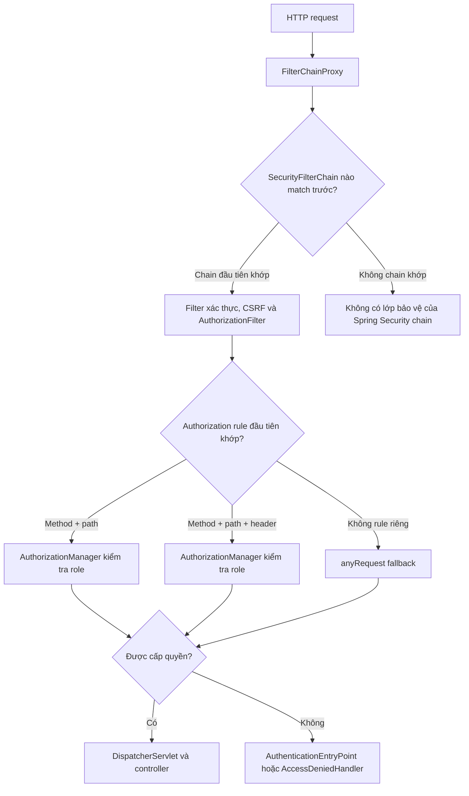

# Khớp request theo HTTP method, header và điều kiện tùy chỉnh trong Spring Security Servlet

**Module:** Spring Security – Servlet  
**Chủ đề cha:** Khớp yêu cầu  
**Môi trường ví dụ:** Java 17 · Spring Boot 3.3.5 · Spring Security 6.x · Spring MVC/Servlet (embedded Tomcat).

## 1. Mục tiêu và ranh giới kiến thức

Khi xây dựng API, chỉ so sánh đường dẫn (`/api/**`) thường chưa đủ. Cùng một URL có thể cho phép `GET` nhưng không cho phép `POST`; một request có thể có header đặc thù dành cho một luồng xử lý; một số chính sách phải kết hợp **method + path + header + trạng thái request**. Spring Security Servlet cung cấp `RequestMatcher` để xác định **request nào khớp**, sau đó dùng `AuthorizationManager` để quyết định **người gửi request có quyền hay không**.

Sau bài này, bạn có thể:

1. Dùng `.requestMatchers(HttpMethod.GET, "/path")` và các method khác trong `authorizeHttpRequests`.
2. Viết một `RequestMatcher` tùy chỉnh kiểm tra `HttpServletRequest` (method, servlet path, header, các điều kiện khác) mà không nhầm matcher với xác thực người dùng.
3. Kết hợp nhiều điều kiện bằng `AndRequestMatcher`, `OrRequestMatcher`, `NegatedRequestMatcher` hoặc lambda rõ nghĩa khi phù hợp.
4. Giải thích thứ tự **first-match-wins** giữa các rule authorization và phân biệt nó với lựa chọn **`SecurityFilterChain` đầu tiên khớp**.
5. Hiểu vì sao **header do client kiểm soát có thể giả mạo**, nên không dùng `X-Role`, `X-Admin` hoặc `X-User` làm chứng cứ danh tính nếu chưa có một trust boundary thật.
6. Phân biệt `401` (authentication challenge), `403` (authorization/CSRF), `404` (không có MVC mapping) và các lỗi do `Accept`/`Content-Type`.
7. Viết ứng dụng Spring Boot Java 17 đầy đủ với bộ test MockMvc cho request đúng/sai method, header, role, CSRF và fallback `anyRequest().denyAll()`.

**Điểm mấu chốt:** *Matching* chỉ là bước chọn **chính sách** theo thuộc tính HTTP request; *authentication* mới xác minh người gọi, còn *authorization* kiểm tra họ được phép làm gì. Không dùng header tùy chỉnh như một mật khẩu hoặc role tự khai.

## 2. Bối cảnh: bộ lọc và hai cấp độ khớp

Một request từ client được Servlet container đưa vào filter chain. `FilterChainProxy` của Spring Security lựa chọn `SecurityFilterChain` phù hợp theo cấu hình. Trong chain đó, `AuthorizationFilter` áp dụng các quy tắc đăng ký qua `authorizeHttpRequests`.



Đây là mô hình khái niệm: thứ tự chính xác của từng filter có thể thay đổi theo cấu hình, nhưng hai ý sau cần giữ:

- **Cấp 1: Chọn `SecurityFilterChain`.** `http.securityMatcher(...)` đặt phạm vi cho toàn chain. Chain đầu tiên match được dùng; các chain sau không được thử lại chỉ vì chain hiện tại trả `403`.
- **Cấp 2: Chọn authorization rule.** Trong chain, các `requestMatchers(...)` được xét theo thứ tự khai báo; rule đầu tiên match quyết định chính sách. `anyRequest()` là fallback của **chain đó**, không phải fallback toàn ứng dụng.

Ví dụ, có hai chains:

```java
// Fragment minh họa, chưa có đủ cấu hình để chạy độc lập:
@Order(1)
@Bean
SecurityFilterChain api(HttpSecurity http) throws Exception {
    http.securityMatcher("/api/**")
        .authorizeHttpRequests(a -> a.anyRequest().authenticated());
    return http.build();
}

@Order(2)
@Bean
SecurityFilterChain other(HttpSecurity http) throws Exception {
    http.authorizeHttpRequests(a -> a.anyRequest().denyAll());
    return http.build();
}
```

Request `/api/orders` được chain thứ nhất xét và **không chuyển xuống chain hai** nếu bị deny. Request `/settings` được chain thứ hai xét. Đoạn code này là một **fragment**; Spring Boot project thật phải có bean/config và authentication mechanism phù hợp.

## 3. Khớp theo HTTP method với `requestMatchers`

### 3.1. Cùng URL, khác method nghĩa là quyền khác

`HttpMethod` là enum ở `org.springframework.http.HttpMethod`. Ví dụ:

```java
http.authorizeHttpRequests(auth -> auth
        .requestMatchers(HttpMethod.GET, "/api/orders")
            .hasAnyRole("READER", "EDITOR")
        .requestMatchers(HttpMethod.POST, "/api/orders")
            .hasRole("EDITOR")
        .anyRequest().denyAll());
```

Ý nghĩa:

- `GET /api/orders`: `ROLE_READER` hoặc `ROLE_EDITOR`.
- `POST /api/orders`: chỉ `ROLE_EDITOR`, **và** phải qua CSRF protection nếu CSRF bật.
- `DELETE /api/orders`: không khớp rule GET/POST, fallback `denyAll`.
- `GET /api/other`: fallback `denyAll` vì path khác.
- `HEAD /api/orders`: **không nên mặc định coi là GET** ở bước authorization matcher; cần test/chọn rule riêng nếu API thực sự hỗ trợ HEAD.

Với Spring MVC, một `@GetMapping` có thể hỗ trợ `HEAD` tự động ở tầng controller, nhưng **`requestMatchers(HttpMethod.GET, ...)` kiểm tra method của request**. Authorization có thể từ chối `HEAD` ngay trước MVC. Đừng mở method chỉ vì nghĩ controller tự xử lý.

### 3.2. Method là thuộc tính HTTP request thực

`request.getMethod()` trả phương thức ở request Servlet. Nó không phải tham số form, header tùy chọn hoặc giá trị do client gửi trong JSON body. Với các tính năng như `HiddenHttpMethodFilter`, forwarding, reverse proxy và method override, cần hiểu **filter order** và request mà Spring Security thực tế nhìn thấy; đừng tự đoán từ URL.

Một rule có method rõ ràng làm policy dễ audit hơn:

```java
.requestMatchers(HttpMethod.GET, "/public/status").permitAll()
.requestMatchers(HttpMethod.POST, "/api/orders").hasRole("EDITOR")
.anyRequest().denyAll()
```

So với:

```java
// Rủi ro: mở cả POST/DELETE/PATCH cho prefix này nếu route tồn tại.
.requestMatchers("/public/**").permitAll()
```

Rule không có method thường áp dụng với mọi HTTP method match path. Nếu sau này ai đó thêm endpoint `POST /public/delete-all`, một `permitAll` quá rộng có thể thành lỗ hổng, dù code cũ “chỉ dùng GET”.

### 3.3. `OPTIONS`, CORS preflight và HEAD

Trình duyệt có thể gửi CORS preflight `OPTIONS` trước một request có header/method không thuộc nhóm simple requests. Một fallback `anyRequest().denyAll()` có thể từ chối OPTIONS nếu hệ thống chưa cấu hình CORS. Điều này **không** nên được “sửa nhanh” bằng cách mở `.requestMatchers("/**").permitAll()`.

Cách đúng là cấu hình `CorsConfigurationSource`/`http.cors(...)` phù hợp allowed origins, methods, headers và credentials rồi kiểm thử browser + preflight. **CORS không phải authentication và cũng không thay CSRF.** Nếu API không phục vụ frontend cross-origin, có thể không cần mở CORS.

`HEAD` và `OPTIONS` nên được quyết định có chủ đích theo API contract. Không mặc định rule GET cấp quyền cho mọi method có thể liên quan.

## 4. Khớp theo request header

Spring Security không yêu cầu mọi loại request matcher phải được biểu diễn bằng DSL string path. Interface:

```java
package org.springframework.security.web.util.matcher;

public interface RequestMatcher {
    boolean matches(jakarta.servlet.http.HttpServletRequest request);
}
```

Đoạn interface là mô tả chữ ký trọng tâm, không phải mã để chép thành file vì framework đã cung cấp `RequestMatcher`. Bạn có thể dùng lambda:

```java
RequestMatcher partnerHeader =
        request -> "partner".equals(
                request.getHeader("X-Export-Mode"));
```

**Nhưng không nên dùng matcher header đơn lẻ làm bằng chứng quyền.** Nó chỉ nhận biết request nói `"partner"`, không chứng minh người gọi thực sự là partner. Giá trị của header này có thể được tạo từ `curl`, browser script (theo CORS constraints), Postman hoặc bất kỳ HTTP client nào đủ khả năng gửi header.

### 4.1. Header name và header value

HTTP header field name **không phân biệt hoa/thường** theo ngữ nghĩa giao thức: `X-Export-Mode` và `x-export-mode` là cùng tên field. Servlet container thường hỗ trợ tra cứu theo tên không phân biệt hoa/thường thông qua `getHeader(...)`.

Tuy nhiên, **header value** có thể có quy tắc riêng. Trong ví dụ ta cố ý dùng so sánh:

```java
"partner".equals(request.getHeader("X-Export-Mode"))
```

nên chỉ chấp nhận chuỗi **đúng `"partner"`**. Không tự trim, ignore case hay parse token theo cách khác nếu nghiệp vụ không yêu cầu. Nếu header nhiều giá trị hoặc xuất hiện lặp, `getHeader()` thường trả một giá trị đầu tiên; những trường hợp này cần policy canonicalization nếu có ý nghĩa bảo mật.

Với những header giao thức phức tạp như `Accept`, `Content-Type`, `Authorization`, `Forwarded`, `If-Match` hoặc `Range`, không nên tự “split bằng dấu phẩy” một cách tùy tiện. Hãy dùng parser/API của Spring/Servlet theo chuẩn trường đó.

### 4.2. Không coi `Accept` hoặc `Content-Type` là danh tính

- `Accept`: client muốn nhận loại **response** nào, ví dụ `application/json`; có thể có nhiều media types và quality factors.
- `Content-Type`: loại **request body** mà client gửi (đặc biệt quan trọng với POST/PUT/PATCH), ví dụ `application/json`.
- `Authorization`: mang credential theo scheme đang dùng, do authentication filter xác minh.
- `X-Export-Mode`: header **ứng dụng tự định nghĩa** để chọn workflow hoặc policy, nhưng không xác thực được identity.

Ví dụ sai về mặt bảo mật:

```java
// Anti-pattern: ai cũng có thể tự gửi X-Role: ADMIN.
RequestMatcher adminHeaderOnly =
        req -> "ADMIN".equals(req.getHeader("X-Role"));

http.authorizeHttpRequests(auth -> auth
        .requestMatchers(adminHeaderOnly).permitAll()
        .anyRequest().denyAll());
```

Đây không phải “role check”. Một attacker có thể tự gắn `X-Role: ADMIN` vào request. Cần xác thực người gọi bằng Basic/Bearer/session/OIDC và kiểm tra `Authentication.getAuthorities()` hoặc chính sách tương đương.

### 4.3. Trusted proxy headers và trust boundary

Một số hệ thống đặt gateway/reverse proxy phía trước, dùng các header như `X-Authenticated-User`, `X-Client-Cert-Subject` hoặc `X-Forwarded-*` do proxy thêm. **Chỉ** coi chúng là dữ liệu đáng tin sau khi có cơ chế bảo đảm:

1. Backend không thể được gọi trực tiếp bỏ qua proxy tin cậy.
2. Proxy **loại bỏ/ghi đè** header cùng tên do client tùy ý gửi.
3. Kết nối proxy → backend được bảo vệ và peer được xác thực đúng theo threat model.
4. Authentication ở edge đã được thực hiện bằng một hệ thống có kiểm soát.
5. Spring Security/ứng dụng hiểu rõ semantics và đồng bộ authorization/identity.

Ngay cả vậy, nên ưu tiên cơ chế authentication tiêu chuẩn hoặc pre-authenticated flow được cấu hình đúng thay vì viết `req.getHeader("X-User")` rồi coi như user đã đăng nhập. Header tự nhận diện không bao giờ tự trở thành bằng chứng.

## 5. `RequestMatcher` tùy chỉnh: ghép method + path + header

Mục tiêu ví dụ: chỉ cho một **partner đã xác thực và có `ROLE_PARTNER`** gọi export endpoint khi request dùng method GET, path cụ thể và header workflow `"partner"`.

Chính sách gồm **hai giai đoạn độc lập**:

1. `RequestMatcher` xác định request có dạng cần áp dụng rule partner: `GET /api/export` + `X-Export-Mode: partner`.
2. `.hasRole("PARTNER")` yêu cầu `Authentication` hợp lệ với authority `ROLE_PARTNER`.

```java
RequestMatcher partnerExport = req ->
        "GET".equals(req.getMethod())
        && "/api/export".equals(req.getServletPath())
        && "partner".equals(req.getHeader("X-Export-Mode"));

http.authorizeHttpRequests(auth -> auth
        .requestMatchers(partnerExport).hasRole("PARTNER")
        .requestMatchers(HttpMethod.GET, "/api/export").denyAll()
        .anyRequest().denyAll());
```

**Đọc từ trên xuống:**

- Partner đúng role, đúng method/path/header → rule 1 match và kiểm tra role → allow.
- Partner đúng role nhưng thiếu header → rule 1 không match, rule 2 match → **deny**.
- User thường giả mạo header đúng → rule 1 match, nhưng không có role → **deny**.
- Anonymous gửi đúng header → rule 1 match, nhưng chưa authenticated → authentication entry point, thường `401` với HTTP Basic.
- DELETE/POST `/api/export` → không match rule 1 và GET rule 2; fallback deny.
- Request `/api/orders` không bị rule export áp dụng; đi theo các rule method/path tương ứng.

**Vì sao thêm rule deny cho cùng path?** Nó làm **failure mode rõ ràng** nếu thiếu/sai header. Nếu bỏ rule 2 mà fallback `anyRequest().authenticated()` hoặc `.permitAll()`, một request thiếu header có thể vô tình lọt qua fallback, trái với ý định chỉ cho export theo điều kiện đặc biệt. Với `anyRequest().denyAll()` vẫn chặn được, nhưng deny path riêng giúp reviewer hiểu ý định và tránh thay đổi fallback sau này làm hở endpoint.

### 5.1. `getServletPath()` và routing

`request.getServletPath()` thường là phần đường dẫn mà Servlet xử lý sau context path (trong cấu hình Spring Boot MVC/Tomcat mặc định của ví dụ, nó là `/api/export`). Nếu ứng dụng đặt `spring.mvc.servlet.path`, có nhiều servlet, forward hoặc custom mapping, đường dẫn nhìn thấy có thể khác. **Không cắt substring từ `getRequestURI()` rồi giả định luôn giống `getServletPath()`.**

Một matcher tự viết so sánh path bằng string cần kiểm thử context path, servlet path, trailing slash, encoded URL, semicolon/path parameters và dispatcher types của deployment thật. Khi match URL phức tạp, cân nhắc dùng matcher do Spring cung cấp (MVC-aware) kết hợp header matcher thay vì tự xử lý mọi edge case.

### 5.2. Có thể kết hợp matcher bằng các lớp có sẵn

Nếu muốn tổ hợp rõ ràng, Spring Security Servlet có `AndRequestMatcher`, `OrRequestMatcher`, `NegatedRequestMatcher`. Một mẫu fragment:

```java
RequestMatcher methodAndPath =
        new AntPathRequestMatcher("/api/export", "GET");

RequestMatcher header =
        req -> "partner".equals(req.getHeader("X-Export-Mode"));

RequestMatcher combined =
        new AndRequestMatcher(methodAndPath, header);
```

Imports gồm:

```java
import org.springframework.security.web.util.matcher.AndRequestMatcher;
import org.springframework.security.web.util.matcher.AntPathRequestMatcher;
import org.springframework.security.web.util.matcher.RequestMatcher;
```

`AntPathRequestMatcher` dùng được với Spring Security 6.3 của ví dụ, nhưng ở các phiên bản Spring Security mới hơn có thể bị đánh dấu deprecated hoặc được khuyến nghị thay bằng matcher khác. Trong code dài hạn, kiểm tra API của version dự án và dùng MVC-aware matching khi thích hợp. Project **runnable** ở phần 8 dùng một lambda `RequestMatcher` cho method/path/header để tránh phụ thuộc thêm vào class matcher chuyên biệt.

**Không kết hợp matcher bằng một cách gây sai logic**:

- `AndRequestMatcher(A, B)` → khớp khi **cả A và B đều đúng**.
- `OrRequestMatcher(A, B)` → khớp khi **ít nhất một** điều kiện đúng; nguy hiểm nếu bạn định yêu cầu đồng thời method và header.
- `NegatedRequestMatcher(A)` → đảo kết quả, hữu ích nhưng dễ tạo rule rất rộng nếu matcher A quá hẹp.

Khi policy nhạy cảm, test tất cả tổ hợp **method × path × header × role** thay vì nhìn code và đoán.

### 5.3. Có nên đọc request body trong `RequestMatcher` không?

**Thông thường không.** Việc đọc `InputStream`/`Reader` trong filter matching có thể tiêu thụ request body trước controller, làm hỏng JSON/form parsing và tạo vấn đề replay/DoS. Matcher nên dựa vào thông tin an toàn để kiểm tra sớm như method, path, headers, query metadata đã được chuẩn hóa.

Nếu policy bắt buộc dựa trên **nội dung nghiệp vụ** trong body, xác thực ở filter rồi kiểm tra authorization ở service/controller hoặc method security sau khi parse/validate DTO. Không cố xử lý domain authorization bằng cách đọc JSON thủ công ở `RequestMatcher`.

## 6. First-match-wins, precedence và fallback an toàn

Spring Security DSL `authorizeHttpRequests` áp dụng rule theo thứ tự khai báo. **Rule đầu tiên match** quyết định authorization; rule đặc biệt bên dưới không được cộng thêm như một điều kiện thứ hai.

Ví dụ nguy hiểm:

```java
// Sai: GET /api/export bị rule public quá rộng cho qua trước.
http.authorizeHttpRequests(auth -> auth
        .requestMatchers(HttpMethod.GET, "/api/**").permitAll()
        .requestMatchers(partnerExport).hasRole("PARTNER")
        .anyRequest().denyAll());
```

Dù có header hay không, mọi `GET /api/export` đã match rule GET `/api/**` phía trước. Rule `partnerExport` bị che khuất.

Phiên bản đúng:

```java
http.authorizeHttpRequests(auth -> auth
        .requestMatchers(partnerExport).hasRole("PARTNER")
        .requestMatchers(HttpMethod.GET, "/api/export").denyAll()
        .requestMatchers(HttpMethod.GET, "/public/status").permitAll()
        .anyRequest().denyAll());
```

Trong code thực, thường bạn sẽ đặt các rule specific và deny override trước, nhóm public nhỏ, nhóm role/method, sau cùng fallback.

### 6.1. Tại sao `anyRequest().denyAll()` hữu ích?

Một route được bổ sung trong tương lai mà không có rule tương ứng sẽ bị chặn (fail-closed), thay vì được mở cho anonymous hoặc tất cả authenticated users.

| Fallback | Endpoint mới ngoài danh sách rule | Rủi ro |
| --- | --- | --- |
| `anyRequest().permitAll()` | Có thể công khai ngay | Cao nếu API chứa dữ liệu nhạy cảm |
| `anyRequest().authenticated()` | Ai đăng nhập cũng có thể qua HTTP authorization | Có thể thiếu role/ownership policy |
| `anyRequest().denyAll()` | Không thể qua authorization nếu chưa được mở rõ | Phù hợp hệ thống cần phê duyệt từng endpoint |

**Lưu ý:** Fallback này chỉ áp dụng **bên trong chain match request**. Nếu có route không khớp bất kỳ `SecurityFilterChain`, nó có thể không được bảo vệ bởi Spring Security; cần thiết kế một catch-all chain hoặc ràng buộc toàn app thích hợp.

### 6.2. Header điều kiện không thay quyền thực tế

Nếu `.requestMatchers(partnerExport).hasRole("PARTNER")`, role không được đọc từ `X-Export-Mode`. Role đến từ `Authentication` do Basic/Session/Bearer/OIDC hoặc provider xác thực và chuyển thành authorities. Header chỉ chọn **trường hợp** áp dụng rule. Đây là cách phối hợp điều kiện request và danh tính an toàn hơn rule chỉ dựa vào header.

Tuy nhiên, khi một actor đã có role, họ có thể tự gửi header phù hợp. **Header không bảo vệ tài nguyên khỏi chính các actor có quyền đó**. Nếu nghiệp vụ đòi xác thực mạnh hơn (MFA, thiết bị, tổ chức, chứng chỉ), phải dùng policy tương ứng và dữ liệu trusted, không kỳ vọng header tự làm bước xác thực bổ sung.

## 7. Status code và lớp kiểm tra gây lỗi

| Request/tình huống | Kết quả thường gặp | Tầng quyết định |
| --- | --- | --- |
| GET public đúng path/method | `200` nếu controller trả OK | Authorization cho qua, MVC xử lý |
| GET private không Basic credentials | `401` + challenge nếu HTTP Basic | AuthenticationEntryPoint |
| GET private credentials sai | `401` | BasicAuthenticationFilter/entry point |
| GET private đã authenticated nhưng thiếu role | `403` | AuthorizationFilter / AccessDeniedHandler |
| GET export đúng header nhưng thiếu role | `403` nếu authenticated | Role authorization, **không** phải header parser |
| GET export partner đúng role nhưng thiếu header | `403` nếu authenticated | Custom matcher không match → rule deny |
| GET URL không tồn tại, fallback deny | `403` nếu authenticated | Authorization có thể chặn trước MVC 404 |
| POST admin đúng role nhưng thiếu CSRF | `403` | CsrfFilter có thể từ chối trước authorization |
| POST với CSRF đúng nhưng thiếu role | `403` | AuthorizationFilter |
| GET hợp lệ nhưng `Accept` không phù hợp response | Có thể `406` | Spring MVC content negotiation |
| POST body không phù hợp `Content-Type` controller mong đợi | Có thể `415` | MVC/media type handling |
| OPTIONS preflight bị CORS policy từ chối | Tùy cấu hình (`403` hoặc browser blocking) | CORS filter/browser |

Đừng coi tất cả `403` là “matcher sai”. Để debug phải biết request bị từ chối bởi **CSRF**, **authorization**, **CORS** hay thành phần khác. Trong test dùng `.with(csrf())` để tách authorization của POST khỏi CSRF.

## 8. Project Spring Boot hoàn chỉnh: method + header + role

Project này tạo API minh họa:

- `GET /public/status`: công khai, trả `"UP"`.
- `GET /api/orders`: chỉ `ROLE_READER` hoặc `ROLE_EDITOR`, trả `"orders-read"`.
- `POST /api/orders`: chỉ `ROLE_EDITOR`, có CSRF token hợp lệ, trả `"order-accepted"`.
- `GET /api/export`: chỉ `ROLE_PARTNER` **và** header `X-Export-Mode: partner`, trả `"partner-export"`.
- `GET /api/export` thiếu/sai header: **denyAll**, kể cả partner đã authenticated.
- Tất cả request khác: `anyRequest().denyAll()`.

Ba tài khoản demo: `reader / reader-pass`, `editor / editor-pass`, `partner / partner-pass`. Password được băm BCrypt trong memory user store. **Không dùng credentials demo ở môi trường công khai**; với HTTP Basic thật phải dùng HTTPS.

### 8.1. Cấu trúc project

```text
request-matching-demo/
├── pom.xml
└── src/
    ├── main/java/demo/matching/
    │   ├── MatchingApplication.java
    │   ├── SecurityConfig.java
    │   └── ApiController.java
    └── test/java/demo/matching/
        └── MatchingApplicationTests.java
```

Cần JDK 17+, Maven và quyền tải dependency khi build lần đầu.

### 8.2. `pom.xml`

```xml
<?xml version="1.0" encoding="UTF-8"?>
<project xmlns="http://maven.apache.org/POM/4.0.0"
         xmlns:xsi="http://www.w3.org/2001/XMLSchema-instance"
         xsi:schemaLocation="http://maven.apache.org/POM/4.0.0 https://maven.apache.org/xsd/maven-4.0.0.xsd">
    <modelVersion>4.0.0</modelVersion>

    <parent>
        <groupId>org.springframework.boot</groupId>
        <artifactId>spring-boot-starter-parent</artifactId>
        <version>3.3.5</version>
        <relativePath/>
    </parent>

    <groupId>demo</groupId>
    <artifactId>request-matching-demo</artifactId>
    <version>1.0.0</version>
    <properties>
        <java.version>17</java.version>
    </properties>

    <dependencies>
        <dependency>
            <groupId>org.springframework.boot</groupId>
            <artifactId>spring-boot-starter-web</artifactId>
        </dependency>
        <dependency>
            <groupId>org.springframework.boot</groupId>
            <artifactId>spring-boot-starter-security</artifactId>
        </dependency>
        <dependency>
            <groupId>org.springframework.boot</groupId>
            <artifactId>spring-boot-starter-test</artifactId>
            <scope>test</scope>
        </dependency>
        <dependency>
            <groupId>org.springframework.security</groupId>
            <artifactId>spring-security-test</artifactId>
            <scope>test</scope>
        </dependency>
    </dependencies>

    <build>
        <plugins>
            <plugin>
                <groupId>org.springframework.boot</groupId>
                <artifactId>spring-boot-maven-plugin</artifactId>
            </plugin>
        </plugins>
    </build>
</project>
```

Đây là Spring MVC/Servlet (`spring-boot-starter-web`), không phải WebFlux. Spring Boot parent quản lý các dependency phiên bản tương thích.

### 8.3. `src/main/java/demo/matching/MatchingApplication.java`

```java
package demo.matching;

import org.springframework.boot.SpringApplication;
import org.springframework.boot.autoconfigure.SpringBootApplication;

@SpringBootApplication
public class MatchingApplication {
    public static void main(String[] args) {
        SpringApplication.run(MatchingApplication.class, args);
    }
}
```

### 8.4. `src/main/java/demo/matching/SecurityConfig.java`

```java
package demo.matching;

import org.springframework.context.annotation.Bean;
import org.springframework.context.annotation.Configuration;
import org.springframework.http.HttpMethod;
import org.springframework.security.config.Customizer;
import org.springframework.security.config.annotation.web.builders.HttpSecurity;
import org.springframework.security.config.http.SessionCreationPolicy;
import org.springframework.security.core.userdetails.User;
import org.springframework.security.core.userdetails.UserDetails;
import org.springframework.security.core.userdetails.UserDetailsService;
import org.springframework.security.crypto.bcrypt.BCryptPasswordEncoder;
import org.springframework.security.crypto.password.PasswordEncoder;
import org.springframework.security.provisioning.InMemoryUserDetailsManager;
import org.springframework.security.web.SecurityFilterChain;
import org.springframework.security.web.util.matcher.RequestMatcher;

@Configuration
public class SecurityConfig {

    @Bean
    PasswordEncoder passwordEncoder() {
        return new BCryptPasswordEncoder();
    }

    @Bean
    UserDetailsService users(PasswordEncoder encoder) {
        UserDetails reader = User.withUsername("reader")
                .password(encoder.encode("reader-pass"))
                .roles("READER")
                .build();

        UserDetails editor = User.withUsername("editor")
                .password(encoder.encode("editor-pass"))
                .roles("EDITOR")
                .build();

        UserDetails partner = User.withUsername("partner")
                .password(encoder.encode("partner-pass"))
                .roles("PARTNER")
                .build();

        return new InMemoryUserDetailsManager(reader, editor, partner);
    }

    @Bean
    SecurityFilterChain securityFilterChain(HttpSecurity http)
            throws Exception {

        // Matcher kiểm tra dạng request, KHÔNG xác minh người gửi.
        // getServletPath() đúng với Spring MVC/Tomcat mapping mặc định demo.
        RequestMatcher partnerExport = request ->
                "GET".equals(request.getMethod())
                && "/api/export".equals(request.getServletPath())
                && "partner".equals(request.getHeader("X-Export-Mode"));

        http.authorizeHttpRequests(auth -> auth

                // Public URL duy nhất và chỉ dành cho GET.
                .requestMatchers(HttpMethod.GET, "/public/status")
                    .permitAll()

                // Custom matcher trước, role check sau.
                .requestMatchers(partnerExport)
                    .hasRole("PARTNER")

                // Thiếu/sai header không được lọt qua rule fallback.
                .requestMatchers(HttpMethod.GET, "/api/export")
                    .denyAll()

                // Cùng URL /api/orders, tách policy theo method.
                .requestMatchers(HttpMethod.POST, "/api/orders")
                    .hasRole("EDITOR")

                .requestMatchers(HttpMethod.GET, "/api/orders")
                    .hasAnyRole("READER", "EDITOR")

                // Route khác không được cấp quyền ngầm.
                .anyRequest().denyAll());

        // Basic chỉ để demo authentication, không gán role từ header tự khai.
        http.httpBasic(Customizer.withDefaults());

        http.sessionManagement(session -> session
                .sessionCreationPolicy(SessionCreationPolicy.STATELESS));

        // Giữ CSRF bật. POST trong MockMvc dùng .with(csrf()).
        return http.build();
    }
}
```

**Tại sao cấu hình này an toàn hơn rule chỉ đọc header?**

- Matcher `partnerExport` chỉ kiểm tra `GET`, path, giá trị của `X-Export-Mode`.
- `.hasRole("PARTNER")` kiểm tra role đã có trong `Authentication` do Spring Security xác thực.
- Người có `ROLE_READER` gửi `X-Export-Mode: partner` **vẫn không được export**.
- Người có `ROLE_PARTNER` nhưng bỏ header **vẫn bị deny**.
- Một role có tên `PARTNER` chỉ có thể đến từ `UserDetailsService`/provider tin cậy trong demo, không phải request header.
- Fallback `denyAll` tránh route mới được công khai ngoài ý muốn.
- `STATELESS` là lựa chọn cho HTTP Basic API độc lập từng request; nó **không phải điều kiện bắt buộc** để `RequestMatcher` hoạt động.
- CSRF vẫn bật; một API browser tự động gửi Basic credentials có thể có nguy cơ CSRF ở mutation endpoint. Không tắt CSRF chỉ vì gọi API là stateless.

**Giới hạn:** `getServletPath()` được so khớp chuỗi chính xác trong project demo; dự án có custom servlet path, context path hay nhiều servlet nên dùng matcher phù hợp và integration test. Không copy nguyên lambda này vào mọi deployment rồi coi path security chắc chắn đúng.

### 8.5. `src/main/java/demo/matching/ApiController.java`

```java
package demo.matching;

import org.springframework.http.MediaType;
import org.springframework.web.bind.annotation.GetMapping;
import org.springframework.web.bind.annotation.PostMapping;
import org.springframework.web.bind.annotation.RestController;

@RestController
public class ApiController {

    @GetMapping(value = "/public/status",
                produces = MediaType.TEXT_PLAIN_VALUE)
    public String status() {
        return "UP";
    }

    @GetMapping(value = "/api/orders",
                produces = MediaType.TEXT_PLAIN_VALUE)
    public String readOrders() {
        return "orders-read";
    }

    @PostMapping(value = "/api/orders",
                 produces = MediaType.TEXT_PLAIN_VALUE)
    public String createOrder() {
        // Chỉ minh họa authorization, không lưu đơn hàng thật.
        return "order-accepted";
    }

    @GetMapping(value = "/api/export",
                produces = MediaType.TEXT_PLAIN_VALUE)
    public String export() {
        return "partner-export";
    }
}
```

Controller **không** tự kiểm tra `X-Export-Mode` hoặc role, vì Spring Security filter đã quyết định yêu cầu quyền. Nếu nghiệp vụ có đối tượng cụ thể (đơn hàng thuộc customer A), vẫn cần kiểm tra ownership ở service/domain; HTTP path rule không tự chống BOLA/IDOR.

### 8.6. Test `src/test/java/demo/matching/MatchingApplicationTests.java`

```java
package demo.matching;

import org.junit.jupiter.api.Test;
import org.springframework.beans.factory.annotation.Autowired;
import org.springframework.boot.test.autoconfigure.web.servlet.AutoConfigureMockMvc;
import org.springframework.boot.test.context.SpringBootTest;
import org.springframework.http.MediaType;
import org.springframework.test.web.servlet.MockMvc;

import static org.hamcrest.Matchers.containsString;
import static org.springframework.security.test.web.servlet.request.SecurityMockMvcRequestPostProcessors.csrf;
import static org.springframework.security.test.web.servlet.request.SecurityMockMvcRequestPostProcessors.httpBasic;
import static org.springframework.test.web.servlet.request.MockMvcRequestBuilders.get;
import static org.springframework.test.web.servlet.request.MockMvcRequestBuilders.head;
import static org.springframework.test.web.servlet.request.MockMvcRequestBuilders.post;
import static org.springframework.test.web.servlet.result.MockMvcResultMatchers.content;
import static org.springframework.test.web.servlet.result.MockMvcResultMatchers.header;
import static org.springframework.test.web.servlet.result.MockMvcResultMatchers.status;

@SpringBootTest
@AutoConfigureMockMvc
class MatchingApplicationTests {

    @Autowired
    MockMvc mvc;

    @Test
    void publicGetAllowsAnonymous() throws Exception {
        mvc.perform(get("/public/status"))
                .andExpect(status().isOk())
                .andExpect(content().string("UP"));
    }

    @Test
    void publicGetRuleDoesNotOpenPost() throws Exception {
        mvc.perform(post("/public/status")
                .with(httpBasic("editor", "editor-pass"))
                .with(csrf()))
                .andExpect(status().isForbidden());
    }

    @Test
    void ordersGetRequiresCredentials() throws Exception {
        mvc.perform(get("/api/orders")
                .accept(MediaType.TEXT_PLAIN))
                .andExpect(status().isUnauthorized())
                .andExpect(header().string("WWW-Authenticate",
                        containsString("Basic")));
    }

    @Test
    void readerCanReadOrders() throws Exception {
        mvc.perform(get("/api/orders")
                .with(httpBasic("reader", "reader-pass")))
                .andExpect(status().isOk())
                .andExpect(content().string("orders-read"));
    }

    @Test
    void editorCanReadOrders() throws Exception {
        mvc.perform(get("/api/orders")
                .with(httpBasic("editor", "editor-pass")))
                .andExpect(status().isOk());
    }

    @Test
    void partnerCannotReadOrdersWithoutReaderOrEditorRole()
            throws Exception {
        mvc.perform(get("/api/orders")
                .with(httpBasic("partner", "partner-pass")))
                .andExpect(status().isForbidden());
    }

    @Test
    void readerCannotPostOrdersEvenWithValidCsrf()
            throws Exception {
        mvc.perform(post("/api/orders")
                .with(httpBasic("reader", "reader-pass"))
                .with(csrf()))
                .andExpect(status().isForbidden());
    }

    @Test
    void editorCanPostOrdersWithCsrf() throws Exception {
        mvc.perform(post("/api/orders")
                .with(httpBasic("editor", "editor-pass"))
                .with(csrf()))
                .andExpect(status().isOk())
                .andExpect(content().string("order-accepted"));
    }

    @Test
    void editorPostWithoutCsrfFailsBeforeAuthorization()
            throws Exception {
        mvc.perform(post("/api/orders")
                .with(httpBasic("editor", "editor-pass")))
                .andExpect(status().isForbidden());
    }

    @Test
    void partnerWithRequiredHeaderCanExport() throws Exception {
        mvc.perform(get("/api/export")
                .header("X-Export-Mode", "partner")
                .with(httpBasic("partner", "partner-pass")))
                .andExpect(status().isOk())
                .andExpect(content().string("partner-export"));
    }

    @Test
    void partnerWithoutRequiredHeaderIsDenied() throws Exception {
        mvc.perform(get("/api/export")
                .with(httpBasic("partner", "partner-pass")))
                .andExpect(status().isForbidden());
    }

    @Test
    void partnerWithWrongHeaderValueIsDenied() throws Exception {
        mvc.perform(get("/api/export")
                .header("X-Export-Mode", "public")
                .with(httpBasic("partner", "partner-pass")))
                .andExpect(status().isForbidden());
    }

    @Test
    void readerCannotSelfDeclarePartnerViaHeader() throws Exception {
        mvc.perform(get("/api/export")
                .header("X-Export-Mode", "partner")
                .with(httpBasic("reader", "reader-pass")))
                .andExpect(status().isForbidden());
    }

    @Test
    void anonymousHeaderDoesNotCreateAuthentication()
            throws Exception {
        mvc.perform(get("/api/export")
                .header("X-Export-Mode", "partner")
                .accept(MediaType.TEXT_PLAIN))
                .andExpect(status().isUnauthorized());
    }

    @Test
    void headIsNotAutomaticallyOpenedByGetAuthorizationRule()
            throws Exception {
        mvc.perform(head("/api/orders")
                .with(httpBasic("editor", "editor-pass")))
                .andExpect(status().isForbidden());
    }

    @Test
    void unknownUrlFallsBackToDenyAll() throws Exception {
        mvc.perform(get("/api/unknown")
                .with(httpBasic("editor", "editor-pass")))
                .andExpect(status().isForbidden());
    }
}
```

**Dự kiến 16 test PASS** khi đúng code/config như trên, nhưng đây là **kỳ vọng kiểm tra tĩnh**, không phải log đã chạy trong bài này. Chạy:

```bash
mvn test
```

Tập test này phân biệt:

- Public GET **không** đồng nghĩa public POST.
- GET và POST cùng `/api/orders` có role policy khác.
- `403` do thiếu CSRF khác `403` do thiếu `ROLE_EDITOR`.
- Header đúng nhưng `ROLE_READER` không đạt role partner.
- Partner đúng role mà thiếu/sai header bị deny.
- Header tự khai mà anonymous vẫn nhận authentication challenge.
- `HEAD` không tự được authorize theo GET rule.
- Route chưa khai báo rơi vào `anyRequest().denyAll()`.

**Lưu ý:** `.with(csrf())` là tiện ích của `spring-security-test`, không phải payload một client thật có thể gửi nguyên văn. Trong browser, CSRF token phải lấy/gửi theo repository của ứng dụng. MockMvc không thực hiện TLS handshake, không mô phỏng mọi behavior của browser/proxy và không thay thế integration tests trên hạ tầng thật.

### 8.7. Thử thủ công bằng `curl`

Trong thư mục có `pom.xml`:

```bash
mvn clean test
mvn spring-boot:run
```

Sau đó dùng terminal khác, trên Windows PowerShell cũ có thể cần `curl.exe` để tránh alias:

```bash
# Public GET:
curl -s http://localhost:8080/public/status

# Protected GET chưa xác thực:
curl -s -o /dev/null -w '%{http_code}\n' \
  http://localhost:8080/api/orders

# Reader xem GET orders:
curl -s -u reader:reader-pass \
  http://localhost:8080/api/orders

# Partner đúng role + header:
curl -s -u partner:partner-pass \
  -H 'X-Export-Mode: partner' \
  http://localhost:8080/api/export

# Partner đúng role nhưng thiếu header:
curl -s -o /dev/null -w '%{http_code}\n' \
  -u partner:partner-pass \
  http://localhost:8080/api/export

# Reader tự khai header partner:
curl -s -o /dev/null -w '%{http_code}\n' \
  -u reader:reader-pass \
  -H 'X-Export-Mode: partner' \
  http://localhost:8080/api/export
```

Kết quả từng lệnh, theo thứ tự:

```text
UP
401
orders-read
partner-export
403
403
```

Một số response body không có newline cuối; các lệnh `-w` in status có newline. Quan sát `-i`/`-v` khi cần xem headers, nhưng **không ghi lại hoặc chia sẻ raw `Authorization`**.

**Giới hạn an toàn:** HTTP Basic chỉ là Base64 của username/password, **không mã hóa credential**. Các lệnh dùng `http://localhost` với password giả để học; nếu có tài khoản thật, bắt buộc HTTPS với certificate validation. Không đặt password thật vào script chia sẻ hoặc shell history. Không dùng `curl -k` để bỏ qua TLS validation trong môi trường thật.

**Tại sao không có lệnh `curl -X POST` thành công đơn giản?** Bài demo giữ CSRF mặc định bật. POST thiếu token có thể bị `403` trước authorization. Để thử POST ngoài MockMvc, cần client nhận/gửi CSRF token theo `CsrfTokenRepository` của ứng dụng và duy trì cookie/session tương ứng; đừng tắt CSRF toàn cục chỉ để POST chạy. Đối với non-browser API, CSRF policy phải được quyết định theo threat model thực.

## 9. Khớp nhiều điều kiện: những điều không nên làm

### 9.1. Header điều kiện khác authentication credential

Tuy header `X-Export-Mode` có vẻ “đặc biệt”, client bất kỳ có thể thêm nó. Role vẫn phải do security authentication thiết lập.

**Sai:**

```java
.requestMatchers(request ->
        "admin".equals(request.getHeader("X-Role")))
    .permitAll()
```

**Đúng hướng:**

```java
.requestMatchers(partnerExport).hasRole("PARTNER")
```

Nếu dùng pre-authenticated proxy headers, phải có trust boundary đúng trước khi biến chúng thành Authentication; không dùng rule `.permitAll()` theo header tự gửi.

### 9.2. Dùng `OrRequestMatcher` thay vì `AndRequestMatcher`

Đang muốn “method GET **và** header partner” nhưng dùng OR sẽ mở rule cho request chỉ có GET hoặc chỉ có header. Khi combined matcher được áp dụng cùng `.permitAll`, đây có thể là lỗ hổng. Nếu mục tiêu là tất cả điều kiện đúng, dùng AND hoặc lambda với `&&`; review bảng chân trị và test các tổ hợp phủ định.

### 9.3. Đặt rule rộng trước custom matcher

```java
// Sai: Rule broad nuốt custom rule phía sau.
.requestMatchers("/api/**").authenticated()
.requestMatchers(partnerExport).hasRole("PARTNER")
.anyRequest().denyAll()
```

Một user authenticated bình thường có thể vào export path vì rule broad match trước. Đưa custom rule và deny fallback riêng cho export lên trước broad matcher; tốt hơn nữa, hạn chế rule broad và khai báo paths cụ thể.

### 9.4. Trộn validation của API với authorization

`Content-Type: application/json` không chứng minh user có quyền tạo đơn hàng. Việc parse JSON, validate DTO, enforce `produces`/`consumes` nên do MVC/service xử lý. Authorization có thể phụ thuộc request metadata tin cậy nhưng không thay thế input validation.

Tương tự, `Accept: application/json` không phải một auth token. Nên dùng `ContentNegotiationStrategy`/Spring MVC media type matching thay vì tự dựng một “quyền truy cập JSON” từ header Accept.

### 9.5. Đọc body trong RequestMatcher

Đọc `request.getInputStream()` trong filter có thể tiêu thụ stream làm `@RequestBody` không còn đọc được. Nếu cần policy dựa trên nội dung đơn hàng hoặc owner ID, thực hiện authorization ở business layer sau parse/validate, hoặc thiết kế filter wrapping rất có chủ đích; không dùng request matcher để parse full JSON tùy tiện.

### 9.6. Không xét header duplicate và normalization

Nếu hệ thống có nhiều lớp proxy, header trùng lặp hoặc được canonicalize khác nhau có thể dẫn đến diễn giải mâu thuẫn. Với header mang ý nghĩa bảo mật, hãy đặt policy rõ cho duplicate/multiple values, reject ambiguous input, chuẩn hóa ở trust boundary và test cách gateway/servlet container xử lý. Đừng tự split chuỗi `getHeader` không có tiêu chuẩn.

### 9.7. Nhầm `requestMatchers` với `securityMatcher`

- `securityMatcher`: phạm vi một `SecurityFilterChain`, quyết định request có đi qua chain hay không.
- `requestMatchers`: chọn rule authorization **bên trong chain đã được chọn**.
- `anyRequest`: fallback **trong chain**.
- `RequestMatcher`: interface chung có thể dùng cả ở lựa chọn chain và trong authorization.

Nếu chain là `.securityMatcher("/api/**")`, custom matcher cho `/public/status` trong chain đó **không bao giờ được thử** với request `/public/status`; phải cấu hình chain khác hoặc sửa scope. Rule `permitAll` không mở rộng scope của chain.

### 9.8. Tin rằng một matcher chặn mọi request ngoài path dù chain không match

Một request không khớp bất kỳ security chain có thể không nhận các filters bảo mật. Với nhiều chains, cần catch-all chain đúng policy hoặc bảo đảm phạm vi được bao phủ. Không dùng `anyRequest().denyAll()` bên trong `/api/**` rồi kết luận `/admin/**` đã được chặn.

### 9.9. Bỏ quên error dispatch, servlet path hoặc context path

`RequestDispatcher` có thể tạo `ERROR`/`FORWARD` dispatch; policy và filter invocation có thể khác theo dispatcher types. Một fallback deny có thể làm lỗi 404 thành lỗi thứ cấp khi xử lý error page. Chỉ mở `DispatcherType.ERROR` hoặc `FORWARD` khi đã xem threat model và mapping của ứng dụng; không mặc định mở toàn bộ forwards.

Custom `getServletPath` equality phải kiểm thử nếu Spring MVC servlet nằm dưới `/service`, có context path, hoặc có proxy rewrite. Không “fix” bằng cách bỏ path check và chỉ dựa vào header/role.

### 9.10. Bỏ qua CSRF vì API dùng `STATELESS`

CSRF không đồng nghĩa server session. Nếu browser tự gửi credentials Basic/cookie theo ambient authentication và có POST/DELETE đổi trạng thái, vẫn cần đánh giá CSRF. `STATELESS` chỉ nói Spring Security không dùng `HttpSession` để nhận diện user qua request; không bảo đảm mọi browser credential tự gửi đều biến mất. Test POST với `.with(csrf())` để cô lập kết quả phân quyền, rồi kiểm tra chính sách CSRF thật.

### 9.11. Thiếu unit/integration tests âm tính

Nếu chỉ test “partner có header đúng → 200”, bạn có thể bỏ sót “reader có header đúng → 200 ngoài ý muốn”. Bộ test phải gồm thiếu header, header sai, anonymous, role sai, method sai, path khác, CSRF sai và fallback. Những trường hợp bị từ chối thường có giá trị kiểm tra bảo mật lớn hơn một happy path.

## 10. Khi nào nên dùng custom matcher, khi nào không?

| Bài toán | Khuyến nghị |
| --- | --- |
| GET công khai, POST chỉ admin | Dùng `.requestMatchers(HttpMethod.GET/POST, path)` trực tiếp |
| Prefix API có role riêng | Dùng path matcher cụ thể + role, đặt trước fallback |
| Bắt buộc GET + header workflow + role | Dùng `RequestMatcher` kết hợp điều kiện **và** `.hasRole(...)` |
| Header là JWT/Bearer credential | Dùng authentication filter/resource server, không tự so sánh header trong `permitAll` |
| Header là identity từ reverse proxy | Dùng pre-auth integration + trust boundary; reject client-supplied spoofing |
| Yêu cầu theo resource owner / amount | Dùng method/service authorization sau parse data |
| API cần `Content-Type` hoặc `Accept` đúng | Dùng MVC `consumes`/`produces` và content negotiation |
| Cần `OPTIONS` preflight | Cấu hình CORS có kiểm soát, không mở toàn hệ thống |
| Bảo vệ URL ở nhiều Servlet | Dùng matcher phù hợp servlet path và integration tests |
| Quy tắc phối hợp nhiều boolean điều kiện | Dùng `AndRequestMatcher`, `OrRequestMatcher` hoặc lambda rõ nghĩa kèm tests |

## 11. Quy trình debug matcher có hệ thống

Khi một URL trả `401`/`403` không như mong đợi, kiểm tra theo thứ tự:

1. **Method chính xác:** GET/POST/HEAD/OPTIONS/PATCH hay request đã bị filter override method?
2. **Path thực tế:** context path, servlet path, URI, query string, trailing slash và URL encoding.
3. **Chain được chọn:** `SecurityFilterChain` nào match đầu tiên, có `@Order` và `securityMatcher` khác không?
4. **Filter trước authorization:** CSRF, CORS, Basic/Bearer, HTTPS redirect, request firewall có chặn trước không?
5. **RequestMatcher nào match đầu tiên trong chain:** Có rule rộng đứng trước rule chi tiết không?
6. **Header:** đúng tên/value, thiếu, thừa khoảng trắng, duplicate, proxy rewrite hoặc case khác không?
7. **Authentication:** Có credential hợp lệ không? `Authentication` là user nào, role nào?
8. **Authorization:** `hasRole("PARTNER")` tương ứng authority `ROLE_PARTNER` không? Prefix/claims conversion có cấu hình riêng không?
9. **Fallback:** Nếu custom matcher false, request đi đâu? Có deny path hoặc `anyRequest().denyAll()` không?
10. **MVC:** Khi authorization cho qua, controller có mapping method/path/`consumes`/`produces` phù hợp không?
11. **Ownership:** Caller có quyền với bản ghi/domain object cụ thể không?
12. **Tests:** So sánh cả positive/negative, không chỉ status mà xem response headers/role behavior.

Bật logging Spring Security có chọn lọc trong môi trường dev khi cần quan sát chain/rule decisions, nhưng **không log raw `Authorization`, cookies, session IDs hoặc dữ liệu nhạy cảm**. Một HTTP `403` từ CSRF và một HTTP `403` từ role denial là hai nguyên nhân rất khác.

## 12. Bài tập tự luyện

### Bài 1. Method matcher

```java
.requestMatchers(HttpMethod.GET, "/api/items").permitAll()
.anyRequest().denyAll()
```

**Câu hỏi:** `POST /api/items` có được phép chỉ vì GET public không?  
**Đáp án:** Không. POST không match rule GET; nếu vượt qua CSRF/filter khác, fallback deny.

### Bài 2. Header và role

```java
RequestMatcher partner = req ->
        "partner".equals(req.getHeader("X-Mode"));
```

**Câu hỏi:** `.requestMatchers(partner).permitAll()` có chứng minh người gọi là đối tác không?  
**Đáp án:** Không. Header do client gửi có thể giả mạo. Nên dùng authentication và role/authority thật (ví dụ `.hasRole("PARTNER")`) cùng với matcher định tuyến.

### Bài 3. AND hay OR

**Câu hỏi:** Muốn cho phép chỉ khi method GET **và** header `X-Mode=partner`, dùng `AndRequestMatcher` hay `OrRequestMatcher`?  
**Đáp án:** AND hoặc lambda với `&&`. OR cho phép khi chỉ một điều kiện đúng, trái yêu cầu.

### Bài 4. Thứ tự rule

```java
.requestMatchers("/api/**").authenticated()
.requestMatchers(partnerExport).hasRole("PARTNER")
.anyRequest().denyAll()
```

**Câu hỏi:** Có chắc rule partner được thực thi với `/api/export` không?  
**Đáp án:** Không. Rule `/api/**` match trước và có thể cho authenticated user thường qua. Đặt rule cụ thể trước và có deny fallback.

### Bài 5. Vẫn 403 dù role đúng

**Câu hỏi:** `POST /api/orders` với `ROLE_EDITOR` trả 403, trong khi GET thành công. Nguyên nhân có thể là gì?  
**Đáp án:** Thiếu CSRF token, sai method/path, rule khác match trước, authentication/role thực tế khác, hoặc filter khác từ chối. Test POST có `.with(csrf())` để tách authorization khỏi CSRF.

### Bài 6. `getServletPath`

**Câu hỏi:** Vì sao custom matcher kiểm tra `"/api/export".equals(req.getServletPath())` cần integration test khi deploy dưới custom servlet path?  
**Đáp án:** Servlet path phụ thuộc mapping và dispatch; string có thể khác so với root-mapped Tomcat demo, khiến matcher false hoặc sai phạm vi.

### Bài 7. `Accept` là authorization?

**Câu hỏi:** Client đặt `Accept: application/json` có đủ để được đọc báo cáo riêng tư không?  
**Đáp án:** Không. `Accept` mô tả response representation, không phải credential hay role. Spring MVC có content negotiation; Security cần authentication/authorization riêng.

### Bài 8. CORS preflight

**Câu hỏi:** Browser gửi OPTIONS và nhận lỗi trước POST. Có nên mở `anyRequest().permitAll()` không?  
**Đáp án:** Không. Xác minh CORS policy, allowed origin/method/headers, security chain và preflight. Đừng mở toàn bộ URL chỉ để preflight thành công.

### Bài 9. Kết hợp hai chains

**Câu hỏi:** `anyRequest().denyAll()` trong chain `/api/**` có tự chặn `/admin/**` không?  
**Đáp án:** Không. `anyRequest` chỉ áp dụng request nằm trong chain được chọn. Cần catch-all chain hoặc cấu hình toàn hệ thống đủ bao phủ.

### Bài 10. Dùng header để đổi mode export

**Câu hỏi:** User đã có role PARTNER có thể tự chọn header `"partner"`; vậy matcher cung cấp lớp an toàn nào?  
**Đáp án:** Nó chọn route/policy theo một thuộc tính request, không bổ sung xác thực. Quyền quan trọng vẫn đến từ role đã xác minh, ownership và các kiểm soát nghiệp vụ.

## 13. Checklist đưa vào code review

1. Liệt kê tất cả HTTP methods ứng dụng hỗ trợ, không mặc định GET và HEAD giống nhau.
2. Path patterns có phạm vi hẹp, được thử với servlet path/context path thực tế.
3. `securityMatcher` của chain bao phủ đúng URL, không có chain ưu tiên cao che khuất.
4. Rule method/path/header cụ thể đứng trước matcher tổng quát.
5. Header từ client **không** được dùng làm bằng chứng danh tính hoặc quyền.
6. Nếu header từ trusted gateway, có cơ chế chống spoofing và xác thực giữa các tầng.
7. Custom matcher không đọc/tiêu thụ request body.
8. Header duplicate, normalization và case/value semantics đã có policy nếu cần.
9. Role/authorities được kiểm tra qua `Authentication`, không lấy từ raw header.
10. Có fallback rõ (ưu tiên `denyAll` với API nhạy cảm).
11. Rule public dùng `permitAll`, không `web.ignoring` nếu vẫn cần security filters/headers.
12. CSRF/CORS được xử lý độc lập với authorization.
13. `401`/`403`/`404`/`406`/`415` được phân biệt khi debug.
14. Có negative tests cho role sai, header sai/thiếu, method không đúng, anonymous và route không khai báo.
15. Domain ownership/BOLA/IDOR được kiểm tra ở service/method authorization thích hợp.
16. Chỉ dùng credentials giả trên localhost và HTTPS/certificate validation khi có thông tin thật.
17. Không lưu `Authorization`, cookies, token hoặc secret trong logs/trace.
18. Khi refactor matcher/DSL qua Spring Security major version, đối chiếu API compatibility và chạy lại integration tests.

## Kết luận

**Khớp HTTP method, header và điều kiện tùy chỉnh** là cách chọn chính sách authorization theo thuộc tính của request trong Spring Security Servlet. Method/path matcher giúp giới hạn phạm vi; `RequestMatcher` tùy chỉnh cho phép kết hợp các điều kiện đặc thù; `hasRole`/`authenticated` mới kiểm tra quyền từ danh tính đã xác minh. Khi kết hợp, phải nhớ **first-match-wins**, chain scope, CSRF/CORS và **không tin header tùy ý như bằng chứng danh tính**.

Đặt các matcher nhạy cảm trước rule rộng, thêm fallback `anyRequest().denyAll()` khi cần fail-closed và kiểm thử đủ các tổ hợp method × header × role. Đây là nền tảng để HTTP authorization rõ ràng, có thể bảo trì và tránh vô tình công khai endpoint khi codebase thay đổi.