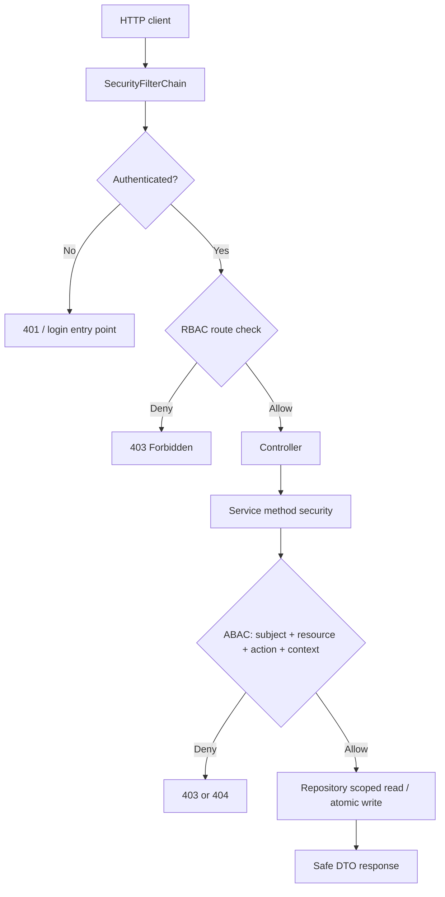

# RBAC và ABAC: lựa chọn điều kiện phù hợp với ứng dụng

> **Môi trường:** Java 17+, Spring Boot 3.x, Spring Security 6.x trên Servlet stack (Spring MVC). Bài trình bày RBAC/ABAC từ khái niệm, cách chọn mô hình, nguồn thuộc tính đáng tin, bảo vệ HTTP/service đến kiểm thử positive/negative. Ví dụ dùng form HTTP Basic cho dễ thử, một kho tài liệu in-memory và `MockMvc`; password demo chỉ được dùng tại localhost. Kết quả code là **kỳ vọng** khi chạy dự án đúng cấu hình, không khẳng định đã biên dịch/thực thi ở môi trường tài liệu.

## 1. Bài toán: vì sao chỉ có role thường chưa đủ?

Giả sử một công ty có nhóm `VIEWER`, `MANAGER`, `AUDITOR` và API `POST /api/documents/{id}/approve`. `hasRole("MANAGER")` có thể đúng để giới hạn **ai được dùng chức năng duyệt**, nhưng một manager tại tenant `acme` có được duyệt tài liệu tenant `beta` không? Một tài liệu đã duyệt hoặc vượt hạn mức có được duyệt tiếp không? Người tạo tài liệu có được tự duyệt không?

Tất cả các câu hỏi sau role check đều cần **thuộc tính cụ thể của tài nguyên và hành động**. Nếu coi role MANAGER là quyền duyệt bất kỳ ID nào, ứng dụng có thể tạo horizontal privilege escalation hoặc vi phạm quy tắc separation of duties. Ngược lại, nếu tạo role riêng cho mọi kết hợp như `MANAGER_ACME_LIMIT_50000_DRAFT`, quyền sẽ trở thành rất khó bảo trì (*role explosion*).

Mục tiêu là hiểu **chọn điều kiện phù hợp**, không phải khẳng định ABAC “mạnh hơn” RBAC ở mọi hoàn cảnh. Đối với quyền đơn giản, RBAC dễ vận hành. Với tài nguyên có chủ sở hữu, tenant, hạn mức, phân loại hoặc trạng thái, ABAC trở nên cần thiết. Mô hình phổ biến là **RBAC ở lớp chức năng + ABAC tại quyết định truy cập dữ liệu cụ thể**.

## 2. RBAC là gì?

**RBAC** (*Role-Based Access Control*) liên kết user với roles, roles với permissions. Một ma trận quyền chức năng:

| Role | Permissions ở mức chức năng |
|---|---|
| `VIEWER` | Được gọi API xem tài liệu thuộc phạm vi quyền |
| `MANAGER` | Được gọi API xem và đề nghị duyệt |
| `AUDITOR` | Được gọi API phục vụ kiểm toán trong phạm vi được giao |
| `ADMIN` | Quản lý tài khoản/role trong phạm vi đã cấp |

RBAC hỏi: **“Với role đã được xác minh, actor được dùng loại chức năng nào?”**

Trong Spring Security, nếu tạo user bằng `roles("MANAGER")`, authority thực tế thông thường là `ROLE_MANAGER`. Có thể cấu hình:

```java
.requestMatchers(HttpMethod.POST, "/api/documents/*/approve")
    .hasRole("MANAGER")
```

`hasRole("MANAGER")` với mặc định sẽ tìm authority `ROLE_MANAGER`. Trong khi đó `hasAuthority("ROLE_MANAGER")` so sánh tên authority cụ thể. Nếu hệ thống tùy biến role prefix, phải điều chỉnh các quy tắc cho nhất quán; không nhầm `hasRole("ROLE_MANAGER")` với `hasRole("MANAGER")` trong mặc định.

**Điểm mạnh:** RBAC dễ audit, cho phép cấp quyền qua một danh sách roles được quản lý tập trung, phù hợp với chức năng ổn định. **Giới hạn:** role đơn lẻ không chứng minh người gọi sở hữu record, thuộc tenant hợp lệ, đáp ứng hạn mức giao dịch hay có thể thực hiện thao tác trong trạng thái hiện tại. Một người có role `MANAGER` vẫn có thể chỉ quản lý **một** phòng ban.

### Role explosion xảy ra thế nào?

Thử mã hóa mọi yêu cầu bằng tên roles: `MANAGER_ACME`, `MANAGER_BETA`, `MANAGER_ACME_LIMIT_50000`, `MANAGER_ACME_DAYTIME`, `MANAGER_ACME_APPROVE_DRAFT`... Mỗi khi tenant, hạn mức hoặc trạng thái thay đổi, vai trò cần cập nhật liên tục. Người cấp quyền khó trả lời “tổ hợp roles này thực sự cho phép gì?”. Hãy để role biểu thị **năng lực công việc** và để dữ liệu nghiệp vụ/thuộc tính được đánh giá tại thời điểm quyết định.

## 3. ABAC là gì?

**ABAC** (*Attribute-Based Access Control*) đánh giá các thuộc tính và điều kiện:

- **Subject:** user ID, tenant membership, bộ phận, các authorities đã xác minh, MFA assurance, danh sách assignment.
- **Resource:** owner, tenant, classification, số tiền, trạng thái, quan hệ parent/child, thời điểm tạo.
- **Action:** read, approve, cancel, export, delete, changePermissions.
- **Environment:** thời gian theo clock đáng tin, security posture, sự kiện step-up gần đây, tín hiệu mạng qua proxy đã xác minh.

Một policy kết hợp RBAC và ABAC có thể biểu diễn:

```text
ALLOW approve IF
    subject has ROLE_MANAGER
AND subject.tenant == document.tenant
AND document.state == DRAFT
AND document.amountCents <= 50000
AND subject.username != document.owner
OTHERWISE DENY
```

`ROLE_MANAGER` là điều kiện RBAC; tenant, state, amount và owner là các điều kiện ABAC. Chúng được đánh giá cùng nhau tại thời điểm thực hiện.

ABAC mạnh ở **fine-grained policy** cho từng record và context, nhưng cần bảo đảm attributes đáng tin và được cập nhật. Một decision engine phức tạp không tự tốt hơn một điều kiện Java đơn giản, rõ ràng và có test.

### ABAC không có nghĩa tin header do client gửi

`X-Role: MANAGER`, `X-Tenant: acme`, `owner=alice`, `X-MFA: true` hoặc payload JWT **chưa verify chữ ký** đều không phải chứng cứ quyền. Các giá trị đó có thể do attacker đặt. Nguồn của subject attributes phải là `Authentication` đã xác thực và hệ thống quyền server-side; resource attributes phải lấy từ record mà server quản lý; context phải được xác định qua nguồn đáng tin. Trường thiếu, dữ liệu hỏng hoặc dịch vụ quyền lỗi thì **fail closed**.

Với JWT, một claim chỉ đáng tin sau khi xác thực signature/issuer/audience/algorithm/expiry theo policy; ngay cả khi được verify, claim về membership có thể đã stale nếu người dùng vừa bị thu hồi quyền.

## 4. Chọn RBAC, ABAC hay hybrid theo yêu cầu

| Nghiệp vụ | Điều kiện phù hợp |
|---|---|
| Chỉ người có `ROLE_OPS` dùng trang vận hành chung | **RBAC** có thể đủ |
| Chỉ `MANAGER` được mở chức năng duyệt | **RBAC**, nhưng chưa đủ với bản ghi cụ thể |
| User xem đơn hàng/tài liệu **do mình sở hữu** | **ABAC** owner + tenant |
| Manager duyệt invoice đúng tenant, còn DRAFT, dưới hạn mức | **Hybrid RBAC + ABAC** |
| Auditor đọc hồ sơ mức INTERNAL, không xem SENSITIVE | **Hybrid** role + classification |
| Support xem ticket được phân công | **Hybrid** role + assignment hiện hành |
| Từ chối export nếu thiếu MFA gần đây | **ABAC** môi trường/assurance, sau xác thực |
| Quản trị viên toàn cục thật sự được duyệt mọi tenant | **RBAC có thể đủ**, nếu global scope là policy được review |
| Tenant admin chỉ quản trị tenant mình | **Hybrid** admin role + tenant scope |

Lựa chọn thực dụng: **RBAC ở HTTP** cho loại chức năng, **ABAC ở service/domain** cho record và action, **DB query/update có scope** để duy trì quyền khi dữ liệu thay đổi. Nếu không có thuộc tính bổ sung và role cho phép toàn bộ phạm vi đó, đừng xây một policy engine chỉ để làm phức tạp hệ thống.

## 5. Mô hình thực thi trên Spring Security Servlet

`authorizeHttpRequests` sử dụng `SecurityFilterChain` để kiểm tra authentication, role và tuyến URL/HTTP method. Khi request đi qua lớp này, Spring MVC controller mới gọi service. Method security với `@EnableMethodSecurity` và `@PreAuthorize` có thể chặn lời gọi service qua Spring proxy. Đối với object-level conditions, service hoặc policy bean phải lấy tài nguyên và các attributes thực rồi quyết định.



Các trường hợp thường gây nhầm:

- `authenticated()` chỉ xác nhận có danh tính, **không** bảo vệ mọi tài liệu có ID từ request.
- `hasRole("MANAGER")` không chứng minh manager có đúng tenant/limit.
- `@PreAuthorize` được Spring AOP áp dụng khi lời gọi đi qua bean proxy; tự gọi `this.method()` trong cùng bean có thể bypass annotation. Đặt điều kiện nghiệp vụ cốt lõi bên trong service/policy và test boundary.
- Filter HTTP không tự bảo vệ đường vào service từ scheduler, queue consumer hoặc batch job. Những luồng đó cũng phải áp đúng policy với một trusted actor context.
- DTO giới hạn field trả ra; một user được phép đọc record không có nghĩa họ được thấy secret/PII trong entity.

## 6. Scenario: phê duyệt tài liệu theo tenant và hạn mức

Dự án minh họa có roles `VIEWER`, `MANAGER`, `AUDITOR`.

| Người dùng | Role | Tenant | Quyền đọc |
|---|---|---|---|
| `alice` | VIEWER | acme | Chỉ tài liệu do Alice tạo |
| `bob` | VIEWER | acme | Chỉ tài liệu do Bob tạo |
| `carol` | VIEWER | beta | Chỉ tài liệu do Carol tạo |
| `mai` | MANAGER | acme | Mọi tài liệu tenant acme |
| `minh` | MANAGER | beta | Mọi tài liệu tenant beta |
| `an` | AUDITOR | acme | Chỉ tài liệu INTERNAL tại acme |

Dữ liệu mẫu do server quản lý:

| ID | Tenant | Owner | State | Amount (cents) | Classification |
|---|---|---|---|---:|---|
| 100 | acme | alice | DRAFT | 30000 | INTERNAL |
| 101 | acme | bob | DRAFT | 80000 | SENSITIVE |
| 102 | acme | bob | APPROVED | 20000 | INTERNAL |
| 200 | beta | carol | DRAFT | 15000 | INTERNAL |
| 201 | beta | carol | DRAFT | 25000 | SENSITIVE |

**Read policy:** tài liệu phải thuộc tenant của actor. `VIEWER` chỉ đọc tài liệu do mình sở hữu, `MANAGER` đọc tài liệu trong tenant và `AUDITOR` chỉ đọc tài liệu classification INTERNAL trong tenant. Không có điều kiện phù hợp → **404** theo policy che giấu sự tồn tại.

**Approve policy:** caller có role MANAGER; tenant đúng; document còn DRAFT; amount ≤ 50000; owner khác người duyệt. State sai → 409, hạn mức/self-approval sai → 403, khác tenant hoặc ID không tồn tại → 404. Đây là lựa chọn minh họa, không phải luật chung cho mọi doanh nghiệp.

## 7. Tạo Spring Boot 3.x project Java 17+

Chọn trong Spring Initializr: Java 17+, Spring Boot 3.x, Gradle Groovy, dependencies Spring Web, Spring Security, Spring Boot Starter Test, Spring Security Test.

Đoạn `dependencies` của `build.gradle`:

```groovy
dependencies {
    implementation 'org.springframework.boot:spring-boot-starter-web'
    implementation 'org.springframework.boot:spring-boot-starter-security'

    testImplementation 'org.springframework.boot:spring-boot-starter-test'
    testImplementation 'org.springframework.security:spring-security-test'
}
```

Đây chỉ là một **khối**; plugins, repositories, versions và Gradle wrapper được Initializr tạo. Các file cần bổ sung:

```text
src/main/java/com/example/rbacabac/
    AccessModelApplication.java
    SecurityConfig.java
    DocumentService.java
    DocumentController.java
src/test/java/com/example/rbacabac/
    RbacAbacAuthorizationTest.java
```

### 7.1. Ứng dụng chính

**`src/main/java/com/example/rbacabac/AccessModelApplication.java`**

```java
package com.example.rbacabac;

import org.springframework.boot.SpringApplication;
import org.springframework.boot.autoconfigure.SpringBootApplication;

@SpringBootApplication
public class AccessModelApplication {
    public static void main(String[] args) {
        SpringApplication.run(AccessModelApplication.class, args);
    }
}
```

### 7.2. RBAC ở SecurityFilterChain và method security

**`src/main/java/com/example/rbacabac/SecurityConfig.java`**

```java
package com.example.rbacabac;

import jakarta.servlet.DispatcherType;

import org.springframework.context.annotation.Bean;
import org.springframework.context.annotation.Configuration;
import org.springframework.http.HttpMethod;
import org.springframework.security.config.Customizer;
import org.springframework.security.config.annotation.method.configuration.EnableMethodSecurity;
import org.springframework.security.config.annotation.web.builders.HttpSecurity;
import org.springframework.security.core.userdetails.User;
import org.springframework.security.core.userdetails.UserDetailsService;
import org.springframework.security.crypto.factory.PasswordEncoderFactories;
import org.springframework.security.crypto.password.PasswordEncoder;
import org.springframework.security.provisioning.InMemoryUserDetailsManager;
import org.springframework.security.web.SecurityFilterChain;

@Configuration
@EnableMethodSecurity
public class SecurityConfig {

    @Bean
    PasswordEncoder passwordEncoder() {
        return PasswordEncoderFactories.createDelegatingPasswordEncoder();
    }

    @Bean
    UserDetailsService users(PasswordEncoder encoder) {
        return new InMemoryUserDetailsManager(
                User.withUsername("alice")
                    .password(encoder.encode("alice-pass"))
                    .roles("VIEWER").build(),
                User.withUsername("bob")
                    .password(encoder.encode("bob-pass"))
                    .roles("VIEWER").build(),
                User.withUsername("carol")
                    .password(encoder.encode("carol-pass"))
                    .roles("VIEWER").build(),
                User.withUsername("mai")
                    .password(encoder.encode("mai-pass"))
                    .roles("MANAGER").build(),
                User.withUsername("minh")
                    .password(encoder.encode("minh-pass"))
                    .roles("MANAGER").build(),
                User.withUsername("an")
                    .password(encoder.encode("an-pass"))
                    .roles("AUDITOR").build()
        );
    }

    @Bean
    SecurityFilterChain securityFilterChain(HttpSecurity http)
            throws Exception {
        return http
                .authorizeHttpRequests(auth -> auth
                    // Cho phép Servlet error dispatch xử lý lỗi 404/409.
                    .dispatcherTypeMatchers(DispatcherType.ERROR).permitAll()
                    .requestMatchers(HttpMethod.POST,
                            "/api/documents/*/approve")
                        .hasRole("MANAGER")
                    .requestMatchers(HttpMethod.GET,
                            "/api/documents", "/api/documents/*")
                        .authenticated()
                    .anyRequest().denyAll()
                )
                .httpBasic(Customizer.withDefaults())
                // CSRF vẫn bật: POST cần CSRF token khi thích hợp.
                .build();
    }
}
```

`.hasRole("MANAGER")` là **RBAC coarse-grained**: người VIEWER/AUDITOR không được gọi chức năng duyệt. `.authenticated()` ở GET chỉ yêu cầu danh tính hợp lệ; service phải kiểm tra tenant, owner/classification. `.anyRequest().denyAll()` giúp tránh public-by-default. `@EnableMethodSecurity` bật `@PreAuthorize` bảo vệ service method.

Dùng HTTP Basic trong lab để có request độc lập và dễ kiểm thử. Base64 không bảo vệ password — ngoài localhost phải dùng HTTPS. CSRF không được tắt: trong browser có credentials/cookies, CSRF phải được đánh giá nghiêm túc; ở tests POST dùng `with(csrf())` để đánh giá đúng RBAC/ABAC thay vì bị 403 bởi CSRF trước.

### 7.3. DocumentService: ABAC từ nguồn tin cậy

**`src/main/java/com/example/rbacabac/DocumentService.java`**

```java
package com.example.rbacabac;

import java.util.Comparator;
import java.util.List;
import java.util.Map;
import java.util.Set;
import java.util.concurrent.ConcurrentHashMap;
import java.util.stream.Collectors;

import org.springframework.http.HttpStatus;
import org.springframework.security.access.prepost.PreAuthorize;
import org.springframework.security.authentication.AnonymousAuthenticationToken;
import org.springframework.security.core.Authentication;
import org.springframework.security.core.GrantedAuthority;
import org.springframework.security.core.context.SecurityContextHolder;
import org.springframework.stereotype.Service;
import org.springframework.web.server.ResponseStatusException;

@Service
public class DocumentService {

    private record Subject(
            String username, String tenant, Set<String> authorities) {
        boolean hasRole(String role) {
            return authorities.contains("ROLE_" + role);
        }
    }

    private record Document(
            long id, String tenant, String owner,
            String state, long amountCents, String classification) {}

    // DTO công khai, không expose toàn bộ Document.
    public record DocumentView(
            long id, String state, long amountCents) {}

    // Demo: membership server-side đáng tin, không lấy từ request.
    private final Map<String, String> tenantByUsername = Map.of(
            "alice", "acme", "bob", "acme", "carol", "beta",
            "mai", "acme", "minh", "beta", "an", "acme"
    );

    private final ConcurrentHashMap<Long, Document> documents =
            new ConcurrentHashMap<>(Map.of(
                100L, new Document(
                        100, "acme", "alice", "DRAFT", 30000, "INTERNAL"),
                101L, new Document(
                        101, "acme", "bob", "DRAFT", 80000, "SENSITIVE"),
                102L, new Document(
                        102, "acme", "bob", "APPROVED", 20000, "INTERNAL"),
                200L, new Document(
                        200, "beta", "carol", "DRAFT", 15000, "INTERNAL"),
                201L, new Document(
                        201, "beta", "carol", "DRAFT", 25000, "SENSITIVE")
            ));

    private Subject subject() {
        Authentication auth =
                SecurityContextHolder.getContext().getAuthentication();

        if (auth == null || !auth.isAuthenticated()
                || auth instanceof AnonymousAuthenticationToken) {
            throw new ResponseStatusException(HttpStatus.FORBIDDEN);
        }

        String tenant = tenantByUsername.get(auth.getName());
        if (tenant == null) {
            throw new ResponseStatusException(HttpStatus.FORBIDDEN);
        }

        Set<String> authorities = auth.getAuthorities().stream()
                .map(GrantedAuthority::getAuthority)
                .collect(Collectors.toUnmodifiableSet());

        return new Subject(auth.getName(), tenant, authorities);
    }

    private boolean canRead(Subject s, Document d) {
        if (d == null || !s.tenant().equals(d.tenant())) {
            return false;
        }
        if (s.hasRole("MANAGER")) {
            return true;
        }
        if (s.hasRole("AUDITOR")
                && "INTERNAL".equals(d.classification())) {
            return true;
        }
        return s.hasRole("VIEWER") && s.username().equals(d.owner());
    }

    private static ResponseStatusException notVisible() {
        return new ResponseStatusException(HttpStatus.NOT_FOUND);
    }

    private static DocumentView toView(Document d) {
        return new DocumentView(d.id(), d.state(), d.amountCents());
    }

    public DocumentView read(long id) {
        Subject s = subject();
        Document d = documents.get(id);
        if (!canRead(s, d)) {
            throw notVisible();
        }
        return toView(d);
    }

    public List<DocumentView> listVisible() {
        Subject s = subject();
        return documents.values().stream()
                .filter(d -> canRead(s, d))
                .sorted(Comparator.comparingLong(Document::id))
                .map(DocumentService::toView)
                .toList();
    }

    @PreAuthorize("hasRole('MANAGER')")
    public DocumentView approve(long id) {
        Subject s = subject();

        // Atomic cho mỗi id trong một ConcurrentHashMap/JVM.
        Document updated = documents.compute(id, (key, old) -> {
            if (old == null || !s.tenant().equals(old.tenant())) {
                throw notVisible();
            }
            if (!s.hasRole("MANAGER")) {
                throw new ResponseStatusException(HttpStatus.FORBIDDEN);
            }
            if (!"DRAFT".equals(old.state())) {
                throw new ResponseStatusException(HttpStatus.CONFLICT);
            }
            if (old.amountCents() > 50000
                    || s.username().equals(old.owner())) {
                throw new ResponseStatusException(HttpStatus.FORBIDDEN);
            }
            return new Document(
                    old.id(), old.tenant(), old.owner(),
                    "APPROVED", old.amountCents(), old.classification());
        });

        return toView(updated);
    }
}
```

Đọc chính sách trong service:

1. `subject()` lấy principal và authorities từ `SecurityContext`, tra tenant membership ở directory do server kiểm soát. Nếu authentication/tenant không hợp lệ, **deny**.
2. `canRead` kiểm tra tenant trước, rồi mới role và resource classification/owner. Same tenant chưa đủ với VIEWER; có role AUDITOR cũng chưa được xem SENSITIVE.
3. `listVisible` lọc **từng tài liệu** trước khi trả DTO, để list/search không lộ tài liệu mà detail endpoint đã chặn.
4. `approve` có `@PreAuthorize("hasRole('MANAGER')")` để bảo vệ method qua proxy, nhưng còn kiểm tra role và resource state/amount/tenant/owner trong operation.
5. `documents.compute` tránh race giữa check và update cho **một key trong một JVM**. Trong production, cần DB transaction/conditional UPDATE/optimistic locking và policy versioning.
6. `DocumentView` chỉ chứa `id/state/amountCents`; ứng dụng thật phải đánh giá field-level policy riêng, đừng expose raw JPA entity chứa PII, tokens hoặc internal notes.
7. Không một attribute nào trong quyết định được gán từ `X-Role`, `X-Tenant` hoặc payload data do client tự chọn.

**Giới hạn kỹ thuật:** Dự án này dùng dữ liệu in-memory và Spring proxy method security. `this.approve()` từ chính class có thể bỏ qua `@PreAuthorize`; một entry point nội bộ phải gọi service qua bean đúng cách và không tạo SecurityContext giả. Các quy tắc nghiệp vụ sống tại service nhằm bảo vệ cả use-case ngoài HTTP.

### 7.4. Controller mỏng

**`src/main/java/com/example/rbacabac/DocumentController.java`**

```java
package com.example.rbacabac;

import java.util.List;

import org.springframework.web.bind.annotation.GetMapping;
import org.springframework.web.bind.annotation.PathVariable;
import org.springframework.web.bind.annotation.PostMapping;
import org.springframework.web.bind.annotation.RestController;

@RestController
public class DocumentController {
    private final DocumentService service;

    public DocumentController(DocumentService service) {
        this.service = service;
    }

    @GetMapping("/api/documents")
    public List<DocumentService.DocumentView> list() {
        return service.listVisible();
    }

    @GetMapping("/api/documents/{id}")
    public DocumentService.DocumentView detail(
            @PathVariable long id) {
        return service.read(id);
    }

    @PostMapping("/api/documents/{id}/approve")
    public DocumentService.DocumentView approve(
            @PathVariable long id) {
        return service.approve(id);
    }
}
```

Controller chỉ xử lý mapping, không nhận role/owner/tenant để làm nguồn quyền. Mọi policy đọc/duyệt được thực thi ở `DocumentService` và phương thức có `@PreAuthorize`. Việc frontend ẩn nút “Duyệt” chỉ cải thiện UX, **không** thay thế policy ở server.

## 8. Chạy thử: 200, 401, 403, 404, 409 khác nhau

Trong root Gradle project:

```bash
# Linux / macOS
./gradlew bootRun

# Windows PowerShell
.\gradlew.bat bootRun
```

Port mặc định là `http://localhost:8080`, nếu không đổi `server.port`. Trên một số Windows PowerShell dùng `curl.exe` thay vì alias `curl`. Các password chỉ dành cho localhost; production bắt buộc HTTPS.

### Anonymous không được qua authentication

```bash
curl -i http://localhost:8080/api/documents/100
```

**Kỳ vọng:** 401 với `WWW-Authenticate` Basic challenge. Chưa tới logic ABAC trong service.

### Người có role VIEWER: vẫn kiểm tra owner và tenant

```bash
curl -i -u alice:alice-pass http://localhost:8080/api/documents/100
curl -i -u bob:bob-pass http://localhost:8080/api/documents/100
curl -i -u carol:carol-pass http://localhost:8080/api/documents/100
```

**Kỳ vọng:** Alice 200 và JSON tài liệu 100; Bob cùng tenant acme nhưng không phải owner → 404; Carol khác tenant beta → 404.

```json
{"id":100,"state":"DRAFT","amountCents":30000}
```

### MANAGER và AUDITOR vẫn bị giới hạn theo ABAC

```bash
curl -i -u mai:mai-pass http://localhost:8080/api/documents/101
curl -i -u mai:mai-pass http://localhost:8080/api/documents/200
curl -i -u an:an-pass http://localhost:8080/api/documents/100
curl -i -u an:an-pass http://localhost:8080/api/documents/101
```

**Kỳ vọng:** Mai đọc SENSITIVE 101 ở acme → 200, Mai đọc 200 ở beta → 404. An đọc INTERNAL 100 → 200, nhưng SENSITIVE 101 → 404. Đó là các điều kiện tenant/classification, không chỉ role.

### Spoof headers không mở quyền

```bash
curl -i -u bob:bob-pass \
  -H 'X-Role: MANAGER' -H 'X-Tenant: acme' \
  http://localhost:8080/api/documents/100
```

**Kỳ vọng:** 404. Trường trong request là dữ liệu chưa tin cậy; server vẫn nhìn principal Bob và owner Alice.

### Vì sao POST thiếu CSRF có thể trả 403 trước ABAC?

```bash
curl -i -u mai:mai-pass -X POST \
  http://localhost:8080/api/documents/100/approve
```

**Kỳ vọng:** 403 do CSRF khi không gửi token hợp lệ, **không chứng minh** Mai thiếu điều kiện duyệt. Trong test dùng `with(csrf())` để cô lập policy. Với browser app sử dụng cookies/Basic, đừng tắt CSRF bừa; với API Bearer stateless có thể có threat model riêng.

## 9. MockMvc: bắt buộc kiểm chứng các cases DENY

**`src/test/java/com/example/rbacabac/RbacAbacAuthorizationTest.java`**

```java
package com.example.rbacabac;

import org.junit.jupiter.api.Test;
import org.springframework.beans.factory.annotation.Autowired;
import org.springframework.boot.test.autoconfigure.web.servlet.AutoConfigureMockMvc;
import org.springframework.boot.test.context.SpringBootTest;
import org.springframework.http.HttpHeaders;
import org.springframework.test.web.servlet.MockMvc;

import static org.springframework.security.test.web.servlet.request.SecurityMockMvcRequestPostProcessors.csrf;
import static org.springframework.security.test.web.servlet.request.SecurityMockMvcRequestPostProcessors.httpBasic;
import static org.springframework.test.web.servlet.request.MockMvcRequestBuilders.get;
import static org.springframework.test.web.servlet.request.MockMvcRequestBuilders.post;
import static org.springframework.test.web.servlet.result.MockMvcResultMatchers.header;
import static org.springframework.test.web.servlet.result.MockMvcResultMatchers.jsonPath;
import static org.springframework.test.web.servlet.result.MockMvcResultMatchers.status;

@SpringBootTest
@AutoConfigureMockMvc
class RbacAbacAuthorizationTest {

    @Autowired
    MockMvc mvc;

    @Test
    void anonymousDoesNotEnterBusinessPolicy() throws Exception {
        mvc.perform(get("/api/documents/100"))
                .andExpect(status().isUnauthorized())
                .andExpect(header().exists(HttpHeaders.WWW_AUTHENTICATE));
    }

    @Test
    void viewerCanReadOwnDocument() throws Exception {
        mvc.perform(get("/api/documents/100")
                    .with(httpBasic("alice", "alice-pass")))
                .andExpect(status().isOk())
                .andExpect(jsonPath("$.id").value(100));
    }

    @Test
    void viewerCannotReadOtherOwnerInSameTenant() throws Exception {
        mvc.perform(get("/api/documents/100")
                    .with(httpBasic("bob", "bob-pass")))
                .andExpect(status().isNotFound());
    }

    @Test
    void viewerCannotReadOtherTenant() throws Exception {
        mvc.perform(get("/api/documents/100")
                    .with(httpBasic("carol", "carol-pass")))
                .andExpect(status().isNotFound());
    }

    @Test
    void forgedHeadersAreNotAuthoritative() throws Exception {
        mvc.perform(get("/api/documents/100")
                    .with(httpBasic("bob", "bob-pass"))
                    .header("X-Role", "MANAGER")
                    .header("X-Tenant", "acme"))
                .andExpect(status().isNotFound());
    }

    @Test
    void listIsFilteredByPrincipal() throws Exception {
        mvc.perform(get("/api/documents")
                    .with(httpBasic("alice", "alice-pass")))
                .andExpect(status().isOk())
                .andExpect(jsonPath("$.length()").value(1))
                .andExpect(jsonPath("$[0].id").value(100));

        mvc.perform(get("/api/documents")
                    .with(httpBasic("bob", "bob-pass")))
                .andExpect(status().isOk())
                .andExpect(jsonPath("$.length()").value(2))
                .andExpect(jsonPath("$[0].id").value(101))
                .andExpect(jsonPath("$[1].id").value(102));
    }

    @Test
    void managerReadsSensitiveOnlyInOwnTenant() throws Exception {
        mvc.perform(get("/api/documents/101")
                    .with(httpBasic("mai", "mai-pass")))
                .andExpect(status().isOk());

        mvc.perform(get("/api/documents/200")
                    .with(httpBasic("mai", "mai-pass")))
                .andExpect(status().isNotFound());
    }

    @Test
    void auditorReadsInternalButNotSensitive() throws Exception {
        mvc.perform(get("/api/documents/100")
                    .with(httpBasic("an", "an-pass")))
                .andExpect(status().isOk());

        mvc.perform(get("/api/documents/101")
                    .with(httpBasic("an", "an-pass")))
                .andExpect(status().isNotFound());
    }

    @Test
    void postWithoutCsrfIsRejectedAtFilter() throws Exception {
        mvc.perform(post("/api/documents/100/approve")
                    .with(httpBasic("mai", "mai-pass")))
                .andExpect(status().isForbidden());
    }

    @Test
    void viewerCannotApproveEvenWithCsrf() throws Exception {
        mvc.perform(post("/api/documents/100/approve")
                    .with(httpBasic("alice", "alice-pass"))
                    .with(csrf()))
                .andExpect(status().isForbidden());
    }

    @Test
    void auditorCannotApprove() throws Exception {
        mvc.perform(post("/api/documents/100/approve")
                    .with(httpBasic("an", "an-pass"))
                    .with(csrf()))
                .andExpect(status().isForbidden());
    }

    @Test
    void managerCannotApproveOutsideTenant() throws Exception {
        mvc.perform(post("/api/documents/200/approve")
                    .with(httpBasic("mai", "mai-pass"))
                    .with(csrf()))
                .andExpect(status().isNotFound());
    }

    @Test
    void managerCannotApproveOverAmountLimit() throws Exception {
        mvc.perform(post("/api/documents/101/approve")
                    .with(httpBasic("mai", "mai-pass"))
                    .with(csrf()))
                .andExpect(status().isForbidden());
    }

    @Test
    void managerCannotApproveAlreadyApprovedRecord() throws Exception {
        mvc.perform(post("/api/documents/102/approve")
                    .with(httpBasic("mai", "mai-pass"))
                    .with(csrf()))
                .andExpect(status().isConflict());
    }

    @Test
    void managerCanApproveEligibleRecord() throws Exception {
        mvc.perform(post("/api/documents/100/approve")
                    .with(httpBasic("mai", "mai-pass"))
                    .with(csrf()))
                .andExpect(status().isOk())
                .andExpect(jsonPath("$.id").value(100))
                .andExpect(jsonPath("$.state").value("APPROVED"));
    }

    @Test
    void unknownDocumentIsNotVisible() throws Exception {
        mvc.perform(get("/api/documents/999")
                    .with(httpBasic("alice", "alice-pass")))
                .andExpect(status().isNotFound());
    }
}
```

Chạy:

```bash
# macOS / Linux
./gradlew test

# Windows PowerShell
.\gradlew.bat test
```

**Kết quả mong đợi:** 16 tests PASS khi project đúng như các file minh họa, không phải kết quả đã thực thi sẵn. Một test thay state document 100 sang APPROVED; các test còn lại không phụ thuộc trạng thái đó, chỉ xem ID hoặc dùng record khác để thử state. Khi mở rộng test suite, nên reset fixtures/transaction giữa các tests để tránh phụ thuộc thứ tự chạy.

Test không chỉ chứng minh đường thành công (Alice 200, Mai approve 200), mà chứng minh **same tenant khác owner**, **cross tenant**, **classification**, **hạn mức**, **state**, **role**, **header giả**, **thiếu CSRF** và **danh sách** đều không cho quyền ngoài policy.

## 10. Ma trận quyết định mong đợi

| Hành động | Role / actor | ABAC condition | HTTP status |
|---|---|---|---|
| GET document 100 | anonymous | Không authentication | **401** |
| GET document 100 | Alice VIEWER | acme + owner Alice | **200** |
| GET document 100 | Bob VIEWER | Cùng tenant, khác owner | **404** |
| GET document 100 | Carol VIEWER | Khác tenant | **404** |
| GET document 101 | Mai MANAGER | Cùng tenant, được xem SENSITIVE | **200** |
| GET document 200 | Mai MANAGER | Tenant beta khác acme | **404** |
| GET document 100 | An AUDITOR | Classification INTERNAL | **200** |
| GET document 101 | An AUDITOR | SENSITIVE không được phép | **404** |
| POST approve 100 | Alice VIEWER | Thiếu role MANAGER | **403** |
| POST approve 100 | Mai MANAGER, thiếu CSRF | Filter chặn trước service | **403** |
| POST approve 101 | Mai MANAGER + CSRF | amount 80000 > 50000 | **403** |
| POST approve 102 | Mai MANAGER + CSRF | State APPROVED | **409** |
| POST approve 200 | Mai MANAGER + CSRF | Khác tenant | **404** |
| POST approve 100 | Mai MANAGER + CSRF | DRAFT, 30000, acme | **200** + APPROVED |

Phản hồi 403 không nhất thiết là do RBAC: nó có thể đến từ CSRF hoặc điều kiện ABAC. **404 thay vì 403** với dữ liệu ngoài phạm vi là lựa chọn che giấu sự tồn tại; một hệ thống khác có thể dùng 403 nếu threat model cho phép. Trong audit nội bộ vẫn cần biết deny reason nhưng response công khai không làm lộ thông tin nhạy cảm.

## 11. ABAC ở production: thiết kế policy dễ thay đổi

### 11.1. Chia PEP, PDP, PIP theo quy mô

Có thể dùng tư duy:

- **Policy Enforcement Point (PEP):** nơi chặn/cho qua, như HTTP filter, method interceptor, service boundary.
- **Policy Decision Point (PDP):** nơi quyết định ALLOW/DENY theo subject/action/resource/context; có thể chỉ là một Java bean.
- **Policy Information Point (PIP):** nơi lấy thuộc tính đáng tin: membership DB, identity directory, resource metadata, risk engine.
- **Policy Administration Point (PAP):** nơi quản lý policy version, review, audit và người được sửa policy.

Một ứng dụng nhỏ có thể triển khai PDP bằng một class Java được test tốt; không nhất thiết đưa request qua một policy service phân tán. Nếu service phải gọi policy engine qua network, cần tính latency, timeout, cache và **fail closed** khi thiếu quyết định tin cậy.

### 11.2. Tránh chỉ bảo vệ ở controller

Controller có thể được gọi qua REST, nhưng logic nghiệp vụ còn có thể từ worker, message queue, scheduled job hoặc GraphQL. Nếu check tenant ở một controller còn service `findById`/`save` vô điều kiện, một entry point mới có thể bypass. Đặt policy ở service/domain boundary và, với dữ liệu quan trọng, scope query ở DB. Dùng DTO đầu vào để tránh mass assignment vào `owner`, `tenant`, `classification` hoặc `approved`.

### 11.3. Method-security expression là công cụ, không tự quyết định policy

Ví dụ là **snippet**, chưa runnable độc lập nếu thiếu bean `documentPolicy`:

```java
@PreAuthorize("@documentPolicy.canRead(authentication, #id)")
public DocumentView read(long id) {
    // Service vẫn phải load record theo scope và tạo DTO an toàn.
}
```

Cần `@EnableMethodSecurity`, bean `documentPolicy` với method tương thích, parameter names có thể resolve, và performance/transaction policy. Kiểm tra Spring AOP proxy/self-invocation; annotation chưa giải quyết TOCTOU khi record thay đổi sau check. Với nhiều roles, cũng cần định nghĩa rõ **deny-overrides** hay **allow-union**; demo cho MANAGER ưu tiên xem tài liệu trong tenant, không phải mặc định đúng cho mọi doanh nghiệp.

## 12. Scoped database query và TOCTOU

Với database thật, không nên chỉ dùng `repository.findById(id)` rồi trả entity nếu người gọi không có quyền. Đẩy scope của principal/tenant vào query:

```sql
SELECT id, state, amount_cents
FROM documents
WHERE id = :documentId
  AND tenant_id = :trustedTenant
  AND owner_id = :trustedOwner;
```

Ví dụ riêng cho VIEWER; manager/auditor có thể cần query khác theo policy, nhưng **trustedTenant/Owner** phải được server tính từ principal đã xác minh. Dữ liệu list, search, export, counts và pagination đều phải áp scope tương đương.

Đối với approve, check tenant/hạn mức/state rồi update theo ID ở một transaction khác có thể tạo **time-of-check/time-of-use (TOCTOU)**. Dùng conditional update + version:

```sql
UPDATE documents
SET state = 'APPROVED',
    version = version + 1
WHERE id = :documentId
  AND tenant_id = :trustedTenant
  AND state = 'DRAFT'
  AND amount_cents <= :approvedLimit
  AND owner_id <> :trustedApprover
  AND version = :expectedVersion;
```

Chỉ khi số hàng cập nhật bằng 1 mới coi là thành công. Số hàng 0 có thể do record không tồn tại, khác tenant, quá hạn mức, state đã đổi hoặc version xung đột; service ánh xạ lỗi không tiết lộ dữ liệu ngoài phạm vi. Với tài chính, còn cần transaction, audit, idempotency và state machine.

**Row Level Security** tại database có thể bổ sung an toàn nhưng phải đặt/reset actor/tenant context đúng khi dùng connection pool và không sử dụng DB role bypass RLS. Nó không loại bỏ HTTP authentication hay service-level policy.

## 13. Thuộc tính động và ranh giới tin cậy

### 13.1. Subject claims có thể stale

`ROLE_MANAGER` hoặc tenant membership trong JWT/session có thể bị giữ sau khi quyền đã thu hồi. Cần xác định thời điểm yêu cầu fresh permission (đặc biệt cho approve/delete/export), thời hạn token/session, policy version và cơ chế invalidate cache khi thay đổi quyền. Signature hợp lệ **không chứng minh** mọi quyền hiện tại vẫn đúng.

### 13.2. Attribute từ request có thể là selector, không phải quyền

Client có thể chọn `tenantId` trong URL để xác định tenant muốn xem; đó chỉ là **tenant mục tiêu**. Server phải kiểm tra principal thuộc tenant đó và tài liệu thật sự thuộc tenant. Client gửi `X-Role` không nâng role, `X-MFA` không chứng minh đã thực hiện MFA. Header forwarded IP chỉ đáng tin khi đến từ reverse proxy đã được kiểm soát và loại bỏ giá trị giả do client gửi.

### 13.3. Ngữ cảnh môi trường

Một policy có thể yêu cầu thời điểm trong giờ làm, MFA gần đây, độ tin cậy thiết bị hoặc network zone. Khi triển khai, dùng server clock/timezone chuẩn, assurance từ authentication đáng tin, risk signals được kiểm chứng. Nếu risk service không trả lời, quy định rõ fail-closed hoặc degrade cho từng loại action; không mặc định cho phép giao dịch nhạy cảm để tránh downtime.

### 13.4. Thay đổi attribute và cache

Cần version/invalidation nếu owner, tenant, classification hoặc role thay đổi. Shared cache chỉ dùng key `documentId` có thể phát lại response Mai đã được đọc cho Bob, dù service thường từ chối. Cache key phải có authorization scope, quyền hiện hành và TTL thích hợp; dữ liệu nhạy cảm thường cần `Cache-Control: private, no-store` hoặc không shared-cache.

### 13.5. Dữ liệu con và xuất dữ liệu hàng loạt

Có quyền project 10 không chứng minh file 200 thuộc project 10 khi client gửi `GET /projects/10/files/200`. Check mối quan hệ parent/child trong DB. Các endpoint list, export, search suggestions và aggregate counts cũng phải tuân cùng policy; nếu không, detail endpoint trả 404 nhưng endpoint khác vẫn lộ tên, số lượng hoặc bản ghi.

## 14. Lỗi hay gặp khi chọn RBAC/ABAC

| Triệu chứng | Nguyên nhân | Kiểm chứng/sửa |
|---|---|---|
| Manager của tenant A xem được tenant B | Chỉ `hasRole("MANAGER")`, không check tenant | Test cross-tenant 404; membership từ server |
| Viewer đọc record người khác | Chỉ `authenticated()`, thiếu owner check | Test cùng tenant khác owner |
| Auditor thấy tài liệu SENSITIVE | Chưa dùng classification hoặc dùng stale metadata | Test INTERNAL/SENSITIVE và thay đổi classification |
| Client thay `X-Role` là có quyền | Tin header chưa xác minh | Lấy role từ `Authentication` |
| POST trả 403, team cho rằng ABAC deny | Thiếu CSRF trước service | Test tách `with(csrf())` |
| Role names tăng quá nhanh | Cố nhét tenant/amount/state vào role | Tách functional roles và resource attributes |
| Method security không chạy | Thiếu `@EnableMethodSecurity` hoặc self-invocation | Test qua bean proxy và service boundary |
| Cùng record được duyệt hai lần | Check/update tách rời, race | Conditional UPDATE + version |
| Dữ liệu list/export lộ cross-tenant | Detail check nhưng query list không scope | Negative tests mọi data paths |
| Permission mới bị áp chậm | JWT/cache chứa claims cũ | TTL/revocation/fresh lookup |
| Cache trả record Alice cho Bob | Key không chứa principal/tenant scope | Bảo vệ cache/response |
| Auditor có nhiều roles được đọc quá rộng | Policy allow-union chưa review | Định nghĩa deny-overrides khi cần |
| Policy service timeout thì app cho qua | Fail-open | Fail closed cho action nhạy cảm |

## 15. Checklist đưa vào sản phẩm

1. Viết ma trận **actor–action–resource–context**, xác định trường hợp deny mặc định.
2. Gắn roles/permissions với chức năng rõ, nhất quán với authorities do identity provider xác minh.
3. Chỉ dùng RBAC khi quyền thực sự không phụ thuộc resource/tenant; thêm ABAC khi cần owner, assignment, amount, classification, state.
4. Không tin role, tenant, owner và MFA assertion do client tự khai; sử dụng nguồn dữ liệu có thẩm quyền.
5. Bảo vệ HTTP bằng `authorizeHttpRequests`, bảo vệ service bằng policy/method security, bảo vệ DB bằng query scope.
6. Không trả raw entity hoặc cho client mass assign owner/tenant/state; dùng DTO/phân quyền field.
7. Kiểm tra hiệu năng policy ABAC: N+1 queries, cache stale, timeout, policy engine availability.
8. Có transaction/locking/optimistic version khi viết; tránh TOCTOU trên record mutable.
9. Với multi-tenant, xác minh cả user membership và record tenant, không chỉ query parameter `tenantId`.
10. Kiểm thử **negative cases**: đúng role sai tenant, đúng tenant sai owner, quá hạn mức, state sai, classification, forged headers, missing CSRF.
11. Version policy, audit ALLOW/DENY, actor/action/resource type; không log passwords, cookies, tokens hoặc chi tiết PII không cần thiết.
12. Kiểm tra đường gọi không qua HTTP, background tasks, service self-invocation và gateway rewriting.
13. Rà soát role hierarchy, quyền admin toàn cục vs tenant admin, xung đột vai trò và separation of duties.
14. Khi đổi quyền/membership, lập kế hoạch refresh, revoke, invalidate sessions/tokens/cache cho các thao tác nhạy cảm.
15. Với user-facing UI, có thể hiển thị khả năng `canApprove` nhưng server vẫn là nơi quyết định cuối cùng.

## 16. Câu hỏi tự luyện

**1.** Mai có role MANAGER. Có được duyệt tài liệu 200 của beta không?  
**Đáp án:** Không; Mai chỉ được cấp tenant acme. Role là điều kiện cần, tenant ABAC không thỏa.

**2.** Bob và Alice cùng tenant acme và role VIEWER. Bob xem tài liệu 100 được không?  
**Đáp án:** Không; Alice sở hữu 100, Bob không sở hữu.

**3.** Vì sao An AUDITOR đọc 100 nhưng không đọc 101?  
**Đáp án:** Classification là thuộc tính resource, policy cho AUDITOR chỉ xem INTERNAL.

**4.** Một trang cấu hình OPS chỉ cho một nhóm nhỏ vào, không có tài nguyên theo người dùng. Có cần ABAC engine?  
**Đáp án:** Không nhất thiết. RBAC rõ ràng, được review và test có thể phù hợp.

**5.** MANAGER đúng tenant nhưng document đã APPROVED. Đây là lỗi authentication hay authorization/business state?  
**Đáp án:** Authentication có thể đúng; nghiệp vụ không cho approve lại, demo trả 409.

**6.** Có thể tin `X-Tenant` từ client như membership không?  
**Đáp án:** Không. Header chỉ có thể là selector; membership phải được xác minh theo principal.

**7.** Vì sao `@PreAuthorize` chưa đủ chống TOCTOU?  
**Đáp án:** Vì resource state/amount/tenant có thể đổi sau khi check; cần conditional update hoặc transaction/locking.

**8.** `hasRole("MANAGER")` có làm manager xem mọi tenant không?  
**Đáp án:** Không, trừ khi ứng dụng cố ý cấp global scope và enforce bằng policy phù hợp.

**9.** Test POST trả 403 khi thiếu CSRF đã chứng minh amount check hoạt động?  
**Đáp án:** Chưa. Phải cung cấp CSRF hợp lệ rồi test ABAC riêng.

**10.** Role trong JWT được ký hợp lệ nhưng vừa bị thu hồi ở DB. Phải xử lý gì?  
**Đáp án:** Tùy độ rủi ro cần fresh membership, token TTL/revocation, policy version và cache invalidation.

**11.** Có thể để UI ẩn nút “Approve” là đủ không?  
**Đáp án:** Không. Client có thể tự gửi request; policy phải ở server.

**12.** Dùng UUID ngẫu nhiên cho tài liệu có thể bỏ owner/tenant check không?  
**Đáp án:** Không. ID khó đoán không phải authorization.

## 17. Tổng kết

- **RBAC** trả lời “người dùng có quyền sử dụng chức năng nào”, dựa trên roles và permissions đã xác minh.
- **ABAC** trả lời “người đó có được thực hiện action này trên tài nguyên này, trong ngữ cảnh này không”, sử dụng subject/resource/action/environment attributes.
- Ứng dụng Spring Security Servlet thường dùng **hybrid**: `authorizeHttpRequests`/`hasRole` ở HTTP, `@PreAuthorize` khi cần ở method boundary và **service/domain policy** cho tenant, owner, state, amount và classification.
- Giá trị attribute chỉ đáng tin khi nguồn/chu kỳ cập nhật đã được xác minh; không dùng header hoặc JWT chưa kiểm chứng làm bằng chứng quyền.
- Thử nghiệm phải bao gồm **allow + deny**: same-tenant cross-owner, cross-tenant, over-limit, wrong state, forged headers, roles, CSRF, list filtering.
- Với database thật, kết hợp query scope, conditional writes, transactions/locking, DTO và kiểm soát stale memberships/cache.
- Tránh role explosion, ABAC overengineering, fail-open và coi role admin là quyền vượt mọi tenant mà không có policy.

**Nguyên tắc:** Role là cách phân nhóm chức năng; attributes là những giới hạn cụ thể. Chọn mức chi tiết nhỏ nhất **đủ để chứng minh** mỗi quyết định quyền truy cập mà vẫn có thể test, audit và bảo trì.