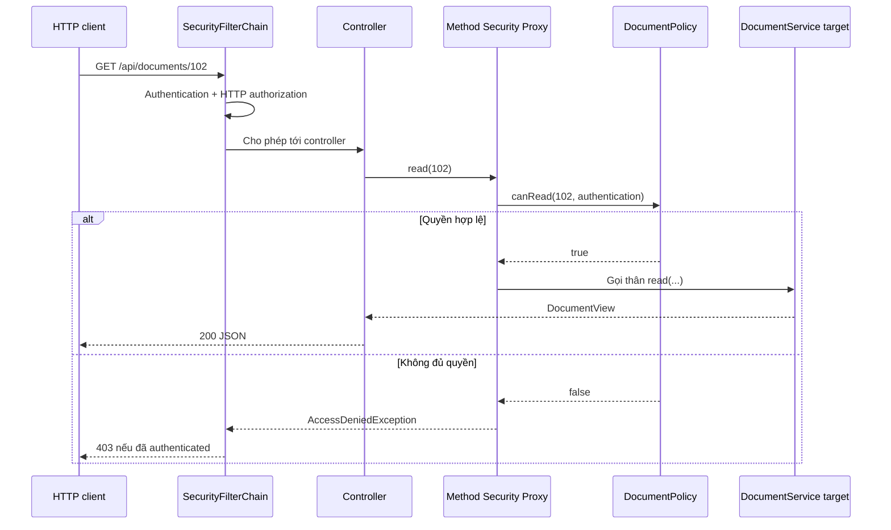

# `@PreAuthorize` và kiểm tra quyền trước khi gọi phương thức

**Module:** Spring Security – Servlet  
**Nhóm:** Bảo vệ phương thức (*Method Security*)  
**Ví dụ:** Java 17, Spring Boot 3.3.5, Spring Security 6.x, Spring MVC/Servlet.

## Mục tiêu

`authorizeHttpRequests` phân quyền ở HTTP layer: request nào được đi tới controller. `@PreAuthorize` phân quyền ở **method boundary**, thường đặt tại service: caller có được chạy một phương thức nghiệp vụ với các tham số cụ thể hay không. Nó đặc biệt hữu ích khi hai người cùng đăng nhập nhưng chỉ được truy cập **tài liệu của chính mình**.

Sau bài này, bạn có thể:

- Bật method security bằng `@EnableMethodSecurity`.
- Dùng `@PreAuthorize("hasRole('ADMIN')")`, `hasAuthority(...)`, `authentication`, tham số method và một policy bean trong SpEL.
- Hiểu vì sao kiểm tra **trước khi thân method chạy** khác với HTTP authentication, `@PostAuthorize`, hay kiểm tra controller sau khi đã có side effects.
- Dùng `@P("id")` để tham số SpEL có tên ổn định.
- Tránh self-invocation, `new` object, private/final method và lỗi AOP proxy.
- Đặt policy ownership tại service, tách dữ liệu do client cung cấp khỏi dữ liệu server tin cậy.
- Viết một project Spring Boot Java 17 với security tests chứng minh **người bị từ chối không khiến service method body chạy**.
- Xem xét `401`, `403`, transaction, CSRF và các vấn đề khi hệ thống có nhiều entrypoints.

**Thông điệp trọng tâm:** `@PreAuthorize` chỉ phát huy tác dụng khi lời gọi đi qua cơ chế method security của Spring. Nó không phải một lệnh Java chạy tự động khi chỉ nhìn thấy annotation.

## 1. Bảo vệ HTTP và bảo vệ method khác nhau thế nào?

Xét API đọc tài liệu:

```text
GET /api/documents/101   → owner: alice
GET /api/documents/102   → owner: bob
```

Trong một `SecurityFilterChain`, bạn có thể viết:

```java
http.authorizeHttpRequests(auth -> auth
        .requestMatchers(HttpMethod.GET, "/api/documents/{id}")
            .authenticated()
        .anyRequest().denyAll());
```

Đoạn này yêu cầu user **đã xác thực**. Nhưng nó không biết document 101 thuộc Alice, document 102 thuộc Bob. Nếu controller/service chỉ dùng `findById(id)` rồi trả dữ liệu, Bob có thể thử ID 101 để xem tài liệu của Alice. Đó là rủi ro IDOR/BOLA.

Phân quyền tại method:

```java
@PreAuthorize("@documentPolicy.canRead(#id, authentication)")
public DocumentView read(@P("id") long id) {
    return store.findById(id).orElseThrow();
}
```

Đây là **fragment**; class hoàn chỉnh ở phần 8. Trước khi thân `read(...)` chạy, method interceptor đánh giá biểu thức. Bean `documentPolicy` tra chủ sở hữu trong kho dữ liệu tin cậy và đối chiếu với `Authentication`. Nếu không cho phép, một access-denied exception được phát ra, thân `read` không chạy.



Sơ đồ mô tả quyết định quyền, không nhằm mô phỏng mọi filter/advisor theo đúng thứ tự thực thi nội bộ.

| Lớp | Phụ trách | Không tự giải quyết |
| --- | --- | --- |
| Authentication | Username/password, session, JWT hoặc identity provider xác minh danh tính | Tài liệu cụ thể thuộc về ai |
| HTTP authorization | Method/path/role ở `authorizeHttpRequests` | Ownership và quy tắc domain chi tiết |
| Method authorization | Quyền gọi public Spring bean method và dùng tham số/caller | Tất cả entrypoint không đi qua proxy |
| Transaction/data authorization | Invariant khi đọc/ghi DB, tenant và concurrency | Tự động cấu hình HTTP authentication |

Vì vậy `.authenticated()` có thể đi cùng `@PreAuthorize("@documentPolicy.canRead(...)")`: **không mâu thuẫn**, mà là hai lớp bổ trợ nhau.

## 2. Bật `@PreAuthorize`: `@EnableMethodSecurity`

Trong Spring Security 6, method security cần được bật tường minh:

```java
import org.springframework.context.annotation.Configuration;
import org.springframework.security.config.annotation.method.configuration.EnableMethodSecurity;

@Configuration
@EnableMethodSecurity
public class MethodSecurityConfiguration {
}
```

Đây là một class configuration độc lập có thể biên dịch trong project Spring Boot phù hợp. Ở project runnable phần 8, annotation được đặt trực tiếp trên class `SecurityConfig`, không phải tạo cả hai classes.

Cần nhớ:

- Có `spring-boot-starter-security` không có nghĩa mọi `@PreAuthorize` tự được bật khi chưa cấu hình method security.
- `@EnableMethodSecurity` hỗ trợ `@PreAuthorize`/`@PostAuthorize` thông qua method security infrastructure. Với Spring Security 6, `prePostEnabled` mặc định cho phép pre/post annotations.
- Cơ chế mặc định thường dùng Spring AOP proxies. Method cần được gọi **qua Spring-managed bean proxy**.
- Nếu tự `new DocumentService(...)` thay vì nhận bean do container cung cấp, không tự có method security advice.
- Nên đặt annotation ở public service method được caller bên ngoài bean thực sự gọi, không dựa vào private/final/self-invocation.
- Nếu có nhiều Spring contexts, custom proxy, Java/Kotlin final classes hoặc nhiều interfaces, kiểm thử đúng đường gọi ở runtime.

### 2.1. `@PreAuthorize` chạy trước điều gì?

Nó chạy **trước thân method được bảo vệ** khi lời gọi đã đi qua method interceptor. Nhưng điều đó **không có nghĩa** chưa có bất kỳ xử lý nào xảy ra:

1. Servlet filters có thể đã xác thực và xử lý security headers/CSRF.
2. MVC đã có thể match route, parse path variables và bind các tham số.
3. Controller có thể đã chạy code trước khi gọi service.
4. Biểu thức authorization có thể gọi policy bean truy vấn database.
5. Advisor khác như transaction, cache hoặc tracing có thể có thứ tự phụ thuộc cấu hình.

Do đó, nếu controller ghi dữ liệu rồi mới gọi method có `@PreAuthorize`, annotation không thể “đảo ngược” side effect trước đó. Đặt thao tác nhạy cảm **sau guard phù hợp**, ưu tiên ở business service và kết hợp data-layer checks khi cần.

## 3. SpEL thường dùng với `@PreAuthorize`

`@PreAuthorize` nhận một biểu thức Spring Expression Language (*SpEL*) viết bởi nhà phát triển.

| Biểu thức | Kết quả mong muốn | Lưu ý |
| --- | --- | --- |
| `hasRole('ADMIN')` | User có vai trò admin | Mặc định tìm authority `ROLE_ADMIN` |
| `hasAnyRole('USER','ADMIN')` | Có ít nhất một role phù hợp | Prefix mặc định `ROLE_` |
| `hasAuthority('SCOPE_documents.read')` | Có authority chính xác | Hữu ích với JWT/OAuth scopes khi converter tạo authority này |
| `hasAnyAuthority('DOC_READ','DOC_EDIT')` | Có một authority phù hợp | Không tự thêm prefix |
| `isAuthenticated()` | Caller không anonymous theo trust semantics | Remember-me có thể được tính là authenticated |
| `isFullyAuthenticated()` | Không anonymous và không remember-me | Không thay thế MFA hoặc “login trong 5 phút gần đây” |
| `#username == authentication.name` | So sánh tham số và identity hiện tại | Dùng dữ liệu canonical/trusted cho ownership |
| `@documentPolicy.canRead(#id, authentication)` | Gọi một Spring policy bean | Bean có thể tra owner, tenant, trạng thái record |

Ví dụ fragment:

```java
@PreAuthorize("hasRole('ADMIN')")
public String rebuildReport() {
    return "rebuild-ok";
}

@PreAuthorize("hasAuthority('DOC_READ')")
public String listDocuments() {
    return "list-ok";
}

@PreAuthorize("#username == authentication.name")
public String profile(@P("username") String username) {
    return username;
}
```

Các phương thức trên cần được đặt trong Spring-managed class và đi qua proxy; đây chỉ là minh họa biểu thức.

### 3.1. `hasRole` khác `hasAuthority`

Spring Security `User.withUsername(...).roles("ADMIN")` thường tạo `GrantedAuthority` tên `ROLE_ADMIN`. Do đó:

```text
roles("ADMIN")            → ROLE_ADMIN
hasRole('ADMIN')          → kiểm tra ROLE_ADMIN
hasAuthority('ROLE_ADMIN')→ kiểm tra chính xác ROLE_ADMIN
hasAuthority('ADMIN')     → không match ROLE_ADMIN mặc định
```

Nếu provider cấp authority `"ADMIN"` không có `ROLE_`, hãy chuẩn hóa authority naming hoặc dùng `hasAuthority('ADMIN')`. Không “sửa” một lỗi prefix bằng cách vô hiệu hóa method security. Với JWT, authorities có thể mang prefix `SCOPE_`; kiểm tra `JwtAuthenticationConverter`/mapper của hệ thống thật.

### 3.2. Tham số `#id` trong SpEL và `@P`

SpEL method security cần tìm đúng tên tham số. Java compiler có thể không lưu tên tham số nếu thiếu `-parameters` hoặc metadata thích hợp. Dùng annotation:

```java
import org.springframework.security.access.method.P;
import org.springframework.security.access.prepost.PreAuthorize;

@PreAuthorize("#username == authentication.name")
public String getProfile(@P("username") String username) {
    return username;
}
```

`@P("username")` cho phép policy tham chiếu `#username` một cách rõ ràng. Đừng tự tạo expression dựa trên request string rồi đánh giá như mã chương trình; expressions trong annotation là **chính sách do developer kiểm soát**.

### 3.3. Quyền sở hữu nên dựa trên dữ liệu server

Ví dụ nguy hiểm:

```java
// Không tin owner client gửi kèm request.
@PreAuthorize("#owner == authentication.name")
public void edit(long id, String owner) {
    // Nếu owner tự khai, guard có thể sai dù tên trùng.
}
```

Client có thể cố gửi owner của mình, dù record thực tế thuộc người khác. Đúng hướng là tra owner gắn với `id` từ repository tin cậy:

```java
@PreAuthorize("@documentPolicy.canRead(#id, authentication)")
public DocumentView read(@P("id") long id) {
    return store.findById(id).orElseThrow();
}
```

`@documentPolicy` tham chiếu **bean Spring có tên documentPolicy**; `authentication` là identity đã được xác minh qua security context. Có thể kiểm tra role/admin và ownership trong policy Java độc lập, dễ test hơn một SpEL dài.

## 4. Vì sao Spring AOP proxy là một phần của bảo mật?

Sơ đồ lời gọi:

```text
Controller → Spring AOP proxy(DocumentService)
               ├── đánh giá @PreAuthorize
               │    ├── allow → target DocumentService.read(...)
               │    └── deny  → AccessDeniedException
               └── không có quyền thì thân target không chạy
```

### 4.1. Self-invocation có thể bypass guard

Đây là **anti-pattern minh họa**, không phải source file của project runnable:

```java
@Service
class UnsafeService {
    @PreAuthorize("hasRole('ADMIN')")
    public String sensitive() {
        return "secret";
    }

    public String wrapper() {
        return this.sensitive(); // Không đi qua Spring proxy trong proxy mode.
    }
}
```

Nếu `wrapper()` được gọi qua proxy nhưng `wrapper` **không có guard**, câu lệnh `this.sensitive()` là internal Java call, nên có thể bypass advice của `sensitive()`. Hãy tách method nhạy cảm sang service khác được inject, hoặc đặt guard tại entrypoint thật sự / kiểm tra policy trực tiếp ở domain boundary.

### 4.2. Những tình huống khiến annotation bị bỏ qua

- Quên `@EnableMethodSecurity`.
- Gọi một object được tạo bằng `new` thay vì Spring bean.
- Một method gọi method khác trong cùng instance bằng `this`.
- Đặt annotation trên private method, final method hoặc vị trí proxy không intercept.
- Dùng constructor hoặc lifecycle hook mà chưa có proxy phù hợp.
- Gọi tới implementation/interface khác annotation site cần bảo vệ.
- Gọi từ async/background thread không có `SecurityContext` hợp lệ.
- Có custom AOP advisor ordering hoặc caching làm behavior khác dự định.

**Kiểm thử thực tế** thay vì chỉ thấy annotation trong code. Cần ít nhất một test với user không có quyền và assert thân method không thực thi.

### 4.3. `@PreAuthorize` khác `@PostAuthorize`

- `@PreAuthorize`: kiểm tra trước thân target method, phù hợp chặn side effects.
- `@PostAuthorize`: kiểm tra sau khi method trả về; có thể dùng `returnObject`, nhưng method có thể đã ghi dữ liệu.
- `@PreFilter`/`@PostFilter`: lọc collections theo policy trước/sau method, có hiệu năng và data exposure riêng.
- `@Secured` và `@RolesAllowed`: các kiểu annotation khác có cấu hình enable và semantics riêng.

Không dùng `@PostAuthorize` để “bảo vệ” một lệnh chuyển tiền nếu bạn cần từ chối **trước khi** chuyển tiền. Không mặc định transaction rollback đủ để hoàn tác external side effects.

## 5. `AccessDeniedException`: vì sao có thể là 401 hoặc 403?

Khi pre-authorization từ chối, method interceptor thường phát sinh `AccessDeniedException` hoặc subtype. HTTP response được `ExceptionTranslationFilter`/entrypoint/access-denied handler và security chain quyết định.

| Tình huống | Thường thấy | Giải thích |
| --- | --- | --- |
| HTTP Basic endpoint protected, không có credentials | `401` + `WWW-Authenticate: Basic` | HTTP layer challenge trước service |
| Password Basic sai | `401` | Authentication thất bại |
| User authenticated, service method thiếu role | `403` | Method authorization từ chối |
| User authenticated, tài liệu thuộc user khác | `403` | Ownership policy từ chối |
| Admin đủ quyền, controller trả dữ liệu | `200` | Guard cho phép, method body chạy |
| POST thiếu CSRF token | `403` | Có thể bị `CsrfFilter` chặn trước method |
| Form login chưa authenticated | Redirect tới login tùy config | Không nhất thiết Basic 401 |
| Method cho phép nhưng nghiệp vụ báo lỗi | Theo exception handler | Không phải lỗi `@PreAuthorize` |

Trong project, record không tồn tại khiến policy trả `false`; authenticated user nhận `403` (fail-closed) trước khi vào method. Với các hệ thống khác, bạn có thể cần contract `404` để che existence; thiết kế điều này rõ ràng và nhất quán. Status không phải trực tiếp được “viết” bởi annotation.

## 6. Ranh giới thời gian: kiểm tra trước không bảo đảm toàn bộ transaction an toàn

Policy có thể tra owner tại T1, sau đó service lấy lại document tại T2. Với database mutable, ownership hoặc trạng thái có thể đổi giữa hai thời điểm — **time-of-check/time-of-use (TOCTOU)**.

```text
T1: @PreAuthorize policy xác định document 101 thuộc Alice
T2: một giao dịch khác chuyển owner document 101 sang Bob
T3: target service tiếp tục thao tác trên document 101
```

Với mutation nhạy cảm, cân nhắc transaction/locking, query theo owner và tenant, optimistic locking hoặc DB row-level security. Ví dụ tư duy:

```sql
UPDATE documents
SET title = :newTitle
WHERE id = :id
  AND owner_username = :authenticatedUsername;
```

`:authenticatedUsername` phải xuất phát từ identity đáng tin, không từ header/JSON tự khai. Kiểm tra số hàng update và tenant boundary. `@PreAuthorize` vẫn có giá trị, nhưng không thay transaction/data consistency.

Tương tự, policy bean có thể truy vấn database **để quyết định guard**, nên “thân service không chạy khi bị deny” **không phải** “không có DB query nào xảy ra”.

## 7. Project: API đọc tài liệu có quyền sở hữu

Ví dụ sử dụng 3 account demo:

| Tài khoản | Password giả | Authority | Được phép |
| --- | --- | --- | --- |
| `alice` | `alice-pass` | `ROLE_USER` | Đọc document `101` |
| `bob` | `bob-pass` | `ROLE_USER` | Đọc document `102` |
| `admin` | `admin-pass` | `ROLE_ADMIN` | Đọc mọi document tồn tại, xem admin summary |

Endpoints:

- `GET /public/ping`: public.
- `GET /api/documents/{id}`: HTTP yêu cầu authenticated; method guard xác minh ownership/admin.
- `GET /api/admin/summary`: HTTP yêu cầu authenticated; method guard yêu cầu `ROLE_ADMIN`.
- Mọi URL/method khác: HTTP fallback `.anyRequest().denyAll()`.

Demo có `DocumentStore` in-memory và `AtomicInteger` đếm số lần chạy **thân** service method. Nếu user bị deny trước method, counter không tăng. Password được lưu bằng BCrypt trong `InMemoryUserDetailsManager`; không dùng account demo ở production.

### 7.1. Cấu trúc

```text
method-security-demo/
├── pom.xml
└── src/
    ├── main/java/demo/method/
    │   ├── MethodSecurityApplication.java
    │   ├── SecurityConfig.java
    │   ├── DocumentView.java
    │   ├── DocumentStore.java
    │   ├── DocumentPolicy.java
    │   ├── DocumentService.java
    │   └── DocumentController.java
    └── test/java/demo/method/
        └── MethodSecurityApplicationTests.java
```

Cần JDK 17+, Maven và Maven repository truy cập được khi build lần đầu.

### 7.2. `pom.xml`

```xml
<?xml version="1.0" encoding="UTF-8"?>
<project xmlns="http://maven.apache.org/POM/4.0.0"
         xmlns:xsi="http://www.w3.org/2001/XMLSchema-instance"
         xsi:schemaLocation="http://maven.apache.org/POM/4.0.0 https://maven.apache.org/xsd/maven-4.0.0.xsd">
    <modelVersion>4.0.0</modelVersion>
    <parent>
        <groupId>org.springframework.boot</groupId>
        <artifactId>spring-boot-starter-parent</artifactId>
        <version>3.3.5</version>
        <relativePath/>
    </parent>
    <groupId>demo</groupId>
    <artifactId>method-security-demo</artifactId>
    <version>1.0.0</version>
    <properties>
        <java.version>17</java.version>
    </properties>
    <dependencies>
        <dependency>
            <groupId>org.springframework.boot</groupId>
            <artifactId>spring-boot-starter-web</artifactId>
        </dependency>
        <dependency>
            <groupId>org.springframework.boot</groupId>
            <artifactId>spring-boot-starter-security</artifactId>
        </dependency>
        <dependency>
            <groupId>org.springframework.boot</groupId>
            <artifactId>spring-boot-starter-test</artifactId>
            <scope>test</scope>
        </dependency>
        <dependency>
            <groupId>org.springframework.security</groupId>
            <artifactId>spring-security-test</artifactId>
            <scope>test</scope>
        </dependency>
    </dependencies>
    <build>
        <plugins>
            <plugin>
                <groupId>org.springframework.boot</groupId>
                <artifactId>spring-boot-maven-plugin</artifactId>
            </plugin>
        </plugins>
    </build>
</project>
```

Spring Boot parent quản lý Spring Security/JUnit versions tương thích. Dùng `spring-boot-starter-web` nên đây là **Servlet/Spring MVC**, không phải WebFlux.

### 7.3. `src/main/java/demo/method/MethodSecurityApplication.java`

```java
package demo.method;

import org.springframework.boot.SpringApplication;
import org.springframework.boot.autoconfigure.SpringBootApplication;

@SpringBootApplication
public class MethodSecurityApplication {
    public static void main(String[] args) {
        SpringApplication.run(MethodSecurityApplication.class, args);
    }
}
```

### 7.4. `src/main/java/demo/method/SecurityConfig.java`

```java
package demo.method;

import org.springframework.context.annotation.Bean;
import org.springframework.context.annotation.Configuration;
import org.springframework.http.HttpMethod;
import org.springframework.security.config.Customizer;
import org.springframework.security.config.annotation.method.configuration.EnableMethodSecurity;
import org.springframework.security.config.annotation.web.builders.HttpSecurity;
import org.springframework.security.config.http.SessionCreationPolicy;
import org.springframework.security.core.userdetails.User;
import org.springframework.security.core.userdetails.UserDetails;
import org.springframework.security.core.userdetails.UserDetailsService;
import org.springframework.security.crypto.bcrypt.BCryptPasswordEncoder;
import org.springframework.security.crypto.password.PasswordEncoder;
import org.springframework.security.provisioning.InMemoryUserDetailsManager;
import org.springframework.security.web.SecurityFilterChain;

@Configuration
@EnableMethodSecurity
public class SecurityConfig {

    @Bean
    PasswordEncoder passwordEncoder() {
        return new BCryptPasswordEncoder();
    }

    @Bean
    UserDetailsService users(PasswordEncoder encoder) {
        UserDetails alice = User.withUsername("alice")
                .password(encoder.encode("alice-pass"))
                .roles("USER")
                .build();

        UserDetails bob = User.withUsername("bob")
                .password(encoder.encode("bob-pass"))
                .roles("USER")
                .build();

        UserDetails admin = User.withUsername("admin")
                .password(encoder.encode("admin-pass"))
                .roles("ADMIN")
                .build();

        return new InMemoryUserDetailsManager(alice, bob, admin);
    }

    @Bean
    SecurityFilterChain securityFilterChain(HttpSecurity http)
            throws Exception {

        http.authorizeHttpRequests(auth -> auth
                .requestMatchers(HttpMethod.GET, "/public/ping")
                    .permitAll()
                .requestMatchers(HttpMethod.GET, "/api/documents/{id}")
                    .authenticated()
                .requestMatchers(HttpMethod.GET, "/api/admin/summary")
                    .authenticated()
                .anyRequest().denyAll());

        http.httpBasic(Customizer.withDefaults());

        http.sessionManagement(session -> session
                .sessionCreationPolicy(SessionCreationPolicy.STATELESS));

        // Chỉ có GET trong demo; CSRF mặc định vẫn bật.
        return http.build();
    }
}
```

`@EnableMethodSecurity` là phần quyết định khiến `@PreAuthorize` ở service thực sự được Spring method security xử lý. Không đặt `@PreAuthorize` trong controller rồi mong mọi caller từ batch/scheduler đã được bảo vệ; đặt ở service reusable khi đó là domain boundary.

HTTP rules chỉ yêu cầu authenticated; **method rules mới có thông tin role/ownership**. Một endpoint mới không tự mở vì fallback deny.

### 7.5. `src/main/java/demo/method/DocumentView.java`

```java
package demo.method;

public record DocumentView(long id, String owner, String title) {
}
```

`record` Java 17 được hỗ trợ; JSON demo chứa `id`, `owner`, `title`. Với dữ liệu thật, DTO nên trả đúng trường client cần, không để lộ raw `Authentication`, password hash hoặc access tokens.

### 7.6. `src/main/java/demo/method/DocumentStore.java`

```java
package demo.method;

import java.util.Map;
import java.util.Optional;

import org.springframework.stereotype.Repository;

@Repository
public class DocumentStore {

    private final Map<Long, DocumentView> docs = Map.of(
            101L, new DocumentView(101L, "alice", "Alice summary"),
            102L, new DocumentView(102L, "bob", "Bob summary"));

    public Optional<DocumentView> findById(long id) {
        return Optional.ofNullable(docs.get(id));
    }
}
```

Nguồn owner là dữ liệu server-side; client không được tự tuyên bố document thuộc về ai. Map immutable phù hợp bài học nhưng không mô phỏng concurrency/DB/tenant thực tế.

### 7.7. `src/main/java/demo/method/DocumentPolicy.java`

```java
package demo.method;

import org.springframework.security.authentication.AnonymousAuthenticationToken;
import org.springframework.security.core.Authentication;
import org.springframework.stereotype.Component;

@Component("documentPolicy")
public class DocumentPolicy {

    private final DocumentStore store;

    public DocumentPolicy(DocumentStore store) {
        this.store = store;
    }

    public boolean canRead(long id, Authentication authentication) {
        if (authentication == null
                || !authentication.isAuthenticated()
                || authentication instanceof AnonymousAuthenticationToken) {
            return false;
        }

        return store.findById(id)
                .map(doc -> isAdmin(authentication)
                        || doc.owner().equals(authentication.getName()))
                .orElse(false);
    }

    private boolean isAdmin(Authentication authentication) {
        return authentication.getAuthorities().stream()
                .anyMatch(a -> "ROLE_ADMIN".equals(a.getAuthority()));
    }
}
```

`DocumentPolicy` được gọi **từ SpEL expression**. Nó dùng `authentication.getName()` đã được xác minh và owner từ `DocumentStore`. Với unknown ID, trả false — fail-closed. Role ADMIN chỉ cho phép đọc tài liệu **tồn tại**.

Không dùng `request.getHeader("X-Role")` hoặc `owner` do client gửi làm dữ liệu xác minh quyền. Nếu hệ thống thật có multi-tenant, phải thêm tenant/organization checks từ identity đáng tin, không chỉ so username.

### 7.8. `src/main/java/demo/method/DocumentService.java`

```java
package demo.method;

import java.util.concurrent.atomic.AtomicInteger;

import org.springframework.http.HttpStatus;
import org.springframework.security.access.method.P;
import org.springframework.security.access.prepost.PreAuthorize;
import org.springframework.stereotype.Service;
import org.springframework.web.server.ResponseStatusException;

@Service
public class DocumentService {

    private final DocumentStore store;
    private final AtomicInteger readCalls = new AtomicInteger();
    private final AtomicInteger adminCalls = new AtomicInteger();

    public DocumentService(DocumentStore store) {
        this.store = store;
    }

    @PreAuthorize("@documentPolicy.canRead(#id, authentication)")
    public DocumentView read(@P("id") long id) {
        readCalls.incrementAndGet();

        return store.findById(id)
                .orElseThrow(() -> new ResponseStatusException(
                        HttpStatus.NOT_FOUND, "Document not found"));
    }

    @PreAuthorize("hasRole('ADMIN')")
    public String adminSummary() {
        adminCalls.incrementAndGet();
        return "admin-summary";
    }

    public int readCount() {
        return readCalls.get();
    }

    public int adminCount() {
        return adminCalls.get();
    }
}
```

Giải thích:

- Trước `read(...)`, Spring method interceptor gọi `documentPolicy.canRead` với `#id` do `@P("id")` đặt tên và `authentication` từ SecurityContext.
- Khi guard trả false, `readCalls.incrementAndGet()` **không chạy**. Đây là điều hai test riêng sẽ chứng minh.
- `adminSummary()` chỉ chạy với `ROLE_ADMIN`.
- `ResponseStatusException(404)` là phòng thủ khi data biến mất sau policy lookup; với map immutable trong demo sẽ không xảy ra nếu policy đã pass.
- Counters chỉ hỗ trợ bài học; không public thành endpoint/metric nhạy cảm.
- Với DB mutable, hai lần lookup cần transaction/locking hoặc conditional query để tránh TOCTOU.

### 7.9. `src/main/java/demo/method/DocumentController.java`

```java
package demo.method;

import org.springframework.http.MediaType;
import org.springframework.web.bind.annotation.GetMapping;
import org.springframework.web.bind.annotation.PathVariable;
import org.springframework.web.bind.annotation.RestController;

@RestController
public class DocumentController {

    private final DocumentService service;

    public DocumentController(DocumentService service) {
        this.service = service;
    }

    @GetMapping(value = "/public/ping",
                produces = MediaType.TEXT_PLAIN_VALUE)
    public String ping() {
        return "pong";
    }

    @GetMapping("/api/documents/{id}")
    public DocumentView getDocument(@PathVariable long id) {
        return service.read(id);
    }

    @GetMapping(value = "/api/admin/summary",
                produces = MediaType.TEXT_PLAIN_VALUE)
    public String adminSummary() {
        return service.adminSummary();
    }
}
```

Controller nhận path variable rồi gọi **Spring-managed `DocumentService` bean được constructor-injected**, không tự tạo bằng `new`. Vì thế method interceptor có cơ hội đánh giá `@PreAuthorize` khi controller gọi service.

## 8. Chạy và quan sát HTTP 401/403

Tại thư mục có `pom.xml`:

```bash
mvn clean test
mvn spring-boot:run
```

Mặc định Spring Boot dùng `http://localhost:8080` trong môi trường local nếu chưa đổi port. Các lệnh sau dùng credentials demo, không áp dụng password thật qua HTTP. Khi deploy, **HTTP Basic chỉ nên dùng qua HTTPS với certificate validation**; Base64 không mã hóa password.

```bash
# Public:
curl -s http://localhost:8080/public/ping

# Protected không credentials:
curl -s -o /dev/null -w '%{http_code}\n' \
  http://localhost:8080/api/documents/101

# Alice xem tài liệu 101:
curl -s -u alice:alice-pass \
  http://localhost:8080/api/documents/101

# Alice thử xem tài liệu 102 của Bob:
curl -s -o /dev/null -w '%{http_code}\n' \
  -u alice:alice-pass \
  http://localhost:8080/api/documents/102

# Admin xem tài liệu 102:
curl -s -u admin:admin-pass \
  http://localhost:8080/api/documents/102

# Alice thử gọi admin service:
curl -s -o /dev/null -w '%{http_code}\n' \
  -u alice:alice-pass \
  http://localhost:8080/api/admin/summary

# Admin gọi admin service:
curl -s -u admin:admin-pass \
  http://localhost:8080/api/admin/summary
```

Kết quả kỳ vọng của **bảy lệnh riêng**:

```text
pong
401
{"id":101,"owner":"alice","title":"Alice summary"}
403
{"id":102,"owner":"bob","title":"Bob summary"}
403
admin-summary
```

Một số body không kết thúc bằng newline; `curl -w` in newline sau status. Ở PowerShell, dùng `curl.exe` nếu `curl` bị alias sang lệnh khác. Đừng dùng password thật trong shell history/process metadata.

`403` của Alice đọc 102 và `403` của Alice gọi admin method là **hai loại method authorization denial**; HTTP layer chỉ yêu cầu authenticated và cho request tới controller. Ngược lại `401` do thiếu Basic credentials có thể xảy ra **trước** khi service được gọi.

## 9. Test với MockMvc và `@WithMockUser`

Tạo file `src/test/java/demo/method/MethodSecurityApplicationTests.java`:

```java
package demo.method;

import org.junit.jupiter.api.Test;
import org.springframework.beans.factory.annotation.Autowired;
import org.springframework.boot.test.autoconfigure.web.servlet.AutoConfigureMockMvc;
import org.springframework.boot.test.context.SpringBootTest;
import org.springframework.http.MediaType;
import org.springframework.security.access.AccessDeniedException;
import org.springframework.security.test.context.support.WithMockUser;
import org.springframework.test.web.servlet.MockMvc;

import static org.hamcrest.Matchers.containsString;
import static org.junit.jupiter.api.Assertions.assertEquals;
import static org.junit.jupiter.api.Assertions.assertThrows;
import static org.springframework.security.test.web.servlet.request.SecurityMockMvcRequestPostProcessors.httpBasic;
import static org.springframework.test.web.servlet.request.MockMvcRequestBuilders.get;
import static org.springframework.test.web.servlet.result.MockMvcResultMatchers.content;
import static org.springframework.test.web.servlet.result.MockMvcResultMatchers.header;
import static org.springframework.test.web.servlet.result.MockMvcResultMatchers.jsonPath;
import static org.springframework.test.web.servlet.result.MockMvcResultMatchers.status;

@SpringBootTest
@AutoConfigureMockMvc
class MethodSecurityApplicationTests {

    @Autowired
    MockMvc mvc;

    @Autowired
    DocumentService service;

    @Test
    void pingAllowsAnonymous() throws Exception {
        mvc.perform(get("/public/ping"))
                .andExpect(status().isOk())
                .andExpect(content().string("pong"));
    }

    @Test
    void missingCredentialsReceiveBasicChallenge() throws Exception {
        mvc.perform(get("/api/documents/101")
                        .accept(MediaType.APPLICATION_JSON))
                .andExpect(status().isUnauthorized())
                .andExpect(header().string("WWW-Authenticate",
                        containsString("Basic")));
    }

    @Test
    void badPasswordIsRejected() throws Exception {
        mvc.perform(get("/api/documents/101")
                        .with(httpBasic("alice", "wrong")))
                .andExpect(status().isUnauthorized());
    }

    @Test
    void aliceCanReadOwnDocument() throws Exception {
        mvc.perform(get("/api/documents/101")
                        .with(httpBasic("alice", "alice-pass")))
                .andExpect(status().isOk())
                .andExpect(jsonPath("$.id").value(101))
                .andExpect(jsonPath("$.owner").value("alice"))
                .andExpect(jsonPath("$.title").value("Alice summary"));
    }

    @Test
    void bobCanReadOwnDocument() throws Exception {
        mvc.perform(get("/api/documents/102")
                        .with(httpBasic("bob", "bob-pass")))
                .andExpect(status().isOk())
                .andExpect(jsonPath("$.owner").value("bob"));
    }

    @Test
    void aliceCannotReadBobsDocument() throws Exception {
        mvc.perform(get("/api/documents/102")
                        .with(httpBasic("alice", "alice-pass")))
                .andExpect(status().isForbidden());
    }

    @Test
    void bobCannotReadAlicesDocument() throws Exception {
        mvc.perform(get("/api/documents/101")
                        .with(httpBasic("bob", "bob-pass")))
                .andExpect(status().isForbidden());
    }

    @Test
    void adminCanReadExistingDocument() throws Exception {
        mvc.perform(get("/api/documents/102")
                        .with(httpBasic("admin", "admin-pass")))
                .andExpect(status().isOk())
                .andExpect(jsonPath("$.owner").value("bob"));
    }

    @Test
    void aliceCannotCallAdminService() throws Exception {
        mvc.perform(get("/api/admin/summary")
                        .with(httpBasic("alice", "alice-pass")))
                .andExpect(status().isForbidden());
    }

    @Test
    void adminCanCallAdminService() throws Exception {
        mvc.perform(get("/api/admin/summary")
                        .with(httpBasic("admin", "admin-pass")))
                .andExpect(status().isOk())
                .andExpect(content().string("admin-summary"));
    }

    @Test
    void deniedReadDoesNotEnterMethodBody() throws Exception {
        int before = service.readCount();

        mvc.perform(get("/api/documents/102")
                        .with(httpBasic("alice", "alice-pass")))
                .andExpect(status().isForbidden());

        assertEquals(before, service.readCount());
    }

    @Test
    void deniedAdminCallDoesNotEnterMethodBody() throws Exception {
        int before = service.adminCount();

        mvc.perform(get("/api/admin/summary")
                        .with(httpBasic("bob", "bob-pass")))
                .andExpect(status().isForbidden());

        assertEquals(before, service.adminCount());
    }

    @Test
    void unknownDocumentIsDeniedByPolicy() throws Exception {
        mvc.perform(get("/api/documents/999")
                        .with(httpBasic("alice", "alice-pass")))
                .andExpect(status().isForbidden());
    }

    @Test
    @WithMockUser(username = "alice", roles = "USER")
    void directSpringBeanCallStillDeniesCrossOwner() {
        assertThrows(AccessDeniedException.class,
                () -> service.read(102L));
    }

    @Test
    @WithMockUser(username = "alice", roles = "USER")
    void directSpringBeanCallAllowsOwner() {
        DocumentView doc = service.read(101L);
        assertEquals("alice", doc.owner());
        assertEquals(101L, doc.id());
    }

    @Test
    @WithMockUser(username = "alice", roles = "USER")
    void directSpringBeanCallStillDeniesAdminMethod() {
        assertThrows(AccessDeniedException.class,
                () -> service.adminSummary());
    }
}
```

Với project này, **dự kiến 16 bài kiểm thử PASS**, nhưng đây là kỳ vọng kiểm tra tĩnh, **chưa phải kết quả Maven thực thi**.

Chạy:

```bash
mvn test
```

Ý nghĩa quan trọng nhất của các tests:

- `missingCredentials...` và `badPassword...` chứng minh HTTP authentication được xử lý trước method.
- Các test owner/chủ sở hữu cho thấy một người đã login vẫn không được đọc tài liệu của người khác.
- Hai test `DoesNotEnterMethodBody` ghi nhận counter trước/sau một denial; **không tăng** chứng minh thân service method không chạy.
- Ba test `@WithMockUser` gọi trực tiếp **bean được inject qua Spring** nhưng method security vẫn hoạt động. Chúng không dựa vào HTTP route.
- `unknownDocumentIsDeniedByPolicy` chứng minh chính sách fail-closed khi ID không tồn tại.

`@WithMockUser` là helper của `spring-security-test`, không phải cách “tự tạo quyền” trong production. Các tests có shared Spring context; so sánh counter trước/sau thay vì đòi counter luôn bằng 0. Không bật parallel execution khi đang dùng counter chung mà chưa cô lập fixture.

MockMvc kiểm tra filter chain, method interceptor và trạng thái HTTP; không kiểm tra TLS handshake, real browser cookie behavior hay transaction/concurrency giữa nhiều nodes.

## 10. Các lỗi thường gặp

### 10.1. Có `@PreAuthorize` nhưng vẫn truy cập được

**Khả năng:** Chưa bật `@EnableMethodSecurity`, gọi object tự tạo bằng `new`, self-invocation, annotation trên private/final method, hoặc đã gọi entrypoint khác không đi qua Spring proxy.

**Khắc phục:** Gắn annotation lên public Spring-managed service method, gọi qua bean injection và dùng negative test kèm bộ đếm/spy xác minh method body không chạy.

### 10.2. `hasRole('ADMIN')` bị deny dù user “có ADMIN”

**Khả năng:** GrantedAuthority thực tế là `"ADMIN"` chứ không phải `"ROLE_ADMIN"`.

**Khắc phục:** Kiểm tra mapping authorities; dùng `hasAuthority('ADMIN')` nếu policy thực sự yêu cầu chuỗi đó hoặc chuẩn hóa các roles có prefix.

### 10.3. SpEL không tìm thấy `#id`

**Khả năng:** Không có Java parameter name metadata do compiler flag.

**Khắc phục:** Dùng `@P("id")` hoặc cấu hình compiler `-parameters` và kiểm tra class được build. Test cả trường hợp id hợp lệ/không hợp lệ.

### 10.4. Chỉ check identity, không check object ownership

HTTP `.authenticated()` không đủ chống BOLA. Nếu record có owner/tenant, dùng policy bean tra từ store tin cậy và check quyền theo record. Đừng tin owner truyền từ JSON hoặc query.

### 10.5. `@PreAuthorize` trả 403 nhưng DB đã bị ghi

Có thể side effect nằm ở controller trước lời gọi service, hoặc custom logic chạy trước guard. `@PreAuthorize` không quay ngược side effects đã xảy ra. Đưa mutation vào method guard và củng cố transaction/data authorization.

### 10.6. `@PostAuthorize` được dùng để chặn mutation

`@PostAuthorize` chạy **sau** method; không phù hợp khi action đã thực thi. Dùng pre-authorization hoặc guard trong transaction ở điểm trước khi thao tác không thể đảo.

### 10.7. Policy bean lookup nhiều lần làm chậm API

Trong demo, policy và body cùng đọc store. Với DB thật, cân nhắc query có điều kiện role/owner, transaction, cache theo tenant/user an toàn hoặc xây policy gắn với aggregate. Không loại bỏ ownership check để tối ưu một query.

### 10.8. Method security không hiện diện ở `@Async`

`SecurityContext` thường gắn với thread; background worker có thể không có authentication. Dùng context propagation/identity rõ ràng và không tự gán admin credentials khi gặp denied.

### 10.9. Cache/AOP thứ tự không đúng

Nếu một cache advisor trả kết quả nhạy cảm mà method security không được áp dụng cho đường đó, user có thể nhận dữ liệu ngoài quyền. Test cached/uncached và advisor ordering; không giả định security advice luôn outermost.

### 10.10. 403 bị nhầm CSRF với method denial

Với POST, `CsrfFilter` có thể chặn trước method. Test POST có CSRF hợp lệ để phân biệt authorization với CSRF. Đừng tắt CSRF chỉ vì muốn method security test pass.

## 11. Security design checklist

1. `@EnableMethodSecurity` thực sự có mặt trong Spring application context cần bảo vệ.
2. Mỗi sensitive method có public entrypoint Spring-managed, được gọi qua proxy.
3. Không dùng `this.secureMethod()` để vượt qua proxy ngoài ý muốn.
4. `hasRole`/`hasAuthority` được kiểm tra với authorities **thực tế**, không theo tên role đoán.
5. Tham số SpEL có metadata `@P` hoặc compiler setup đáng tin cậy.
6. Policy tra ownership và tenant từ DB/service tin cậy.
7. HTTP authorization vẫn hạn chế method/path và có fallback phù hợp.
8. CSRF/CORS, TLS, cookie hoặc token authentication được xử lý riêng.
9. Side effects nhạy cảm xảy ra sau khi guard thực sự được áp dụng.
10. Khi ghi DB, có transaction và phương án tránh TOCTOU.
11. Không trả raw `Authentication`/principal hoặc log credentials khi denied.
12. Batch/scheduler/async calls cũng có policy/context được thiết kế rõ.
13. Có negative tests cho anonymous, role sai, cross-owner, unknown ID và method body không chạy.
14. Có positive tests để không tạo policy từ chối tất cả do nhầm SpEL.
15. Security exceptions được HTTP layer xử lý đúng; không công khai chi tiết dữ liệu khi deny.
16. Không phụ thuộc hoàn toàn vào annotation trên controller nếu service còn caller khác.
17. Đánh giá cache key/tenant và thứ tự các AOP interceptors.
18. Xem xét method security khi code refactor service interface/class hoặc nâng Spring version.

## 12. Câu hỏi tự luyện

**1.** HTTP đã `.authenticated()`, có cần `@PreAuthorize` không?  
**Đáp án:** Có khi yêu cầu chi tiết hơn identity, như owner/role/tenant. HTTP authentication chỉ chứng minh người gọi.

**2.** `@PreAuthorize("hasRole('ADMIN')")` có chấp nhận authority `ADMIN` mặc định không?  
**Đáp án:** Không; thông thường nó yêu cầu `ROLE_ADMIN`.

**3.** Gọi `this.secure()` từ method khác cùng bean có bảo đảm guard chạy không?  
**Đáp án:** Không ở Spring AOP proxy mode thông thường; self-invocation có thể bypass advice.

**4.** `@PreAuthorize` có ngăn mọi DB query trước khi kiểm tra permission không?  
**Đáp án:** Không. Policy bean có thể cần query DB để quyết định; chỉ có target method body bị chặn khi deny.

**5.** Vì sao dùng `@P("id")`?  
**Đáp án:** Giúp SpEL nhận `#id` ổn định khi Java parameter name metadata không sẵn có.

**6.** Alice có quyền đọc 101 nhưng gọi 102 trả 403; lỗi ở Basic login?  
**Đáp án:** Không. Alice đã authenticated; bị method policy từ chối vì owner không khớp.

**7.** Vì sao không dùng `@PostAuthorize` để bảo vệ thao tác thanh toán?  
**Đáp án:** Method đã chạy trước khi kiểm tra; side effect có thể xảy ra.

**8.** Một test chỉ assert 403 đã đủ chứng minh thân method không chạy chưa?  
**Đáp án:** Chưa chắc 403 đến từ filter nào. Thêm counter/spy và test positive để xác minh guard pre-invocation.

**9.** Chính sách xem tài liệu nên tin field `owner` trong JSON của client không?  
**Đáp án:** Không; owner phải từ dữ liệu server và identity đã xác thực.

**10.** `@PreAuthorize` có đảm bảo một update transaction không gặp race không?  
**Đáp án:** Không. Cần transaction, DB constraints hoặc conditional update/locking theo yêu cầu.

## Kết luận

`@PreAuthorize` cho phép thực thi **authorization trước thân Spring-managed method**, dựa trên role, authority, `Authentication`, tham số và policy bean. Khi phối hợp `@EnableMethodSecurity`, Spring AOP proxy, kiểm tra ownership đáng tin và HTTP filter chain, nó giúp bảo vệ nghiệp vụ khỏi user đã đăng nhập nhưng không có quyền trên dữ liệu cụ thể.

Bài học quan trọng nhất không nằm ở một annotation, mà ở **ranh giới lời gọi**: phải gọi qua proxy, kiểm tra quyền **trước side effects**, tránh self-invocation và có negative tests chứng minh method body không chạy khi deny. Với hệ thống có DB/tenant/caching/async, method security là lớp cần thiết nhưng không thay thế data/transaction authorization.