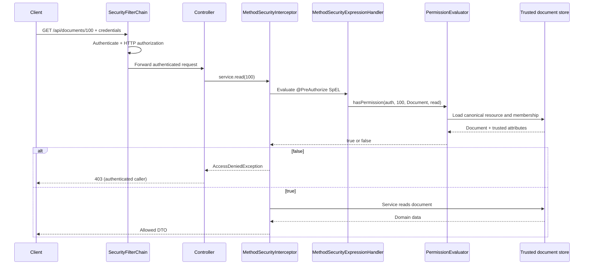

# MethodSecurityExpressionHandler và PermissionEvaluator

> **Phạm vi:** Spring Security **6.x**, Spring Boot **3.x**, Java **17+**, ứng dụng **Servlet/Spring MVC**. Bài đi sâu vào cách Spring Security đánh giá biểu thức phân quyền phương thức, cách tùy biến `MethodSecurityExpressionHandler` để lắp `PermissionEvaluator` và cách kiểm tra quyền trên **tài nguyên cụ thể** bằng `hasPermission`. Ví dụ dùng dữ liệu tài liệu trong bộ nhớ, HTTP Basic và MockMvc để quan sát hành vi thực; mọi kết quả test được ghi là **kỳ vọng**, không khẳng định đã thực thi Java trong môi trường của tài liệu.

## 1. Bài toán xuất phát: đã có role, vì sao cần hasPermission?

Một hệ thống tài liệu có ba loại người dùng: `VIEWER`, `MANAGER`, `AUDITOR`. URL `GET /api/documents/100` có thể được cấu hình `authenticated()`, tức là bất kỳ user đã xác thực nào cũng có thể gọi *chức năng* đọc. Nhưng user Bob chưa chắc được xem tài liệu 100 của Alice. Một manager ở tenant `acme` cũng không tự nhiên được duyệt tài liệu tenant `beta`. Quyền có thể còn phụ thuộc **owner, tenant, classification, trạng thái và số tiền**.

Spring Security đã có các biểu thức như:

```java
@PreAuthorize("isAuthenticated()")
@PreAuthorize("hasRole('MANAGER')")
@PreAuthorize("hasAuthority('DOCUMENT_READ')")
```

Chúng hữu ích để kiểm tra trạng thái xác thực và authorities, nhưng với **object-level authorization**, cần một hàm kiểm tra tài nguyên cụ thể:

```java
@PreAuthorize("hasPermission(#p0, 'Document', 'read')")
public DocumentView read(long documentId) { ... }
```

Ở đây:

- `#p0` là **tham số thứ nhất** của method, tức `documentId`; cách này không phụ thuộc việc trình biên dịch có lưu tên tham số hay không.
- `'Document'` là tên loại tài nguyên do ứng dụng quy ước (không phải tham số HTTP được client tự quyết định).
- `'read'` là quyền/hành động muốn kiểm tra, không phải một câu SQL.
- `hasPermission` gọi chính sách của ứng dụng thông qua `PermissionEvaluator` được nối vào expression handler.
- Nếu người gọi không có quyền hoặc tài liệu không tồn tại, lời gọi bị từ chối **trước khi body của method chạy**.

**Ý chính:** `hasRole` trả lời câu hỏi về **quyền chức năng**; `hasPermission` có thể trả lời về **một hành động trên một đối tượng hoặc ID cụ thể**. Hai cách thường dùng đồng thời, chứ không loại trừ nhau.

## 2. Các lớp tham gia vào method security

Trong Spring Security Servlet, request đi qua `SecurityFilterChain` để nhận Authentication và kiểm tra quyền ở HTTP layer; sau đó controller gọi một **Spring bean** có `@PreAuthorize`. Spring Method Security interceptors kiểm tra annotation qua Spring AOP trước khi chuyển lời gọi vào service.



**Lưu ý tên gọi:** Trong Spring Security 6 với `@EnableMethodSecurity`, cơ chế mặc định sử dụng các **authorization method interceptors/managers** hiện đại cho từng loại annotation; sơ đồ chỉ dùng “interceptor” theo nghĩa khái quát, không bắt buộc một class cũ cụ thể tên `MethodSecurityInterceptor`. Không tự sao chép cấu hình cũ `GlobalMethodSecurityConfiguration` hay `@EnableGlobalMethodSecurity` của các phiên bản trước.

### Phân biệt trách nhiệm

| Thành phần | Vai trò | Không làm thay |
|---|---|---|
| `@EnableMethodSecurity` | Bật hạ tầng kiểm tra annotations trên Spring beans | Không định nghĩa chính sách tài nguyên |
| `@PreAuthorize` | SpEL được đánh giá **trước khi gọi method** | Không tự tìm owner/tenant nếu không có policy |
| `@PostAuthorize` | SpEL đánh giá **sau khi method trả kết quả** | Không ngăn body method đã chạy/side effects |
| `MethodSecurityExpressionHandler` | Tạo expression evaluation context/root và kết nối những thành phần đánh giá | Không tự hiểu domain documents của ứng dụng |
| `DefaultMethodSecurityExpressionHandler` | Handler có sẵn với nhiều biểu thức phổ biến và setter để cắm evaluator | Không phải authorization server, không phải DB |
| `PermissionEvaluator` | Giao diện để kiểm tra quyền trên object hoặc trên ID/type | Không tự authenticate user |
| `SecurityContextHolder` / `Authentication` | Danh tính và authorities đã được xác thực | Không chứng minh sở hữu mọi record |
| Domain service/repository | Áp luật dữ liệu, transaction/atomic write và scope | Không được giả định HTTP rule đã bảo vệ mọi đường gọi |

Một bean `PermissionEvaluator` không tự biến thành chính sách đúng; logic của nó phải đáng tin, đầy đủ, hiệu quả và được kiểm thử.

## 3. MethodSecurityExpressionHandler thực sự làm gì?

`MethodSecurityExpressionHandler` là hợp đồng để Spring Security xử lý **method-security expressions**. Implementation thường dùng là `DefaultMethodSecurityExpressionHandler`. Nó tạo ngữ cảnh diễn giải SpEL với thông tin về `Authentication`, method invocation, các method arguments, root expression và các chiến lược như permission evaluator, role hierarchy hay trust resolver.

Khi viết:

```java
@PreAuthorize("hasRole('MANAGER') and hasPermission(#p0, 'Document', 'approve')")
public DocumentView approve(long documentId) { ... }
```

Spring Security cần hiểu `hasRole`, `hasPermission` và `#p0` trong ngữ cảnh **lời gọi hiện tại**. Handler là cầu nối giữa SpEL và những thành phần thực thi authorization. Với `DefaultMethodSecurityExpressionHandler`, bạn có thể dùng `setPermissionEvaluator(...)` để cung cấp quy tắc domain.

**Không nhầm với `DefaultWebSecurityExpressionHandler`:** handler cho HTTP/web expressions thuộc một ngữ cảnh khác. Khi sử dụng `@PreAuthorize` với `@EnableMethodSecurity`, phải cấu hình **method-security** handler; việc chỉ tùy biến web expression handler không đồng nghĩa `hasPermission` ở service đã được nối đúng.

### 3.1. Đăng ký handler trong Spring Security 6

Một cấu hình gọn (snippet):

```java
@Bean
static MethodSecurityExpressionHandler methodSecurityExpressionHandler(
        PermissionEvaluator permissionEvaluator) {
    DefaultMethodSecurityExpressionHandler handler =
            new DefaultMethodSecurityExpressionHandler();
    handler.setPermissionEvaluator(permissionEvaluator);
    return handler;
}
```

Ở đây dùng **`static @Bean`** để Spring đăng ký expression handler sớm cho hạ tầng method security. Phương pháp này phù hợp với Spring Security 6 và tránh phụ thuộc vào lớp cấu hình cũ. `PermissionEvaluator` sẽ là một bean do ứng dụng cung cấp.

Đừng ghi đè cả handler khi bạn chỉ cần một hàm phân quyền mà không hiểu các mặc định; khi tùy biến, hãy giữ các tính năng mặc định không chủ ý thay đổi, gồm role hierarchy, permission cache hay parameter name discovery nếu ứng dụng cần chúng. Handler có thể được khởi tạo sớm: tránh đưa vào cấu hình những dependency vô tình gây vòng bean hoặc phải đi qua method-security proxy ở ngay giai đoạn bootstrap.

### 3.2. Biểu thức hỗ trợ sẵn và biểu thức của ứng dụng

Các biểu thức method-security phổ biến:

- `isAuthenticated()`: đã xác thực (tùy loại auth; remember-me cũng có thể được tính là authenticated).
- `isFullyAuthenticated()`: không chỉ là remembered authentication.
- `hasRole('MANAGER')`: role ở mức Spring authorities, thường so với `ROLE_MANAGER`.
- `hasAuthority('DOCUMENT_READ')`: authority chính xác, không thêm prefix.
- `hasAnyRole(...)`, `hasAnyAuthority(...)`: nhiều lựa chọn.
- `principal`, `authentication`: danh tính và auth context.
- `#p0`, `#a0`: method argument theo vị trí; `#id` cần metadata/annotation parameter names thích hợp.
- `returnObject`: kết quả trả về ở biểu thức hậu kiểm như `@PostAuthorize`.
- `hasPermission(...)`: chuyển quyết định tài nguyên tới `PermissionEvaluator`.

**Không phụ thuộc vào tên tham số một cách tình cờ.** Ví dụ `@PreAuthorize("hasPermission(#documentId, 'Document', 'read')")` có thể cần trình biên dịch bật `-parameters`, hoặc `@P("documentId")` từ Spring Security. Trong bài dùng `#p0` để nhất quán. Khi method đổi thứ tự tham số, phải update expression và tests.

## 4. PermissionEvaluator: hai overload quan trọng

Giao diện `org.springframework.security.access.PermissionEvaluator` có hai phương thức:

```java
boolean hasPermission(Authentication authentication,
                      Object targetDomainObject,
                      Object permission);

boolean hasPermission(Authentication authentication,
                      java.io.Serializable targetId,
                      String targetType,
                      Object permission);
```

### 4.1. Kiểm tra theo object

Biểu thức:

```java
@PreAuthorize("hasPermission(#p0, 'read')")
public DocumentView inspect(Document document) { ... }
```

dùng overload `hasPermission(Authentication, Object, Object)`. Đối số thứ hai là **object đang được đưa vào method**. Điều đó dễ mắc lỗi nếu object do client deserialize từ JSON và có `owner`/`tenant` bị giả: evaluator **không được tin toàn bộ field của object chỉ vì nó là Java object**. Nên lấy ID và tra lại canonical record từ repository hoặc bảo đảm object đến từ workflow server-side đã xác thực cùng transaction.

Nếu `targetDomainObject == null` hoặc loại object không hỗ trợ, trả **false**. Không viết fallback “unknown type → true”.

### 4.2. Kiểm tra theo ID và type

Biểu thức:

```java
@PreAuthorize("hasPermission(#p0, 'Document', 'read')")
public DocumentView read(long id) { ... }
```

sử dụng overload `hasPermission(Authentication, Serializable, String, Object)`. `id` cần kiểu Serializable; `Long` đáp ứng. `targetType` là namespace của domain do ứng dụng định nghĩa để phân biệt `Document` với `Invoice` có cùng ID 100. Không nhận type từ người dùng rồi tự lắp thành SpEL không qua validation.

**Ưu điểm:** service nhận ID thay vì tải full object ở controller. **Chi phí:** evaluator có thể cần truy vấn DB để quyết định, và service có thể lại tải lần nữa; hãy cân nhắc query scope, caching request-scoped hoặc policy service phù hợp, không bỏ check chỉ để giảm một truy vấn.

### 4.3. Điều gì xảy ra khi PermissionEvaluator trả false?

`@PreAuthorize` phủ quyết lời gọi trước khi body chạy; Spring Security thường ném `AccessDeniedException`. Khi xuất phát từ HTTP request đã xác thực, kết quả thường là **403 Forbidden** (tùy entry point/exception handling). Với request chưa xác thực, Security có thể trả **401** hoặc redirect login theo mechanism. Với method call không qua HTTP, exception đi lên caller nội bộ; nó **không tự biến thành HTTP status**.

Nếu evaluator ném exception DB/timeout, phải có chính sách fail-closed và logging an toàn. Một kết quả **false** không nhất thiết chứng minh tài nguyên không tồn tại; có thể là ngoài tenant, thiếu role, sai action, sai resource type hoặc dữ liệu không đáng tin.

## 5. Policy mẫu: owner, tenant, classification, state và hạn mức

Ta có những account:

| Tài khoản | Role | Tenant của server |
|---|---|---|
| `alice` | VIEWER | acme |
| `bob` | VIEWER | acme |
| `carol` | VIEWER | beta |
| `mai` | MANAGER | acme |
| `minh` | MANAGER | beta |
| `an` | AUDITOR | acme |

Và các tài liệu:

| ID | Tenant | Owner | Classification | State | amountCents |
|---|---|---|---|---|---:|
| 100 | acme | alice | INTERNAL | DRAFT | 30000 |
| 101 | acme | bob | SENSITIVE | DRAFT | 90000 |
| 102 | acme | bob | INTERNAL | APPROVED | 12000 |
| 200 | beta | carol | INTERNAL | DRAFT | 20000 |
| 201 | acme | mai | INTERNAL | DRAFT | 9000 |

Chính sách **`read`**:

1. Chỉ khi Authentication hợp lệ và username có tenant membership do hệ thống gán.
2. Document phải thuộc cùng tenant.
3. MANAGER xem tài liệu trong tenant; AUDITOR chỉ xem classification INTERNAL; VIEWER chỉ xem do chính mình sở hữu.
4. Không thuộc các nhánh hợp lệ → DENY.

Chính sách **`approve`**:

1. Caller phải có `ROLE_MANAGER`.
2. Document thuộc tenant của caller và owner khác caller (không tự duyệt).
3. State phải là `DRAFT` và amountCents ≤ 50000.
4. Không thỏa bất kỳ điều kiện nào → DENY.

**Đây là hybrid RBAC + ABAC.** Role giúp giới hạn loại năng lực; các thuộc tính của resource và owner/tenant bảo vệ quyết định cụ thể. Nếu hệ thống cần thay policy, nên version và kiểm thử ma trận allow/deny thay vì rải điều kiện rời rạc trong nhiều controllers.

## 6. Dự án mẫu Spring Boot 3.x chạy được

### 6.1. Tạo project và dependencies

Tạo Gradle Groovy project Java 17+, Spring Boot 3.x bằng Spring Initializr, chọn **Spring Web**, **Spring Security**, **Spring Boot Starter Test** và **Spring Security Test**. Khối `dependencies` trong `build.gradle`:

```groovy
dependencies {
    implementation 'org.springframework.boot:spring-boot-starter-web'
    implementation 'org.springframework.boot:spring-boot-starter-security'
    testImplementation 'org.springframework.boot:spring-boot-starter-test'
    testImplementation 'org.springframework.security:spring-security-test'
}
```

Đây chỉ là khối dependencies; giữ phần plugins/repositories/version và Gradle wrapper từ Initializr. Các file:

```text
src/
├── main/java/com/example/methodperm/
│   ├── MethodPermissionApplication.java
│   ├── SecurityConfig.java
│   ├── DocumentStore.java
│   ├── DocumentPolicy.java
│   ├── DocumentPermissionEvaluator.java
│   ├── DocumentService.java
│   └── DocumentController.java
└── test/java/com/example/methodperm/
    └── DocumentPermissionTest.java
```

Các file bên dưới là **class Java độc lập đúng package**, không phải snippet chắp vá; có thể dùng nguyên cấu trúc trong project do Initializr tạo.

### 6.2. Main Application

**`src/main/java/com/example/methodperm/MethodPermissionApplication.java`**

```java
package com.example.methodperm;

import org.springframework.boot.SpringApplication;
import org.springframework.boot.autoconfigure.SpringBootApplication;

@SpringBootApplication
public class MethodPermissionApplication {
    public static void main(String[] args) {
        SpringApplication.run(MethodPermissionApplication.class, args);
    }
}
```

### 6.3. Domain store: nguồn dữ liệu tin cậy

**`src/main/java/com/example/methodperm/DocumentStore.java`**

```java
package com.example.methodperm;

import java.util.Map;
import java.util.concurrent.ConcurrentHashMap;
import java.util.concurrent.atomic.AtomicReference;

import org.springframework.http.HttpStatus;
import org.springframework.security.core.Authentication;
import org.springframework.stereotype.Component;
import org.springframework.web.server.ResponseStatusException;

@Component
public class DocumentStore {

    public record Doc(
            long id, String tenant, String owner,
            String classification, String state, long amountCents) {}

    public record View(long id, String state, long amountCents) {}

    private final ConcurrentHashMap<Long, Doc> documents =
            new ConcurrentHashMap<>(Map.of(
                100L, new Doc(
                        100, "acme", "alice", "INTERNAL", "DRAFT", 30000),
                101L, new Doc(
                        101, "acme", "bob", "SENSITIVE", "DRAFT", 90000),
                102L, new Doc(
                        102, "acme", "bob", "INTERNAL", "APPROVED", 12000),
                200L, new Doc(
                        200, "beta", "carol", "INTERNAL", "DRAFT", 20000),
                201L, new Doc(
                        201, "acme", "mai", "INTERNAL", "DRAFT", 9000)
            ));

    public Doc find(long id) {
        return documents.get(id);
    }

    public Doc approveIfAllowed(
            long id, Authentication authentication, DocumentPolicy policy) {
        AtomicReference<Doc> output = new AtomicReference<>();

        documents.compute(id, (key, current) -> {
            // Không chỉ tin @PreAuthorize ở thời điểm trước đó:
            // trạng thái dữ liệu có thể thay đổi giữa hai bước.
            if (!policy.canApprove(authentication, current)) {
                throw new ResponseStatusException(HttpStatus.FORBIDDEN);
            }

            Doc updated = new Doc(
                    current.id(), current.tenant(), current.owner(),
                    current.classification(), "APPROVED",
                    current.amountCents());
            output.set(updated);
            return updated;
        });

        return output.get();
    }
}
```

Với `ConcurrentHashMap.compute`, phần kiểm tra và cập nhật của **một key trong một JVM** được thực hiện cùng thao tác. Dùng `AtomicReference` chỉ để lấy document đã cập nhật ra ngoài lambda. Trong database thật, phải dùng transaction/conditional UPDATE và kiểm tra số hàng được cập nhật. Không dùng HashMap in-memory để đại diện kho quyền production.

### 6.4. DocumentPolicy: một chỗ định nghĩa điều kiện nghiệp vụ

**`src/main/java/com/example/methodperm/DocumentPolicy.java`**

```java
package com.example.methodperm;

import java.util.Map;

import org.springframework.security.authentication.AnonymousAuthenticationToken;
import org.springframework.security.core.Authentication;
import org.springframework.security.core.GrantedAuthority;
import org.springframework.stereotype.Component;

@Component
public class DocumentPolicy {

    // Demo: trusted membership directory. Không lấy tenant từ header
    // X-Tenant hoặc từ DTO do client gửi.
    private final Map<String, String> tenantByUser = Map.of(
            "alice", "acme",
            "bob", "acme",
            "carol", "beta",
            "mai", "acme",
            "minh", "beta",
            "an", "acme"
    );

    private boolean valid(Authentication authentication) {
        return authentication != null
                && authentication.isAuthenticated()
                && !(authentication instanceof AnonymousAuthenticationToken)
                && tenantByUser.containsKey(authentication.getName());
    }

    private static boolean hasRole(
            Authentication authentication, String role) {
        return authentication.getAuthorities().stream()
                .map(GrantedAuthority::getAuthority)
                .anyMatch(("ROLE_" + role)::equals);
    }

    private boolean sameTenant(
            Authentication authentication, DocumentStore.Doc doc) {
        return valid(authentication)
                && doc != null
                && tenantByUser.get(authentication.getName())
                        .equals(doc.tenant());
    }

    public boolean canRead(
            Authentication authentication, DocumentStore.Doc doc) {
        if (!sameTenant(authentication, doc)) {
            return false;
        }
        if (hasRole(authentication, "MANAGER")) {
            return true;
        }
        if (hasRole(authentication, "AUDITOR")
                && "INTERNAL".equals(doc.classification())) {
            return true;
        }
        return hasRole(authentication, "VIEWER")
                && authentication.getName().equals(doc.owner());
    }

    public boolean canApprove(
            Authentication authentication, DocumentStore.Doc doc) {
        return sameTenant(authentication, doc)
                && hasRole(authentication, "MANAGER")
                && "DRAFT".equals(doc.state())
                && doc.amountCents() <= 50000
                && !authentication.getName().equals(doc.owner());
    }

    // Chỉ hai action được định nghĩa; mọi tên quyền khác bị deny.
    public boolean allows(
            Authentication authentication, DocumentStore.Doc doc,
            Object permission) {
        if (!(permission instanceof String action)) {
            return false;
        }
        return switch (action) {
            case "read" -> canRead(authentication, doc);
            case "approve" -> canApprove(authentication, doc);
            default -> false;
        };
    }
}
```

**Các bất biến đáng lưu ý:**

- `sameTenant` từ chối nếu Authentication không hợp lệ, tenant không được gán hoặc document không tồn tại.
- Không có `hasRole` nào tự mặc nhiên bỏ qua tenant check.
- `SENSITIVE` không tự lộ cho AUDITOR; VIEWER vẫn phải trùng owner.
- `approve` đòi state, hạn mức và không tự phê duyệt, ngoài việc có role.
- `allows` dùng **allowlist action**: permission lạ, null, sai kiểu → false. Không có nhánh “unknown → allow”.
- Policy không nhận username, role hoặc tenant qua request chưa được xác thực. Spring Authentication và server membership directory là dữ liệu được tin trong demo.

Dữ liệu `tenantByUser` trong production phải thay bằng membership/entitlement store có quản lý quyền, cache invalidation và audit. Không gộp nhầm username trùng giữa nhiều identity providers hoặc tenants.

### 6.5. PermissionEvaluator: kiểm tra theo object lẫn ID

**`src/main/java/com/example/methodperm/DocumentPermissionEvaluator.java`**

```java
package com.example.methodperm;

import java.io.Serializable;

import org.springframework.security.access.PermissionEvaluator;
import org.springframework.security.core.Authentication;
import org.springframework.stereotype.Component;

@Component
public class DocumentPermissionEvaluator implements PermissionEvaluator {

    private final DocumentStore store;
    private final DocumentPolicy policy;

    public DocumentPermissionEvaluator(
            DocumentStore store, DocumentPolicy policy) {
        this.store = store;
        this.policy = policy;
    }

    @Override
    public boolean hasPermission(
            Authentication authentication,
            Object targetDomainObject,
            Object permission) {
        if (!(targetDomainObject instanceof DocumentStore.Doc submitted)) {
            return false;
        }
        // Quan trọng: object truyền vào có thể bị giả owner/tenant.
        // Chỉ dùng ID để truy xuất canonical record từ nguồn tin cậy.
        DocumentStore.Doc actual = store.find(submitted.id());
        return policy.allows(authentication, actual, permission);
    }

    @Override
    public boolean hasPermission(
            Authentication authentication,
            Serializable targetId,
            String targetType,
            Object permission) {
        if (!"Document".equals(targetType)
                || !(targetId instanceof Long id)) {
            return false;
        }
        DocumentStore.Doc actual = store.find(id);
        return policy.allows(authentication, actual, permission);
    }
}
```

Hai overload là **trọng tâm** của bài:

- **Object overload:** `hasPermission(documentObject, 'read')`. Evaluator không tin `submitted.owner()` hay `submitted.tenant()`; nó lấy ID và đọc record gốc từ `store`. Nếu attacker tạo object giả với ID 101 nhưng owner Alice, policy vẫn kiểm tra record 101 thực tế thuộc Bob.
- **ID/type overload:** `hasPermission(100L, 'Document', 'read')`. Evaluator chỉ chấp nhận targetType chính xác `"Document"` và ID kiểu `Long`. ID kiểu `String`, type `"Invoice"` hoặc action `"delete"` đều bị từ chối. Việc chặt chẽ với type giúp tránh mở quyền nhầm giữa hai loại đối tượng có cùng ID.

Trong app thực tế có thể hỗ trợ UUID hoặc các ID khác bằng mapping rõ ràng, nhưng phải validate namespace/kiểu, không dùng ép kiểu mù quáng hoặc tải tài nguyên thuộc tenant khác rồi trả dữ liệu. **Không viết evaluator luôn return true chỉ để “cho app chạy”.**

### 6.6. Cấu hình MethodSecurityExpressionHandler và HTTP security

**`src/main/java/com/example/methodperm/SecurityConfig.java`**

```java
package com.example.methodperm;

import jakarta.servlet.DispatcherType;

import org.springframework.context.annotation.Bean;
import org.springframework.context.annotation.Configuration;
import org.springframework.http.HttpMethod;
import org.springframework.security.access.PermissionEvaluator;
import org.springframework.security.access.expression.method.DefaultMethodSecurityExpressionHandler;
import org.springframework.security.access.expression.method.MethodSecurityExpressionHandler;
import org.springframework.security.config.Customizer;
import org.springframework.security.config.annotation.method.configuration.EnableMethodSecurity;
import org.springframework.security.config.annotation.web.builders.HttpSecurity;
import org.springframework.security.core.userdetails.User;
import org.springframework.security.core.userdetails.UserDetailsService;
import org.springframework.security.crypto.factory.PasswordEncoderFactories;
import org.springframework.security.crypto.password.PasswordEncoder;
import org.springframework.security.provisioning.InMemoryUserDetailsManager;
import org.springframework.security.web.SecurityFilterChain;

@Configuration
@EnableMethodSecurity
public class SecurityConfig {

    @Bean
    PasswordEncoder passwordEncoder() {
        return PasswordEncoderFactories.createDelegatingPasswordEncoder();
    }

    @Bean
    UserDetailsService users(PasswordEncoder encoder) {
        return new InMemoryUserDetailsManager(
                User.withUsername("alice")
                        .password(encoder.encode("alice-pass"))
                        .roles("VIEWER").build(),
                User.withUsername("bob")
                        .password(encoder.encode("bob-pass"))
                        .roles("VIEWER").build(),
                User.withUsername("carol")
                        .password(encoder.encode("carol-pass"))
                        .roles("VIEWER").build(),
                User.withUsername("mai")
                        .password(encoder.encode("mai-pass"))
                        .roles("MANAGER").build(),
                User.withUsername("minh")
                        .password(encoder.encode("minh-pass"))
                        .roles("MANAGER").build(),
                User.withUsername("an")
                        .password(encoder.encode("an-pass"))
                        .roles("AUDITOR").build()
        );
    }

    // static @Bean giúp method-security infrastructure thấy handler sớm.
    @Bean
    static MethodSecurityExpressionHandler methodSecurityExpressionHandler(
            PermissionEvaluator permissionEvaluator) {
        DefaultMethodSecurityExpressionHandler handler =
                new DefaultMethodSecurityExpressionHandler();
        handler.setPermissionEvaluator(permissionEvaluator);
        return handler;
    }

    @Bean
    SecurityFilterChain securityFilterChain(HttpSecurity http)
            throws Exception {
        return http
                .authorizeHttpRequests(auth -> auth
                    .dispatcherTypeMatchers(DispatcherType.ERROR).permitAll()
                    // RBAC ở HTTP: chỉ MANAGER được gọi chức năng duyệt.
                    .requestMatchers(HttpMethod.POST,
                            "/api/documents/*/approve")
                        .hasRole("MANAGER")
                    // Đọc tài liệu: endpoint cho authenticated callers.
                    // Quyền với ID cụ thể nằm trong @PreAuthorize.
                    .requestMatchers(HttpMethod.GET,
                            "/api/documents/*")
                        .authenticated()
                    .anyRequest().denyAll()
                )
                .httpBasic(Customizer.withDefaults())
                // Không tắt CSRF. POST cần CSRF token trong demo.
                .build();
    }
}
```

**Giải thích:**

1. `@EnableMethodSecurity` bật pre/post method-security interceptors. Nếu thiếu annotation, `@PreAuthorize` có thể không được enforce.
2. `static @Bean MethodSecurityExpressionHandler` dùng implementation mặc định và gọi `setPermissionEvaluator(...)`. Đây là nơi **lắp chính sách domain vào biểu thức**, không phải nơi lưu dữ liệu người dùng.
3. `PermissionEvaluator` do Spring inject là `DocumentPermissionEvaluator` vì bean có kiểu phù hợp; chỉ khai báo **một** bean của loại này trong demo.
4. `.hasRole("MANAGER")` ở POST là RBAC coarse-grained. `@PreAuthorize` trong service vẫn chặn khi service được gọi qua đường khác qua proxy (và bổ sung domain conditions).
5. `.authenticated()` trên GET **không cấp quyền đọc mọi document**; object permission quyết định tại method layer.
6. `.anyRequest().denyAll()` khóa các routes chưa cấp phép; `DispatcherType.ERROR` được cho phép để Spring/Servlet xử lý lỗi, không nhằm public hóa thông tin lỗi.
7. `httpBasic` phục vụ demo và phải dùng HTTPS trên mạng thực. CSRF vẫn bật: để test POST với một CSRF token hợp lệ, dùng `with(csrf())` trong MockMvc.

**Cảnh báo version:** Spring Security 6 dùng `@EnableMethodSecurity`, khác cú pháp cũ `@EnableGlobalMethodSecurity`/`GlobalMethodSecurityConfiguration`. Nếu dùng custom method expression handler trong một app đã có role hierarchy/trust resolver/bean resolver, cần đối chiếu tất cả cấu hình trước khi thay; không thay global handler mù quáng làm biến mất tùy chỉnh khác.

### 6.7. Service: @PreAuthorize gọi evaluator, business logic tự giữ bất biến

**`src/main/java/com/example/methodperm/DocumentService.java`**

```java
package com.example.methodperm;

import org.springframework.http.HttpStatus;
import org.springframework.security.access.prepost.PreAuthorize;
import org.springframework.security.core.Authentication;
import org.springframework.security.core.context.SecurityContextHolder;
import org.springframework.stereotype.Service;
import org.springframework.web.server.ResponseStatusException;

@Service
public class DocumentService {

    private final DocumentStore store;
    private final DocumentPolicy policy;

    public DocumentService(DocumentStore store, DocumentPolicy policy) {
        this.store = store;
        this.policy = policy;
    }

    private static DocumentStore.View toView(DocumentStore.Doc d) {
        return new DocumentStore.View(
                d.id(), d.state(), d.amountCents());
    }

    private static Authentication authentication() {
        return SecurityContextHolder.getContext().getAuthentication();
    }

    @PreAuthorize("hasPermission(#p0, 'Document', 'read')")
    public DocumentStore.View read(long documentId) {
        DocumentStore.Doc current = store.find(documentId);
        // Recheck trusted record: permission could change between
        // initial check and use (TOCTOU / stale policy).
        if (!policy.canRead(authentication(), current)) {
            throw new ResponseStatusException(HttpStatus.FORBIDDEN);
        }
        return toView(current);
    }

    @PreAuthorize("hasRole('MANAGER') and hasPermission(#p0, 'Document', 'approve')")
    public DocumentStore.View approve(long documentId) {
        DocumentStore.Doc updated = store.approveIfAllowed(
                documentId, authentication(), policy);
        return toView(updated);
    }

    // Minh họa object overload cho caller nội bộ đáng tin.
    // Không expose raw Doc từ JSON client làm nguồn thuộc tính quyền.
    @PreAuthorize("hasPermission(#p0, 'read')")
    public DocumentStore.View inspect(DocumentStore.Doc supplied) {
        DocumentStore.Doc current = store.find(supplied.id());
        if (!policy.canRead(authentication(), current)) {
            throw new ResponseStatusException(HttpStatus.FORBIDDEN);
        }
        return toView(current);
    }
}
```

Cả hai biểu thức ID-based nằm trên **public service methods** được controller gọi qua Spring bean proxy. Biểu thức `hasPermission` đánh giá trước khi thực thi body. `DocumentService.read` còn kiểm tra lại record đã tải, để tránh dùng một bản tài liệu bị thay owner/tenant sau khi precheck. Với `approve`, `DocumentStore.approveIfAllowed` kiểm tra lại policy **ngay bên trong cập nhật atomic per-key**. Đây là cách demo tránh ảo tưởng “check xong rồi update theo ID bất kể dữ liệu thay đổi”.

`inspect(Doc)` chỉ để minh họa **object overload**; không phải API cho người dùng gửi JSON `Doc` rồi tin record đó. Nó được test với một object giả để chứng minh evaluator tải lại bản canonical. Tài nguyên trả ra dùng DTO `DocumentStore.View`, không trả toàn bộ entity chứa owner/tenant/classification hoặc thông tin riêng.

**Chú ý:** `@PreAuthorize` mặc định dùng Spring proxy. Gọi `this.read(...)`/`this.approve(...)` trong chính class có thể bypass interceptor, dù explicit policy checks trong body vẫn tồn tại. Với ứng dụng thật, đặt policy trọng yếu trong một component được dùng nhất quán và test tất cả entry points.

### 6.8. Controller: định tuyến nhưng không có quyền quyết định owner

**`src/main/java/com/example/methodperm/DocumentController.java`**

```java
package com.example.methodperm;

import org.springframework.web.bind.annotation.GetMapping;
import org.springframework.web.bind.annotation.PathVariable;
import org.springframework.web.bind.annotation.PostMapping;
import org.springframework.web.bind.annotation.RestController;

@RestController
public class DocumentController {

    private final DocumentService documents;

    public DocumentController(DocumentService documents) {
        this.documents = documents;
    }

    @GetMapping("/api/documents/{id}")
    public DocumentStore.View read(@PathVariable long id) {
        return documents.read(id);
    }

    @PostMapping("/api/documents/{id}/approve")
    public DocumentStore.View approve(@PathVariable long id) {
        return documents.approve(id);
    }
}
```

Controller không lấy `owner`, `tenant` hoặc `role` từ JSON/header làm chứng cứ; method security lấy principal hiện tại từ `SecurityContext` và policy tra source tin cậy. Một request có `X-User: alice` nhưng Basic principal Bob sẽ vẫn là Bob.

## 7. Chạy và thử HTTP với curl

Từ thư mục có Gradle wrapper do Initializr tạo:

```bash
# Linux / macOS
./gradlew bootRun

# Windows PowerShell
.\gradlew.bat bootRun
```

Mặc định `http://localhost:8080` khi không thay `server.port`. Trong Windows PowerShell cũ, dùng `curl.exe` để tránh alias. Credential mẫu chỉ phục vụ localhost, không truyền password qua HTTP trên Internet.

### 7.1. Không có credentials → HTTP 401

```bash
curl -i http://localhost:8080/api/documents/100
```

**Kỳ vọng:** `401 Unauthorized` kèm Basic challenge `WWW-Authenticate`. Request chưa qua authentication.

### 7.2. Alice đọc đúng tài liệu của mình → 200

```bash
curl -i -u alice:alice-pass http://localhost:8080/api/documents/100
```

**Kỳ vọng:** HTTP 200 và JSON:

```json
{"id":100,"state":"DRAFT","amountCents":30000}
```

GET đã qua `authenticated()` ở HTTP, rồi `hasPermission(100L,'Document','read')` trả true vì user Alice có role VIEWER, tenant acme và owner là Alice.

### 7.3. Bob cùng tenant vẫn bị từ chối

```bash
curl -i -u bob:bob-pass http://localhost:8080/api/documents/100
curl -i -u carol:carol-pass http://localhost:8080/api/documents/100
```

**Kỳ vọng:** Cả hai `403 Forbidden`. Bob cùng acme nhưng không sở hữu tài liệu 100; Carol ở beta. Cả hai đã **đăng nhập hợp lệ**, nhưng permission evaluator deny. Thông báo HTTP có thể được định nghĩa để che giấu tài nguyên thành 404 trong một policy khác; ví dụ này giữ mặc định access-denied của `@PreAuthorize` là 403.

### 7.4. Đúng role vẫn bị giới hạn scope

```bash
curl -i -u mai:mai-pass http://localhost:8080/api/documents/101
curl -i -u mai:mai-pass http://localhost:8080/api/documents/200
curl -i -u an:an-pass http://localhost:8080/api/documents/100
curl -i -u an:an-pass http://localhost:8080/api/documents/101
```

**Kỳ vọng:** Mai đọc 101 của acme được 200; Mai đọc 200 của beta bị 403. Auditor An đọc INTERNAL 100 được 200; đọc SENSITIVE 101 bị 403.

### 7.5. Forged headers không làm tăng quyền

```bash
curl -i -u bob:bob-pass \
  -H 'X-User: alice' -H 'X-Tenant: acme' \
  http://localhost:8080/api/documents/100
```

**Kỳ vọng:** 403. `PermissionEvaluator` chỉ sử dụng Authentication và trusted store, không tin các headers.

### 7.6. Lệnh POST không có CSRF token

```bash
curl -i -u mai:mai-pass \
  -X POST http://localhost:8080/api/documents/100/approve
```

**Kỳ vọng:** 403 do thiếu CSRF token trong demo. Điều này **không chứng minh** permission evaluator đã chạy; `CsrfFilter` có thể chặn trước method security. Để kiểm tra đúng policy approve, dùng MockMvc POST có `with(csrf())` bên dưới, hoặc xây form/token endpoint hợp lệ. Không tắt CSRF toàn ứng dụng chỉ để chạy ví dụ curl.

## 8. Kiểm thử tích hợp với MockMvc

Đây là phần chứng minh **handler đã thực sự gọi evaluator**, thay vì chỉ test logic Java riêng. Các request dùng Spring Security Test `httpBasic(...)` để xác thực qua filter thật, và `csrf()` cho POST. Ngoài các tests HTTP, có hai tests method/service cho object overload và tính fail-closed trước input không hợp lệ.

**`src/test/java/com/example/methodperm/DocumentPermissionTest.java`**

```java
package com.example.methodperm;

import org.junit.jupiter.api.Test;
import org.springframework.beans.factory.annotation.Autowired;
import org.springframework.boot.test.autoconfigure.web.servlet.AutoConfigureMockMvc;
import org.springframework.boot.test.context.SpringBootTest;
import org.springframework.http.HttpHeaders;
import org.springframework.security.access.AccessDeniedException;
import org.springframework.security.core.Authentication;
import org.springframework.security.core.context.SecurityContextHolder;
import org.springframework.security.test.context.support.WithMockUser;
import org.springframework.test.web.servlet.MockMvc;

import static org.junit.jupiter.api.Assertions.assertEquals;
import static org.junit.jupiter.api.Assertions.assertFalse;
import static org.junit.jupiter.api.Assertions.assertThrows;
import static org.junit.jupiter.api.Assertions.assertTrue;
import static org.springframework.security.test.web.servlet.request.SecurityMockMvcRequestPostProcessors.csrf;
import static org.springframework.security.test.web.servlet.request.SecurityMockMvcRequestPostProcessors.httpBasic;
import static org.springframework.test.web.servlet.request.MockMvcRequestBuilders.get;
import static org.springframework.test.web.servlet.request.MockMvcRequestBuilders.post;
import static org.springframework.test.web.servlet.result.MockMvcResultMatchers.header;
import static org.springframework.test.web.servlet.result.MockMvcResultMatchers.jsonPath;
import static org.springframework.test.web.servlet.result.MockMvcResultMatchers.status;

@SpringBootTest
@AutoConfigureMockMvc
class DocumentPermissionTest {

    @Autowired
    MockMvc mvc;

    @Autowired
    DocumentService service;

    @Autowired
    DocumentStore store;

    @Autowired
    DocumentPermissionEvaluator evaluator;

    @Test
    void anonymousCannotRead() throws Exception {
        mvc.perform(get("/api/documents/100"))
                .andExpect(status().isUnauthorized())
                .andExpect(header().exists(HttpHeaders.WWW_AUTHENTICATE));
    }

    @Test
    void viewerCanReadOwnedDocument() throws Exception {
        mvc.perform(get("/api/documents/100")
                    .with(httpBasic("alice", "alice-pass")))
                .andExpect(status().isOk())
                .andExpect(jsonPath("$.id").value(100));
    }

    @Test
    void viewerCannotReadOtherOwnerSameTenant() throws Exception {
        mvc.perform(get("/api/documents/100")
                    .with(httpBasic("bob", "bob-pass")))
                .andExpect(status().isForbidden());
    }

    @Test
    void viewerCannotReadCrossTenant() throws Exception {
        mvc.perform(get("/api/documents/100")
                    .with(httpBasic("carol", "carol-pass")))
                .andExpect(status().isForbidden());
    }

    @Test
    void managerReadsOnlyWithinOwnTenant() throws Exception {
        mvc.perform(get("/api/documents/101")
                    .with(httpBasic("mai", "mai-pass")))
                .andExpect(status().isOk());
        mvc.perform(get("/api/documents/200")
                    .with(httpBasic("mai", "mai-pass")))
                .andExpect(status().isForbidden());
    }

    @Test
    void auditorCannotReadSensitiveDocument() throws Exception {
        mvc.perform(get("/api/documents/100")
                    .with(httpBasic("an", "an-pass")))
                .andExpect(status().isOk());
        mvc.perform(get("/api/documents/101")
                    .with(httpBasic("an", "an-pass")))
                .andExpect(status().isForbidden());
    }

    @Test
    void forgedHeadersCannotBecomeTrustedAttributes() throws Exception {
        mvc.perform(get("/api/documents/100")
                    .with(httpBasic("bob", "bob-pass"))
                    .header("X-User", "alice")
                    .header("X-Tenant", "acme"))
                .andExpect(status().isForbidden());
    }

    @Test
    void unknownDocumentIsDenied() throws Exception {
        mvc.perform(get("/api/documents/999")
                    .with(httpBasic("alice", "alice-pass")))
                .andExpect(status().isForbidden());
    }

    @Test
    void viewerCannotApproveEvenWithCsrf() throws Exception {
        mvc.perform(post("/api/documents/100/approve")
                    .with(httpBasic("alice", "alice-pass"))
                    .with(csrf()))
                .andExpect(status().isForbidden());
    }

    @Test
    void managerRequestMissingCsrfIsRejected() throws Exception {
        mvc.perform(post("/api/documents/100/approve")
                    .with(httpBasic("mai", "mai-pass")))
                .andExpect(status().isForbidden());
    }

    @Test
    void managerCannotApproveCrossTenant() throws Exception {
        mvc.perform(post("/api/documents/200/approve")
                    .with(httpBasic("mai", "mai-pass"))
                    .with(csrf()))
                .andExpect(status().isForbidden());
    }

    @Test
    void managerCannotApproveOverLimit() throws Exception {
        mvc.perform(post("/api/documents/101/approve")
                    .with(httpBasic("mai", "mai-pass"))
                    .with(csrf()))
                .andExpect(status().isForbidden());
    }

    @Test
    void managerCannotApproveAlreadyApproved() throws Exception {
        mvc.perform(post("/api/documents/102/approve")
                    .with(httpBasic("mai", "mai-pass"))
                    .with(csrf()))
                .andExpect(status().isForbidden());
    }

    @Test
    void managerCannotApproveOwnDocument() throws Exception {
        mvc.perform(post("/api/documents/201/approve")
                    .with(httpBasic("mai", "mai-pass"))
                    .with(csrf()))
                .andExpect(status().isForbidden());
    }

    @Test
    void managerCanApproveEligibleDocument() throws Exception {
        mvc.perform(post("/api/documents/100/approve")
                    .with(httpBasic("mai", "mai-pass"))
                    .with(csrf()))
                .andExpect(status().isOk())
                .andExpect(jsonPath("$.id").value(100))
                .andExpect(jsonPath("$.state").value("APPROVED"));
    }

    @Test
    @WithMockUser(username = "alice", roles = "VIEWER")
    void objectOverloadLoadsCanonicalRecord() {
        // Object overload cũng được gọi qua Method Security interceptor.
        assertEquals(100L, service.inspect(store.find(100)).id());

        // Attacker tạo object với owner Alice nhưng id=101 thực tế
        // là tài liệu của Bob. Evaluator lấy canonical id=101.
        DocumentStore.Doc forged = new DocumentStore.Doc(
                101, "acme", "alice", "INTERNAL", "DRAFT", 1);
        assertThrows(AccessDeniedException.class,
                () -> service.inspect(forged));
    }

    @Test
    @WithMockUser(username = "alice", roles = "VIEWER")
    void evaluatorDeniesUnknownTypeIdAndAction() {
        Authentication auth =
                SecurityContextHolder.getContext().getAuthentication();
        assertTrue(evaluator.hasPermission(
                auth, 100L, "Document", "read"));
        assertFalse(evaluator.hasPermission(
                auth, "100", "Document", "read"));
        assertFalse(evaluator.hasPermission(
                auth, 100L, "Invoice", "read"));
        assertFalse(evaluator.hasPermission(
                auth, 100L, "Document", "delete"));
        assertFalse(evaluator.hasPermission(
                auth, (Object) null, "read"));
    }
}
```

Chạy:

```bash
# Linux / macOS
./gradlew test

# Windows PowerShell
.\gradlew.bat test
```

**Kết quả kỳ vọng:** **17 tests PASS** khi dùng đúng cấu hình và các lớp phía trên. Đây là **kết quả dự kiến, không phải đầu ra của một lần chạy thực tế trong môi trường bài viết**. Một test duyệt tài liệu 100 cập nhật trạng thái từ DRAFT sang APPROVED; các tests khác kiểm tra ID/khả năng đọc hoặc duyệt tài liệu khác nên không phụ thuộc vào thứ tự. Khi mở rộng suite, nên reset fixtures hay dùng transaction/DB isolation để tránh state leakage.

### 8.1. Ý nghĩa của từng nhóm test

- **Không credentials → 401**: xác minh HTTP authentication, chưa qua method.
- **Đúng VIEWER/owner → 200**: `hasPermission(...,'read')` thực sự cho phép.
- **Bob/Carol denied → 403**: phân biệt same-tenant khác owner và cross tenant.
- **MANAGER/AUDITOR bị hạn chế → 200/403**: role không tự vượt tenant/classification.
- **Headers giả → 403**: chưa tin request-supplied identity/tenant.
- **ID không tồn tại → 403**: evaluator không tìm được canonical record → false.
- **Approve tests → 403 hoặc 200**: role, CSRF, limit, state, self-approval, tenant và success đều được kiểm tra.
- **Object-overload test**: gọi `service.inspect` qua Spring bean proxy với `@WithMockUser` để xác minh `hasPermission(#p0,'read')` không cho qua một Doc giả.
- **ID/type/action tests**: không chỉ kiểm tra đường allow; các biến thể sai kiểu, sai namespace và action chưa cho phép phải return false.

`@WithMockUser` trong hai tests service **không dùng để chứng minh HTTP Basic**, nhưng phù hợp để cô lập method security và gọi evaluator. Các tests MockMvc khác dùng `httpBasic(...)` để chạy security filters thật.

## 9. Phân biệt @PreAuthorize và @PostAuthorize

### PreAuthorize

`@PreAuthorize` đánh giá biểu thức **trước khi method body chạy**. Đây là lựa chọn tốt cho thao tác nhạy cảm và các lệnh có side effects, vì có thể ngăn gọi method ngay từ đầu.

```java
@PreAuthorize("hasPermission(#p0, 'Document', 'approve')")
public DocumentView approve(long id) { /* ... */ }
```

Điểm hạn chế: evaluator có thể phải tải document theo ID, rồi service lại tải sau khi method được phép. Đây là chi phí có thật, nhưng **không** được bỏ kiểm tra quyền. Đối với write, làm recheck/conditional update để tránh resource thay đổi giữa lúc check và sử dụng.

### PostAuthorize

`@PostAuthorize` đánh giá sau khi method đã chạy, khi có `returnObject`. Nó hữu ích khi method là **pure read** và chỉ khi đã tải được tài nguyên mới có thể đánh giá object:

```java
// SNIPPET minh họa; cần bean Service và PermissionEvaluator.
// Không dùng với method thực hiện ghi/side effects.
@PostAuthorize("hasPermission(returnObject, 'read')")
public Document loadDocument(long id) {
    return repository.findById(id).orElse(null);
}
```

Nhưng **body đã chạy** trước khi @PostAuthorize có thể từ chối. Nếu method gửi email, chuyển tiền, ghi database hoặc log toàn bộ secret trước đó, hậu kiểm không thể hoàn tác tác động. Ngoài ra cần phòng dữ liệu nhạy cảm lọt qua caches/logs/side channels khi đã được tải vào bộ nhớ. Với read endpoint nhạy cảm, scoped query thường tốt hơn việc lấy mọi thứ rồi mới hậu kiểm.

### PostFilter / PreFilter

`@PostFilter` có thể lọc các phần tử khỏi collection dựa trên expression, nhưng nếu lấy hàng triệu records trước rồi lọc, ứng dụng sẽ tốn tài nguyên và có thể lộ qua logs, caching hay pagination totals. Ưu tiên **lọc ở repository query** theo principal/tenant. `@PreFilter` lọc collection đầu vào trong một số use cases; không coi việc lọc request payload là chứng nhận các ID đã được phép nếu chưa kiểm tra ownership server-side.

## 10. Lỗi thường gặp khi cấu hình handler và evaluator

| Triệu chứng | Nguyên nhân khả dĩ | Cách kiểm chứng |
|---|---|---|
| `hasPermission` luôn từ chối dù đã khai báo bean evaluator | Chưa cắm vào `MethodSecurityExpressionHandler` đang dùng, sai method-security config | Kiểm tra static @Bean handler, wiring và method integration test |
| `@PreAuthorize` không hoạt động | Thiếu `@EnableMethodSecurity`, không gọi qua Spring bean proxy | Gọi qua bean từ controller/test, kiểm tra annotation và AOP |
| `hasPermission(#id,...)` nhận null | Không có parameter names, khác compiler options | Dùng `#p0` hoặc `@P("id")`/`-parameters` |
| Truy cập object sai tenant nhưng vẫn 200 | Evaluator tin tenant/owner do caller tự khai | Tải canonical object từ trusted repository |
| Overload không chạy như dự định | Viết 2 args vs 3 args, sai targetType hoặc ID Java type | Test cả hai overload, verify strict type checks |
| Test chỉ có `@WithMockUser` không phát hiện thiếu HTTP guard | Method test không kiểm tra servlet filters | Thêm MockMvc test với httpBasic/anonymous |
| POST trả 403 nhưng team cho rằng evaluator từ chối | CSRF filter đã chặn trước method | Gửi `with(csrf())` cho test permission |
| User có MANAGER nhưng không approve được | Domain condition tenant/owner/state/limit chưa thỏa | Audit reason an toàn và test từng condition |
| Method gọi nội bộ không được bảo vệ | Self-invocation bypass proxy | Tách bean/call qua proxy; policy ở service |
| Quyền stale sau đổi tenant/role | Auth claims/cache cũ, không invalidate | Fresh membership, TTL/revocation/versioning |
| Request chậm khi list 1000 records | Evaluator query DB từng bản ghi gây N+1 | Scoped batch SQL, cache đúng scope |
| Approve chạy dù quyền bị thu hồi giữa hai bước | TOCTOU, check rồi update không ràng buộc | Atomic conditional update, transaction/lock |
| Unknown permission trả true | Default allow / catch-all không an toàn | Allowlist actions, false for unknown/null |
| Object evaluator tin field từ DTO giả | Chỉ check target.owner bằng object do client deserialize | Lookup canonical record by ID |
| 403 và 404 bị xử lý lẫn lộn | Exception mapping không nhất quán | Document visibility policy, HTTP tests |

### 10.1. Spring Security 5 vs 6: đừng sao chép tutorial cũ mù quáng

Một số tài liệu cũ nhắc `@EnableGlobalMethodSecurity(prePostEnabled = true)` hoặc kế thừa `GlobalMethodSecurityConfiguration`. Với Spring Security 6 và ứng dụng mẫu này, dùng `@EnableMethodSecurity` và cung cấp bean expression handler. Đừng chỉ dán một `PermissionEvaluator` bean rồi giả định mọi phần mềm Spring Security 6 tự biết tích hợp nó vào tất cả các loại authorization manager.

### 10.2. Java parameter names và SpEL

Nếu viết `@PreAuthorize("@policy.canRead(#documentId)")` và `#documentId` là null, cần xem build metadata. Các cách:

- Dùng `#p0`/`#a0` khi positional argument đủ rõ.
- Build bật `-parameters`; Spring Boot Gradle plugin thường hỗ trợ nhưng phải kiểm tra dự án.
- Dùng `@P("documentId")` của Spring Security ở parameter nếu cần public name ổn định.
- Tách diễn đạt phức tạp thành policy method có arguments rõ, thay vì đẩy logic nhiều dòng vào annotation.

Dù dùng cách nào, **test method security thật** với caller và resource khác quyền, không chỉ compile annotation.

### 10.3. Không đặt business policy trong web expression handler

`DefaultWebSecurityExpressionHandler`/`WebExpressionAuthorizationManager` xử lý security expressions ở HTTP request context, còn method-security handler giải quyết method invocation. Một thay đổi ở web handler không đảm bảo `@PreAuthorize` có evaluator mới. Tách hai lớp để tránh giả định “URL đã cho qua nên service chắc chắn cho phép”.

## 11. Ranh giới tin cậy và thiết kế PermissionEvaluator production

### 11.1. Authentication không phải object owner

Nếu `Authentication.getName()` là Bob, request có `owner=alice` hoặc `X-User: alice` không thể đổi identity. Các quyền resource-specific phải dùng principal đã xác thực, membership do server quản lý và object metadata hiện hành. Một số hệ có username có thể đổi; tốt hơn dùng immutable account ID khi quyết định owner/tenant trong database thật.

### 11.2. Không cho client kiểm soát SpEL

Đừng nối một chuỗi expression từ request (như `"hasPermission(...)"`) rồi yêu cầu framework đánh giá nó như policy. SpEL có khả năng truy cập object/methods; nhận expression từ nguồn không tin cậy tạo rủi ro injection. Chỉ cho client chọn action/type thông qua **allowlist** nếu nghiệp vụ yêu cầu, còn biểu thức bảo mật phải được định nghĩa bởi ứng dụng và review.

### 11.3. Unknown permission và null object phải deny

Viết `return true` ở nhánh mặc định vì chưa hỗ trợ resourceType là lỗi nghiêm trọng. Tài liệu này dùng `switch` chặt với `read`, `approve`, kiểm soát type `Document` và ID `Long`. Không cho type `Invoice` sử dụng chung record ID 100 nếu không có mapping chính thức.

### 11.4. Truy vấn dữ liệu theo scope

Một evaluator đọc record rồi kiểm tra owner/tenant là hữu ích, nhưng application service/repository còn cần **scope query**:

```sql
SELECT id, state, amount_cents
FROM documents
WHERE id = :documentId
  AND tenant_id = :trustedTenant
  AND (
      owner_id = :trustedUser
      OR :canReadWholeTenant = TRUE
  );
```

`:trustedTenant`, `:trustedUser` và `:canReadWholeTenant` **phải được xác định server-side** từ Authentication và membership. Không lấy `X-Tenant` của browser mà gán trực tiếp vào parameter được gọi “trusted”. Với AUDITOR còn có classification restriction, vì vậy query phải bao quát toàn bộ policy chứ không sao chép giản lược rồi bỏ một điều kiện.

### 11.5. Transaction và TOCTOU

`hasPermission` thường chạy **trước** transaction của method hoặc trong một thứ tự advisors cần được kiểm chứng. Nếu một người bị thu hồi quyền hoặc document đổi trạng thái giữa precheck và update, chỉ precheck không đủ.

Một cách chống race với SQL có điều kiện:

```sql
UPDATE documents
SET state = 'APPROVED',
    version = version + 1
WHERE id = :documentId
  AND tenant_id = :trustedTenant
  AND state = 'DRAFT'
  AND amount_cents <= :limitCents
  AND owner_id <> :trustedApprover
  AND version = :expectedVersion;
```

Ứng dụng chỉ coi lệnh thành công khi update đúng 1 hàng. Nếu 0 hàng, không tự suy ra record tồn tại hay không trước khi áp visibility policy. Đối với hệ tài chính, cần audit/transaction/idempotency và business invariants khác.

### 11.6. Permissions cho list, search, export

`@PreAuthorize("hasPermission(#id,...)")` rất tiện cho detail endpoint, nhưng **không bảo vệ danh sách tự động**. Các methods list/search/export phải lọc records theo scope hoặc thực thi policy cho từng phần tử với hiệu năng phù hợp. Dùng `@PostFilter` mà đã tải toàn bộ bảng có thể gây N+1, leak qua count/pagination/caches. Đẩy predicates xuống SQL/JPA projection và dùng query authorization-aware.

### 11.7. Authorization data bị stale

Session/JWT có thể chứa roles/claims cũ. Resource metadata/membership cũng có thể nằm trong cache. Hãy xác định TTL/revocation, policy version và những hành động cần kiểm tra quyền mới nhất. Việc JWT chữ ký hợp lệ không chứng minh quyền MANAGER vẫn chưa bị thu hồi sau khi token được cấp.

### 11.8. Auditing và observability

Log nên phân biệt:

- actor ID đã xác thực (hoặc pseudonym), resource type, action, decision;
- timestamp, policy version, correlation ID và nguồn thuộc tính;
- lý do deny dưới dạng mã an toàn, không tiết lộ record cho client không có quyền.

Không log raw password, bearer/JSESSIONID/CSRF token, dữ liệu thanh toán, document nội dung nhạy cảm. Với denied access, response có thể chung `403` hoặc `404` theo policy, còn logs nội bộ được kiểm soát mới chứa reason chi tiết.

## 12. Khi nào nên dùng PermissionEvaluator, khi nào policy bean là đủ?

**Dùng `PermissionEvaluator` khi** ứng dụng có nhiều resource types, muốn thống nhất cú pháp `hasPermission(target,'action')` và `hasPermission(id,type,'action')`, hoặc cần một cầu nối tái sử dụng được giữa method-security expressions và dịch vụ quyền. Phù hợp nếu authorization theo tài nguyên là pattern rộng của ứng dụng.

**Dùng policy bean được gọi trong SpEL khi** nhu cầu nhỏ hơn, cần các methods giàu ngữ nghĩa và tránh ép tất cả quyết định về một chuỗi action. Ví dụ snippet:

```java
// Chỉ minh họa. Cần bean documentPolicy và method canApprove.
@PreAuthorize("@documentPolicy.canApprove(authentication, #p0)")
public DocumentView approve(long id) { ... }
```

Chỉ đúng khi `documentPolicy.canApprove` nhận ID và tải trusted document theo ID. Trong code thực hành, `DocumentPolicy.canApprove` nhận `Doc` chứ không nhận Long, nên **không thể copy snippet này mà bỏ qua bước viết method tương thích**.

**Không bắt buộc tạo PermissionEvaluator trong mọi dự án.** `hasRole` và một policy service thuần cũng có thể đủ cho application nhỏ; công cụ phù hợp nhất là công cụ làm luật phân quyền **dễ kiểm tra, không lặp, đúng nguồn dữ liệu và được áp tại mọi entry point**.

### Khi nào không nên mở rộng handler sâu?

Nếu bạn chỉ cần một phương thức `canAccessDocument`, có thể không cần tùy biến các phần sâu của SpEL root. Việc thay cả expression handler có nguy cơ ảnh hưởng role hierarchy, permission cache hoặc những customizations đang có. Chỉ mở rộng thật sự cần thiết; viết integration tests cho behavior cũ sau khi thay.

## 13. Bảng đối chiếu quyết định trong ví dụ

| Request / lời gọi | Kết quả kỳ vọng | Lý do |
|---|---:|---|
| Anonymous GET tài liệu 100 | **401** | HTTP authentication chặn |
| Alice VIEWER GET 100 | **200** | Cùng tenant, owner trùng |
| Bob VIEWER GET 100 | **403** | Cùng tenant nhưng owner khác |
| Carol VIEWER GET 100 | **403** | Tenant beta, tài liệu acme |
| Mai MANAGER GET 101 | **200** | MANAGER trong tenant acme |
| Mai MANAGER GET 200 | **403** | MANAGER không tự vượt tenant |
| An AUDITOR GET 100 | **200** | INTERNAL cùng tenant |
| An AUDITOR GET 101 | **403** | SENSITIVE không được phép |
| Alice VIEWER POST approve 100 + CSRF | **403** | HTTP hasRole MANAGER từ chối |
| Mai MANAGER POST approve 100 không CSRF | **403** | CSRF filter chặn trước method |
| Mai MANAGER POST approve 101 + CSRF | **403** | Amount 90000 > 50000 |
| Mai MANAGER POST approve 102 + CSRF | **403** | State đã APPROVED |
| Mai MANAGER POST approve 201 + CSRF | **403** | Manager tự duyệt tài liệu của mình |
| Mai MANAGER POST approve 200 + CSRF | **403** | Cross tenant |
| Mai MANAGER POST approve 100 + CSRF | **200** | DRAFT, tenant acme, amount 30000, không tự duyệt |
| Unknown ID/type/action hoặc null object | **DENY** | Evaluator fail closed |

Bảng là **kỳ vọng theo policy**; nếu project thực tế dùng entry point, exception handler hoặc route matchers khác, HTTP status/redirect sẽ phải được kiểm chứng lại. Đừng nhầm request bị CSRF chặn với request bị PermissionEvaluator từ chối.

## 14. Lỗi vận hành và debugging có hệ thống

Khi một method có annotation không chặn caller, hãy lần lượt tự hỏi:

1. **Có `@EnableMethodSecurity` chưa?** Có ở configuration trong Spring context đang dùng không?
2. **Spring bean/proxy có đang được gọi không?** Hay tạo service bằng `new` hoặc gọi `this.method()` khiến interceptor bị bypass?
3. **Expression handler đúng có được sử dụng không?** Static bean được phát hiện? Có handler khác bị override? Evaluator nào được inject?
4. **Biểu thức có đúng overload không?** `hasPermission(#p0,'read')` vs `hasPermission(#p0,'Document','read')`; `#p0` có đúng tham số chứa ID không?
5. **Authentication có thật không?** IsAuthenticated, role mapping `ROLE_`, tenant membership và ID?
6. **TargetType và targetId có đúng kiểu không?** Demo chấp nhận `Long`, không chấp nhận string `"100"`.
7. **Policy trả false vì sao?** Owner, tenant, classification, state, amount hay unrecognized action?
8. **Có filter chặn trước không?** Missing CSRF, không credentials, sai HTTP matcher, denyAll?
9. **Có cache/stale data không?** Role/tenant được cache, resource đổi owner, action race?
10. **Có tình trạng call từ async/background hay Spring proxy khác không?** Context propagation và service identity cần được thiết kế.

Để debug, dùng tests nhỏ: một case phải ALLOW và nhiều cases phải DENY. Đừng “sửa” bằng `permitAll()` hoặc `return true` trong evaluator chỉ để đi qua lỗi.

## 15. Checklist production

1. Chỉ sử dụng `@EnableMethodSecurity` và DSL phù hợp phiên bản Spring Security; không sao chép nguyên xi cấu hình method security cũ.
2. Kết nối chính xác `MethodSecurityExpressionHandler` với `PermissionEvaluator` cần dùng; test method security thực qua bean proxy.
3. Dùng allowlist permissions và domain types; null/unknown → **DENY**.
4. Lấy principal từ `Authentication` đã được xác minh và membership/role từ nguồn đáng tin; không dùng header tự khai.
5. Với object overload, không tin các trường owner/tenant của object được client gửi; luôn dựa canonical record.
6. Với ID overload, validate targetType và ID Java type, bảo vệ khỏi cross-type confusion.
7. Đặt policy cốt lõi tại service/repository, không chỉ ở controller và không chỉ ở annotation.
8. Kiểm tra transaction và atomic writes cho thay đổi state; tránh TOCTOU giữa precheck và update.
9. Đảm bảo list/search/export/aggregate/caches cũng áp scope đúng; không chỉ bảo vệ GET detail.
10. Tránh N+1 policy lookup; chỉ cache quyết định khi có scope/version/invalidation đáng tin.
11. Có negative tests same-tenant/cross-tenant, forged object/headers, role, action, null, unknown ID/type, CSRF, self-approval và state.
12. Phân biệt 401/403/404, ghi audit nội bộ an toàn và không lộ raw credentials hoặc PII.
13. Kiểm tra method proxy self-invocation, `@PostAuthorize` side effects, asynchronous entry points và service calls từ hệ thống nội bộ.
14. Chú ý thay đổi tenant/role ở IdP/DB; dùng policy version, TTL/revocation hoặc fresh lookup cho hành động nhạy cảm.
15. Đánh giá complexity: PermissionEvaluator không bắt buộc nếu một policy bean đơn giản đủ; chọn abstraction dễ review và test.

## 16. Bài tập luyện tập

**Câu 1.** Vì sao `hasRole('MANAGER')` không đủ để duyệt mọi document?  
**Đáp án:** Nó kiểm tra role, không kiểm tra tenant, trạng thái, amount hoặc owner cụ thể.

**Câu 2.** `hasPermission(#p0,'Document','read')` gọi overload nào?  
**Đáp án:** `hasPermission(Authentication, Serializable targetId, String targetType, Object permission)`.

**Câu 3.** `hasPermission(#p0,'read')` khi `#p0` là một Document gọi overload nào?  
**Đáp án:** `hasPermission(Authentication, Object targetDomainObject, Object permission)`.

**Câu 4.** User Bob gửi Doc giả có ID 101 nhưng owner Alice. Có được xem bằng object overload?  
**Đáp án:** Không. Evaluator nên tải canonical Doc 101 từ server và kiểm tra owner thực tế là Bob; ví dụ test giả owner Alice với principal Alice và vẫn bị từ chối.

**Câu 5.** Thiếu `@EnableMethodSecurity` ảnh hưởng gì?  
**Đáp án:** Hạ tầng intercept method annotations có thể không được bật; `@PreAuthorize` không thực thi như dự kiến.

**Câu 6.** Tại sao dùng `static @Bean MethodSecurityExpressionHandler`?  
**Đáp án:** Đăng ký handler sớm để method-security infrastructure nhận custom evaluator, đúng hướng cấu hình của Spring Security 6.

**Câu 7.** Nếu `@PreAuthorize` return true, document thay owner trước khi update thì sao?  
**Đáp án:** Có TOCTOU; cần recheck trong transaction/conditional update hoặc đảm bảo snapshot/locking.

**Câu 8.** Gọi `service.approve(...)` từ controller và `this.approve(...)` trong cùng bean có khác nhau không?  
**Đáp án:** Có thể. Spring AOP thường chỉ intercept qua proxy; self-invocation có thể bypass annotation.

**Câu 9.** POST thiếu CSRF trả 403. Có chứng minh PermissionEvaluator đã deny không?  
**Đáp án:** Chưa; có thể `CsrfFilter` chặn trước method. Thêm CSRF hợp lệ rồi test business policy.

**Câu 10.** Khi targetType là `Invoice`, nhưng ID trùng một Document, evaluator nên làm gì?  
**Đáp án:** Từ chối nếu không có policy Invoice rõ, tránh cross-type permission confusion.

**Câu 11.** Có phải `@PostAuthorize` là lựa chọn phù hợp cho method chuyển tiền không?  
**Đáp án:** Không; body đã chạy trước hậu kiểm, side effects có thể đã xảy ra. Dùng precheck và atomic domain transaction.

**Câu 12.** Nếu một ứng dụng chỉ có hai roles và không cần xét owner/tenant, có bắt buộc tạo PermissionEvaluator không?  
**Đáp án:** Không. `hasRole`/`hasAuthority` và một policy đơn giản có thể đủ.

## 17. Tổng kết

- `MethodSecurityExpressionHandler` kết nối SpEL của **method security** với những thành phần đánh giá; `DefaultMethodSecurityExpressionHandler` có thể được tùy biến bằng `setPermissionEvaluator`.
- `PermissionEvaluator` có **hai overload**: theo **target object** và theo **target ID + type**. `hasPermission` chuyển lời gọi vào overload tương ứng.
- `@EnableMethodSecurity` bật interceptors; `@PreAuthorize` thực thi trước body (qua bean proxy). Spring Security 6 nên dùng **static bean expression handler** thay vì các lớp cấu hình method security cũ.
- Các quyết định nên **DENY** nếu null, unknown action/type, thiếu Authentication, sai owner/tenant hoặc trạng thái không phù hợp.
- **Không tin object/attributes do client gửi**; evaluator nên dùng canonical domain data. Service/DB vẫn phải giữ scope và atomic update để chống TOCTOU.
- Test cả HTTP và service: caller đã đăng nhập nhưng không có quyền, cross-tenant, spoofed object, missing CSRF, action/ID type sai, approval giới hạn và đường thành công.

**Nguyên tắc:** `MethodSecurityExpressionHandler` là hạ tầng để Spring hiểu biểu thức, còn `PermissionEvaluator` là chỗ ứng dụng diễn đạt quyền trên tài nguyên. Hệ thống an toàn không chỉ **lắp** evaluator, mà còn dùng đúng nguồn dữ liệu, đúng overload, đúng nơi thực thi và kiểm thử các nhánh từ chối.