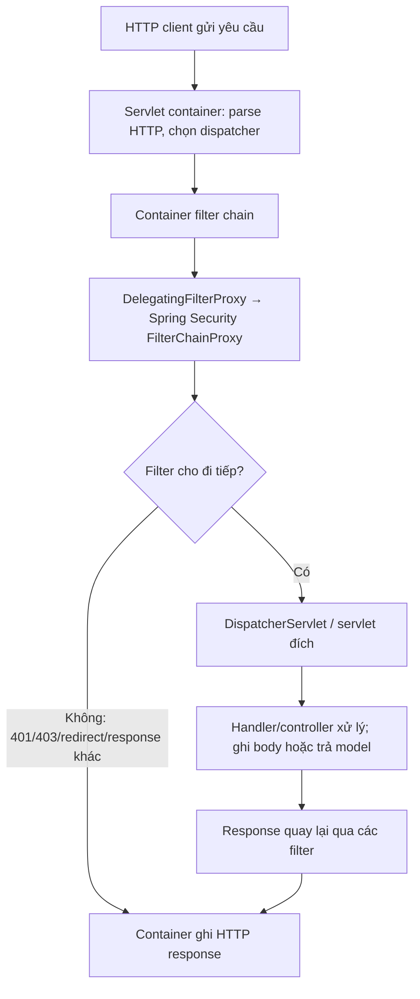

# `HttpServletRequest`, `HttpServletResponse` và vòng đời một yêu cầu HTTP

**Phạm vi:** Nền tảng Jakarta Servlet trong ứng dụng web Java, với cách các đối tượng request/response đi qua Spring MVC và Spring Security (Servlet stack). Ví dụ dùng Java 17, Spring Boot 3.3.x, Spring Security 6.x và namespace `jakarta.servlet.*`.

## 1. Bức tranh tổng thể

Khi trình duyệt hoặc HTTP client gửi yêu cầu, **Servlet container** (ví dụ Tomcat) tiếp nhận và xử lý kết nối, phân tích HTTP, tạo hoặc gắn các đối tượng biểu diễn yêu cầu và phản hồi cho một lần xử lý:

- **`HttpServletRequest`** là giao diện *đọc đầu vào HTTP*: phương thức, đường dẫn, query string, headers, cookies, tham số, nội dung body, thông tin session và các thuộc tính nội bộ của request.
- **`HttpServletResponse`** là giao diện *xây dựng đầu ra HTTP*: mã trạng thái, headers, cookies, content type/charset và body; container thực sự ghi dữ liệu ra kết nối.
- Hai giao diện thuộc **Jakarta Servlet API** (`jakarta.servlet.http`); ứng dụng thường nhận đối tượng triển khai/wrapper do container hoặc filter cung cấp. Đừng tự khởi tạo chúng như các DTO thông thường.
- Một **HTTP request** và một **Servlet dispatch** không phải lúc nào cũng đồng nhất: `forward`, error dispatch và async dispatch có thể làm yêu cầu đi qua các thành phần khác nhau. Với request đồng bộ thông thường, container giao một luồng xử lý tới filter chain và servlet; với xử lý bất đồng bộ, công việc có thể tiếp tục ở luồng khác.

Ví dụ:

```http
GET /api/hello?name=An HTTP/1.1
Host: localhost:8080
Accept: text/plain
```

Trong controller, `request.getMethod()` là `GET`, `request.getRequestURI()` là `/api/hello`, `request.getQueryString()` là `name=An`; `response` sau khi xử lý có thể mang `200 OK`, `Content-Type: text/plain;charset=UTF-8` và nội dung lời chào.

**Phân biệt ba vòng đời:** servlet/filter thường được container quản lý như thành phần dùng lại qua nhiều request; đối tượng request/response gắn với một lượt xử lý; HTTP session (nếu sử dụng) có thể tồn tại qua nhiều request. Không lưu request/response vào trường `static` hoặc bean singleton để dùng về sau.

## 2. Vòng đời từ lúc nhận HTTP đến lúc trả response



Các giai đoạn cần nhớ:

1. **Nhận và định tuyến:** container đọc request line/headers, chọn ứng dụng, URL mapping, dispatch type; gắn request/response vào quá trình xử lý. Body có thể được đọc theo nhu cầu, không nhất thiết được tải sẵn thành một chuỗi.
2. **Filter đi vào (`chain.doFilter`)**: một filter có thể xem/sửa request hoặc response, đặt header, ghi log, bọc đối tượng bằng `HttpServletRequestWrapper`/`HttpServletResponseWrapper`, hoặc dừng chain bằng cách tự trả response.
3. **Spring Security (nếu cấu hình):** `DelegatingFilterProxy` chuyển lời gọi vào `FilterChainProxy`; đối tượng này chọn `SecurityFilterChain` phù hợp để chạy các security filter như khôi phục security context, xác thực, CSRF và phân quyền. Thứ tự, matcher và cấu hình quyết định filter nào chạy. Chỉ những yêu cầu đi qua chuỗi đã đăng ký mới chịu các quy tắc tương ứng.
4. **Servlet đích:** trong Spring MVC thường là `DispatcherServlet`, rồi tới handler mapping, controller và các phần chuyển đổi dữ liệu (`@RequestBody`, `@ResponseBody`, `ResponseEntity`, v.v.). Servlet không dùng Spring MVC vẫn có thể xử lý trực tiếp.
5. **Đường về:** sau khi `chain.doFilter` trả về, phần `finally`/code sau chain của các filter được thực thi theo thứ tự ngược. `status`, headers, body được container gửi/hoàn tất; thời điểm **commit** phụ thuộc việc flush, đầy buffer hoặc các thao tác như `sendError`/`sendRedirect`, không được suy ra chỉ từ việc controller đã return.
6. **Kết thúc hoặc dispatch tiếp:** container hoàn tất tài nguyên và giải phóng phạm vi request đồng bộ. `forward`, `ERROR` và `ASYNC` có thể tạo dispatch tiếp; một số filter không tham gia mọi loại dispatch.

Luồng thành công thường là `client → filters → security filters → servlet/controller → filters → client`. Luồng bị chặn (ví dụ thiếu quyền) có thể trả `401`/`403` ngay tại security filter mà **không chạy controller**.

## 3. Đọc `HttpServletRequest` đúng cách

| Nhu cầu | API thường dùng | Ý nghĩa / lưu ý |
| --- | --- | --- |
| HTTP method | `getMethod()` | `GET`, `POST`, `PUT`…; không suy ra quyền từ method. |
| Path | `getRequestURI()` | URI path theo request, **không gồm query string**; có thể gồm context path. |
| Context và servlet mapping | `getContextPath()`, `getServletPath()`, `getPathInfo()` | Phụ thuộc cách deploy/mapping; `getPathInfo()` có thể `null`. |
| Query gốc | `getQueryString()` | Chuỗi raw sau dấu `?`, có thể `null`; chưa phải bản map đã decode. |
| Tham số | `getParameter("name")`, `getParameterValues(...)` | Trả tham số query và, tùy kiểu nội dung, form URL-encoded; không đại diện cho JSON body. |
| Headers | `getHeader("Accept")`, `getHeaders("X-Tag")` | Tên header không phân biệt hoa/thường; header có thể không tồn tại. |
| Body | `getInputStream()` **hoặc** `getReader()` | Body là luồng đọc; thường chỉ tiêu thụ một lần. Không gọi lẫn cả hai trên cùng request. |
| Cookies | `getCookies()` | Có thể là `null`; không mặc định tin dữ liệu cookie. |
| Session | `getSession(false)` | Lấy session hiện có hoặc `null`; `getSession()`/`getSession(true)` có thể **tạo session mới**. |
| Dữ liệu nội bộ | `getAttribute(...)`, `setAttribute(...)` | Dùng giữa các filter/servlet trong cùng request, khác query/form parameter. |
| Client/proxy | `getRemoteAddr()` | Có thể là địa chỉ reverse proxy; không tin thẳng `X-Forwarded-For` do client tự gửi. |

### URL và tham số: tránh nhầm lẫn

Với request giả định tới `https://example.test/shop/api/items?id=7`, ứng dụng được triển khai ở context `/shop`:

- `getContextPath()` → `/shop`.
- `getRequestURI()` → `/shop/api/items`.
- `getQueryString()` → `id=7`.
- `getParameter("id")` → `"7"`.
- `getRequestURL()` trả `StringBuffer` chứa URL **không có query**, dựa vào thông tin request mà container nhìn thấy; hostname/scheme bên ngoài proxy có thể khác nếu cấu hình forwarded headers chưa đúng.

`getParameter` có thể trả `null`, nhiều giá trị cùng tên thì dùng `getParameterValues`. Với JSON `{"name":"An"}` gửi bằng `Content-Type: application/json`, `getParameter("name")` **không tự parse JSON**; ở Spring MVC hãy dùng `@RequestBody` và message converter tương ứng.

### Đọc body, encoding, request attributes

- Nếu tự đọc body dạng ký tự, chọn charset thích hợp trước khi gọi `getReader()`; `setCharacterEncoding(...)` phải thực hiện trước khi dữ liệu tham số/body bị giải mã để có hiệu lực ở những nơi container áp dụng.
- `getInputStream()` đọc byte; `getReader()` đọc ký tự. Sau khi một filter đọc hết body, `@RequestBody` phía sau có thể không còn gì để đọc. `ContentCachingRequestWrapper` chỉ cache những byte đã được đọc, **không tự biến input stream thành luồng đọc lại được**; muốn đọc lại cần thiết kế wrapper thực sự phù hợp.
- `request.setAttribute("traceId", id)` chia sẻ dữ liệu cho downstream filters/servlet trong *request hiện tại*. `session.setAttribute(...)` tồn tại qua nhiều request của session. Đừng đặt dữ liệu riêng của request vào singleton bean hoặc static field.
- Không log nguyên `Authorization`, cookies, access token, mật khẩu hay body nhạy cảm. Tất cả dữ liệu từ client cần được kiểm tra đầu vào trước khi sử dụng.

## 4. Tạo `HttpServletResponse` đúng cách

Một HTTP response gồm **status line, headers và body**. Các thao tác quan trọng:

| API | Tác dụng | Cần nhớ |
| --- | --- | --- |
| `setStatus(201)` | Đặt mã HTTP status | Có thể vẫn ghi body; nên chọn code phản ánh kết quả thực tế. |
| `sendError(400)` | Báo lỗi qua container | Có thể kích hoạt error page/dispatch; không mặc nhiên đảm bảo JSON lỗi theo ý ứng dụng. |
| `sendRedirect("/login")` | Phản hồi chuyển hướng (thường 302) | Client gửi **request mới** tới `Location`; khác `RequestDispatcher.forward(...)`. |
| `setHeader("X-Trace-Id", id)` | Gán/ghi đè header cùng tên | `addHeader` dùng khi muốn thêm giá trị thay vì thay thế. |
| `setContentType(...)`, `setCharacterEncoding(...)` | Khai báo media type và charset | Thiết lập **trước** khi lấy writer/commit response. |
| `getWriter()` | Ghi body văn bản | Không dùng chung với `getOutputStream()` trên cùng response. |
| `getOutputStream()` | Ghi body nhị phân | Ví dụ stream file; quản lý flush và lỗi client ngắt kết nối. |
| `addCookie(cookie)` | Thêm `Set-Cookie` | Với cookie nhạy cảm cân nhắc `HttpOnly`, `Secure`, `SameSite`, `Path` và thời hạn. |
| `isCommitted()` | Cho biết headers/status đã được commit hay chưa | Sau commit, việc đổi status/header có thể không còn hiệu lực hoặc phát sinh lỗi. |

**Buffer và commit:** Ghi vài ký tự vào writer chưa chắc đã gửi header ra mạng ngay. Response thường có buffer; flush writer/stream, buffer đầy hoặc thao tác điều khiển như `sendError` có thể làm response được commit. Không cố ghi JSON lỗi mới sau khi response đã commit. Trong Spring MVC, dùng `ResponseEntity`, `@ResponseStatus` hoặc exception handler cho phần lớn use case; để framework chọn converter và quản lý response.

**Forward vs redirect:** `RequestDispatcher.forward(req, resp)` chuyển xử lý nội bộ trên server (thường cùng request và attributes) và phải thực hiện trước khi response commit. `sendRedirect(...)` trả status + `Location`, trình duyệt/client tạo một request mới; request attributes cũ không tự đi theo.

## 5. Quan hệ với Spring Security Servlet

Security filter đọc thông tin từ `HttpServletRequest` (headers, cookie/session, path, method, credentials) và quyết định có nên tiếp tục tới controller không. Chúng cũng có thể chỉnh `HttpServletResponse` (ví dụ `WWW-Authenticate`, redirect tới login, `401 Unauthorized`, `403 Forbidden`, security headers).

- **Authentication (xác thực)** trả lời “ai đang gọi?”; `Authentication` sau khi xác thực thường được truy cập qua `SecurityContextHolder` trong ngữ cảnh xử lý phù hợp. `request.getUserPrincipal()` có thể phản ánh principal qua lớp tích hợp Servlet, nhưng không nên giả định mọi cấu hình có cùng kiểu principal.
- **Authorization (phân quyền)** trả lời “người đó có được truy cập endpoint này không?”; các request matcher và `authorizeHttpRequests` cấu hình chính sách. `permitAll()` không có nghĩa mọi filter khác bị vô hiệu.
- **Exception handling:** tùy trạng thái xác thực, `ExceptionTranslationFilter` phối hợp `AuthenticationEntryPoint` (thường khởi phát xác thực/401 hay redirect) và `AccessDeniedHandler` (thường 403). Kết quả thực tế tùy authentication mechanism và cấu hình.
- **CSRF:** với ứng dụng dựa vào cookie/session, các request làm thay đổi trạng thái như POST/PUT/DELETE thường cần bảo vệ CSRF. Bộ lọc CSRF có thể từ chối request **trước** khi tới controller, kể cả endpoint được `permitAll()`. Không tắt CSRF theo thói quen; đánh giá cơ chế xác thực và cách client gửi credential.
- **Session và async:** đừng mặc định HTTP Basic làm hệ thống stateless. `SecurityContextHolder` mặc định dựa trên thread context; với `@Async`, executor hoặc Servlet async, cần cơ chế truyền context thích hợp thay vì dùng trực tiếp ThreadLocal ở luồng khác.

Vì vậy, khi chẩn đoán `401`, `403`, redirect hoặc controller không được gọi, hãy kiểm tra **filter chain được chọn, matcher, filter order, authentication, CSRF và loại dispatch** trước khi chỉ xem code controller.

## 6. Ví dụ có thể chạy: filter → Spring Security → controller

Ví dụ Spring Boot 3.3.5, Java 17. Tạo các file đúng cấu trúc sau, rồi chạy Maven. Endpoint công khai `GET /api/hello` cho phép quan sát method/URI. Filter sinh `X-Request-Id` và ghi log hai phía của `chain.doFilter`; security config yêu cầu xác thực ở các đường dẫn còn lại.

**`pom.xml`**

```xml
<project xmlns="http://maven.apache.org/POM/4.0.0"
         xmlns:xsi="http://www.w3.org/2001/XMLSchema-instance"
         xsi:schemaLocation="http://maven.apache.org/POM/4.0.0 https://maven.apache.org/xsd/maven-4.0.0.xsd">
    <modelVersion>4.0.0</modelVersion>
    <parent>
        <groupId>org.springframework.boot</groupId>
        <artifactId>spring-boot-starter-parent</artifactId>
        <version>3.3.5</version>
        <relativePath/>
    </parent>
    <groupId>demo</groupId>
    <artifactId>servlet-lifecycle</artifactId>
    <version>0.0.1-SNAPSHOT</version>
    <properties>
        <java.version>17</java.version>
    </properties>
    <dependencies>
        <dependency>
            <groupId>org.springframework.boot</groupId>
            <artifactId>spring-boot-starter-web</artifactId>
        </dependency>
        <dependency>
            <groupId>org.springframework.boot</groupId>
            <artifactId>spring-boot-starter-security</artifactId>
        </dependency>
    </dependencies>
    <build>
        <plugins>
            <plugin>
                <groupId>org.springframework.boot</groupId>
                <artifactId>spring-boot-maven-plugin</artifactId>
            </plugin>
        </plugins>
    </build>
</project>
```

**`src/main/java/demo/Application.java`**

```java
package demo;

import org.springframework.boot.SpringApplication;
import org.springframework.boot.autoconfigure.SpringBootApplication;

@SpringBootApplication
public class Application {
    public static void main(String[] args) {
        SpringApplication.run(Application.class, args);
    }
}
```

**`src/main/java/demo/SecurityConfig.java`**

```java
package demo;

import org.springframework.context.annotation.Bean;
import org.springframework.context.annotation.Configuration;
import org.springframework.http.HttpMethod;
import org.springframework.security.config.Customizer;
import org.springframework.security.config.annotation.web.builders.HttpSecurity;
import org.springframework.security.web.SecurityFilterChain;

@Configuration
public class SecurityConfig {
    @Bean
    SecurityFilterChain security(HttpSecurity http) throws Exception {
        http.authorizeHttpRequests(auth -> auth
                .requestMatchers(HttpMethod.GET, "/api/hello").permitAll()
                .anyRequest().authenticated());
        http.httpBasic(Customizer.withDefaults());
        return http.build();
    }
}
```

**`src/main/java/demo/TraceFilter.java`**

```java
package demo;

import java.io.IOException;
import java.util.UUID;

import jakarta.servlet.FilterChain;
import jakarta.servlet.ServletException;
import jakarta.servlet.http.HttpServletRequest;
import jakarta.servlet.http.HttpServletResponse;

import org.springframework.core.Ordered;
import org.springframework.core.annotation.Order;
import org.springframework.stereotype.Component;
import org.springframework.web.filter.OncePerRequestFilter;

@Component
@Order(Ordered.HIGHEST_PRECEDENCE)
public class TraceFilter extends OncePerRequestFilter {
    @Override
    protected void doFilterInternal(HttpServletRequest request,
                                    HttpServletResponse response,
                                    FilterChain chain)
            throws ServletException, IOException {
        String id = UUID.randomUUID().toString();
        request.setAttribute("traceId", id);
        response.setHeader("X-Request-Id", id);

        System.out.printf("[%s] ENTER %s %s%n",
                id, request.getMethod(), request.getRequestURI());
        try {
            chain.doFilter(request, response);
        } finally {
            System.out.printf("[%s] EXIT status=%d committed=%s%n",
                    id, response.getStatus(), response.isCommitted());
        }
    }
}
```

**`src/main/java/demo/HelloController.java`**

```java
package demo;

import java.nio.charset.StandardCharsets;

import jakarta.servlet.http.HttpServletRequest;

import org.springframework.http.MediaType;
import org.springframework.http.ResponseEntity;
import org.springframework.web.bind.annotation.GetMapping;
import org.springframework.web.bind.annotation.RequestParam;
import org.springframework.web.bind.annotation.RestController;

@RestController
public class HelloController {
    @GetMapping(value = "/api/hello", produces = MediaType.TEXT_PLAIN_VALUE)
    public ResponseEntity<String> hello(
            @RequestParam(name = "name", defaultValue = "bạn") String name,
            HttpServletRequest request) {
        String body = "Xin chào, " + name
                + " | method=" + request.getMethod()
                + " | uri=" + request.getRequestURI();
        return ResponseEntity.ok()
                .contentType(new MediaType("text", "plain", StandardCharsets.UTF_8))
                .header("X-Handled-By", "HelloController")
                .body(body);
    }
}
```

**Chạy và kiểm tra (trong thư mục chứa `pom.xml`):**

```bash
mvn spring-boot:run

# Trong terminal khác:
curl -s 'http://localhost:8080/api/hello?name=An'
curl -si 'http://localhost:8080/api/hello?name=An'
curl -s -o /dev/null -w '%{http_code}\n' http://localhost:8080/api/private
curl -s -o /dev/null -w '%{http_code}\n' -X POST http://localhost:8080/api/hello
```

Lệnh `curl -s` thứ nhất trả **body chính xác** (không có newline do controller thêm):

```text
Xin chào, An | method=GET | uri=/api/hello
```

- Lệnh `curl -si` cho thấy status `200`, `Content-Type: text/plain;charset=UTF-8` và các header như `X-Request-Id` (UUID thay đổi mỗi lượt), `X-Handled-By: HelloController`; thứ tự/cách viết hoa header do server quyết định.
- Yêu cầu không xác thực tới `/api/private` trả **401** bằng HTTP Basic trước khi tới controller. Route `/api/private` không được khai báo; nếu xác thực thành công thì bước MVC có thể trả `404`, là một tình huống khác.
- `POST /api/hello` không có CSRF token thường trả **403** bởi `CsrfFilter` với cấu hình trên; thao tác này không chứng tỏ controller hỗ trợ POST (controller chỉ khai báo GET).
- Log của `TraceFilter` có dòng `ENTER` trước `chain.doFilter` và `EXIT` ở `finally`; `status` phản ánh kết quả quan sát tại thời điểm filter thoát. `committed` có thể là `true` hoặc `false` tùy thời điểm/kiểu ghi response, nên **không gán cứng giá trị này làm expected output**.
- Vì filter đăng ký ở mức Servlet và có `@Order(Ordered.HIGHEST_PRECEDENCE)`, ví dụ này đặt nó trước security filter proxy. Trong hệ thống thực tế, luôn kiểm tra thứ tự đăng ký và dispatcher types của các filter.
- Ví dụ dùng Basic chỉ để dễ quan sát `401`; mật khẩu mặc định do Spring Boot phát sinh trong log phục vụ môi trường thử nghiệm. Ứng dụng thật cần cấu hình authentication và chính sách session/CSRF phù hợp.

## 7. Những tình huống dễ nhầm

### A. `401` và `403` có thể xuất hiện trước controller

Nếu filter xác thực/phân quyền hoặc CSRF kết thúc xử lý, đoạn code `@GetMapping`/`@PostMapping` sẽ không chạy. Đặt breakpoint vào filter chain, xem matcher và cấu hình bảo vệ, không kết luận ngay rằng URL mapping sai.

### B. Đọc body để log làm hỏng `@RequestBody`

Một filter tự gọi `request.getInputStream().readAllBytes()` có thể tiêu thụ body trước Spring MVC. Dùng chiến lược logging có giới hạn, tuân thủ privacy, phù hợp luồng bất đồng bộ và wrapper được thiết kế cho việc đọc lại nếu thật sự cần. `ContentCachingRequestWrapper` không tự cho phép replay một body đã đọc.

### C. Ghi response quá sớm

Nếu filter gọi `response.getWriter().write(...)` rồi flush trước `chain.doFilter`, controller có thể không sửa được status/header. Nếu filter đã tự xử lý (ví dụ trả 401), thường phải `return` và **không** tiếp tục chain. Đừng gọi `sendError` sau khi response đã committed.

### D. Nhầm phạm vi dữ liệu

`getParameter` đến từ đầu vào HTTP; `getAttribute` là dữ liệu gắn trong request; `getSession(false)` là trạng thái theo session nếu có. Session không tương đương một HTTP request, còn `request.getSession()` có thể tạo session ngoài ý muốn.

### E. Quên proxy và bảo mật đầu vào

`getRemoteAddr()` nhiều khi là proxy. Header `Host` và `X-Forwarded-*` không đáng tin nếu thiếu cấu hình proxy đáng tin cậy; sai cấu hình có thể làm sai URL, redirect hoặc quyết định bảo mật. Không ghi thông tin xác thực vào log và không tạo HTML không escape từ tham số người dùng.

### F. Không phân biệt `javax` và `jakarta`

Spring Boot 3 / Spring Framework 6 dùng các import `jakarta.servlet.*`. Sao chép ví dụ `javax.servlet.*` của hệ sinh thái cũ có thể làm build lỗi hoặc gây nhầm dependency. Chọn cùng thế hệ Servlet, Spring và thư viện.

### G. Đinh ninh mỗi request chạy đúng một thread/một filter pass

Async processing, `forward`, `ERROR` dispatch và cách cấu hình dispatcher types có thể khiến code chạy trên luồng/dispatch khác. `OncePerRequestFilter` có chính sách riêng cho async/error dispatch; không suy ra rằng mọi filter được thực thi đúng một lần cho toàn bộ vòng đời mạng HTTP.

## 8. Cách tự kiểm tra khi debug một request

1. Ghi nhận **method + URI + query**, không log secrets; xác định context path, proxy và target handler dự kiến.
2. Kiểm tra Servlet filter nào được đăng ký, thứ tự, dispatcher types; filter có gọi `chain.doFilter` hay đã tự viết response.
3. Nếu dùng Spring Security, xác định `SecurityFilterChain` nào khớp, authentication hiện tại, authorization matcher và CSRF.
4. Nếu đã đến MVC, kiểm tra handler mapping, binding (`@RequestParam`, `@RequestBody`) và các exception handler.
5. Xác định ai đặt status, headers, body; kiểm tra `response.isCommitted()` trước khi sửa response.
6. Với async/error/forward, theo dõi từng dispatch và cơ chế truyền security/request context.

**Tự luyện tập:** Thêm một `GET /api/inspect` đọc `getQueryString()` và `getAttribute("traceId")`; so sánh với `getHeader("X-Request-Id")` (header này thuộc *response*, không phải request). Sau đó thử gửi `POST` không có CSRF token và quan sát vì sao controller không chạy. Cuối cùng, đổi filter để chỉ `response.setHeader(...)` trước `chain.doFilter` và giải thích tại sao đây là vị trí phù hợp để thêm header theo request ID.