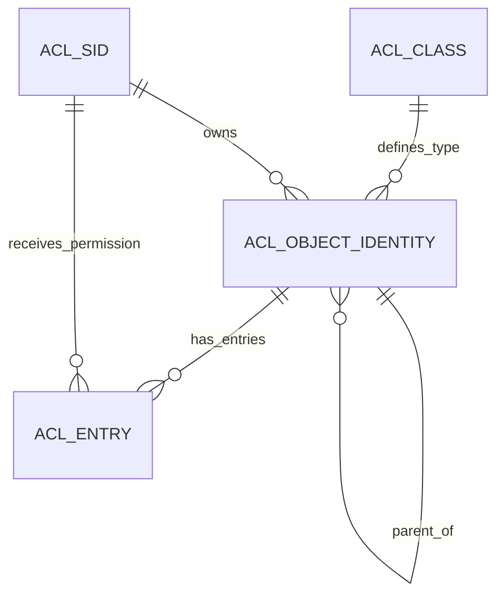

# `AclService`, `MutableAclService` và lưu trữ ACL bằng JDBC

**Module:** Spring Security – Servlet  
**Nhóm:** Quyền tài nguyên  
**Công nghệ minh họa:** Java 17, Spring Boot 3.3.5, Spring Security ACL 6.x, Spring MVC/Servlet, Spring JDBC và H2.

## 1. Mục tiêu

`authorizeHttpRequests(...).authenticated()` chỉ yêu cầu người gọi có danh tính được xác thực. Nó **không** trả lời Alice có được đọc tài liệu thuộc Bob hay không. Spring Security ACL (*Access Control List*) giải quyết bài toán cấp quyền **theo từng tài nguyên**, từng người dùng hoặc authority. Ba thành phần trong chủ đề này là:

- **`AclService`**: đọc ACL cho một hoặc nhiều `ObjectIdentity`.
- **`MutableAclService`**: mở rộng API đọc bằng thao tác tạo, cập nhật và xóa ACL/ACE.
- **JDBC ACL storage**: lưu danh tính tài nguyên, SID và danh sách ACE trong bốn bảng dữ liệu quan hệ có ràng buộc.

Sau bài học, bạn có thể hiểu `Sid`, `ObjectIdentity`, `Acl`, `AccessControlEntry`, `Permission` mask, `granting`, `owner`, `parent`, `entriesInheriting`; đọc/ghi ACL bằng `JdbcMutableAclService`; cấu hình `BasicLookupStrategy`, `AclCache` và JDBC schema; tích hợp method security; kiểm thử cấp quyền và thu hồi; kiểm soát transaction, cache và tenant isolation.

**Thông điệp:** ACL chỉ chứa **dữ liệu chính sách**. Nó không tự bảo vệ controller: hệ thống phải xác thực caller, truy vấn ACL và đưa ra quyết định authorization tại HTTP, method hoặc domain boundary.

## 2. Khi nào cần ACL thay vì role/ownership đơn giản?

Giả sử ứng dụng có tài liệu:

| Tài liệu | Chủ sở hữu | Quyền READ | Quyền WRITE |
| --- | --- | --- | --- |
| 101 | Alice | Alice, Bob | Alice |
| 102 | Bob | Bob | Bob |
| 103 | Carol | Carol, nhóm REVIEWER | Carol |

Một rule HTTP:

```java
.requestMatchers("/api/documents/**").authenticated()
```

chỉ kiểm tra danh tính, không kiểm tra object ID. Một method:

```java
@PreAuthorize("hasRole('USER')")
public Document read(long id) { ... }
```

cũng không ngăn một user thường đọc tài liệu người khác. Nếu không có cơ chế kiểm tra quyền theo ID, hệ thống gặp nguy cơ **IDOR/BOLA**.

ACL giúp mô tả:

```text
ObjectIdentity(Document, 101)
    ACE 0: PrincipalSid("alice"), READ, allow
    ACE 1: PrincipalSid("alice"), WRITE, allow
    ACE 2: PrincipalSid("bob"),   READ, allow
    ACE 3: GrantedAuthoritySid("ROLE_ADMIN"), READ, allow
```

Khi user Bob yêu cầu đọc tài liệu 101, hệ thống dựng `PrincipalSid("bob")` và các authority SID từ `Authentication`, sau đó kiểm tra ACE READ.

**Chọn ACL có chủ đích:** Nếu ứng dụng chỉ có quy tắc “người tạo bản ghi được sửa”, một database query `WHERE owner_id = :currentUser` có thể đơn giản hơn ACL. ACL đem lại giá trị khi có chia sẻ tài liệu, quyền theo nhóm, nhiều permission trên cùng resource, parent inheritance hoặc cấp/thu hồi quyền riêng từng đối tượng.

## 3. Sáu đối tượng nền tảng của ACL

### 3.1. `ObjectIdentity`: đối tượng nào?

```java
ObjectIdentity oid =
        new ObjectIdentityImpl(Document.class, 101L);
```

Imports:

```java
import org.springframework.security.acls.model.ObjectIdentity;
import org.springframework.security.acls.domain.ObjectIdentityImpl;
```

Một object identity gồm **class/type name** và **identifier**. Với class `demo.acl.Document`, database thường ghi `acl_class.class = 'demo.acl.Document'` và object ID `101`. Nếu đổi package/class mà không migrate dữ liệu ACL, lookup có thể không tìm thấy ACL cũ.

Đừng tái sử dụng ID của document đã xóa cho tài liệu mới nếu ACL cũ có thể còn tồn tại. Trong hệ thống nhiều tenant, `(Document.class, 101)` có thể không đủ phân biệt tài liệu 101 của hai tenant khác nhau; cần ID toàn cục, tenant namespace rõ hoặc một chiến lược object identity thích hợp.

### 3.2. `Sid`: ai nhận quyền?

Hai kiểu thông dụng:

```java
Sid alice = new PrincipalSid("alice");
Sid admins = new GrantedAuthoritySid("ROLE_ADMIN");
```

Imports:

```java
import org.springframework.security.acls.model.Sid;
import org.springframework.security.acls.domain.PrincipalSid;
import org.springframework.security.acls.domain.GrantedAuthoritySid;
```

`PrincipalSid` là danh tính cụ thể. `GrantedAuthoritySid` biểu diễn authority/role của một nhóm người dùng. Chúng được lưu trong `acl_sid`; cột `principal` phân biệt hai loại.

**Nguồn SID phải đáng tin:** username lấy từ `authentication.getName()`, authorities lấy từ `authentication.getAuthorities()`; tuyệt đối không lấy raw `X-User`, `X-Role` hoặc một chuỗi username do client gửi để **quyết định quyền của chính caller**.

### 3.3. `Permission`: có quyền làm gì?

Spring ACL có `BasePermission` với các bit masks chuẩn:

| Permission | Mask | Ý nghĩa gợi ý |
| --- | ---: | --- |
| `BasePermission.READ` | 1 | Đọc |
| `BasePermission.WRITE` | 2 | Sửa |
| `BasePermission.CREATE` | 4 | Tạo |
| `BasePermission.DELETE` | 8 | Xóa |
| `BasePermission.ADMINISTRATION` | 16 | Quản lý ACL/permission |

```java
import org.springframework.security.acls.domain.BasePermission;
import org.springframework.security.acls.model.Permission;

Permission permission = BasePermission.READ;
int mask = permission.getMask(); // 1
```

Permission mask là một giá trị số nguyên biểu diễn quyền. **`ROLE_ADMIN` không mặc định hàm ý `BasePermission.READ`** trên mọi object. Muốn admin đọc mọi tài liệu, phải có ACE dành cho authority admin, policy override tin cậy hoặc một permission granting strategy có chủ đích.

Custom permissions cần mask ổn định, không va chạm, có tests và migration khi thay đổi. Không giả định một chuỗi `"READ"` được mọi `PermissionEvaluator` hiểu theo ý bạn nếu chưa cấu hình mapping.

### 3.4. `AccessControlEntry`: một dòng cấp hoặc từ chối quyền

ACE gồm object identity ACL, SID, permission mask, `granting`, thứ tự và các audit flags.

```text
acl_object_identity = 10
ace_order = 0
sid = PrincipalSid("alice")
mask = 1
granting = true
audit_success = false
audit_failure = false
```

`granting=true` cho phép theo semantics của permission granting strategy; `granting=false` có thể biểu diễn từ chối. **Thứ tự ACE có thể ảnh hưởng kết quả**. Đừng hiểu đơn giản rằng chỉ cần có một ALLOW ở bất kỳ vị trí nào thì luôn được phép, hoặc bất kỳ DENY nào luôn thắng mọi ALLOW. Đánh giá theo strategy và thứ tự ACE thực tế, có positive/negative tests cho những tổ hợp bạn dùng.

### 3.5. `Acl`: bộ quyền cho một object

Một `Acl` tập hợp object identity, owner SID, các entries, parent ACL và `entriesInheriting`. Hai loại owner dễ nhầm:

- **Domain owner**: người sở hữu tài liệu trong bảng nghiệp vụ.
- **ACL owner**: owner của ACL, có thể được `AclAuthorizationStrategy` xét khi thay đổi ACL.

Không tự giả định hai owner này là cùng một người; project demo tạo owner ACL là identity seed riêng, còn domain owner là Alice/Bob.

### 3.6. Parent và inheritance

Đối tượng con có thể thừa hưởng quyền của parent ACL nếu quan hệ parent và `entriesInheriting` được cấu hình đúng. Ví dụ folder và file có policy kế thừa. Tuy nhiên chỉ có cột `parent_object` trong DB **không tự hình thành** cây quyền nếu code không thiết lập parent ACL.

Đối với quyền bị thu hồi, một user có thể vẫn được grant từ **role ACE** hoặc **parent ACL**, dù principal ACE của họ đã bị xóa. Phải xem toàn bộ nguồn cấp quyền, không chỉ một dòng.

## 4. `AclService`: đọc ACL bằng các ObjectIdentity

`AclService`, thuộc `org.springframework.security.acls.model`, là interface **chỉ đọc**. Các phương thức chính:

```java
Acl acl = aclService.readAclById(
        new ObjectIdentityImpl(Document.class, 101L));
```

Có overload nhận danh sách SID liên quan:

```java
List<Sid> sids = List.of(
        new PrincipalSid("alice"),
        new GrantedAuthoritySid("ROLE_USER"));
Acl acl = aclService.readAclById(oid, sids);
```

Ngoài ra, `readAclsById(...)` hỗ trợ đọc nhiều object identities, hữu ích khi cần đánh giá quyền cho một danh sách tài liệu. Tránh gọi `readAclById` riêng lẻ hàng nghìn lần trong vòng lặp mà chưa xem xét batch read/cache/N+1 queries.

### 4.1. Quyết định `isGranted`

```java
boolean allowed = acl.isGranted(
        List.of(BasePermission.READ),
        sids,
        false);
```

Ba tham số là danh sách permissions, danh sách SIDs và `administrativeMode`. Với quyết định READ thông thường, dùng `false`; không diễn giải `administrativeMode=true` như cờ bypass cho admin.

`Acl.isGranted(...)` hoặc `readAclById(...)` có thể phát sinh `NotFoundException` nếu không tìm thấy ACL/ACE thích hợp. Khi xây policy, thường xử lý **fail-closed**, tức thiếu bằng chứng permission thì không cấp quyền.

### 4.2. Dựng SID từ Authentication

```java
List<Sid> sids = new ArrayList<>();
sids.add(new PrincipalSid(authentication.getName()));

for (GrantedAuthority authority : authentication.getAuthorities()) {
    sids.add(new GrantedAuthoritySid(authority.getAuthority()));
}
```

Imports là `java.util.ArrayList`, `org.springframework.security.core.Authentication` và `org.springframework.security.core.GrantedAuthority`.

Nếu user được grant READ bằng role, phải có SID authority tương ứng trong list. Nếu chỉ tạo principal SID, bạn có thể vô tình bỏ qua những permission được cấp qua group.

## 5. `MutableAclService`: thao tác tạo, cập nhật, xóa ACL

`MutableAclService` mở rộng `AclService`. Ngoài các hàm đọc, nó cung cấp operations như:

```java
MutableAcl createAcl(ObjectIdentity identity);
MutableAcl updateAcl(MutableAcl acl);
void deleteAcl(ObjectIdentity identity, boolean deleteChildren);
```

Đây là chữ ký khái niệm; exception declarations được lược bỏ. Thao tác thật có thể ném `AlreadyExistsException`, `NotFoundException`, lỗi kiểm tra ACL administration hay JDBC exceptions.

### 5.1. Tạo ACL

```java
ObjectIdentity identity = new ObjectIdentityImpl(Document.class, 101L);
MutableAcl acl = mutableAclService.createAcl(identity);
```

`JdbcMutableAclService` có thể lấy `Authentication` hiện hành làm **ACL owner**. Nếu chạy từ bootstrap thread không có security context, cần một cách seed owner an toàn. Project có `AclSeeder` tạo bootstrap authentication **chỉ trong quá trình khởi tạo demo**, sau đó clear context; tuyệt đối không biến cách này thành backdoor tự nâng quyền qua HTTP.

`createAcl` không tự tạo domain document. Nó tạo cấu trúc ACL liên quan object identity. Đừng tạo ACL cho một object không tồn tại nếu nghiệp vụ không cho phép; quản lý lifecycle nhất quán.

### 5.2. Cấp quyền đọc

```java
MutableAcl acl = (MutableAcl) mutableAclService.readAclById(identity);
acl.insertAce(
        acl.getEntries().size(),
        BasePermission.READ,
        new PrincipalSid("bob"),
        true);
mutableAclService.updateAcl(acl);
```

**Phân biệt:**

- `insertAce` sửa đối tượng ACL mutable trong memory.
- `updateAcl` lưu thay đổi qua implementation (JDBC, đồng bộ/evict cache).
- `@Transactional` nên bao bọc một read-modify-write operation.
- Caller phải có **quyền quản lý ACL**, không chỉ quyền đọc document.

Nên thiết kế idempotency để tránh tạo nhiều ACE giống nhau khi retry request, và kiểm soát trường hợp hai admin sửa cùng ACL đồng thời.

### 5.3. Thu hồi một ACE

Fragment xóa entry READ của Bob:

```java
MutableAcl acl = (MutableAcl) mutableAclService.readAclById(identity);

for (int i = acl.getEntries().size() - 1; i >= 0; i--) {
    AccessControlEntry ace = acl.getEntries().get(i);
    if (ace.getSid().equals(new PrincipalSid("bob"))
            && ace.getPermission().equals(BasePermission.READ)) {
        acl.deleteAce(i);
    }
}
mutableAclService.updateAcl(acl);
```

Import `org.springframework.security.acls.model.AccessControlEntry`. Xóa từ cuối để index không bị lệch. Tuy nhiên Bob có thể **vẫn được READ** từ một GrantedAuthoritySid hoặc parent ACL. Cần test hành vi thực sau revoke, kể cả cache.

### 5.4. Xóa ACL

```java
mutableAclService.deleteAcl(identity, false);
```

`deleteAcl` xóa quyền ACL, **không phải** xóa tài liệu nghiệp vụ. `deleteChildren` yêu cầu hiểu quan hệ parent/child ACL trước khi sử dụng; nếu true, có thể ảnh hưởng những ACL con. Khi xóa domain object nên dọn ACL đồng bộ hoặc có compensation workflow; giữ ACL cũ và tái sử dụng ID có thể gây cấp quyền nhầm.

## 6. Bốn bảng ACL với JDBC



| Bảng | Các trường quan trọng | Vai trò |
| --- | --- | --- |
| `acl_class` | `id`, `class` | Định danh kiểu object, ví dụ `demo.acl.Document` |
| `acl_sid` | `id`, `principal`, `sid` | Người dùng/role nhận quyền |
| `acl_object_identity` | `id`, `object_id_class`, `object_id_identity`, `owner_sid`, `parent_object`, `entries_inheriting` | Một ACL gắn với object instance |
| `acl_entry` | `id`, `acl_object_identity`, `ace_order`, `sid`, `mask`, `granting`, `audit_success`, `audit_failure` | Các ACE theo thứ tự |

Ràng buộc cần nhớ: unique trên `acl_class.class`, unique `(acl_sid.sid, acl_sid.principal)`, unique `(acl_object_identity.object_id_class, object_id_identity)` và unique `(acl_entry.acl_object_identity, ace_order)`. Foreign keys ngăn các bản ghi quyền trỏ tới class/SID/ACL sai.

### 6.1. Dữ liệu mẫu

```text
acl_class
  id=1 class=demo.acl.Document

acl_sid
  id=1 principal=true sid=acl-bootstrap
  id=2 principal=true sid=alice
  id=3 principal=true sid=bob
  id=4 principal=false sid=ROLE_ADMIN

acl_object_identity
  id=1 object_id_class=1 object_id_identity=101 owner_sid=1

acl_entry
  acl_object_identity=1 ace_order=0 sid=2 mask=1 granting=true
  acl_object_identity=1 ace_order=1 sid=4 mask=1 granting=true
```

Tập dữ liệu trên mang tính mô tả; ID tự sinh có thể khác theo thứ tự insert thực tế. `owner_sid` là owner ACL do bootstrap tạo, không nhất thiết là domain owner `alice`.

### 6.2. Tính nhất quán của DDL và Java class name

`ObjectIdentityImpl(Document.class, 101L)` dùng class name của `Document` làm loại object. Nếu đổi package `demo.acl` trong source code mà không migrate `acl_class`, các quyền cũ có thể “biến mất” đối với lookup. Khi dùng UUID/string ID, schema bigint mặc định có thể không đủ; phải thiết kế một mapping object ID ổn định và tương thích với JDBC implementation.

Ở multi-tenant, nếu hai tenant đều có `Document.id=101`, cần tránh collision trong `acl_object_identity`. Có thể dùng ID toàn cục hoặc object namespace bao gồm tenant. Không để một SID `alice` của tenant A được cấp quyền trên object của tenant B do key trùng.

### 6.3. Vì sao transaction quan trọng?

Tạo ACL có thể tạo cả `acl_class`, `acl_sid` và `acl_object_identity`; cập nhật ACL có thể xóa/chèn nhiều entries. Không transaction thì lỗi giữa chừng có thể để lại dữ liệu nửa vời.

`@Transactional` bao toàn bộ operation giúp Spring JDBC dùng cùng transaction/connection, đồng thời hỗ trợ identity queries của một số dialect. Điều đó **không** tự giải quyết lost update khi hai người sửa ACL đồng thời; cần locking/version/serialization policy.

## 7. Các implementation JDBC và cache

- `JdbcAclService`: implementation **đọc** ACL, phù hợp khi ACL chỉ được quản lý ở nơi khác.
- `JdbcMutableAclService`: triển khai `MutableAclService`, kế thừa khả năng đọc và bổ sung mutation.
- `BasicLookupStrategy`: đọc ACL/ACE/owner/parent qua JDBC.
- `AclCache`, `SpringCacheBasedAclCache`: cache ACL đã load.
- `AclAuthorizationStrategy`: quyết định ai được sửa ACL owner/entries.
- `PermissionGrantingStrategy`: cách đánh giá ACE khi `isGranted`.
- `AclService`/`MutableAclService`: interface nên inject cho các services tương ứng.

Đừng inject `MutableAclService` vào mọi controller nếu chỉ cần kiểm tra quyền đọc. Chính sách least privilege tốt hơn: policy class nhận `AclService`, admin class nhận `MutableAclService`.

### 7.1. Identity queries theo database

`JdbcMutableAclService` cần đọc ID vừa tạo cho `acl_class` và `acl_sid`. Query tùy dialect. Ví dụ H2 sẽ dùng:

```java
service.setClassIdentityQuery(
        "SELECT CURRENT VALUE FOR acl_class_seq");
service.setSidIdentityQuery(
        "SELECT CURRENT VALUE FOR acl_sid_seq");
```

Đây là H2 sequence syntax cho schema ở phần dưới, **không phải** SQL đa database. PostgreSQL có thể cần `currval(...)` với tên sequence và transaction phù hợp; MySQL có thể dùng một cơ chế last insert identity khác. Khi đổi DB phải dùng migration/test integration trên dialect đích.

### 7.2. ACL cache không tự đồng bộ giữa nodes

`JdbcMutableAclService.updateAcl` có cơ chế làm việc với ACL cache trong implementation. Nhưng một `ConcurrentMapCache` là cache của **một JVM**. Nếu hệ thống có nhiều instances, node khác có thể còn ACL cũ sau khi một node revoke. Cần distributed invalidation/version/TTL và test yêu cầu về độ trễ thu hồi quyền.

Đặc biệt phải xem parent ACL inheritance, dữ liệu cached theo object type+ID, multi-tenant key và thứ tự read/write/transaction.

## 8. Project chạy thử: Spring Boot + H2 JDBC ACL

Demo có hai document và ba account:

- `alice / alice-pass`, `ROLE_USER`, được READ tài liệu 101.
- `bob / bob-pass`, `ROLE_USER`, được READ tài liệu 102.
- `admin / admin-pass`, `ROLE_ADMIN`, được READ cả 101 và 102 nhờ role ACE.
- `POST /api/docs/{id}/shares?username=bob`: admin có thể cấp READ cho Bob trên tài liệu 101, bằng `MutableAclService`.

HTTP layer yêu cầu authenticated; `@PreAuthorize` ở service mới đọc ACL hoặc bảo vệ admin operation. Dữ liệu document dùng Map in-memory, còn ACL metadata được lưu vào H2 qua JDBC. H2 trong ví dụ là **in-memory**, không sống qua process restart; muốn durable storage phải dùng database file/server thích hợp và migrations.

### 8.1. Cây thư mục

```text
jdbc-acl-demo/
├── pom.xml
└── src/
    ├── main/
    │   ├── java/demo/acl/
    │   │   ├── AclApplication.java
    │   │   ├── SecurityConfig.java
    │   │   ├── AclInfrastructure.java
    │   │   ├── Document.java
    │   │   ├── DocumentStore.java
    │   │   ├── AclBootstrap.java
    │   │   ├── AclSeeder.java
    │   │   ├── AclPolicy.java
    │   │   ├── DocumentService.java
    │   │   ├── AclAdministration.java
    │   │   └── DocumentController.java
    │   └── resources/
    │       ├── application.properties
    │       └── schema.sql
    └── test/java/demo/acl/
        └── AclApplicationTests.java
```

Cần JDK 17+, Maven và khả năng tải Maven dependencies lần đầu.

### 8.2. `pom.xml`

```xml
<?xml version="1.0" encoding="UTF-8"?>
<project xmlns="http://maven.apache.org/POM/4.0.0"
         xmlns:xsi="http://www.w3.org/2001/XMLSchema-instance"
         xsi:schemaLocation="http://maven.apache.org/POM/4.0.0 https://maven.apache.org/xsd/maven-4.0.0.xsd">
    <modelVersion>4.0.0</modelVersion>
    <parent>
        <groupId>org.springframework.boot</groupId>
        <artifactId>spring-boot-starter-parent</artifactId>
        <version>3.3.5</version>
        <relativePath/>
    </parent>
    <groupId>demo</groupId>
    <artifactId>jdbc-acl-demo</artifactId>
    <version>1.0.0</version>
    <properties>
        <java.version>17</java.version>
    </properties>
    <dependencies>
        <dependency>
            <groupId>org.springframework.boot</groupId>
            <artifactId>spring-boot-starter-web</artifactId>
        </dependency>
        <dependency>
            <groupId>org.springframework.boot</groupId>
            <artifactId>spring-boot-starter-security</artifactId>
        </dependency>
        <dependency>
            <groupId>org.springframework.security</groupId>
            <artifactId>spring-security-acl</artifactId>
        </dependency>
        <dependency>
            <groupId>org.springframework.boot</groupId>
            <artifactId>spring-boot-starter-jdbc</artifactId>
        </dependency>
        <dependency>
            <groupId>com.h2database</groupId>
            <artifactId>h2</artifactId>
            <scope>runtime</scope>
        </dependency>
        <dependency>
            <groupId>org.springframework.boot</groupId>
            <artifactId>spring-boot-starter-test</artifactId>
            <scope>test</scope>
        </dependency>
        <dependency>
            <groupId>org.springframework.security</groupId>
            <artifactId>spring-security-test</artifactId>
            <scope>test</scope>
        </dependency>
    </dependencies>
    <build>
        <plugins>
            <plugin>
                <groupId>org.springframework.boot</groupId>
                <artifactId>spring-boot-maven-plugin</artifactId>
            </plugin>
        </plugins>
    </build>
</project>
```

`spring-security-acl` là module riêng cần khai báo; `spring-boot-starter-security` không tự tạo JDBC ACL tables.

### 8.3. `src/main/resources/application.properties`

```properties
spring.datasource.url=jdbc:h2:mem:acldemo;DB_CLOSE_DELAY=-1
spring.datasource.driver-class-name=org.h2.Driver
spring.datasource.username=sa
spring.datasource.password=
spring.sql.init.mode=always
spring.sql.init.schema-locations=classpath:schema.sql
```

H2 in-memory phục vụ test/demo một process. Đừng xem nó là JDBC persistence **bền vững qua restart**. Production cần database durable, credentials được bảo vệ và schema migrations.

### 8.4. `src/main/resources/schema.sql`

```sql
CREATE SEQUENCE acl_class_seq START WITH 1 INCREMENT BY 1;
CREATE SEQUENCE acl_sid_seq START WITH 1 INCREMENT BY 1;
CREATE SEQUENCE acl_object_identity_seq START WITH 1 INCREMENT BY 1;
CREATE SEQUENCE acl_entry_seq START WITH 1 INCREMENT BY 1;

CREATE TABLE acl_class (
    id BIGINT DEFAULT NEXT VALUE FOR acl_class_seq PRIMARY KEY,
    class VARCHAR(255) NOT NULL,
    CONSTRAINT uq_acl_class UNIQUE (class)
);

CREATE TABLE acl_sid (
    id BIGINT DEFAULT NEXT VALUE FOR acl_sid_seq PRIMARY KEY,
    principal BOOLEAN NOT NULL,
    sid VARCHAR(255) NOT NULL,
    CONSTRAINT uq_acl_sid UNIQUE (sid, principal)
);

CREATE TABLE acl_object_identity (
    id BIGINT DEFAULT NEXT VALUE FOR acl_object_identity_seq PRIMARY KEY,
    object_id_class BIGINT NOT NULL,
    object_id_identity BIGINT NOT NULL,
    parent_object BIGINT,
    owner_sid BIGINT NOT NULL,
    entries_inheriting BOOLEAN NOT NULL,
    CONSTRAINT uq_acl_object UNIQUE (
        object_id_class, object_id_identity),
    CONSTRAINT fk_acl_class FOREIGN KEY (object_id_class)
        REFERENCES acl_class(id),
    CONSTRAINT fk_acl_parent FOREIGN KEY (parent_object)
        REFERENCES acl_object_identity(id),
    CONSTRAINT fk_acl_owner FOREIGN KEY (owner_sid)
        REFERENCES acl_sid(id)
);

CREATE TABLE acl_entry (
    id BIGINT DEFAULT NEXT VALUE FOR acl_entry_seq PRIMARY KEY,
    acl_object_identity BIGINT NOT NULL,
    ace_order INTEGER NOT NULL,
    sid BIGINT NOT NULL,
    mask INTEGER NOT NULL,
    granting BOOLEAN NOT NULL,
    audit_success BOOLEAN NOT NULL,
    audit_failure BOOLEAN NOT NULL,
    CONSTRAINT uq_acl_order UNIQUE (
        acl_object_identity, ace_order),
    CONSTRAINT fk_acl_entry_object FOREIGN KEY (
        acl_object_identity) REFERENCES acl_object_identity(id),
    CONSTRAINT fk_acl_entry_sid FOREIGN KEY (sid)
        REFERENCES acl_sid(id)
);
```

`schema.sql` tạo bảng mới. Không dùng lại nguyên script để “migrate” DB đã có dữ liệu. Constraint và index phù hợp với truy vấn `acl_class`, `acl_sid`, `acl_object_identity`, `acl_entry` phải được bảo vệ khi triển khai thật.

### 8.5. `src/main/java/demo/acl/AclApplication.java`

```java
package demo.acl;

import org.springframework.boot.SpringApplication;
import org.springframework.boot.autoconfigure.SpringBootApplication;

@SpringBootApplication
public class AclApplication {
    public static void main(String[] args) {
        SpringApplication.run(AclApplication.class, args);
    }
}
```

### 8.6. `src/main/java/demo/acl/SecurityConfig.java`

```java
package demo.acl;

import org.springframework.context.annotation.Bean;
import org.springframework.context.annotation.Configuration;
import org.springframework.http.HttpMethod;
import org.springframework.security.config.Customizer;
import org.springframework.security.config.annotation.method.configuration.EnableMethodSecurity;
import org.springframework.security.config.annotation.web.builders.HttpSecurity;
import org.springframework.security.config.http.SessionCreationPolicy;
import org.springframework.security.core.userdetails.User;
import org.springframework.security.core.userdetails.UserDetails;
import org.springframework.security.core.userdetails.UserDetailsService;
import org.springframework.security.crypto.bcrypt.BCryptPasswordEncoder;
import org.springframework.security.crypto.password.PasswordEncoder;
import org.springframework.security.provisioning.InMemoryUserDetailsManager;
import org.springframework.security.web.SecurityFilterChain;

@Configuration
@EnableMethodSecurity
public class SecurityConfig {

    @Bean
    PasswordEncoder passwordEncoder() {
        return new BCryptPasswordEncoder();
    }

    @Bean
    UserDetailsService users(PasswordEncoder encoder) {
        UserDetails alice = User.withUsername("alice")
                .password(encoder.encode("alice-pass"))
                .roles("USER").build();
        UserDetails bob = User.withUsername("bob")
                .password(encoder.encode("bob-pass"))
                .roles("USER").build();
        UserDetails admin = User.withUsername("admin")
                .password(encoder.encode("admin-pass"))
                .roles("ADMIN").build();
        return new InMemoryUserDetailsManager(alice, bob, admin);
    }

    @Bean
    SecurityFilterChain securityFilterChain(HttpSecurity http)
            throws Exception {

        http.authorizeHttpRequests(auth -> auth
                .requestMatchers(HttpMethod.GET, "/public/ping")
                    .permitAll()
                .requestMatchers(HttpMethod.GET, "/api/docs/{id}")
                    .authenticated()
                .requestMatchers(HttpMethod.POST,
                        "/api/docs/{id}/shares")
                    .authenticated()
                .anyRequest().denyAll());

        http.httpBasic(Customizer.withDefaults());
        http.sessionManagement(session -> session
                .sessionCreationPolicy(SessionCreationPolicy.STATELESS));

        // CSRF vẫn được bật, vì POST cần được kiểm thử riêng.
        return http.build();
    }
}
```

HTTP Basic chỉ dùng demo với passwords giả trên localhost. Khi có credentials thật phải dùng HTTPS/certificate validation; Base64 không mã hóa mật khẩu. `STATELESS` không tự thực thi ACL, và CSRF không bị tắt bởi `authenticated()`.

### 8.7. `src/main/java/demo/acl/AclInfrastructure.java`

```java
package demo.acl;

import javax.sql.DataSource;

import org.springframework.cache.concurrent.ConcurrentMapCache;
import org.springframework.context.annotation.Bean;
import org.springframework.context.annotation.Configuration;
import org.springframework.security.acls.domain.AclAuthorizationStrategyImpl;
import org.springframework.security.acls.domain.ConsoleAuditLogger;
import org.springframework.security.acls.domain.DefaultPermissionGrantingStrategy;
import org.springframework.security.acls.domain.SpringCacheBasedAclCache;
import org.springframework.security.acls.jdbc.BasicLookupStrategy;
import org.springframework.security.acls.jdbc.JdbcMutableAclService;
import org.springframework.security.acls.model.AclAuthorizationStrategy;
import org.springframework.security.acls.model.AclCache;
import org.springframework.security.acls.model.LookupStrategy;
import org.springframework.security.acls.model.MutableAclService;
import org.springframework.security.acls.model.PermissionGrantingStrategy;
import org.springframework.security.core.authority.SimpleGrantedAuthority;

@Configuration
public class AclInfrastructure {

    @Bean
    AclAuthorizationStrategy aclAuthorizationStrategy() {
        return new AclAuthorizationStrategyImpl(
                new SimpleGrantedAuthority("ROLE_ADMIN"));
    }

    @Bean
    PermissionGrantingStrategy permissionGrantingStrategy() {
        return new DefaultPermissionGrantingStrategy(
                new ConsoleAuditLogger());
    }

    @Bean
    AclCache aclCache(
            PermissionGrantingStrategy granting,
            AclAuthorizationStrategy strategy) {
        return new SpringCacheBasedAclCache(
                new ConcurrentMapCache("aclCache"),
                granting, strategy);
    }

    @Bean
    LookupStrategy lookupStrategy(
            DataSource dataSource,
            AclCache aclCache,
            AclAuthorizationStrategy strategy,
            PermissionGrantingStrategy granting) {
        return new BasicLookupStrategy(
                dataSource, aclCache, strategy, granting);
    }

    @Bean
    MutableAclService mutableAclService(
            DataSource dataSource,
            LookupStrategy lookupStrategy,
            AclCache aclCache) {
        JdbcMutableAclService service =
                new JdbcMutableAclService(
                        dataSource, lookupStrategy, aclCache);

        // Identity queries phụ thuộc H2 sequences ở schema.sql.
        service.setClassIdentityQuery(
                "SELECT CURRENT VALUE FOR acl_class_seq");
        service.setSidIdentityQuery(
                "SELECT CURRENT VALUE FOR acl_sid_seq");
        return service;
    }
}
```

`JdbcMutableAclService` là `MutableAclService` và cũng là `AclService`. Vì vậy read policy có thể inject `AclService`, admin service inject `MutableAclService` từ **cùng bean**.

`SpringCacheBasedAclCache` ở đây dùng cache đơn JVM, đủ cho demo. Với nhiều nodes, cần invalidation/versioning để quyền bị thu hồi không còn trong cache tại node khác. Spring ACL còn có `JdbcAclService` cho ứng dụng chỉ cần đọc, nhưng project này cần mutation nên dùng `JdbcMutableAclService`.

### 8.8. `src/main/java/demo/acl/Document.java`

```java
package demo.acl;

public record Document(long id, String owner, String title) {
}
```

Record Java 17. `ObjectIdentityImpl(Document.class, id)` dùng class `demo.acl.Document`; keep namespace ổn định hoặc migrate `acl_class` khi đổi package.

### 8.9. `src/main/java/demo/acl/DocumentStore.java`

```java
package demo.acl;

import java.util.Map;
import java.util.Optional;

import org.springframework.stereotype.Repository;

@Repository
public class DocumentStore {
    private final Map<Long, Document> docs = Map.of(
            101L, new Document(101L, "alice", "Alice notes"),
            102L, new Document(102L, "bob", "Bob notes"));

    public Optional<Document> findById(long id) {
        return Optional.ofNullable(docs.get(id));
    }
}
```

Domain data ở Map để ví dụ dễ theo dõi; ACL data ghi xuống H2. Production nên có transaction/consistency policy giữa domain record và ACL.

### 8.10. `src/main/java/demo/acl/AclBootstrap.java`

```java
package demo.acl;

import org.springframework.security.acls.domain.BasePermission;
import org.springframework.security.acls.domain.GrantedAuthoritySid;
import org.springframework.security.acls.domain.ObjectIdentityImpl;
import org.springframework.security.acls.domain.PrincipalSid;
import org.springframework.security.acls.model.MutableAcl;
import org.springframework.security.acls.model.MutableAclService;
import org.springframework.security.acls.model.ObjectIdentity;
import org.springframework.stereotype.Service;
import org.springframework.transaction.annotation.Transactional;

@Service
public class AclBootstrap {
    private final MutableAclService acls;

    public AclBootstrap(MutableAclService acls) {
        this.acls = acls;
    }

    @Transactional
    public void seed() {
        createAcl(101L, "alice");
        createAcl(102L, "bob");
    }

    private void createAcl(long id, String owner) {
        ObjectIdentity identity =
                new ObjectIdentityImpl(Document.class, id);
        MutableAcl acl = acls.createAcl(identity);

        acl.insertAce(0, BasePermission.READ,
                new PrincipalSid(owner), true);
        acl.insertAce(1, BasePermission.READ,
                new GrantedAuthoritySid("ROLE_ADMIN"), true);
        acls.updateAcl(acl);
    }
}
```

Trong H2 memory, seed chạy khi app bắt đầu với DB trống. Với database durable, phải tránh gọi `createAcl` lặp khi đã tồn tại và dùng migrations/idempotent provisioning, không nuốt `AlreadyExistsException`.

### 8.11. `src/main/java/demo/acl/AclSeeder.java`

```java
package demo.acl;

import java.util.List;

import org.springframework.boot.ApplicationArguments;
import org.springframework.boot.ApplicationRunner;
import org.springframework.security.authentication.UsernamePasswordAuthenticationToken;
import org.springframework.security.core.Authentication;
import org.springframework.security.core.authority.SimpleGrantedAuthority;
import org.springframework.security.core.context.SecurityContext;
import org.springframework.security.core.context.SecurityContextHolder;
import org.springframework.stereotype.Component;

@Component
public class AclSeeder implements ApplicationRunner {
    private final AclBootstrap bootstrap;

    public AclSeeder(AclBootstrap bootstrap) {
        this.bootstrap = bootstrap;
    }

    @Override
    public void run(ApplicationArguments args) {
        // Identity seed giả dùng CHỈ cho startup demo.
        Authentication seedUser =
                new UsernamePasswordAuthenticationToken(
                        "acl-bootstrap", "n/a",
                        List.of(new SimpleGrantedAuthority("ROLE_ADMIN")));

        SecurityContext ctx =
                SecurityContextHolder.createEmptyContext();
        ctx.setAuthentication(seedUser);
        SecurityContextHolder.setContext(ctx);

        try {
            // Spring bean khác -> transaction interceptor hoạt động.
            bootstrap.seed();
        } finally {
            SecurityContextHolder.clearContext();
        }
    }
}
```

Lý do: `createAcl` có thể dùng `Authentication` hiện hành làm owner ACL, nên bootstrap thread cần identity seed có kiểm soát. Đây **không phải** cách cấp admin permission cho HTTP user; tuyệt đối không dùng `SecurityContextHolder` tự đặt admin trong request path để “sửa lỗi 403”. `bootstrap.seed()` ở một bean khác giúp `@Transactional` được áp dụng qua Spring proxy.

### 8.12. `src/main/java/demo/acl/AclPolicy.java`

```java
package demo.acl;

import java.util.ArrayList;
import java.util.List;

import org.springframework.security.acls.domain.BasePermission;
import org.springframework.security.acls.domain.GrantedAuthoritySid;
import org.springframework.security.acls.domain.ObjectIdentityImpl;
import org.springframework.security.acls.domain.PrincipalSid;
import org.springframework.security.acls.model.Acl;
import org.springframework.security.acls.model.AclService;
import org.springframework.security.acls.model.NotFoundException;
import org.springframework.security.acls.model.ObjectIdentity;
import org.springframework.security.acls.model.Sid;
import org.springframework.security.authentication.AnonymousAuthenticationToken;
import org.springframework.security.core.Authentication;
import org.springframework.security.core.GrantedAuthority;
import org.springframework.stereotype.Component;

@Component("aclPolicy")
public class AclPolicy {
    private final AclService acls;
    private final DocumentStore documents;

    public AclPolicy(AclService acls, DocumentStore documents) {
        this.acls = acls;
        this.documents = documents;
    }

    public boolean canRead(long id, Authentication authentication) {
        if (authentication == null
                || !authentication.isAuthenticated()
                || authentication instanceof AnonymousAuthenticationToken) {
            return false;
        }

        if (documents.findById(id).isEmpty()) {
            return false;
        }

        List<Sid> sids = new ArrayList<>();
        sids.add(new PrincipalSid(authentication.getName()));
        for (GrantedAuthority granted :
                authentication.getAuthorities()) {
            sids.add(new GrantedAuthoritySid(
                    granted.getAuthority()));
        }

        ObjectIdentity identity =
                new ObjectIdentityImpl(Document.class, id);

        try {
            Acl acl = acls.readAclById(identity, sids);
            return acl.isGranted(
                    List.of(BasePermission.READ), sids, false);
        } catch (NotFoundException missingAclOrAce) {
            return false; // Fail-closed, không cho phép mặc định.
        }
    }
}
```

Policy dựng SID từ user đã xác thực, không từ raw request headers. `AclService.readAclById(...)` lấy ACL, `Acl.isGranted(READ, sids, false)` mới kiểm tra permission. Với unknown object/ACL, trả false. Không bắt lỗi DB rộng rồi trả true; nếu JDBC hỏng, phải fail-closed và ghi telemetry an toàn.

### 8.13. `src/main/java/demo/acl/DocumentService.java`

```java
package demo.acl;

import org.springframework.http.HttpStatus;
import org.springframework.security.access.method.P;
import org.springframework.security.access.prepost.PreAuthorize;
import org.springframework.stereotype.Service;
import org.springframework.web.server.ResponseStatusException;

@Service
public class DocumentService {
    private final DocumentStore docs;

    public DocumentService(DocumentStore docs) {
        this.docs = docs;
    }

    @PreAuthorize("@aclPolicy.canRead(#id, authentication)")
    public Document read(@P("id") long id) {
        return docs.findById(id)
                .orElseThrow(() -> new ResponseStatusException(
                        HttpStatus.NOT_FOUND, "Document not found"));
    }
}
```

Method security cần `@EnableMethodSecurity` và lời gọi thông qua Spring-managed bean. `@P("id")` giúp SpEL nhận đúng tham số `#id` dù compiler không lưu metadata tên tham số. Tránh self-invocation (`this.read(...)`) làm bypass proxy trong mode phổ biến.

### 8.14. `src/main/java/demo/acl/AclAdministration.java`

```java
package demo.acl;

import org.springframework.http.HttpStatus;
import org.springframework.security.acls.domain.BasePermission;
import org.springframework.security.acls.domain.ObjectIdentityImpl;
import org.springframework.security.acls.domain.PrincipalSid;
import org.springframework.security.acls.model.MutableAcl;
import org.springframework.security.acls.model.MutableAclService;
import org.springframework.security.acls.model.ObjectIdentity;
import org.springframework.security.access.prepost.PreAuthorize;
import org.springframework.stereotype.Service;
import org.springframework.transaction.annotation.Transactional;
import org.springframework.web.server.ResponseStatusException;

@Service
public class AclAdministration {
    private final MutableAclService acls;
    private final DocumentStore docs;

    public AclAdministration(
            MutableAclService acls, DocumentStore docs) {
        this.acls = acls;
        this.docs = docs;
    }

    @PreAuthorize("hasRole('ADMIN')")
    @Transactional
    public void grantRead(long id, String recipientUsername) {
        if (docs.findById(id).isEmpty()) {
            throw new ResponseStatusException(
                    HttpStatus.NOT_FOUND, "Document not found");
        }

        ObjectIdentity identity =
                new ObjectIdentityImpl(Document.class, id);
        MutableAcl acl =
                (MutableAcl) acls.readAclById(identity);

        acl.insertAce(acl.getEntries().size(),
                BasePermission.READ,
                new PrincipalSid(recipientUsername),
                true);
        acls.updateAcl(acl);
    }
}
```

Phần demo giả định admin chỉ cấp một lần cho một username. Production phải chống duplicate grants, giới hạn người nhận trong tenant, validate account tồn tại, thiết kế idempotency, concurrency locking và audit. **Không** cho user thường tự chọn toàn bộ permission mask/ACE order/owner để tự cấp quyền.

### 8.15. `src/main/java/demo/acl/DocumentController.java`

```java
package demo.acl;

import org.springframework.http.HttpStatus;
import org.springframework.http.MediaType;
import org.springframework.web.bind.annotation.GetMapping;
import org.springframework.web.bind.annotation.PathVariable;
import org.springframework.web.bind.annotation.PostMapping;
import org.springframework.web.bind.annotation.RequestParam;
import org.springframework.web.bind.annotation.ResponseStatus;
import org.springframework.web.bind.annotation.RestController;

@RestController
public class DocumentController {
    private final DocumentService documents;
    private final AclAdministration admin;

    public DocumentController(
            DocumentService documents, AclAdministration admin) {
        this.documents = documents;
        this.admin = admin;
    }

    @GetMapping(value = "/public/ping",
                produces = MediaType.TEXT_PLAIN_VALUE)
    public String ping() {
        return "pong";
    }

    @GetMapping("/api/docs/{id}")
    public Document read(@PathVariable long id) {
        return documents.read(id);
    }

    @PostMapping("/api/docs/{id}/shares")
    @ResponseStatus(HttpStatus.NO_CONTENT)
    public void share(
            @PathVariable long id,
            @RequestParam String username) {
        admin.grantRead(id, username);
    }
}
```

`DocumentController` không đọc bảng ACL trực tiếp và không dựng role từ tham số client. Nó gọi Spring service beans, nên method security/transaction interceptors có cơ hội làm việc đúng.

## 9. MockMvc và JDBC tests

File `src/test/java/demo/acl/AclApplicationTests.java`:

```java
package demo.acl;

import javax.sql.DataSource;

import org.junit.jupiter.api.Test;
import org.springframework.beans.factory.annotation.Autowired;
import org.springframework.boot.test.autoconfigure.web.servlet.AutoConfigureMockMvc;
import org.springframework.boot.test.context.SpringBootTest;
import org.springframework.http.MediaType;
import org.springframework.jdbc.core.JdbcTemplate;
import org.springframework.test.annotation.DirtiesContext;
import org.springframework.test.web.servlet.MockMvc;

import static org.hamcrest.Matchers.containsString;
import static org.junit.jupiter.api.Assertions.assertEquals;
import static org.junit.jupiter.api.Assertions.assertTrue;
import static org.springframework.security.test.web.servlet.request.SecurityMockMvcRequestPostProcessors.csrf;
import static org.springframework.security.test.web.servlet.request.SecurityMockMvcRequestPostProcessors.httpBasic;
import static org.springframework.test.web.servlet.request.MockMvcRequestBuilders.get;
import static org.springframework.test.web.servlet.request.MockMvcRequestBuilders.post;
import static org.springframework.test.web.servlet.result.MockMvcResultMatchers.content;
import static org.springframework.test.web.servlet.result.MockMvcResultMatchers.header;
import static org.springframework.test.web.servlet.result.MockMvcResultMatchers.jsonPath;
import static org.springframework.test.web.servlet.result.MockMvcResultMatchers.status;

@SpringBootTest
@AutoConfigureMockMvc
class AclApplicationTests {

    @Autowired
    MockMvc mvc;

    @Autowired
    DataSource dataSource;

    @Test
    void pingIsPublic() throws Exception {
        mvc.perform(get("/public/ping"))
                .andExpect(status().isOk())
                .andExpect(content().string("pong"));
    }

    @Test
    void unauthenticatedCannotRead() throws Exception {
        mvc.perform(get("/api/docs/101")
                .accept(MediaType.APPLICATION_JSON))
                .andExpect(status().isUnauthorized())
                .andExpect(header().string(
                        "WWW-Authenticate", containsString("Basic")));
    }

    @Test
    void aliceCanReadHerDocument() throws Exception {
        mvc.perform(get("/api/docs/101")
                .with(httpBasic("alice", "alice-pass")))
                .andExpect(status().isOk())
                .andExpect(jsonPath("$.id").value(101))
                .andExpect(jsonPath("$.owner").value("alice"));
    }

    @Test
    void bobCannotReadAlicesDocumentInitially() throws Exception {
        mvc.perform(get("/api/docs/101")
                .with(httpBasic("bob", "bob-pass")))
                .andExpect(status().isForbidden());
    }

    @Test
    void bobCanReadOwnDocument() throws Exception {
        mvc.perform(get("/api/docs/102")
                .with(httpBasic("bob", "bob-pass")))
                .andExpect(status().isOk())
                .andExpect(jsonPath("$.title").value("Bob notes"));
    }

    @Test
    void adminReadsBothDocumentsByRoleAce() throws Exception {
        mvc.perform(get("/api/docs/101")
                .with(httpBasic("admin", "admin-pass")))
                .andExpect(status().isOk());
        mvc.perform(get("/api/docs/102")
                .with(httpBasic("admin", "admin-pass")))
                .andExpect(status().isOk());
    }

    @Test
    void missingDocumentFailsClosed() throws Exception {
        mvc.perform(get("/api/docs/999")
                .with(httpBasic("admin", "admin-pass")))
                .andExpect(status().isForbidden());
    }

    @Test
    void aclRowsReallyExistInJdbc() {
        JdbcTemplate jdbc = new JdbcTemplate(dataSource);
        Integer nObjects = jdbc.queryForObject(
                "SELECT COUNT(*) FROM acl_object_identity",
                Integer.class);
        Integer nEntries = jdbc.queryForObject(
                "SELECT COUNT(*) FROM acl_entry",
                Integer.class);

        assertEquals(2, nObjects);
        assertTrue(nEntries >= 4);
    }

    @Test
    void normalUserCannotGrantReadEvenWithCsrf() throws Exception {
        mvc.perform(post("/api/docs/101/shares")
                .with(httpBasic("bob", "bob-pass"))
                .with(csrf())
                .param("username", "bob"))
                .andExpect(status().isForbidden());
    }

    @Test
    void adminWithoutCsrfCannotGrantRead() throws Exception {
        mvc.perform(post("/api/docs/101/shares")
                .with(httpBasic("admin", "admin-pass"))
                .param("username", "bob"))
                .andExpect(status().isForbidden());
    }

    @Test
    @DirtiesContext(methodMode =
            DirtiesContext.MethodMode.AFTER_METHOD)
    void adminGrantsBobReadAndCacheReflectsMutation()
            throws Exception {
        mvc.perform(get("/api/docs/101")
                .with(httpBasic("bob", "bob-pass")))
                .andExpect(status().isForbidden());

        mvc.perform(post("/api/docs/101/shares")
                .with(httpBasic("admin", "admin-pass"))
                .with(csrf())
                .param("username", "bob"))
                .andExpect(status().isNoContent());

        mvc.perform(get("/api/docs/101")
                .with(httpBasic("bob", "bob-pass")))
                .andExpect(status().isOk())
                .andExpect(jsonPath("$.owner").value("alice"));
    }
}
```

**Dự kiến 11 tests PASS** nếu code, dependencies và H2 sequence queries phù hợp. Đây là đánh giá **tĩnh**, không phải tuyên bố đã chạy `mvn test` trong nhiệm vụ biên soạn.

Các test chứng minh:

- HTTP authentication cần thiết để tới controller.
- `AclService` đọc ACE owner/role khác nhau trên từng object.
- Một user logged in không được READ mọi document.
- JDBC tables thật được tạo và chứa ACEs, không phải danh sách permissions giả.
- Admin cấp READ bằng `MutableAclService`, user được quyền sau commit/cache update.
- POST thiếu CSRF bị từ chối trước khi method/ACL quyết định.
- `@DirtiesContext` ở test mutation giảm ảnh hưởng lên các tests khác; nếu chạy parallel phải có isolation tốt hơn.

MockMvc không mô phỏng đầy đủ browser, TLS, multi-node cache, database failover hoặc concurrent ACL update. Với hệ thống thật cần integration tests trên DB production-like và hạ tầng tương ứng.

### 9.1. Chạy project

Trong thư mục `jdbc-acl-demo`:

```bash
mvn clean test
mvn spring-boot:run
```

Một vài request quan sát bằng terminal khác:

```bash
curl -s http://localhost:8080/public/ping

curl -s -o /dev/null -w '%{http_code}\n' \
  http://localhost:8080/api/docs/101

curl -s -u alice:alice-pass \
  http://localhost:8080/api/docs/101

curl -s -o /dev/null -w '%{http_code}\n' \
  -u bob:bob-pass http://localhost:8080/api/docs/101

curl -s -u admin:admin-pass \
  http://localhost:8080/api/docs/102
```

Dự kiến kết quả theo thứ tự:

```text
pong
401
{"id":101,"owner":"alice","title":"Alice notes"}
403
{"id":102,"owner":"bob","title":"Bob notes"}
```

Body text có thể không tự thêm newline. Với PowerShell cũ, dùng `curl.exe` thay alias `curl` khi cần. Tất cả credentials ở đây chỉ dùng local. Basic trên HTTP không an toàn cho tài khoản thật.

**Không dùng POST `curl` thiếu CSRF để kết luận ACL mutation bị deny.** Demo giữ `CsrfFilter`, nên POST admin thiếu token có thể trả 403 **trước khi vào ACL code**. Test dùng `.with(csrf())` từ `spring-security-test`, không phải một payload HTTP client thật; client cần nhận/gửi token theo repository đang cấu hình hoặc thiết kế API non-browser với CSRF policy riêng.

## 10. Kết nối với `hasPermission(...)`

Spring Method Security có expression:

```java
@PreAuthorize("hasPermission(#id, 'demo.acl.Document', 'READ')")
public Document read(@P("id") long id) {
    // Logic domain...
}
```

Đây là **fragment** đòi hỏi `PermissionEvaluator` được cấu hình, không tự chạy chỉ vì có Spring ACL dependency. Có thể dùng `AclPermissionEvaluator` và `DefaultMethodSecurityExpressionHandler` thích hợp với phiên bản Spring Security đang dùng. Khi tích hợp, phải bảo đảm:

1. String type `demo.acl.Document` khớp `acl_class.class`.
2. Permission string được `PermissionFactory`/evaluator mapping đúng sang `BasePermission.READ`.
3. `SidRetrievalStrategy` lấy principal/authorities từ authentication thật.
4. Missing ACL bị deny và exceptions không bị chuyển thành allow.
5. Có tests cho principal ACE, role ACE, denial, unknown ID và cache.

Project chính dùng `@PreAuthorize("@aclPolicy.canRead(#id, authentication)")`: cách này **tường minh và ít magic**, giúp bài học thấy rõ `AclService`, SID và `Acl.isGranted`.

## 11. Transaction, cache, concurrency và revocation

### 11.1. Domain và ACL phải có lifecycle phối hợp

Có thể document đã được lưu DB nhưng ACL creation thất bại, hoặc document bị xóa mà ACL vẫn còn. Thiết kế cùng transaction khi dùng cùng DB; nếu khác stores cần outbox/saga/compensation rõ. Policy không tìm thấy ACL thì fail-closed.

### 11.2. Hai admin cập nhật cùng ACL

```text
Admin A: read ACL #101
Admin B: read ACL #101
Admin A: thêm ACE cho Bob, updateAcl
Admin B: thêm ACE cho Carol trên snapshot cũ, updateAcl
```

Một update có thể ghi đè entry của update khác tùy implementation. `@Transactional` **không tự giải quyết** tất cả lost-update races. Có thể cần lock theo object identity, versioning/optimistic locking, isolation hoặc serialized command handler.

### 11.3. Quyền bị thu hồi nhưng cache còn cũ

Sau khi xóa ACE, DB có thể đúng nhưng instance khác vẫn giữ cached ACL. Cần distributed eviction/version/TTL hoặc chiến lược đọc authoritative source khi xử lý data nhạy cảm. Không giả định local `ConcurrentMapCache` được đồng bộ nhiều nodes.

### 11.4. Lỗi DB không phải bằng chứng cấp quyền

Không catch mọi `DataAccessException` rồi trả `true`. Khi không xác minh được ACL, fail-closed. Phân biệt “không có ACL/ACE” với “database unavailable” để ghi log và monitoring phù hợp nhưng không tiết lộ dữ liệu cho caller.

### 11.5. Thứ tự ACE và inheritance

Xóa một principal ACE không đủ nếu role ACE/parent ACL vẫn grant quyền. Cần test khi dùng `granting=false`, thứ tự entries, permission mask và `entriesInheriting`. Với nhiều permissions trong một request, tránh diễn giải `isGranted` như phép OR đơn giản nếu strategy khác.

### 11.6. An toàn khi multi-tenant

SID `"alice"` và object ID `101` phải nằm trong namespace đáng tin cậy. Nếu hai tenant dùng cùng username/ID, schema ACL có thể cần surrogate object IDs hoặc tên SID phân vùng; mọi method policy còn phải kiểm tra tenant từ identity đã xác thực.

## 12. Troubleshooting

### `NotFoundException` khi `readAclById`

Có thể class name hoặc object ID không khớp, ACL chưa được seed, row bị xóa hoặc migration thiếu. Trả deny trong policy, xác minh `acl_class`/`acl_object_identity` và domain lifecycle; đừng mặc nhiên allow.

### `createAcl` thất bại ngay lúc startup

Có thể thiếu authentication để gán ACL owner, schema chưa tạo xong hoặc identity query sai dialect. Demo dùng `AclSeeder` tạm đặt bootstrap identity rồi gọi transactional bean.

### `AlreadyExistsException` khi tạo ACL

ACL đã tồn tại cho cùng class/type+ID hoặc concurrent create; không tự bỏ UNIQUE constraint. Dùng idempotent provisioning/locking đúng.

### Admin có role nhưng `isGranted(READ)` false

`ROLE_ADMIN` không tự tương đương READ; cần ACE cho `GrantedAuthoritySid("ROLE_ADMIN")` hoặc một policy được định nghĩa rõ.

### `insertAce` chạy nhưng DB không có entry

Có thể quên `MutableAclService.updateAcl(acl)` hoặc transaction bị rollback. Chỉ sửa `MutableAcl` trong memory chưa chắc đã persist.

### Thu hồi ACE nhưng user vẫn truy cập được

Còn ACE khác qua role/parent, cache stale, hoặc policy không gọi ACL thật. Kiểm tra `AclCache` và test người dùng sau revoke.

### Sau refactor class, toàn bộ ACL không còn tìm thấy

`ObjectIdentityImpl(Document.class,id)` gắn type bằng tên class Java. Đổi package cần migration bảng `acl_class` hoặc stable object type strategy.

### Bản demo H2 chạy được nhưng lên PostgreSQL lỗi

Identity queries, types, sequences, indexes, locks và JDBC behavior khác nhau. Chạy integration tests trên database thực và dùng migrations; không bê nguyên H2 schema/SQL sang DB khác.

### HTTP đã authenticated nhưng vẫn 403

Có thể method ACL deny, CSRF deny hoặc role guard của admin deny. Tách nguyên nhân bằng test có/không CSRF, kiểm tra authority và ACE. `permitAll` không tắt CSRF.

### Tự inject `MutableAclService` vào public API

Đó là rủi ro leo thang quyền. Chỉ expose business operations hẹp, bảo vệ admin policy và dùng ACL authorization strategy; không cho client tùy ý set SID/mask/owner.

## 13. Checklist triển khai thực tế

1. Xác định rõ nhu cầu per-object permissions so với owner-query đơn giản.
2. ObjectIdentity class/type và ID ổn định, tách đúng tenant.
3. Dựng SID từ `Authentication` đã kiểm chứng; không tin `X-Role`/`X-User`.
4. Phân biệt `AclService` read với `MutableAclService` write trong DI.
5. Bốn bảng có PK/FK/unique constraints, migration và indices phù hợp.
6. Cấu hình `JdbcMutableAclService`, `LookupStrategy`, `AclCache` nhất quán.
7. Identity queries đúng database dialect, được integration-test.
8. `@EnableMethodSecurity` được bật nếu dùng `@PreAuthorize`.
9. Có policy gọi `Acl.isGranted` hoặc `PermissionEvaluator`; không chỉ lưu ACL DB mà quên chấm quyền.
10. Chủ sở hữu ACL và domain owner được mô hình hóa riêng.
11. Lệnh mutation ACL được giới hạn quyền, transaction và audit.
12. API chia sẻ validate recipient, tenant, action, role và idempotency.
13. Missing ACL/ACE/database errors không dẫn tới default allow.
14. Revoke test xét cả role ACE, parent inheritance và cache stale.
15. Cache invalidation phù hợp multi-instance và security SLAs.
16. Quyền theo mask và thứ tự ACE được kiểm thử rõ.
17. Lifecycle tạo/xóa document và ACL không để orphan/sai ID reuse.
18. Concurrency có chiến lược chống lost update.
19. Không log credentials, cookies, tokens, toàn ACL dữ liệu nhạy cảm.
20. Có positive và negative tests cho owner, người ngoài, admin, object không tồn tại.
21. Production dùng HTTPS và database durable có backup/recovery.
22. CSRF/CORS được đánh giá theo cách client xác thực, độc lập ACL.
23. Việc nâng Spring Security/H2 version đi kèm test build và DB migrations.
24. `readAclsById`/batch reads được cân nhắc khi trả danh sách dài.
25. Không coi `ADMINISTRATION` mask là “quyền vô hạn” nếu chưa thiết kế granting strategy.

## 14. Câu hỏi tự luyện

**1. `AclService` có thể tạo ACL không?** Không, API tạo/cập nhật/xóa thuộc `MutableAclService`.

**2. `ObjectIdentity` gồm gì?** Object type/class và ID ổn định, không phải quyền của caller.

**3. `PrincipalSid` khác `GrantedAuthoritySid`?** Một SID cho identity cụ thể, một SID cho authority/role.

**4. `BasePermission.READ` có mask nào?** 1.

**5. `ROLE_ADMIN` luôn READ mọi object không?** Không; cần ACE/policy rõ.

**6. Chèn ACE vào mutable ACL đã lưu DB chưa?** Chưa, phải `updateAcl`.

**7. Bốn bảng JDBC ACL?** `acl_class`, `acl_sid`, `acl_object_identity`, `acl_entry`.

**8. Vì sao cache phải được invalidate sau revoke?** ACL cũ có thể còn grant dù DB đã đổi.

**9. Khi không thấy ACL có nên cho READ?** Không, fail-closed.

**10. ACL owner có phải document owner?** Không nhất thiết.

**11. H2 in-memory tồn tại qua restart không?** Không.

**12. Xóa principal ACE có bảo đảm quyền bị thu hồi không?** Không, còn role/parent ACE có thể grant.

**13. `.authenticated()` thay được ACL object policy không?** Không, chỉ chứng minh đã login.

**14. `AclService.readAclById` có tự chặn controller không?** Không; phải gọi `isGranted` hoặc tích hợp method policy.

**15. Lỗi khi hai admin cùng cập nhật ACL?** Có nguy cơ lost update; cần policy concurrency/locking và tests.

## Kết luận

`AclService` dùng để **đọc ACL**, `MutableAclService` để **tạo/cập nhật/xóa ACL**, còn JDBC persistence quản lý bốn bảng `acl_class`, `acl_sid`, `acl_object_identity`, `acl_entry`. Từ object identity và tập SID được xây từ `Authentication`, ACL quyết định liệu permission như READ/WRITE có được grant cho từng tài nguyên.

Một thiết kế an toàn phải đủ chuỗi **authentication → object identity → ACL lookup → permission decision → method/domain guard → transaction/cache consistency**. Khi thiếu ACL, SID không phù hợp hoặc hạ tầng không đủ dữ liệu để chứng minh quyền, không tự cấp quyền mặc định. Với dự án chỉ cần ownership đơn giản, hãy cân nhắc giữ policy gọn trong repository; với chia sẻ và quyền phức tạp, ACL cùng kiểm thử JDBC/thu hồi là lựa chọn đáng cân nhắc.