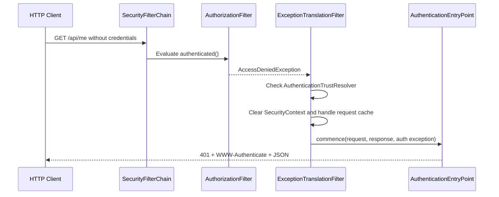

# AuthenticationEntryPoint khi yêu cầu cần được xác thực

> **Phạm vi:** Spring Boot 3.x, Spring Security 6.x, Java 17+ trên **Servlet stack** (Spring MVC). Chủ đề này thuộc nhóm **Phản hồi lỗi**: khi nào Spring Security cần bắt đầu xác thực, cơ chế nào tạo HTTP **401 Unauthorized**, vì sao 401 khác 403, ý nghĩa của `WWW-Authenticate`, cách cấu hình `AuthenticationEntryPoint` đúng cho REST API sử dụng HTTP Basic, và cách kiểm thử đường đi của security filters. Ví dụ runnable sử dụng Spring Web, Spring Security và MockMvc. Các đầu ra được ghi **kỳ vọng**, không khẳng định chúng đã được thực thi trong môi trường tài liệu.

## 1. Tình huống thực tế: request chưa được xác thực

Một client gọi endpoint yêu cầu đăng nhập:

```http
GET /api/me HTTP/1.1
Host: localhost:8080
Accept: application/json
```

Endpoint được cấu hình `authenticated()`. Nếu client không có thông tin đăng nhập hợp lệ, application không thể trả dữ liệu riêng tư. Nhưng **ai** quyết định trả 401, redirect tới form login, hoặc gửi challenge phù hợp giao thức? Câu trả lời cốt lõi là **`AuthenticationEntryPoint`**.

Ví dụ API dùng HTTP Basic có thể phản hồi:

```http
HTTP/1.1 401 Unauthorized
WWW-Authenticate: Basic realm="LabAPI", charset="UTF-8"
Content-Type: application/json;charset=UTF-8
Cache-Control: no-store

{"error":"AUTHENTICATION_REQUIRED"}
```

Một giao diện web form login lại thường chuyển hướng đến `/login` chứ không trả JSON. Cùng là **bắt đầu xác thực**, nhưng hành vi phù hợp phụ thuộc authentication mechanism và loại client.

### Mục tiêu học tập

Sau bài này, bạn có thể:

1. Giải thích chính xác `AuthenticationEntryPoint` là gì, `commence(...)` được gọi khi nào và nó khác authentication filter/provider ra sao.
2. Trình bày đường đi từ `ExceptionTranslationFilter` tới entry point khi request chưa được xác thực nhưng chạm resource protected.
3. Phân biệt `401` cần xác thực, `403` bị từ chối quyền và những trường hợp thiếu CSRF.
4. Thiết kế Basic challenge hợp lệ bằng `WWW-Authenticate` kể cả khi body là JSON.
5. Tích hợp custom entry point với `httpBasic` và `exceptionHandling`, kết hợp `AccessDeniedHandler` cho 403.
6. Viết kiểm thử cả anonymous, sai credentials, đúng credentials nhưng thiếu role, CSRF và endpoint công khai.
7. Tránh các lỗi trộn form login/Basic/Bearer, phá protocol challenge hoặc trả 200 cho lỗi xác thực.

## 2. AuthenticationEntryPoint là hợp đồng gì?

Trong Spring Security Servlet, `AuthenticationEntryPoint` là một interface:

```java
package org.springframework.security.web;

public interface AuthenticationEntryPoint {
    void commence(
            jakarta.servlet.http.HttpServletRequest request,
            jakarta.servlet.http.HttpServletResponse response,
            org.springframework.security.core.AuthenticationException authException
    ) throws java.io.IOException, jakarta.servlet.ServletException;
}
```

Phần code trên **mô tả chữ ký interface**, không phải file Java riêng cần tạo trong dự án.

`commence` được framework gọi khi cần **bắt đầu quy trình xác thực** hoặc đáp lại một lỗi authentication. Nó nhận:

- `request`: request HTTP đang cần chứng minh danh tính.
- `response`: response mà entry point có thể điều chỉnh status, headers, body, redirect.
- `authException`: lỗi/điều kiện khiến quy trình xác thực cần bắt đầu; không nên trả trực tiếp stack trace hoặc exception message cho client.

**Không phải nhiệm vụ của entry point:** xác minh password, đọc DB tài khoản, cấp role, quyết định quyền từng record, tự lưu SecurityContext hoặc kiểm soát refresh/JWT revocation. Việc kiểm tra credentials thuộc các authentication filters/providers; việc phân quyền thuộc authorization rules, method/domain policy.

### Những triển khai thường gặp

| Entry point / cơ chế | Hành vi điển hình | Khi nào hợp lý |
|---|---|---|
| `BasicAuthenticationEntryPoint` | HTTP 401 + `WWW-Authenticate: Basic ...` | API/client dùng HTTP Basic |
| `LoginUrlAuthenticationEntryPoint` | HTTP 302 redirect tới login page | Ứng dụng tương tác qua browser + form login |
| `BearerTokenAuthenticationEntryPoint` | HTTP 401 + Bearer challenge chuẩn | OAuth2 Resource Server nhận bearer tokens |
| `HttpStatusEntryPoint` | Đặt HTTP status cố định, không tự dựng protocol challenge đầy đủ | API tự xử lý protocol/challenge hoặc môi trường đặc thù |
| Custom `AuthenticationEntryPoint` | Status/headers/body có cấu trúc do ứng dụng định nghĩa | Cần response JSON nhất quán, giữ semantics authentication mechanism |

Không nên đổi mọi entry point sang một JSON response có `401` rồi bỏ qua `WWW-Authenticate` với Basic/Bearer nếu client cần giao thức challenge để biết cách xác thực tiếp.

## 3. 401 khác 403 như thế nào?

### 3.1. HTTP 401 — authentication còn thiếu hoặc không hợp lệ

HTTP 401 có tên lịch sử là **Unauthorized**, nhưng trên thực tế thường nghĩa là **chưa có xác thực phù hợp**. Trong HTTP authentication challenge, một 401 phải gửi header `WWW-Authenticate` chứa ít nhất một challenge áp dụng cho resource. Ví dụ:

```http
WWW-Authenticate: Basic realm="LabAPI", charset="UTF-8"
```

`realm` giúp mô tả phạm vi bảo vệ (*protection space*) của Basic. `charset="UTF-8"` là tham số được Basic hỗ trợ; nó không biến Base64 thành mã hóa. Credential Basic dùng Base64 cho `username:password`, nên **phải sử dụng HTTPS** trong môi trường thực.

401 không nhất thiết có nghĩa người dùng nhập password sai; request **chưa gửi** credentials cũng có thể nhận 401.

### 3.2. HTTP 403 — đã xác thực nhưng không đủ quyền

HTTP 403 **Forbidden** phù hợp khi danh tính đã được xác thực nhưng không có quyền dùng chức năng/tài nguyên. Ví dụ `ROLE_USER` gọi `/api/admin` chỉ dành cho `ROLE_ADMIN`:

```http
HTTP/1.1 403 Forbidden
Content-Type: application/json;charset=UTF-8

{"error":"ACCESS_DENIED"}
```

Đây thường là công việc của `AccessDeniedHandler`, **không phải** `AuthenticationEntryPoint`. Client không được “chữa” mọi 403 bằng cách liên tục nhập lại password; vấn đề có thể nằm ở role, tenant, ownership, policy hoặc CSRF.

### 3.3. Bảng phân loại nhanh

| Request/tình huống | Trạng thái authentication | Kết quả điển hình |
|---|---|---|
| Anonymous GET `/api/me` | Không có credentials | **401** + challenge đối với Basic |
| Basic username/password sai | Authentication thất bại | **401** + challenge |
| Basic đúng, USER GET `/api/me` | Authentication hợp lệ | **200** |
| Basic đúng, USER GET `/api/admin` | Đã xác thực, thiếu ROLE_ADMIN | **403** |
| Basic đúng, ADMIN GET `/api/admin` | Role đáp ứng policy | **200** |
| GET `/api/public` không credentials | Endpoint permitAll | **200** |
| POST cần CSRF nhưng token thiếu | Request bị CSRF filter chặn | **403**, ngay cả khi credentials có vẻ đúng |
| Request bị deny khi là anonymous | Chưa được xác thực để quyết định quyền | Thường chuyển sang entry point (401/redirect) |
| Request bị deny khi là remember-me auth | Có auth nhưng chưa đủ cấp xác thực cho action nhạy cảm | Spring có thể khởi động lại authentication thay vì dùng 403 tùy trust resolver |

**Tinh tế:** Spring Security dùng `AuthenticationTrustResolver` trong một số đường xử lý access denied. Với anonymous hoặc remember-me được xem là không đủ cấp độ tin cậy, `ExceptionTranslationFilter` có thể gọi entry point để yêu cầu authentication mạnh hơn. Đừng viết quy tắc giả “cứ có bất kỳ Authentication object nào là nhất định 403”. Kết quả còn phụ thuộc cơ chế bảo mật, trust level và exception path.

## 4. Luồng Spring Security gọi entry point

Với URL `/api/me` yêu cầu `authenticated()`, request chưa có credentials thường đi qua:



`ExceptionTranslationFilter` **không phải** filter tự xác minh credentials; nó là cầu nối giữa exceptions ở security chain và **HTTP response** phù hợp. Nó thường xử lý hai nhánh quan trọng:

1. Có `AuthenticationException` cần bắt đầu xác thực → gửi đến `AuthenticationEntryPoint`.
2. Có `AccessDeniedException` → nếu caller anonymous/không đủ mức xác thực, bắt đầu authentication bằng entry point; nếu đã xác thực đủ nhưng thiếu quyền, chuyển cho `AccessDeniedHandler`.

### BasicAuthenticationFilter là ngoại lệ dễ bị hiểu sai

Khi request gửi `Authorization: Basic ...` nhưng password **sai**, `BasicAuthenticationFilter` thường bắt được lỗi authentication của chính nó và gọi **entry point được cấu hình cho HTTP Basic**. Điều này không đòi lỗi nhất thiết phải đi ngược qua `ExceptionTranslationFilter`.

Vì vậy khi muốn phản hồi JSON thống nhất cho cả **không có credentials** và **credentials sai**, hãy nối **cùng custom entry point** ở cả `httpBasic(...)` và `exceptionHandling(...)`:

```java
.httpBasic(basic -> basic.authenticationEntryPoint(json401))
.exceptionHandling(exceptions -> exceptions
    .authenticationEntryPoint(json401)
    .accessDeniedHandler(json403))
```

Đây là snippet trong cấu hình `HttpSecurity`; các biến `json401/json403` là các bean tương ứng. Nếu chỉ cài ở một trong hai chỗ, một số đường lỗi có thể dùng handler mặc định khác và body/headers sẽ không nhất quán.

### RequestCache và session

Khi bắt đầu authentication, Spring Security có thể lưu request trước đó trong `RequestCache` để sau khi login thành công redirect về trang đã yêu cầu. Điều này hữu ích cho form login trên web, nhưng có thể không phù hợp với API stateless. Với API Basic dùng `SessionCreationPolicy.STATELESS`, mục tiêu thường là client gửi credentials trên **mỗi request** và không dựa vào server-side login session. Nếu API không cần saved request, có thể xem xét `NullRequestCache`; đừng xây redirect-login workflow cho Basic API chỉ vì mặc định framework hỗ trợ.

## 5. WWW-Authenticate: đừng làm mất protocol challenge

Header `WWW-Authenticate` là thành phần bắt buộc/quan trọng của 401 theo các HTTP authentication schemes. Ví dụ:

```http
HTTP/1.1 401 Unauthorized
WWW-Authenticate: Basic realm="LabAPI", charset="UTF-8"
Content-Type: application/json

{"error":"AUTHENTICATION_REQUIRED"}
```

Đoạn `charset="UTF-8"` giúp client biết Basic credentials được hiểu theo UTF-8 trong phạm vi giao thức; nó **không phải Content-Type của body**. Body có thể là JSON để frontend dễ đọc, còn header challenge giữ khả năng tương tác với HTTP clients.

**Không gắn `WWW-Authenticate: Basic ...` cho Bearer-only API.** Với OAuth2 Resource Server, Bearer challenge phải phù hợp RFC 6750 và trạng thái token; Spring Security cung cấp `BearerTokenAuthenticationEntryPoint`. Với form login, browser thường mong redirect tới login page, không phải Basic prompt. Cấu hình phải theo **scheme** mà ứng dụng thực sự triển khai.

### Khi nào không nên gửi chi tiết lỗi?

Không phản hồi:

```json
{"error":"USER_ALICE_EXISTS_BUT_PASSWORD_WRONG"}
```

Điều đó có thể giúp liệt kê tài khoản và tiết lộ logic đăng nhập. Với API công khai, dùng một mã lỗi ổn định như `AUTHENTICATION_REQUIRED` hoặc `INVALID_CREDENTIALS` (nếu threat model cho phép), không đưa `authException.getMessage()`, token, Authorization header, password hay stack trace vào response. Ghi sự kiện lỗi ở audit/log nội bộ theo mức độ an toàn.

## 6. Ví dụ runnable: Spring Boot 3.x Java 17+ với JSON AuthenticationEntryPoint

Mục tiêu của ví dụ là nhìn thấy được **hai luồng khác nhau**:

- Anonymous hoặc Basic credentials sai → custom **401 entry point** và Basic challenge.
- User đăng nhập đúng nhưng thiếu role ADMIN → custom **403 access-denied handler**, **không** khởi động xác thực lần nữa.

Dự án còn giữ bảo vệ **CSRF** cho POST để phân biệt được lỗi CSRF với thiếu authentication/role.

### 6.1. Chuẩn bị Gradle project

Tạo một Spring Boot 3.x project Java 17+ với Gradle Groovy DSL từ Spring Initializr, chọn dependencies Spring Web, Spring Security, Spring Boot Starter Test và Spring Security Test. Khối `dependencies` trong `build.gradle`:

```groovy
dependencies {
    implementation 'org.springframework.boot:spring-boot-starter-web'
    implementation 'org.springframework.boot:spring-boot-starter-security'

    testImplementation 'org.springframework.boot:spring-boot-starter-test'
    testImplementation 'org.springframework.security:spring-security-test'
}
```

Đây chỉ là **khối** `dependencies`; giữ nguyên phần plugins, repositories, Boot version và wrapper do Initializr tạo.

Cấu trúc:

```text
src/
├── main/java/com/example/entrypoint/
│   ├── EntryPointApplication.java
│   ├── SecurityConfig.java
│   └── ApiController.java
└── test/java/com/example/entrypoint/
    └── EntryPointIntegrationTest.java
```

### 6.2. Main application

**`src/main/java/com/example/entrypoint/EntryPointApplication.java`**

```java
package com.example.entrypoint;

import org.springframework.boot.SpringApplication;
import org.springframework.boot.autoconfigure.SpringBootApplication;

@SpringBootApplication
public class EntryPointApplication {
    public static void main(String[] args) {
        SpringApplication.run(EntryPointApplication.class, args);
    }
}
```

### 6.3. SecurityConfig: entry point 401, handler 403, HTTP Basic

**`src/main/java/com/example/entrypoint/SecurityConfig.java`**

```java
package com.example.entrypoint;

import java.nio.charset.StandardCharsets;

import jakarta.servlet.DispatcherType;
import jakarta.servlet.http.HttpServletResponse;

import org.springframework.context.annotation.Bean;
import org.springframework.context.annotation.Configuration;
import org.springframework.http.HttpHeaders;
import org.springframework.http.HttpMethod;
import org.springframework.http.MediaType;
import org.springframework.security.config.annotation.web.builders.HttpSecurity;
import org.springframework.security.config.http.SessionCreationPolicy;
import org.springframework.security.core.userdetails.User;
import org.springframework.security.core.userdetails.UserDetailsService;
import org.springframework.security.crypto.factory.PasswordEncoderFactories;
import org.springframework.security.crypto.password.PasswordEncoder;
import org.springframework.security.provisioning.InMemoryUserDetailsManager;
import org.springframework.security.web.AuthenticationEntryPoint;
import org.springframework.security.web.SecurityFilterChain;
import org.springframework.security.web.access.AccessDeniedHandler;

@Configuration
public class SecurityConfig {

    @Bean
    PasswordEncoder passwordEncoder() {
        return PasswordEncoderFactories.createDelegatingPasswordEncoder();
    }

    @Bean
    UserDetailsService users(PasswordEncoder encoder) {
        return new InMemoryUserDetailsManager(
                User.withUsername("alice")
                    .password(encoder.encode("alice-pass"))
                    .roles("USER").build(),
                User.withUsername("admin")
                    .password(encoder.encode("admin-pass"))
                    .roles("USER", "ADMIN").build()
        );
    }

    @Bean
    AuthenticationEntryPoint json401EntryPoint() {
        return (request, response, exception) -> {
            response.setStatus(HttpServletResponse.SC_UNAUTHORIZED);
            response.setCharacterEncoding(StandardCharsets.UTF_8.name());
            response.setContentType(MediaType.APPLICATION_JSON_VALUE);
            response.setHeader(HttpHeaders.WWW_AUTHENTICATE,
                    "Basic realm=\"LabAPI\", charset=\"UTF-8\"");
            response.setHeader(HttpHeaders.CACHE_CONTROL, "no-store");
            response.getWriter().write(
                    "{\"error\":\"AUTHENTICATION_REQUIRED\"}");
        };
    }

    @Bean
    AccessDeniedHandler json403Handler() {
        return (request, response, exception) -> {
            response.setStatus(HttpServletResponse.SC_FORBIDDEN);
            response.setCharacterEncoding(StandardCharsets.UTF_8.name());
            response.setContentType(MediaType.APPLICATION_JSON_VALUE);
            response.setHeader(HttpHeaders.CACHE_CONTROL, "no-store");
            response.getWriter().write("{\"error\":\"ACCESS_DENIED\"}");
        };
    }

    @Bean
    SecurityFilterChain securityFilterChain(
            HttpSecurity http,
            AuthenticationEntryPoint json401EntryPoint,
            AccessDeniedHandler json403Handler
    ) throws Exception {
        return http
                .authorizeHttpRequests(auth -> auth
                    // Servlet error dispatch cho phép lỗi được render.
                    .dispatcherTypeMatchers(DispatcherType.ERROR).permitAll()
                    .requestMatchers(HttpMethod.GET, "/api/public")
                        .permitAll()
                    .requestMatchers(HttpMethod.GET, "/api/me")
                        .authenticated()
                    .requestMatchers(HttpMethod.GET, "/api/admin")
                        .hasRole("ADMIN")
                    .requestMatchers(HttpMethod.POST, "/api/notes")
                        .authenticated()
                    .anyRequest().denyAll()
                )
                .httpBasic(basic -> basic
                    // Bad Basic credentials được xử lý ngay tại filter.
                    .authenticationEntryPoint(json401EntryPoint))
                .exceptionHandling(exceptions -> exceptions
                    // Anonymous đến protected endpoint:
                    .authenticationEntryPoint(json401EntryPoint)
                    // Authenticated nhưng không đủ quyền:
                    .accessDeniedHandler(json403Handler))
                .sessionManagement(session -> session
                    .sessionCreationPolicy(SessionCreationPolicy.STATELESS))
                // Không gọi csrf.disable(): POST vẫn kiểm tra CSRF.
                .build();
    }
}
```

**Tại sao code này hoạt động theo đúng trách nhiệm?**

1. `json401EntryPoint()` triển khai `AuthenticationEntryPoint.commence(...)` qua Java lambda. Nó không gọi `AuthenticationManager` và không kiểm tra password.
2. Nó đặt `401`, JSON body cố định và header `WWW-Authenticate: Basic realm="LabAPI", charset="UTF-8"`. Header là một HTTP Basic challenge, JSON chỉ là phần trình bày cho client.
3. `json403Handler()` xử lý `AccessDeniedException` cho principal đã xác thực nhưng không đủ role; nó đặt `403` và response JSON khác, không chủ ý thêm Basic challenge.
4. `.httpBasic(...authenticationEntryPoint(json401EntryPoint))` bao phủ đường Basic credentials **không hợp lệ** trong `BasicAuthenticationFilter`.
5. `.exceptionHandling(...authenticationEntryPoint(json401EntryPoint))` bao phủ đường cần bắt đầu xác thực, điển hình là anonymous request tới `authenticated()`.
6. `SessionCreationPolicy.STATELESS` cho demo Basic không dựa HTTP session login; client gửi credentials mỗi request. Nó **không** tự vô hiệu CSRF.
7. `anyRequest().denyAll()` bảo vệ routes chưa được công khai, tránh endpoint vô tình lộ. `DispatcherType.ERROR` được phép để servlet hiển thị lỗi, không phải route public chứa dữ liệu.
8. Hai accounts có passwords được hash bằng encoder; password rõ chỉ tồn tại trong đoạn khởi tạo người dùng demo localhost.

**Quan trọng:** nếu gắn thêm `formLogin()` hoặc `oauth2ResourceServer()` vào **cùng** chain, việc chọn entry point và client behavior sẽ phức tạp hơn. Đừng đặt Basic challenge làm mặc định cho browser login hoặc JWT resource server một cách vô ý.

### 6.4. Controller cho các tình huống 200, 401, 403

**`src/main/java/com/example/entrypoint/ApiController.java`**

```java
package com.example.entrypoint;

import java.util.Map;

import org.springframework.security.core.Authentication;
import org.springframework.web.bind.annotation.GetMapping;
import org.springframework.web.bind.annotation.PostMapping;
import org.springframework.web.bind.annotation.RestController;

@RestController
public class ApiController {

    @GetMapping("/api/public")
    public String publicInfo() {
        return "PUBLIC_OK";
    }

    @GetMapping("/api/me")
    public Map<String, String> me(Authentication authentication) {
        return Map.of("user", authentication.getName());
    }

    @GetMapping("/api/admin")
    public Map<String, String> admin() {
        return Map.of("message", "ADMIN_ONLY");
    }

    @PostMapping("/api/notes")
    public Map<String, String> createNote() {
        // Minh họa POST có CSRF; không lưu dữ liệu thật.
        return Map.of("message", "NOTE_ACCEPTED");
    }
}
```

`/api/public` không yêu cầu credentials. `/api/me` yêu cầu bất kỳ user đã xác thực. `/api/admin` yêu cầu ROLE_ADMIN; Alice chỉ có ROLE_USER nên bị `403`. `/api/notes` là ví dụ POST: không có CSRF token thì bị filter chặn dù HTTP Basic credentials có thể hợp lệ.

## 7. Chạy thủ công và đọc response

Khởi động trong root Gradle project:

```bash
# Linux / macOS
./gradlew bootRun

# Windows PowerShell
.\gradlew.bat bootRun
```

Nếu không sửa cấu hình port, ứng dụng nghe tại `http://localhost:8080`. Trên Windows PowerShell cũ, có thể cần `curl.exe` thay cho alias `curl`. **Tất cả credentials ở đây chỉ dùng localhost**, tuyệt đối không dùng HTTP Basic không TLS trên Internet.

### 7.1. Endpoint công khai

```bash
curl -i http://localhost:8080/api/public
```

**Kỳ vọng:** status 200 và body `PUBLIC_OK`. `AuthenticationEntryPoint` không cần chạy vì URL được `permitAll()`.

### 7.2. Endpoint bảo vệ, không có credentials

```bash
curl -i http://localhost:8080/api/me
```

**Kỳ vọng:** status 401, `WWW-Authenticate` chứa `Basic realm="LabAPI"` và JSON:

```json
{"error":"AUTHENTICATION_REQUIRED"}
```

Đây là trường hợp rõ nhất của “yêu cầu cần được xác thực”: HTTP authorization biết request chưa thể đi qua, `ExceptionTranslationFilter` dẫn đến entry point.

### 7.3. Basic password sai

```bash
curl -i -u alice:wrong-pass http://localhost:8080/api/me
```

**Kỳ vọng:** status 401 và cùng mã lỗi JSON như trên. Khác trường hợp anonymous, request **có** credentials nhưng authentication thất bại. `BasicAuthenticationFilter` sử dụng entry point được cấu hình riêng trong `httpBasic`.

### 7.4. Basic đúng

```bash
curl -i -u alice:alice-pass http://localhost:8080/api/me
```

**Kỳ vọng:** status 200 với JSON:

```json
{"user":"alice"}
```

Không cần entry point vì Authentication hợp lệ và endpoint chỉ yêu cầu `authenticated()`.

### 7.5. User đúng nhưng thiếu role ADMIN

```bash
curl -i -u alice:alice-pass http://localhost:8080/api/admin
```

**Kỳ vọng:** 403 và:

```json
{"error":"ACCESS_DENIED"}
```

Đây là trách nhiệm của `AccessDeniedHandler`, không phải thông báo “mời nhập lại password”. Nếu client nhận 401 thay vì 403 cho ca này, cần kiểm tra role mapping, trust resolver, Authentication type và cấu hình exception handling.

### 7.6. Admin đúng quyền

```bash
curl -i -u admin:admin-pass http://localhost:8080/api/admin
```

**Kỳ vọng:** 200 và JSON:

```json
{"message":"ADMIN_ONLY"}
```

### 7.7. POST thiếu CSRF

```bash
curl -i -u alice:alice-pass -X POST \
  http://localhost:8080/api/notes
```

**Kỳ vọng:** 403 do thiếu CSRF token trong cấu hình demo. Vì `CsrfFilter` chạy trước một số bước authorization, phản hồi này không chứng minh user thiếu role hoặc entry point sai. Để kiểm thử POST thành công, dùng MockMvc với `with(csrf())` ở phần sau. Không tắt CSRF chỉ để lệnh curl POST thuận tiện.

### 7.8. Basic credentials sai trên URL public?

Nếu client gửi `Authorization: Basic ...` với password sai **ngay cả khi URL có `permitAll()`**, `BasicAuthenticationFilter` vẫn có thể thử xác thực header và trả 401 trước khi tới authorization rule. `permitAll()` cho phép anonymous access; nó **không ra lệnh bỏ qua một credentials header sai**. Test đường này giúp tránh ngộ nhận khi frontend luôn gắn Authorization header cũ vào mọi request.

## 8. MockMvc: test riêng từng đường phát sinh lỗi

Dùng `@SpringBootTest` và `@AutoConfigureMockMvc` để request đi qua security filters. `httpBasic(...)` của Spring Security Test tạo Authorization header hợp lệ theo HTTP Basic; `csrf()` tạo token hợp lệ cho POST.

**`src/test/java/com/example/entrypoint/EntryPointIntegrationTest.java`**

```java
package com.example.entrypoint;

import org.junit.jupiter.api.Test;
import org.springframework.beans.factory.annotation.Autowired;
import org.springframework.boot.test.autoconfigure.web.servlet.AutoConfigureMockMvc;
import org.springframework.boot.test.context.SpringBootTest;
import org.springframework.http.HttpHeaders;
import org.springframework.http.MediaType;
import org.springframework.test.web.servlet.MockMvc;

import static org.springframework.security.test.web.servlet.request.SecurityMockMvcRequestPostProcessors.csrf;
import static org.springframework.security.test.web.servlet.request.SecurityMockMvcRequestPostProcessors.httpBasic;
import static org.springframework.test.web.servlet.request.MockMvcRequestBuilders.get;
import static org.springframework.test.web.servlet.request.MockMvcRequestBuilders.post;
import static org.springframework.test.web.servlet.result.MockMvcResultMatchers.content;
import static org.springframework.test.web.servlet.result.MockMvcResultMatchers.header;
import static org.springframework.test.web.servlet.result.MockMvcResultMatchers.jsonPath;
import static org.springframework.test.web.servlet.result.MockMvcResultMatchers.status;

@SpringBootTest
@AutoConfigureMockMvc
class EntryPointIntegrationTest {

    @Autowired
    MockMvc mvc;

    @Test
    void publicEndpointNeedsNoAuthentication() throws Exception {
        mvc.perform(get("/api/public"))
                .andExpect(status().isOk())
                .andExpect(content().string("PUBLIC_OK"));
    }

    @Test
    void anonymousProtectedRequestInvokesEntryPoint() throws Exception {
        mvc.perform(get("/api/me"))
                .andExpect(status().isUnauthorized())
                .andExpect(header().string(
                        HttpHeaders.WWW_AUTHENTICATE,
                        "Basic realm=\"LabAPI\", charset=\"UTF-8\""))
                .andExpect(content().contentTypeCompatibleWith(
                        MediaType.APPLICATION_JSON))
                .andExpect(jsonPath("$.error")
                        .value("AUTHENTICATION_REQUIRED"));
    }

    @Test
    void wrongBasicPasswordAlsoInvokesEntryPoint() throws Exception {
        mvc.perform(get("/api/me")
                    .with(httpBasic("alice", "wrong-pass")))
                .andExpect(status().isUnauthorized())
                .andExpect(header().exists(HttpHeaders.WWW_AUTHENTICATE))
                .andExpect(jsonPath("$.error")
                        .value("AUTHENTICATION_REQUIRED"));
    }

    @Test
    void authenticatedUserCanAccessProtectedEndpoint()
            throws Exception {
        mvc.perform(get("/api/me")
                    .with(httpBasic("alice", "alice-pass")))
                .andExpect(status().isOk())
                .andExpect(jsonPath("$.user").value("alice"));
    }

    @Test
    void userWithoutAdminRoleGetsAccessDeniedHandler()
            throws Exception {
        mvc.perform(get("/api/admin")
                    .with(httpBasic("alice", "alice-pass")))
                .andExpect(status().isForbidden())
                .andExpect(jsonPath("$.error")
                        .value("ACCESS_DENIED"))
                .andExpect(header().doesNotExist(
                        HttpHeaders.WWW_AUTHENTICATE));
    }

    @Test
    void administratorCanAccessAdminEndpoint()
            throws Exception {
        mvc.perform(get("/api/admin")
                    .with(httpBasic("admin", "admin-pass")))
                .andExpect(status().isOk())
                .andExpect(jsonPath("$.message")
                        .value("ADMIN_ONLY"));
    }

    @Test
    void anonymousAdminRequestBeginsAuthentication()
            throws Exception {
        mvc.perform(get("/api/admin"))
                .andExpect(status().isUnauthorized())
                .andExpect(jsonPath("$.error")
                        .value("AUTHENTICATION_REQUIRED"));
    }

    @Test
    void postWithoutCsrfIsForbidden() throws Exception {
        mvc.perform(post("/api/notes")
                    .with(httpBasic("alice", "alice-pass")))
                .andExpect(status().isForbidden());
    }

    @Test
    void postWithValidCsrfAndBasicCredentialsSucceeds()
            throws Exception {
        mvc.perform(post("/api/notes")
                    .with(httpBasic("alice", "alice-pass"))
                    .with(csrf()))
                .andExpect(status().isOk())
                .andExpect(jsonPath("$.message")
                        .value("NOTE_ACCEPTED"));
    }

    @Test
    void anonymousPostWithCsrfStillNeedsAuthentication()
            throws Exception {
        mvc.perform(post("/api/notes")
                    .with(csrf()))
                .andExpect(status().isUnauthorized())
                .andExpect(jsonPath("$.error")
                        .value("AUTHENTICATION_REQUIRED"));
    }

    @Test
    void invalidCredentialsOnPublicUrlDoNotBecomeValid()
            throws Exception {
        mvc.perform(get("/api/public")
                    .with(httpBasic("alice", "wrong-pass")))
                .andExpect(status().isUnauthorized());
    }
}
```

Chạy:

```bash
# Linux / macOS
./gradlew test

# Windows PowerShell
.\gradlew.bat test
```

**Kỳ vọng:** 11 tests PASS nếu project được tạo như trên. Đây là **dự đoán từ cấu hình và assertions, chưa phải kết quả chạy thực tế**. Đừng thay tất cả các assertions bằng `status().is4xxClientError()`: như vậy không phân biệt được entry point 401, denied handler 403 hay CSRF 403.

**Test nào chứng minh điều gì?**

- `anonymousProtectedRequestInvokesEntryPoint` chứng minh thiếu authentication trả 401 với **Basic challenge**, không chỉ status.
- `wrongBasicPasswordAlsoInvokesEntryPoint` chứng minh đường authentication thất bại trong Basic filter đi tới cùng entry point.
- `userWithoutAdminRoleGetsAccessDeniedHandler` chứng minh authenticated caller bị **403** với JSON riêng và không nhận Basic challenge.
- `administratorCanAccessAdminEndpoint` bảo đảm cấu hình không deny mọi thứ.
- `postWithoutCsrfIsForbidden` và `postWithValidCsrfAndBasicCredentialsSucceeds` tách riêng lỗi request CSRF và authentication/authorization.
- `anonymousPostWithCsrfStillNeedsAuthentication` chứng minh token CSRF hợp lệ không thay thế user credentials.
- `invalidCredentialsOnPublicUrlDoNotBecomeValid` cho thấy permitAll không biến header authentication sai thành hợp lệ.

### Vì sao không chỉ unit test gọi commence() bằng mock?

Có thể viết unit test cho một entry point riêng để kiểm tra status/header/body, nhưng nó **không đảm bảo** `SecurityFilterChain` thật đã chọn bean ấy cho cả anonymous request và invalid HTTP Basic. MockMvc integration test ở trên giúp xác minh wiring, thứ tự filters, response status và các đường lỗi liên quan; nên có cả test này.

## 9. Khi ứng dụng dùng form login: hành vi sẽ khác

Ở website tương tác, người dùng chưa login nhưng truy cập trang cần xác thực thường được redirect tới form:

```http
GET /account/settings
```

Thường nhận:

```http
HTTP/1.1 302 Found
Location: /login
```

Điều này đến từ `LoginUrlAuthenticationEntryPoint`, không phải custom JSON Basic entry point của demo. Request trước đó có thể được lưu bởi `RequestCache` để sau khi login thành công trình duyệt quay lại trang đích.

Ví dụ cấu hình **minh họa riêng** cho website, không ghép vào chain Basic runnable ở phần trên:

```java
http
    .authorizeHttpRequests(auth -> auth
        .requestMatchers("/login", "/assets/**").permitAll()
        .anyRequest().authenticated())
    .formLogin(form -> form.permitAll());
```

Đây chỉ là snippet dùng `http` đã được khởi tạo. Đừng vừa bật `formLogin` vừa ép JSON 401 Basic entry point cho mọi request rồi mong trình duyệt redirect như trước. Nếu ứng dụng có cả web UI và API, có thể chia thành **hai SecurityFilterChain** phân vùng bằng `securityMatcher(...)` và xác định thứ tự, hoặc dùng `defaultAuthenticationEntryPointFor(...)` với `RequestMatcher` rõ ràng. Cần test URL thực tế để tránh chain web nhận request API và trả HTML.

### Vấn đề vòng lặp redirect

Nếu `/login` không được `permitAll()`, một request anonymous vào login page lại bị redirect về chính nó, tạo redirect loop. Spring Security `formLogin(form -> form.permitAll())` thường cho phép trang login/success/failure URLs liên quan; khi tùy biến endpoint, cần test để tránh 302 vô hạn.

## 10. Khi API dùng JWT/Bearer: không tự gửi Basic challenge

OAuth2 Resource Server nhận:

```http
Authorization: Bearer eyJ...
```

Nếu token không có, hết hạn, sai chữ ký hoặc không đạt điều kiện chấp nhận, Spring Security có cơ chế riêng, thường qua `BearerTokenAuthenticationEntryPoint`. Challenge dùng **Bearer**, không phải Basic:

```http
HTTP/1.1 401 Unauthorized
WWW-Authenticate: Bearer
```

Với token không hợp lệ, `WWW-Authenticate` có thể chứa các tham số lỗi hợp lệ theo RFC 6750, nhưng **không cần phát lại token** hoặc secret trong response. Trường hợp token hợp lệ nhưng thiếu scope/quyền có thể được xử lý bằng `BearerTokenAccessDeniedHandler`, phản hồi 403 và Bearer insufficient-scope semantics khi phù hợp.

Snippet minh họa (cần Spring Security OAuth2 Resource Server dependency và JWT decoder config, **không chạy độc lập trong project Basic ở trên**):

```java
http.oauth2ResourceServer(oauth2 -> oauth2
        .jwt(jwt -> {})
);
```

**Không thay Bearer entry point bằng `WWW-Authenticate: Basic ...` chỉ để API trả body JSON thống nhất.** Nếu cần JSON error chung, giữ challenge/status đúng scheme, rồi thêm body qua handler phù hợp. Việc chọn Bearer hoặc Basic là quyết định authentication architecture, không phải chỉ là quyết định màu sắc của message lỗi.

## 11. Nhiều filter chains và chọn đúng entry point

Một server có thể phục vụ cả:

- `/api/**` cho machine clients sử dụng Basic/JWT;
- `/app/**` cho browser dùng form login;
- `/admin/**` với yêu cầu mạnh hơn, có thể MFA.

Nếu cấu hình một `AuthenticationEntryPoint` toàn cục không dựa matcher, API có thể bất ngờ nhận HTML redirect, browser lại thấy popup Basic, hoặc Bearer client nhận challenge sai. Có hai hướng thường dùng:

1. **Nhiều `SecurityFilterChain`**: gắn `securityMatcher`/`@Order` để chọn chain theo request. Mỗi chain có authentication mechanism và entry point phù hợp. Phải đảm bảo không có đường hở ở matcher hoặc chain fallback.
2. **Cùng một chain với các entry-point matchers**: `exceptionHandling(ex -> ex.defaultAuthenticationEntryPointFor(..., matcher))` khi thực sự cần phân phối theo request. Cần hiểu interactions với các authentication filters như `BasicAuthenticationFilter`; cấu hình riêng entry point của từng filter nếu cần.

Không đánh đồng `requestMatchers(...)` trong authorization với `securityMatcher(...)` chọn cả chain. Một chain có `securityMatcher("/api/**")` chỉ áp dụng cho các requests nó match; nếu không có chain khác xử lý các URLs còn lại, có thể để lại vùng ngoài ý muốn không được bảo vệ.

### Content negotiation: Accept không phải thước đo duy nhất

Dựa chỉ vào header `Accept: application/json` để quyết định 401 JSON hay redirect login có thể gây kết quả khó đoán. Browser, fetch và clients khác thường gửi nhiều Accept values. Tốt hơn phân vùng theo path/client contract và authentication scheme, sau đó có thể kết hợp RequestMatcher theo content type khi phù hợp. Việc test `Accept` khác nhau vẫn hữu ích để phát hiện behavior không nhất quán.

## 12. Response body, errors và quyền tiết lộ thông tin

### 12.1. Không trả exception message thô

Sai:

```java
// Không dùng cho production:
response.getWriter().write(
        "{\"error\":\"" + authException.getMessage() + "\"}");
```

Ngoài nguy cơ rò thông tin nội bộ, nối chuỗi thành JSON mà không escape có thể tạo JSON không hợp lệ hoặc injection nếu message chứa ký tự bất ngờ. Trong demo dùng một JSON string hằng. Nếu API cần error schema gồm `code`, `message`, `traceId`, hãy dùng `ObjectMapper`/serializer hoặc một component ghi response đáng tin cậy, không nhúng raw exception vào body.

### 12.2. Không dùng 200 cho lỗi xác thực

Một số API cũ trả:

```http
HTTP/1.1 200 OK
Content-Type: application/json

{"success":false,"error":"NEED_LOGIN"}
```

Điều này phá semantics của HTTP: clients, proxies, monitoring, retry/interceptor code và security tests không thể dựa vào status chuẩn. Khi cần xác thực lại, dùng 401/challenge hoặc redirect đúng cơ chế; khi đã xác thực nhưng không đủ quyền, dùng 403/visibility policy.

### 12.3. Header chống lưu cache

Các response chứa dữ liệu bảo mật hoặc thông tin lỗi mang ngữ cảnh user nên có `Cache-Control` phù hợp. Demo trả `Cache-Control: no-store` cho 401/403 custom response, giúp ngăn caching ngoài ý muốn. Tuy nhiên caching còn phụ thuộc toàn bộ headers và middleboxes; không coi một header là giải pháp cho mọi leak.

### 12.4. Error trace và audit

Ghi audit nên phân biệt:

- request authentication thiếu credentials;
- credentials không hợp lệ (không tiết lộ có tồn tại username hay không);
- account disabled/locked theo internal code có quyền;
- authenticated caller bị denied;
- CSRF rejection;
- resource-specific authorization failure.

Có thể ghi correlation ID, request path đã chuẩn hóa, policy name, status và actor ID đã xác minh (nếu có). **Không log** plaintext password, Authorization header, JSESSIONID, CSRF token, refresh token, response chứa secret, hoặc stack trace không cần thiết ra client.

## 13. Edge cases dễ nhầm

### 13.1. Basic header không hợp lệ về cú pháp

Một `Authorization: Basic ...` không decode được hoặc thiếu phần username/password có thể bị Basic filter từ chối. Status/body của lỗi này phụ thuộc phiên bản, parser và handler wiring; viết test cụ thể cho cách parse của app. **Không** dựa vào phân biệt lỗi parse hay password sai trong body vì điều đó có thể giúp attacker tìm username hợp lệ.

### 13.2. Endpoint permitAll nhận invalid Basic credentials

`permitAll()` có nghĩa không cần authentication để đi qua URL; **nếu client chủ động gửi Basic header sai**, filter vẫn có thể thử xác thực và trả 401. Cách đúng để thử endpoint anonymous là **không gửi** header Authorization.

### 13.3. Nhầm CSRF 403 với access-denied 403

`CsrfFilter` có thể từ chối POST trước khi `AuthorizationFilter` hay controller chạy. Trong một số cấu hình, CsrfFilter dùng access denied handling riêng; vì vậy đừng kỳ vọng **mọi 403** nhất thiết được tạo bởi `AccessDeniedHandler` custom của `exceptionHandling`. Hãy test status trước; nếu API yêu cầu error schema chung cho CSRF, cấu hình handler CSRF phù hợp và kiểm thử riêng.

### 13.4. Custom authentication filter ném exception ở vị trí khác

Không phải mọi `AuthenticationException` tự động được `ExceptionTranslationFilter` bắt: điều này phụ thuộc vị trí filter trong chain và exception đi qua đâu. Ví dụ `BasicAuthenticationFilter` có entry point riêng. Với custom `OncePerRequestFilter`, hãy kiểm tra filter order, xử lý lỗi và điểm gọi entry point; đừng chỉ ném một exception ở mọi filter rồi giả định nó được dịch thành JSON 401.

### 13.5. @ControllerAdvice không “bắt hết” security errors

`@RestControllerAdvice` xử lý nhiều exceptions của MVC/controller, nhưng authentication/authorization thường diễn ra **trước MVC** trong servlet filters. Một global exception handler của controller không thay cho `AuthenticationEntryPoint` hay `AccessDeniedHandler` trong `SecurityFilterChain`.

### 13.6. AnonymousAuthenticationToken có thể khiến isAuthenticated() gây nhầm

Spring Security có thể đưa một `AnonymousAuthenticationToken` vào `SecurityContext`. Đừng tự viết middleware “authentication != null && authentication.isAuthenticated()” rồi suy ra user đã login; framework `authenticated()` có logic trust resolver riêng để phân biệt anonymous. Để kiểm soát URL, dùng Spring Security DSL thay vì tự kiểm tra một boolean đơn giản.

### 13.7. Remember-me và mức độ xác thực

Nếu user được auto-login qua remember-me nhưng endpoint yêu cầu `fullyAuthenticated()`, Spring Security có thể bắt đầu authentication mạnh hơn. Tùy cơ chế, kết quả là redirect login hoặc challenge. Điều này không đồng nghĩa password sai; mức tin cậy hiện tại chưa đạt yêu cầu của action.

### 13.8. Basic credentials trên HTTP

`Authorization: Basic` là Base64 chứ không được mã hóa. Một custom entry point trả JSON đẹp không giải quyết được truyền credential không TLS; HTTPS và quản trị password/credential là yêu cầu riêng. Với API trên Internet, nên cân nhắc cơ chế xác thực phù hợp threat model thay vì mặc định Basic cho mọi trường hợp.

### 13.9. CORS preflight

Browser gửi `OPTIONS` preflight trước request cross-origin có Authorization header. Nếu CORS chưa được cấu hình để xử lý preflight phù hợp, request OPTIONS có thể nhận challenge/deny và frontend không gửi request chính. Cần cấu hình `http.cors(...)` và allowed origins/headers/methods có kiểm soát; **không** mở `permitAll` toàn bộ API hoặc tắt CSRF để “sửa CORS”. Test cả preflight và request thực.

### 13.10. API gateway và reverse proxy

Gateway có thể biến đổi WWW-Authenticate, 401/403 hoặc redirect, hoặc có authentication trước Spring. Nếu một request bị chặn tại gateway, entry point trong application **không chạy**. Cần biết trust boundary, phối hợp error contract và logs/correlation giữa gateway và service. Không tin `X-User`/`X-Role` do client ngoài trực tiếp gửi như danh tính hợp lệ.

## 14. So sánh các cách cấu hình thường gặp

| Cấu hình | Ứng dụng | Hành vi khi chưa xác thực |
|---|---|---|
| `.httpBasic(Customizer.withDefaults())` | HTTP Basic API đơn giản | Basic 401 challenge |
| `.formLogin(form -> form.permitAll())` | Browser app | Redirect tới login page |
| `.oauth2ResourceServer(oauth -> oauth.jwt(...))` | Bearer JWT API | Bearer challenge đúng scheme |
| `.exceptionHandling(ex -> ex.authenticationEntryPoint(json401))` | Muốn custom điểm bắt đầu xác thực | Dùng entry point đã khai báo ở các đường đi mà chain chọn |
| `.httpBasic(basic -> basic.authenticationEntryPoint(json401))` | Muốn custom bad-Basic-credentials response | Filter Basic sẽ gọi entry point đó |
| `.exceptionHandling(ex -> ex.accessDeniedHandler(json403))` | Muốn body riêng cho authenticated/unauthorized **permission** failure | 403 JSON cho đường AccessDenied được handler đó xử lý |
| `.sessionManagement(s -> s.sessionCreationPolicy(STATELESS))` | API không dùng session login | Không tự tắt Basic/CSRF, không thay entry point |
| `.authorizeHttpRequests(a -> a.anyRequest().permitAll())` | Chỉ test public routes | Không phù hợp để bảo vệ API có dữ liệu riêng |

**Nhận xét:** custom error shape không nên che mất authentication contract. Những clients tiêu thụ API cần dựa trên **HTTP status + đúng challenge scheme**, và JSON body là thông tin bổ sung dễ sử dụng.

## 15. Troubleshooting theo triệu chứng

| Dấu hiệu | Nguyên nhân thường gặp | Kiểm tra / hướng sửa |
|---|---|---|
| `/api/me` không credentials trả 403 thay vì 401 | Entry point sai/matcher khác, SecurityContext bị xử lý như authenticated | Test anonymous và chain đã match |
| Basic password sai nhận HTML thay JSON | Chỉ cấu hình `exceptionHandling`, Basic filter dùng entry point khác | Gắn custom entry point ở `httpBasic` |
| User thiếu ADMIN nhận 401 thay 403 | Authentication không thực sự thành công, custom exception handler sai | Kiểm tra Basic auth, role mapping, 401/403 handlers |
| 401 thiếu `WWW-Authenticate` | JSON custom entry point bỏ header | Thêm challenge theo Basic/Bearer contract |
| Browser bị bật Basic login popup | API trả `WWW-Authenticate: Basic` | Chọn form login/redirect cho web routes |
| JWT client nhận Basic challenge | Dùng một entry point Basic cho Bearer chain | Dùng BearerTokenAuthenticationEntryPoint |
| POST Basic + CSRF token thiếu → 403 | CsrfFilter chặn | Tách test CSRF và auth; gửi token hợp lệ |
| `/login` redirect vô hạn | Login URL bị protect | Permit login route và kiểm tra form config |
| Mọi 401 bị cache bất thường | Header/cache proxy chưa phù hợp | Cache-Control no-store, proxy contract |
| Custom handler không chạy cho lỗi ở filter khác | Filter order hoặc filter tự xử lý exception | Kiểm tra actual filter chain, wire handler nơi cần |
| @RestControllerAdvice không bắt 401 | Request bị filter chặn trước MVC | Dùng AuthenticationEntryPoint |
| Public endpoint với invalid Basic header trả 401 | Basic filter xác thực header đã gửi | Không gửi Authorization header trên anonymous request |
| CORS preflight nhận 401/403 | CORS chưa cấu hình/OPTIONS bị chặn | Tích hợp CORS đúng trust boundary |
| API trả lỗi khác nhau giữa các nodes | SecurityFilterChain/config không đồng nhất | Test rollout, properties, gateway behavior |

### Quy trình debug có thể lặp lại

1. Xác nhận request được xử lý bởi **SecurityFilterChain nào**. Nếu dùng nhiều chains, kiểm tra `securityMatcher` và thứ tự.
2. Xác nhận request có/không có `Authorization` header; đừng vô tình gửi header cũ.
3. Xác định authentication filter nào xử lý credentials: Basic, form, Bearer hoặc custom.
4. Xem kết quả authentication có hợp lệ chưa; nếu không, entry point có được gọi đúng không?
5. Nếu authentication hợp lệ, kiểm tra `hasRole`/authorities/permission cùng AccessDeniedHandler.
6. Với POST, kiểm tra CSRF trước khi diễn giải 403 là lỗi role.
7. Kiểm tra `WWW-Authenticate`, `Location`, `Content-Type`, cache headers và body trên **HTTP response thực**.
8. Test thêm browser/client/gateway, không chỉ một lần curl trên localhost.

## 16. Checklist triển khai production

1. Chọn rõ client/authentication scheme: form, Basic, Bearer hoặc các chains riêng.
2. Dùng `AuthenticationEntryPoint` để **bắt đầu xác thực**; dùng `AccessDeniedHandler` cho trường hợp đã xác thực nhưng thiếu quyền.
3. Với Basic/Bearer, giữ `WWW-Authenticate` đúng giao thức trong 401; không tùy tiện đổi challenge.
4. Không trả `authException.getMessage()`, password, token, header Authorization hoặc stack trace trong JSON lỗi.
5. Kiểm tra cả đường không credentials **và** đường sai credentials, vì có thể đi qua filters khác nhau.
6. Không dùng `permitAll`, `csrf.disable` hay đổi 401 thành 200 để “ẩn lỗi” trong production.
7. Với browser, xác định redirect/login URL, RequestCache và CSRF/session behavior; tránh vòng lặp redirect.
8. Với API stateless, kiểm tra request cache, proxy headers và tính nhất quán response.
9. Phân biệt 401, 403, 404 (visibility policy) và các lỗi validation/business; không gộp mọi thứ thành một JSON status.
10. Test “authenticated nhưng thiếu role” riêng để chứng minh 403 không bị chuyển thành 401.
11. Với nhiều SecurityFilterChains, kiểm tra securityMatcher/defaultAuthenticationEntryPointFor và wildcard routes.
12. Có audit/correlation ID, rate limiting, account lockout theo threat model và bảo vệ logs/PII.
13. Bảo đảm HTTPS cho Basic và an toàn cookie/CSRF cho browser flow.
14. Tối thiểu một integration test cho mỗi error path qua filter chain, không chỉ unit test controller.
15. Đảm bảo error responses không bị cache ngoài ý muốn; cấu hình gateways/CDN/proxies phù hợp.
16. Xem xét ảnh hưởng tới mobile/frontend clients: 401 có thể yêu cầu refresh/reauth, 403 là từ chối chính sách, không nên refresh vô hạn vì 403.

## 17. Câu hỏi tự kiểm tra

**Câu 1.** Một client không gửi Basic credentials vào `GET /api/me`. Component nào tạo phản hồi bắt đầu xác thực?  
**Đáp án:** `AuthenticationEntryPoint` được cấu hình trong security chain, thường được gọi qua `ExceptionTranslationFilter` khi anonymous request chạm rule bắt buộc authentication.

**Câu 2.** Alice login đúng nhưng gọi `/api/admin` thiếu ROLE_ADMIN. Nên dùng entry point để tạo 401?  
**Đáp án:** Không. Authentication đã hợp lệ; thường là `AccessDeniedHandler` tạo 403.

**Câu 3.** Vì sao JSON response 401 của Basic vẫn cần `WWW-Authenticate`?  
**Đáp án:** HTTP authentication challenge cần cho client biết scheme/protection space; JSON chỉ là body mô tả lỗi.

**Câu 4.** Vì sao cấu hình custom 401 chỉ trong `exceptionHandling` đôi khi không đủ cho password sai?  
**Đáp án:** `BasicAuthenticationFilter` có thể tự gọi entry point được đặt trong `httpBasic` khi Basic authentication thất bại.

**Câu 5.** `permitAll` trên public endpoint có làm Basic header sai trở nên hợp lệ không?  
**Đáp án:** Không. Nếu đã gửi credentials, Basic filter vẫn có thể xử lý và từ chối.

**Câu 6.** POST trả 403 khi thiếu CSRF, có chứng minh authenticated user không có role không?  
**Đáp án:** Chưa. CSRF có thể chặn trước khi kiểm tra role; test POST với token hợp lệ để phân biệt.

**Câu 7.** Resource server nhận Bearer token. Có nên trả `WWW-Authenticate: Basic`?  
**Đáp án:** Không. Phải dùng Bearer challenge/entry point theo giao thức tương ứng.

**Câu 8.** `@RestControllerAdvice` có đảm bảo bắt mọi lỗi authentication từ filters không?  
**Đáp án:** Không. Filter security thường chạy trước MVC; phải cấu hình entry point/handlers trong chain.

**Câu 9.** API có form web và REST. Vì sao một entry point mặc định cho mọi request có thể gây lỗi?  
**Đáp án:** Browser cần login redirect, còn API Basic/Bearer cần challenge/JSON; nên chia chains hoặc request matchers rõ.

**Câu 10.** Có thể trả HTTP 200 kèm `{"error":"NEED_LOGIN"}` thay 401 không?  
**Đáp án:** Không nên. Nó đánh mất HTTP semantics, ảnh hưởng clients, caches, retry, monitoring và security tests.

**Câu 11.** User có remember-me auth và resource yêu cầu full authentication. Kết quả luôn 403?  
**Đáp án:** Không. Một số đường access-denied do không đủ authentication level có thể được chuyển tới entry point yêu cầu xác thực mạnh hơn.

**Câu 12.** Khi `AuthenticationEntryPoint.commence` chạy, nó có phải tự đăng nhập user rồi set SecurityContext không?  
**Đáp án:** Không. Nó tạo phản hồi yêu cầu xác thực; credential validation và establishment of authentication nằm ở filter/provider khác.

## 18. Tóm tắt

- **`AuthenticationEntryPoint`** là điểm bắt đầu authentication khi một protected resource chưa có identity đủ tin cậy hoặc credentials không hợp lệ. Phương thức trung tâm là `commence(request,response,authException)`.
- **`ExceptionTranslationFilter`** thường điều phối lỗi từ authorization sang entry point hoặc access denied handler; **`BasicAuthenticationFilter`** có thể trực tiếp gọi entry point riêng khi password sai.
- **401** nghĩa là cần/chưa có authentication hợp lệ và với HTTP authentication phải giữ `WWW-Authenticate` challenge. **403** thường là caller đã xác thực nhưng bị cấm bởi role/policy hoặc một request security layer như CSRF.
- Với **HTTP Basic** API trả JSON, cấu hình cùng custom entry point ở **`httpBasic`** và **`exceptionHandling`**, đồng thời dùng **`AccessDeniedHandler`** riêng cho 403.
- Với **form login**, entry point thường redirect `/login`. Với **OAuth2 Resource Server**, dùng Bearer challenge, không gửi Basic challenge.
- Muốn xác minh đúng, test anonymous, bad credentials, role denied, admin allowed, public endpoint, CSRF và response headers bằng **MockMvc qua SecurityFilterChain**.
- Không biến lỗi bảo mật thành 200, không log/token leak, không thay thông báo JSON để phá giao thức authentication.

**Nguyên tắc cuối bài:** **401 hỏi “hãy xác thực theo cơ chế này”; 403 nói “đã có danh tính nhưng hành động này bị từ chối”.** `AuthenticationEntryPoint` và `AccessDeniedHandler` chính là hai điểm mở rộng giúp Spring Security biểu đạt ranh giới đó một cách đúng giao thức, nhất quán và có thể kiểm thử.