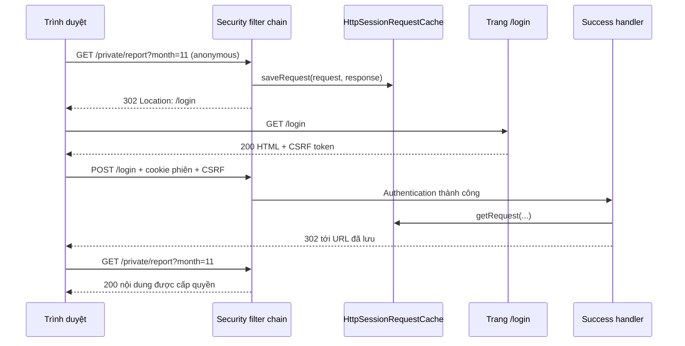

# RequestCache và tránh vòng lặp chuyển hướng tới trang lỗi, trang đăng nhập

> **Phạm vi:** Spring Security trên Servlet stack (Spring MVC, Spring Boot 3.x / Spring Security 6.x). Bài này thuộc nhóm **Phản hồi lỗi**: xử lý đúng luồng chưa đăng nhập, bị từ chối quyền, lỗi ứng dụng và điều hướng sau đăng nhập.

## 1. Kết quả cần đạt

Sau bài học, bạn có thể:

- Giải thích vì sao yêu cầu GET tới tài nguyên được bảo vệ có thể được ghi nhớ trước khi chuyển tới trang đăng nhập, và vì sao việc đó khác với trả HTTP 401/403/500.
- Phân biệt trách nhiệm của `ExceptionTranslationFilter`, `AuthenticationEntryPoint`, `RequestCache`, `RequestCacheAwareFilter`, `SavedRequestAwareAuthenticationSuccessHandler` và `AccessDeniedHandler`.
- Cấu hình `HttpSessionRequestCache` chỉ lưu những request điều hướng cần khôi phục; luôn cho phép truy cập trang đăng nhập, trang lỗi và luồng `DispatcherType.ERROR` thích hợp.
- Nhận biết và chặn redirect loop; kiểm tra HTTP status, `Location`, cookie phiên và request được lưu bằng một chuỗi thử nghiệm có thể tái hiện.

## 2. Ba kết quả bảo mật khác nhau

Giả sử khách truy cập `GET /private/report?month=11`:

| Tình huống | Thành phần xử lý | Hành vi web thường gặp |
| --- | --- | --- |
| Chưa xác thực, yêu cầu trang bảo vệ | `ExceptionTranslationFilter` gọi `AuthenticationEntryPoint` | Lưu request thích hợp rồi phản hồi `302 Location: /login` (với form login); API thường trả `401`. |
| Đã xác thực nhưng thiếu quyền `ADMIN` | `AccessDeniedHandler` | `403 Forbidden` hoặc trang 403 giữ nguyên status. Không được cứ chuyển tới đăng nhập. |
| Controller/ứng dụng phát sinh lỗi ngoài cơ chế bảo mật | Servlet container/Spring Boot error dispatch | Phản hồi lỗi 4xx/5xx qua `/error`, không biến lỗi 500 thành vòng lặp 302. |

`RequestCache` **không phải** bộ nhớ đệm response, không cache toàn bộ dữ liệu POST, không cấp quyền và không tự xử lý ngoại lệ. Nó giữ thông tin request cần quay lại sau khi xác thực, thường ở `HttpSession`. Chỉ khi một luồng xác thực yêu cầu lưu request thì `saveRequest` mới có ý nghĩa; một request bình thường không tự động được lưu vì có filter này.

## 3. Luồng request được lưu và khôi phục



Ở bước đầu, `ExceptionTranslationFilter` bắt `AuthenticationException` hoặc trường hợp `AccessDeniedException` đối với người dùng anonymous và bắt đầu quá trình xác thực. Với cơ chế phù hợp, nó gọi `requestCache.saveRequest` trước khi dùng `AuthenticationEntryPoint`. `LoginUrlAuthenticationEntryPoint` phát lệnh redirect tới trang login.

`HttpSessionRequestCache` thường lưu `DefaultSavedRequest` trong phiên, bao gồm URL đích và các thông tin request có thể tái tạo; **đừng coi đó là replay body của POST**. Sau xác thực, `SavedRequestAwareAuthenticationSuccessHandler` ưu tiên URL đã lưu nếu có và cấu hình cho phép; nếu người dùng mở thẳng `/login` mà không có saved request, nó dùng đường dẫn mặc định.

`RequestCacheAwareFilter` hỗ trợ dùng lại request được lưu khi request quay về khớp điều kiện. Chi tiết thời điểm đọc session và tham số đánh dấu khôi phục có thể khác giữa bản Spring Security 5 và 6; không dựa vào tham số nội bộ hoặc tên attribute để xây logic nghiệp vụ. Điều bảo đảm ở cấp ứng dụng là URL hợp lệ, session/cookie được duy trì và authorization vẫn phải được kiểm tra lại trên request quay về.

**Phân biệt hai request:** `GET /login` để hiển thị form và `POST /login` do filter xác thực xử lý. Không nên tự viết controller POST trùng đường dẫn mà `UsernamePasswordAuthenticationFilter` đang quản lý.

## 4. Tại sao xuất hiện redirect loop?

### 4.1. Trang đăng nhập cũng bị bảo vệ

Cấu hình sai: `anyRequest().authenticated()` áp dụng cả `GET /login`, trong khi `AuthenticationEntryPoint` lại chuyển người chưa đăng nhập tới `/login`. Kết quả có thể là:

```text
GET /private/report   -> 302 /login
GET /login            -> 302 /login
GET /login            -> 302 /login
... (ERR_TOO_MANY_REDIRECTS)
```

**Sửa:** cho phép anonymous vào GET trang login; nếu dùng login tùy chỉnh, cấu hình `formLogin(...loginPage("/login").permitAll())` và có MVC route/view GET `/login` thực sự. Điều này không có nghĩa cho phép mọi POST của ứng dụng.

### 4.2. Error dispatch hoặc trang lỗi lại bị yêu cầu đăng nhập

Một exception trong controller hoặc lỗi 404 có thể khiến container dispatch tới `/error` với `DispatcherType.ERROR`. Nếu security filter tiếp tục áp dụng authorization và chặn `/error`, quá trình tạo response lỗi bị chuyển thành request đăng nhập; nếu login cũng gặp lỗi, vòng lặp càng khó đọc.

**Sửa:** cho phép dispatcher kiểu `ERROR` và route `/error` nếu ứng dụng dùng Spring Boot error endpoint. Giữ status lỗi gốc; không dùng `redirect:/login` làm cách xử lý mặc định cho mọi lỗi. Trong ứng dụng có view forwarding, chỉ cân nhắc `FORWARD` sau khi hiểu rõ router và giới hạn truy cập; đừng cấp phép rộng chỉ để làm hết lỗi.

### 4.3. Đường dẫn login, failure, success hoặc access-denied sai

- `loginPage("/signin")` nhưng controller chỉ có `/login`, hoặc trang login tự `redirect:/login` vô hạn.
- `failureUrl("/private/login-error")` trỏ vào route cần xác thực: mỗi lần sai mật khẩu lại đi vào entry point.
- `defaultSuccessUrl("/private/admin", true)` luôn chuyển tài khoản USER tới nơi bị 403, đồng thời bỏ qua saved request; 403 không nên bị redirect về login.
- Custom success handler đọc saved request nhưng chuyển hướng tới chính `/login` hay `/error`; hoặc reverse proxy sinh URL HTTP/HTTPS sai làm redirect qua lại.
- Trộn browser form login với API JSON; client API tự động follow 302 đến trang HTML rồi coi đó là lỗi xác thực.

**Sửa:** login, login failure và error page phải tự phục vụ được; success URL phải phù hợp quyền người dùng; phân biệt authorization failure với authentication requirement; tránh chu kỳ trong controller, filter và proxy.

### 4.4. Request cache lưu mục tiêu không nên quay lại

Nếu ứng dụng lưu request tới `/login`, `/error`, `/logout`, endpoint API hoặc POST thay đổi dữ liệu, success handler có thể đưa người dùng đến đường dẫn không phù hợp. Một lần mở nhiều tab cũng có thể làm saved request trong cùng phiên bị thay bởi request khác.

**Sửa:** xác định rõ mục tiêu cần lưu (ví dụ GET/HEAD trang điều hướng được bảo vệ), bỏ qua ERROR dispatch, các route đăng nhập/lỗi và API; với API/stateless dùng `NullRequestCache`. Ở demo dưới đây chỉ lưu GET của `/private/**` trên dispatch REQUEST.

## 5. Demo Spring Boot: form login, request cache có phạm vi

Ví dụ **có thể chạy độc lập** với JDK 17+ và Maven; dùng Spring Boot 3.3.0 (thuộc dòng Spring Security 6.x). Nó có trang đăng nhập tùy chỉnh, route cần đăng nhập, route cần ADMIN và form chứa CSRF token. Tài khoản trong bộ nhớ chỉ phục vụ học tập.

Cấu trúc:

```text
request-cache-demo/
├── pom.xml
└── src/main/
    ├── java/demo/security/
    │   ├── DemoApplication.java
    │   ├── SecurityConfig.java
    │   └── PageController.java
    └── resources/templates/login.html
```

**`pom.xml`**

```xml
<project xmlns="http://maven.apache.org/POM/4.0.0"
         xmlns:xsi="http://www.w3.org/2001/XMLSchema-instance"
         xsi:schemaLocation="http://maven.apache.org/POM/4.0.0 https://maven.apache.org/xsd/maven-4.0.0.xsd">
    <modelVersion>4.0.0</modelVersion>
    <parent>
        <groupId>org.springframework.boot</groupId>
        <artifactId>spring-boot-starter-parent</artifactId>
        <version>3.3.0</version>
        <relativePath/>
    </parent>
    <groupId>demo</groupId>
    <artifactId>request-cache-demo</artifactId>
    <version>0.0.1-SNAPSHOT</version>
    <properties>
        <java.version>17</java.version>
    </properties>
    <dependencies>
        <dependency>
            <groupId>org.springframework.boot</groupId>
            <artifactId>spring-boot-starter-web</artifactId>
        </dependency>
        <dependency>
            <groupId>org.springframework.boot</groupId>
            <artifactId>spring-boot-starter-security</artifactId>
        </dependency>
        <dependency>
            <groupId>org.springframework.boot</groupId>
            <artifactId>spring-boot-starter-thymeleaf</artifactId>
        </dependency>
    </dependencies>
    <build>
        <plugins>
            <plugin>
                <groupId>org.springframework.boot</groupId>
                <artifactId>spring-boot-maven-plugin</artifactId>
            </plugin>
        </plugins>
    </build>
</project>
```

**`src/main/java/demo/security/DemoApplication.java`**

```java
package demo.security;

import org.springframework.boot.SpringApplication;
import org.springframework.boot.autoconfigure.SpringBootApplication;

@SpringBootApplication
public class DemoApplication {
    public static void main(String[] args) {
        SpringApplication.run(DemoApplication.class, args);
    }
}
```

**`src/main/java/demo/security/SecurityConfig.java`**

```java
package demo.security;

import jakarta.servlet.DispatcherType;
import org.springframework.context.annotation.Bean;
import org.springframework.context.annotation.Configuration;
import org.springframework.security.config.annotation.web.builders.HttpSecurity;
import org.springframework.security.core.userdetails.User;
import org.springframework.security.core.userdetails.UserDetailsService;
import org.springframework.security.crypto.bcrypt.BCryptPasswordEncoder;
import org.springframework.security.crypto.password.PasswordEncoder;
import org.springframework.security.provisioning.InMemoryUserDetailsManager;
import org.springframework.security.web.SecurityFilterChain;
import org.springframework.security.web.savedrequest.HttpSessionRequestCache;
import org.springframework.security.web.savedrequest.RequestCache;

@Configuration
public class SecurityConfig {
    @Bean
    RequestCache requestCache() {
        HttpSessionRequestCache cache = new HttpSessionRequestCache();
        cache.setRequestMatcher(request ->
                request.getDispatcherType() == DispatcherType.REQUEST
                && "GET".equals(request.getMethod())
                && request.getServletPath().startsWith("/private/"));
        return cache;
    }

    @Bean
    SecurityFilterChain securityFilterChain(
            HttpSecurity http, RequestCache requestCache) throws Exception {
        return http
            .authorizeHttpRequests(auth -> auth
                .dispatcherTypeMatchers(DispatcherType.ERROR).permitAll()
                .requestMatchers("/", "/login", "/error").permitAll()
                .requestMatchers("/private/admin").hasRole("ADMIN")
                .requestMatchers("/private/**").authenticated()
                .anyRequest().denyAll())
            .requestCache(cache -> cache.requestCache(requestCache))
            .formLogin(form -> form
                .loginPage("/login")
                .loginProcessingUrl("/login")
                .failureUrl("/login?error")
                .permitAll())
            .build();
    }

    @Bean
    PasswordEncoder passwordEncoder() {
        return new BCryptPasswordEncoder();
    }

    @Bean
    UserDetailsService users(PasswordEncoder encoder) {
        return new InMemoryUserDetailsManager(
            User.withUsername("learner")
                .password(encoder.encode("demo-pass"))
                .roles("USER")
                .build());
    }
}
```

**Giải thích cấu hình:**

1. `dispatcherTypeMatchers(DispatcherType.ERROR).permitAll()` cho phép luồng dựng response lỗi đi qua authorization của security chain. `requestMatchers("/error").permitAll()` cũng cho phép URL error trong trường hợp request trực tiếp; đây là quyền truy cập endpoint, không phải cho phép lộ stack trace.
2. `formLogin(...loginPage("/login").permitAll())` làm GET login có thể hiển thị cho người chưa xác thực; filter vẫn kiểm tra CSRF trên POST login.
3. `requestCache(...)` sử dụng `HttpSessionRequestCache` nhưng chỉ lưu GET `/private/**` khi dispatcher là REQUEST. GET `/login` và `/error` không thể trở thành saved request trong demo.
4. `hasRole("ADMIN")` đòi authority `ROLE_ADMIN`; tài khoản `learner` chỉ có `ROLE_USER` nên yêu cầu `/private/admin` sau khi đăng nhập sẽ nhận 403.
5. Không cấu hình `alwaysUseDefaultTargetUrl=true`; vì vậy form login vẫn có thể ưu tiên request được lưu. Khi không có saved request, handler dùng mặc định của framework.
6. Quy tắc `anyRequest().denyAll()` ở cuối giúp ví dụ không vô tình mở thêm route. Ứng dụng thật cần bổ sung đúng các route public (static assets, health endpoint…) theo nhu cầu; giữ các rule cụ thể trước rule tổng quát.

**`src/main/java/demo/security/PageController.java`**

```java
package demo.security;

import org.springframework.security.core.Authentication;
import org.springframework.stereotype.Controller;
import org.springframework.web.bind.annotation.GetMapping;
import org.springframework.web.bind.annotation.RequestParam;
import org.springframework.web.bind.annotation.ResponseBody;

@Controller
public class PageController {
    @GetMapping("/")
    @ResponseBody
    public String home() {
        return "Home";
    }

    @GetMapping("/login")
    public String login() {
        return "login";
    }

    @GetMapping("/private/report")
    @ResponseBody
    public String report(
            @RequestParam(defaultValue = "all") String month,
            Authentication authentication) {
        return "Report " + month + " for " + authentication.getName();
    }

    @GetMapping("/private/admin")
    @ResponseBody
    public String admin() {
        return "Admin only";
    }
}
```

**`src/main/resources/templates/login.html`**

```html
<!doctype html>
<html lang="vi" xmlns:th="http://www.thymeleaf.org">
<head>
    <meta charset="utf-8">
    <title>Đăng nhập</title>
</head>
<body>
    <h1>Đăng nhập</h1>
    <p th:if="${param.error != null}">Sai thông tin đăng nhập.</p>
    <form method="post" th:attr="action=@{/login}">
        <label>Tài khoản <input name="username" required></label>
        <label>Mật khẩu <input type="password" name="password" required></label>
        <input type="hidden"
               th:name="${_csrf.parameterName}"
               th:value="${_csrf.token}">
        <button type="submit">Đăng nhập</button>
    </form>
</body>
</html>
```

Biểu mẫu dùng `th:attr` để tạo action theo context path và chèn CSRF token một lần bằng input ẩn. Nếu dùng cơ chế tự thêm CSRF hidden field qua `th:action`, hãy hiểu cơ chế của view engine và tránh vô tình nhân đôi field. Không tắt CSRF chỉ để làm POST login hoạt động.

**Chạy và kiểm tra:**

```bash
cd request-cache-demo
mvn spring-boot:run
```

Mở cửa sổ ẩn danh đến `http://localhost:8080/private/report?month=11`. Trình duyệt được chuyển tới `/login`; đăng nhập `learner` / `demo-pass`, sau đó quay về `/private/report?month=11` và nhận chính xác:

```text
Report 11 for learner
```

Truy cập `/private/admin` sau đăng nhập sẽ trả **403** (có thể hiển thị trang lỗi mặc định). Truy cập `/login?error` khi chưa đăng nhập vẫn nhận trang login 200. Nếu mở thẳng `/login` để đăng nhập, không có saved request nên đích sau login là mặc định (thường là `/` trong cấu hình này), không tự ý dẫn tới báo cáo.

Có thể quan sát redirect đầu tiên mà không gửi mật khẩu:

```bash
curl -i -c cookies.txt "http://localhost:8080/private/report?month=11"
curl -i -b cookies.txt "http://localhost:8080/login"
```

Lệnh đầu dự kiến trả `302` với `Location: http://localhost:8080/login` (URL cụ thể phụ thuộc host/port/context path); lệnh thứ hai trả HTML 200. Khi kiểm tra đầy đủ POST bằng HTTP client, phải gửi đúng cookie phiên **và** CSRF token từ trang login; nếu thiếu CSRF, 403 là hành vi phòng vệ bình thường chứ không phải redirect loop.

## 6. Chính sách lưu request trong ứng dụng thực

| Loại request | Chính sách khuyến nghị | Lý do |
| --- | --- | --- |
| GET trang HTML cần đăng nhập | Có thể lưu | Người dùng mong trở lại trang ban đầu sau login. |
| GET `/login`, `/error`, `/logout`, CSS/JS | Không lưu | Không tạo mục tiêu điều hướng vô nghĩa hoặc vòng lặp. |
| `DispatcherType.ERROR` | Không lưu; cho phép dựng response lỗi thích hợp | Tránh thay lỗi thật bằng redirect xác thực. |
| POST/PUT/PATCH/DELETE | Thường không tự động replay | Body, CSRF, tính idempotent và side effect không được bảo đảm. |
| API JSON hoặc stateless JWT | `NullRequestCache`; trả status trực tiếp | Máy khách cần mã lỗi có nghĩa, không cần trang login HTML. |

Ví dụ **đoạn cấu hình bổ sung**, dành cho ứng dụng có security chain riêng cho API (không phải file bắt buộc của demo trên):

```java
@Bean
@org.springframework.core.annotation.Order(1)
SecurityFilterChain apiChain(HttpSecurity http) throws Exception {
    return http.securityMatcher("/api/**")
        .authorizeHttpRequests(auth -> auth.anyRequest().authenticated())
        .requestCache(cache -> cache.requestCache(
            new org.springframework.security.web.savedrequest.NullRequestCache()))
        .sessionManagement(session -> session.sessionCreationPolicy(
            org.springframework.security.config.http.SessionCreationPolicy.STATELESS))
        .exceptionHandling(errors -> errors
            .authenticationEntryPoint(
                new org.springframework.security.web.authentication.HttpStatusEntryPoint(
                    org.springframework.http.HttpStatus.UNAUTHORIZED))
            .accessDeniedHandler(
                new org.springframework.security.web.access.HttpStatusAccessDeniedHandler(
                    org.springframework.http.HttpStatus.FORBIDDEN)))
        .httpBasic(org.springframework.security.config.Customizer.withDefaults())
        .csrf(csrf -> csrf.disable())
        .build();
}
```

Đoạn này là **ví dụ tùy chọn**: phải ghép vào cấu hình có đúng `@Bean`/import, giữ chain web còn lại ở độ ưu tiên thấp hơn và chỉ vô hiệu CSRF khi API thật sự không dựa trên cookie phiên để xác thực. Với API nhận cookie/session từ browser, CSRF có thể vẫn cần thiết. Nếu không bật Basic/JWT phù hợp, API sẽ không xác thực được dù status 401/403 là đúng; chọn cơ chế credentials theo kiến trúc thực tế.

## 7. Kiểm thử vòng lặp và status một cách có hệ thống

Thử từ một phiên ẩn danh mới, rồi một phiên USER, rồi phiên có quyền cao hơn nếu ứng dụng có:

| Kịch bản | Kỳ vọng | Tín hiệu lỗi |
| --- | --- | --- |
| Anonymous GET `/private/report?month=11` | Một lần 302 tới `/login` | Chuỗi 302 lặp qua cùng URL. |
| Anonymous GET `/login` | 200 + form/CSRF | 302 tới chính `/login` hoặc 403 do CSRF bị xử lý sai. |
| Sai password POST `/login` kèm CSRF đúng | Về `/login?error` rồi 200 | `/login?error` bị bảo vệ hoặc redirect vô hạn. |
| Đúng password sau saved GET | 302 về URL report; GET tiếp theo 200 | Quay lại `/login`, về `/error` hoặc mất query string. |
| Đúng password, mở login trực tiếp | Đến URL mặc định hợp lệ | Success redirect tới route không có quyền. |
| USER GET `/private/admin` | 403, không login lại | 302 /login cho người đã xác thực. |
| Anonymous GET `/error` hoặc lỗi ứng dụng được dispatch | Có response lỗi ổn định; không vòng lặp | Lỗi 500 bị che bởi 302 /login. |
| API chưa xác thực (khi dùng API chain) | 401, không HTML login | API nhận 302/HTML gây lỗi parse ở client. |

Đừng suy luận chỉ từ URL cuối cùng khi client tự follow redirect. Dùng Network tab với **Preserve log** hoặc HTTP client không tự follow để quan sát từng status và header `Location`. Nhìn cả cookie `JSESSIONID` giữa GET trang bảo vệ, GET login và POST login: mất cookie có thể làm mất saved request hoặc làm CSRF thất bại.

## 8. Chẩn đoán và sửa lỗi thường gặp

1. **Lặp `/login → /login`:** rà `authorizeHttpRequests`, custom login page/controller, error view, redirect trong filter tùy biến. Bảo đảm GET login được `permitAll` và render view thay vì tự redirect.
2. **`/error → /login → /error`:** kiểm tra dispatcher type, rule cho `/error` và exception trong chính template/controller lỗi. Khi log thấy ERROR dispatch bị authorization chặn, cho phép `DispatcherType.ERROR` theo nhu cầu.
3. **Sau login quay về trang sai:** kiểm tra saved request còn tồn tại không, session có đổi/mất ngoài ý muốn không, login được khởi tạo trực tiếp hay từ trang bảo vệ, có custom `AuthenticationSuccessHandler` hoặc `defaultSuccessUrl(..., true)` ghi đè hay không. Với nhiều tab, yêu cầu gần nhất có thể làm thay đổi đích đã lưu.
4. **403 khi POST login:** thường kiểm tra trước CSRF token, cookie phiên, form action và tên field; không quy hết cho RequestCache. Đừng dùng `csrf.disable()` như cách sửa mặc định cho browser app.
5. **302 quá nhiều giữa HTTP và HTTPS / giữa host:** kiểm tra trusted proxy, TLS termination, context path và forwarded headers. Chỉ nhận `Forwarded`/`X-Forwarded-*` từ proxy đáng tin và cấu hình reverse proxy/Spring Boot nhất quán.
6. **Response 403 lại bị redirect tới login:** kiểm tra custom `AccessDeniedHandler` hoặc code MVC xử lý lỗi 403. Đã xác thực nhưng thiếu quyền là từ chối quyền, không phải yêu cầu xác thực lại.
7. **Saved request trỏ tới URL cũ sau logout hoặc flow hủy:** cân nhắc gọi `requestCache.removeRequest(request, response)` trong luồng tùy chỉnh và bảo đảm logout xóa/huỷ phiên theo chính sách. Không ghi thông tin nhạy cảm trong query string được lưu hoặc log.

Khi cần debug cục bộ, bật tạm:

```properties
logging.level.org.springframework.security=DEBUG
```

Tìm trình tự authentication entry point, save/get matching request, successful authentication, access denied và `ERROR` dispatch. Không bật debug dài hạn trên production khi có nguy cơ lộ header, session identifier hoặc chi tiết bảo mật. Kiểm tra cả đường đi của request trong các `SecurityFilterChain`: thứ tự matcher sai có thể khiến rule mong muốn không bao giờ chạy.

## 9. Checklist thiết kế an toàn

- Route login, failure và error xử lý được cả khi chưa đăng nhập; không redirect tới chính chúng.
- Phân biệt **401/challenge**, **403/access denied**, **4xx/5xx lỗi ứng dụng**; browser có thể dùng 302 login cho anonymous, API nên dùng status rõ ràng.
- Chỉ cache các GET điều hướng thực sự cần quay lại; không lưu error dispatch, login, logout, API hoặc thao tác thay đổi dữ liệu.
- Preserve query string và session cookie của saved request; vẫn **xác thực và phân quyền lại** khi quay về.
- Ưu tiên success handler chuẩn khi không cần logic tùy chỉnh; không bật `alwaysUseDefaultTargetUrl` nếu cần trả về request gốc.
- Cấu hình CSRF đúng cho form login; phân biệt lỗi token với redirect loop.
- Xem chuỗi status/Location/cookie theo từng bước; kiểm tra cả lỗi phát sinh trong controller và proxy.

**Điểm cốt lõi:** `RequestCache` phục vụ trải nghiệm quay lại sau khi đăng nhập; quyền truy cập và phản hồi lỗi vẫn do authentication, authorization và error handling quyết định. Một trang login/error truy cập được, cùng chính sách lưu request hẹp và việc kiểm tra status theo từng hop, sẽ loại bỏ phần lớn vòng lặp chuyển hướng.
