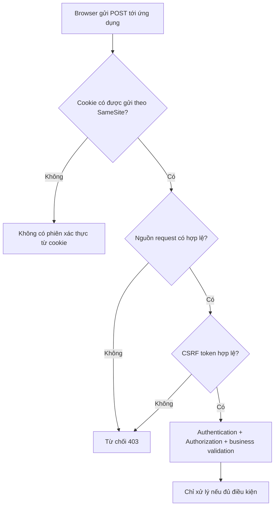

# SameSite và kiểm tra nguồn yêu cầu như các lớp hỗ trợ bảo vệ CSRF

> **Phạm vi:** ứng dụng **Spring Security trên Servlet stack** (Spring MVC / Spring Boot 3.x, Spring Security 6.x), đặc biệt khi trình duyệt tự đính kèm cookie phiên vào request. Trọng tâm là hiểu và kết hợp `SameSite`, kiểm tra `Origin`/`Referer` và Fetch Metadata như **các lớp phòng vệ bổ sung** cho cơ chế CSRF token; không đánh đồng các lớp này hoặc xem chúng thay thế xác thực/phân quyền.

## 1. Mục tiêu học tập

Sau bài này, bạn có thể:

1. Giải thích cơ chế CSRF khi trình duyệt tự gửi cookie xác thực, phân biệt **same-site** với **same-origin**.
2. Chọn `SameSite=Strict`, `Lax` hoặc `None; Secure` dựa trên luồng người dùng, hiểu giới hạn của từng chính sách và tác động khi đăng nhập liên miền.
3. Kiểm tra nguồn của **request thay đổi trạng thái** bằng `Origin`; có thể dùng `Referer` làm đường dự phòng với so khớp origin chính xác, xử lý header trống/`null` có chủ đích.
4. Dùng `Sec-Fetch-Site` như tín hiệu bổ sung để chặn các yêu cầu không mong muốn từ trang khác; biết khi nào cần ngoại lệ.
5. Cấu hình Spring Boot + Spring Security: giữ **CSRF token** trên form POST, đặt SameSite cho session cookie, thêm bộ lọc kiểm tra nguồn và kiểm thử từng lớp độc lập.

## 2. Bối cảnh: vì sao cookie mở đường cho CSRF?

Giả sử người dùng đã đăng nhập `https://bank.example` bằng cookie phiên. Khi họ mở `https://attacker.test`, trang tấn công có thể cố gửi một request tới ứng dụng đích, chẳng hạn qua form HTML:

```html
<form method="post" action="https://bank.example/transfer">
  <input type="hidden" name="to" value="attacker">
  <input type="hidden" name="amount" value="100">
</form>
<script>document.forms[0].submit()</script>
```

Đây là **mô phỏng nguy cơ**, không phải cách thử nghiệm trên hệ thống không được phép. Nếu trình duyệt tự đính kèm cookie phiên và máy chủ chỉ kiểm tra đã đăng nhập, server có thể nhầm request do trang khác khởi tạo là ý định của chủ tài khoản. CSRF không cần kẻ tấn công đọc response.

Lớp phòng vệ chuẩn của Spring Security đối với ứng dụng browser dùng cookie là **CSRF token**: token gắn với phiên/ngữ cảnh xác thực, được render cho trang hợp lệ và yêu cầu gửi lại trên thao tác thay đổi trạng thái. Trang khác không được tự do đọc token trong response cùng origin nhờ chính sách same-origin (nếu ứng dụng không có XSS/CORS cấu hình nguy hiểm).

Các kiểm soát còn lại giúp giảm thêm bề mặt tấn công:



Sơ đồ là **mô hình phòng vệ khái niệm**, không phải cam kết về thứ tự thực thi filter hay mọi trình duyệt. Kẻ tấn công vẫn có thể gửi HTTP trực tiếp ngoài trình duyệt, tự tạo header và cookie mà họ sở hữu. Vì vậy `Origin` và `Sec-Fetch-*` chỉ có ý nghĩa như các tín hiệu bảo vệ yêu cầu từ **trình duyệt**, không phải bằng chứng danh tính.

## 3. Same-origin và same-site là hai ranh giới khác nhau

**Origin** gồm bộ ba **scheme + host + port**. Hai URL chỉ cùng origin khi cả ba thành phần khớp.

**Site** trong chính sách cookie hiện đại thường xét **scheme + registrable domain** (eTLD+1 dựa trên Public Suffix List), không phân biệt port và các subdomain cùng site. Đây là **schemeful same-site**: đổi `https` sang `http` có thể biến thành cross-site dù host giống nhau. Với `localhost`, địa chỉ IP và suffix đặc biệt, thuật toán cụ thể tuân theo quy tắc của trình duyệt, không tự đoán bằng cách cắt chuỗi domain.

| Cặp URL | Same-origin? | Same-site? (schemeful, thông thường) |
| --- | --- | --- |
| `https://app.example.com/a` ↔ `https://app.example.com/b` | Có | Có |
| `https://app.example.com` ↔ `https://api.example.com` | Không (khác host) | Có |
| `https://app.example.com` ↔ `https://app.example.com:8443` | Không (khác port) | Có |
| `https://app.example.com` ↔ `http://app.example.com` | Không (khác scheme) | Không |
| `https://app.example.com` ↔ `https://evil.example.net` | Không | Không |

**Hệ quả quan trọng:** `SameSite` vẫn có thể cho gửi session cookie đối với request từ **subdomain khác cùng site**. Nếu `preview.example.com` bị chiếm quyền, request do nó khởi tạo tới `app.example.com` là cross-origin nhưng có thể same-site. Do đó `SameSite=Lax/Strict` **không đủ** để bảo vệ trước subdomain không đáng tin. Kiểm tra `Origin` chính xác và CSRF token tiếp tục có giá trị.

Cookie `Domain=.example.com` cho phép chia sẻ cookie giữa các host phù hợp trong domain và làm tăng rủi ro từ subdomain; cookie **host-only** (không khai báo `Domain`) thường là lựa chọn an toàn hơn khi không cần chia sẻ. `SameSite` và `Domain` giải quyết hai bài toán khác nhau.

## 4. Các chế độ SameSite và tác động thực tế

`SameSite` là thuộc tính của **Set-Cookie** do server trả về; trình duyệt quyết định có đính kèm cookie trên request sau đó hay không.

| Thuộc tính | Cross-site subresource / fetch thông thường | Cross-site top-level navigation GET | Cross-site POST từ form | Khi dùng |
| --- | --- | --- | --- | --- |
| `SameSite=Strict` | Không gửi | Không gửi | Không gửi | Luồng thuần cùng site, yêu cầu cô lập cao; lưu ý UX khi theo link từ ngoài. |
| `SameSite=Lax` | Không gửi | **Gửi** với điều hướng cấp cao dùng method an toàn như GET | Thông thường **không gửi** | Lựa chọn thực tế cho nhiều ứng dụng web dùng session và điều hướng bên ngoài. |
| `SameSite=None; Secure` | Có thể gửi, nếu các chính sách cookie khác cho phép | Có thể gửi | Có thể gửi | Tích hợp cross-site thật sự cần cookie, ví dụ một số SSO/iframe; phải có HTTPS và CSRF token thích hợp. |

**Lưu ý quan trọng:**

- `SameSite=None` yêu cầu `Secure` ở các trình duyệt hiện đại; cookie `Secure` chỉ được gửi qua kết nối bảo mật, với một số ngoại lệ xử lý localhost do trình duyệt.
- Trình duyệt có thể **chặn third-party cookies** kể cả khi server ghi `SameSite=None; Secure`; chính sách thay đổi theo trình duyệt, người dùng và môi trường.
- Không dựa vào **mặc định khi bỏ SameSite**. Một số trình duyệt áp dụng Lax mặc định với ngoại lệ tạm thời cho POST ngay sau khi cookie mới được đặt (thường gọi `Lax-allowing-unsafe`); giá trị `SameSite=Lax` được khai báo tường minh có hành vi chặt hơn. Không dùng "trình duyệt hiện nay tự bảo vệ" thay cho CSRF token.
- `Lax` cho phép cookie trên một số điều hướng **GET** cross-site. GET/HEAD/OPTIONS/TRACE phải có ngữ nghĩa **an toàn**; không triển khai `GET /delete-account` hay `GET /transfer` làm thao tác thay đổi trạng thái.
- `Strict` có thể khiến người dùng mở link từ email/trang khác đến ứng dụng nhưng không được gửi cookie ở điều hướng đầu tiên, phải đăng nhập lại hoặc cần một điều hướng same-site tiếp theo.
- Các luồng OAuth2/OIDC/SAML có callback cross-site (đặc biệt POST binding), đăng nhập federated, widget nhúng có thể cần thiết kế ngoại lệ và cookie phù hợp. Đừng đặt `Strict` trên toàn bộ hệ thống rồi sửa bằng cách tắt CSRF. Các giao thức xác thực còn có `state`, `nonce` hoặc kiểm tra InResponseTo riêng theo giao thức.

### Cấu hình session cookie trong Spring Boot

Với ứng dụng Servlet dùng session cookie do embedded server quản lý, Spring Boot 3.x có thể cấu hình:

**`src/main/resources/application.properties`**

```properties
server.servlet.session.cookie.same-site=lax
server.servlet.session.cookie.http-only=true

# Chỉ bật trong môi trường HTTPS thật; deploy production cần HTTPS.
# server.servlet.session.cookie.secure=true
```

Quan sát `Set-Cookie` trên response có tạo session thực tế. Ví dụ **minh họa** (giá trị session là tùy phiên, tên/thuộc tính tùy container):

```http
Set-Cookie: JSESSIONID=<session-id>; Path=/; HttpOnly; SameSite=Lax
```

`HttpOnly` giúp JavaScript không đọc cookie, `Secure` yêu cầu truyền qua HTTPS, `SameSite` hạn chế bối cảnh gửi cookie; ba thuộc tính **không thay thế nhau** và không sửa được lỗi XSS hoặc phân quyền. Nếu ứng dụng tự tạo thêm cookie đăng nhập, session store thay đổi, hoặc proxy viết lại `Set-Cookie`, hãy kiểm tra từng cookie xác thực riêng thay vì chỉ nhìn `JSESSIONID`.

Với production, ưu tiên HTTPS, cookie `Secure`, hạn chế `Domain`, thời hạn phiên phù hợp và tránh đưa mã phiên vào URL. Nếu proxy kết thúc TLS ở phía trước ứng dụng, cần cấu hình proxy/forwarded headers **chỉ từ proxy tin cậy** để ứng dụng hiểu scheme và URL công khai chính xác.

## 5. Kiểm tra nguồn yêu cầu bằng Origin và Referer

### Origin: tín hiệu ưu tiên khi hiện diện

Trên nhiều request thay đổi trạng thái do trình duyệt tạo, `Origin` cho biết origin của ngữ cảnh khởi tạo request, ví dụ:

```http
POST /profile HTTP/1.1
Host: app.example.com
Origin: https://app.example.com
Cookie: JSESSIONID=...
Content-Type: application/x-www-form-urlencoded
```

Ứng dụng chỉ nhận thao tác nếu `Origin` nằm trong **danh sách origin được phép do server quản lý**, ví dụ `https://app.example.com`. Phải so khớp **scheme, host và port**; không kiểm tra bằng `startsWith("https://app.example.com")` vì `https://app.example.com.attacker.test` có thể vượt qua phép kiểm tra chuỗi đầu. Chỉ whitelist origin thật sự tin cậy theo chức năng; `*.example.com` không mặc nhiên đáng tin vì có thể có subdomain bị kiểm soát hoặc tài khoản tenant.

`Origin: null` có thể xuất hiện từ ngữ cảnh sandbox, file hoặc redirect/chính sách riêng. Đừng coi `null` hay header trống là "cùng origin" theo mặc định. Header `Host` thể hiện **đích nhận request**, không chứng minh request xuất phát từ trang nào.

### Referer: đường dự phòng có giới hạn

Khi không có `Origin`, server **có thể** xem `Referer` rồi trích xuất scheme/host/port để so với origin đích. `Referer` chứa URL đầy đủ và có thể vắng mặt vì `Referrer-Policy`, quyền riêng tư, điều hướng hoặc client; so sánh bằng phép so khớp tiền tố chuỗi rất dễ sai. Không log toàn bộ URL Referer nếu query có dữ liệu nhạy cảm.

Có hai chính sách hợp lệ tùy sản phẩm:

- **Fail closed** khi cả hai header đều vắng: độ chặt cao, nhưng có thể từ chối client cũ, privacy browser, công cụ HTTP và tích hợp hợp lệ.
- **Cho phép tiếp tục vào CSRF token** khi thiếu nguồn: ít gây gián đoạn hơn, nhưng lớp kiểm tra nguồn không còn là cổng chặn bắt buộc ở tình huống đó. Quyết định này phải được ghi rõ và kiểm thử theo đối tượng client.

Không sử dụng `Origin`/`Referer` như một nguồn duy nhất để xác định user hay chấp nhận thao tác thiếu CSRF token. Đối với trình duyệt, chúng là **lớp kiểm tra nguồn** chứ không phải cơ chế authentication.

## 6. Fetch Metadata: thêm thông tin bối cảnh từ trình duyệt

Các header `Sec-Fetch-*` do trình duyệt hiện đại phát sinh trong request, ví dụ:

```http
Sec-Fetch-Site: cross-site
Sec-Fetch-Mode: navigate
Sec-Fetch-Dest: document
```

`Sec-Fetch-Site` có các giá trị phổ biến:

| Giá trị | Diễn giải |
| --- | --- |
| `same-origin` | Request được khởi tạo từ cùng origin. |
| `same-site` | Cùng site, có thể khác origin/subdomain. |
| `cross-site` | Bối cảnh khởi tạo thuộc site khác. |
| `none` | Không có site khởi tạo, ví dụ điều hướng từ thanh địa chỉ/bookmark trong các ngữ cảnh áp dụng. |

Một chính sách **bổ sung** đơn giản cho các route thay đổi trạng thái có thể từ chối `Sec-Fetch-Site: cross-site`. Chính sách có thể chặt hơn bằng cách yêu cầu `same-origin` cho thao tác quan trọng, vì `same-site` chưa loại trừ subdomain không đáng tin. Với `none` hoặc header thiếu, phải có quy tắc riêng; đừng mặc định xem chúng là bằng chứng request an toàn.

Lưu ý `Sec-Fetch-*` có thể không được gửi bởi client cũ hay HTTP client. Chúng là tín hiệu do browser tạo trong môi trường browser, có thể bị giả mạo bởi client tự lập trình. Một số request từ payment provider, webhook, OAuth callback, SAML POST hoặc embedding cross-site là hợp lệ; chính sách cần **ngoại lệ hẹp, theo endpoint và giao thức**, không mở toàn site. Không đưa request hợp lệ vào 403 chỉ vì đọc một header mà chưa kiểm tra luồng kinh doanh.

**CORS khác CSRF:** CORS kiểm soát khả năng script phía trình duyệt đọc response cross-origin và giới hạn một số loại request cần preflight. Form HTML cross-site dùng content type đơn giản vẫn có thể được gửi **không cần CORS preflight**. Chặn CORS hoặc không bật `@CrossOrigin` không đủ để phòng CSRF.

## 7. Demo chạy được: Spring Boot + session SameSite + CSRF token + Origin guard

Demo dùng **Java 17+**, Maven, **Spring Boot 3.3.0 / Spring Security 6.x** và trình duyệt truy cập `http://localhost:8080`. Đây là ví dụ học tập có cả thao tác thay đổi dữ liệu trong bộ nhớ; production cần TLS, lưu trữ và chính sách nguồn phù hợp.

Cấu trúc thư mục:

```text
csrf-origin-demo/
├── pom.xml
└── src/
    ├── main/
    │   ├── java/demo/csrf/
    │   │   ├── DemoApplication.java
    │   │   ├── SecurityConfig.java
    │   │   ├── SameOriginGuardFilter.java
    │   │   └── PageController.java
    │   └── resources/
    │       ├── application.properties
    │       └── templates/
    │           ├── login.html
    │           └── profile.html
    └── test/java/demo/csrf/
        └── SecurityFlowTest.java
```

### 7.1. Dependencies và cấu hình

**`pom.xml`**

```xml
<project xmlns="http://maven.apache.org/POM/4.0.0"
         xmlns:xsi="http://www.w3.org/2001/XMLSchema-instance"
         xsi:schemaLocation="http://maven.apache.org/POM/4.0.0 https://maven.apache.org/xsd/maven-4.0.0.xsd">
    <modelVersion>4.0.0</modelVersion>
    <parent>
        <groupId>org.springframework.boot</groupId>
        <artifactId>spring-boot-starter-parent</artifactId>
        <version>3.3.0</version>
        <relativePath/>
    </parent>
    <groupId>demo</groupId>
    <artifactId>csrf-origin-demo</artifactId>
    <version>0.0.1-SNAPSHOT</version>
    <properties>
        <java.version>17</java.version>
    </properties>
    <dependencies>
        <dependency>
            <groupId>org.springframework.boot</groupId>
            <artifactId>spring-boot-starter-web</artifactId>
        </dependency>
        <dependency>
            <groupId>org.springframework.boot</groupId>
            <artifactId>spring-boot-starter-security</artifactId>
        </dependency>
        <dependency>
            <groupId>org.springframework.boot</groupId>
            <artifactId>spring-boot-starter-thymeleaf</artifactId>
        </dependency>
        <dependency>
            <groupId>org.springframework.boot</groupId>
            <artifactId>spring-boot-starter-test</artifactId>
            <scope>test</scope>
        </dependency>
        <dependency>
            <groupId>org.springframework.security</groupId>
            <artifactId>spring-security-test</artifactId>
            <scope>test</scope>
        </dependency>
    </dependencies>
    <build>
        <plugins>
            <plugin>
                <groupId>org.springframework.boot</groupId>
                <artifactId>spring-boot-maven-plugin</artifactId>
            </plugin>
        </plugins>
    </build>
</project>
```

**`src/main/resources/application.properties`**

```properties
server.port=8080
server.servlet.session.cookie.same-site=lax
server.servlet.session.cookie.http-only=true

# Origin tin cậy do server kiểm soát, dùng ở filter bên dưới.
app.public-origin=http://localhost:8080
```

`app.public-origin` là **cấu hình đích đáng tin**, không được đọc từ một header tùy ý do client gửi. Khi deploy production, đổi thành ví dụ `https://app.example.com` và bật `server.servlet.session.cookie.secure=true` cùng HTTPS/forwarded headers đúng. Nếu app hỗ trợ nhiều origin công khai, quản lý allowlist cụ thể thay vì wildcard.

**`src/main/java/demo/csrf/DemoApplication.java`**

```java
package demo.csrf;

import org.springframework.boot.SpringApplication;
import org.springframework.boot.autoconfigure.SpringBootApplication;

@SpringBootApplication
public class DemoApplication {
    public static void main(String[] args) {
        SpringApplication.run(DemoApplication.class, args);
    }
}
```

### 7.2. Filter đối chiếu Origin/Referer

**`src/main/java/demo/csrf/SameOriginGuardFilter.java`**

```java
package demo.csrf;

import jakarta.servlet.DispatcherType;
import jakarta.servlet.FilterChain;
import jakarta.servlet.ServletException;
import jakarta.servlet.http.HttpServletRequest;
import jakarta.servlet.http.HttpServletResponse;
import org.springframework.web.filter.OncePerRequestFilter;

import java.io.IOException;
import java.net.URI;
import java.util.Set;

final class SameOriginGuardFilter extends OncePerRequestFilter {
    private static final Set<String> SAFE_METHODS =
            Set.of("GET", "HEAD", "OPTIONS", "TRACE");

    private final URI expectedOrigin;

    SameOriginGuardFilter(String expectedOrigin) {
        this.expectedOrigin = URI.create(expectedOrigin);
        URI u = this.expectedOrigin;
        if (u.getHost() == null
                || !(u.getScheme().equalsIgnoreCase("http")
                     || u.getScheme().equalsIgnoreCase("https"))
                || u.getRawUserInfo() != null
                || (u.getRawPath() != null && !u.getRawPath().isEmpty())
                || u.getRawQuery() != null
                || u.getRawFragment() != null) {
            throw new IllegalArgumentException(
                    "app.public-origin must be an HTTP(S) origin");
        }
    }

    @Override
    protected boolean shouldNotFilter(HttpServletRequest request) {
        // Chỉ kiểm tra request khởi tạo từ client và method không an toàn.
        return request.getDispatcherType() != DispatcherType.REQUEST
                || SAFE_METHODS.contains(request.getMethod());
    }

    @Override
    protected void doFilterInternal(
            HttpServletRequest request,
            HttpServletResponse response,
            FilterChain chain) throws ServletException, IOException {
        String origin = request.getHeader("Origin");
        String referer = request.getHeader("Referer");

        boolean trusted;
        if (origin != null) {
            // Origin hiện diện: không fallback sang Referer nếu Origin sai.
            trusted = isTrusted(origin, true);
        } else if (referer != null) {
            trusted = isTrusted(referer, false);
        } else {
            // Policy demo: fail closed nếu không có cả hai header.
            trusted = false;
        }

        if (!trusted) {
            response.sendError(HttpServletResponse.SC_FORBIDDEN,
                    "Unexpected request origin");
            return;
        }
        chain.doFilter(request, response);
    }

    private boolean isTrusted(String value, boolean strictOriginHeader) {
        try {
            URI candidate = URI.create(value);
            if (candidate.getHost() == null
                    || candidate.getScheme() == null
                    || candidate.getRawUserInfo() != null) {
                return false;
            }
            // Origin header chỉ được chứa scheme://host[:port].
            if (strictOriginHeader
                    && ((candidate.getRawPath() != null
                          && !candidate.getRawPath().isEmpty())
                        || candidate.getRawQuery() != null
                        || candidate.getRawFragment() != null)) {
                return false;
            }
            return candidate.getScheme()
                        .equalsIgnoreCase(expectedOrigin.getScheme())
                    && candidate.getHost()
                        .equalsIgnoreCase(expectedOrigin.getHost())
                    && port(candidate) == port(expectedOrigin);
        } catch (IllegalArgumentException ex) {
            // Ví dụ Origin: null, URL sai cú pháp hoặc nhiều origin một dòng.
            return false;
        }
    }

    private static int port(URI uri) {
        if (uri.getPort() != -1) {
            return uri.getPort();
        }
        return "https".equalsIgnoreCase(uri.getScheme()) ? 443 : 80;
    }
}
```

**Điểm cần hiểu trong filter:**

- So sánh URL có cấu trúc bằng `URI`, không bằng tiền tố chuỗi. Phân biệt port mặc định HTTP 80, HTTPS 443.
- Nếu `Origin` xuất hiện nhưng không tin cậy thì **từ chối ngay**; không cho `Referer` hợp lệ "chữa" Origin xấu.
- Nếu `Origin` vắng và `Referer` có mặt, lấy origin của URL Referer; phần path có thể khác nên không bắt path phải rỗng.
- Demo **fail closed** nếu cả hai thiếu. Đây là quyết định bảo mật và tương thích của demo; một số client hợp lệ sẽ bị 403. Ứng dụng thật có thể chọn fallback sang CSRF token hoặc phân luồng cho non-browser API.
- Filter chỉ chạy cho request HTTP gốc có method không an toàn. `ERROR` dispatch được bỏ qua để không che lỗi gốc.
- Không áp dụng filter này làm thay thế CSRF token; filter chủ yếu bảo vệ request từ trình duyệt. Kẻ có khả năng tạo request HTTP trực tiếp vẫn đặt được header theo ý họ.

### 7.3. SecurityFilterChain giữ CSRF mặc định

**`src/main/java/demo/csrf/SecurityConfig.java`**

```java
package demo.csrf;

import jakarta.servlet.DispatcherType;
import org.springframework.beans.factory.annotation.Value;
import org.springframework.context.annotation.Bean;
import org.springframework.context.annotation.Configuration;
import org.springframework.security.config.Customizer;
import org.springframework.security.config.annotation.web.builders.HttpSecurity;
import org.springframework.security.core.userdetails.User;
import org.springframework.security.core.userdetails.UserDetailsService;
import org.springframework.security.crypto.bcrypt.BCryptPasswordEncoder;
import org.springframework.security.crypto.password.PasswordEncoder;
import org.springframework.security.provisioning.InMemoryUserDetailsManager;
import org.springframework.security.web.SecurityFilterChain;
import org.springframework.security.web.csrf.CsrfFilter;

@Configuration
public class SecurityConfig {
    @Bean
    SecurityFilterChain filterChain(
            HttpSecurity http,
            @Value("${app.public-origin}") String publicOrigin)
            throws Exception {
        return http
            .authorizeHttpRequests(auth -> auth
                .dispatcherTypeMatchers(DispatcherType.ERROR).permitAll()
                .requestMatchers("/", "/login", "/error").permitAll()
                .requestMatchers("/profile").authenticated()
                .anyRequest().denyAll())
            .addFilterBefore(
                new SameOriginGuardFilter(publicOrigin), CsrfFilter.class)
            .csrf(Customizer.withDefaults())
            .formLogin(form -> form
                .loginPage("/login")
                .loginProcessingUrl("/login")
                .failureUrl("/login?error")
                .permitAll())
            .build();
    }

    @Bean
    PasswordEncoder passwordEncoder() {
        return new BCryptPasswordEncoder();
    }

    @Bean
    UserDetailsService users(PasswordEncoder encoder) {
        return new InMemoryUserDetailsManager(
            User.withUsername("student")
                .password(encoder.encode("demo-pass"))
                .roles("USER")
                .build());
    }
}
```

**Vì sao cách gắn filter này có ý nghĩa?**

1. `.csrf(Customizer.withDefaults())` duy trì bảo vệ CSRF chuẩn cho phương thức không an toàn. Không thêm `csrf.disable()` cho app web dùng session.
2. `addFilterBefore(..., CsrfFilter.class)` cho phép từ chối Origin không hợp lệ trước khi xử lý token. Cả Origin đúng lẫn token đúng **đều cần thiết** khi policy demo bật.
3. `new SameOriginGuardFilter(...)` không khai báo thêm `@Component` hoặc Spring `@Bean` kiểu servlet Filter, để tránh Boot tự đăng ký một bản filter khác ở **container filter chain** ngoài Spring Security chain. Điều này giữ thứ tự thực thi rõ ràng.
4. `/login` được phép truy cập mà không cần đăng nhập, **nhưng POST `/login` vẫn có CSRF token và Origin guard**. `permitAll` chỉ bỏ yêu cầu authentication; không tắt kiểm tra CSRF.
5. Cho phép `DispatcherType.ERROR` để request nội bộ dựng trang lỗi không bị biến thành redirect tới login.
6. Khi bổ sung route có thể thay đổi dữ liệu, bảo đảm request vẫn qua security chain phù hợp, kiểm tra authorization và xử lý bất biến nghiệp vụ. Không coi 403 từ filter là thay thế phân quyền.

### 7.4. MVC controller và hai form có CSRF token

**`src/main/java/demo/csrf/PageController.java`**

```java
package demo.csrf;

import org.springframework.security.core.Authentication;
import org.springframework.stereotype.Controller;
import org.springframework.ui.Model;
import org.springframework.web.bind.annotation.GetMapping;
import org.springframework.web.bind.annotation.PostMapping;
import org.springframework.web.bind.annotation.RequestParam;
import org.springframework.web.bind.annotation.ResponseBody;

import java.util.Map;
import java.util.concurrent.ConcurrentHashMap;

@Controller
public class PageController {
    private final Map<String, String> names = new ConcurrentHashMap<>();

    @GetMapping("/")
    @ResponseBody
    public String home() {
        return "Home: open /profile to sign in and edit your display name.";
    }

    @GetMapping("/login")
    public String login() {
        return "login";
    }

    @GetMapping("/profile")
    public String profile(Authentication auth, Model model) {
        model.addAttribute("username", auth.getName());
        model.addAttribute("displayName",
                names.getOrDefault(auth.getName(), "(unset)"));
        return "profile";
    }

    @PostMapping("/profile")
    @ResponseBody
    public String update(
            Authentication auth,
            @RequestParam String displayName) {
        names.put(auth.getName(), displayName);
        return "Updated displayName to " + displayName;
    }
}
```

Trong production, lưu thay đổi trong service/database theo tài khoản đã xác thực, validate kích thước/nội dung đầu vào và tránh echo dữ liệu chưa được encode vào HTML. Demo dùng map trong RAM để chứng minh thao tác POST thực sự làm thay đổi trạng thái ứng dụng.

**`src/main/resources/templates/login.html`**

```html
<!doctype html>
<html lang="vi" xmlns:th="http://www.thymeleaf.org">
<head>
    <meta charset="utf-8">
    <title>Đăng nhập</title>
</head>
<body>
    <h1>Đăng nhập</h1>
    <p th:if="${param.error != null}">Thông tin đăng nhập không hợp lệ.</p>
    <form method="post" th:attr="action=@{/login}">
        <label>Tài khoản <input name="username" required></label>
        <label>Mật khẩu <input name="password" type="password" required></label>
        <input type="hidden"
               th:name="${_csrf.parameterName}"
               th:value="${_csrf.token}">
        <button type="submit">Đăng nhập</button>
    </form>
</body>
</html>
```

**`src/main/resources/templates/profile.html`**

```html
<!doctype html>
<html lang="vi" xmlns:th="http://www.thymeleaf.org">
<head>
    <meta charset="utf-8">
    <title>Hồ sơ</title>
</head>
<body>
    <h1>Hồ sơ</h1>
    <p>Tài khoản: <strong th:text="${username}">student</strong></p>
    <p>Tên hiện tại: <span th:text="${displayName}">(unset)</span></p>
    <form method="post" th:attr="action=@{/profile}">
        <label>Tên hiển thị
            <input name="displayName" maxlength="80" required>
        </label>
        <input type="hidden"
               th:name="${_csrf.parameterName}"
               th:value="${_csrf.token}">
        <button type="submit">Lưu tên</button>
    </form>
</body>
</html>
```

`th:attr` đặt action URL theo context path; input ẩn đưa token CSRF đã được Spring Security cung cấp vào form. Trong một số tích hợp Thymeleaf, `th:action` có thể tự bổ sung hidden CSRF field qua Spring MVC `RequestDataValueProcessor`; nếu chọn cách đó thì không nên chèn field trùng một cách vô ý. Ví dụ dùng `th:attr` và chèn token rõ ràng để người học dễ quan sát.

### 7.5. Chạy demo và quan sát hành vi

Tại thư mục `csrf-origin-demo`:

```bash
mvn test
mvn spring-boot:run
```

1. Mở `http://localhost:8080/profile` trong trình duyệt. Vì chưa đăng nhập, bạn được chuyển tới `/login`.
2. Đăng nhập bằng `student` / `demo-pass`. Trình duyệt gửi cookie phiên, `Origin` hoặc `Referer` và CSRF token; sau xác thực sẽ trở về `/profile`.
3. Nhập `Lan` và nhấn lưu. HTTP POST trả đúng nội dung minh họa:

```text
Updated displayName to Lan
```

4. Quay lại `/profile`; trang hiện tên `Lan` từ map bộ nhớ. Xem DevTools → Network: kiểm tra `POST /profile` có token, `Origin` và cookie; xem response tạo session để xác nhận `SameSite=Lax`. Trình duyệt thường không cho đọc giá trị cookie `HttpOnly` bằng JavaScript; DevTools vẫn cho inspect cookie trong khu vực lưu trữ phù hợp.

**Thử lớp kiểm tra nguồn bằng curl (không cần mật khẩu):**

```bash
curl -i -X POST "http://localhost:8080/profile"   -H "Origin: https://attacker.test"   --data-urlencode "displayName=Unexpected"

curl -i -X POST "http://localhost:8080/profile"   -H "Origin: http://localhost:8080"   --data-urlencode "displayName=MissingCsrf"
```

Cả hai dự kiến **403**, nhưng vì các lý do khác nhau: request đầu tiên bị **Origin guard** loại bỏ; request thứ hai qua Origin guard rồi bị **CSRF filter** loại bỏ vì thiếu token hợp lệ. Đừng chỉ dựa vào mã 403 mà kết luận lớp nào hoạt động; dùng log filter, MockMvc hoặc debug để xác định.

Lệnh `curl` ở trên là cú pháp shell nhiều dòng trên môi trường Bash/Linux/macOS; trong PowerShell cần đổi ký tự nối dòng hoặc viết một dòng. Các response có thể có body/HTML error khác nhau theo cấu hình Spring Boot, nhưng mã 403 là kỳ vọng trong demo.

## 8. Test từng lớp độc lập với Spring Security Test

**`src/test/java/demo/csrf/SecurityFlowTest.java`**

```java
package demo.csrf;

import org.junit.jupiter.api.Test;
import org.springframework.beans.factory.annotation.Autowired;
import org.springframework.boot.test.autoconfigure.web.servlet.AutoConfigureMockMvc;
import org.springframework.boot.test.context.SpringBootTest;
import org.springframework.test.web.servlet.MockMvc;

import static org.springframework.security.test.web.servlet.request
        .SecurityMockMvcRequestPostProcessors.csrf;
import static org.springframework.security.test.web.servlet.request
        .SecurityMockMvcRequestPostProcessors.user;
import static org.springframework.test.web.servlet.request.MockMvcRequestBuilders.post;
import static org.springframework.test.web.servlet.result.MockMvcResultMatchers.content;
import static org.springframework.test.web.servlet.result.MockMvcResultMatchers.status;

@SpringBootTest
@AutoConfigureMockMvc
class SecurityFlowTest {
    @Autowired
    MockMvc mvc;

    @Test
    void crossSiteOriginRejectedEvenWithValidCsrfToken() throws Exception {
        mvc.perform(post("/profile")
                .with(user("student"))
                .with(csrf())
                .header("Origin", "https://attacker.test")
                .param("displayName", "X"))
            .andExpect(status().isForbidden());
    }

    @Test
    void validOriginButMissingCsrfTokenRejected() throws Exception {
        mvc.perform(post("/profile")
                .with(user("student"))
                .header("Origin", "http://localhost:8080")
                .param("displayName", "X"))
            .andExpect(status().isForbidden());
    }

    @Test
    void validOriginAndCsrfTokenAllowAuthorizedPost() throws Exception {
        mvc.perform(post("/profile")
                .with(user("student"))
                .with(csrf())
                .header("Origin", "http://localhost:8080")
                .param("displayName", "Lan"))
            .andExpect(status().isOk())
            .andExpect(content().string("Updated displayName to Lan"));
    }

    @Test
    void missingOriginAndRefererRejectedByDemoPolicy() throws Exception {
        mvc.perform(post("/profile")
                .with(user("student"))
                .with(csrf())
                .param("displayName", "X"))
            .andExpect(status().isForbidden());
    }

    @Test
    void trustedRefererCanBeUsedWhenOriginAbsent() throws Exception {
        mvc.perform(post("/profile")
                .with(user("student"))
                .with(csrf())
                .header("Referer", "http://localhost:8080/profile")
                .param("displayName", "Mai"))
            .andExpect(status().isOk())
            .andExpect(content().string("Updated displayName to Mai"));
    }
}
```

Các test này chứng minh **phân lớp**: hợp lệ CSRF token vẫn bị từ chối khi Origin sai; Origin hợp lệ vẫn bị từ chối khi thiếu token; cùng origin + token hợp lệ + xác thực thì thao tác được chấp nhận. `MockMvc` là test ở lớp ứng dụng, **không kiểm chứng cách trình duyệt áp dụng SameSite khi gửi cookie**. Để kiểm chứng SameSite, chạy browser test hoặc quan sát network request thực tế.

## 9. Áp dụng cho các loại endpoint khác nhau

| Endpoint / client | SameSite và CSRF | Kiểm tra nguồn |
| --- | --- | --- |
| Form HTML cùng origin dùng session cookie | Thường `Lax`; CSRF token trên POST/PUT/PATCH/DELETE | Có thể chặn Origin khác origin, fallback Referer có chủ đích. |
| SPA cùng origin gọi API bằng cookie | Giữ CSRF token (có thể qua header) và cookie phù hợp | Origin check, Fetch Metadata bổ sung; lưu ý token kiểu SPA có cấu hình riêng. |
| SPA ở origin khác cùng site | SameSite có thể cho gửi cookie, nhưng đây là **cross-origin** | Allowlist origin cụ thể; phải thiết kế CORS/credentials và CSRF token thích hợp. |
| Third-party iframe / cross-site integration có session cookie | Có thể cần `None; Secure`, cookie còn phụ thuộc chính sách browser | Ngoại lệ được xác thực theo giao thức, Origin allowlist, CSRF/state phù hợp; không bỏ kiểm tra toàn cục. |
| API Bearer token chỉ gửi qua `Authorization`, không dựa vào ambient cookie | CSRF có thể không cần cho endpoint đó nếu browser không tự gắn credentials | Authorization token và quyền API vẫn bắt buộc; CORS và Origin theo mô hình client. |
| Webhook máy chủ đến máy chủ | Không dựa vào SameSite và Origin browser | Xác minh chữ ký/HMAC, token, mTLS hoặc cơ chế server-to-server riêng; không dựa vào header Origin. |

**Với Spring Security, đừng tắt CSRF cho cả ứng dụng chỉ vì một endpoint cần ngoại lệ.** Nếu có nhiều nhóm endpoint, phân tách bằng `SecurityFilterChain` có `securityMatcher` rõ ràng hoặc cấu hình `csrf.ignoringRequestMatchers(...)` **hẹp, được kiểm chứng**. Form login, hành động tài khoản và các API dựa trên cookie vẫn phải có bảo vệ phù hợp.

## 10. Những giới hạn không nên bỏ qua

### SameSite không xử lý hết mọi trường hợp

- **Same-site nhưng khác origin:** sibling subdomain có thể tạo request same-site tới app; Lax/Strict không mặc nhiên chặn.
- **Top-level GET:** Lax có thể gửi cookie; nếu GET tạo side effect, nguy cơ còn nguyên.
- **Cookie không được kiểm soát đồng nhất:** ứng dụng có nhiều cookie/session, proxy, subdomain; cần audit cookie thực tế, không chỉ một property.
- **Browser không đồng nhất:** third-party cookie blocking, schemeful same-site, trình duyệt cũ và callback SSO có thể khác nhau; kiểm thử trên môi trường mục tiêu.

### Origin/Referer và Fetch Metadata cũng có giới hạn

- `Origin`/`Referer` có thể vắng mặt hoặc `null`; fail-closed có thể phá client hợp lệ. Mọi ngoại lệ cần xác định đối tượng, xác thực và endpoint cụ thể.
- Không kết luận `Sec-Fetch-Site: same-site` là đáng tin nếu có subdomain không kiểm soát. `Sec-Fetch-Site: none` không đồng nghĩa "cùng origin".
- HTTP client hoặc kẻ đã có quyền điều khiển browser/client có thể tự đặt các header không bị giới hạn như JavaScript trên website; không dùng các header đó như token xác thực.
- Không so khớp chuỗi bằng suffix hay prefix, không dùng `Host` của request làm nguồn kỳ vọng mà không xét Host header spoofing/proxy; origin đáng tin phải từ cấu hình server hoặc danh sách tenant đã xác thực.
- **XSS** trong cùng origin có thể truy cập token CSRF hoặc khởi tạo request hợp lệ và vượt qua Origin/SameSite. Phòng XSS bằng encode output, CSP phù hợp, kiểm soát dependency và không chèn HTML không tin cậy.

### Triển khai sai còn có thể phá luồng hợp lệ

Một số luồng thanh toán, OAuth2/OIDC redirect, SAML POST, mở trang bằng email, nhúng iframe và đăng nhập liên site cần cookie/điều hướng qua ranh giới site. Nếu chọn `Strict` hoặc từ chối mọi `cross-site` trong một filter toàn cục, bạn có thể tạo **login loop**, mất session/state hoặc từ chối callback hợp lệ. Phân tích luồng protocol và áp dụng ngoại lệ có ranh giới, kiểm tra `state`/`nonce`/chữ ký/mã một lần theo giao thức.

## 11. Checklist kiểm thử và chẩn đoán

1. Trong DevTools → Application/Storage, xem **từng cookie xác thực**: `SameSite`, `Secure`, `HttpOnly`, `Domain`, `Path`. Trong Network, xem `Set-Cookie` thực tế và cookie được gửi theo request.
2. Từ một website **cross-site**, thử submit form POST tới route thay đổi trạng thái trong môi trường test được phép: xác nhận không tạo thay đổi và ghi rõ lớp từ chối.
3. Từ một **subdomain cùng site nhưng khác origin**, thử request có cookie: xác nhận Origin allowlist/CSRF token vẫn ngăn thao tác trái phép.
4. Kiểm thử đủ tình huống: Origin đúng/sai/`null`/thiếu; Referer đúng/sai/thiếu; `Sec-Fetch-Site`: `same-origin`/`same-site`/`cross-site`/`none`/thiếu.
5. Kiểm tra client bình thường: form login có CSRF, POST được phép khi authenticated, trang error vẫn hiện status đúng, GET chỉ đọc dữ liệu.
6. Kiểm tra integration: proxy HTTPS, OAuth/SAML callback, CORS credentials, API không cookie, webhook có chữ ký, browser privacy mode và third-party cookie policy.
7. Khi gặp 403, xác định thành phần nào chặn: Origin filter, `CsrfFilter`, authorization rule, CORS/preflight, session hết hạn hay proxy. Không sửa bằng cách tắt đồng loạt security filter.
8. Log **loại lỗi và route** thay vì ghi nguyên cookie, CSRF token hoặc toàn bộ URL chứa bí mật. Với Spring Security có thể bật `logging.level.org.springframework.security=DEBUG` tạm thời trong môi trường test nhưng phải tắt sau khi phân tích.

## 12. Ghi nhớ

**CSRF token là cơ chế kiểm tra tính hợp lệ của thao tác thay đổi trạng thái trong ứng dụng browser dựa trên cookie.** `SameSite` giảm phạm vi trình duyệt tự gửi cookie; `Origin`/`Referer` xác minh nguồn khởi tạo request theo chính sách; `Sec-Fetch-*` bổ sung ngữ cảnh request. Kết hợp các lớp này với authentication, authorization, HTTPS, cookie an toàn và phòng XSS giúp giảm nguy cơ CSRF mà vẫn giữ được luồng đăng nhập/tích hợp hợp lệ.

**Nguyên tắc triển khai:** giữ CSRF token đúng cơ chế Spring Security, xác định **origin tin cậy bằng cấu hình server**, kiểm tra cookie và header trong trình duyệt thực tế, và chỉ cho ngoại lệ có phạm vi rõ ràng.