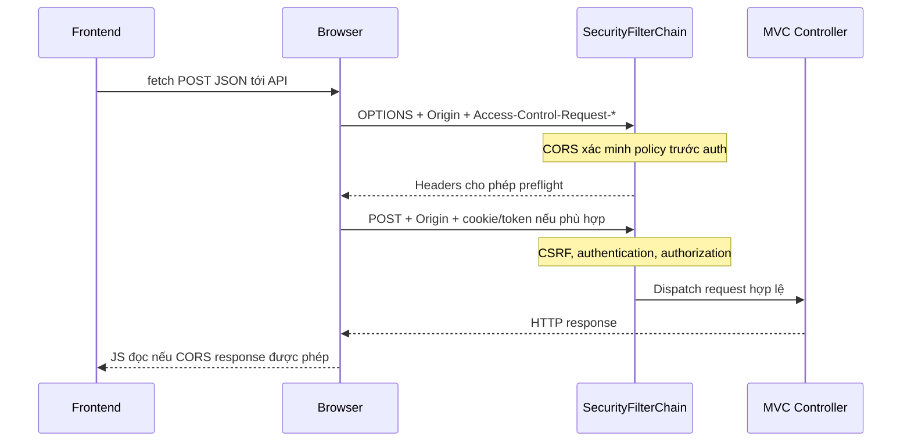

# Kết hợp cấu hình CORS của Spring MVC với Spring Security

## 1. Bài toán cần giải quyết

Một ứng dụng Spring Boot sử dụng **Spring MVC trên Servlet stack** và **Spring Security** thường đồng thời cần hai thứ: định nghĩa frontend origin nào có thể gọi API qua browser, và giữ các bước authentication, authorization, CSRF chính xác. Khi frontend ở `http://localhost:5173` gọi backend `http://localhost:8080`, request là **cross-origin** vì khác port dù cùng hostname.

**CORS (Cross-Origin Resource Sharing)** là cơ chế để server cho phép JavaScript chạy từ một origin khác đọc HTTP response trong trình duyệt. Spring MVC có thể khai báo chính sách qua `WebMvcConfigurer#addCorsMappings` hoặc `@CrossOrigin`; Spring Security cần xử lý chính sách đó **trước các bước xác thực** để preflight `OPTIONS` không bị từ chối nhầm. Cách cấu hình phổ biến cho Spring Security 6 là:

```java
http.cors(Customizer.withDefaults());
```

Khi Spring MVC có mặt, không cấu hình một `CorsConfigurationSource` riêng và dùng cấu hình CORS của MVC, Security có thể tự tận dụng CORS mapping của MVC. **MVC xác định origin/method/header được phép; Security bảo đảm CORS được xử lý tại đúng vị trí trong filter chain.**

Mục tiêu sau bài: cấu hình được một demo Java 17+/Spring Boot 3.x chạy được, kiểm thử preflight và request thật, hiểu khi nào dùng `@CrossOrigin` hoặc `CorsConfigurationSource`, xử lý các lỗi 401/403/CORS và tránh nhầm CORS với CSRF hay cookie policy.

## 2. Browser gửi request CORS như thế nào?

Origin là bộ ba `scheme + host + port`. Browser coi `https://app.example.com` và `https://api.example.com` là hai origin khác nhau (khác host); `http://localhost:5173` và `http://localhost:8080` khác origin (khác port); `http://api.example.com` và `https://api.example.com` khác origin (khác scheme).

**Same-Origin Policy (SOP)** giới hạn script ở origin A đọc dữ liệu của origin B. CORS là **quyết định cấp quyền từ server B**; không phải login, không phải phân quyền endpoint, và không ngăn mọi request cross-origin được gửi. Chẳng hạn, một form HTML có thể submit POST tới server khác dù script không đọc được response.

Một request CORS điển hình mang header do browser thiết lập:

```http
GET /api/ping HTTP/1.1
Host: localhost:8080
Origin: http://localhost:5173
```

Nếu origin được phép, phản hồi của backend có thể chứa:

```http
Access-Control-Allow-Origin: http://localhost:5173
Vary: Origin
```

**Kết quả cuối cùng do browser kiểm tra.** `curl` có thể tạo header `Origin` để thử policy nhưng không tự áp dụng CORS như browser.

### 2.1. Simple request và preflight

Không phải mọi request cross-origin đều có preflight. GET thông thường hoặc form POST dùng content type “simple”, với các header được phép, có thể gửi request thật ngay. Khi JavaScript muốn gửi JSON `Content-Type: application/json` hoặc header tùy chỉnh `X-CSRF-TOKEN`, browser thường cần **preflight OPTIONS**:

```http
OPTIONS /api/notes HTTP/1.1
Host: localhost:8080
Origin: http://localhost:5173
Access-Control-Request-Method: POST
Access-Control-Request-Headers: content-type,x-csrf-token
```

Browser hỏi “origin này có được gửi POST mang các header dự định trên không?”. Server duyệt policy và trả response như sau; status hoặc cách trình bày danh sách header cụ thể có thể khác theo framework:

```http
HTTP/1.1 200 OK
Access-Control-Allow-Origin: http://localhost:5173
Access-Control-Allow-Methods: GET,POST
Access-Control-Allow-Headers: content-type,x-csrf-token
Access-Control-Allow-Credentials: true
Access-Control-Max-Age: 1800
```

Preflight **không phải POST thật**, thường **không mang cookie đăng nhập**, và không được coi là một thao tác người dùng đã hoàn tất. Nếu preflight không vượt CORS, browser có thể không gửi POST thật.

### 2.2. Vì sao Spring Security phải tham gia?

Spring Security nằm trong **Servlet filter chain**, thường chạy trước `DispatcherServlet` và controller MVC. Nếu filter authentication xử lý `OPTIONS` preflight trước cơ chế CORS, nó có thể từ chối vì preflight không có cookie/credential. Thêm `@CrossOrigin` trên controller chỉ xác định policy MVC; policy đó cần được Security sử dụng đủ sớm.



Từ góc nhìn Spring MVC, `CorsRegistry` và `@CrossOrigin` cung cấp cấu hình gắn với các `HandlerMapping`. Khi ứng dụng có MVC và không khai báo nguồn khác cho Security, `HandlerMappingIntrospector` cho phép cơ chế CORS trong Security dùng lại thông tin mapping/policy đó. Đó là lý do `.cors(Customizer.withDefaults())` kết hợp tự nhiên với `WebMvcConfigurer` trong ứng dụng Spring MVC Servlet.

## 3. Demo Java 17+ chạy được với Spring Boot và Spring Security

Giả định frontend được tin cậy chạy ở `http://localhost:5173`, API chạy ở `http://localhost:8080`. Demo có ba endpoint:

| API | Mục đích | Quyền và bảo vệ |
| --- | --- | --- |
| `GET /api/ping` | Thử CORS GET đơn giản | Public |
| `GET /api/csrf` | Trả token CSRF cho client được phép | Public; token gắn với request/session |
| `POST /api/notes` | Thử request JSON thay đổi trạng thái | Cần session đã login, token CSRF và quyền |

Dùng Spring Boot 3.x với dependency `spring-boot-starter-web` (MVC) và `spring-boot-starter-security` (Security). Ví dụ cấu hình Gradle Groovy cho một demo độc lập, tại `build.gradle`:

```groovy
plugins {
    id 'java'
    id 'org.springframework.boot' version '3.3.5'
    id 'io.spring.dependency-management' version '1.1.6'
}

group = 'com.example'
version = '0.0.1-SNAPSHOT'

java {
    toolchain {
        languageVersion = JavaLanguageVersion.of(17)
    }
}

repositories {
    mavenCentral()
}

dependencies {
    implementation 'org.springframework.boot:spring-boot-starter-web'
    implementation 'org.springframework.boot:spring-boot-starter-security'
}
```

Đây là một mốc Spring Boot 3.3.x minh họa. Nếu module đã có plugin/dependency management do dự án sở hữu, hãy dùng chính các phiên bản đang được quản lý thay vì khai báo plugin trùng.

**Tệp `src/main/java/com/example/corsdemo/CorsDemoApplication.java`**

```java
package com.example.corsdemo;

import org.springframework.boot.SpringApplication;
import org.springframework.boot.autoconfigure.SpringBootApplication;

@SpringBootApplication
public class CorsDemoApplication {
    public static void main(String[] args) {
        SpringApplication.run(CorsDemoApplication.class, args);
    }
}
```

Đây là điểm khởi động Spring Boot; `@SpringBootApplication` quét các lớp cùng package và package con.

**Tệp `src/main/java/com/example/corsdemo/MvcCorsConfig.java`**

```java
package com.example.corsdemo;

import org.springframework.context.annotation.Configuration;
import org.springframework.web.servlet.config.annotation.CorsRegistry;
import org.springframework.web.servlet.config.annotation.WebMvcConfigurer;

@Configuration
public class MvcCorsConfig implements WebMvcConfigurer {
    @Override
    public void addCorsMappings(CorsRegistry registry) {
        registry.addMapping("/api/**")
                .allowedOrigins("http://localhost:5173")
                .allowedMethods("GET", "POST")
                .allowedHeaders("Content-Type", "X-CSRF-TOKEN")
                .allowCredentials(true)
                .maxAge(1800);
    }
}
```

Cấu hình MVC này là **nguồn chính sách CORS chính của demo**. Các thành phần:

- `addMapping("/api/**")` giới hạn chính sách vào API dưới `/api/`.
- `allowedOrigins` chứa **origin đầy đủ** gồm scheme/hostname/port, không phải URL có path hay dấu `/` cuối.
- `allowedMethods("GET", "POST")` cho phép hai phương thức request thật. Preflight dùng `OPTIONS` để *hỏi quyền* gửi POST; không bắt buộc thêm OPTIONS vào danh sách phương thức nghiệp vụ CORS.
- `allowedHeaders` cho phép frontend khai báo header `Content-Type` để gửi JSON và `X-CSRF-TOKEN` khi gửi token chống CSRF. Chỉ mở các header ứng dụng thật sự cần.
- `allowCredentials(true)` hỗ trợ CORS response cho request mang credential; **không tự ép browser gửi cookie**.
- `maxAge(1800)` đề nghị cache kết quả preflight 1800 giây, vẫn chịu giới hạn của browser.

**Tệp `src/main/java/com/example/corsdemo/SecurityConfig.java`**

```java
package com.example.corsdemo;

import org.springframework.context.annotation.Bean;
import org.springframework.context.annotation.Configuration;
import org.springframework.http.HttpMethod;
import org.springframework.security.config.Customizer;
import org.springframework.security.config.annotation.web.builders.HttpSecurity;
import org.springframework.security.web.SecurityFilterChain;

@Configuration
public class SecurityConfig {
    @Bean
    SecurityFilterChain securityFilterChain(HttpSecurity http) throws Exception {
        return http
                .cors(Customizer.withDefaults())
                .authorizeHttpRequests(auth -> auth
                        .requestMatchers(HttpMethod.GET, "/api/ping", "/api/csrf")
                        .permitAll()
                        .anyRequest().authenticated()
                )
                .formLogin(Customizer.withDefaults())
                .build();
    }
}
```

`.cors(Customizer.withDefaults())` bật tích hợp CORS của Security và cho phép sử dụng cấu hình MVC đã khai báo. `permitAll` ở hai GET chỉ bỏ yêu cầu login cho các URL đó; POST vẫn cần đăng nhập. Cấu hình này **giữ CSRF protection mặc định** vì không gọi `csrf.disable()`. Với một request POST, có thể vượt qua CORS nhưng vẫn bị Security từ chối vì token CSRF sai, không login, hoặc không đủ quyền.

**Tệp `src/main/java/com/example/corsdemo/ApiController.java`**

```java
package com.example.corsdemo;

import java.util.Map;

import org.springframework.security.web.csrf.CsrfToken;
import org.springframework.web.bind.annotation.GetMapping;
import org.springframework.web.bind.annotation.PostMapping;
import org.springframework.web.bind.annotation.RequestAttribute;
import org.springframework.web.bind.annotation.RequestBody;
import org.springframework.web.bind.annotation.RequestMapping;
import org.springframework.web.bind.annotation.RestController;

@RestController
@RequestMapping("/api")
public class ApiController {
    @GetMapping("/ping")
    public Map<String, String> ping() {
        return Map.of("message", "pong");
    }

    @GetMapping("/csrf")
    public Map<String, String> csrf(
            @RequestAttribute("_csrf") CsrfToken csrfToken) {
        return Map.of(
                "token", csrfToken.getToken(),
                "headerName", csrfToken.getHeaderName()
        );
    }

    @PostMapping("/notes")
    public Map<String, String> saveNote(
            @RequestBody Map<String, String> input) {
        return Map.of("saved", input.getOrDefault("text", ""));
    }
}
```

Các lớp là **ba tệp Java độc lập cùng package** và có thể được biên dịch trong ứng dụng Spring Boot với dependencies trên. Controller trả dữ liệu mẫu, không gọi database. `@RequestAttribute("_csrf")` đọc `CsrfToken` được Spring Security đặt trong request; gọi `getToken()` giúp lấy token khi cần. Endpoint lấy token ở đây dành cho demo có frontend được kiểm soát; ứng dụng thực tế cần quyết định chính sách public/session/cache và kiểm tra luồng đăng nhập của mình.

Để chạy bằng Gradle Wrapper trong dự án đã khởi tạo:

```bash
# Linux hoặc macOS
./gradlew bootRun

# Windows PowerShell
.\gradlew.bat bootRun
```

Nếu không cấu hình `server.port` khác, server chạy mặc định ở cổng 8080. Form login mặc định của Spring Security có thể truy cập tại `/login`; với user mặc định của demo, mật khẩu được in trong log khi khởi động nếu chưa có cấu hình account khác. Đây là tài khoản thử nghiệm, không phù hợp cho môi trường triển khai thật.

### 3.1. Kiểm chứng preflight bằng curl

Chạy trên máy có backend demo:

```bash
curl -i -X OPTIONS "http://localhost:8080/api/notes" \
  -H "Origin: http://localhost:5173" \
  -H "Access-Control-Request-Method: POST" \
  -H "Access-Control-Request-Headers: content-type,x-csrf-token"
```

Trên Windows PowerShell 5.1, `curl` có thể là alias của `Invoke-WebRequest`; dùng `curl.exe` để chắc chắn gọi curl:

```powershell
curl.exe -i -X OPTIONS "http://localhost:8080/api/notes" -H "Origin: http://localhost:5173" -H "Access-Control-Request-Method: POST" -H "Access-Control-Request-Headers: content-type,x-csrf-token"
```

Kỳ vọng response preflight thành công và có các header xác nhận `http://localhost:5173`, `POST`, `content-type,x-csrf-token`, `Access-Control-Allow-Credentials: true`. Đừng đòi chính xác 200 hay đúng thứ tự/hoa thường của danh sách: hãy kiểm tra **ý nghĩa** của các header. Preflight không cần session cookie. Nếu `OPTIONS` bị redirect login hoặc bị 401/403, kiểm tra Security CORS và mapping.

### 3.2. Kiểm chứng GET trong browser

Trên trang frontend thật có origin `http://localhost:5173`, chạy trong DevTools Console:

```javascript
const response = await fetch("http://localhost:8080/api/ping", {
  credentials: "include"
});
console.log(response.status, await response.json());
```

Khi cấu hình đúng, browser có thể đọc response status 200 với JSON tương đương:

```json
{"message":"pong"}
```

Cách DevTools hiển thị object có thể khác. `credentials: "include"` khiến browser **cân nhắc gửi cookie** cho request cross-origin nếu cookie phù hợp; nó không bảo đảm có cookie hoặc session đang login. Vì `GET /api/ping` public nên không cần session để trả kết quả.

### 3.3. POST có cookie, CSRF token và CORS

Trong browser đã login hợp lệ tại backend (cùng profile, cookie session còn hiệu lực), frontend có thể lấy CSRF token và gửi POST:

```javascript
const base = "http://localhost:8080";

const tokenResponse = await fetch(base + "/api/csrf", {
  credentials: "include"
});
if (!tokenResponse.ok) throw new Error("Không lấy được token");
const csrf = await tokenResponse.json();

const saveResponse = await fetch(base + "/api/notes", {
  method: "POST",
  credentials: "include",
  headers: {
    "Content-Type": "application/json",
    [csrf.headerName]: csrf.token
  },
  body: JSON.stringify({ text: "Ghi chú thử nghiệm" })
});

console.log(saveResponse.status, await saveResponse.text());
```

Đoạn này **chỉ chạy thành công khi browser có session backend hợp lệ, token thuộc cùng session, và Security cho phép POST**. Với các điều kiện đúng, response có thể là HTTP 200 và JSON `{"saved":"Ghi chú thử nghiệm"}`. Khi chưa login, server có thể redirect về form login hoặc trả trạng thái từ chối; khi CSRF token thiếu/sai, Spring Security thường trả 403 dù CORS đã được cấu hình đúng.

**Bốn phép kiểm tra hoàn toàn riêng biệt:**

1. CORS cho browser biết origin, method và header có được phép hay không.
2. Browser quyết định có gửi session cookie/credential theo `credentials` và cookie policy hay không.
3. Security kiểm tra CSRF, authentication và authorization trên request thật.
4. Controller xử lý nghiệp vụ; browser chỉ cho script đọc response nếu các header CORS hợp lệ.

## 4. @CrossOrigin là cách cấu hình cục bộ của Spring MVC

Thay vì một policy toàn bộ `/api/**`, có thể đặt `@CrossOrigin` trên handler cần cross-origin:

```java
package com.example.corsdemo;

import java.util.Map;
import org.springframework.web.bind.annotation.CrossOrigin;
import org.springframework.web.bind.annotation.GetMapping;
import org.springframework.web.bind.annotation.RestController;

@RestController
public class StatusController {
    @CrossOrigin(origins = "http://localhost:5173")
    @GetMapping("/status")
    public Map<String, String> status() {
        return Map.of("status", "ok");
    }
}
```

Đây là **biến thể độc lập để giải thích annotation**, không cần thêm vào demo ở mục 3. Security vẫn cần bật CORS đúng cách. Nếu một endpoint đồng thời được áp dụng global `addCorsMappings` và annotation `@CrossOrigin`, các policy có thể được **kết hợp** theo `CorsConfiguration#combine`: thuộc tính dạng danh sách có thể cộng gộp, thuộc tính đơn trị có thể được giá trị cục bộ ghi đè. Vì thế không giả định annotation tự động thu hẹp tất cả quyền được cấu hình global; nên kiểm chứng hiệu lực bằng preflight.

| Nhu cầu | Cách thường phù hợp |
| --- | --- |
| Nhiều endpoint `/api/**` cùng phục vụ một frontend | MVC `WebMvcConfigurer` + Security `cors()` |
| Một vài controller cần origin riêng | MVC `@CrossOrigin` trên controller/handler |
| API không đi qua Spring MVC HandlerMapping | `CorsConfigurationSource`/`CorsFilter` có chủ đích |
| Nhiều `SecurityFilterChain` trong app | Đặt CORS trên các chain có thể match CORS request; xác định chain nào thực sự xử lý path |

## 5. Khi dùng CorsConfigurationSource thay cho MVC CORS

Một phương án khác là cung cấp source CORS trực tiếp cho Security. Ví dụ bên dưới là **phương án thay thế** cho `MvcCorsConfig`, không phải cấu hình cần đặt song song với ví dụ ở mục 3:

```java
package com.example.corsdemo;

import java.util.List;
import org.springframework.context.annotation.Bean;
import org.springframework.context.annotation.Configuration;
import org.springframework.web.cors.CorsConfiguration;
import org.springframework.web.cors.UrlBasedCorsConfigurationSource;

@Configuration
public class AlternativeCorsSource {
    @Bean
    UrlBasedCorsConfigurationSource corsConfigurationSource() {
        CorsConfiguration cfg = new CorsConfiguration();
        cfg.setAllowedOrigins(List.of("http://localhost:5173"));
        cfg.setAllowedMethods(List.of("GET", "POST"));
        cfg.setAllowedHeaders(List.of("Content-Type", "X-CSRF-TOKEN"));
        cfg.setAllowCredentials(true);
        cfg.setMaxAge(1800L);

        UrlBasedCorsConfigurationSource source =
                new UrlBasedCorsConfigurationSource();
        source.registerCorsConfiguration("/api/**", cfg);
        return source;
    }
}
```

Khi một bean `CorsConfigurationSource` được sử dụng bởi Security, Security có thể lấy policy từ bean này **thay vì MVC HandlerMapping**. Nếu annotation `@CrossOrigin` và cấu hình global MVC không đồng nhất với source riêng, hành vi thực tế có thể khác điều bạn đọc ở controller. Nếu có **nhiều nguồn `CorsConfigurationSource`**, Security có thể không tự chọn được nguồn đúng; chỉ định rõ trên từng chain, ví dụ `http.cors(cors -> cors.configurationSource(source))`.

Đừng đăng ký lặp nhiều `CorsFilter` và nguồn CORS không thống nhất chỉ để “thử cho hết lỗi”. Lựa chọn rõ một nơi sở hữu chính sách hoặc xác định từng chain/endpoint cụ thể, rồi kiểm chứng preflight và request thật. Nếu muốn dùng chính sách Spring MVC, cấu hình phổ biến nhất vẫn là `WebMvcConfigurer`/`@CrossOrigin` cộng với `.cors(Customizer.withDefaults())`.

## 6. Credentials, wildcard và SameSite

### 6.1. Không dùng Access-Control-Allow-Origin: '*' với credential

Khi request CORS dùng credential và response có `Access-Control-Allow-Credentials: true`, browser **không chấp nhận** phản hồi có:

```http
Access-Control-Allow-Origin: *
Access-Control-Allow-Credentials: true
```

Vì vậy **không dùng `allowedOrigins("*")` cùng `allowCredentials(true)`**. Spring Framework cũng có kiểm tra đối với sự kết hợp không hợp lệ này. Hãy dùng origin đầy đủ, như `http://localhost:5173` và `https://app.example.com`. Nếu thực sự cần pattern, Spring hỗ trợ `allowedOriginPatterns`, nhưng phải kiểm soát chặt phạm vi subdomain; `https://*.example.com` có thể bao gồm cả subdomain không đáng tin. Khi pattern khớp, server có thể trả lại **origin cụ thể đã xác minh**, không cần trả wildcard.

`Access-Control-Allow-Origin` chỉ nhận một origin cụ thể hoặc `*`, **không phải** danh sách cách nhau bằng dấu phẩy. Không phản chiếu mù toàn bộ header `Origin` nhận được.

### 6.2. credentials: "include" không ép cookie được gửi

`fetch` mặc định dùng `credentials: "same-origin"`. Khi browser ở frontend `:5173` gọi API `:8080`, fetch mặc định **không tự gửi cookie cho cross-origin request**. Khi đặt `credentials: "include"`, cookie backend có thể được đính kèm nếu đồng thời thỏa:

- Cookie còn hiệu lực, session server còn hiệu lực.
- Host/`Domain` và `Path` của request khớp cookie.
- `Secure`/HTTPS được đáp ứng.
- `SameSite` cho phép trong **site context** của request.
- Chính sách browser không chặn cookie bên thứ ba, partitioned cookie hoặc các trường hợp liên quan.

`localhost:5173` và `localhost:8080` là **khác origin nhưng thường cùng site** khi scheme/hostname khớp. Vì vậy không kết luận “khác port thì luôn bắt buộc `SameSite=None`”. Ngược lại, với frontend/backend thực sự cross-site, nhiều trường hợp cookie cần `SameSite=None; Secure` và vẫn chịu giới hạn third-party cookies.

`allowCredentials(true)` cho phép browser đọc CORS response credentialed từ origin hợp lệ; nó **không cấu hình cookie**, không làm login thay người dùng, và không thay thế `credentials: "include"` ở phía JavaScript. `Set-Cookie` là forbidden response header với JavaScript; liệt kê nó trong `exposedHeaders` không cho phép script đọc header này.

### 6.3. CORS không thay thế CSRF, authentication hay authorization

**CORS** điều chỉnh quyền **JavaScript đọc response khác origin**. **CSRF** chống request thay đổi trạng thái do trang khác khởi phát nhưng mang credential tự gửi. Browser vẫn có thể gửi cross-origin form POST mà trang tấn công không đọc được phản hồi. Một cấu hình CORS chặt **không có nghĩa** đã chặn mọi CSRF.

Trong ví dụ dùng session cookie, Spring Security giữ CSRF protection cho POST/PUT/PATCH/DELETE theo chính sách mặc định. POST thiếu token CSRF có thể nhận 403; đó không phải lý do để `csrf.disable()`. Endpoint thay đổi trạng thái cũng phải kiểm tra login và phân quyền. Nếu một API chỉ dùng bearer token do JavaScript tin cậy chủ động gắn vào header `Authorization` và không chấp nhận credential tự gửi khác, đánh giá CSRF có thể khác; phải xác nhận **toàn bộ** cơ chế xác thực trước khi loại trừ CSRF.

## 7. Chẩn đoán lỗi theo Network: OPTIONS hay request thật?

Mở DevTools → Network, bật Preserve log nếu cần, thử lại chức năng rồi kiểm tra **hai request riêng**: `OPTIONS` preflight (nếu có) và method GET/POST thật.

| Triệu chứng | Nguyên nhân nên kiểm tra | Cách giải quyết |
| --- | --- | --- |
| `OPTIONS` nhận 401 hoặc 302 đến `/login` | Preflight không có cookie; filter xác thực chạy trước xử lý CORS | Bật `http.cors()` ở chain match URL, kiểm tra CORS policy từ MVC/source |
| `OPTIONS` nhận 403 `Invalid CORS request` | Origin, method, header hoặc path không match policy | Đối chiếu `Origin`, `Access-Control-Request-Method`, `Access-Control-Request-Headers` và mapping |
| `OPTIONS` thành công nhưng POST 403 | CSRF token sai/thiếu, người dùng không login, hoặc không đủ quyền | Kiểm tra response/log của **POST thật** và các lớp Security, không tắt CSRF bừa |
| GET/POST server trả 200 nhưng browser báo CORS | Response thật thiếu CORS headers hoặc credentials/wildcard sai | Kiểm tra header của **response thật**, kể cả lỗi/redirect |
| Browser nói wildcard không hợp lệ với credentials | `Access-Control-Allow-Origin: *` đi cùng credentials | Chỉ định origin chính xác; không dùng `*` với credential |
| `fetch` có `credentials: "include"` nhưng backend không có session | Cookie không phù hợp Domain/Path/Secure/SameSite hoặc bị third-party policy chặn | Xem DevTools Cookies tab, login/session và host/scheme |
| Header `Authorization`/`X-CSRF-TOKEN` làm preflight fail | Header thực tế không thuộc `allowedHeaders` | Bổ sung đúng header cần thiết; đừng mở mù mọi header |
| Chỉ vài URL lỗi | Mapping `/api/**` không match hoặc khác SecurityFilterChain | Xác định MVC handler/path và chain đã chọn |
| Lỗi chỉ khi thêm bean `CorsConfigurationSource` | Security chọn source riêng thay cho MVC mappings | Đồng bộ nguồn chính sách hoặc cấu hình source tường minh |
| Browser báo CORS khi backend redirect | Response điều hướng và CORS không khớp frontend flow | Xử lý login/redirect/API response rõ ràng |

Có thể thử origin không được tin cậy qua `curl`:

```bash
curl -i -X OPTIONS "http://localhost:8080/api/notes" \
  -H "Origin: http://untrusted.example" \
  -H "Access-Control-Request-Method: POST"
```

Origin này **không nên nhận header cho phép**. Tuy nhiên `curl` không mô phỏng browser thực thi SOP/CORS, cookie SameSite, top-level navigation hay third-party cookie restrictions. Luôn kết luận sau khi thử trên trình duyệt thật.

### Những cách sửa sai phổ biến

1. Chỉ thêm `@CrossOrigin` trong controller mà không xử lý preflight trước auth filter.
2. Chỉ thêm `requestMatchers(HttpMethod.OPTIONS, "/**").permitAll()` mà không tạo CORS policy đúng. Mở OPTIONS có thể đổi auth result nhưng browser vẫn cần các header CORS hợp lệ.
3. Bật `http.cors()` nhưng chưa cấu hình allowed origin, method và header của frontend.
4. Để tồn tại cùng lúc MVC global, `@CrossOrigin`, `CorsFilter` riêng và bean `CorsConfigurationSource` với những policy mâu thuẫn.
5. Dùng `allowedOrigins("*")` và `allowCredentials(true)`.
6. Thêm `http://localhost:5173/page` hoặc `http://localhost:5173/` vào allowed origin. Header `Origin` chỉ gồm scheme/host/port, không kèm path và dấu slash cuối.
7. Cho rằng CORS thành công là đã login hoặc phân quyền; hoặc tắt CSRF để xử lý một lỗi CORS chưa được chẩn đoán.
8. Kết luận từ `curl` hoạt động rằng request cross-origin chắc chắn hoạt động trong browser.

## 8. Checklist đưa cấu hình vào ứng dụng thực

- Xác định **origin frontend chính xác** cho local, test và production, bao gồm scheme và port. Không mở wildcard rộng khi có credential.
- Áp dụng CORS cho **đúng endpoint/path**: `addMapping("/api/**")` hoặc `@CrossOrigin` phù hợp; khi dùng cả hai, kiểm tra kết quả combine.
- Khai báo **allowedMethods** và **allowedHeaders** từ request thực tế; giảm phạm vi cho nhu cầu đã biết.
- Với ứng dụng dùng Spring MVC, ưu tiên **chính sách tại MVC + `http.cors(Customizer.withDefaults())`** để Security đọc cùng policy.
- Kiểm tra chain đang match; nếu có `CorsConfigurationSource` riêng hoặc nhiều nguồn, biết rõ source nào được dùng.
- Nếu có cookie, kiểm tra đồng thời `credentials: "include"`, `allowCredentials(true)`, origin cụ thể, cookie attributes, session và SameSite.
- Giữ **CSRF protection** với session-based unsafe methods; `GET` không được gây thay đổi trạng thái nghiệp vụ.
- Thử **preflight, request thật, response lỗi và origin không được phép** bằng Network tab; đừng chỉ nhìn response từ terminal.

**Ghi nhớ:** **Spring MVC khai báo CORS policy → Spring Security `cors()` áp dụng policy trước authentication cho preflight → request thật vẫn qua CSRF/auth/authorization → browser dùng CORS response để quyết định JavaScript có được đọc kết quả.** Một preflight thành công chỉ cho thấy CORS được chấp thuận; nó không có nghĩa endpoint đã bỏ xác thực hay người dùng có quyền thực hiện thao tác.
