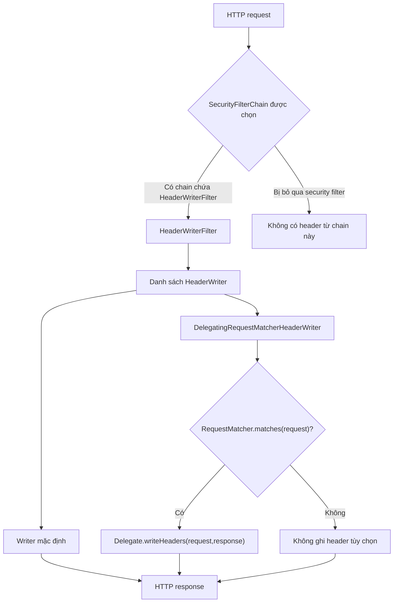

# HeaderWriter, DelegatingRequestMatcherHeaderWriter và HTTP header theo endpoint

> **Phạm vi:** Spring Security trên **Servlet stack** (Spring MVC / Spring Boot 3.x, Spring Security 6.x). Bài học nằm trong nhóm **Bảo vệ HTTP**: hiểu cơ chế ghi security response header, biết cách áp dụng chính sách khác nhau cho từng endpoint và kiểm tra header thực tế. Ví dụ sử dụng Java 17+, Spring Boot 3.3.0 và DSL `SecurityFilterChain`.

## 1. Kết quả cần đạt

Sau bài học, bạn có thể:

1. Giải thích HTTP **response header** bảo mật dùng để làm gì, tại sao header là một lớp phòng vệ riêng với authentication, authorization, CSRF và validation.
2. Mô tả vai trò `HeaderWriter`, `HeaderWriterFilter` và `DelegatingRequestMatcherHeaderWriter` trong Servlet filter chain.
3. Giữ các security header mặc định của Spring Security, bổ sung **Content-Security-Policy** và **Referrer-Policy** có điều kiện theo endpoint mà không vô tình bỏ baseline.
4. Viết Java config dùng `HttpSecurity.headers(...)` cùng `RequestMatcher` để gửi header đúng với những URL được chỉ định.
5. Phân biệt lỗi matcher sai, header bị ghi đè, nhiều CSP cùng tồn tại, response redirect/error không có header và header từ reverse proxy.
6. Kiểm thử bằng `MockMvc` và `curl -I/-i` để xác nhận **status + header + path** thay vì chỉ xem trang có tải được hay không.

## 2. Vì sao phải quan tâm security response headers?

HTTP response có thể gồm:

```http
HTTP/1.1 200 OK
Content-Type: text/html;charset=UTF-8
X-Content-Type-Options: nosniff
X-Frame-Options: DENY
Referrer-Policy: no-referrer
Content-Security-Policy: default-src 'self'; object-src 'none'; base-uri 'self'; frame-ancestors 'none'
Cache-Control: no-cache, no-store, max-age=0, must-revalidate
```

Các header trên yêu cầu **trình duyệt** thực thi một số chính sách khi xử lý response:

| Header | Vai trò | Lưu ý |
| --- | --- | --- |
| `X-Content-Type-Options: nosniff` | Hạn chế trình duyệt đoán MIME type trong những tình huống nhất định. | Server vẫn cần trả `Content-Type` đúng và kiểm soát upload. |
| `X-Frame-Options: DENY` | Ngăn nhúng tài liệu trong frame ở các browser hỗ trợ. | Không thay CSRF token; `CSP frame-ancestors` là cơ chế hiện đại, linh hoạt hơn. |
| `Content-Security-Policy` (CSP) | Hạn chế nguồn script/style/image, plugin, nơi được nhúng, base URI, form destination... | **Không tự động có trong cấu hình mặc định**; chính sách phải phù hợp tài nguyên trang. |
| `Referrer-Policy` | Kiểm soát lượng thông tin URL được gửi trong header `Referer` khi điều hướng/tải tài nguyên. | Có thể ảnh hưởng analytics hoặc tích hợp; không phải authorization. |
| `Strict-Transport-Security` (HSTS) | Yêu cầu browser dùng HTTPS trong thời hạn định trước cho host. | Chỉ có ý nghĩa khi browser nhận qua HTTPS; cẩn thận `includeSubDomains`/preload. |
| `Cache-Control`, `Pragma`, `Expires` | Giảm khả năng lưu cache response nhạy cảm. | Không thể thay permission ở tầng ứng dụng; cấu hình riêng nếu cần public caching. |
| `Permissions-Policy` | Cho phép/hạn chế một số browser features như camera, microphone, geolocation. | Cần kiểm tra hỗ trợ của browser và cú pháp policy. |

**Header không phải phép màu:** CSP không sửa lỗi phân quyền, X-Frame-Options không chặn request giả mạo, HSTS không bảo vệ khi origin vẫn phục vụ nội dung không tin cậy, và cache header không thay kiểm soát dữ liệu nhạy cảm. Security cần nhiều lớp, trong đó header giúp browser giảm tác động của một số rủi ro.

### Header mặc định của Spring Security

Khi một request đi qua `SecurityFilterChain` có bật cấu hình header mặc định, Spring Security thường thêm `Cache-Control`/`Pragma`/`Expires`, `X-Content-Type-Options: nosniff`, `X-Frame-Options: DENY` và `X-XSS-Protection: 0` (tùy version). HSTS được cấu hình cho response HTTPS theo điều kiện và cấu hình tương ứng; **không mong đợi HSTS trên HTTP cục bộ**.

`X-XSS-Protection: 0` **tắt** bộ lọc XSS cũ của một số browser; đây không phải tuyên bố server đã phòng XSS. Dùng encode output, validation và CSP đúng thay vì bật lại bộ lọc trình duyệt lỗi thời.

**CSP, Referrer-Policy và Permissions-Policy không tự xuất hiện chỉ vì đã thêm `spring-boot-starter-security`.** Bạn phải cấu hình chúng theo nhu cầu và tự kiểm thử.

Cấu hình `headers.headers(... )` của Security DSL hoạt động ở **response**, không tự thay đổi cookie, session hay header của **request**.

## 3. Cơ chế HeaderWriter trong Spring Security Servlet

Giao diện `org.springframework.security.web.header.HeaderWriter` có một phương thức:

```java
void writeHeaders(HttpServletRequest request, HttpServletResponse response);
```

Đây là **chữ ký giao diện** để giải thích cơ chế, không phải chương trình Java chạy độc lập. Từ request và response, writer quyết định header nào được ghi. Một số implementation phổ biến:

- `StaticHeadersWriter`: ghi tên header và giá trị cố định; tiện cho policy rõ ràng như CSP hoặc Referrer-Policy.
- `ContentSecurityPolicyHeaderWriter`: writer chuyên dụng cho CSP, khi bạn cần dùng API chuyên biệt.
- `HstsHeaderWriter`: ghi HSTS có điều kiện thích hợp, mặc định liên quan đến HTTPS.
- `CacheControlHeadersWriter`, `ContentTypeOptionsHeaderWriter`, `XFrameOptionsHeaderWriter`: phục vụ các header baseline tương ứng.
- `DelegatingRequestMatcherHeaderWriter`: kiểm tra `RequestMatcher`, chỉ gọi writer được bọc khi request **khớp điều kiện**.

`HeaderWriterFilter` nằm trong Servlet `SecurityFilterChain`; nó gọi các writer đã được cấu hình khi chuẩn bị commit response. Bởi vậy writer có thể ảnh hưởng response trả về từ controller, redirect hoặc luồng lỗi **nếu request đi qua security chain tương ứng và writer/matcher thực sự chạy**. Không giả định mọi response trong hệ thống đều đi qua cùng một chain.

### Quan hệ giữa các thành phần



`DelegatingRequestMatcherHeaderWriter` có ý tưởng tương đương:

```java
if (requestMatcher.matches(request)) {
    delegate.writeHeaders(request, response);
}
```

Đây là **mã minh họa logic**, không phải nội dung class thư viện để bạn sao chép làm implementation. Nó không tự sửa điều kiện của các writer khác, không chọn cả `SecurityFilterChain`, không cấp quyền, và không thay đổi response body.

### Ba lớp matcher dễ bị nhầm

1. **`securityMatcher(...)` của `SecurityFilterChain`:** xác định **chain nào** xử lý request. Nếu request không đi vào chain này, writer trong chain cũng không chạy.
2. **`requestMatchers(...)` trong `authorizeHttpRequests(...)`:** quyết định request cần authenticated/role/permission gì. `permitAll()` vẫn đi qua chain và có thể nhận security headers; `web.ignoring()` thì bỏ qua chain.
3. **`RequestMatcher` truyền vào `DelegatingRequestMatcherHeaderWriter`:** quyết định **header tùy chọn nào** được ghi. Nó không quyết định cho phép hay từ chối request.

Một header "không xuất hiện" có thể do sai **bất kỳ** lớp nào trong ba lớp trên; phải chẩn đoán theo thứ tự.

## 4. Khi nào cần header khác nhau theo endpoint?

Không phải mọi response cần chính sách giống hệt nhau:

| Đường dẫn ví dụ | Mục đích | Chính sách có thể lựa chọn |
| --- | --- | --- |
| `/public/home` | Trang HTML công khai có tài nguyên cùng origin | CSP cho phép tài nguyên cùng origin, chặn object và frame bên ngoài. |
| `/account/dashboard` | Trang HTML cá nhân | CSP chặt hơn, `Referrer-Policy: no-referrer` để giảm chia sẻ đường dẫn. |
| `/api/**` | JSON API | Chủ yếu là authentication, CORS, cache và Content-Type; CSP không thay bảo mật API. |
| `/assets/**` | CSS, JS, ảnh tĩnh | Cache policy khác nội dung cá nhân; đừng vô tình cho response bí mật vào public cache. |
| `/download/**` | File tải xuống | `Content-Disposition`, Content-Type, MIME sniffing và cache theo phân loại dữ liệu. |

Mọi header tùy chỉnh nên gắn với **mô hình rủi ro cụ thể**. CSP trên HTML có tác động rõ ràng hơn CSP trên JSON. Với nội dung nhúng cross-origin, `X-Frame-Options: DENY` mặc định có thể xung đột với yêu cầu của sản phẩm; không chỉ thêm `frame-ancestors` rồi kỳ vọng mọi browser cũ cho iframe hoạt động.

### Chọn phạm vi matcher

- Dùng path khớp **chính xác** hoặc prefix rõ ràng (`/account/**`) nếu cùng nhóm trang có cùng chính sách.
- Xét thêm method, `DispatcherType` và host **nếu thực sự cần**, nhất là khi một URL phục vụ HTML GET nhưng cũng là API POST.
- Header dựa trên response content type/status **không thể suy ra chỉ từ path** nếu route trả nhiều định dạng. Một matcher chỉ kiểm tra request không đủ phân biệt HTML/JSON đã được render.
- Kiểm soát thay đổi đường dẫn: thêm endpoint mới ngoài matcher thì policy tùy chọn có thể không áp dụng. Test cần bao gồm route mới quan trọng.
- Không nhầm đường dẫn request sau reverse proxy hoặc context path; kiểm tra matcher bằng test với deployment path thực.

## 5. Ví dụ đầy đủ có thể chạy: header theo hai nhóm trang

Demo sử dụng **Spring Boot 3.3.0**, **Spring Security 6.x**, **Java 17+**, Maven và Thymeleaf. Hai endpoint:

- `GET /public/home`: công khai; nhận CSP phù hợp nội dung public.
- `GET /account/dashboard`: cần đăng nhập HTTP Basic; nhận **CSP chặt hơn** và `Referrer-Policy: no-referrer`.

Các header bảo mật mặc định **vẫn bật**. Không cần controller tự gọi `response.setHeader(...)`.

### 5.1. Cấu trúc thư mục

```text
endpoint-headers-demo/
├── pom.xml
└── src/
    ├── main/
    │   ├── java/demo/headers/
    │   │   ├── DemoApplication.java
    │   │   ├── SecurityConfig.java
    │   │   └── PageController.java
    │   └── resources/
    │       └── templates/
    │           ├── public-home.html
    │           └── account-dashboard.html
    └── test/java/demo/headers/
        └── HeaderPolicyTest.java
```

### 5.2. Maven và ứng dụng

**`pom.xml`:**

```xml
<project xmlns="http://maven.apache.org/POM/4.0.0"
         xmlns:xsi="http://www.w3.org/2001/XMLSchema-instance"
         xsi:schemaLocation="http://maven.apache.org/POM/4.0.0 https://maven.apache.org/xsd/maven-4.0.0.xsd">
    <modelVersion>4.0.0</modelVersion>
    <parent>
        <groupId>org.springframework.boot</groupId>
        <artifactId>spring-boot-starter-parent</artifactId>
        <version>3.3.0</version>
        <relativePath/>
    </parent>
    <groupId>demo</groupId>
    <artifactId>endpoint-headers-demo</artifactId>
    <version>0.0.1-SNAPSHOT</version>
    <properties>
        <java.version>17</java.version>
    </properties>
    <dependencies>
        <dependency>
            <groupId>org.springframework.boot</groupId>
            <artifactId>spring-boot-starter-web</artifactId>
        </dependency>
        <dependency>
            <groupId>org.springframework.boot</groupId>
            <artifactId>spring-boot-starter-security</artifactId>
        </dependency>
        <dependency>
            <groupId>org.springframework.boot</groupId>
            <artifactId>spring-boot-starter-thymeleaf</artifactId>
        </dependency>
        <dependency>
            <groupId>org.springframework.boot</groupId>
            <artifactId>spring-boot-starter-test</artifactId>
            <scope>test</scope>
        </dependency>
        <dependency>
            <groupId>org.springframework.security</groupId>
            <artifactId>spring-security-test</artifactId>
            <scope>test</scope>
        </dependency>
    </dependencies>
    <build>
        <plugins>
            <plugin>
                <groupId>org.springframework.boot</groupId>
                <artifactId>spring-boot-maven-plugin</artifactId>
            </plugin>
        </plugins>
    </build>
</project>
```

**`src/main/java/demo/headers/DemoApplication.java`:**

```java
package demo.headers;

import org.springframework.boot.SpringApplication;
import org.springframework.boot.autoconfigure.SpringBootApplication;

@SpringBootApplication
public class DemoApplication {
    public static void main(String[] args) {
        SpringApplication.run(DemoApplication.class, args);
    }
}
```

### 5.3. Cấu hình SecurityFilterChain với DelegatingRequestMatcherHeaderWriter

**`src/main/java/demo/headers/SecurityConfig.java`:**

```java
package demo.headers;

import org.springframework.context.annotation.Bean;
import org.springframework.context.annotation.Configuration;
import org.springframework.security.config.Customizer;
import org.springframework.security.config.annotation.web.builders.HttpSecurity;
import org.springframework.security.core.userdetails.User;
import org.springframework.security.core.userdetails.UserDetailsService;
import org.springframework.security.crypto.bcrypt.BCryptPasswordEncoder;
import org.springframework.security.crypto.password.PasswordEncoder;
import org.springframework.security.provisioning.InMemoryUserDetailsManager;
import org.springframework.security.web.SecurityFilterChain;
import org.springframework.security.web.header.writers.DelegatingRequestMatcherHeaderWriter;
import org.springframework.security.web.header.writers.StaticHeadersWriter;
import org.springframework.security.web.util.matcher.AntPathRequestMatcher;

@Configuration
public class SecurityConfig {
    static final String PUBLIC_CSP =
            "default-src 'self'; object-src 'none'; "
            + "base-uri 'self'; frame-ancestors 'none'";

    static final String ACCOUNT_CSP =
            "default-src 'self'; script-src 'none'; object-src 'none'; "
            + "base-uri 'self'; frame-ancestors 'none'; form-action 'self'";

    @Bean
    SecurityFilterChain securityFilterChain(HttpSecurity http) throws Exception {
        var publicPages = new AntPathRequestMatcher("/public/**");
        var accountPages = new AntPathRequestMatcher("/account/**");

        return http
            .authorizeHttpRequests(auth -> auth
                .requestMatchers("/public/**").permitAll()
                .requestMatchers("/account/**").authenticated()
                .anyRequest().denyAll())
            .headers(headers -> headers
                .addHeaderWriter(new DelegatingRequestMatcherHeaderWriter(
                    publicPages,
                    new StaticHeadersWriter(
                        "Content-Security-Policy", PUBLIC_CSP)))
                .addHeaderWriter(new DelegatingRequestMatcherHeaderWriter(
                    accountPages,
                    new StaticHeadersWriter(
                        "Content-Security-Policy", ACCOUNT_CSP)))
                .addHeaderWriter(new DelegatingRequestMatcherHeaderWriter(
                    accountPages,
                    new StaticHeadersWriter(
                        "Referrer-Policy", "no-referrer"))))
            .httpBasic(Customizer.withDefaults())
            .build();
    }

    @Bean
    PasswordEncoder passwordEncoder() {
        return new BCryptPasswordEncoder();
    }

    @Bean
    UserDetailsService users(PasswordEncoder encoder) {
        return new InMemoryUserDetailsManager(
            User.withUsername("learner")
                .password(encoder.encode("demo-pass"))
                .roles("USER")
                .build());
    }
}
```

**Diễn giải từng quyết định:**

1. `authorizeHttpRequests` thiết lập quyền: public được `permitAll`; account cần authenticated; các path khác bị từ chối. Header matcher có nhiệm vụ khác authorization matcher, dù ví dụ dùng cùng prefix.
2. `new AntPathRequestMatcher("/public/**")` và `new AntPathRequestMatcher("/account/**")` kiểm tra đường dẫn Servlet tương ứng. API này có sẵn ở bản Spring Security 6.x của demo; khi nâng cấp major version, kiểm tra API matcher được khuyến nghị của phiên bản đích.
3. Mỗi `DelegatingRequestMatcherHeaderWriter` chỉ chạy writer bọc bên trong khi path của request khớp. Hai nhóm `public` và `account` không trùng nhau, nên mỗi trang nhận **một giá trị CSP của ứng dụng**.
4. `StaticHeadersWriter` dùng cho chuỗi giá trị cố định. CSP thực thi **trên response**, không phải annotation của controller. Chính sách account cấm script bằng `script-src 'none'`; trang demo cố ý không sử dụng JavaScript.
5. `Referrer-Policy: no-referrer` chỉ đặt cho `/account/**`, giảm URL trang cá nhân bị gửi qua Referer khi đi tới đích khác. Trang public giữ chính sách referrer mặc định của trình duyệt nếu không có header khác từ proxy.
6. Cách gọi `.headers(headers -> headers.addHeaderWriter(...))` **thêm** writer tùy chọn vào cấu hình headers; **không gọi** `defaultsDisabled()` và **không vô hiệu** các writer mặc định. HSTS chỉ xuất hiện trong môi trường HTTPS theo cơ chế tương ứng.
7. `httpBasic` cung cấp cách xác thực gọn cho demo. Production có thể dùng session/form login hoặc cơ chế khác; thay cách đăng nhập không làm thay đổi vai trò của `DelegatingRequestMatcherHeaderWriter`.
8. Tài khoản trong bộ nhớ và mật khẩu `demo-pass` chỉ để học tập; ứng dụng thật cần định danh, quản lý credential và phân quyền phù hợp.

> **Chú ý:** chúng ta không khai báo `StaticHeadersWriter` thành Servlet `Filter`. Đây là bean/config trong security chain; tạo thêm filter đăng ký ở container có thể khiến header được áp dụng ngoài thứ tự bạn dự kiến.

### 5.4. Controller và template

**`src/main/java/demo/headers/PageController.java`:**

```java
package demo.headers;

import org.springframework.stereotype.Controller;
import org.springframework.web.bind.annotation.GetMapping;

@Controller
public class PageController {
    @GetMapping("/public/home")
    public String publicHome() {
        return "public-home";
    }

    @GetMapping("/account/dashboard")
    public String dashboard() {
        return "account-dashboard";
    }
}
```

**`src/main/resources/templates/public-home.html`:**

```html
<!doctype html>
<html lang="vi">
<head>
    <meta charset="utf-8">
    <title>Trang công khai</title>
</head>
<body>
    <h1>Trang công khai</h1>
    <p>Header Content-Security-Policy của nhóm /public/**.</p>
    <a href="/account/dashboard">Mở dashboard</a>
</body>
</html>
```

**`src/main/resources/templates/account-dashboard.html`:**

```html
<!doctype html>
<html lang="vi">
<head>
    <meta charset="utf-8">
    <title>Dashboard</title>
</head>
<body>
    <h1>Dashboard cá nhân</h1>
    <p>Chỉ người đã xác thực mới mở được trang này.</p>
    <a href="/public/home">Trở lại trang công khai</a>
</body>
</html>
```

Trang demo chỉ có HTML tĩnh, không cần script inline, CSS inline hoặc nguồn từ CDN. Trong ứng dụng dùng script, hình ảnh, font hoặc API ngoài origin, bạn phải thiết kế CSP tương ứng: dùng `nonce`/`hash` hoặc nguồn cho phép tối thiểu khi cần; không thêm `unsafe-inline` tùy tiện để "sửa" CSP. Kiểm tra browser console vì CSP có thể khiến một tính năng không chạy mà server vẫn trả 200.

### 5.5. Chạy và quan sát response

Tại thư mục `endpoint-headers-demo`:

```bash
mvn test
mvn spring-boot:run
```

**Public page:**

```bash
curl -i http://localhost:8080/public/home
```

Kỳ vọng status `200 OK`, cùng các header như:

```http
X-Content-Type-Options: nosniff
X-Frame-Options: DENY
Content-Security-Policy: default-src 'self'; object-src 'none'; base-uri 'self'; frame-ancestors 'none'
```

**Account page có credential:**

```bash
curl -i -u learner:demo-pass http://localhost:8080/account/dashboard
```

Kỳ vọng status `200 OK` với:

```http
X-Content-Type-Options: nosniff
X-Frame-Options: DENY
Content-Security-Policy: default-src 'self'; script-src 'none'; object-src 'none'; base-uri 'self'; frame-ancestors 'none'; form-action 'self'
Referrer-Policy: no-referrer
```

**Account page chưa xác thực:**

```bash
curl -i http://localhost:8080/account/dashboard
```

Kỳ vọng `401 Unauthorized` và `WWW-Authenticate: Basic ...`. Trong cấu hình này, đường dẫn vẫn khớp `/account/**` nên header tùy chọn cũng được ghi vào response 401 khi đi qua chain; việc **được viết header** không đồng nghĩa request được cấp quyền.

Các response mẫu đã **lược bớt** header khác như `Content-Type`, `Cache-Control`, `Date` và phần body để dễ đọc. Giá trị của `WWW-Authenticate`, cách viết hoa tên header, thứ tự và một số giá trị phụ thuộc framework/container. Hãy xác minh bằng Network tab hoặc curl thay vì so nguyên văn toàn bộ response.

`curl -I` gửi request **HEAD**, còn `curl -i` gửi GET và hiển thị cả header/body. Nếu ứng dụng có chính sách khác cho HEAD hoặc controller chỉ xử lý một method, kiểm thử HEAD riêng; đừng mặc nhiên coi output từ HEAD là đại diện hoàn toàn cho GET.

## 6. Kiểm thử tự động với MockMvc

Bài toán ở đây không chỉ là controller trả 200, mà là **request đúng path nhận đúng policy**, public không nhận policy của private và baseline không bị mất.

**`src/test/java/demo/headers/HeaderPolicyTest.java`:**

```java
package demo.headers;

import org.junit.jupiter.api.Test;
import org.springframework.beans.factory.annotation.Autowired;
import org.springframework.boot.test.autoconfigure.web.servlet.AutoConfigureMockMvc;
import org.springframework.boot.test.context.SpringBootTest;
import org.springframework.test.web.servlet.MockMvc;

import static org.springframework.security.test.web.servlet.request
    .SecurityMockMvcRequestPostProcessors.user;
import static org.springframework.test.web.servlet.request.MockMvcRequestBuilders.get;
import static org.springframework.test.web.servlet.result.MockMvcResultMatchers.header;
import static org.springframework.test.web.servlet.result.MockMvcResultMatchers.status;

@SpringBootTest
@AutoConfigureMockMvc
class HeaderPolicyTest {
    @Autowired
    MockMvc mvc;

    @Test
    void publicPageHasPublicCspAndRetainsDefaults() throws Exception {
        mvc.perform(get("/public/home"))
            .andExpect(status().isOk())
            .andExpect(header().string(
                "Content-Security-Policy", SecurityConfig.PUBLIC_CSP))
            .andExpect(header().doesNotExist("Referrer-Policy"))
            .andExpect(header().string(
                "X-Content-Type-Options", "nosniff"))
            .andExpect(header().string("X-Frame-Options", "DENY"));
    }

    @Test
    void accountPageHasStrictCspAndReferrerPolicy() throws Exception {
        mvc.perform(get("/account/dashboard").with(user("learner")))
            .andExpect(status().isOk())
            .andExpect(header().string(
                "Content-Security-Policy", SecurityConfig.ACCOUNT_CSP))
            .andExpect(header().string("Referrer-Policy", "no-referrer"))
            .andExpect(header().string(
                "X-Content-Type-Options", "nosniff"));
    }

    @Test
    void anonymousAccountRequestIsUnauthorizedWithHeaders() throws Exception {
        mvc.perform(get("/account/dashboard"))
            .andExpect(status().isUnauthorized())
            .andExpect(header().string(
                "Content-Security-Policy", SecurityConfig.ACCOUNT_CSP))
            .andExpect(header().string("Referrer-Policy", "no-referrer"));
    }
}
```

Với Maven, lệnh:

```bash
mvn test
```

sẽ biên dịch source và chạy JUnit 5 qua Spring Boot test infrastructure. Test thứ nhất chứng minh policy public và baseline còn tồn tại; test thứ hai chứng minh writer nhắm đúng endpoint private; test thứ ba kiểm tra policy trên một response bị security từ chối. Nếu có custom error handling, redirect, exception hoặc nhiều chain, bổ sung test đúng các response loại đó.

**Giới hạn của test:** `MockMvc` xác minh HTTP header do ứng dụng ghi nhưng **không mô phỏng đầy đủ browser enforcement của CSP/HSTS**. Kiểm tra CSP bằng browser DevTools/Console, HTTPS/HSTS bằng môi trường HTTPS, response qua proxy/CDN bằng HTTP client vào URL triển khai thật.

## 7. HeaderWriter tùy chỉnh và matcher phức tạp hơn

`StaticHeadersWriter` xử lý trường hợp giá trị cố định rất tốt. Khi header phụ thuộc request, có thể dùng lambda triển khai `HeaderWriter` (đoạn dưới là **minh họa** để chèn trong `SecurityConfig`, không phải một ứng dụng độc lập):

```java
org.springframework.security.web.header.HeaderWriter writer =
    (request, response) -> {
        if (!response.containsHeader("X-Request-Policy")) {
            response.setHeader("X-Request-Policy", "reviewed");
        }
    };
```

Đây là header ví dụ tự định nghĩa, **không phải browser security standard**. Khi triển khai thực tế, chỉ tạo header cần thiết, bảo đảm giá trị an toàn (không chứa CR/LF hay dữ liệu người dùng tùy ý), và đừng dùng "header đánh dấu" làm bằng chứng server đã xác thực request.

Có thể bọc writer này trong `DelegatingRequestMatcherHeaderWriter` để chỉ áp dụng ở path đã chọn. Cũng có thể viết `RequestMatcher` tùy chỉnh để kiểm tra **path + method**:

```java
org.springframework.security.web.util.matcher.RequestMatcher matcher =
    request -> "GET".equals(request.getMethod())
        && request.getServletPath().startsWith("/account/");
```

Đoạn trên là ví dụ cú pháp Java 17, không phải matcher production tối ưu. `startsWith("/account/")` giới hạn đúng dấu gạch chéo để `/accounting` không bị tính là một phần của `/account/`; bạn vẫn cần xét servlet mapping, context path, encoded path, trailing slash và rule route thực tế. Dùng matcher được kiểm thử của framework khi có thể.

### Khi nào tự viết writer?

Chỉ nên tự viết nếu header có logic mà writer chuẩn không đáp ứng: ví dụ áp dụng một phần chính sách dựa trên nhóm endpoint đã được phân loại. Nếu header toàn cục hoặc giá trị cố định, cấu hình DSL chuẩn hoặc `StaticHeadersWriter` dễ hiểu và dễ kiểm thử hơn.

Tránh đọc trực tiếp parameter không tin cậy rồi ghép vào CSP, redirect target hoặc `Access-Control-Allow-Origin`. Việc ghi header không được vô tình biến dữ liệu không tin cậy thành một phần chính sách mà browser sẽ thực thi.

## 8. Header theo endpoint, nhiều SecurityFilterChain và proxy

### 8.1. Nhiều chain có thứ tự

Ứng dụng thật có thể có chain riêng cho `/api/**` và chain cho web UI:

```text
/api/**         → SecurityFilterChain API (authentication, CORS, headers API)
/public/**      → SecurityFilterChain web (public CSP)
/account/**     → SecurityFilterChain web (private CSP)
```

Spring Security dùng **chain đầu tiên phù hợp** với request. Vì vậy writer chỉ có tác dụng trong chain được chọn. Nếu có chain API ở độ ưu tiên cao nhưng không cấu hình headers cần thiết, việc cấu hình writer ở web chain không "bù" cho API. Cần kiểm thử thứ tự `@Order` và `securityMatcher` của mỗi chain.

`web.ignoring()` loại request khỏi Spring Security chain, đồng nghĩa `HeaderWriterFilter` của chain cũng không chạy. Để tài nguyên công khai vẫn nhận security header, thường ưu tiên `permitAll()` bên trong chain thay vì bỏ qua hoàn toàn, trừ trường hợp có lý do rõ ràng.

### 8.2. Reverse proxy/CDN có thể thêm hoặc sửa header

Nếu Nginx, ingress, API gateway hoặc CDN đặt thêm CSP/X-Frame-Options/HSTS, response đến người dùng có thể khác hẳn response khi test MockMvc cục bộ. Cần xác định **một nơi sở hữu từng policy** hoặc có quy tắc hợp nhất rõ ràng.

Một số tình huống:

- Ứng dụng ghi CSP A, proxy ghi CSP B: browser có thể thực thi **nhiều chính sách đồng thời**, khiến tài nguyên bị chặn nhiều hơn mong đợi. Đừng nghĩ CSP thứ hai mặc nhiên "ghi đè" hoặc nới lỏng CSP đầu.
- Writer dùng `setHeader` khác với `addHeader`; có thể thay thế hoặc thêm header tùy thứ tự. Đừng dựa vào writer cuối cùng để sửa policy sai một cách ngầm định.
- `X-Frame-Options: DENY` mặc định có thể cản việc nhúng trang, kể cả khi CSP `frame-ancestors` cho phép domain khác. Browser hiện đại ưu tiên CSP frame-ancestors khi enforced, nhưng tương thích browser cũ còn khác; phải quyết định chiến lược chính sách cho iframe một cách nhất quán.
- `Content-Security-Policy-Report-Only` chỉ báo cáo vi phạm, **không thực thi chặn**. Dùng để đánh giá ảnh hưởng trước rollout, rồi chuyển sang CSP enforced khi phù hợp.
- Security headers có thể bị mất ở 304, redirect 302, response lỗi 404/500, static asset hoặc redirect do proxy tạo. Test trực tiếp từng đường đi thay vì chỉ xem controller 200.

### 8.3. HSTS cần đặc biệt thận trọng

`Strict-Transport-Security` được browser ghi nhớ khi nhận từ HTTPS. Các directive như `max-age`, `includeSubDomains` và `preload` tác động tới hành vi trong thời gian dài. Chỉ bật phạm vi subdomain và preload khi toàn bộ các host liên quan đã sẵn sàng HTTPS và có quy trình rollback tương ứng. HSTS mặc định trong Spring Security không xuất hiện trên kết nối HTTP thuần, điều này là bình thường.

## 9. Những lỗi phổ biến và cách tìm nguyên nhân

| Hiện tượng | Nguyên nhân cần kiểm tra | Cách xử lý |
| --- | --- | --- |
| CSP không có ở `/account/dashboard` | Matcher chưa khớp, route thuộc chain khác, request bypass security, hoặc proxy bỏ header. | Test matcher và chain theo path thật; kiểm tra network cả trước/sau proxy. |
| Header chỉ có ở `/public/home`, không có ở trang mới | Path mới nằm ngoài `/public/**`. | Thiết kế group route rõ ràng, thêm test cho endpoint mới; không mở matcher quá rộng. |
| Mất `nosniff`, `X-Frame-Options`, cache headers | Dùng `defaultsDisabled()` hoặc `headers.disable()`/chain khác. | Giữ baseline và thêm writer; chỉ tắt một header nếu có lý do và có bảo vệ thay thế. |
| CSP chặn CSS/JS hoặc image hợp lệ | Policy thiếu nguồn, dùng script/style inline, CDN, data/blob URL hoặc hash/nonce chưa đúng. | Xem CSP violation trong browser; sửa policy/kiến trúc tài nguyên theo nguyên tắc allowlist tối thiểu. |
| CSP xuất hiện hai lần | Writer mặc định/tùy chỉnh, gateway/CDN cùng ghi header, nhiều layer đặt policy. | Xác định owner, giảm trùng policy; hiểu rằng browser có thể enforce đồng thời. |
| 401/403 có header khác 200 | Entry point, error dispatch, chain/matcher hoặc error handler khác luồng. | Test response bị từ chối quyền, error và redirect riêng. |
| Header đúng ở MockMvc nhưng thiếu trên site | Reverse proxy/CDN/ingress rewrite hoặc static routing bypass app. | Curl vào domain thật, so header từng tầng và cấu hình proxy. |
| HSTS không xuất hiện ở localhost HTTP | HSTS gắn với HTTPS. | Kiểm tra qua HTTPS test environment thay vì bật bừa trên HTTP. |
| Đặt `Referrer-Policy` cho mọi route làm hỏng luồng thống kê | Chính sách quá chặt cho tất cả endpoint. | Phân loại trang nhạy cảm, chọn policy được sản phẩm chấp thuận. |

### Checklist chẩn đoán theo thứ tự

1. Xác định **URL thực tế, method, status** của response và nó đi qua `SecurityFilterChain` nào.
2. Xác định request có khớp `RequestMatcher` của writer hay không (path, method, dispatcher, context path).
3. Kiểm tra trong cấu hình có `defaultsDisabled()`, `headers.disable()`, writer khác đặt cùng header hoặc nhiều chain không.
4. Dùng `curl -i`/DevTools kiểm tra header của response 200, 302, 401, 403, 404/500 và 304 trong các đường đi thật sự có sử dụng.
5. So sánh response từ ứng dụng nội bộ và response qua gateway/CDN; quan sát header trùng, thay thế hoặc bị loại bỏ.
6. Nếu CSP không hoạt động như ý, đọc vi phạm ở browser console; tách lỗi browser policy khỏi lỗi authentication, authorization, CSRF và nội dung ứng dụng.
7. Viết test regression cho endpoint quan trọng trước khi thay đổi routing, chain order, proxy hoặc security configuration.

## 10. Câu hỏi ôn tập

**1. Khi đã đặt `permitAll()`, header writer có chạy không?**

Có, nếu request vẫn đi qua security chain chứa `HeaderWriterFilter` và điều kiện của writer khớp. `permitAll()` chỉ cho phép authorization, khác với loại khỏi toàn bộ chain.

**2. `DelegatingRequestMatcherHeaderWriter` có quyết định user được truy cập endpoint không?**

Không. Nó chỉ quyết định có gọi writer bọc bên trong để ghi header hay không. Quyền truy cập được quyết định riêng bởi authentication/authorization và các filter liên quan.

**3. Vì sao không thêm CSP global và CSP endpoint để "nới quyền" cho một trang?**

Nhiều CSP có thể đồng thời áp dụng và tăng mức hạn chế; policy endpoint không bảo đảm nới được global policy. Thiết kế policy nhất quán và test chính xác header phản hồi từ ứng dụng/proxy.

**4. Vì sao `HeaderWriter` không thay thế xác thực, phân quyền hoặc CSRF token?**

Security header chủ yếu hướng dẫn browser xử lý **response**. Server vẫn phải kiểm tra quyền truy cập dữ liệu, tính hợp lệ request và mọi thao tác thay đổi trạng thái; HTTP client không phải browser có thể không thực thi policy.

**5. Trường hợp nào cần cân nhắc bảo mật theo endpoint?**

Khi các nhóm trang có đặc tính khác nhau: dashboard chứa dữ liệu cá nhân, trang public có tài nguyên riêng, trang nhúng, file download hoặc API. Matcher phải chính xác và thống nhất với routing/chain.

## 11. Ghi nhớ

- **`HeaderWriter`** ghi security response header; **`HeaderWriterFilter`** áp dụng writers trong Spring Security Servlet chain.
- **`DelegatingRequestMatcherHeaderWriter`** gắn writer với `RequestMatcher`, cho phép đặt policy theo path/endpoint mà không đổi quyền truy cập.
- **`HttpSecurity.headers(...)`** là nơi cấu hình. Khi thêm writer tùy chọn, **giữ header mặc định** trừ khi có yêu cầu đã phân tích rõ.
- CSP/Referrer-Policy cần chủ động cấu hình; CSP phải phù hợp tài nguyên HTML và có thể bị ảnh hưởng bởi proxy hoặc các policy khác.
- Xác minh bằng test **đúng route, đúng status, đúng header**, kể cả denied/error/redirect và response từ hạ tầng triển khai.

**Nguyên tắc thực hành:** xác định chính sách browser cần cho từng nhóm endpoint, chọn matcher rõ ràng, để security chain ghi header nhất quán, rồi dùng test và quan sát HTTP response thực tế để bảo đảm chính sách được áp dụng.