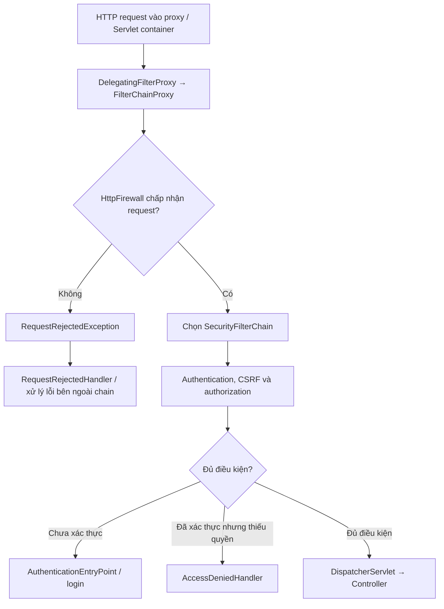

# Sự khác biệt giữa từ chối yêu cầu nguy hiểm với trả lỗi thiếu quyền

> **Bối cảnh:** Spring Security trên **Servlet stack**, tập trung vào `HttpFirewall`, `StrictHttpFirewall`, `FilterChainProxy` và việc phân biệt yêu cầu bị chặn vì cấu trúc đáng ngờ với yêu cầu bị từ chối do chưa xác thực hoặc không đủ quyền.

## 1. Hai câu hỏi bảo mật hoàn toàn khác nhau

Khi một HTTP request không được xử lý, cần xác định **request bị từ chối ở lớp nào và vì nguyên nhân gì** trước khi giải thích HTTP status.

1. **HttpFirewall:** “Bản thân cách biểu diễn request có chấp nhận được để xử lý an toàn không?” Ví dụ URL chưa được chuẩn hóa, chứa mẫu đường dẫn dễ gây sai khác cách phân tích, HTTP method không được chấp nhận, hoặc header/parameter bị cấm. Đây là kiểm tra **hình dạng request**, diễn ra trước khi Spring Security chọn và chạy các filter xác thực/phân quyền.
2. **Authentication/authorization:** “Đây là ai, đã đăng nhập chưa và danh tính này có quyền truy cập tài nguyên không?” Request có thể hoàn toàn hợp lệ về cú pháp, nhưng vẫn bị từ chối vì thiếu danh tính hoặc thiếu quyền.
3. **Các cơ chế khác:** CSRF, CORS, validation hoặc ứng dụng nghiệp vụ cũng có thể từ chối request. **Chỉ nhìn 400/401/403 chưa đủ** để kết luận cơ chế nào gây ra lỗi.

Một `GET /admin/report` hợp lệ nhưng được gửi bằng tài khoản chỉ có vai trò `USER` là **lỗi thiếu quyền**. Một request như `GET /admin//report` có thể bị `StrictHttpFirewall` chặn vì đường dẫn đáng ngờ **ngay cả khi người gửi là ADMIN**. Ngược lại, firewall chấp nhận `GET /admin/report` không có nghĩa người dùng được phép đọc báo cáo.

**“Request nguy hiểm” trong ngữ cảnh HttpFirewall không phải bằng chứng đã xác định người gửi là kẻ tấn công.** Đó là request vi phạm chính sách biểu diễn/chuẩn hóa an toàn; có thể do tấn công, client lỗi, proxy không thống nhất hoặc cấu hình chưa phù hợp.

## 2. Thứ tự xử lý trong Spring Security Servlet

Spring Security nhận request từ Servlet container thông qua `DelegatingFilterProxy` và `FilterChainProxy`. `HttpFirewall` hoạt động ở lớp `FilterChainProxy` trước việc chọn `SecurityFilterChain` thích hợp. Nếu request vượt qua firewall, các filter bảo mật mới tiếp tục xử lý authentication, CSRF, authorization, rồi có thể đi tới `DispatcherServlet` và controller.



Sơ đồ chỉ thể hiện các nhánh **điển hình**. Từng filter có thể xử lý lỗi theo cơ chế riêng, đặc biệt CSRF, HTTP Basic, CORS, hoặc ứng dụng có nhiều security chains. Reverse proxy và Servlet container cũng có thể từ chối request trước khi tới Spring.

### 2.1. Khi HttpFirewall từ chối

Các bước khái niệm:

1. `FilterChainProxy` gọi `HttpFirewall#getFirewalledRequest(...)` để nhận dạng request có thể sử dụng an toàn trong việc chọn/match filter chain.
2. Với `StrictHttpFirewall`, request vi phạm quy tắc sẽ phát sinh `RequestRejectedException`.
3. Vì lỗi xảy ra **trước các security filters thông thường**, không thể giả định `ExceptionTranslationFilter`, `AuthenticationEntryPoint`, `AccessDeniedHandler` hay controller `@ExceptionHandler` sẽ xử lý nó.
4. Cơ chế liên quan là `RequestRejectedHandler` ở cấp `FilterChainProxy`, hoặc cơ chế error handling ngoài chain. `HttpStatusRequestRejectedHandler` có thể được cấu hình để trả một mã HTTP rõ ràng (thường 400). **Không khẳng định cứ bị firewall chặn là luôn 400**: response còn tùy phiên bản/cấu hình handler, Servlet container, reverse proxy và các exception handler bên ngoài.

### 2.2. Khi thiếu authentication hoặc quyền

Một request đã vượt qua firewall và tới bước bảo vệ endpoint:

- **Chưa đăng nhập / credential không hợp lệ:** cơ chế authentication kích hoạt `AuthenticationEntryPoint` hoặc xử lý lỗi tương đương. Với HTTP Basic, thường là **401 Unauthorized** kèm `WWW-Authenticate`; với form login, browser có thể nhận **302 redirect** đến trang đăng nhập.
- **Đã xác thực nhưng không đủ authority/role:** đường xử lý `AccessDeniedException` và `AccessDeniedHandler` thường trả **403 Forbidden**.
- **Dữ liệu request sai quy tắc nghiệp vụ:** controller/validation có thể trả **400** hoặc mã khác; đây không đồng nghĩa firewall đã từ chối.
- **Thiếu hoặc sai CSRF token:** CSRF filter có thể trả **403** ngay cả khi authentication hợp lệ. Cần phân biệt với lỗi thiếu authority.
- **Lỗi CORS preflight:** có thể trả **403** do chính sách origin/method/header không phù hợp; không suy ra người dùng thiếu quyền.

`ExceptionTranslationFilter` có nhiệm vụ chuyển các ngoại lệ `AuthenticationException` và `AccessDeniedException` từ những filter/đối tượng nằm trong phạm vi xử lý của nó thành phản hồi authentication/access denied tương ứng. **Nó không phải handler tổng quát cho mọi `RequestRejectedException` xảy ra trước filter chain.**

## 3. Bảng so sánh cốt lõi

| Tiêu chí | Firewall từ chối request đáng ngờ | Chưa xác thực | Đã xác thực nhưng thiếu quyền |
| --- | --- | --- | --- |
| Câu hỏi | Cấu trúc/request có an toàn để phân tích/match? | Request có danh tính hợp lệ? | Danh tính có đủ authority? |
| Vị trí thông thường | `HttpFirewall` trong `FilterChainProxy`, trước chọn chain | Các filter authentication | Authorization filter, method security hoặc tầng nghiệp vụ |
| Dữ liệu quyết định | Method, URL/path, path encoding/normalization, header/parameter theo policy | Session, Basic credential, bearer token, cơ chế auth | Role/authority, rule `requestMatchers`, `@PreAuthorize`, ownership |
| Có cần user login để lỗi xuất hiện? | Không | Không | Thường có danh tính hợp lệ nhưng thiếu quyền |
| Ngoại lệ tiêu biểu | `RequestRejectedException` | `AuthenticationException` hoặc auth entry point | `AccessDeniedException` |
| Thành phần phản hồi | `RequestRejectedHandler` / container handler | `AuthenticationEntryPoint` hoặc authentication mechanism | `AccessDeniedHandler` |
| HTTP status thường gặp | 400 khi handler được cấu hình trả Bad Request; không bảo đảm cố định | 401 Basic/API hoặc 302 form login | 403 |
| Cách khắc phục chính | Sửa request, đồng nhất proxy/URL parsing hoặc xem lại policy firewall có kiểm soát | Cung cấp credential hợp lệ/đăng nhập | Cấp đúng quyền hoặc thay đổi access rule theo yêu cầu nghiệp vụ |
| Lỗi tư duy phổ biến | “ADMIN thì được vượt firewall.” | “401 là thiếu role.” | “403 luôn do firewall hoặc URL nguy hiểm.” |

**Thứ tự quan trọng:** một request có path bị firewall từ chối chưa chắc đã đi tới bước xác thực. Không thể chỉ bằng cách gửi thêm bearer token, cookie hoặc cấp thêm role để “sửa” lỗi đó.

## 4. StrictHttpFirewall kiểm tra những gì?

`StrictHttpFirewall` là implementation chặt chẽ mà Spring Security dùng làm cấu hình mặc định trong các phiên bản Servlet hiện đại. Nó nhằm giảm rủi ro khi các thành phần khác nhau (proxy, container, MVC, matcher, server) diễn giải **khác nhau** về cùng một URL hoặc method, dẫn đến request được kiểm tra theo một đường dẫn nhưng xử lý như đường dẫn khác.

Những nhóm kiểm tra đáng chú ý:

- **HTTP method:** theo mặc định chỉ cho phép các method phổ biến như `DELETE`, `GET`, `HEAD`, `OPTIONS`, `PATCH`, `POST`, `PUT`; các method khác có thể bị từ chối ngay ở firewall. Container cũng có thể chặn một method trước đó.
- **Đường dẫn không chuẩn hóa:** các chuỗi như dấu `//` dư, đường dẫn có biểu diễn không chuẩn, dấu chấm và thành phần path có thể gây chênh lệch cách match URL.
- **Ký tự/biểu diễn bị cấm:** theo chính sách mặc định, semicolon `;` trong path, backslash, một số URL-encoded characters như encoded slash, encoded backslash, encoded percent, các ký tự điều khiển hoặc biểu diễn đáng ngờ có thể bị từ chối.
- **Header, parameter và hostname:** firewall có các cơ chế kiểm tra/giới hạn nội dung, trong đó cấu hình có thể tùy biến danh sách tên/giá trị hợp lệ. Không nên gán cho firewall vai trò thay thế validation nghiệp vụ.
- **Canonicalization:** việc kiểm tra trước security matcher tránh trường hợp lớp phân quyền đọc một path trong khi tầng MVC hay server xử lý một path khác.

**Không ghi nhớ máy móc rằng mọi biểu diễn cụ thể chắc chắn trả 400.** Reverse proxy có thể normalize hoặc reject trước khi đến Spring; Servlet container có thể diễn giải path/encoding trước filter; cấu hình `StrictHttpFirewall` có thể được điều chỉnh. Hãy kiểm tra đường đi thực tế và cấu hình đang dùng.

### 4.1. Vì sao bỏ chặn tùy tiện có thể nguy hiểm?

Giả sử một hệ thống đặt rule “chỉ ADMIN được gọi `/admin/**`”. Nếu proxy, firewall, matcher và controller chuẩn hóa URL khác nhau, có thể tạo ra sự bất nhất về **đường dẫn được kiểm tra quyền** và **đường dẫn thực thi**. Chính sách firewall chặt hướng tới giảm nguy cơ dạng này, không đơn thuần làm sạch log.

Spring Security có các phương thức cấu hình linh hoạt như `setAllowSemicolon` hay `setAllowUrlEncodedSlash`. **Không bật chúng chỉ để “hết 400”**. Trước khi nới lỏng cần:

1. Chứng minh tính năng thật sự cần cú pháp đó, ví dụ một ứng dụng di sản dùng matrix variables.
2. Kiểm tra reverse proxy, load balancer, Servlet container, URL matcher, Spring MVC và downstream có diễn giải path giống nhau không.
3. Kiểm thử cả path được phép và path gần giống nhạy cảm, đặc biệt `/admin/**`, `/api/**`, các phương thức khác nhau và encoding lặp.
4. Ưu tiên đổi API để dữ liệu có dấu slash hoặc semicolon nằm trong **query parameter/body** khi đó phù hợp nghiệp vụ, thay vì yêu cầu path chứa encoded delimiter.
5. Nếu cần điều chỉnh policy, thu hẹp và ghi rõ lý do; không tắt hoặc thay thế firewall chặt bằng chính sách mở toàn cục.

## 5. Demo runnable: cùng một API, ba loại từ chối

Tạo Spring Boot 3.x với Java 17+ và hai dependencies: Spring MVC web starter và Spring Security starter. Ví dụ dùng `HTTP Basic` cho dễ quan sát **401/403**, không cần frontend hay cookie phiên. Demo gồm:

- `GET /public`: ai cũng xem được.
- `GET /private/profile`: phải đăng nhập.
- `GET /admin/report`: cần vai trò `ADMIN`.
- Một request có path bị `StrictHttpFirewall` coi là không an toàn sẽ bị chặn **trước khi phân quyền**, bất kể credential.

### 5.1. build.gradle

```groovy
plugins {
    id 'java'
    id 'org.springframework.boot' version '3.3.5'
    id 'io.spring.dependency-management' version '1.1.6'
}

group = 'com.example'
version = '0.0.1-SNAPSHOT'

java {
    toolchain {
        languageVersion = JavaLanguageVersion.of(17)
    }
}

repositories {
    mavenCentral()
}

dependencies {
    implementation 'org.springframework.boot:spring-boot-starter-web'
    implementation 'org.springframework.boot:spring-boot-starter-security'
}
```

Các phiên bản plugin chỉ phục vụ demo độc lập, thuộc nhánh Spring Boot 3.3.x. Nếu đang tích hợp vào module đã có quản lý dependency riêng, dùng phiên bản/module plugin do dự án quyết định.

### 5.2. Ứng dụng Spring Boot

Tệp `src/main/java/com/example/firewalldemo/FirewallDemoApplication.java`:

```java
package com.example.firewalldemo;

import org.springframework.boot.SpringApplication;
import org.springframework.boot.autoconfigure.SpringBootApplication;

@SpringBootApplication
public class FirewallDemoApplication {
    public static void main(String[] args) {
        SpringApplication.run(FirewallDemoApplication.class, args);
    }
}
```

### 5.3. SecurityConfig

Tệp `src/main/java/com/example/firewalldemo/SecurityConfig.java`:

```java
package com.example.firewalldemo;

import org.springframework.context.annotation.Bean;
import org.springframework.context.annotation.Configuration;
import org.springframework.security.config.Customizer;
import org.springframework.security.config.annotation.web.builders.HttpSecurity;
import org.springframework.security.config.annotation.web.configuration.WebSecurityCustomizer;
import org.springframework.security.core.userdetails.User;
import org.springframework.security.core.userdetails.UserDetailsService;
import org.springframework.security.crypto.factory.PasswordEncoderFactories;
import org.springframework.security.crypto.password.PasswordEncoder;
import org.springframework.security.provisioning.InMemoryUserDetailsManager;
import org.springframework.security.web.SecurityFilterChain;
import org.springframework.security.web.firewall.StrictHttpFirewall;

@Configuration
public class SecurityConfig {
    @Bean
    SecurityFilterChain securityFilterChain(HttpSecurity http) throws Exception {
        return http
                .authorizeHttpRequests(auth -> auth
                        .requestMatchers("/public").permitAll()
                        .requestMatchers("/admin/**").hasRole("ADMIN")
                        .anyRequest().authenticated()
                )
                .httpBasic(Customizer.withDefaults())
                .build();
    }

    @Bean
    PasswordEncoder passwordEncoder() {
        return PasswordEncoderFactories.createDelegatingPasswordEncoder();
    }

    @Bean
    UserDetailsService users(PasswordEncoder encoder) {
        return new InMemoryUserDetailsManager(
                User.withUsername("viewer")
                        .password(encoder.encode("viewer-demo"))
                        .roles("USER")
                        .build(),
                User.withUsername("admin")
                        .password(encoder.encode("admin-demo"))
                        .roles("ADMIN")
                        .build()
        );
    }

    @Bean
    WebSecurityCustomizer webSecurityCustomizer() {
        return web -> web.httpFirewall(new StrictHttpFirewall());
    }
}
```

Giải thích:

- `requestMatchers("/public").permitAll()` mở duy nhất route public.
- `requestMatchers("/admin/**").hasRole("ADMIN")` yêu cầu authority `ROLE_ADMIN` (Spring Security thêm prefix `ROLE_` khi gọi `hasRole("ADMIN")`).
- `anyRequest().authenticated()` yêu cầu login cho các route còn lại.
- `httpBasic()` giúp client CLI nhận `401` khi chưa xác thực, `403` khi đã xác thực nhưng không đủ role.
- Hai account mã hóa password bằng `DelegatingPasswordEncoder` dành cho demo local. **Không dùng tài khoản/password ví dụ trong production.**
- `WebSecurityCustomizer` ở đây chủ động đặt `StrictHttpFirewall` để thấy điểm cấu hình. Đây cũng là loại firewall chặt mặc định trong cấu hình Spring Security Servlet thông thường; vì vậy bean này chủ yếu **minh họa**, không phải yêu cầu phải thêm vào mọi dự án.
- Không tắt CSRF: các thử nghiệm bên dưới đều dùng GET, là phương thức an toàn theo cấu hình CSRF mặc định.

### 5.4. Controller

Tệp `src/main/java/com/example/firewalldemo/AccessDemoController.java`:

```java
package com.example.firewalldemo;

import java.util.Map;
import org.springframework.web.bind.annotation.GetMapping;
import org.springframework.web.bind.annotation.RestController;

@RestController
public class AccessDemoController {
    @GetMapping("/public")
    public Map<String, String> publicInfo() {
        return Map.of("result", "public");
    }

    @GetMapping("/private/profile")
    public Map<String, String> privateInfo() {
        return Map.of("result", "authenticated");
    }

    @GetMapping("/admin/report")
    public Map<String, String> adminReport() {
        return Map.of("result", "admin-only");
    }
}
```

Đây là bốn lớp Java trong package `com.example.firewalldemo` tính cả application class, security config, controller và các dependency class do Spring cung cấp; code chạy trong ứng dụng Spring Boot có dependency tương ứng. Controller không chứa logic xác thực/role bởi Security đã kiểm tra URL ở filter chain.

### 5.5. Chạy và quan sát ba kết quả

Dùng Gradle Wrapper có sẵn trong một dự án Spring Boot được khởi tạo với cấu hình trên:

```bash
# Linux / macOS
./gradlew bootRun

# Windows PowerShell
.\gradlew.bat bootRun
```

Nếu không đổi cổng, backend ở `http://localhost:8080`. Kiểm tra với các lệnh:

```bash
# Public, không cần tài khoản: HTTP 200
curl -i "http://localhost:8080/public"

# Endpoint bảo vệ, không gửi Basic credential: thường HTTP 401
curl -i "http://localhost:8080/private/profile"

# Đúng tài khoản USER, đủ quyền xem profile: HTTP 200
curl -i -u viewer:viewer-demo "http://localhost:8080/private/profile"

# USER cố vào route ADMIN: HTTP 403 Forbidden
curl -i -u viewer:viewer-demo "http://localhost:8080/admin/report"

# ADMIN được phép: HTTP 200
curl -i -u admin:admin-demo "http://localhost:8080/admin/report"
```

Đối với lệnh đầu và ba lệnh có role như mô tả, response JSON khi thành công lần lượt là:

```json
{"result":"public"}
```

```json
{"result":"authenticated"}
```

```json
{"result":"admin-only"}
```

**Nhận xét:** request `/admin/report` từ `viewer` có URL và method bình thường, đã vượt qua firewall, nhưng thiếu `ROLE_ADMIN`; vì thế kết quả **403** không liên quan tới URL nguy hiểm. Request `/private/profile` không có credential gặp nhánh authentication; `HTTP Basic` có thể trả **401** và header `WWW-Authenticate`.

### 5.6. Request bị firewall từ chối: địa chỉ đáng ngờ

Thử request chứa dấu `;` trong URL path, vốn bị `StrictHttpFirewall` mặc định từ chối nếu request đến được filter ở dạng đó:

```bash
curl --path-as-is -i -u admin:admin-demo "http://localhost:8080/private/profile;mode=debug"
```

Sau đó có thể thử một URL chứa dấu `//` không chuẩn hóa:

```bash
curl --path-as-is -i -u admin:admin-demo "http://localhost:8080/private//profile"
```

**Kết quả cần xác minh:** server/proxy/container có thể chặn hoặc chuẩn hóa URL trước khi Spring; nếu tới `StrictHttpFirewall` ở dạng bị cấm, request bị từ chối với `RequestRejectedException` **trước khi kiểm tra vai trò ADMIN**. Không ấn định một HTTP status duy nhất nếu chưa biết `RequestRejectedHandler`, container và proxy của ứng dụng. Khi cấu hình `HttpStatusRequestRejectedHandler` để trả Bad Request, có thể thấy **400**; môi trường khác có thể trình bày response khác.

Một request bị từ chối vì path đáng ngờ **không trở nên hợp lệ khi thêm Basic credential của ADMIN**. Ngược lại, `/admin/report` đúng cú pháp vẫn cần `ROLE_ADMIN`. Hai thử nghiệm này đặt cùng credential cạnh hai nguyên nhân từ chối khác nhau.

Lưu ý: `curl --path-as-is` giúp hạn chế việc *client* tự normalize path; nó **không kiểm soát** việc reverse proxy hoặc Servlet container ở phía server xử lý URL.

## 6. Handler nào xử lý lỗi nào?

### 6.1. RequestRejectedException và RequestRejectedHandler

Khi `HttpFirewall` từ chối request, `RequestRejectedException` phát sinh ở tầng `FilterChainProxy`. Một `RequestRejectedHandler` có thể được gắn vào `FilterChainProxy` để xử lý loại từ chối này; ví dụ `HttpStatusRequestRejectedHandler` dùng để đặt status cụ thể. Khi tùy biến, cần xác nhận handler **thực sự được kết nối vào FilterChainProxy trong phiên bản/cấu hình ứng dụng**.

Không mặc định một `@RestControllerAdvice` ở MVC sẽ bắt được exception này. `DispatcherServlet` và controller có thể **chưa được gọi**. Tương tự, cấu hình `AccessDeniedHandler` không có nghĩa tự động thay đổi response của firewall: hai loại handler làm việc ở vị trí khác nhau.

### 6.2. AuthenticationEntryPoint và AccessDeniedHandler

Đối với đường đi authentication/authorization:

- `AuthenticationEntryPoint` có trách nhiệm bắt đầu quá trình xác thực khi cần. HTTP Basic thường trả 401 và challenge; form login có thể redirect 302; ứng dụng REST có thể tùy biến sang JSON 401.
- `AccessDeniedHandler` thường xử lý trường hợp danh tính đã xác thực nhưng thiếu quyền, trả 403 và có thể ghi response body phù hợp API.
- `ExceptionTranslationFilter` giúp dịch các exception xác thực/truy cập từ phần chain nó bao phủ. Không coi nó là bộ bắt mọi lỗi Servlet.
- `CsrfFilter` cũng có thể từ chối bằng mã 403 khi token CSRF không hợp lệ; nội dung response tương tự “Forbidden” **không chứng minh** thiếu role.

Sơ đồ điều hướng sự cố:

```text
Request bị từ chối?
  ├─ Có lỗi RequestRejectedException / path-method-header bất thường?
  │    └─ Xem HttpFirewall, RequestRejectedHandler, container/proxy
  ├─ Thiếu hoặc sai credential?
  │    └─ Xem authentication filter và AuthenticationEntryPoint
  ├─ Authenticated nhưng thiếu role/authority?
  │    └─ Xem authorization rule, AccessDeniedException/Handler
  ├─ Thiếu/sai CSRF token trên unsafe method?
  │    └─ Xem CsrfFilter và CSRF policy
  └─ Controller đã chạy rồi mới báo lỗi?
       └─ Xem validation, handler, service và error mapping nghiệp vụ
```

Không dùng status code như bằng chứng duy nhất. Cần xem **loại exception thực tế và thành phần đã ghi response**.

## 7. Khi nào 400, 401, 403 là dấu hiệu đáng tin?

| Tình huống | Status điển hình | Chú ý khi kết luận |
| --- | --- | --- |
| URL hoặc HTTP method bị `StrictHttpFirewall` chặn | Thường có thể cấu hình 400, nhưng không cố định | Proxy/container/handler có thể trả status khác; exception là bằng chứng mạnh hơn |
| HTTP Basic thiếu/sai credential | 401 | Xem `WWW-Authenticate`; form login có thể 302 |
| User có `ROLE_USER` nhưng endpoint yêu cầu `ROLE_ADMIN` | 403 | Kiểm tra `AuthorizationFilter`/method security và authority thực tế |
| POST có session nhưng CSRF token thiếu hoặc sai | Thường 403 | Không kết luận là thiếu authority |
| CORS preflight không được phép | Có thể 403 | Kiểm tra `Origin`, method, headers, Security CORS |
| Request JSON sai định dạng hoặc validation lỗi | Thường 400 | Controller/MVC báo lỗi dữ liệu, không nhất thiết `HttpFirewall` |
| Reverse proxy từ chối URL trước khi chuyển vào ứng dụng | Phụ thuộc proxy, thường 400/4xx | Log Spring có thể không có request |
| 404 do route không tồn tại | 404 | Firewall có thể đã chấp nhận request; endpoint vẫn không có mapping |

Mã HTTP là **giao diện phản hồi** cho client. Nguyên nhân phải được nhận diện qua request, đường xử lý, exception, cấu hình và log.

### 7.1. Đừng tùy tiện đổi 403 thành 400, hay ngược lại

Client và hệ thống giám sát cần phân biệt ba ý nghĩa:

- **Bad Request (400):** request không chấp nhận được do cú pháp/định dạng/chính sách request ở cấp đầu vào. Từ chối ở firewall *có thể* được ánh xạ thành 400 khi chủ động cấu hình.
- **Unauthorized (401):** client cần cung cấp credential hợp lệ, đặc biệt trong ngữ cảnh HTTP Basic/Bearer có challenge hoặc API 401.
- **Forbidden (403):** server đã hiểu request nhưng không cho phép hành động, thường vì thiếu quyền; cũng có thể do CSRF hoặc CORS tùy tầng.

Nếu mọi lỗi đều trả 403 với thông điệp “Access denied”, người vận hành dễ sửa nhầm role thay vì kiểm tra path encoding hoặc chính sách firewall. Nhưng thông điệp client cũng không nên phơi bày chi tiết tên rule firewall hay URL có chứa dữ liệu nhạy cảm.

## 8. Debug có thứ tự và an toàn

### Bước 1 — Xác định request có tới ứng dụng không

Kiểm tra access log của reverse proxy / Servlet container, request method/path và sự khác biệt giữa URL browser hiển thị và request thực tế. Một 400 đến từ proxy có thể không tạo log tương ứng trong Spring Security. Nếu có security rejection log, kiểm tra nó có `RequestRejectedException` hay không.

### Bước 2 — Xác định đường xử lý

- **HttpFirewall:** tìm dấu hiệu request bị từ chối trước chain, ví dụ path chứa semicolon, đường dẫn chưa chuẩn hóa hoặc method không được phép; kiểm tra cấu hình `StrictHttpFirewall` và các thành phần normalize URL phía trước.
- **Authentication:** kiểm tra client có gửi credential đúng không, session/token còn hiệu lực không; Basic 401 thường kèm challenge.
- **Authorization:** kiểm tra endpoint thực tế match rule nào, authority được cấp là gì, và user đã authenticated hay chưa.
- **CSRF/CORS:** với POST/PUT/PATCH/DELETE hoặc browser cross-origin, kiểm tra CSRF token, preflight OPTIONS và header CORS trước khi kết luận thiếu quyền.

### Bước 3 — Dùng bộ thử nghiệm đối chứng

Cùng một endpoint đã biết, thử có kiểm soát:

1. **URL chuẩn, không credential:** có thể 401 hoặc redirect khi route bảo vệ.
2. **URL chuẩn, credential hợp lệ nhưng thiếu role:** có thể 403.
3. **URL chuẩn, credential có đủ role:** phải đến controller và nhận kết quả nghiệp vụ.
4. **URL nghi vấn, credential đủ role:** nếu firewall từ chối, kết quả không phụ thuộc role và controller không chạy.
5. **URL nghi vấn, không credential:** đối chiếu cùng nguồn từ chối để chứng minh lỗi xuất hiện **trước authentication**.
6. **Một request POST cần CSRF:** dùng token đúng/sai riêng để không trộn lỗi CSRF vào bài thử firewall/role.

Khi test qua browser, DevTools → Network giúp xác định redirect, request thật và preflight. Khi test URL encoding dùng `curl --path-as-is`, nhớ proxy/container vẫn có thể thay đổi path trước Spring.

### Bước 4 — Quan sát và ghi log đúng lớp

- Theo dõi tần suất `RequestRejectedException` riêng với 401/403 do authentication/authorization.
- Ghi correlation/request ID khi khả thi, source component, route/method đã chuẩn hóa cho metric và trạng thái do handler trả.
- Giới hạn và làm sạch dữ liệu log: request path, query/header raw có thể chứa chuỗi độc hại, ký tự điều khiển hoặc thông tin nhạy cảm; không ghi toàn bộ token/password vào log.
- Nếu sử dụng custom `RequestRejectedHandler`, kiểm thử cả body/status/header trả về và không tiết lộ cấu trúc bảo mật nội bộ.
- Dùng test cho case bình thường và edge cases trước khi nới lỏng `StrictHttpFirewall`; đừng dựa duy nhất vào số lượng 400/403 giảm sau thay đổi.

## 9. Các nhầm lẫn thường gặp

| Nhầm lẫn | Sự thật |
| --- | --- |
| “Có ADMIN thì request nào cũng phải qua được.” | Firewall đánh giá tính chấp nhận được của request **trước khi** xét quyền ADMIN. |
| “403 luôn là thiếu quyền.” | 403 còn có thể do CSRF, CORS hoặc error handler; xem nguồn lỗi. |
| “400 luôn do HttpFirewall.” | 400 có thể từ proxy, container, MVC JSON parsing, validation hoặc chính firewall được ánh xạ thành 400. |
| “RequestRejectedException là AccessDeniedException.” | Đây là các loại lỗi khác nhau, với vị trí và handler khác nhau. |
| “Chỉ cần thêm permitAll cho URL bị từ chối.” | `permitAll` xử lý authorization, không bỏ qua kiểm tra `HttpFirewall`. |
| “Thêm requestMatcher cho URL lạ sẽ sửa firewall.” | Matcher chạy sau bước request phải được firewall chấp nhận. |
| “Bỏ StrictHttpFirewall là xong.” | Nới lỏng thiếu đánh giá có thể tạo bất nhất chuẩn hóa URL và bypass rule. |
| “Có 401/403 thì request chắc chắn đã vào controller.” | Security có thể từ chối trước `DispatcherServlet`; controller chưa chạy. |
| “Chuyển lỗi thành cùng một JSON 403 sẽ đơn giản hơn.” | Điều đó che khuất nguyên nhân và làm client/quan sát khó phân biệt authentication, authorization và request rejection. |

## 10. Câu hỏi tự kiểm tra

**1.** Người dùng `ADMIN` gửi `GET /admin//report`. Vì sao vẫn có thể thất bại?  
Vì `StrictHttpFirewall` có thể từ chối URL chưa chuẩn hóa trước bước xét role; không đồng nghĩa tài khoản thiếu `ROLE_ADMIN`.

**2.** Một tài khoản `USER` gọi `GET /admin/report` đúng cú pháp và nhận 403. Cần kiểm tra gì trước?  
Xác minh người dùng đã authenticated, rule `/admin/**` yêu cầu authority gì, và thực tế user có authority nào. Nếu exception là `AccessDeniedException`, đây là nhánh authorization, không cần chỉnh firewall.

**3.** Client gọi `GET /private/profile` không kèm Basic credential và nhận 401. Có phải HttpFirewall phát hiện tấn công không?  
Không. 401 là nhánh authentication của HTTP Basic; request có thể hoàn toàn đúng cú pháp.

**4.** Có thể dùng `@RestControllerAdvice` để chắc chắn bắt được `RequestRejectedException` không?  
Không chắc, vì exception xuất hiện trước khi request đi vào `DispatcherServlet`; cần xem xử lý lỗi ở `FilterChainProxy`, `RequestRejectedHandler`, container hoặc proxy.

**5.** Tại sao phải kiểm tra cả proxy và Servlet container khi thấy encoded slash bị từ chối?  
Vì các tầng có thể decode, normalize hoặc reject trước Spring, làm status và exception khác dự kiến; mục tiêu là bảo đảm tất cả tầng nhìn URL nhất quán.

**6.** Có nên bật `setAllowUrlEncodedSlash(true)` chỉ vì frontend gặp 400?  
Không. Phải chứng minh yêu cầu nghiệp vụ và kiểm thử nguy cơ path normalization/bypass trên các tầng trước khi nới lỏng.

## 11. Ghi nhớ cuối bài

Một HTTP request đi qua hai cổng kiểm tra khác nhau:

**Cổng 1 — HttpFirewall:** *Request được biểu diễn thế này có chấp nhận được không?* Nếu không, phát sinh `RequestRejectedException` và không cần biết người gửi đã đăng nhập hay có role gì.

**Cổng 2 — Spring Security authorization:** *Request hợp lệ này do ai thực hiện và họ được phép làm gì?* Nếu thiếu authentication, có thể 401/redirect; nếu đã đăng nhập nhưng thiếu quyền, thường 403. CSRF và các filter khác vẫn có thể từ chối độc lập.

**Chẩn đoán bằng loại exception, vị trí xử lý và request thực tế; không dựa một mình vào status code.** Giữ `StrictHttpFirewall` chặt chẽ và dùng authentication/authorization để kiểm soát danh tính, quyền truy cập.
