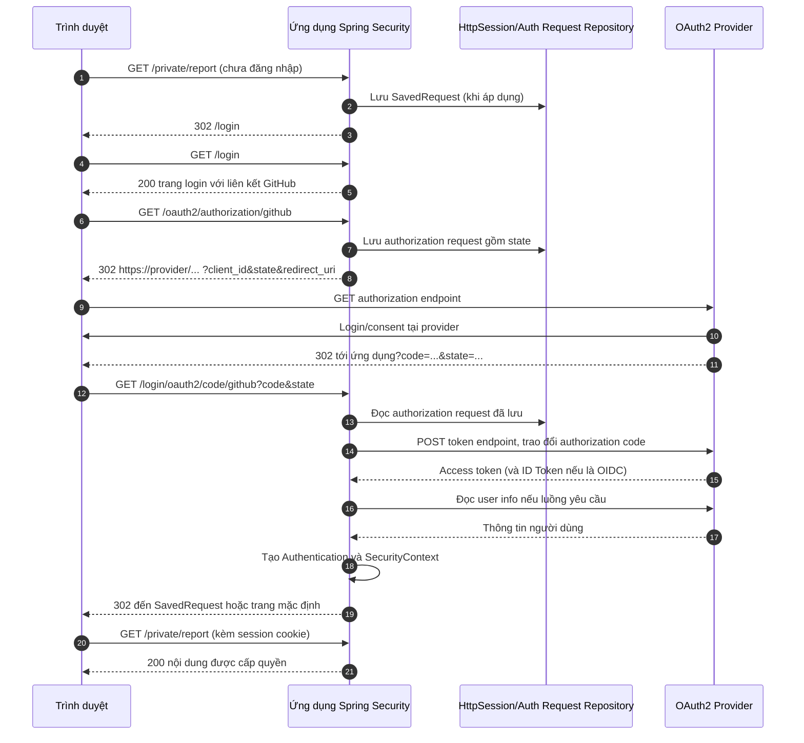

# oauth2Login: endpoint khởi tạo, callback và đăng nhập thành công

> **Phạm vi:** Spring Security **Servlet** (Spring MVC / Spring Boot 3.x / Spring Security 6.x). Bài học tập trung vào luồng OAuth 2.0 Login: endpoint đưa trình duyệt sang nhà cung cấp, endpoint nhận authorization code và xử lý đăng nhập thành công. Ví dụ dùng **Java 17+**, **Spring Boot 3.3.0** và GitHub OAuth App, kèm MockMvc test không cần kết nối GitHub. Đây là bài về ứng dụng đóng vai trò **OAuth2 Client**, không phải xây OAuth2 Authorization Server.

## 1. Mục tiêu học tập

Sau bài này, bạn có thể:

1. Chỉ đúng URL mặc định `/oauth2/authorization/{registrationId}` và `/login/oauth2/code/{registrationId}`, giải thích vì sao chúng khác nhau.
2. Đi theo từng bước **Authorization Code flow** từ user chưa đăng nhập tới lúc ứng dụng nhận code, đổi code lấy access token, tải thông tin người dùng và lập phiên xác thực.
3. Phân biệt `OAuth2AuthorizationRequestRedirectFilter`, `OAuth2LoginAuthenticationFilter`, `ClientRegistration`, `OAuth2AuthorizationRequestRepository`, `OAuth2AuthorizedClient`, `OAuth2AuthenticationToken` và authentication success handler.
4. Hiểu việc kiểm tra `state`, giữ session/cookie, `redirect_uri`, lỗi callback và cơ chế **SavedRequest** quyết định trang được mở sau khi login.
5. Cấu hình `oauth2Login` tối thiểu, chạy ứng dụng với OAuth App thật, kiểm thử endpoint khởi tạo và bảo vệ endpoint; biết giới hạn của test giả lập.
6. Xử lý những lỗi phổ biến như `redirect_uri_mismatch`, `authorization_request_not_found`, sai `registrationId`, mất session, redirect loop và callback sai đường dẫn.

## 2. OAuth2 Login là gì, khác API token như thế nào?

Trong mô hình **OAuth2 Login** của một ứng dụng Servlet:

- **Người dùng** truy cập website của bạn bằng trình duyệt.
- **Ứng dụng của bạn** là OAuth2 Client (cũng là relying application). Nó đưa trình duyệt đến trang authorization của nhà cung cấp danh tính, nhận authorization code và gọi token endpoint **từ máy chủ**.
- **Authorization Server/Provider** là GitHub, Google hoặc nhà cung cấp tương tự. Nó xác thực người dùng và đưa trình duyệt trở lại `redirect_uri` đã đăng ký.
- Sau khi xác thực, Spring Security tạo `Authentication`, lưu vào `SecurityContext`; trong cấu hình ứng dụng web có session, phiên đăng nhập ứng dụng thường được duy trì qua session cookie.
- **Access token lấy từ provider** phục vụ việc gọi tài nguyên của provider theo scope cho phép. Nó không mặc nhiên là access token cho API nội bộ của bạn, cũng không phải cookie phiên ứng dụng.

**OAuth 2.0** chủ yếu là khung ủy quyền, không tự quy định một chuẩn nhận dạng user hoàn chỉnh. Spring Security `oauth2Login` có thể dùng OAuth2 user-info (ví dụ GitHub) hoặc **OpenID Connect** với provider hỗ trợ OIDC và scope `openid`. Với OIDC, ID Token và các quy tắc như issuer/audience/nonce có vai trò riêng; **GitHub OAuth App trong ví dụ không phải ví dụ OIDC và không phát ID Token theo luồng này**.

Các giá trị dễ nhầm:

| Giá trị | Ý nghĩa |
| --- | --- |
| `registrationId` | Định danh cấu hình provider **ở ứng dụng**, ví dụ `github`. Không phải user ID hay client ID bí mật. |
| `client-id` | Định danh OAuth App do provider cấp; xuất hiện trong authorization request. |
| `client-secret` | Bí mật của confidential client; chỉ giữ phía server/secrets manager. |
| `scope` | Phạm vi truy cập mà ứng dụng xin từ provider; không tự biến thành role nội bộ. |
| `state` | Giá trị ngẫu nhiên liên kết yêu cầu khởi tạo và callback; phòng authorization response không được khởi tạo hợp lệ. |
| `code` | Authorization code ngắn hạn, thường chỉ dùng một lần, được đổi lấy token ở server. |
| `redirect_uri` | URL **callback của ứng dụng**, phải khớp với cấu hình provider và khớp endpoint filter nhận callback. |
| `access_token` | Credential để gọi API của provider theo quyền được cấp; không nên đưa vào URL/log. |
| `JSESSIONID` | Cookie định danh session ứng dụng khi dùng Servlet session; không phải OAuth access token. |

## 3. Hai endpoint mặc định và thứ tự chạy

Khi cấu hình một `ClientRegistration` có id `github` và bật `oauth2Login`, mặc định có hai endpoint rất khác nhau:

| Bước | URL trên **ứng dụng** | Thành phần xử lý | Vai trò |
| --- | --- | --- | --- |
| 1. Khởi tạo | `GET /oauth2/authorization/github` | `OAuth2AuthorizationRequestRedirectFilter` | Tạo authorization request, lưu thông tin để đối chiếu callback, trả `302` tới provider. |
| 2. Callback | `GET /login/oauth2/code/github?code=...&state=...` | `OAuth2LoginAuthenticationFilter` | Kiểm tra response, lấy authorization request đã lưu, xác minh state, đổi code lấy token, nạp user và hoàn tất authentication. |

**Đặc biệt:** URL callback **không phải** URL đăng nhập mà người dùng cần tự mở. Nếu tự gõ `/login/oauth2/code/github` mà không có authorization request hợp lệ trong session, callback không đủ dữ liệu để xác thực và sẽ thất bại.

Phía provider sẽ có endpoint khác (ví dụ GitHub authorization URL), nhưng đó là server bên ngoài ứng dụng. Luồng khởi tạo không trả user vào controller Spring MVC thông thường; request thường được các filter bảo mật xử lý trước khi đến controller.

### Sơ đồ tuần tự



Sơ đồ minh họa luồng phổ biến với authorization-code callback bằng **GET**. Không phải provider nào cũng yêu cầu cùng một lần gọi user info; OIDC có thể dùng claims từ ID Token. Các chi tiết token endpoint, PKCE và lưu trữ authorized client được cấu hình bằng Spring Security và provider.

## 4. Bước khởi tạo: OAuth2AuthorizationRequestRedirectFilter

Khi browser mở:

```http
GET /oauth2/authorization/github HTTP/1.1
Host: localhost:8080
```

`OAuth2AuthorizationRequestRedirectFilter` sử dụng `ClientRegistrationRepository` để tìm `ClientRegistration` có `registrationId = github`. Từ đó, nó có thể tạo yêu cầu tới provider bao gồm:

- `response_type=code`: xin authorization code theo Authorization Code flow.
- `client_id`: định danh của OAuth App.
- `scope`: phạm vi quyền xin cấp.
- `redirect_uri`: callback được client gửi và provider sử dụng/đối chiếu.
- `state`: giá trị ngẫu nhiên để đối chiếu khi callback.
- Với cấu hình/hỗ trợ phù hợp: tham số **PKCE** như `code_challenge` và `code_challenge_method`.

Trước khi redirect, Spring Security lưu `OAuth2AuthorizationRequest` bằng một `AuthorizationRequestRepository`. Mặc định trong web Servlet là `HttpSessionOAuth2AuthorizationRequestRepository`, liên kết dữ liệu authorization request với session tương ứng. Sau đó ứng dụng trả:

```http
HTTP/1.1 302 Found
Location: https://github.com/login/oauth/authorize?response_type=code&client_id=...&scope=read:user&state=...&redirect_uri=...
```

**Response trên chỉ là hình minh họa**: query parameter có thể bị URL-encode, thứ tự và URL thực tế phụ thuộc provider. Không chép nguyên `state`/authorization code từ phiên này sang phiên khác.

### Khi người dùng bắt đầu từ một trang được bảo vệ

Ví dụ anonymous truy cập `GET /private/report` trước, `ExceptionTranslationFilter` có thể dùng `RequestCache` ghi nhớ trang đích và đưa người dùng tới trang login; sau đó người dùng chọn OAuth2 provider. **SavedRequest và OAuth2 authorization request là hai đối tượng khác nhau**:

- `SavedRequest`: "Sau khi đăng nhập, quay lại trang nào?" Thường được lưu bởi `HttpSessionRequestCache`.
- `OAuth2AuthorizationRequest`: "Authorization flow này được khởi tạo thế nào, với state, redirect URI, registration nào?" Thường được lưu bởi `HttpSessionOAuth2AuthorizationRequestRepository`.

Mất một trong hai có hậu quả khác nhau: mất SavedRequest có thể làm user về trang mặc định; mất authorization request thường khiến **callback không thể được xác minh**.

### Trang /login đóng vai trò gì?

Nếu ứng dụng có ít nhất một OAuth2 Client registration và dùng login mặc định, Spring Security có thể sinh trang `GET /login` chứa link `/oauth2/authorization/github`. Trang login chỉ là giao diện chọn cách đăng nhập. Bước xác thực người dùng thật diễn ra tại provider.

Nếu tự tạo `/login`, cần render link khởi tạo đúng URL và cho phép anonymous truy cập trang đó. Không tạo form gửi `POST /login/oauth2/code/github` như form username/password truyền thống.

## 5. Bước callback: OAuth2LoginAuthenticationFilter

Sau khi người dùng xác thực/đồng ý tại provider, trình duyệt trở lại ví dụ:

```http
GET /login/oauth2/code/github?code=REDACTED&state=REDACTED HTTP/1.1
Host: localhost:8080
Cookie: JSESSIONID=...
```

`OAuth2LoginAuthenticationFilter` bắt request khớp callback URI. Ở mức khái niệm, nó:

1. Đọc `code`/`state` hoặc `error` từ authorization response.
2. Tải authorization request ban đầu từ `AuthorizationRequestRepository` (thường là HttpSession), kiểm tra sự liên kết giữa callback và request đã khởi tạo; state sai hoặc dữ liệu không tồn tại phải bị từ chối.
3. Xác định `ClientRegistration`/registrationId tương ứng và tạo authentication request.
4. Gửi code tới **token endpoint của provider** kèm những thông tin client/PKCE thích hợp. Code thường chỉ dùng một lần, có thời hạn và gắn với redirect URI.
5. Xây dựng principal và authorities từ OAuth2 user-info hoặc ID Token/claims trong OIDC; tạo `OAuth2AuthenticationToken`. Có thể lưu `OAuth2AuthorizedClient` chứa access/refresh token theo chính sách repository/service.
6. Hoàn thành Spring Security authentication, lưu security context theo cấu hình, gọi success handler hoặc failure handler thích hợp.

### Ba trách nhiệm khác nhau

| Thành phần | Chức năng |
| --- | --- |
| `OAuth2LoginAuthenticationFilter` | Xử lý authorization response/callback và phối hợp quá trình xác thực. |
| `OAuth2LoginAuthenticationProvider` (hoặc provider OIDC liên quan) | Đổi authorization code, lấy thông tin user và xác thực kết quả trong pipeline. |
| `AuthenticationSuccessHandler` | Quyết định response **sau khi authentication thành công**, điển hình trả `302` về SavedRequest/trang mặc định. |

Một callback có code **không đồng nghĩa login thành công**. Nếu `state` không khớp, token endpoint trả lỗi, cấu hình client sai hoặc provider không cấp thông tin cần thiết, success handler không nên chạy.

### Vì sao callback và session phải đi cùng nhau?

Với repository mặc định lưu trong HttpSession, browser phải giữ **cookie session** trong toàn bộ hành trình qua provider:

- Tab bắt đầu login và tab nhận callback dùng cùng browser session/cookie phù hợp.
- Không vô tình đổi host `localhost` ↔ `127.0.0.1`, đổi scheme/port hoặc cookie domain/path gây mất phiên.
- Nếu qua load balancer với nhiều instance, session phải được giữ nhất quán (session store chung hoặc cơ chế triển khai phù hợp).
- Với callback GET top-level từ site khác, `SameSite=Lax` thường cho phép browser gửi session cookie. `SameSite=Strict` có thể chặn cookie khi quay lại từ provider, làm mất OAuth2 authorization request. Callback bằng POST trong các tích hợp khác cần phân tích riêng.
- Nếu phía trước có reverse proxy/TLS termination, URL `{baseUrl}` và forwarded headers phải phản ánh **public HTTPS origin** một cách an toàn.

**Không tắt xác minh `state` để "sửa" callback**. Hãy sửa nguyên nhân mất dữ liệu authorization request hoặc sai redirect URI.

## 6. Đăng nhập thành công: SecurityContext, session, SavedRequest

Sau khi Spring Security xác thực được user:

1. `Authentication` được đánh dấu authenticated và đưa vào `SecurityContext`.
2. Với cấu hình login web dùng session, `SecurityContextRepository` có thể lưu context để request sau nhận diện cùng user qua session.
3. `OAuth2AuthenticationToken` đại diện principal/authorities đã xác thực; `getAuthorizedClientRegistrationId()` cho biết user đăng nhập bằng registration nào.
4. `OAuth2AuthorizedClient` mô tả quan hệ client + principal + access token/refresh token (khi có); nó phục vụ những tác vụ gọi API provider và có vòng đời riêng với SecurityContext.
5. Success handler xác định trang đích và trả redirect/response. Request đến trang đích vẫn qua kiểm tra authorization bình thường.

**Default success behavior:** `SavedRequestAwareAuthenticationSuccessHandler` ưu tiên request trước login khi có SavedRequest; nếu không có, sử dụng target mặc định. `defaultSuccessUrl("/after-login", false)` cấu hình trang fallback nhưng **không ép bỏ SavedRequest**. Ngược lại, `defaultSuccessUrl("/after-login", true)` buộc chuyển tới URL mặc định, bỏ qua request đã lưu.

Ví dụ:

| Người dùng làm gì trước login? | Hậu quả sau OAuth2 callback thành công |
| --- | --- |
| Mở `/private/report` rồi mới chọn GitHub login | Chuyển về `/private/report` nếu SavedRequest còn hợp lệ. |
| Mở thẳng `/oauth2/authorization/github` | Không có trang protected trước đó; về `/after-login` (fallback). |
| Callback thất bại do state/token | Sang `/login?error` hoặc trang thất bại đã cấu hình. **Không** được coi là authenticated. |
| Login thành công nhưng không đủ quyền vào trang đích | Request sau redirect sẽ nhận 403 theo authorization, không mặc nhiên được truy cập. |

Tránh custom success handler tự nối query không tin cậy thành `Location` (open redirect). Nếu buộc redirect tới đường dẫn riêng, phải giới hạn bằng allowlist origin/relative path và kiểm tra business authorization. Một endpoint mặc định sau login cần phải thuộc các route người dùng đã xác thực được phép mở.

## 7. Demo Spring Boot 3.3: đăng nhập qua GitHub

Ví dụ này **biên dịch và chạy** với Java 17+, Maven và thông tin của một **GitHub OAuth App** do bạn tạo. Luồng login browser thật cần GitHub truy cập được từ máy của người dùng và credential hợp lệ; không có cách chạy end-to-end với GitHub chỉ từ hai chuỗi giả. Phần `MockMvc` phía dưới kiểm tra được một số hành vi **offline** bằng credential thử nghiệm và authentication giả lập.

### 7.1. Đăng ký OAuth App

Trong phần cài đặt OAuth Apps của GitHub, tạo app dành cho môi trường phát triển với:

- **Homepage URL**: `http://localhost:8080/`.
- **Authorization callback URL**: `http://localhost:8080/login/oauth2/code/github` (đường dẫn mặc định).
- Nhận `Client ID` và `Client Secret`; lưu secret ở biến môi trường, secret manager hoặc môi trường chạy, **không commit vào Git**.
- Chỉ xin scope cần thiết, ví dụ `read:user` để đọc hồ sơ. Quyền trên GitHub không tự biến thành role của app.

Trong triển khai production, thay toàn bộ callback bằng URL HTTPS công khai và cập nhật đúng cấu hình ở GitHub. Nhiều provider yêu cầu **exact match** của redirect URI đã đăng ký; ngay cả khác slash, scheme, host hoặc port cũng có thể làm lỗi.

### 7.2. Cấu trúc project

```text
oauth2-login-demo/
├── pom.xml
└── src/
    ├── main/
    │   ├── java/demo/login/
    │   │   ├── DemoApplication.java
    │   │   ├── SecurityConfig.java
    │   │   └── PageController.java
    │   └── resources/
    │       └── application.properties
    └── test/java/demo/login/
        └── OAuth2LoginFlowTest.java
```

**`pom.xml`:**

```xml
<project xmlns="http://maven.apache.org/POM/4.0.0"
         xmlns:xsi="http://www.w3.org/2001/XMLSchema-instance"
         xsi:schemaLocation="http://maven.apache.org/POM/4.0.0 https://maven.apache.org/xsd/maven-4.0.0.xsd">
    <modelVersion>4.0.0</modelVersion>
    <parent>
        <groupId>org.springframework.boot</groupId>
        <artifactId>spring-boot-starter-parent</artifactId>
        <version>3.3.0</version>
        <relativePath/>
    </parent>
    <groupId>demo</groupId>
    <artifactId>oauth2-login-demo</artifactId>
    <version>0.0.1-SNAPSHOT</version>
    <properties>
        <java.version>17</java.version>
    </properties>
    <dependencies>
        <dependency>
            <groupId>org.springframework.boot</groupId>
            <artifactId>spring-boot-starter-web</artifactId>
        </dependency>
        <dependency>
            <groupId>org.springframework.boot</groupId>
            <artifactId>spring-boot-starter-security</artifactId>
        </dependency>
        <dependency>
            <groupId>org.springframework.boot</groupId>
            <artifactId>spring-boot-starter-oauth2-client</artifactId>
        </dependency>
        <dependency>
            <groupId>org.springframework.boot</groupId>
            <artifactId>spring-boot-starter-test</artifactId>
            <scope>test</scope>
        </dependency>
        <dependency>
            <groupId>org.springframework.security</groupId>
            <artifactId>spring-security-test</artifactId>
            <scope>test</scope>
        </dependency>
    </dependencies>
    <build>
        <plugins>
            <plugin>
                <groupId>org.springframework.boot</groupId>
                <artifactId>spring-boot-maven-plugin</artifactId>
            </plugin>
        </plugins>
    </build>
</project>
```

**`src/main/resources/application.properties`:**

```properties
server.port=8080

# GitHub là provider đã được Spring Boot nhận biết từ registration ID.
spring.security.oauth2.client.registration.github.client-id=${GITHUB_CLIENT_ID}
spring.security.oauth2.client.registration.github.client-secret=${GITHUB_CLIENT_SECRET}
spring.security.oauth2.client.registration.github.scope=read:user
spring.security.oauth2.client.registration.github.redirect-uri={baseUrl}/login/oauth2/code/{registrationId}

# Với callback GET thông thường từ provider, Lax thường phù hợp hơn Strict.
server.servlet.session.cookie.same-site=lax
server.servlet.session.cookie.http-only=true

# Production: dùng HTTPS, Secure cookie và cấu hình reverse proxy tin cậy.
# server.servlet.session.cookie.secure=true
```

`{baseUrl}` và `{registrationId}` là placeholder **của Spring Security** được thay theo request/client registration. `${GITHUB_CLIENT_ID}`, `${GITHUB_CLIENT_SECRET}` là placeholder của Spring Boot đọc biến môi trường. Không thay callback thành URL endpoint khởi tạo. Nếu chạy sau reverse proxy, cần thiết lập forwarded-header policy tin cậy để `{baseUrl}` trỏ đúng public origin.

**`src/main/java/demo/login/DemoApplication.java`:**

```java
package demo.login;

import org.springframework.boot.SpringApplication;
import org.springframework.boot.autoconfigure.SpringBootApplication;

@SpringBootApplication
public class DemoApplication {
    public static void main(String[] args) {
        SpringApplication.run(DemoApplication.class, args);
    }
}
```

**`src/main/java/demo/login/SecurityConfig.java`:**

```java
package demo.login;

import org.springframework.context.annotation.Bean;
import org.springframework.context.annotation.Configuration;
import org.springframework.security.config.annotation.web.builders.HttpSecurity;
import org.springframework.security.core.userdetails.UserDetailsService;
import org.springframework.security.web.SecurityFilterChain;

@Configuration
public class SecurityConfig {
    @Bean
    SecurityFilterChain securityFilterChain(HttpSecurity http) throws Exception {
        return http
            .authorizeHttpRequests(auth -> auth
                .requestMatchers(
                    "/", "/login", "/error",
                    "/oauth2/authorization/**",
                    "/login/oauth2/code/**").permitAll()
                .requestMatchers("/private/**", "/after-login").authenticated()
                .anyRequest().denyAll())
            .oauth2Login(oauth -> oauth
                .defaultSuccessUrl("/after-login", false)
                .failureUrl("/login?error"))
            .build();
    }
}
```

**Diễn giải chính xác:**

- `oauth2Login` kích hoạt các filter OAuth2 login. `ClientRegistration` được Boot tạo từ registration properties; không cần controller bắt `/oauth2/authorization/github` hay `/login/oauth2/code/github`.
- `GET /login` là trang login mặc định được Spring Security sinh trong cấu hình này. Vì có registration `github`, trang thường có liên kết tới `/oauth2/authorization/github`. Không viết controller `/login` nếu dùng trang mặc định.
- `permitAll` cho phép browser chưa đăng nhập đi đến trang login, endpoint khởi tạo và callback. Filter callback vẫn kiểm tra authorization response; `permitAll` không biến callback giả thành đăng nhập hợp lệ.
- `/private/**` và `/after-login` cần authenticated, nên request chưa login được chuyển đến entry point; người đã login không tự động được phép vào mọi endpoint nếu ứng dụng thêm điều kiện phân quyền.
- `defaultSuccessUrl("/after-login", false)` duy trì ưu tiên SavedRequest; `failureUrl("/login?error")` định nghĩa trang chuyển đến khi callback thất bại.
- Demo không cấu hình `SessionCreationPolicy.STATELESS`. Flow mặc định dùng `HttpSessionOAuth2AuthorizationRequestRepository` và thông thường dựa vào session để giữ security context sau login.
- Không tắt CSRF mặc định cho toàn bộ website. Callback Authorization Code dùng GET và được đối chiếu `state`; các endpoint POST thay đổi trạng thái trong tương lai vẫn cần bảo vệ CSRF thích hợp.
- Có thể bỏ import `UserDetailsService` trong file này nếu IDE cảnh báo import không sử dụng; đó là import dư, không phải thành phần bắt buộc của OAuth2 login.

**`src/main/java/demo/login/PageController.java`:**

```java
package demo.login;

import org.springframework.security.oauth2.client.authentication.OAuth2AuthenticationToken;
import org.springframework.stereotype.Controller;
import org.springframework.web.bind.annotation.GetMapping;
import org.springframework.web.bind.annotation.ResponseBody;

@Controller
public class PageController {
    @GetMapping("/")
    @ResponseBody
    public String home() {
        return "Open /private/report to start OAuth2 login.";
    }

    @GetMapping("/private/report")
    @ResponseBody
    public String privateReport(OAuth2AuthenticationToken authentication) {
        return "Protected via " + authentication.getAuthorizedClientRegistrationId();
    }

    @GetMapping("/after-login")
    @ResponseBody
    public String afterLogin(OAuth2AuthenticationToken authentication) {
        return "Signed in via " + authentication.getAuthorizedClientRegistrationId();
    }
}
```

Controller đọc `OAuth2AuthenticationToken` của người dùng đã xác thực; `registrationId` được hiển thị để minh họa provider đã dùng. **Không** trả access token, refresh token hoặc thông tin nhạy cảm cho browser. Trong ứng dụng thật, xác định người dùng nội bộ bằng ánh xạ identity của provider đã được xác minh, không tự tin tưởng một username/email string chưa được kiểm chứng.

### 7.3. Chạy và thử browser thật

Thiết lập hai biến môi trường bằng cơ chế phù hợp hệ điều hành. Ví dụ **Bash**:

```bash
export GITHUB_CLIENT_ID='your-github-oauth-client-id'
export GITHUB_CLIENT_SECRET='your-github-oauth-client-secret'
mvn spring-boot:run
```

Các giá trị trên là **chỗ để thay bằng credential của OAuth App thật**. Mã Java biên dịch/chạy được nhưng bước đăng nhập GitHub từ browser chỉ hoạt động với credential hợp lệ và callback đã đăng ký đúng. Trong PowerShell, dùng biến môi trường theo cú pháp `$env:GITHUB_CLIENT_ID` và `$env:GITHUB_CLIENT_SECRET`.

Thử tuần tự trong tab ẩn danh:

1. Mở `http://localhost:8080/private/report`. Bạn chưa login nên ứng dụng redirect tới `/login`; request `/private/report` có thể được lưu trong `RequestCache`.
2. Trên `/login`, chọn GitHub. Browser mở `/oauth2/authorization/github`, nhận redirect tới authorization endpoint GitHub với `state`.
3. Đăng nhập/đồng ý trên GitHub. Provider chuyển browser tới `http://localhost:8080/login/oauth2/code/github?code=...&state=...`.
4. Spring Security xử lý callback, nhận token và user info rồi xác thực. Vì đã có SavedRequest `/private/report`, browser được redirect về đó; response body dự kiến **chính xác**:

```text
Protected via github
```

5. Trong một phiên ẩn danh mới, mở **trực tiếp** `http://localhost:8080/oauth2/authorization/github`, đăng nhập. Vì không có SavedRequest từ trang protected, fallback sau login là `/after-login`; response body:

```text
Signed in via github
```

Bạn không cần tự nhập callback URL hay copy code giữa các browser. Quan sát request bằng DevTools → Network (Preserve log) để thấy chuỗi `302`, cookie và response cuối. **Không chia sẻ URL callback chứa code/state nguyên vẹn**, access token, client secret hoặc cookie phiên.

Chỉ kiểm tra redirect ban đầu bằng curl, **không follow** sang provider:

```bash
curl -i http://localhost:8080/private/report
curl -i http://localhost:8080/login
curl -i -c cookies.txt http://localhost:8080/oauth2/authorization/github
```

`GET /private/report` khi anonymous thường trả `302` tới `/login`; `GET /login` trả `200` với link OAuth2; `GET /oauth2/authorization/github` trả `302` tới GitHub và có thể tạo session cookie. **Không kỳ vọng curl tự hoàn tất OAuth login**: bước user consent, session cookie, state và provider callback cần được thực hiện đúng flow browser hoặc HTTP client có đầy đủ phiên và credential.

## 8. Kiểm thử bằng Spring Security Test và MockMvc

Các test offline dưới đây dùng `spring-security-test`, không gọi token endpoint của GitHub. Chúng kiểm chứng **routing, link khởi tạo, redirect tới provider, login requirement và một principal OAuth2 được mô phỏng**. Chúng không khẳng định đã chạy một end-to-end token exchange thực.

**`src/test/java/demo/login/OAuth2LoginFlowTest.java`:**

```java
package demo.login;

import org.junit.jupiter.api.Test;
import org.springframework.beans.factory.annotation.Autowired;
import org.springframework.boot.test.autoconfigure.web.servlet.AutoConfigureMockMvc;
import org.springframework.boot.test.context.SpringBootTest;
import org.springframework.test.web.servlet.MockMvc;

import static org.hamcrest.Matchers.containsString;
import static org.hamcrest.Matchers.startsWith;
import static org.springframework.security.test.web.servlet.request
    .SecurityMockMvcRequestPostProcessors.oauth2Login;
import static org.springframework.test.web.servlet.request.MockMvcRequestBuilders.get;
import static org.springframework.test.web.servlet.result.MockMvcResultMatchers.content;
import static org.springframework.test.web.servlet.result.MockMvcResultMatchers.header;
import static org.springframework.test.web.servlet.result.MockMvcResultMatchers.status;

@SpringBootTest(properties = {
    "spring.security.oauth2.client.registration.github.client-id=test-client",
    "spring.security.oauth2.client.registration.github.client-secret=test-secret"
})
@AutoConfigureMockMvc
class OAuth2LoginFlowTest {
    @Autowired
    MockMvc mvc;

    @Test
    void loginPageHasGitHubAuthorizationLink() throws Exception {
        mvc.perform(get("/login"))
            .andExpect(status().isOk())
            .andExpect(content().string(
                containsString("/oauth2/authorization/github")));
    }

    @Test
    void startEndpointRedirectsToGitHub() throws Exception {
        mvc.perform(get("/oauth2/authorization/github"))
            .andExpect(status().is3xxRedirection())
            .andExpect(header().string("Location",
                startsWith("https://github.com/login/oauth/authorize?")))
            .andExpect(header().string("Location",
                containsString("client_id=test-client")))
            .andExpect(header().string("Location",
                containsString("state=")));
    }

    @Test
    void anonymousProtectedPageRequiresLogin() throws Exception {
        mvc.perform(get("/private/report"))
            .andExpect(status().is3xxRedirection())
            .andExpect(header().string("Location",
                containsString("/login")));
    }

    @Test
    void simulatedOAuth2PrincipalMayAccessProtectedPage() throws Exception {
        // oauth2Login() dựng Authentication test; không gọi provider callback.
        // Mặc định registrationId của test processor là "test".
        mvc.perform(get("/private/report").with(oauth2Login()))
            .andExpect(status().isOk())
            .andExpect(content().string("Protected via test"));
    }
}
```

Chạy `mvn test`. Test đầu chứng minh login page tạo link đúng; test thứ hai khởi tạo redirect mà **không theo 302** và không trao đổi token; test thứ ba xác minh rule cho trang private; test cuối dùng `oauth2Login()` **mô phỏng user đã xác thực**, nên khác hoàn toàn với việc browser thật gọi callback.

**Để kiểm chứng callback đầy đủ**, cần một **test IdP/mock OAuth2 server** có authorization endpoint, token endpoint và user-info endpoint theo hợp đồng chuẩn, hoặc một môi trường sandbox của provider. Khi đó hãy xác nhận ít nhất:

- Callback với `code`/`state` hợp lệ và cùng session được chấp nhận.
- Callback với `state` sai, thiếu hoặc đã dùng không được xác thực.
- Callback lặp lại với code đã dùng phải bị từ chối theo chính sách của provider.
- Provider trả `error=access_denied`, token endpoint trả `invalid_client`/`invalid_grant`: vào failure handler, không tạo phiên đăng nhập hợp lệ.
- Sau success, SavedRequest hợp lệ được ưu tiên; không có SavedRequest thì dùng fallback.
- Khi user thiếu role ở trang đích, browser có thể nhận 403 sau redirect, không coi login thất bại là lý do duy nhất.

Tránh mock `code` rồi kỳ vọng ứng dụng tự chấp nhận mà không kiểm tra state/token: test kiểu đó bỏ qua chính điều cần bảo vệ.

## 9. Tùy chỉnh authorization endpoint và callback

Có những ứng dụng cần URL khác mặc định, ví dụ vì routing legacy hoặc proxy. **Phải đổi nhất quán ba nơi**:

1. Đường dẫn **khởi tạo** mà browser mở.
2. `baseUri` của filter xử lý **callback**, cộng với template `redirect-uri` của `ClientRegistration`.
3. Callback URL đã đăng ký với provider.

Đoạn dưới là cấu hình **minh họa thay thế** bên trong `HttpSecurity` của `SecurityConfig`, không phải chương trình độc lập:

```java
.oauth2Login(oauth -> oauth
    .authorizationEndpoint(auth ->
        auth.baseUri("/connect/oauth2"))
    .redirectionEndpoint(redir ->
        redir.baseUri("/callback/oauth2/*"))
    .defaultSuccessUrl("/after-login", false)
    .failureUrl("/login?error"))
```

Với config này, link bắt đầu là:

```text
/connect/oauth2/github
```

và trong `application.properties` phải sửa:

```properties
spring.security.oauth2.client.registration.github.redirect-uri={baseUrl}/callback/oauth2/{registrationId}
```

Provider cũng phải đăng ký callback thật, ví dụ `http://localhost:8080/callback/oauth2/github`. Cần cập nhật `authorizeHttpRequests` để anonymous có thể đi vào các endpoint cần thiết và cập nhật link trên login page tùy biến. **Không chỉ đổi một nửa**: đổi `redirect-uri` mà không đổi `redirectionEndpoint.baseUri` sẽ làm callback đến URL không được OAuth2 login filter bắt; đổi `authorizationEndpoint.baseUri` mà giữ link cũ sẽ làm browser không khởi tạo được luồng.

Khi dùng nhiều registration (ví dụ `google` và `github`), mỗi registration có id và provider metadata riêng; routing khởi tạo theo `{registrationId}`. Cấu hình authorization URL của provider, client credentials và scopes không thể dùng lẫn. Không suy ra registration nào từ email domain của user hay từ path do người dùng tự cung cấp ngoài cơ chế được framework kiểm soát.

### Custom login page

Nếu muốn giao diện đăng nhập riêng:

```java
.oauth2Login(oauth -> oauth
    .loginPage("/signin")
    .defaultSuccessUrl("/after-login", false))
```

Đây cũng chỉ là **đoạn cấu hình bổ sung**. Bạn phải tạo controller/view `GET /signin`, cho phép anonymous truy cập nó, render link `/oauth2/authorization/github` (hoặc custom initiation baseUri), và bảo đảm không redirect `/signin` tới chính nó. Nếu cấu hình login page nhưng quên tạo route hoặc vô tình yêu cầu authenticated, có thể dẫn đến 404 hoặc redirect loop.

## 10. State, PKCE, callback và các giới hạn bảo mật

### 10.1. state ngăn authorization response không có liên kết hợp lệ

`state` ràng buộc authorization response với authorization request đã bắt đầu từ browser/session đó. Nó phòng **login CSRF** và nhiều kiểu tiêm authorization response. Không dùng một giá trị `state` tĩnh, không đọc `state` từ query rồi tự công nhận login, không bỏ repository chỉ vì gặp lỗi state.

`state` **không thay thế** CSRF token cho mọi form POST trong ứng dụng. OAuth state liên quan tới **authorization flow**, còn CSRF token của Spring Security bảo vệ các request thay đổi trạng thái của **ứng dụng web**.

### 10.2. PKCE tăng khả năng chống đánh cắp authorization code

PKCE dùng `code_verifier` bí mật theo flow và `code_challenge` gửi ở authorization request; token endpoint yêu cầu verifier tương ứng. Với OAuth2 provider hỗ trợ, nên ưu tiên PKCE theo yêu cầu hiện hành của provider và mô hình client. Spring Security có API tùy chỉnh authorization request để thêm PKCE; không tự chế challenge bằng chuỗi hardcode. Trong luồng `oauth2Login` không nên **giả định PKCE luôn bật** chỉ vì đã thêm starter. Quan sát authorization request của provider và kiểm thử token exchange thực tế.

**Ví dụ minh họa về khả năng cấu hình** (không nằm trong demo mặc định và chỉ sử dụng khi provider hỗ trợ):

```java
.oauth2Login(oauth -> oauth.authorizationEndpoint(auth -> auth
    .authorizationRequestResolver(customResolver)))
```

Trong đó `customResolver` phải là `OAuth2AuthorizationRequestResolver` được khởi tạo theo `ClientRegistrationRepository`, sử dụng customizer chuẩn như `OAuth2AuthorizationRequestCustomizers.withPkce()` khi cần, đồng thời giữ state/redirect URI và các tham số provider cần thiết. Đoạn trên cố ý **không phải mã độc lập** vì cần khởi tạo resolver và chọn policy PKCE theo provider; không thay cơ chế mặc định bằng custom resolver khi chưa có lý do.

### 10.3. Redirect URI và URL sau login là hai loại redirect

- `redirect_uri` là đích **provider → ứng dụng**, phải được đăng ký/cho phép chặt chẽ; không chấp nhận redirect URI tùy ý được nhét từ request ngoài.
- Success handler redirect là đích **ứng dụng → trang sau đăng nhập**, thường đọc SavedRequest hoặc fallback cố định.
- Failure URL là trang hiển thị lỗi xác thực, cần cho phép anonymous truy cập.
- Không lấy `returnUrl`/`next` chưa được kiểm soát từ user input rồi chuyển hướng ra ngoài tùy ý. Dùng đường dẫn nội bộ hoặc allowlist chính xác.

### 10.4. Credential, token và identity

- Không đưa `client-secret` vào JavaScript hoặc bundle frontend; giữ ở server/secret manager.
- Không log/trả về `code`, `state`, access token, refresh token, session cookie hoặc ID Token. URL callback mang code có thể xuất hiện trong lịch sử/log/proxy; hạn chế thông tin lưu lại và đảm bảo TLS.
- Dùng HTTPS và callback URL chính xác ở production. Xác minh cấu hình proxy forwarded headers từ **proxy tin cậy**, không tin header do client không tin cậy tự đặt.
- Không dùng email chưa xác minh làm khóa định danh hoặc role nội bộ. Nhiều provider có email thiếu/ẩn/chưa verified. Kết hợp issuer/provider ID + subject/ID ổn định theo hợp đồng provider.
- Đừng coi OAuth2 scope `read:user` là `ROLE_ADMIN` của ứng dụng. Cần ánh xạ và kiểm tra quyền theo chính sách nội bộ.
- Nếu ứng dụng gọi API provider sau login, quản lý lưu trữ/thời hạn token, refresh, thu hồi quyền và lỗi khi token hết hạn. `OAuth2AuthorizedClient` không nên bị serialize thành dữ liệu công khai.

## 11. Debug lỗi khởi tạo, callback và success

| Hiện tượng | Nguyên nhân thường gặp | Cách kiểm tra/sửa |
| --- | --- | --- |
| `/oauth2/authorization/github` trả 404/không redirect | Chưa có ClientRegistration `github`, chưa bật `oauth2Login`, request không vào đúng chain hoặc custom baseUri khác. | Xem cấu hình registration, matcher của chain, link login page và `authorizationEndpoint.baseUri`. |
| Provider báo `redirect_uri_mismatch` | Callback gửi trong authorization request khác URL đã đăng ký. | So sánh **scheme + host + port + path** đúng với provider; kiểm tra `{baseUrl}`/proxy. |
| Callback tới `/login/oauth2/code/github` bị 404/403 | Filter callback không bắt route, chain khác xử lý, URL bị thay hoặc method/provider khác. | So sánh `redirect-uri` và `redirectionEndpoint.baseUri`; kiểm tra chain order và dispatcher. |
| `authorization_request_not_found` / `invalid_state_parameter` | Mất session, state sai, callback không cùng browser, cookie SameSite/Domain/Path, load balancer hoặc auth flow hết hạn. | Bắt đầu lại từ link khởi tạo; giữ cookie, kiểm tra repository/session store và URL host chính xác. |
| Provider trả `access_denied` | User từ chối consent hoặc provider chặn. | Dùng failure handler, hiển thị lỗi an toàn; không đánh dấu login thành công. |
| Token endpoint trả `invalid_client` | Client ID/secret sai hoặc phương thức authentication client không khớp. | Kiểm tra secret và registration/provider token endpoint, không in secret vào log. |
| Token endpoint trả `invalid_grant` | Code hết hạn/đã dùng, redirect URI hoặc PKCE verifier sai. | Không replay code; bắt đầu flow mới, kiểm tra callback và PKCE. |
| Login xong quay về `/login` liên tục | Session không bền, page/error URL cần authentication, success URL vòng lặp hoặc chain/forwarded headers sai. | Kiểm tra cookie, SecurityContext, login page `permitAll`, SavedRequest và từng `Location`. |
| Login xong không về trang ban đầu | RequestCache không còn SavedRequest hoặc success handler ép target mặc định. | Kiểm tra `defaultSuccessUrl(..., false)`, các handler tùy biến và session. |
| Login thành công nhưng `/private` trả 403 | Authentication hợp lệ nhưng không có quyền/role nội bộ. | Phân biệt **authorization failure** với lỗi OAuth2 login. |
| Login hợp lệ nhưng API provider trả 401/403 | Access token hết hạn, scope thiếu hoặc token/provider không khớp. | Kiểm tra authorized client, scope và lifecycle token; không đánh đồng với session login. |

### Quy trình điều tra thực tế

1. Trong Network tab (Preserve log), ghi nhận **status, Location, host/path** của từng hop; không tự follow 302 rồi chỉ xem URL cuối.
2. Xác minh authorization request tới provider có `client_id`, `redirect_uri` và `state` đúng; không đăng state/code/token nguyên vẹn lên issue tracker.
3. Xác nhận browser gửi **cùng session cookie** tới `/oauth2/authorization/github` và `/login/oauth2/code/github`; nếu chuyển host/scheme hoặc qua proxy, kiểm tra cookie flags.
4. Kiểm tra callback đi vào `OAuth2LoginAuthenticationFilter` của chain mong muốn, không bị filter/proxy/controller khác chiếm.
5. Xác minh kết quả token exchange và nạp principal; nếu thất bại, đi vào failure handler; nếu thành công, SecurityContext hợp lệ.
6. Kiểm tra success handler chọn SavedRequest hay fallback, và trang sau redirect có yêu cầu role nào.
7. Nếu có nhiều instance, kiểm tra session distribution và token/authorized-client storage. Chỉ điều tra bằng log an toàn, ẩn credential.

Có thể tạm bật log để debug trong môi trường test:

```properties
logging.level.org.springframework.security=DEBUG
```

Log chi tiết bảo mật có thể chứa thông tin nhạy cảm, nên không bật vô hạn hoặc gửi nguyên văn ra nơi công cộng. Không cố tình hạ cơ chế state, CSRF, HTTPS hay session để che một lỗi routing/callback.

## 12. Checklist triển khai đúng

- `ClientRegistration` tồn tại với **đúng** `registrationId`, client ID/secret, provider metadata, scope, redirect URI.
- Link browser mở **endpoint khởi tạo** `/oauth2/authorization/{registrationId}` (hoặc baseUri đã tùy chỉnh), không gọi trực tiếp callback.
- Provider được đăng ký **đúng** callback; `OAuth2LoginAuthenticationFilter` trong đúng SecurityFilterChain nhận response code + state.
- Authorization request ban đầu được lưu/đọc cùng session; kiểm tra state, PKCE khi áp dụng và token exchange theo cấu hình.
- Login page và failure URL phải truy cập được khi anonymous; tránh redirect loop.
- Success handler **ưu tiên SavedRequest nếu mong muốn**; fallback URL hợp lệ và được user đã xác thực truy cập.
- Sau thành công, request tiếp theo vẫn qua authorization của Spring Security; OAuth2 profile/scope không mặc nhiên thay thế role nghiệp vụ.
- Không để code/state/token/secret/session ID lộ trong response/log; bật TLS/Secure cookie ở production, kiểm tra SameSite/callback.
- Test riêng start endpoint, callback error, success, SavedRequest và role; phân biệt **MockMvc giả lập principal** với kiểm thử OAuth2 end-to-end thật.

**Cốt lõi:** `oauth2Login` là một chuỗi có trạng thái từ **initiation URL → provider → callback URL → authentication → success redirect**. URL bắt đầu, callback, `state`, session và handler sau đăng nhập phải nhất quán. Mất một mắt xích thường tạo ra 404, state mismatch, redirect loop hoặc login thành công nhưng không quay lại đúng trang.