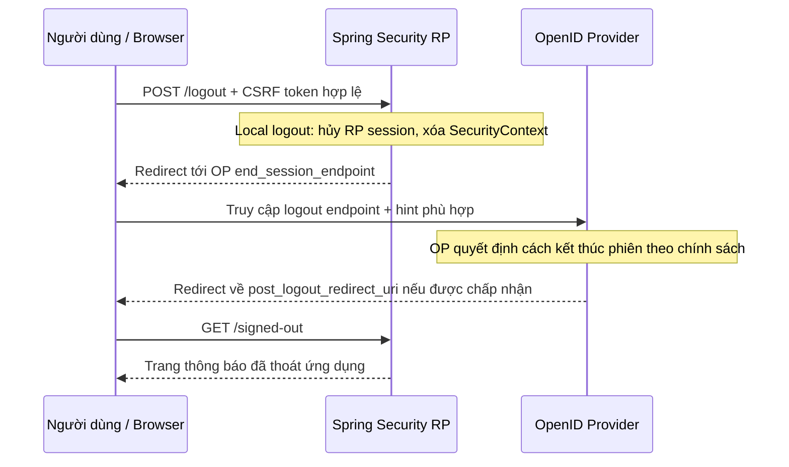
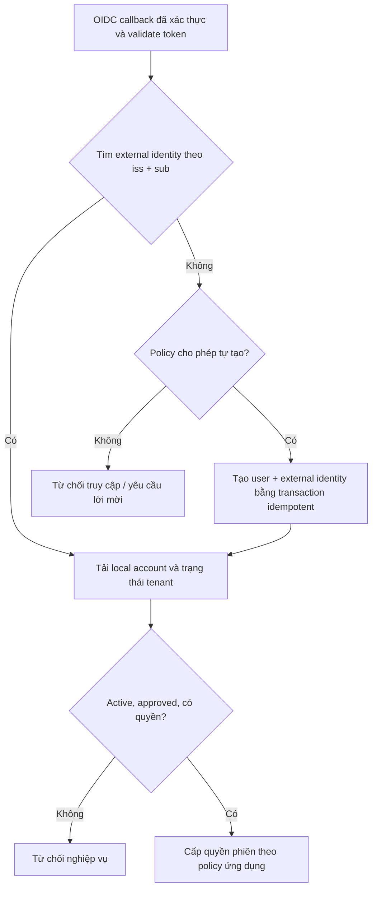

# Đăng xuất OIDC, xử lý lỗi và ranh giới với nghiệp vụ cấp tài khoản

> **Bối cảnh:** Spring Security **Servlet** với `oauth2Login()` và OpenID Connect (OIDC). Chủ đề tập trung vào cách một ứng dụng **OAuth2 Client / Relying Party (RP)** đăng xuất phiên của chính mình, phối hợp đăng xuất với **OpenID Provider (OP)**, xử lý các trường hợp lỗi và phân định rõ việc đăng nhập/đăng xuất với nghiệp vụ tạo, liên kết, khóa hoặc xóa tài khoản ứng dụng.

## 1. Phân biệt ba việc thường bị gọi chung là “đăng xuất”

Một ứng dụng dùng OIDC thường liên quan đến ít nhất ba trạng thái độc lập:

1. **Phiên tại ứng dụng (RP session):** `HttpSession` và `SecurityContext` mà Spring Security dùng để nhận biết người dùng đã đăng nhập ở ứng dụng hiện tại. *Local logout* nhằm chấm dứt trạng thái này.
2. **Phiên đăng nhập tại nhà cung cấp danh tính (OP session):** cookie/phiên SSO ở Identity Provider, ví dụ máy chủ `login.example.test`. Nếu OP session còn, người dùng có thể quay lại `/oauth2/authorization/{registrationId}` và đăng nhập lại mà không cần nhập mật khẩu. *RP-initiated logout* yêu cầu OP kết thúc phiên theo giao thức/khả năng OP hỗ trợ.
3. **Tài khoản và dữ liệu nghiệp vụ:** bản ghi user nội bộ, quyền truy cập tài nguyên, role, hồ sơ, lời mời, đơn hàng hoặc quan hệ thành viên. **Logout không mặc nhiên xóa, khóa, cấp mới hay cập nhật những dữ liệu này**.

Còn có loại trạng thái thứ tư: **access token, refresh token và phiên ở các Resource Server**. Hủy HTTP session của RP **không tự động thu hồi mọi token đã cấp**; có thể cần token revocation, xóa kho token, giảm TTL hoặc cơ chế riêng của hệ thống.

| Hành động | Tác động mong muốn | Không tự đảm bảo |
| --- | --- | --- |
| Local logout tại Spring Security RP | Hủy hoặc vô hiệu hóa session và xóa security context hiện tại | OP session cũng kết thúc; token đã cấp ở nơi khác bị revoke; user DB bị xóa |
| RP-initiated logout theo OIDC | Dẫn browser đến OP logout endpoint để OP xử lý yêu cầu đăng xuất | Mọi ứng dụng SSO khác đã logout; OP logout chắc chắn thành công; tài khoản bị hủy |
| Token revocation | Thu hồi token cụ thể theo hợp đồng của authorization server | RP session hay OP browser session cùng lúc chấm dứt |
| Disable/deprovision tài khoản | Thay đổi trạng thái quyền truy cập, dữ liệu và lifecycle của user theo quy trình nghiệp vụ | Tự động xảy ra khi bấm logout |
| Xóa tài khoản | Hành động nghiệp vụ có xác minh, chính sách dữ liệu và audit riêng | Được phép thực hiện chỉ vì sự kiện logout |

**Mô hình dễ nhớ:** logout là quản lý **phiên**, còn provisioning/deprovisioning là quản lý **danh tính và tài khoản**. Hai dòng công việc có thể liên quan nhưng không được gộp một cách vô điều kiện.

## 2. Các vai trò trong luồng OIDC

- **User agent (browser):** chuyển hướng giữa ứng dụng RP và OP; mang các cookie theo domain, SameSite và chính sách trình duyệt.
- **Spring Security OAuth2 Client / RP:** khởi động đăng nhập qua `oauth2Login()`, xác thực callback, tạo `Authentication` chứa `OidcUser`, lưu security context và quản lý phiên tại RP.
- **OpenID Provider (OP):** xác thực người dùng, cung cấp authorization endpoint, token endpoint, OIDC metadata, ID Token và (nếu hỗ trợ) `end_session_endpoint`.
- **Application account service:** thực hiện logic nghiệp vụ đối với user nội bộ, mapping identity, phân quyền, cấp tài khoản, suspend/restore hoặc lifecycle. Đây không phải trách nhiệm mặc định của OP logout endpoint.

### 2.1. ID Token khác access token

**ID Token** là bằng chứng OIDC về phiên xác thực và danh tính do OP phát cho RP. Nó thường là JWT có các claim như `iss`, `sub`, `aud`, `exp`. **Access token** dành cho truy cập API/Resource Server; không được dùng làm ID Token thay thế trong logout hint.

Luồng **RP-Initiated Logout** thường truyền tham số `id_token_hint` để OP nhận diện phiên/ngữ cảnh đăng nhập của RP. Tham số này mang ID Token đã cấp trước đó; **nó không phải yêu cầu xóa tài khoản hoặc thu hồi mọi access token**. Tránh đưa token vào log, analytics hoặc chỗ có thể bị công khai dù ID Token không phải mật khẩu.

### 2.2. Ba ranh giới dữ liệu quan trọng

- **OIDC authentication:** xác minh rằng OP đã xác thực một subject cụ thể.
- **Local account linking:** tìm user ứng dụng tương ứng bằng khóa danh tính ổn định như cặp **(`iss`, `sub`)**; email là thuộc tính có thể thay đổi, không nên là khóa liên kết duy nhất.
- **Business authorization:** quyết định user này có quyền xem/sửa dữ liệu gì; không mặc nhiên đồng nhất mọi nhóm/role trong OP với quyền kinh doanh nội bộ.

Các ranh giới này phải được thiết kế rõ ngay cả khi trải nghiệm người dùng chỉ có một nút “Đăng nhập bằng SSO”.

## 3. Local logout trong Spring Security Servlet

Trong cấu hình mặc định, endpoint logout của Spring Security thường là **`POST /logout`** khi CSRF protection đang bật. Lý do là logout **thay đổi trạng thái phiên**: nếu cho phép một link GET từ trang ngoài đăng xuất nạn nhân, có thể xuất hiện *logout CSRF*. Một số cấu hình cung cấp trang xác nhận logout trên GET, nhưng không nên coi GET là lệnh logout bắt buộc.

Đối với local logout, các `LogoutHandler` của Spring Security thực hiện công việc như:

- Xóa `SecurityContext` hiện tại.
- Vô hiệu hóa `HttpSession` theo cấu hình mặc định của `SecurityContextLogoutHandler`.
- Chạy các logout handler bổ sung nếu được khai báo (ví dụ xử lý cookie, cleanup token tùy hệ thống).
- Sau đó gọi `LogoutSuccessHandler` để quyết định response tiếp theo, chẳng hạn redirect về trang đã đăng xuất hoặc khởi động OP logout.

**Không đồng nhất “đã invalidate session server” với “mọi cookie hoặc token đã biến mất”.** Browser có thể vẫn giữ cookie `JSESSIONID` cũ nhưng session server đã không còn hợp lệ. Nếu dùng persistent remember-me, Redis session, shared token store hoặc `OAuth2AuthorizedClientService` thì kiểm tra riêng cách dữ liệu được lưu/xóa. Một logout handler không tự biết tất cả kho credential bên ngoài.

### 3.1. Vì sao Local Logout chưa đủ với OIDC SSO?

Ví dụ nạn nhân đã đăng nhập ứng dụng RP và OP. Khi RP chỉ hủy local session:

1. Browser không còn session hợp lệ tại RP.
2. Cookie SSO ở OP vẫn còn.
3. Lần tới RP chuyển browser tới authorization endpoint của OP, OP có thể xác thực lại ngay nhờ phiên SSO.
4. Người dùng có cảm giác “đăng xuất rồi nhưng đăng nhập lại không hỏi mật khẩu”.

Điều này **không chứng minh Spring Security quên hủy session**. Nó có thể là hành vi SSO đúng thiết kế và cần luồng RP-initiated logout nếu sản phẩm muốn yêu cầu OP kết thúc phiên chung.

## 4. RP-Initiated Logout theo OpenID Connect

OIDC RP-Initiated Logout là cơ chế RP hướng browser tới **logout endpoint của OP**, thường lấy từ OIDC discovery metadata với tên `end_session_endpoint`. OP có thể tiếp nhận các tham số như:

- `id_token_hint`: ID Token liên quan đến phiên đăng nhập; giúp OP nhận diện RP/session.
- `post_logout_redirect_uri`: URL mà OP có thể chuyển người dùng quay lại sau khi xử lý logout; thường cần được OP cho phép/đăng ký chính xác.
- `state`: giá trị tương quan yêu cầu và phản hồi logout (khi dùng theo hợp đồng provider); nếu tự triển khai thì cần sinh, lưu và xác minh an toàn.
- `client_id`: trong một số trường hợp OP hỗ trợ để nhận diện client, theo quy tắc giao thức và provider; không tự thay `id_token_hint` tùy tiện.

Tham số nào cần/được hỗ trợ tùy OP và phiên bản đặc tả; client phải tôn trọng hợp đồng của OP thay vì tự chế URL logout bằng các query parameter chưa kiểm chứng.



**Ba ranh giới tin cậy:**

- RP có thể xác nhận **local logout** đã diễn ra.
- RP có thể tạo **redirect yêu cầu OP logout**, nhưng response redirect không chứng minh OP đã xử lý thành công. Browser có thể không theo redirect, OP có thể không hỗ trợ endpoint, hoặc OP có thể yêu cầu xác nhận thêm.
- Trang `/signed-out` chỉ là **trang quay về**; việc browser mở trang này không phải bằng chứng độc lập rằng tất cả phiên SSO hoặc ứng dụng khác đã được đăng xuất.

### 4.1. Single Logout không tự động lan tới mọi RP

Một môi trường SSO có thể có RP A, RP B, RP C cùng dùng OP. RP-initiated logout từ A có thể khiến OP kết thúc phiên của user ở OP, nhưng **không có bảo đảm tổng quát** rằng local sessions ở B/C đều bị hủy ngay. Một số hệ thống cần cơ chế **front-channel logout** hoặc **back-channel logout**, session correlation và hỗ trợ tương ứng ở từng RP.

- **RP-initiated logout:** RP yêu cầu OP logout; thường dùng browser redirect.
- **Front-channel logout:** OP dùng browser để thông báo logout tới các RP, có phụ thuộc cookie/iframe/browser policy.
- **Back-channel logout:** OP gửi thông báo logout qua kênh server-to-server tới RP; RP phải xác minh thông báo/logout token và biết map OP session/subject vào local sessions.

Cấu hình `OidcClientInitiatedLogoutSuccessHandler` của Spring Security **không tự động cài đặt mọi giao thức Single Logout** hoặc tự thu hồi phiên ở các ứng dụng khác. Nếu yêu cầu sản phẩm là “đăng xuất khỏi tất cả hệ thống”, phải xác định rõ giao thức và coverage mà từng RP/OP hỗ trợ.

## 5. Ví dụ Java 17+: Spring Boot 3.x OAuth2 Client với OIDC logout

Ví dụ minh họa hoàn chỉnh ở mức **mã nguồn ứng dụng**: Spring MVC, Spring Security 6, một OIDC provider đã cấu hình đúng và hỗ trợ RP-initiated logout. Bạn có thể tạo dự án Spring Boot 3.x mới hoặc thêm phần cấu hình tương ứng vào ứng dụng có sẵn. Để chạy đăng nhập/logout thành công bắt buộc có **OIDC issuer thật, client credentials hợp lệ và redirect URI được đăng ký tại OP**. Mã Java có thể biên dịch trong dự án với dependency khai báo; không phải chương trình chạy được bằng `javac` thuần vì dùng Spring Boot.

### 5.1. Gradle dependencies

Tệp `settings.gradle`:

```groovy
rootProject.name = 'oidc-logout-demo'
```

Tệp `build.gradle`:

```groovy
plugins {
    id 'java'
    id 'org.springframework.boot' version '3.3.5'
    id 'io.spring.dependency-management' version '1.1.6'
}

group = 'com.example'
version = '0.0.1-SNAPSHOT'

java {
    toolchain {
        languageVersion = JavaLanguageVersion.of(17)
    }
}

repositories {
    mavenCentral()
}

dependencies {
    implementation 'org.springframework.boot:spring-boot-starter-web'
    implementation 'org.springframework.boot:spring-boot-starter-security'
    implementation 'org.springframework.boot:spring-boot-starter-oauth2-client'
    implementation 'org.springframework.boot:spring-boot-starter-thymeleaf'
}
```

Đây là bộ version minh họa cho Spring Boot 3.3.x. Trong project thật, sử dụng dependency management đã có thay vì khai báo nhiều nguồn version xung đột.

### 5.2. Cấu hình client với issuer

Tệp `src/main/resources/application.yml`:

```yaml
spring:
  security:
    oauth2:
      client:
        registration:
          learning:
            provider: learning-idp
            client-id: ${OIDC_CLIENT_ID}
            client-secret: ${OIDC_CLIENT_SECRET}
            scope:
              - openid
              - profile
              - email
        provider:
          learning-idp:
            issuer-uri: ${OIDC_ISSUER_URI}
```

Các biến môi trường `OIDC_CLIENT_ID`, `OIDC_CLIENT_SECRET`, `OIDC_ISSUER_URI` phải được cấp từ OP. Đặt secret trong secret manager/environment, không commit thông tin bí mật vào source. `issuer-uri` phải trùng issuer thực tế và discovery metadata của OP. Đăng ký chính xác **login redirect URI** tại OP, thường có dạng:

```text
http://localhost:8080/login/oauth2/code/learning
```

Để sử dụng RP-initiated logout, OP phải quảng bá `end_session_endpoint` hoặc cung cấp endpoint logout đáng tin cậy theo cách mà client được cấu hình để dùng. Đăng ký **post logout redirect URI** tương ứng nếu OP yêu cầu:

```text
http://localhost:8080/signed-out
```

Chú ý các môi trường HTTPS, domain công khai, reverse proxy và port. Nếu chạy sau proxy, base URL mà Spring Security nhận biết phải phản ánh scheme/host công khai. Chỉ tin các header forwarded như `Forwarded`/`X-Forwarded-*` từ **reverse proxy đáng tin**, tránh để người gọi tự điều khiển redirect URL.

### 5.3. Spring Boot application

Tệp `src/main/java/com/example/oidcdemo/OidcDemoApplication.java`:

```java
package com.example.oidcdemo;

import org.springframework.boot.SpringApplication;
import org.springframework.boot.autoconfigure.SpringBootApplication;

@SpringBootApplication
public class OidcDemoApplication {
    public static void main(String[] args) {
        SpringApplication.run(OidcDemoApplication.class, args);
    }
}
```

### 5.4. Spring Security cấu hình logout OIDC

Tệp `src/main/java/com/example/oidcdemo/SecurityConfig.java`:

```java
package com.example.oidcdemo;

import org.springframework.context.annotation.Bean;
import org.springframework.context.annotation.Configuration;
import org.springframework.security.config.Customizer;
import org.springframework.security.config.annotation.web.builders.HttpSecurity;
import org.springframework.security.oauth2.client.registration.ClientRegistrationRepository;
import org.springframework.security.oauth2.client.oidc.web.logout.OidcClientInitiatedLogoutSuccessHandler;
import org.springframework.security.web.SecurityFilterChain;

@Configuration
public class SecurityConfig {
    @Bean
    SecurityFilterChain securityFilterChain(
            HttpSecurity http,
            ClientRegistrationRepository registrations) throws Exception {

        OidcClientInitiatedLogoutSuccessHandler oidcLogout =
                new OidcClientInitiatedLogoutSuccessHandler(registrations);

        oidcLogout.setPostLogoutRedirectUri("{baseUrl}/signed-out");

        return http
                .authorizeHttpRequests(auth -> auth
                        .requestMatchers("/", "/login", "/signed-out", "/error")
                        .permitAll()
                        .anyRequest().authenticated()
                )
                .oauth2Login(oauth -> oauth
                        .failureHandler((request, response, exception) ->
                                response.sendRedirect(
                                        request.getContextPath() + "/login?error"
                                )
                        )
                )
                .logout(logout -> logout
                        .logoutSuccessHandler(oidcLogout)
                )
                .build();
    }
}
```

**Cơ chế của ví dụ:**

- `oauth2Login(...)` kích hoạt đăng nhập qua OIDC/OAuth2 Client; với `openid` scope và OP hợp lệ, principal OIDC thường là `OidcUser`.
- `OidcClientInitiatedLogoutSuccessHandler` là `LogoutSuccessHandler` được Spring Security cung cấp để tạo redirect tới endpoint đăng xuất OIDC khi đủ điều kiện. Handler có thể dùng `ClientRegistrationRepository` và thông tin OIDC principal/ID Token để chuẩn bị yêu cầu.
- `setPostLogoutRedirectUri("{baseUrl}/signed-out")` sử dụng base URL của RP; URI này phải phù hợp cấu hình OP. Đường dẫn `/signed-out` chỉ là trang công khai để thông báo trạng thái sau redirect.
- Local logout do Spring Security xử lý trước khi gọi success handler. `Authentication` ban đầu vẫn có thể được truyền cho success handler để xây dựng `id_token_hint` dù `SecurityContext` hiện tại đã bị xóa.
- **Không gọi `csrf.disable()`:** form POST logout cần token CSRF hợp lệ, giống các hành động thay đổi trạng thái khác.
- `failureHandler` chỉ thể hiện xử lý **OIDC login failure** tại filter đăng nhập: chuyển user đến thông báo chung mà không đưa nội dung exception/token ra URL. Nó **không thể phát hiện mọi lỗi phát sinh tại OP sau khi browser đã rời ứng dụng để thực hiện logout**.

Nếu OP không cung cấp `end_session_endpoint`, hoặc request không có principal/ID Token phù hợp, handler không thể đảm bảo làm được OP logout. **Không tự suy ra từ việc RP trả redirect rằng OP logout đã hoàn tất**; cần kiểm tra đặc tính OP và quan sát flow thực tế.

### 5.5. Controller chỉ phục vụ trang, không cấp/xóa account

Tệp `src/main/java/com/example/oidcdemo/PageController.java`:

```java
package com.example.oidcdemo;

import java.security.Principal;

import org.springframework.stereotype.Controller;
import org.springframework.ui.Model;
import org.springframework.web.bind.annotation.GetMapping;

@Controller
public class PageController {
    @GetMapping("/")
    String home(Principal principal, Model model) {
        model.addAttribute(
                "userName",
                principal == null ? "guest" : principal.getName()
        );
        return "home";
    }

    @GetMapping("/signed-out")
    String signedOut() {
        return "signed-out";
    }
}
```

Các handler này **không tạo mới, xóa, khóa hoặc thay đổi role tài khoản**. Giá trị `Principal#getName()` dùng để hiển thị minh họa; đừng mặc định nó là email, hoặc dùng trực tiếp làm khóa DB. Với mapping danh tính lâu dài, cần xác minh `iss`/`sub` từ OIDC claims.

### 5.6. Form logout an toàn với CSRF

Tệp `src/main/resources/templates/home.html`:

```html
<!doctype html>
<html lang="vi" xmlns:th="http://www.thymeleaf.org">
<head>
  <meta charset="utf-8">
  <title>OIDC Client Demo</title>
</head>
<body>
  <p>Người dùng: <span th:text="${userName}">guest</span></p>

  <p>
    <a th:href="@{/oauth2/authorization/learning}">
      Đăng nhập qua OIDC
    </a>
  </p>

  <form th:action="@{/logout}" method="post">
    <button type="submit">Đăng xuất</button>
  </form>
</body>
</html>
```

Với tích hợp Spring MVC, Thymeleaf và Spring Security CSRF, form được xử lý thông qua `th:action` thường được bổ sung trường hidden CSRF nhờ `RequestDataValueProcessor`. **Hãy inspect HTML render thật** để bảo đảm request `POST /logout` có token đúng. Nếu tự tạo form HTML thuần hoặc frontend SPA, cần chủ động nhận và gửi CSRF token theo cơ chế ứng dụng, thay vì đổi logout thành GET để “cho chạy”.

Tệp `src/main/resources/templates/signed-out.html`:

```html
<!doctype html>
<html lang="vi">
<head>
  <meta charset="utf-8">
  <title>Đã rời ứng dụng</title>
</head>
<body>
  <h1>Đã kết thúc phiên tại ứng dụng</h1>
  <p>Yêu cầu đăng xuất qua nhà cung cấp danh tính đã được khởi tạo
     khi luồng OIDC hỗ trợ.</p>
  <a href="/">Trở về trang chính</a>
</body>
</html>
```

Thông điệp cố ý **không khẳng định mọi OP session và RP khác đã được hủy**, vì RP không có bằng chứng tổng quát cho kết luận đó chỉ từ một browser redirect.

### 5.7. Chạy và kiểm chứng

Nếu dự án đã có Gradle Wrapper:

```bash
# Linux/macOS
./gradlew bootRun

# Windows PowerShell
.\gradlew.bat bootRun
```

Sau khi thiết lập environment variables và OIDC client hợp lệ, mở `http://localhost:8080/`. Bấm “Đăng nhập qua OIDC”; browser chuyển hướng đến OP, xác thực rồi quay về `/login/oauth2/code/learning` theo đăng ký. Bấm “Đăng xuất”:

1. DevTools → Network: xác minh request **POST /logout** có token CSRF hợp lệ.
2. Kiểm tra phản hồi RP: local session không còn hợp lệ; response có thể là redirect tới OP `end_session_endpoint` với tham số logout thích hợp.
3. Quan sát browser có thực sự truy cập OP logout endpoint không và OP có hiển thị xác nhận hay báo lỗi.
4. Nếu OP xử lý và chấp nhận redirect, browser trở lại `/signed-out`. Trang này chỉ xác nhận luồng điều hướng, không chứng minh mọi hệ thống SSO đã logout.
5. Truy cập URL cần authentication ở RP một lần nữa. Nếu OP session vẫn còn, OP có thể đăng nhập lại ngay; phân biệt việc **RP session đã hủy** với **OP session còn**.
6. Thử đăng xuất khi IdP không khả dụng trong môi trường test: local logout vẫn phải có chính sách đúng, UI không nên tuyên bố chắc chắn rằng remote logout đã hoàn tất.

Với GET tự do hoặc POST thiếu CSRF token, kết quả có thể là trang xác nhận hoặc 403 tùy cấu hình; **không cần chuyển logout sang GET để khắc phục**.

## 6. Phân biệt các loại lỗi OIDC

Các lỗi cùng xuất hiện quanh nút login/logout nhưng xảy ra ở những ranh giới khác nhau:

| Giai đoạn | Ví dụ | Phía nào có thể phát hiện? | Phản ứng đúng |
| --- | --- | --- | --- |
| Khởi tạo login | Thiếu `ClientRegistration`, sai issuer/discovery, client ID | RP tại cấu hình/khởi tạo hoặc request login | Ghi log kỹ thuật có lọc, báo “không thể bắt đầu đăng nhập”, kiểm tra cấu hình |
| Authorization callback | `error=access_denied`, state sai/mất, authorization code không hợp lệ | OAuth2 login filters của RP | Từ chối đăng nhập, không tạo phiên hoặc tài khoản nội bộ vì callback lỗi |
| ID Token validation | Sai issuer/audience/signature/expiry/nonce | OIDC token validation tại RP | Không chấp nhận principal; điều tra clock skew, metadata, client config, security |
| Session hoặc CSRF | Thiếu session chứa authorization request, POST logout thiếu CSRF | RP / Spring Security | Tách lỗi cookie/session/CSRF khỏi lỗi provider |
| Local logout | Lỗi handler/storage/session đặc biệt | RP | Ghi nhận lỗi, có cơ chế bảo vệ không để session còn hiệu lực ngoài ý muốn |
| Xây dựng OP logout redirect | Thiếu `end_session_endpoint`, thiếu OIDC principal, redirect URI chưa đúng | RP có thể phát hiện một phần | Fallback có kiểm soát, không hứa SSO logout; sửa metadata/đăng ký |
| Browser đang ở OP | OP timeout, yêu cầu xác nhận, OP báo từ chối, browser chặn cookie/redirect | Chủ yếu OP và browser; RP không quan sát tự động mọi bước | UI/CS có hướng dẫn; kiểm chứng bằng trace của browser/OP |
| Quay về `/signed-out` | Callback không đến, URL sai, lỗi allowlist hoặc proxy | RP chỉ thấy nếu có request quay về | Không suy đoán OP đã logout chỉ từ local session |
| Local account provisioning | DB transaction fail, xung đột mapping, tenant không hợp lệ | Ứng dụng nghiệp vụ | Không đồng nhất với OIDC login/logout; trả lỗi nghiệp vụ và audit riêng |

**Nhóm lỗi cần tách khi vận hành:** authentication callback, token validation, local session logout, redirect yêu cầu OP logout, kết quả OP logout, và account lifecycle. Mỗi nhóm có chủ sở hữu, hướng retry và tác động khác nhau.

### 6.1. Login failure handler: làm gì và không làm gì?

Trong code ví dụ, `failureHandler` nhận `AuthenticationException` từ luồng đăng nhập mà filter xử lý, rồi redirect đến trang lỗi chung. Đây là cách tránh đưa `exception.getMessage()`, authorization code, token hoặc stack trace vào URL hiển thị cho người dùng.

Trong ứng dụng thực, có thể:

- Ghi log **loại lỗi, correlation ID, registration ID** và mã phân loại đã lọc; không log raw ID Token, access token, refresh token, authorization code, client secret hay cookie.
- Phân biệt người dùng từ chối consent/login với cấu hình hỏng hoặc OP không khả dụng.
- Cung cấp retry an toàn cho tình huống có thể thử lại; tránh vòng lặp redirect vô hạn giữa RP và OP.
- Không tự tạo user nội bộ hoặc “tạm cấp quyền” khi OIDC callback thất bại.
- Kiểm tra session/cookie `SameSite` khi state hoặc authorization request thất lạc sau redirect; đừng bỏ kiểm tra `state` để “chữa lỗi”.

**Giới hạn:** failure handler trong `oauth2Login()` không phải một bộ xử lý lỗi bao trùm mọi HTTP request của ứng dụng, mọi exception controller hay tất cả bước logout xảy ra tại OP.

### 6.2. Remote logout thất bại sau redirect

RP-initiated logout thường là **front-channel browser navigation**. Sau khi RP trả HTTP 302 tới OP, RP **không có kết quả đồng bộ** cho việc OP thật sự kết thúc session. Những tình huống phải dự kiến:

- Browser đóng tab trước khi mở OP logout URL.
- OP không hỗ trợ `end_session_endpoint` hoặc từ chối `id_token_hint`.
- OP yêu cầu xác nhận người dùng hoặc từ chối `post_logout_redirect_uri` chưa được đăng ký.
- Cookie/session của OP đã không còn, khiến OP không nhận diện phiên.
- Mạng đứt, chặn cookie/iframe hoặc chính sách browser làm luồng không hoàn tất.
- OP hoàn tất nhưng không redirect về RP do policy/timeout; hoặc redirect về RP nhưng các RP khác vẫn còn session.

**Chính sách UX đáng tin:** nếu local logout thành công thì thông báo người dùng đã thoát khỏi **ứng dụng hiện tại**; với OP logout có thể nói “đã gửi yêu cầu đăng xuất SSO” hoặc cung cấp hướng dẫn khi thấy OP báo lỗi. Không hiển thị “đã đăng xuất khỏi mọi ứng dụng” nếu không có cơ chế và chứng cứ tương ứng.

### 6.3. Có nên cố “rollback” local logout khi OP logout lỗi?

**Không.** Nếu local logout đã invalidate session, cố tạo lại session đăng nhập chỉ để khớp với OP logout có thể mở lại quyền truy cập sau khi người dùng chủ động thoát. Thay vào đó, local logout có hiệu lực độc lập, remote logout là bước tiếp theo có thể thất bại. Nếu sản phẩm có yêu cầu nghiêm ngặt về logout toàn hệ thống, thiết kế thêm back-channel, session registry, timeout và quan sát trạng thái riêng, không khôi phục session đã vô hiệu hóa một cách âm thầm.

## 7. Ranh giới với cấp tài khoản (provisioning) và quản lý lifecycle

### 7.1. OIDC login không có nghĩa tự động tạo user DB

Khi Spring Security nhận callback OIDC hợp lệ, thông thường nó có một `OidcUser` trong `Authentication`. Điều này **không mặc nhiên** có nghĩa:

- Ứng dụng đã tạo dòng user mới trong DB.
- User đã có quyền sử dụng sản phẩm hoặc đã được cấp role nghiệp vụ.
- Email của user đã được xác minh theo chính sách của ứng dụng.
- Người dùng đã được mời/duyệt tham gia tenant/organization.
- Bên OP đã tạo hoặc sửa tài khoản ứng dụng của bạn.

**Provisioning** phải được quyết định bởi một lớp nghiệp vụ rõ ràng. Ví dụ: ứng dụng có thể chỉ chấp nhận các subject đã được pre-provision; hoặc cho phép Just-in-Time (JIT) provisioning **chỉ khi** invitation/tenant policy cho phép. Đây là lựa chọn sản phẩm, không phải mặc định mà OAuth2 Client hoặc logout handler đảm nhận.

### 7.2. Liên kết danh tính: dùng issuer + subject

Khóa định danh OIDC ổn định cho một RP nên dựa vào cặp:

```text
(issuer, subject) = (id_token.iss, id_token.sub)
```

Đối với ứng dụng đa tenant/đa issuer, cần bảo đảm kiểm tra issuer, client audience, tenant liên quan và các điều kiện account linking trước khi ánh xạ vào user DB. **Không liên kết user chỉ dựa trên email**: email có thể đổi, thiếu, chưa xác minh hoặc được tái sử dụng. Những thuộc tính `preferred_username`, `name` hay `email` phù hợp để hiển thị hơn là làm khóa liên kết duy nhất.

Quy tắc JIT provisioning minh họa bằng pseudo-flow, **không phải API mặc định của Spring Security**:



Điểm cần chú ý khi tự thực hiện:

- Tạo khóa unique cho external identity `(iss, sub)`, bảo vệ transaction khỏi concurrent logins tạo hai account.
- Chỉ auto-provision sau khi xác minh tenant và chính sách invitation/approval; không suy diễn quyền chỉ từ email domain.
- Map group/role claim từ OP bằng allowlist/quy tắc cụ thể; group claim có thể thiếu hoặc đổi.
- Khi local account bị khóa, **OIDC authentication thành công không được tự mở khóa account**.
- Một giao dịch tạo account fail không nên tạo một “shadow account” hoặc tự cấp fallback quyền cao hơn.
- Ghi audit event cho provisioning/account linking/role change riêng với event login.

### 7.3. Logout không phải deprovision, disable hay xóa tài khoản

| Nghiệp vụ | Ai quyết định? | Khi nào xảy ra? |
| --- | --- | --- |
| Logout phiên RP | User, admin session management hoặc policy session | Khi thực hiện logout/expire/revoke session |
| Logout phiên OP | OP theo RP-initiated/front/back-channel logout hoặc policy OP | Khi OP nhận và xử lý yêu cầu phù hợp |
| Tạo user nội bộ | Account service + tenant/invitation policy | Khi onboarding/JIT được cho phép |
| Cấp vai trò | Quản trị quyền / hệ thống chính sách | Theo quy trình cấp quyền độc lập |
| Khóa user | Admin, security event hoặc workflow nghiệp vụ | Khi policy disable/suspend được kích hoạt |
| Xóa user / xử lý dữ liệu | Account lifecycle + retention/privacy policy | Theo yêu cầu xóa đã xác minh và quy trình dữ liệu |
| Revoke token | Authorization server/Token manager | Khi chính sách thu hồi token yêu cầu |

Bấm “Đăng xuất” **không phải** lệnh “Xóa tài khoản”; tương tự, tạo account bên OP không mặc nhiên tạo record tại RP. Có thể liên kết các workflow với nhau khi yêu cầu sản phẩm rõ ràng, nhưng mỗi workflow cần trigger, authorization, idempotency, audit và xử lý lỗi riêng.

### 7.4. Khi tài khoản bị khóa tại RP nhưng OP vẫn xác thực được

OP có thể phát hành ID Token hợp lệ cho một danh tính mà RP đã khóa quyền nghiệp vụ. Khi đó:

1. RP vẫn có thể **xác minh token thành công** (OIDC identity đúng).
2. Account service tra cứu local account và thấy trạng thái `SUSPENDED`/`DISABLED`.
3. RP phải **từ chối tạo phiên ứng dụng có quyền** hoặc chặn request theo policy.
4. Không gọi OP logout thay cho việc disable account; ngược lại, logout không đủ để bảo đảm user bị khóa không đăng nhập lại.

Việc admin yêu cầu “đăng xuất tất cả phiên của user” cũng khác “disable account”: có thể cần session registry/cluster session invalidation, token revocation và back-channel/logout notification, **không chỉ một browser redirect**.

## 8. Những lỗi thiết kế hay gặp

| Lỗi thiết kế | Hệ quả | Hướng đúng |
| --- | --- | --- |
| Chỉ local logout rồi kết luận SSO đã logout | OP session còn, có thể đăng nhập lại ngay | Dùng RP-initiated logout nếu OP hỗ trợ và sản phẩm yêu cầu |
| Redirect tới OP logout rồi kết luận mọi RP đã logout | Các RP khác còn local session | Định nghĩa Single Logout coverage; bổ sung front/back-channel nếu cần |
| Dùng access token làm `id_token_hint` | Sai ngữ nghĩa giao thức/OP có thể từ chối | Dùng ID Token hợp lệ của OIDC authentication |
| Hardcode logout URL, redirect đến URL từ request không kiểm tra | Sai provider metadata; open redirect | Dùng metadata đáng tin, redirect URI được allowlist/đăng ký |
| Chuyển logout sang GET để tránh CSRF | Logout CSRF, request từ trang ngoài gây thay đổi phiên | Giữ POST/CSRF token hoặc cơ chế bảo vệ tương đương |
| Log toàn bộ token và query logout | Lộ định danh/token vào log/analytics | Che thông tin nhạy cảm, correlation ID và mã lỗi đã lọc |
| Retry logout bằng cách khôi phục session RP | Vô tình mở lại phiên đã được user hủy | Giữ local logout có hiệu lực; xử lý remote failure độc lập |
| OIDC login thành công thì cấp mặc định quyền ADMIN | Privilege escalation | Tách xác thực danh tính khỏi phê duyệt/cấp quyền nghiệp vụ |
| Ghép user DB chỉ theo email | Có thể chiếm quyền khi email đổi/tái sử dụng | Ràng buộc `iss` + `sub` và chính sách linking |
| Logout gọi API xóa user DB | Mất dữ liệu, thao tác ngoài ý định | Account deletion là quy trình riêng có xác minh |
| Coi revoke refresh token là end-user logout toàn hệ thống | Session RP/OP khác có thể còn | Quản lý từng tầng session/token riêng |
| Tắt kiểm tra `state`/nonce khi callback lỗi | Tăng nguy cơ login CSRF, code injection, replay | Giữ validation chuẩn, sửa cookie/proxy/redirect config |
| Dùng callback logout URL chưa đăng ký tại OP | OP từ chối redirect hoặc hiển thị lỗi | Đăng ký URI chính xác, đồng bộ môi trường |
| Tự bật cookie SameSite=None ở mọi nơi | Tăng bề mặt request cross-site, vẫn không sửa cấu hình khác | Xác định cookie context và dùng policy phù hợp, CSRF độc lập |

## 9. Checklist kiểm thử theo từng lớp

Dùng **ứng dụng demo, client đăng ký cho test và user thử nghiệm**, không dùng dữ liệu khách hàng hoặc môi trường production để tạo các trường hợp lỗi có chủ đích.

### 9.1. Local logout

- Đã đăng nhập, gửi `POST /logout` với CSRF token hợp lệ: session RP không còn hiệu lực.
- POST thiếu/sai CSRF: request bị chặn khi CSRF bảo vệ logout đang bật; không thay bằng GET.
- Làm mới trang bảo vệ sau logout: phải cần đăng nhập lại ở RP; nếu chuyển đến OP và OP cho đăng nhập tự động, phân biệt **RP session đã hủy** với **OP session còn**.
- Nếu dùng persistent session/token store: kiểm tra các tài nguyên còn hiệu lực và chính sách cleanup theo thiết kế.

### 9.2. OP logout

- OP có `end_session_endpoint`, ID Token hợp lệ, redirect URI đã đăng ký: quan sát browser chuyển tới OP và có thể quay lại RP.
- OP không có logout endpoint: xác định fallback UX, không hiển thị “đã logout toàn SSO”.
- OP logout từ chối `post_logout_redirect_uri`: app vẫn không nên khôi phục phiên RP đã hủy.
- OP chậm/không khả dụng: có thông báo và retry/hướng dẫn phù hợp; không log token.
- Nếu có nhiều RP: kiểm tra RP khác có bị invalidate session không; nếu không, chưa thể gọi đây là single logout toàn hệ thống.

### 9.3. Login error

- User từ chối đăng nhập/consent: hiện lỗi thân thiện, không tạo session.
- Sai issuer, client ID, client secret, redirect URI: login fail rõ ràng, có log kỹ thuật đã lọc.
- Callback thiếu/sai `state` hoặc token validation fail: bị từ chối, không bypass kiểm tra.
- Cookie/session thất lạc sau redirect: kiểm tra cookie SameSite, Secure, proxy, session store và thời gian; không cố “cứu” callback bằng cách bỏ state validation.

### 9.4. Account provisioning boundaries

- OIDC subject **đã được liên kết, account active**: đăng nhập và áp dụng đúng role nội bộ.
- OIDC subject **chưa được liên kết, không có invitation**: từ chối hoặc theo onboarding được phép; không auto tạo user với quyền tùy ý.
- OIDC subject **mới và được JIT cho phép**: tạo local mapping theo `iss/sub` duy nhất, chống duplicate/concurrency.
- Account **bị khóa** nhưng OP xác thực thành công: local policy tiếp tục khóa; logout không mở khóa.
- Bấm logout nhiều lần: không tạo user, không xóa dữ liệu nghiệp vụ, không phát sinh yêu cầu cấp quyền.
- User thay đổi email tại OP: không tự chuyển quyền sở hữu của local account khi subject không đổi.

## 10. Câu hỏi tự kiểm tra

**1. Vì sao bấm logout xong vẫn đăng nhập lại ngay, không nhập password?**  
Có thể local session RP đã hủy nhưng browser còn OP SSO session. Cần phân biệt chính sách OP logout/Single Logout với local logout.

**2. `OidcClientInitiatedLogoutSuccessHandler` có xóa account trong database không?**  
Không. Nó là logout success handler cho luồng điều hướng OIDC; không thay thế account provisioning/deprovisioning.

**3. RP trả HTTP 302 đến `end_session_endpoint`. Có thể ghi log “OP logout thành công” ngay không?**  
Không. RP vừa phát redirect; browser và OP còn phải xử lý. Cần ngôn ngữ/tracking phù hợp với phần quan sát thực tế.

**4. Khi nào `POST /logout` cần CSRF token?**  
Trong cấu hình Spring Security Servlet dùng CSRF protection mặc định, logout là hành động thay đổi trạng thái và thường được yêu cầu POST kèm token.

**5. Nên dùng claim nào để liên kết lâu dài với local user?**  
Cặp `(iss, sub)` đã được xác minh, cùng tenant/client policy thích hợp. Email và username có thể đổi hoặc bị tái sử dụng.

**6. Nếu user đã bị khóa tại RP nhưng vẫn có ID Token hợp lệ từ OP thì sao?**  
RP phải tôn trọng local account status/authorization; xác thực OIDC đúng không đồng nghĩa user được cấp lại quyền.

**7. Remote logout thất bại có nên phục hồi HTTP session cũ?**  
Không. Local logout đã được user chủ động yêu cầu; phục hồi âm thầm có thể tái kích hoạt phiên ngoài ý định.

## Kết luận

Trong Spring Security Servlet, **local logout** là hủy phiên tại RP; **OIDC RP-initiated logout** là yêu cầu OP kết thúc phiên qua giao thức mà OP hỗ trợ; **Single Logout ở nhiều RP** cần cơ chế và kiểm chứng bổ sung; **cấp, khóa hoặc xóa tài khoản** là nghiệp vụ riêng của hệ thống.

Để triển khai an toàn: giữ `POST /logout` với CSRF, dùng `OidcClientInitiatedLogoutSuccessHandler` cùng issuer metadata và redirect URI được đăng ký, xử lý lỗi đăng nhập khác lỗi logout từ xa, không suy diễn kết quả remote chỉ từ redirect, và luôn tách **xác thực danh tính** khỏi **chính sách tài khoản và quyền nghiệp vụ**.
