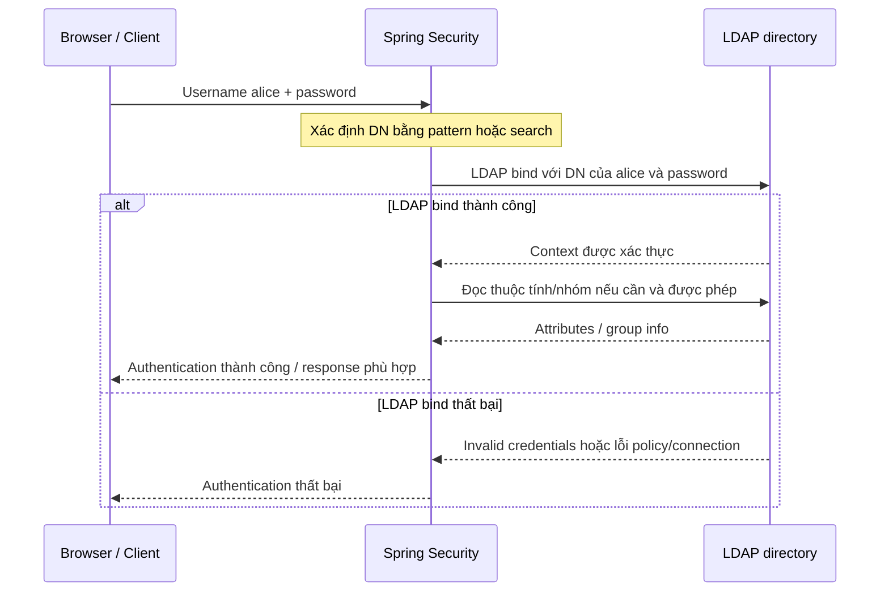
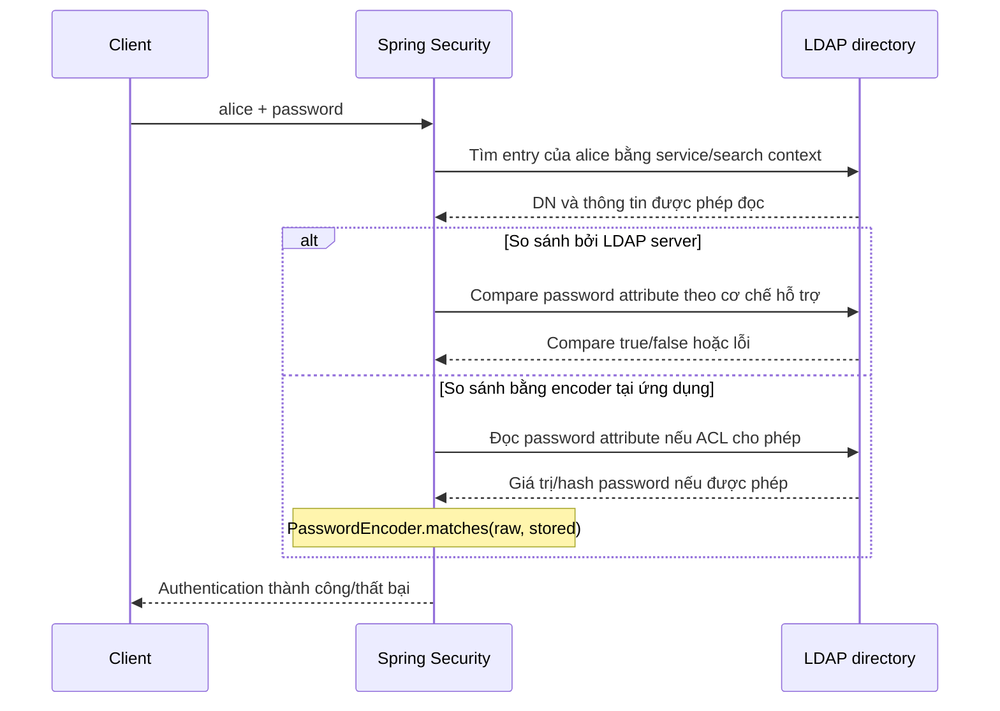

# LDAP bind và password comparison trong xác thực người dùng

> **Phạm vi:** xác thực người dùng qua LDAP trong **Spring Security trên Servlet stack** (Java 17+, Spring Boot 3.x, Spring Security 6.x). Trọng tâm là hiểu và cấu hình đúng hai chiến lược **LDAP bind** và **password comparison**, thay vì coi chúng như hai tên gọi của cùng một phép kiểm tra mật khẩu.

## 1. Mục tiêu và mô hình tổng quát

LDAP (Lightweight Directory Access Protocol) là giao thức truy cập dịch vụ thư mục. Một thư mục có thể chứa tài khoản, thuộc tính người dùng và nhóm; ví dụ entry người dùng có distinguished name (DN):

```text
uid=alice,ou=people,dc=example,dc=com
```

Trong đó:

- `uid=alice` là Relative Distinguished Name (RDN) của entry.
- `ou=people` là đơn vị tổ chức chứa entry.
- `dc=example,dc=com` là phần base DN của cây thư mục.
- Thuộc tính dùng đăng nhập có thể là `uid`, `cn`, `mail` hoặc định danh khác tùy schema. **Không tự giả định username luôn bằng email, hay một username luôn ánh xạ duy nhất trên mọi nhánh cây.**

Khi ứng dụng nhận username và password, có hai chiến lược chính:

1. **Bind authentication:** ứng dụng yêu cầu LDAP server xác thực bằng thao tác **bind với DN của chính người dùng và mật khẩu họ cung cấp**. LDAP server là nơi quyết định thông tin xác thực có được chấp nhận hay không.
2. **Password comparison authentication:** ứng dụng tìm entry rồi kiểm tra mật khẩu theo **cơ chế so sánh**: có thể nhờ LDAP server thực hiện phép compare đối với password attribute, hoặc đọc giá trị hash/attribute khi chính sách cho phép và so sánh cục bộ bằng `PasswordEncoder` tương thích. Việc này phụ thuộc schema, ACL và cơ chế mã hóa mật khẩu thực tế.

Cả hai cách chỉ tạo ra quyết định **authentication (người dùng là ai, thông tin đăng nhập có hợp lệ không)**. Việc cho phép vào `/admin/**`, ánh xạ LDAP groups thành roles, kiểm tra tenant hoặc trạng thái khóa tài khoản còn là các quyết định **authorization/account policy** riêng.

### 1.1. Phân biệt LDAP với các thành phần trong Spring Security

| Thành phần | Vai trò |
| --- | --- |
| LDAP directory | Lưu entry người dùng/nhóm, thực hiện bind, search, compare theo quyền và schema server |
| `ContextSource` | Cung cấp LDAP connection/context; có thể dùng service account để tìm entry |
| `LdapBindAuthenticationManagerFactory` | Tạo `AuthenticationManager` sử dụng chiến lược bind |
| `LdapPasswordComparisonAuthenticationManagerFactory` | Tạo `AuthenticationManager` sử dụng chiến lược password comparison |
| `LdapAuthenticator` và `LdapAuthenticationProvider` | Cơ chế xác thực LDAP ở tầng provider |
| `UserDetailsContextMapper` / authorities mapper | Chuyển thuộc tính/nhóm từ LDAP thành principal/authorities theo chính sách ứng dụng |
| `SecurityFilterChain` | Dùng kết quả xác thực để bảo vệ URL, session, Basic/form login và các filter khác |
| Business account/roles | Quyết định quyền nghiệp vụ, không tự phát sinh chỉ từ việc LDAP xác thực thành công |

Spring Security LDAP tích hợp xác thực **tại application**, chứ không tự biến LDAP thành OIDC/OAuth2 provider. Nếu dùng Active Directory (AD), cách DN, search, UPN, group nesting và lỗi bind có thể có khác biệt; cần kiểm chứng schema/môi trường AD riêng.

## 2. LDAP bind: kiểm tra mật khẩu bằng thao tác đăng nhập vào directory

### 2.1. Luồng xử lý

Với username `alice` và password do người dùng nhập:

1. Ứng dụng nhận credential qua HTTPS, chuyển vào bộ xác thực Spring Security.
2. Tìm DN của user: có thể ghép theo **DN pattern** đã biết, ví dụ `uid={0},ou=people`, hoặc **search** qua tài khoản dịch vụ với filter đã định nghĩa.
3. Spring Security LDAP mở context để thực hiện **bind bằng DN của alice và password do alice cung cấp**.
4. LDAP server quyết định bind thành công hay thất bại dựa trên thông tin tài khoản, chính sách mật khẩu, khóa tài khoản và quyền.
5. Nếu thành công, provider có thể tiếp tục đọc thông tin/nhóm cần thiết để tạo `Authentication` đã xác thực; `SecurityFilterChain` xử lý các rule phân quyền.
6. Nếu bind thất bại, ứng dụng từ chối xác thực; không gọi tiếp controller như người dùng đã được xác thực.



**Điểm quan trọng:** password của alice được gửi trong quy trình bind qua kết nối LDAP bảo mật; ứng dụng **không cần tải giá trị `userPassword` của alice về để tự so sánh**. Directory sở hữu thuật toán hash/password policy; ứng dụng không cần biết password được lưu dưới dạng hash gì. Vì vậy bind thường là lựa chọn mặc định phù hợp khi directory hỗ trợ xác thực người dùng thông thường.

### 2.2. Direct DN pattern và tìm user qua search

**DN pattern** thích hợp khi quy tắc vị trí user ổn định:

```text
Base DN: dc=example,dc=com
DN pattern: uid={0},ou=people
Username: alice
DN hiệu lực: uid=alice,ou=people,dc=example,dc=com
```

Nhưng DN pattern không phù hợp nếu user nằm ở nhiều `ou`, dùng nhiều RDN hoặc tên đăng nhập khác DN. Trong trường hợp đó, ứng dụng dùng **user search** với base/filter rõ ràng, ví dụ:

```text
Base DN: ou=people,dc=example,dc=com
Search filter: (uid={0})
Username: alice
Result DN: uid=alice,ou=staff,ou=people,dc=example,dc=com
```

Đây chỉ là mô tả chiến lược tìm user; cú pháp API cấu hình search cụ thể phụ thuộc factory/version. Search thường cần một **service account có quyền đọc cần thiết**, hoặc anonymous search nếu directory cho phép (nhiều hệ thống không cho). Tài khoản dịch vụ **không phải** tài khoản được xác thực thay người dùng: search ra DN, rồi bind lại bằng credential của user.

**Quy tắc an toàn:** search filter phải dùng tham số được escape/bind an toàn từ Spring LDAP; không ghép trực tiếp username vào filter bằng string concatenation. LDAP injection có thể làm thay đổi điều kiện tìm kiếm. Cần kiểm tra kết quả **0 hoặc nhiều hơn 1 entry** và có chính sách fail-closed, không chọn tùy ý bản ghi đầu tiên.

### 2.3. Ưu điểm và giới hạn của bind

Ưu điểm:

- Password được LDAP server xác minh; ứng dụng không cần đọc hash hay tự quyết định thuật toán hash của directory.
- Dễ phù hợp với directory có ACL cấm đọc password attribute.
- Chính sách account/password ở server có thể được áp dụng trong bind (như expire/locked), tùy server và cấu hình.
- Dễ giải thích log: thao tác bind bằng DN của user thành công hoặc thất bại, sau đó mới ánh xạ quyền.

Giới hạn:

- Cần có khả năng bind bằng credential người dùng; một số kiến trúc directory/identity provider có quy tắc riêng.
- Client phải truyền password đến LDAP server qua đường truyền **TLS đáng tin**. Không sử dụng simple bind gửi password qua kết nối không mã hóa trong production.
- Nếu quy tắc DN sai hoặc search account không đủ quyền, có thể báo “đăng nhập sai” dù mật khẩu đúng.
- Nếu dùng nhiều LDAP replicas hoặc directory proxy, cần xem chính sách consistency, account lockout và failover.
- Không suy diễn user đã được ứng dụng cấp quyền chỉ vì LDAP chấp nhận bind.

## 3. Password comparison: xác minh mật khẩu theo thuộc tính

### 3.1. Khác nhau ở phép kiểm tra cuối

Trong password comparison, ứng dụng thường:

1. Dùng service context để xác định entry cần kiểm tra.
2. Xác định password attribute, thường là `userPassword` nhưng có thể khác tùy schema.
3. Thực hiện **LDAP Compare operation** ở server hoặc đọc password attribute được cho phép để kiểm tra bằng `PasswordEncoder` tương thích.
4. Nếu so sánh đúng, tạo trạng thái xác thực và thu thập authorities theo cấu hình; nếu không, trả authentication failure.



Hai nhánh trên là **các cách triển khai có thể gặp**, không phải bảo đảm rằng mọi LDAP server hoặc mọi cấu hình Spring Security hỗ trợ cả hai một cách tự động. Phải kiểm chứng hành vi authenticator, ACL đọc password, encoding và policy của chính directory. **Không nên bật quyền đọc password hash rộng rãi** chỉ để một demo hoạt động.

### 3.2. Phân biệt LDAP Compare với so sánh hash cục bộ

- **LDAP Compare operation** gửi assertion value để LDAP server xác định thuộc tính có thỏa điều kiện hay không. Server có thể từ chối compare theo ACL hoặc có cách xử lý password attribute riêng. Không thể giả định mọi hệ thống cho phép Compare trên `userPassword`.
- **Local comparison** lấy giá trị mật khẩu đã lưu (thường là hash nếu schema/server cho phép) và dùng `PasswordEncoder.matches(rawPassword, storedHash)`. Điều này chỉ thực hiện được nếu ứng dụng đọc được giá trị phù hợp và encoder hiểu chính xác format được lưu.
- **Password hashing:** `{SSHA}...`, `{CRYPT}...`, BCrypt `$2a$...` hoặc các scheme khác không tương đương nhau. `BCryptPasswordEncoder` **không tự hiểu mọi hash từ LDAP**. Một số directory có thể xử lý compare của password attribute theo cơ chế riêng; một số không hỗ trợ kiểu hash mà bạn chọn.
- **Salted hash:** không so sánh bằng cách mã hóa lại raw password rồi so sánh chuỗi, vì salt ngẫu nhiên làm đầu ra mỗi lần khác nhau; cần `matches` hoặc phép kiểm tra đúng của LDAP server.
- **Account policy:** phép compare thành công không nhất thiết tương đương “được phép login” theo mọi ràng buộc mà bind của server thực thi (expired password, forced reset, lockout, đăng nhập theo giờ...). Phải kiểm thử rule cụ thể, không giả định hai mode có semantics giống hệt nhau.

### 3.3. Khi nào cân nhắc password comparison?

Có thể cân nhắc nếu tổ chức sở hữu directory/schema và đã thiết kế kiểm tra mật khẩu thông qua compare, hoặc tích hợp di sản yêu cầu kiểm tra thuộc tính. Điều kiện tối thiểu:

- Có quy trình chọn **duy nhất** user entry và quyền compare/đọc tối thiểu cho service identity.
- Password attribute đúng, hash/encoder tương thích với chế độ so sánh đã chọn.
- Directory password policy, account status và lockout được áp dụng đúng hoặc được bảo vệ bằng các rule riêng.
- Kết nối TLS và không ghi log password/hash.
- Đã thử fail/success với password đúng, password sai, account khóa/hết hạn, attribute thiếu, ACL deny và server down.

Nếu yêu cầu là “để LDAP server quyết định đăng nhập user”, **bind thường đơn giản và ít phụ thuộc chi tiết lưu password hơn**. Không chuyển sang compare chỉ để giải quyết một lỗi bind chưa được chẩn đoán.

## 4. Bảng so sánh Bind và Password Comparison

| Tiêu chí | LDAP Bind | Password Comparison |
| --- | --- | --- |
| Phép xác minh chủ đạo | Bind với DN của user và password họ cung cấp | Compare password attribute ở LDAP hoặc dùng encoder khi được phép đọc |
| Quyền của service account | Có thể cần đọc/search DN và group; bind xác minh bằng user | Thường cần quyền tìm entry và compare/đọc attribute liên quan |
| Có cần đọc `userPassword`? | Không | Tùy triển khai; local compare cần đọc, server-side compare không nhất thiết |
| Phụ thuộc format hash LDAP | Thường không ở application | Có thể phụ thuộc mạnh vào hash/encoder/compare semantics |
| Chính sách password tại directory | Bind thường áp dụng các ràng buộc xác thực của server | Không bảo đảm tương đương; phải kiểm chứng |
| Độ tương thích | Phổ biến với LDAP authentication tiêu chuẩn | Phụ thuộc ACL, schema, hash, implementation và server |
| Bề mặt bí mật | User password đi trong LDAP bind; cần TLS | Raw password dùng để compare, hash có thể được đọc; cần TLS và ACL |
| Khi password sai | Bind bị từ chối | Compare false hoặc encoder `matches` false |
| Nguy cơ triển khai | DN/search sai, cleartext transport, xử lý service bind sai | Đọc hash không an toàn, dùng sai encoder, bỏ sót account policy |
| Hướng mặc định hợp lý | Ưu tiên nếu directory xác thực user được | Chỉ dùng khi đã kiểm chứng server/schema/ACL/password policy |

Điểm chung: cả hai trả lời authentication, **không tự mang lại roles, permissions hoặc entitlement ứng dụng**. Group mapping là bước khác.

## 5. Chuẩn bị kết nối LDAP an toàn

### 5.1. DN, quyền search và giao thức truyền tải

Giả sử directory có:

```ldif
dn: uid=alice,ou=people,dc=example,dc=com
objectClass: inetOrgPerson
cn: Alice
sn: Example
uid: alice
mail: alice@example.com
```

Mẫu LDIF này **chỉ minh họa phần identity attributes**, cố ý **không chứa mật khẩu/hash**; LDAP server quản lý credential bằng công cụ/provisioning và chính sách password của nó.

Ứng dụng cần biết:

- LDAP server URL, ví dụ `ldaps://ldap.example.com:636` hoặc `ldap://ldap.example.com:389` kết hợp StartTLS có kiểm tra certificate.
- Base DN, ví dụ `dc=example,dc=com`.
- DN pattern hoặc search base/filter phù hợp schema.
- Nếu phải search: service DN và password của tài khoản chỉ có quyền đọc cần thiết.
- Truststore chứa CA phù hợp để xác minh certificate server; xem hostname verification theo JDK/client LDAP.
- Cấu hình timeout, failover, connection lifecycle và logging an toàn.

**Không coi `ldap://` cổng 389 là được mã hóa.** Simple bind trên LDAP không TLS có thể lộ credential. Đối với môi trường production, ưu tiên LDAPS hoặc StartTLS được thiết lập **trước khi chuyển credential**, chứng chỉ được xác minh và không có fallback im lặng sang kết nối plaintext. `ldaps://` cổng 636 chỉ là ví dụ phổ biến; port thực tế do hệ thống quy định.

### 5.2. Service account không được trở thành tài khoản người dùng

Khi dùng search account, service context có thể bind trước để tìm DN và đọc group. Nhưng **thành công của bind service account không chứng minh mật khẩu của alice đúng**. Đối với bind mode, phải có một bước bind bằng DN người dùng. Đối với compare mode, phải có phép compare password thực tế. Đừng tạo authentication thành công chỉ vì `ldapsearch` với service account trả về một entry.

Tài khoản service nên được giới hạn quyền, lưu secret bằng secret manager/environment, phân quyền truy cập log và có kế hoạch rotation. Không dùng tài khoản domain admin khi chỉ cần search user.

## 6. Ví dụ Spring Boot 3.x: LDAP Bind Authentication

Phần này minh họa mã Spring Security **Servlet** cho API dùng HTTP Basic. Mã Java có thể biên dịch khi thêm dependency và đúng package; để **đăng nhập thật** cần một LDAP server đã được cấu hình, certificate đáng tin, và user tồn tại với DN/password hợp lệ. Không thể chạy xác thực LDAP thành công nếu thiếu directory bên ngoài; ví dụ này không tự dựng server LDAP.

### 6.1. Cấu trúc và dependencies

Tạo các tệp:

```text
ldap-auth-demo/
├── build.gradle
├── settings.gradle
└── src/main/
    ├── java/com/example/ldapdemo/
    │   ├── LdapDemoApplication.java
    │   ├── LdapConfiguration.java
    │   ├── SecurityConfig.java
    │   └── DemoController.java
    └── resources/application.yml
```

`settings.gradle`:

```groovy
rootProject.name = 'ldap-auth-demo'
```

`build.gradle`:

```groovy
plugins {
    id 'java'
    id 'org.springframework.boot' version '3.3.5'
    id 'io.spring.dependency-management' version '1.1.6'
}

group = 'com.example'
version = '0.0.1-SNAPSHOT'

java {
    toolchain {
        languageVersion = JavaLanguageVersion.of(17)
    }
}

repositories {
    mavenCentral()
}

dependencies {
    implementation 'org.springframework.boot:spring-boot-starter-web'
    implementation 'org.springframework.boot:spring-boot-starter-security'
    implementation 'org.springframework.security:spring-security-ldap'
}
```

`spring-security-ldap` tích hợp Spring Security với Spring LDAP; `spring-boot-starter-web` chọn Servlet MVC. Spring Boot BOM quản lý version của các dependency tương thích. Mốc version Gradle plugin ở trên là ví dụ cho Boot 3.3.x; trong dự án thực nên dùng version do dự án thống nhất.

### 6.2. application.yml

`src/main/resources/application.yml`:

```yaml
app:
  ldap:
    url: ${LDAP_URL:ldaps://ldap.example.com:636}
    base-dn: ${LDAP_BASE_DN:dc=example,dc=com}
    manager-dn: ${LDAP_MANAGER_DN:cn=reader,ou=service,dc=example,dc=com}
    manager-password: ${LDAP_MANAGER_PASSWORD}
```

Các địa chỉ, DN và user mẫu chỉ để minh họa. Biến môi trường `LDAP_MANAGER_PASSWORD` là **bắt buộc** nếu cấu hình bean cần service account; không commit password vào source hoặc file cấu hình dùng chung. Truststore/CA phải được thiết lập đúng cho kết nối LDAPS.

### 6.3. Điểm khởi chạy Java

`src/main/java/com/example/ldapdemo/LdapDemoApplication.java`:

```java
package com.example.ldapdemo;

import org.springframework.boot.SpringApplication;
import org.springframework.boot.autoconfigure.SpringBootApplication;

@SpringBootApplication
public class LdapDemoApplication {
    public static void main(String[] args) {
        SpringApplication.run(LdapDemoApplication.class, args);
    }
}
```

### 6.4. ContextSource và LDAP bind AuthenticationManager

`src/main/java/com/example/ldapdemo/LdapConfiguration.java`:

```java
package com.example.ldapdemo;

import java.util.List;

import org.springframework.beans.factory.annotation.Value;
import org.springframework.context.annotation.Bean;
import org.springframework.context.annotation.Configuration;
import org.springframework.security.authentication.AuthenticationManager;
import org.springframework.security.config.ldap.LdapBindAuthenticationManagerFactory;
import org.springframework.security.ldap.DefaultSpringSecurityContextSource;

@Configuration
public class LdapConfiguration {
    @Bean
    DefaultSpringSecurityContextSource ldapContextSource(
            @Value("${app.ldap.url}") String ldapUrl,
            @Value("${app.ldap.base-dn}") String baseDn,
            @Value("${app.ldap.manager-dn}") String managerDn,
            @Value("${app.ldap.manager-password}") String managerPassword) {

        DefaultSpringSecurityContextSource source =
                new DefaultSpringSecurityContextSource(
                        List.of(ldapUrl), baseDn);
        source.setUserDn(managerDn);
        source.setPassword(managerPassword);
        return source;
    }

    @Bean
    AuthenticationManager ldapAuthenticationManager(
            DefaultSpringSecurityContextSource ldapContextSource) {

        LdapBindAuthenticationManagerFactory factory =
                new LdapBindAuthenticationManagerFactory(ldapContextSource);

        // uid=alice,ou=people dưới base dc=example,dc=com
        factory.setUserDnPatterns("uid={0},ou=people");
        return factory.createAuthenticationManager();
    }
}
```

**Giải thích mã:**

- `DefaultSpringSecurityContextSource` dùng URL + base DN và optional manager credentials; Spring quản lý lifecycle của bean.
- Service DN/password dùng để tạo context truy cập directory khi cần, **không phải credential của người dùng gửi login**.
- `LdapBindAuthenticationManagerFactory` tạo manager dùng bind khi xác thực user.
- `setUserDnPatterns("uid={0},ou=people")` giả định mọi user trong thư mục thử nghiệm có vị trí DN đều đặn. Trong hệ thống nhiều OU/định danh khác, thay bằng **user search** có filter được escape đúng và kiểm tra uniqueness; không lấy pattern này làm chuẩn cho mọi directory.
- Không hardcode mật khẩu người dùng: password do client gửi sẽ được kiểm tra qua bind với LDAP.
- Ví dụ chưa cấu hình group-to-authorities riêng, vì API demo chỉ yêu cầu `authenticated()`, **không yêu cầu role**.

**Lưu ý Spring API:** nếu dự án là Spring Security đời cũ hơn, DSL/factory có thể khác. Ví dụ được viết cho kiến trúc Spring Security 6 và `SecurityFilterChain`, không dùng `WebSecurityConfigurerAdapter` đã lỗi thời.

### 6.5. SecurityFilterChain

`src/main/java/com/example/ldapdemo/SecurityConfig.java`:

```java
package com.example.ldapdemo;

import org.springframework.context.annotation.Bean;
import org.springframework.context.annotation.Configuration;
import org.springframework.security.authentication.AuthenticationManager;
import org.springframework.security.config.Customizer;
import org.springframework.security.config.annotation.web.builders.HttpSecurity;
import org.springframework.security.web.SecurityFilterChain;

@Configuration
public class SecurityConfig {
    @Bean
    SecurityFilterChain securityFilterChain(
            HttpSecurity http,
            AuthenticationManager ldapAuthenticationManager) throws Exception {

        return http
                .authenticationManager(ldapAuthenticationManager)
                .authorizeHttpRequests(auth -> auth
                        .requestMatchers("/public").permitAll()
                        .anyRequest().authenticated()
                )
                .httpBasic(Customizer.withDefaults())
                .build();
    }
}
```

- `authenticationManager(...)` chỉ rõ manager LDAP cho chain này.
- HTTP Basic là giao diện xác thực đơn giản để kiểm tra bằng terminal, **không phải khuyến nghị dùng Basic cho ứng dụng browser public ở mọi ngữ cảnh**. Nếu dùng Basic trong production, bắt buộc HTTPS và đánh giá trải nghiệm logout/session/CSRF riêng.
- `/public` không cần đăng nhập; đường dẫn khác cần identity hợp lệ. Demo không cấp `ROLE_ADMIN` chỉ vì user có mặt trong LDAP.
- Spring Security mặc định có nhiều biện pháp bảo vệ; ví dụ **không tắt CSRF toàn cục**. Các lệnh thử bên dưới dùng GET và không đòi CSRF token.

### 6.6. Controller để kiểm chứng

`src/main/java/com/example/ldapdemo/DemoController.java`:

```java
package com.example.ldapdemo;

import java.util.Map;

import org.springframework.security.core.Authentication;
import org.springframework.web.bind.annotation.GetMapping;
import org.springframework.web.bind.annotation.RestController;

@RestController
public class DemoController {
    @GetMapping("/public")
    public Map<String, String> publicRoute() {
        return Map.of("status", "public");
    }

    @GetMapping("/me")
    public Map<String, String> me(Authentication authentication) {
        return Map.of("username", authentication.getName());
    }
}
```

Controller `/me` được Spring Security bảo vệ bởi `authenticated()`. `Authentication#getName()` trả tên người dùng theo mapper/giá trị principal đã cấu hình, không phải bằng chứng đầy đủ về LDAP DN hay email. Nếu ứng dụng cần DN/entry attributes, hãy dùng `LdapUserDetails`/context mapper và policy hiển thị dữ liệu phù hợp, không in password/hash.

### 6.7. Chạy và dự đoán kết quả

Nếu dự án đã được tạo với Gradle Wrapper, LDAP server thật có thể kết nối được và các environment variables đã được cung cấp:

```bash
# Linux/macOS
./gradlew bootRun

# Windows PowerShell
.\gradlew.bat bootRun
```

Thử request:

```bash
# Public endpoint
curl -i http://localhost:8080/public

# Chưa gửi credentials
curl -i http://localhost:8080/me

# Username/password đã tồn tại trong LDAP test
curl -i -u alice:correct-password http://localhost:8080/me

# Password không đúng
curl -i -u alice:wrong-password http://localhost:8080/me
```

**Kỳ vọng có điều kiện:**

| Request | Kết quả thường gặp | Điều kiện |
| --- | --- | --- |
| GET `/public` | HTTP 200, body `{"status":"public"}` | Ứng dụng chạy và endpoint không lỗi |
| GET `/me` không credential | HTTP 401 + `WWW-Authenticate` | HTTP Basic mặc định trên route cần auth |
| GET `/me` với đúng user LDAP | HTTP 200 và JSON chứa tên user | LDAPS/TLS, DN pattern, bind và provider đều đúng |
| GET `/me` với sai password | HTTP 401 | Authentication failure bình thường |
| GET `/me` khi directory down | Tùy error mapping, có thể không phải 401 | Lỗi hạ tầng cần được phân loại riêng, không che thành “sai mật khẩu” trong vận hành |

Không có một chuỗi stdout độc lập để khẳng định ngoài các HTTP response trên: kết quả thực tế phụ thuộc server LDAP test, dữ liệu entry, TLS truststore và credential. **Dùng dummy password trong ví dụ, không dùng mật khẩu thật trong command history chia sẻ công khai**.

## 7. Chuyển sang Password Comparison trong Spring Security

**Không đăng ký đồng thời hai bean `AuthenticationManager` với cùng mục đích trong demo.** Nếu muốn thử password comparison, thay riêng bean `ldapAuthenticationManager` ở `LdapConfiguration` bằng đoạn dưới; giữ nguyên `ContextSource`, `SecurityConfig` và controller. Cần có directory test cho phép cơ chế so sánh và password attribute theo format tương thích.

```java
@Bean
AuthenticationManager ldapAuthenticationManager(
        DefaultSpringSecurityContextSource ldapContextSource) {

    LdapPasswordComparisonAuthenticationManagerFactory factory =
            new LdapPasswordComparisonAuthenticationManagerFactory(
                    ldapContextSource, new BCryptPasswordEncoder());

    factory.setUserDnPatterns("uid={0},ou=people");
    return factory.createAuthenticationManager();
}
```

Import bổ sung:

```java
import org.springframework.security.config.ldap.LdapPasswordComparisonAuthenticationManagerFactory;
import org.springframework.security.crypto.bcrypt.BCryptPasswordEncoder;
```

Đây là **mã thành phần thay thế trong lớp cấu hình**, không phải một class Java độc lập. Cần đảm bảo password attribute và bộ so sánh mà Spring Security sử dụng thực sự tương thích với directory: với scheme/hash không tương thích hoặc ACL chặn compare/đọc, việc xác thực có thể thất bại ngay cả khi password đúng. **Không thể kết luận “cứ đưa BCryptPasswordEncoder vào là mọi LDAP server sẽ kiểm tra mật khẩu đúng”**. Với các directory dùng `{SSHA}` hoặc chính sách password riêng, cần thiết kế/kiểm chứng adapter và các phép kiểm tra phù hợp, hoặc ưu tiên LDAP bind.

Các lưu ý cần kiểm tra trước khi triển khai:

1. Directory lưu password attribute nào và định dạng giá trị là gì?
2. Server cho phép **Compare operation** trên attribute đó, hay có thể đọc attribute để đối chiếu bằng encoder?
3. `PasswordEncoder` đã cấu hình có thật sự nhận dạng giá trị trả về/được so sánh?
4. Server có áp dụng account lockout/expiry/disabled trong compare giống bind không?
5. Quyền của service account có tối thiểu không? Có vô tình mở quyền đọc password hash ra ngoài phạm vi không?
6. Khi password attribute bị che/chặn, API có trả lỗi phân biệt với wrong password để vận hành chẩn đoán, trong khi response cho user vẫn chung chung không?

**Cảnh báo về BCrypt:** `BCryptPasswordEncoder#encode` dùng salt ngẫu nhiên; đem ciphertext mới tạo so sánh chuỗi trực tiếp với hash lưu sẵn sẽ không đúng. `BCryptPasswordEncoder#matches` mới là phép kiểm tra thích hợp cho hash BCrypt ở local comparison. LDAP server-side compare có semantics riêng; đừng giả định nó tự diễn giải mọi hash theo cách của Spring.

### 7.1. Vì sao không dùng NoOpPasswordEncoder cho production?

Dùng `NoOpPasswordEncoder` hoặc giữ password dưới dạng cleartext để compare dễ qua có thể làm rò rỉ mật khẩu khi LDAP ACL bị sai hoặc directory bị truy cập trái phép. Nếu dùng password comparison, mục tiêu vẫn phải là **kiểm tra credential an toàn dựa trên hash và policy rõ ràng**, không hạ cấp bảo vệ của password store. Đối với directory đang vận hành, **không chuyển đổi format password hàng loạt** chỉ để chạy ví dụ Spring; làm việc với quản trị directory để chọn chiến lược tương thích.

## 8. Authentication không đồng nghĩa Authorization

Một user có thể bind/compare thành công nhưng vẫn không có quyền truy cập dữ liệu nhạy cảm. Có thể cần thêm:

- Group membership trong LDAP, ví dụ thuộc tính `memberOf` hoặc group entry chứa `member`/`uniqueMember` tùy schema.
- Quy tắc chuyển group sang `GrantedAuthority` như `ROLE_SUPPORT`, `ROLE_ADMIN`, hoặc permission chi tiết.
- Chính sách ứng dụng về tenant, người dùng đã được phê duyệt, tài khoản bị tạm khóa, thời hạn cấp quyền.
- Kiểm tra quyền ở URL và method/service, không chỉ ở frontend.

**Ví dụ nghiệp vụ:** user `alice` có mật khẩu LDAP đúng và xác thực thành công, nhưng nếu không thuộc nhóm “finance-readers”, ứng dụng phải từ chối `GET /finance/report` với chính sách authorization đúng. Không nới quyền chỉ vì bind thành công. Một số LDAP integration dùng group search để lấy authorities; **group search cần cấu hình riêng và không bảo đảm nested group tự được mở rộng theo cách ứng dụng mong muốn**.

Cẩn trọng với **Active Directory**: user DN có thể khác login name, nested groups và các thuộc tính `userAccountControl`, disabled/locked policy có chi tiết riêng. Không dùng một ví dụ `uid={0},ou=people` làm mặc định cho mọi AD forest. Spring Security có hỗ trợ xác thực AD với các component chuyên biệt khi phù hợp, nhưng nguyên tắc “bind vs compare và authorization riêng” không thay đổi.

## 9. Sự khác nhau giữa lỗi mật khẩu và lỗi hạ tầng

| Hiện tượng | Khả năng nguyên nhân | Cách kiểm tra trước khi sửa |
| --- | --- | --- |
| LDAP bind trả invalid credentials | Sai password, DN không khớp, user bị khóa/hết hạn theo server | Đối chiếu DN/search, test bằng tài khoản thử nghiệm và log server đã lọc |
| Bind account dịch vụ thành công nhưng user login luôn fail | Có thể chỉ search được, nhưng user bind sai DN/password | Xác nhận có bước user bind thực tế |
| Password compare luôn false dù hash đúng | Sai password attribute, encoding, ACL hoặc cơ chế compare không hỗ trợ | Kiểm tra hash scheme và compare semantics trên LDAP server |
| Directory trả insufficient access | Service account thiếu quyền search/compare/read attribute | Điều chỉnh ACL tối thiểu hoặc chọn bind thay vì mở rộng quyền đọc hash |
| Directory trả no such object | Base DN, OU, filter hoặc DN pattern sai | Kiểm tra schema/base, uniqueness, search result |
| TLS handshake hoặc certificate validation fail | CA/truststore sai, hostname mismatch, LDAPS/StartTLS setup không đúng | Kiểm tra TLS chain, hostname, proxy, truststore; không tắt certificate checking |
| Connection refused/timeout | Server unreachable, DNS, firewall mạng, port hoặc timeout | Kiểm tra network/retry policy, hạ tầng; không coi là wrong password |
| Login thành công nhưng bị 403 tại route | Missing role/authority hoặc policy nghiệp vụ | Đọc authorities và access rules sau authentication |
| Login fail chỉ với một OU | Pattern/search base quá hẹp | Dùng user search đúng schema, đừng hardcode OU chung |
| Nhập username có `*`, `(`, `)` gây kết quả lạ | Có thể có LDAP filter injection nếu ghép string | Dùng API escape/bind filter và validate input hợp lý |
| Password comparison vượt qua dù account bị khóa | Account/password policy không được kích hoạt tương đương bind | Bổ sung account policy check hoặc dùng bind đúng ngữ nghĩa |
| HTTP Basic trả 401 liên tục | Credential sai, auth manager không được gắn chain, LDAP down | Phân biệt bằng log và metrics; không tiết lộ account tồn tại cho client |

Với LDAP result codes, `49` thường gợi ý invalid credentials, `32` no such object, `50` insufficient access, `52` unavailable. Đừng tuyệt đối hóa: connector/server có thể ánh xạ exception khác hoặc trả thông tin bổ sung tùy vendor. Cần xem nguyên nhân gốc có kiểm soát, không công khai chi tiết cho người dùng cuối.

### 9.1. Đừng tạo user enumeration qua thông báo lỗi

**Thông điệp phía client** cho username sai và password sai nên tránh khác biệt tiết lộ account tồn tại hay không, ví dụ cùng trả “Tên đăng nhập hoặc mật khẩu không hợp lệ” khi đây là lỗi credential. **Thông tin kỹ thuật nội bộ** vẫn nên phân loại chính xác lỗi invalid credentials, sai DN, TLS, unavailable và thiếu ACL để vận hành không vô tình che lỗi hạ tầng.

Không log raw password, password hash, service password, authorization header hoặc LDAP bind credentials. Khi cần chẩn đoán, chỉ log request/correlation ID, thời điểm, error category đã lọc, LDAP host/service name cần thiết và dữ liệu tài khoản đã được hạn chế phù hợp. Dùng audit trail riêng cho thay đổi role/ACL và password policy.

## 10. Kiểm thử có hệ thống: bind và compare

Dùng **test directory**, user giả lập và secrets tạm thời. Không thực hiện thử password sai hàng loạt với account thật vì có thể kích hoạt lockout.

| Ca kiểm thử | Bind | Comparison |
| --- | --- | --- |
| User tồn tại, password đúng | Thành công nếu bind/context/LDAP policy hợp lệ | Thành công nếu compare/encoder/ACL phù hợp |
| Password sai | Bị từ chối | Compare false hoặc local `matches` false |
| Username không tồn tại | Search/DN bind thất bại | Không tìm thấy entry, không so sánh |
| Username trùng ở hai OU | Search phải fail/được giải quyết duy nhất | Search cũng phải fail/được giải quyết duy nhất |
| Account bị disable/locked | Kiểm tra server có từ chối bind đúng policy | Kiểm tra compare có vô tình bỏ qua trạng thái này không |
| Password expired/forced reset | Phản hồi tùy server password policy | Không được mặc định giả định compare áp dụng cùng policy |
| Search account không đọc được group | Xác thực có thể thành công, nhưng thiếu authority | Tương tự; phân quyền có thể sai |
| Search account không có quyền password attribute | User bind vẫn có thể hoạt động | Compare/local read có thể fail |
| Wrong base DN hoặc pattern | User DN sai, bind fail | Không có entry để compare |
| LDAP down hoặc certificate invalid | Phải từ chối an toàn, ghi lỗi hạ tầng | Cũng phải từ chối an toàn |
| Client POST thay đổi trạng thái không có CSRF | Spring Security có thể trả 403 độc lập LDAP | Tương tự, không liên quan chiến lược LDAP |
| HTTP GET route bảo vệ với user thiếu role | Authentication có thể đúng nhưng authorization vẫn 403 | Tương tự |

### 10.1. Checklist trước khi chạy production

- [ ] Chọn chiến lược **bind** khi directory có thể xác thực bằng user DN và không yêu cầu đọc password.
- [ ] Nếu cần **compare**, xác nhận rõ schema, ACL, thuật toán hash, server-side vs local comparison và account/password policy.
- [ ] LDAP kết nối qua TLS, xác minh CA/hostname, không tự downgrade sang cleartext.
- [ ] Search base, DN pattern/filter hợp lý; username được escape an toàn trong LDAP filter.
- [ ] Không có user ambiguity; reject khi tìm 0 hoặc nhiều entry ngoài quy tắc được thiết kế.
- [ ] Service account có quyền tối thiểu; secret được quản lý ngoài source và có rotation.
- [ ] Không lưu/log raw password hoặc password hash; giới hạn data xuất qua response và logs.
- [ ] Account disabled/locked/expired được xử lý đúng cả khi dùng compare.
- [ ] Roles/groups được map rõ, không cấp quyền mặc định quá rộng từ một bind thành công.
- [ ] Tách lỗi credential với hạ tầng trong observability; không tạo user enumeration trong response.
- [ ] Kiểm thử network outage, TLS rotation, DN migration, nested group và LDAP failover.
- [ ] Đánh giá timeout, connection pooling, retry policy và nguy cơ lockout; không retry bừa password sai.

## 11. Tự kiểm tra hiểu bài

**1.** Nếu ứng dụng lấy `userPassword` rồi dùng `PasswordEncoder.matches`, đó có phải LDAP bind không?  
**Không.** Đó là local password comparison; LDAP bind là gửi credential tới server để server xác thực qua thao tác bind.

**2.** LDAP bind thành công nhưng user không có group `ROLE_ADMIN`. Có được vào `/admin` không?  
**Không mặc nhiên.** Authentication đúng, nhưng authorization vẫn kiểm tra authorities/policy riêng.

**3.** Vì sao `uid={0},ou=people` không phù hợp mọi directory?  
Vì username có thể nằm nhiều OU, dùng RDN khác hoặc account search theo thuộc tính khác. Khi cần phải search an toàn và kiểm tra kết quả duy nhất.

**4.** Vì sao thêm `BCryptPasswordEncoder` chưa bảo đảm password comparison hoạt động?  
Vì format `userPassword`, ACL và cách server-side compare/local compare của directory có thể không tương thích. BCrypt cần `matches` khi so hash cục bộ; server LDAP có semantics riêng.

**5.** Tại sao cần LDAPS hoặc StartTLS?  
Vì simple bind và compare trao đổi dữ liệu credential qua mạng; TLS bảo vệ bí mật và tính toàn vẹn khi cấu hình đúng certificate validation.

**6.** Nếu LDAP timeout nhưng UI báo “password không đúng”, điều gì chưa ổn?  
Lỗi hạ tầng đã bị che thành credential failure, gây sai chẩn đoán và có thể khiến client retry không cần thiết. Cần thông điệp công khai an toàn và log kỹ thuật riêng.

## Kết luận

**LDAP bind** xác minh password bằng cách **đăng nhập LDAP với DN của chính user**; ứng dụng không cần đọc hash và LDAP server chủ động áp dụng cơ chế bind/password policy. **Password comparison** xác minh dựa trên **thuộc tính password**, có thể compare ở directory hoặc so sánh cục bộ khi được phép đọc và encoder tương thích; cần đặc biệt kiểm tra ACL, hash format và account policy.

Trong Spring Security Servlet, hai chiến lược có thể được cấu hình bằng các factory tương ứng, nhưng **không nên chuyển đổi chúng tùy tiện**. Chọn cách phù hợp với directory, luôn dùng TLS, escape search filter, giữ secrets an toàn, kiểm thử tài khoản khóa/hết hạn và tách authentication khỏi việc cấp quyền nghiệp vụ.
