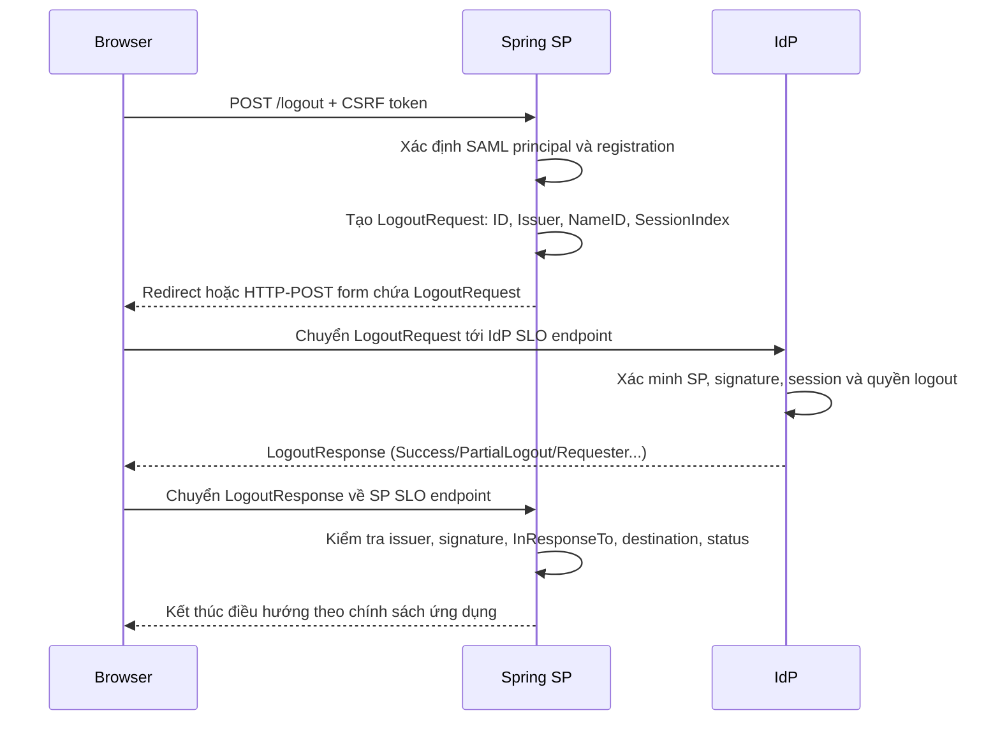
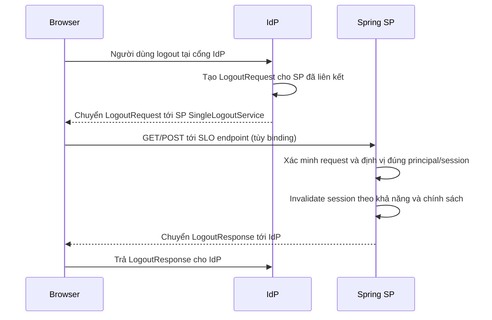

# SAML2 Single Logout và quản lý chứng thư trong hệ thống liên kết — Spring Security Servlet

## 1. Học được gì và bài toán thực tế

Một hệ thống **SAML 2.0 federation** thường có **Identity Provider (IdP)** xác thực người dùng và **Service Provider (SP)** là ứng dụng của chúng ta. Trong Spring Security Servlet, SP có thể dùng SAML2 để đăng nhập và thực hiện **Single Logout (SLO)** nhằm trao đổi thông điệp đăng xuất với IdP.

Bài này trả lời bốn câu hỏi quan trọng:

1. **SAML2 Logout khác logout nội bộ như thế nào?** Khi logout ở SP hoặc IdP, thông điệp nào được gửi, phiên nào thực sự bị đóng?
2. **SP-initiated và IdP-initiated SLO chạy ra sao?** Cách liên hệ `LogoutRequest`, `LogoutResponse`, `NameID`, `SessionIndex`, binding và HTTP session.
3. **Chứng thư X.509 nào dùng để ký, xác minh hoặc giải mã?** Cách cấu hình, công bố metadata, theo dõi hết hạn và xoay vòng khóa giữa SP/IdP.
4. **Làm sao triển khai và kiểm tra bằng Spring Boot 3.x / Spring Security 6.x Servlet?** Phân biệt protocol failure với mất phiên, sai endpoint, signature hoặc trust.

**Phạm vi:** SAML2 Web Browser SSO và SLO ở ứng dụng **Spring MVC/Servlet, Java 17+**. Các đường dẫn/metadata ví dụ phải được đối chiếu với phiên bản Spring Security, cấu hình proxy và IdP thực tế. Spring WebFlux có cấu hình khác. Không đồng nhất SAML2 SLO với OAuth2/OIDC logout hoặc việc thu hồi access token.

## 2. Thành phần, phiên đăng nhập và các lớp tin cậy

| Thành phần | Vai trò | Dữ liệu cần nhớ |
| --- | --- | --- |
| Browser | Chuyển hướng và mang SAML message giữa các bên | Cookie phiên SP/IdP, request/response front-channel |
| SP (Spring Security) | Nhận SAML Response lúc login, lưu SecurityContext/HTTP session, tạo hoặc xử lý logout | `RelyingPartyRegistration`, tên SP, `NameID`, `SessionIndex`, thông điệp chờ được đối chiếu |
| IdP / Asserting Party | Xác thực, phát assertion và thông điệp LogoutRequest/LogoutResponse | Entity ID, SingleLogoutService, session IdP |
| SP metadata | Công bố thông tin SP cho IdP | SP entityID, ACS, SLO endpoint/binding, chứng thư public để IdP xác minh SP |
| IdP metadata | Cho SP biết endpoint và khóa tin cậy của IdP | IdP entityID, SSO/SLO endpoints, chứng thư signing và cờ yêu cầu ký |

**Ba loại trạng thái không nhất thiết mất cùng lúc:** phiên HTTP cục bộ của SP, phiên SSO tại IdP và các phiên ở **SP khác**. Logout nội bộ chỉ chắc chắn kết thúc phiên cục bộ; SLO là một **giao thức phối hợp**, có thể bị lỗi mạng, bị IdP từ chối, hoặc một SP khác không hỗ trợ. Không nên hiển thị “đã đăng xuất tất cả thiết bị và ứng dụng” khi mới chỉ xóa `JSESSIONID` của một SP.

**Trust boundary:** trình duyệt là kênh chuyển thông điệp, không phải nguồn chứng thực. SP phải kiểm tra chữ ký/issuer/destination/correlation của thông điệp SAML theo chính sách đã thỏa thuận. Không tin một XML `LogoutRequest` chỉ vì nó đến đúng URL hoặc vì chứa `NameID` trông hợp lệ.

## 3. SAML Single Logout là gì?

### 3.1. Logout nội bộ so với SLO

- **Local logout:** Spring invalidates `HttpSession`, xóa SecurityContext và cookie phiên theo cấu hình. Phiên IdP và các SP khác vẫn có thể tồn tại.
- **SP-initiated SLO:** người dùng logout tại ứng dụng SP; SP yêu cầu IdP thực hiện logout liên kết, thường gửi `LogoutRequest` qua browser tới IdP; IdP xử lý và trả `LogoutResponse`.
- **IdP-initiated SLO:** IdP bắt đầu logout, gửi `LogoutRequest` đến SP; SP đối chiếu người dùng/phiên tương ứng, xử lý local logout rồi trả `LogoutResponse`.
- **SLO một phần:** một bên có thể đóng session nhưng bên khác lỗi/timeout. Phải quan sát status và log thay vì giả định giao thức có giao dịch phân tán atomic.

SLO không tự thu hồi JWT, refresh token hay cookie độc lập do dịch vụ khác nắm giữ. Muốn xử lý các cơ chế đó phải có chính sách riêng.

### 3.2. SP-initiated: người dùng bấm “Đăng xuất” ở Spring



Những điểm dễ nhầm:

- Với Spring Security, **POST `/logout`** là cách bắt đầu logout do người dùng chủ động trong cấu hình mặc định có CSRF. **Không** dùng `<a href="/logout">` như một GET rồi tự cho phép logout không có CSRF để dễ demo.
- Khi bật SAML2 logout và registration hỗ trợ SLO, một logout success handler có thể tạo SAML `LogoutRequest` gửi IdP. Nếu registration/IdP không có cấu hình SLO tương ứng, hãy kiểm tra khả năng fallback local logout; không mặc định việc gọi `/logout` luôn phát SAML request.
- Sau redirect tới IdP, response quay lại SP qua **SLO endpoint**. Không nhầm với **Assertion Consumer Service (ACS)** dùng cho login.
- Một số triển khai kết thúc local session ở các thời điểm khác nhau. UI phải phản ánh trạng thái thực chứ không hứa mọi phiên từ xa được đóng đồng thời.

### 3.3. IdP-initiated: bắt đầu từ IdP



Nếu yêu cầu đến SP nhưng browser **không mang cookie của phiên SP**, hoặc SLO request không thể định vị phiên cần đóng, kết quả phụ thuộc cách framework/IdP và session repository hoạt động. Đừng suy ra rằng chỉ biết `NameID` thì Spring chắc chắn có thể vô hiệu hóa **mọi HTTP session** trong cụm máy. Muốn hỗ trợ multi-session, cross-node hoặc back-channel-like session revocation cần thiết kế lưu vết session riêng và kiểm thử thực tế.

## 4. Bên trong `LogoutRequest` và `LogoutResponse`

Định dạng SAML được định nghĩa bởi XML schema và profile. Các đoạn dưới là **XML minh họa cấu trúc**, chưa có XML Signature và **không phải thông điệp có thể dùng để đăng xuất thật**.

### 4.1. LogoutRequest

```xml
<samlp:LogoutRequest
    xmlns:samlp="urn:oasis:names:tc:SAML:2.0:protocol"
    xmlns:saml="urn:oasis:names:tc:SAML:2.0:assertion"
    ID="_lr-123" Version="2.0"
    IssueInstant="2026-01-01T10:00:00Z"
    Destination="https://idp.example.test/saml/slo">
    <saml:Issuer>https://sp.example.test/saml/metadata</saml:Issuer>
    <saml:NameID>federated-user-id</saml:NameID>
    <samlp:SessionIndex>session-from-login-assertion</samlp:SessionIndex>
</samlp:LogoutRequest>
```

- **`ID`**: định danh duy nhất cho một request; dùng để đối chiếu response và phát hiện replay.
- **`Issuer`**: entityID của bên phát request; không phải địa chỉ IP, email hoặc username tùy ý.
- **`IssueInstant`**: thời điểm phát request; kiểm tra tính hợp lý theo đồng hồ UTC và chính sách chênh lệch thời gian.
- **`Destination`**: endpoint người nhận được dự kiến; phải khớp địa chỉ đã tin cậy theo policy.
- **`NameID`**: định danh liên kết được trao đổi tại login; **Format/qualifiers có thể quan trọng**, không chỉ là text hiển thị.
- **`SessionIndex`**: nếu có trong assertion lúc SSO, nó giúp IdP/SP xác định session liên kết cần đăng xuất. Không được tự sinh chỉ số bất kỳ rồi kỳ vọng IdP hiểu.
- **XML Signature hoặc Redirect-binding signature**: tùy binding và policy IdP/SP, phải ký và xác minh theo trust đã trao đổi. Ví dụ bỏ signature chỉ nhằm giải thích cấu trúc.

**Không dùng `NameID` như khóa toàn cục thay thế session có kiểm soát.** Hai phiên của cùng một danh tính có thể có phạm vi logout khác nhau; kết hợp issuer, registration, NameID, SessionIndex và session state tương ứng.

### 4.2. LogoutResponse

```xml
<samlp:LogoutResponse
    xmlns:samlp="urn:oasis:names:tc:SAML:2.0:protocol"
    xmlns:saml="urn:oasis:names:tc:SAML:2.0:assertion"
    ID="_lres-789" Version="2.0"
    IssueInstant="2026-01-01T10:00:02Z"
    InResponseTo="_lr-123"
    Destination="https://sp.example.test/logout/saml2/slo">
    <saml:Issuer>https://idp.example.test/entity</saml:Issuer>
    <samlp:Status>
        <samlp:StatusCode
            Value="urn:oasis:names:tc:SAML:2.0:status:Success"/>
    </samlp:Status>
</samlp:LogoutResponse>
```

- **`InResponseTo`** phải ràng buộc với request đang chờ được lưu từ trước, không đối chiếu với một ID do caller tự gửi.
- **`StatusCode`** có thể thành công hoặc thất bại/partial logout; client phải đọc trạng thái thực.
- **`Issuer`, `Destination`, `IssueInstant`, signature** phải được kiểm tra như những trường thuộc giao thức, không chỉ đọc `Status=Success`.
- **`RelayState`** có thể mang state điều hướng/correlation qua binding; không xem nó là bằng chứng chữ ký và không chấp nhận arbitrary redirect URL không kiểm soát.

Một response có XML đúng cú pháp nhưng **sai chữ ký**, sai requester/issuer, sai recipient hoặc sai `InResponseTo` vẫn phải bị từ chối.

### 4.3. Binding HTTP-Redirect và HTTP-POST

| Binding | Cách vận chuyển | Vấn đề kỹ thuật thường gặp |
| --- | --- | --- |
| HTTP-Redirect | Browser GET đến SLO endpoint, SAMLRequest/SAMLResponse được DEFLATE/Base64/URL-encode theo profile | Chữ ký có thể nằm trong query `SigAlg`/`Signature`; reverse proxy rewrite query làm signature lỗi |
| HTTP-POST | Browser submit form POST chứa `SAMLRequest` hoặc `SAMLResponse` đã Base64 | Chữ ký thường được xác minh trong XML theo policy; cần phân biệt SAML POST với form logout `/logout` có CSRF |
| Metadata binding | Mỗi bên quảng bá SingleLogoutService `Binding`, `Location`, đôi khi `ResponseLocation` | SP/IdP phải dùng binding và endpoint mà đối tác thực sự hỗ trợ |

Không kết luận một giao dịch thất bại chỉ vì DevTools thấy 302 hoặc HTML form: đó có thể là phần bình thường của SAML front-channel. Điều cần kiểm tra là **đúng endpoint, message, signature, session và response status**.

## 5. Cấu hình cơ bản Spring Security Servlet

### 5.1. Thêm dependency và đăng ký IdP

Dùng dự án Spring Boot 3.x, Java 17+, Spring MVC. Trong `build.gradle` (Groovy DSL) của project đã có plugin/version do Spring Initializr tạo:

```groovy
dependencies {
    implementation 'org.springframework.boot:spring-boot-starter-web'
    implementation 'org.springframework.boot:spring-boot-starter-security'
    implementation 'org.springframework.security:spring-security-saml2-service-provider'
    implementation 'org.springframework.boot:spring-boot-starter-thymeleaf'
    testImplementation 'org.springframework.boot:spring-boot-starter-test'
    testImplementation 'org.springframework.security:spring-security-test'
}
```

Đảm bảo kho dependency/phiên bản OpenSAML tương thích theo bản Spring Security đang dùng. `spring-security-saml2-service-provider` chứa tính năng SAML2 SP, không phải Resource Server JWT hoặc `oauth2Login`.

Tập tin **`src/main/resources/application.yml`** minh họa một registration tên `corp`:

```yaml
spring:
  security:
    saml2:
      relyingparty:
        registration:
          corp:
            assertingparty:
              metadata-uri: https://idp.example.test/saml/metadata
            signing:
              credentials:
                - private-key-location: file:/run/secrets/saml/sp-signing-key.pem
                  certificate-location: file:/run/certs/saml/sp-signing.crt
```

Điều kiện để chạy **end-to-end**: URL metadata phải là IdP thực với endpoint SSO/SLO và chứng thư hợp lệ; file key/certificate phải thực sự tồn tại, khớp với nhau và private key chỉ đọc được bởi tài khoản chạy ứng dụng; IdP phải tin cậy SP public signing certificate và metadata SP; registration/endpoint/binding cần thống nhất ở hai bên.

**Không** lưu private key thật trong Git hoặc ở vị trí public. Dùng secret mount hoặc kho khóa được tổ chức phê duyệt; `file:` là vị trí ví dụ trên máy/container. Public X.509 certificate có thể được công bố trong metadata theo mục đích phù hợp; private key **không** được công bố.

Trong một số hệ thống, còn phải cấu hình decryption key nếu IdP **mã hóa SAML assertion**. Khóa ký cho SLO và khóa giải mã assertion có vai trò khác; không tự thêm decryption credential nếu ứng dụng/IdP không dùng encryption.

### 5.2. Bật login và SAML2 logout

**`src/main/java/com/example/samllogout/SamlLogoutApplication.java`**

```java
package com.example.samllogout;

import org.springframework.boot.SpringApplication;
import org.springframework.boot.autoconfigure.SpringBootApplication;

@SpringBootApplication
public class SamlLogoutApplication {
    public static void main(String[] args) {
        SpringApplication.run(SamlLogoutApplication.class, args);
    }
}
```

**`src/main/java/com/example/samllogout/SecurityConfig.java`**

```java
package com.example.samllogout;

import org.springframework.context.annotation.Bean;
import org.springframework.context.annotation.Configuration;
import org.springframework.security.config.Customizer;
import org.springframework.security.config.annotation.web.builders.HttpSecurity;
import org.springframework.security.web.SecurityFilterChain;

@Configuration
public class SecurityConfig {
    @Bean
    SecurityFilterChain securityFilterChain(HttpSecurity http)
            throws Exception {
        http
            .authorizeHttpRequests(authorize -> authorize
                .requestMatchers("/", "/error").permitAll()
                .anyRequest().authenticated()
            )
            .saml2Login(Customizer.withDefaults())
            .saml2Logout(Customizer.withDefaults());

        return http.build();
    }
}
```

Phần code không cố gắng xử lý XML SAML bằng controller tự viết. Các filter của Spring Security xử lý login, khởi tạo/nhận SLO theo `RelyingPartyRegistration` và các endpoint mặc định tương ứng. Để SLO hoạt động, **cấu hình IdP và metadata phải có SLO service, binding, public keys và thông tin phiên phù hợp**; chỉ gọi `.saml2Logout(...)` không ép một IdP bất kỳ tham gia SLO.

### 5.3. Trang thử nghiệm có POST logout

**`src/main/java/com/example/samllogout/PageController.java`**

```java
package com.example.samllogout;

import org.springframework.stereotype.Controller;
import org.springframework.web.bind.annotation.GetMapping;

@Controller
public class PageController {
    @GetMapping("/")
    String home() {
        return "home";
    }
}
```

**`src/main/resources/templates/home.html`**

```html
<!doctype html>
<html lang="vi" xmlns:th="http://www.thymeleaf.org">
<head>
    <meta charset="utf-8">
    <title>SAML2 Logout Demo</title>
</head>
<body>
    <h1>Ứng dụng SAML2 Service Provider</h1>
    <a th:href="@{/saml2/authenticate/corp}">Đăng nhập qua IdP</a>

    <form th:action="@{/logout}" method="post">
        <button type="submit">Đăng xuất</button>
    </form>
</body>
</html>
```

Với tích hợp Thymeleaf/Spring Security, `th:action` trên form POST có cơ chế thêm tham số CSRF theo `RequestDataValueProcessor` của framework. **Kiểm tra HTML được render và security config thực tế** để chắc chắn request có CSRF token hợp lệ; không tắt CSRF chỉ để `/logout` chấp nhận GET hoặc POST thiếu token. Ở ứng dụng không dùng Thymeleaf, cần chèn hidden input theo tên và giá trị CSRF token của request.

`GET /saml2/authenticate/corp` là URL khởi tạo SAML login mặc định phổ biến cho registration `corp`. Để SLO hoạt động ở môi trường thực, phải đăng ký đúng SLO URL của SP ở IdP và đảm bảo metadata hai bên phản ánh endpoint đó. Với binding HTTP-POST, endpoint SLO thường thuộc `/logout/saml2/slo`; nhưng **không dùng một path đoán sẵn** nếu ứng dụng đã tùy chỉnh hoặc IdP metadata quy định path khác.

Chạy project Gradle Wrapper (khi đã kết nối IdP và mount khóa hợp lệ):

```bash
./gradlew bootRun
```

Trên Windows PowerShell dùng `.\gradlew.bat bootRun`. Không kỳ vọng ví dụ với `idp.example.test` đăng nhập/đăng xuất được; nó là domain minh họa, không phải IdP có thật.

## 6. `RelyingPartyRegistration` và metadata SLO: quyết định thành công

Trong Spring Security SAML2 SP, `RelyingPartyRegistration` lưu thông tin SP và asserting party: entity IDs, ACS/SLO endpoints, binding và credentials. Có thể cấu hình qua Spring Boot properties, qua IdP metadata hoặc tự tạo registration trong Java khi cần multi-IdP và chuyển đổi chứng thư phức tạp.

Các hạng mục phải đối chiếu với đối tác:

| Thành phần | SP/IdP cần thống nhất | Nếu sai |
| --- | --- | --- |
| SP `entityID` | Định danh ổn định được IdP đăng ký | IdP coi là SP khác hoặc từ chối chữ ký |
| IdP `entityID` | Issuer của asserting party đã tin cậy | SP không nhận đúng người gửi |
| SP SLO `Location` | Public URL nhận LogoutRequest/LogoutResponse | IdP gửi sai host/path hoặc 404/405 |
| IdP SLO `Location` | Endpoint SP gửi LogoutRequest | SP redirect tới endpoint không hỗ trợ |
| Binding (Redirect/POST) | Bên gửi/nhận có cùng profile và thuật toán signature | Signature validation hoặc method sai |
| SP signing certificate | IdP biết public cert tương ứng private key SP dùng ký | IdP từ chối `LogoutRequest` |
| IdP signing certificate | SP tin cậy public cert đang dùng bởi IdP | SP từ chối `LogoutRequest`/`LogoutResponse` |
| `NameID`/`SessionIndex` | Giá trị giữ từ assertion đăng nhập tương ứng | Không tìm được session hoặc IdP không xác định được login session |
| Clock sync | NTP/UTC, giới hạn tuổi message và leeway | Thông điệp bị coi là quá hạn/chưa hợp lệ |
| Public scheme/host | Proxy headers và `baseUrl` sinh ra URL thực | Destination/redirect_uri không khớp, vòng lặp redirect |

### 6.1. Đọc đúng metadata XML

Ví dụ SP metadata trích đoạn (public data; chưa phải file metadata đầy đủ):

```xml
<md:SPSSODescriptor
    xmlns:md="urn:oasis:names:tc:SAML:2.0:metadata"
    protocolSupportEnumeration="urn:oasis:names:tc:SAML:2.0:protocol">
    <md:KeyDescriptor use="signing">
        <ds:KeyInfo xmlns:ds="http://www.w3.org/2000/09/xmldsig#">
            <!-- X.509 public certificate trong ds:X509Data -->
        </ds:KeyInfo>
    </md:KeyDescriptor>
    <md:SingleLogoutService
        Binding="urn:oasis:names:tc:SAML:2.0:bindings:HTTP-POST"
        Location="https://sp.example.test/logout/saml2/slo"/>
</md:SPSSODescriptor>
```

Đoạn trích giản lược chỉ để nhận diện trường. Metadata thực có `EntityDescriptor`, chứng thư public Base64 và các phần tử bắt buộc khác. Đừng copy đoạn này làm metadata sản xuất.

Spring Security có khả năng **công bố SP metadata** khi bật phần cấu hình metadata tương ứng, ví dụ `.saml2Metadata(Customizer.withDefaults())` ở các bản 6.x hỗ trợ. Khi sử dụng, kiểm tra endpoint metadata thực tế (thường `/saml2/metadata/{registrationId}` hoặc endpoint được cấu hình), xuất phát từ **public URL sau proxy** và trình IdP đăng ký lại sau khi thay SLO endpoints hoặc signing certificates. Không giả định metadata tự được IdP cập nhật ngay chỉ vì SP đã thay đổi.

### 6.2. Khi sau reverse proxy

Nếu public URL là `https://sp.example.test` nhưng app chạy nội bộ `http://service:8080`, metadata/SP SLO Destination phải dùng hostname/scheme công khai. Chỉ nhận `Forwarded`/`X-Forwarded-*` từ proxy được tin cậy; không để browser tùy ý quyết định `{baseUrl}`. Kiểm tra cấu hình Spring Boot `server.forward-headers-strategy` nếu được dùng, HTTP proxy chain, TLS offload và context path.

Các vấn đề như `Location: http://service:8080/...`, sai port/path, thiếu cookie `Secure`/`SameSite` hoặc rewrite query có thể làm SLO thất bại dù chữ ký và certificate không sai.

## 7. Ba loại chứng thư/khóa thường gặp và chúng bảo vệ gì

SAML federation sử dụng **X.509 public certificates** để xác minh các chữ ký hoặc mã hóa dữ liệu; private key tương ứng phải được quản lý bí mật.

| Khóa/chứng thư | Bên giữ private key | Bên cần public cert | Công dụng |
| --- | --- | --- | --- |
| **SP signing** | SP | IdP | SP ký SAML AuthnRequest/LogoutRequest/LogoutResponse khi policy yêu cầu |
| **IdP signing** | IdP | SP | SP xác minh assertion, SAML Response và các message logout phù hợp |
| **SP decryption/encryption** | SP giữ private decrypt key | IdP dùng SP public encrypt cert | IdP mã hóa assertion gửi SP; SP giải mã sau khi nhận |
| **TLS certificate** | Chủ server/proxy HTTPS | Browser/HTTP client theo PKI | Bảo vệ kênh HTTPS; **không đồng nghĩa** certificate dùng cho XML Signature |

**Certificate trong metadata không cần mặc nhiên là CA-trusted như TLS cert.** Nhiều SAML deployments dùng certificate tự ký/riêng và tin cậy theo **metadata được xác thực/pinning/out-of-band**. Điểm quan trọng là định danh metadata, key material và kênh cập nhật đáng tin; không chấp nhận “bất cứ chứng thư nào đi kèm XML vừa nhận” làm trust anchor.

### 7.1. Signing, verification và encryption không được lẫn

- **Signing credential:** cặp private key/certificate phía SP để ký theo policy. Một ký tự XML bị sửa hoặc query Redirect binding bị thay đổi có thể làm signature verification thất bại.
- **Verification credential:** public certificate của IdP/SP dùng để kiểm tra chữ ký bên kia. Không cần private key của đối tác.
- **Decryption credential:** private key của SP để giải mã nội dung được IdP mã hóa bằng SP public cert. Không giải quyết lỗi `LogoutRequest` signature bằng cách đổi decryption key nếu SLO không dùng encryption.
- **TLS credential:** bảo vệ HTTP transport, độc lập với trust của SAML XML signature. HTTPS hợp lệ không chứng minh SAML message do đúng IdP ký.

Đừng dùng cùng một keypair cho mọi mục đích nếu kiến trúc có thể tách. Khi buộc phải dùng lại, hiểu phạm vi rủi ro và lên kế hoạch rotation tương ứng.

### 7.2. Những thuộc tính certificate cần giám sát

1. **Fingerprint SHA-256** của certificate public (để đối chiếu bản IdP/SP đã phê duyệt; kiểm tra kênh trao đổi fingerprint).
2. **Subject / Issuer** của X.509, nhưng không dùng CN/subject thay cho entityID hoặc signature validation.
3. **`NotBefore` / `NotAfter`** và chính sách chấp nhận certificate của đối tác. Trong SAML, expiry và trust có thể được xử lý khác nhau theo implementation; kiểm tra chính sách thực tế của IdP/SP, không dựa vào giả định mọi metadata đều thực thi PKIX chain.
4. **Algorithm / key length / KeyUsage** được bên đối tác cho phép, ví dụ dùng RSA/SHA-256 theo thỏa thuận; tránh thuật toán yếu.
5. **Public-key pair matching** giữa private key đang active và certificate quảng bá; xác minh trên hệ thống tin cậy, không gửi private key sang IdP để “kiểm tra”.
6. **Inventory**: chủ sở hữu key, môi trường, bên federation, ngày active, ngày hết hạn, dự kiến rollover, rollback owner, nơi cập nhật metadata.

## 8. Java 17: kiểm tra fingerprint và hạn sử dụng của X.509 certificate

Lệnh JDK để xem chứng thư PEM/DER mà không viết code:

```bash
keytool -printcert -file idp-signing.crt
```

`keytool` hiển thị subject, issuer, validity và fingerprint. Đây là thao tác **đọc public certificate**, không cần private key.

Ví dụ Java 17 độc lập, không dùng Spring; file **`CertificateAudit.java`**:

```java
import java.io.InputStream;
import java.nio.file.Files;
import java.nio.file.Path;
import java.security.MessageDigest;
import java.security.cert.CertificateFactory;
import java.security.cert.CertificateExpiredException;
import java.security.cert.CertificateNotYetValidException;
import java.security.cert.X509Certificate;
import java.time.Duration;
import java.time.Instant;
import java.util.HexFormat;

public class CertificateAudit {
    public static void main(String[] args) throws Exception {
        if (args.length != 1) {
            System.err.println(
                "Usage: java CertificateAudit <certificate-file>");
            System.exit(2);
        }

        X509Certificate cert;
        try (InputStream in = Files.newInputStream(Path.of(args[0]))) {
            cert = (X509Certificate)
                CertificateFactory.getInstance("X.509")
                    .generateCertificate(in);
        }

        byte[] sha256 = MessageDigest.getInstance("SHA-256")
            .digest(cert.getEncoded());

        System.out.println("Subject: "
            + cert.getSubjectX500Principal().getName());
        System.out.println("Issuer: "
            + cert.getIssuerX500Principal().getName());
        System.out.println("SHA-256: "
            + HexFormat.ofDelimiter(":").withUpperCase().formatHex(sha256));
        System.out.println("NotBefore: "
            + cert.getNotBefore().toInstant());
        System.out.println("NotAfter: "
            + cert.getNotAfter().toInstant());

        long daysUntilExpiry = Duration.between(
            Instant.now(), cert.getNotAfter().toInstant()).toDays();
        System.out.println("Expires within 30 days: "
            + (daysUntilExpiry <= 30));

        try {
            cert.checkValidity();
            System.out.println("Time validity: valid");
        } catch (CertificateExpiredException
                 | CertificateNotYetValidException ex) {
            System.out.println("Time validity: invalid");
        }
    }
}
```

Biên dịch và chạy bằng JDK 17+:

```bash
javac CertificateAudit.java
java CertificateAudit idp-signing.crt
```

**Kết quả phụ thuộc certificate và thời điểm chạy**, ví dụ tên subject/issuer, dấu fingerprint hex, thời hạn và tình trạng valid/invalid. Không thể ghi stdout cố định mà không có certificate đầu vào cố định. `checkValidity()` chỉ kiểm tra **khoảng thời gian chứng thư**, không xác minh issuer metadata, chain-of-trust, SAML signature, key pair matching hoặc quyền dùng chứng thư đó.

Với certificate có nhiều phần PEM hoặc metadata chứa nhiều signing keys, cần tách và kiểm tra **từng public certificate đang được đối tác công bố**, không chỉ certificate đầu tiên. Trước rollout phải đối chiếu fingerprint qua kênh được tổ chức tin cậy.

## 9. Quy trình xoay vòng chứng thư an toàn (rollover)

Rủi ro lớn nhất của rotation không phải “file certificate cũ hết hạn” mà là **hai bên đổi key lệch thời điểm**, khiến signature/decryption không thể xử lý. Một kế hoạch rollover tốt cần có **khoảng overlap**, theo dõi và rollback.

### 9.1. IdP thay certificate ký

Trong trường hợp IdP đổi key ký SAML assertion và logout messages:

1. **Trước khi IdP bắt đầu ký bằng khóa mới:** nhận IdP metadata/certificate mới qua kênh tin cậy, xác minh issuer/entityID/fingerprint, cấu hình SP chấp nhận **cả certificate cũ và mới** nếu framework/IdP hỗ trợ đa verification credentials.
2. Cập nhật/refresh `RelyingPartyRegistration` và cache metadata phù hợp; kiểm tra ứng dụng/replica thực sự đã nạp key mới.
3. IdP bắt đầu ký với private key mới; chạy thử SSO và cả hai chiều SLO, kiểm tra signature verification và issuer.
4. Sau giai đoạn overlap được thống nhất, gỡ chứng thư cũ khỏi trust store/cấu hình SP; kiểm tra không còn replica nào phụ thuộc.
5. Nếu lỗi, có rollback plan rõ ràng, nhưng **không tự cho phép unsigned SAML** để “cứu” login/logout.

Nếu chỉ thay cert trong portal IdP nhưng không cập nhật trust phía SP, login và SLO có thể đồng loạt thất bại. Ngược lại, không nên lấy khóa ký mới từ một metadata URL bị người tấn công kiểm soát mà không kiểm tra trust anchor của kênh metadata.

### 9.2. SP thay certificate ký

Khi SP đổi signing key:

1. Sinh **keypair mới** bằng công cụ/secret service được phê duyệt, lưu private key an toàn.
2. Công bố **SP public signing certificate mới** trong metadata/portal IdP trước khi SP dùng private key mới để ký, giữ certificate cũ trong khoảng chuyển tiếp nếu IdP hỗ trợ.
3. Đảm bảo IdP đã nạp và chấp nhận khóa public mới. Chỉ sau đó mới chuyển SP sang **ký bằng private key mới**.
4. Test AuthnRequest (nếu ký), **SP-initiated LogoutRequest**, phản hồi SLO và trường hợp IdP-initiated LogoutResponse.
5. Gỡ khóa cũ sau cửa sổ overlap; dọn private key cũ khỏi runtime/secret store theo chính sách lưu trữ và rollback.

SP và IdP phải thỏa thuận liệu logout messages **bắt buộc được ký** và hỗ trợ thuật toán nào. Một IdP có thể yêu cầu signed LogoutRequest trong khi IdP khác không hỗ trợ cùng binding/chữ ký; kiểm tra metadata/policy thay vì suy diễn từ SSO hoạt động.

### 9.3. SP đổi certificate giải mã assertion

Nếu IdP mã hóa assertion bằng SP public encryption cert:

1. Công bố public encryption cert mới cho IdP; đồng thời SP phải có **private decryption key mới**.
2. Giữ **private key cũ** trong thời gian IdP có thể còn gửi assertion mã hóa cho certificate cũ, nếu chính sách/implementation cho phép nhiều decryption credentials.
3. Sau khi chắc chắn IdP đã dùng cert mới và không còn assertion cũ trong luồng hợp lệ, thu hồi key cũ theo chính sách.
4. Kiểm thử đăng nhập có encrypted assertion; **SLO không nhất thiết mã hóa như assertion** nên test logout riêng.

Khi chứng thư cũ hết hạn trong một số deployment, chiến lược đúng vẫn là **đổi khóa có overlap có kiểm soát**, không kéo dài trust vô hạn hoặc vô hiệu kiểm tra signature.

### 9.4. Bảng phân công khi rollout

| Việc cần làm | SP owner | IdP owner | Bằng chứng nghiệm thu |
| --- | --- | --- | --- |
| Xác nhận metadata/entityID/cert cũ/mới | X | X | Fingerprint ký tên/chấp thuận qua kênh tin cậy |
| Cập nhật public verifying cert phía nhận | X hoặc IdP tùy chiều | X hoặc SP tùy chiều | SSO/SLO signature pass với key mới |
| Bật private signing key mới phía gửi | X nếu SP | X nếu IdP | Message được ký bằng key dự kiến |
| Cập nhật encryption cert (nếu dùng) | Giữ private decrypt key | Dùng public encrypt cert | Encrypted assertion giải mã thành công |
| Test SP/IdP initiated và lỗi mạng | X | X | Logs và kết quả session ở nhiều bên |
| Gỡ key cũ và hoàn tất audit | X | X | Không còn key cũ active ngoài kế hoạch |

Không ghi fingerprint hoặc key nội bộ vào một tài liệu công khai nếu chính sách tổ chức hạn chế; fingerprint public không phải secret, nhưng inventory có thể nhạy cảm về vận hành.

## 10. Những điểm cần kiểm tra riêng trong Spring Security

### 10.1. RelyingPartyRegistration cho SLO

Cấu hình `saml2Login()` thành công **không chứng minh** SLO đã sẵn sàng. Kiểm tra registration cho đúng IdP có:

- Asserting party metadata với **SingleLogoutService Location/Binding** hợp lệ.
- Relying party SLO endpoint public mà IdP đã đăng ký (có thể được publish bằng metadata của SP).
- Signing credentials khi chính sách ký SLO yêu cầu, và verification credentials của IdP.
- Tên registrationID nhất quán với endpoint và các relying party nếu có nhiều IdP.
- Session state sau login đủ để phát `LogoutRequest` chứa `NameID` và `SessionIndex` đúng với assertion.

Mỗi version có cấu hình metadata và resolver khác nhau; khi cần thêm hoặc ghi đè SLO endpoint bằng Java DSL, phải dùng API đúng version đang cài. Không tự copy cấu hình `assertionConsumerServiceLocation` để thay SLO URL: **ACS dành cho login, SingleLogoutService dành cho logout**.

### 10.2. Spring Security filters và callback

Đường đăng nhập thông thường:

```text
GET /saml2/authenticate/{registrationId}
  -> Browser tới IdP SSO
  -> POST /login/saml2/sso/{registrationId}
  -> Spring Security xác minh SAML login
```

Đường logout liên kết thường liên quan:

```text
POST /logout             -> SP khởi tạo logout (kèm CSRF)
GET/POST /logout/saml2/slo -> nhận SAML LogoutRequest/LogoutResponse
```

Địa chỉ là **convention phổ biến của Spring Security Servlet**, có thể tùy biến theo filter/url matcher và binding. Xem cấu hình đang có/metadata để xác minh, không dùng POST vào endpoint SLO bằng một form logout tự chế rồi mong nó biết người dùng muốn thoát.

**CSRF khác XML Signature:** POST `/logout` từ ứng dụng thường cần CSRF token. Một SAML POST từ IdP tới SLO endpoint thường không có CSRF token của HTTP session; Spring Security có tích hợp xử lý cho các message SAML theo filter chuyên dụng. Đừng tắt CSRF cho toàn bộ ứng dụng hoặc chuyển SLO callback sang controller không xác minh SAML để “chữa” 403.

### 10.3. Ghi log sự cố an toàn

Khi debug, cần quan sát registrationId, entityID, binding, destination, request ID, InResponseTo, status code và loại lỗi signature/metadata/session; nhưng không log nguyên SAML assertion, toàn bộ SAMLResponse, session cookie, NameID nhạy cảm, private key hoặc payload có PII lên log tập trung không kiểm soát.

Không đổ lỗi “chứng thư hết hạn” chỉ vì một browser thấy lỗi logout. Cùng một lỗi HTTP 400/403 có thể do binding mismatch, CSRF routing, stale session, signature verification, issuer hoặc InResponseTo. Dùng correlation ID và log từ **cả SP lẫn IdP** (đã redacted) để tìm tầng thất bại.

## 11. Chẩn đoán lỗi SLO theo triệu chứng

| Triệu chứng | Nguyên nhân cần kiểm tra | Cách xác minh/sửa |
| --- | --- | --- |
| POST `/logout` chỉ thoát cục bộ, IdP vẫn SSO | SLO chưa bật, IdP metadata thiếu SLO, registration/credentials chưa hợp lệ | Kiểm tra `.saml2Logout(...)`, asserting party SingleLogoutService, signing key, browser redirect |
| POST `/logout` trả 403 | Thiếu CSRF token trong form hoặc security matcher sai | Xem rendered form, không mở GET logout toàn cục |
| IdP trả lỗi khi nhận LogoutRequest | Sai issuer/SP entityID, NameID/SessionIndex, signing requirement, destination hoặc binding | So sánh metadata hai bên và log IdP |
| SP nhận LogoutResponse nhưng không hoàn tất | `InResponseTo` không khớp request đang chờ, sai issuer/signature/status, session bị mất | Xem correlation storage, cookie, binding và timestamp |
| IdP-initiated request bị 404/405 | SLO endpoint sai hoặc HTTP method/binding không khớp | Kiểm tra metadata `Location` và proxy forwarding |
| IdP-initiated SLO không đóng đúng phiên | Thiếu/mất cookie SP, NameID/SessionIndex không được lưu hoặc nhiều session | Kiểm thử session mapping, multi-node storage, user agent |
| SSO chạy nhưng SLO báo invalid signature | Key khác dùng ký logout, SP/IdP chưa tin cậy certificate hoặc Redirect query bị rewrite | So sánh signer fingerprint, binding, raw request và metadata |
| SLO chỉ lỗi sau certificate rotation | Một bên chuyển signing key trước khi bên kia trust new cert | Bật overlap verification, kiểm tra metadata/cache và replica |
| Assertion không giải mã được sau rotation | IdP mã hóa bằng public encryption cert mà SP đã bỏ private key tương ứng | Kiểm tra decryption credentials và khoảng overlap |
| SLO response đi vào HTTP nội bộ | Proxy không cấp forwarded scheme/host chuẩn | Sửa public base URL và forwarded headers trust boundary |
| Logout thành công nhưng đăng nhập lại ngay | IdP session chưa thoát, SLO thất bại/partial hoặc browser tự SSO lại | Kiểm tra IdP session/cookie và status; không tuyên bố global logout |
| `NameID` khác sau login hoặc không khớp | Format/qualifiers hoặc identity mapping thay đổi giữa IdP/SP | Giữ NameID từ assertion và thử profile IdP |
| Time validation lỗi lẻ tẻ | NTP lệch, IssueInstant/NotOnOrAfter lệch chuẩn | Đồng bộ clock và chính sách leeway |
| Một SP khác vẫn còn đăng nhập | SLO không bảo đảm mọi SP đồng ý/tham gia | Kiểm tra topology federation và báo partial logout |
| Chỉ lỗi trên một replica | Khác certificate/session/metadata cache giữa các node | So sánh rollout, secret mounts, load balancer và version |

Khi người dùng logout trong lúc IdP không thể truy cập, hệ thống phải có UX và audit rõ ràng: có thể **đóng phiên cục bộ** vì an toàn nhưng không được báo SLO hoàn tất khi IdP chưa xác nhận. Quyết định fail-open/fail-closed ở các bước xác minh chữ ký phải theo chính sách bảo mật; **không bỏ kiểm tra chữ ký để đạt tỷ lệ thành công logout cao hơn**.

## 12. Kiểm thử từ local đến môi trường federation

Một SAML SLO test nghiêm túc không chỉ assert redirect 302, vì SLO đi qua browser và một IdP bên ngoài. Nên có hai lớp test:

### 12.1. Kiểm tra cấu hình nội bộ

- App có `RelyingPartyRegistration` đúng `corp`, entityID và metadata SLO thực.
- Đã nạp **SP signing private key + public certificate** khớp và có quyền file phù hợp; metadata IdP có public signing cert của IdP.
- Public SP SLO endpoint sau proxy đúng scheme/host/path/binding.
- Form POST `/logout` từ session đăng nhập có CSRF token.
- Session logout có thể truy xuất NameID/SessionIndex từ SAML authentication.
- Mọi key/cert reload trên nhiều node nhất quán, metadata không stale.
- Certificate audit cho signing/verification/decryption được chạy và cảnh báo trước thời hạn.

Có thể dùng Spring integration tests để kiểm tra SecurityFilterChain và cấu hình bean, nhưng chỉ unit test controller **không đủ** để chứng minh SAML signature hoặc federation logout chạy đúng. Tránh fake SAMLResponse không có chữ ký ở production.

### 12.2. Ma trận kiểm thử với IdP thử nghiệm

| Case | Hành động | Kết quả mong đợi |
| --- | --- | --- |
| SP-initiated success | Đăng nhập rồi POST `/logout` | Gửi LogoutRequest, IdP xác minh, trả LogoutResponse hợp lệ; local session kết thúc |
| IdP-initiated success | Logout trực tiếp tại IdP | SP nhận và xác minh LogoutRequest, kết thúc phiên tương ứng, trả response |
| Invalid signature | IdP test gửi thông điệp với key không trusted | SP từ chối, không thay đổi trust động theo message |
| Invalid InResponseTo | Response tham chiếu ID không tồn tại | Không chấp nhận response, log reason |
| Replay | Phát lại response đã xử lý | Không xử lý như transaction mới |
| Binding mismatch | POST vào Redirect-only endpoint hoặc ngược lại | Phát hiện lỗi và sửa metadata/config, không bỏ verification |
| Session expired | Chờ quá session timeout giữa login và logout | Xử lý lỗi có kiểm soát; không đăng xuất người khác |
| Two tabs / multiple sessions | Login ở hai browser profile rồi logout một profile | Hành vi theo phạm vi SLO đã thỏa thuận, không mặc định logout toàn bộ |
| New signing cert | Chuyển key sau khi phía nhận tin cậy cả hai | SSO + SLO vẫn hoạt động |
| Old cert removed early | Cố dùng key cũ khi phía nhận đã gỡ trust | Bị từ chối và có rollback plan |
| Network interruption | Cắt kết nối tới IdP giữa logout | SP ghi nhận SLO không hoàn tất và phản ánh rõ trên UI |
| Multi-node | Đổi node/load balancing trong chuỗi redirect | Session/correlation và key version nhất quán |

Kiểm tra **session thật** ở SP và IdP, cookie/redirect trong browser cùng status SAML được hai bên xác nhận. Đối với hệ thống nhiều SP, kiểm tra ít nhất một luồng logout có SP khác tham gia và khả năng PartialLogout theo profile đối tác.

### 12.3. Cảnh báo và vận hành

Nên giám sát: ngày hết hạn certificate, ngày rollover đã duyệt, metadata refresh thành công/thất bại, tỷ lệ login/logout signature failure, `InResponseTo` mismatch, SLO request timeout, tần suất PartialLogout, lệch thời gian NTP và các instance có cấu hình key khác nhau.

Đặt cảnh báo trước khi cert hết hạn theo thời gian đủ cho quy trình phối hợp với IdP; khi có nhiều IdP đối tác, inventory **từng registration** phải riêng. Có runbook cập nhật metadata, kiểm thử canary, rollback và quy trình xử lý sự cố key lộ/compromise (thu hồi trust khẩn cấp, thay key, kiểm tra log/audit).

## 13. Những điều không nên làm

1. **Không** tin XML SAML/NameID chỉ vì request gửi từ browser tới đúng path; hãy xác minh signature, issuer và giao dịch.
2. **Không** nhầm TLS cert đang hoạt động với SAML XML signing cert trong metadata.
3. **Không** công bố private key trong metadata hoặc đưa key thật vào repo/log/ticket.
4. **Không** thay cert ký của SP trước khi IdP chấp nhận public cert mới, hoặc cho IdP ký bằng cert mới trước khi SP trust mới.
5. **Không** xóa decryption key cũ trước khi chắc chắn IdP ngừng encrypt cho cert cũ, nếu cần khoảng chuyển tiếp.
6. **Không** tắt CSRF toàn hệ thống để cho form POST `/logout` chạy.
7. **Không** bỏ `InResponseTo`/replay/destination validation để chữa lỗi liên kết.
8. **Không** tuyên bố single logout toàn liên kết khi chỉ local session bị hủy hoặc response status cho biết lỗi/partial.

## 14. Checklist triển khai

- [ ] IdP/SP thống nhất **entity IDs**, SSO/ACS, **SingleLogoutService URL và binding**, signing requirements.
- [ ] SP `RelyingPartyRegistration` đã nạp asserting-party metadata và public verification cert qua kênh tin cậy.
- [ ] SP signing private key được bảo vệ, public cert được IdP tin cậy; encryption/decryption cert được cấu hình chỉ khi cần.
- [ ] `.saml2Login(...)` và `.saml2Logout(...)` cùng nằm trong SecurityFilterChain đúng; form logout dùng POST + CSRF.
- [ ] Browser callback qua proxy có đúng public scheme/host, cookie, NameID, SessionIndex và transaction correlation.
- [ ] SP-initiated và IdP-initiated tests đều pass; invalid signature/issuer/InResponseTo/replay đều bị từ chối.
- [ ] Cả certificate hiện tại **và tương lai** được quản lý bằng inventory, fingerprint, hạn dùng, multi-key overlap và rollback.
- [ ] Hệ thống ghi nhận **partial SLO**, mạng lỗi, session thiếu và phát cảnh báo hữu ích mà không lộ SAML payload/private key.

**Kết luận:** SAML2 Single Logout là giao thức trao đổi `LogoutRequest`/`LogoutResponse` có xác minh giữa SP và IdP, **không phải chỉ xóa cookie**. Trong Spring Security Servlet, cấu hình SLO phải đi kèm `RelyingPartyRegistration`, metadata/endpoint/binding chính xác, signing/verification credentials tin cậy và session correlation. Quản lý chứng thư đúng nghĩa là biết **khóa nào dùng cho việc gì, ai tin cậy khóa đó, cập nhật ở bên nào và thứ tự rollover ra sao**; chỉ như vậy SSO/SLO mới vận hành an toàn khi certificate hết hạn hoặc liên kết thay đổi.
