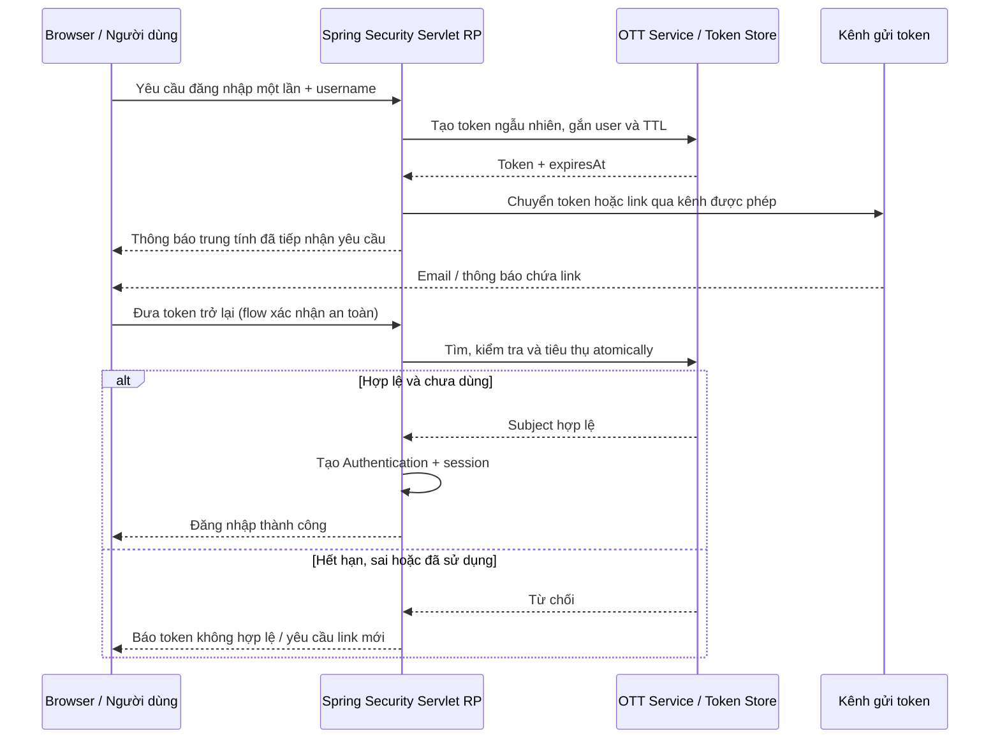

# One-Time Token Login và phân biệt token đăng nhập với mật khẩu TOTP

> **Phạm vi:** xác thực nâng cao trong **Spring Security Servlet**. Bài tập trung vào **One-Time Token Login** (đăng nhập bằng token một lần do máy chủ phát hành) và **TOTP — Time-based One-Time Password** (mã một lần được tính từ khóa bí mật chung và thời gian). Hai kỹ thuật cùng có chữ “one-time” nhưng khác về nguồn sinh, cách kiểm chứng, lưu trữ, mục đích sử dụng và mô hình đe dọa.

## 1. Bài toán: “token một lần” không đồng nghĩa “mật khẩu TOTP”

Hình dung ứng dụng có hai giao diện:

- **“Gửi liên kết đăng nhập vào email”**: người dùng nhập địa chỉ email; server tạo một chuỗi bí mật ngẫu nhiên, lưu thông tin xác minh có hạn sử dụng, rồi gửi liên kết. Người dùng dùng liên kết để thiết lập phiên đăng nhập mà không nhập mật khẩu truyền thống. Đây là một dạng **one-time token login** hay *magic-link login*.
- **“Nhập mã 6 chữ số từ ứng dụng xác thực”**: người dùng mở authenticator, nhìn mã đang thay đổi mỗi khoảng thời gian và nhập mã. Server tự tính mã dự kiến từ khóa bí mật đã đăng ký cho người dùng. Đây thường là **TOTP**, theo RFC 6238, mở rộng HOTP (RFC 4226).

Hai trường hợp không thay cho nhau:

1. **OTT login** thường dùng một bí mật **mới sinh riêng cho mỗi lần yêu cầu**, được máy chủ phát hành và phát tới kênh đã xác minh; server cần ghi nhận và **tiêu thụ** token một cách nguyên tử.
2. **TOTP** dùng một **shared secret có tuổi thọ dài hơn**, thiết bị và server đều lưu khóa; mỗi bên tính code từ khóa và bước thời gian. Code ngắn và có thể trùng trong một time step. Phía server cần chống đoán mã và **chống replay**, không chỉ kiểm tra phép toán.
3. **Mục đích bảo mật** khác nhau: OTT có thể là **phương thức đăng nhập passwordless** thay password. TOTP thường là **yếu tố bổ sung** khi đã có yếu tố khác; chỉ dùng TOTP đơn lẻ không tự tạo thành MFA.
4. Cả OTT qua email và TOTP đều **không tự động chống phishing**: người dùng có thể bị lừa chuyển tiếp token/code. Phương thức gắn với origin như passkey/WebAuthn có đặc tính khác.

Sau bài này bạn cần giải thích được luồng login, config Spring Security Servlet, vòng đời và xử lý lỗi token, thuật toán TOTP, kiểm thử và cách tránh các lỗ hổng phổ biến.

## 2. Khái niệm nền tảng và thuật ngữ

### 2.1. One-Time Token Login (OTT)

**One-Time Token Login** là cơ chế cấp một bí mật tạm thời (token) để hoàn tất xác thực của một lần đăng nhập. Một thiết kế passwordless điển hình gồm:

1. User nhập định danh (email/username) trên form yêu cầu.
2. Backend chuẩn hóa và kiểm tra request theo policy; sinh token ngẫu nhiên **không dự đoán được**.
3. Backend lưu thông tin token, thường gồm `tokenHash`, `subject` hoặc định danh user, `expiresAt`, trạng thái đã sử dụng, và metadata cần thiết.
4. Backend chuyển token ra kênh sở hữu của người dùng (email/SMS/app), có thể dưới dạng **magic link** hoặc mã.
5. Người dùng chuyển token về RP; backend kiểm tra token hợp lệ, còn hạn, đúng mục đích, **chưa dùng**, rồi đánh dấu đã dùng **atomically**.
6. Chỉ sau đó Spring Security tạo `Authentication` đã xác thực và phiên mới với quyền theo policy ứng dụng.

Ví dụ liên kết minh họa:

```text
https://app.example.test/login/ott?token=RANDOM_OPAQUE_VALUE
```

Đây là **ví dụ dạng URL**, không khẳng định mọi phiên bản Spring Security hoặc mọi hệ thống đều tiêu thụ token bằng HTTP GET. Một liên kết GET thường cần đưa user tới trang xác nhận rồi hoàn tất bằng POST hay flow tương ứng để hạn chế email security scanner/bot **vô tình sử dụng token** trước người dùng.

**OTT token là bearer secret:** ai cầm token hợp lệ trước khi bị dùng/hết hạn có thể cố đăng nhập với quyền tương ứng. Vì vậy cần tránh rò rỉ qua URL logs, browser history, Referer, analytics, screenshots hoặc gửi nhầm người nhận. Không để token trong log ứng dụng.

### 2.2. TOTP — Time-based One-Time Password

**TOTP** là mã số ngắn (thường 6 hoặc 8 chữ số), tính từ:

- Khóa bí mật `K` được chia sẻ an toàn giữa server và authenticator lúc đăng ký.
- Thời gian hiện tại, được quy đổi sang bộ đếm bằng chu kỳ `X`, thường là 30 giây.
- Thuật toán HMAC (RFC 6238 mô tả SHA-1, SHA-256 hoặc SHA-512 tùy cấu hình).
- Phép cắt động từ HOTP và modulo `10^digits` để tạo code dạng số có số 0 ở đầu nếu cần.

Công thức:

```text
T = floor((currentUnixTime - T0) / X)
TOTP = HOTP(K, T) mod 10^digits

Ví dụ thường gặp:
  T0 = 0
  X = 30 giây
  digits = 6
  HMAC = SHA-1 (một lựa chọn tương thích rộng)
```

Authenticator **không cần gọi server để xin từng code**. Server cũng tính code từ `K` và thời gian tương ứng, rồi so sánh. Đây là khác biệt lớn so với OTT, nơi server sinh và phát hành token riêng theo từng yêu cầu.

Code TOTP ngắn **có thể bị đoán** nếu không có rate limiting. Việc code thay đổi sau mỗi 30 giây **không tự ngăn replay trong cùng time step**. Phải áp dụng giới hạn thử và chính sách đánh dấu time step đã chấp nhận nếu yêu cầu chỉ dùng một lần.

### 2.3. “One-time” có nghĩa gì trong từng cơ chế?

- **OTT:** token bí mật cụ thể phải được **tiêu thụ tối đa một lần**, kể cả khi hai request đến đồng thời. Trong thiết kế dùng database, điều này cần thao tác trạng thái có tính nguyên tử, không phải quy trình “SELECT rồi UPDATE” dễ race.
- **TOTP:** code được tính theo bước thời gian và có thể giữ nguyên trong cửa sổ hiệu lực. Nếu server chỉ kiểm tra HMAC và timestamp, mã đó **có thể được nhập lại**. Chống replay phải có trạng thái riêng (ví dụ `lastAcceptedCounter`) và kiểm soát cạnh tranh.

Hai kỹ thuật đều phải có expiration, giới hạn số lần thử, audit và kênh truyền bí mật; chúng **không có cùng cách xác minh**.

## 3. Bảng so sánh OTT Login và TOTP

| Tiêu chí | One-Time Token Login | TOTP |
| --- | --- | --- |
| Ai sinh bí mật sử dụng trong một lần? | Server sinh token ngẫu nhiên | Thiết bị và server tính mã từ shared secret + thời gian |
| Token/code được phát thế nào? | Backend gửi email, SMS hoặc kênh khác sau yêu cầu | Authenticator hiển thị code, thường hoạt động offline |
| Độ dài điển hình | Opaque token entropy cao, có thể biểu diễn Base64url | Mã số ngắn, thường 6 hoặc 8 chữ số |
| Trạng thái ở server | Cần quản lý token đã phát, hết hạn, đã dùng; có thể lưu hash | Cần lưu shared secret, thông tin thiết bị và trạng thái chống replay |
| Kiểm chứng | Token chính xác, còn hạn, đúng mục đích/user, chưa dùng; tiêu thụ nguyên tử | HMAC từ secret và counter; kiểm soát clock drift, replay, rate limit |
| Vòng đời | Mỗi lần yêu cầu một token mới | Secret lâu dài; mã thay đổi theo time step |
| Quan hệ với password | Có thể là **passwordless primary login** | Thường là **MFA step** sau một bước authentication |
| Khả năng dùng offline | Kênh nhận token phụ thuộc delivery | App authenticator thường không cần mạng |
| Rủi ro chính | Email compromise, forwarded link, URL leak, replay, scanner tiêu thụ link | Phishing code, lộ seed, brute-force, clock skew, reuse trong cửa sổ |
| Tự chứng minh sở hữu thiết bị? | Không nhất thiết; email inbox không đồng nhất thiết bị cụ thể | Chứng minh sở hữu secret đã provision; secret có thể bị sao chép |
| API Spring Security | `oneTimeTokenLogin()` và dịch vụ/handler OTT (ở phiên bản hỗ trợ) | Không đồng nghĩa `oneTimeTokenLogin()`; cần tích hợp TOTP verifier/MFA flow riêng |
| Khi hết hiệu lực | Hết TTL hoặc token bị consumed/revoked | Counter ngoài window, secret bị revoke, hoặc đã dùng counter |
| Khả năng phishing-resistant | Không mặc nhiên | Không mặc nhiên |

**Quan trọng:** “6 chữ số qua email” cũng có thể là **server-issued OTP** theo thiết kế riêng, không tự trở thành TOTP. Muốn gọi là TOTP cần dùng shared secret và time-step theo thuật toán tương thích.

## 4. Luồng One-Time Token Login trên Spring Security Servlet

Spring Security có tính năng **One-Time Token Login** từ dòng Spring Security **6.4+**. DSL tương ứng là `HttpSecurity#oneTimeTokenLogin`; nó không phải DSL TOTP/MFA tự động. Các tên default endpoint, default page và cách delivery có thể thay đổi theo cấu hình, vì vậy khi triển khai phải đối chiếu **phiên bản dependency thực tế**, filter chain và form đang render.

### 4.1. Luồng khái niệm



Luồng cho thấy **phát token** và **xác minh token** là hai bước khác nhau. Form nhập email chưa được xác thực; **không cấp phiên đăng nhập tại bước yêu cầu token**. Một phiên chỉ hình thành khi token được xác minh và account được phép login theo policy.

### 4.2. Cấu hình cơ bản: không tự coi đây là TOTP

Mô hình Spring Security 6.4+:

```java
@Bean
SecurityFilterChain securityFilterChain(HttpSecurity http) throws Exception {
    return http
            .authorizeHttpRequests(auth -> auth
                    .requestMatchers("/").permitAll()
                    .anyRequest().authenticated())
            .oneTimeTokenLogin(Customizer.withDefaults())
            .build();
}
```

`oneTimeTokenLogin(Customizer.withDefaults())` thêm hỗ trợ OTT vào chuỗi filter xác thực. Nó **không tạo TOTP secret**, không quét QR, không xác minh code từ authenticator, cũng không tự biến login thành two-factor authentication.

**Phân định triển khai:** bật DSL chỉ là bước đầu. Ứng dụng production còn cần kênh phân phối token có kiểm soát, nơi lưu/tiêu thụ token phù hợp số instance, account policy, chống enumeration, rate limiting, bảo vệ email/link và UX cho token lỗi. Cần biết Spring Security đang dùng token service, success handler và endpoint nào theo cấu hình thực tế.

### 4.3. Các thành phần cần hiểu

| Thành phần | Trách nhiệm |
| --- | --- |
| `HttpSecurity#oneTimeTokenLogin` | Kích hoạt cấu hình xác thực bằng one-time token trong Servlet filter chain |
| `OneTimeTokenService` | Tạo, tra cứu, tiêu thụ token theo hợp đồng Spring Security; cần kiểm tra persistence/atomicity khi chạy nhiều instance |
| `OneTimeTokenGenerationSuccessHandler` | Quyết định làm gì sau khi token đã được tạo, ví dụ tích hợp email delivery hoặc phản hồi tới frontend |
| `UserDetailsService` / user lookup | Tải thông tin user/authorities theo cấu hình để tạo principal đã xác thực |
| `AuthenticationManager` / provider/filter OTT | Điều phối kiểm tra token và khởi tạo authenticated principal |
| `SecurityContext` / `HttpSession` | Lưu trạng thái xác thực cho các request Servlet tiếp theo |
| Account/authorization policy | Quyết định user có được login và được phép làm gì, độc lập với việc token khớp |

**Token service và success handler là hai nhiệm vụ khác nhau:** generation success handler **không thay thế** việc backend xác minh/consume token. Ngược lại, token được phát thành công không chứng minh email đã được gửi hoặc đã tới đúng người nhận.

### 4.4. Endpoint mặc định và các yêu cầu HTTP

Ở cấu hình OTT mặc định của dòng Spring Security hỗ trợ tính năng này, thường thấy:

- Endpoint **yêu cầu phát token** như `POST /ott/generate`.
- Endpoint **xử lý xác thực bằng token** như `POST /login/ott`.
- Trang login/OTT được framework tạo hoặc được ứng dụng custom.

Các URL trên là mốc nhận diện **thường gặp**; phải xác minh với phiên bản Spring Security và cách bạn cấu hình `oneTimeTokenLogin`, vì ứng dụng có thể đổi endpoint, thay page hay thêm handler. Một magic link có thể chứa token trong URL nhưng không có nghĩa GET link là một POST xác thực. Với trình duyệt, cần chú ý CSRF, cookies, redirect, và bot “click link” của hệ thống email.

**Không khuyến nghị** tạo link `GET /login/ott?token=...` rồi lập tức tiêu thụ token chỉ do browser/antivirus mở URL, vì có thể gây đăng nhập ngoài ý định hoặc token đã dùng trước khi user thật truy cập. Thiết kế phù hợp thường có bước xác nhận chủ động với method có kiểm soát và CSRF/session binding khi cần.

## 5. Demo Java 17+: bật OTT Login trong Spring Boot 3.4+

Đây là dự án Spring Boot **Servlet MVC** tối thiểu để xem chính sách đăng nhập OTT. Code Java dùng Spring Boot 3.4.x / Spring Security 6.4.x, có thể biên dịch khi dùng dependencies nêu dưới. **Demo chưa kết nối nhà cung cấp email thực:** trước khi triển khai thực tế phải cấu hình `OneTimeTokenGenerationSuccessHandler` đưa link đến người dùng qua email/provider đáng tin. Không coi response chứa token ở chế độ demo (nếu có) là cách triển khai production.

### 5.1. Cấu trúc dự án

```text
ott-login-demo/
├── settings.gradle
├── build.gradle
└── src/main/java/com/example/ottdemo/
    ├── OttLoginDemoApplication.java
    ├── SecurityConfig.java
    └── DemoController.java
```

`settings.gradle`:

```groovy
rootProject.name = 'ott-login-demo'
```

`build.gradle`:

```groovy
plugins {
    id 'java'
    id 'org.springframework.boot' version '3.4.2'
    id 'io.spring.dependency-management' version '1.1.7'
}

group = 'com.example'
version = '0.0.1-SNAPSHOT'

java {
    toolchain {
        languageVersion = JavaLanguageVersion.of(17)
    }
}

repositories {
    mavenCentral()
}

dependencies {
    implementation 'org.springframework.boot:spring-boot-starter-web'
    implementation 'org.springframework.boot:spring-boot-starter-security'
}
```

Nhánh Boot 3.4.x dùng Spring Security 6.4.x do Boot quản lý (không ép version của Spring Security riêng lẻ trong demo). Với dự án đã có BOM/dependency management, áp dụng cùng version thống nhất của dự án. Spring Security 6.3 hoặc trước đó **không có cùng DSL OTT**, nên lỗi “không tìm thấy `oneTimeTokenLogin`” phải được chẩn đoán bằng dependency thực tế, không thêm import ngẫu nhiên.

### 5.2. Application class

`src/main/java/com/example/ottdemo/OttLoginDemoApplication.java`:

```java
package com.example.ottdemo;

import org.springframework.boot.SpringApplication;
import org.springframework.boot.autoconfigure.SpringBootApplication;

@SpringBootApplication
public class OttLoginDemoApplication {
    public static void main(String[] args) {
        SpringApplication.run(OttLoginDemoApplication.class, args);
    }
}
```

### 5.3. SecurityConfig với tài khoản demo

`src/main/java/com/example/ottdemo/SecurityConfig.java`:

```java
package com.example.ottdemo;

import java.util.UUID;

import org.springframework.context.annotation.Bean;
import org.springframework.context.annotation.Configuration;
import org.springframework.security.config.Customizer;
import org.springframework.security.config.annotation.web.builders.HttpSecurity;
import org.springframework.security.core.userdetails.User;
import org.springframework.security.core.userdetails.UserDetails;
import org.springframework.security.core.userdetails.UserDetailsService;
import org.springframework.security.provisioning.InMemoryUserDetailsManager;
import org.springframework.security.web.SecurityFilterChain;

@Configuration
public class SecurityConfig {
    @Bean
    SecurityFilterChain securityFilterChain(HttpSecurity http)
            throws Exception {
        return http
                .authorizeHttpRequests(auth -> auth
                        .requestMatchers("/").permitAll()
                        .anyRequest().authenticated())
                .oneTimeTokenLogin(Customizer.withDefaults())
                .build();
    }

    @Bean
    UserDetailsService userDetailsService() {
        UserDetails learner = User.withUsername("learner@example.test")
                .password("{noop}" + UUID.randomUUID())
                .roles("USER")
                .build();

        return new InMemoryUserDetailsManager(learner);
    }
}
```

Giải thích từng phần:

- `.oneTimeTokenLogin(Customizer.withDefaults())` bật OTT login.
- `/` public; `/me` (ở controller kế tiếp) cần xác thực.
- `UserDetailsService` cung cấp user demo mà token có thể ánh xạ đến, không phải dịch vụ tự động **gửi email**.
- Mật khẩu được sinh ngẫu nhiên chỉ để xây dựng `UserDetails` theo hợp đồng demo. Không có `formLogin()`/HTTP Basic trong chain này, nên **không có luồng đăng nhập bằng password qua các cơ chế đó** trong cấu hình đã trình bày. Khi kết hợp thêm form/basic login, phải xem lại chính sách mật khẩu và encoder.
- `roles("USER")` chỉ tạo role ví dụ. Không tự tạo ROLE_ADMIN cho người sở hữu email.
- `InMemoryUserDetailsManager` và token service trong bộ mặc định chỉ phù hợp minh họa/đơn máy; với production nhiều instance cần thiết kế nguồn lưu token dùng chung và account lookup thực.

**Không dùng `{noop}` cho mật khẩu production.** Giá trị mật khẩu demo ngẫu nhiên không thay thế quy trình quản lý credential của ứng dụng thật.

### 5.4. Controller với endpoint bảo vệ

`src/main/java/com/example/ottdemo/DemoController.java`:

```java
package com.example.ottdemo;

import java.util.Map;

import org.springframework.security.core.Authentication;
import org.springframework.web.bind.annotation.GetMapping;
import org.springframework.web.bind.annotation.RestController;

@RestController
public class DemoController {
    @GetMapping("/")
    public Map<String, String> home() {
        return Map.of("message", "Open endpoint");
    }

    @GetMapping("/me")
    public Map<String, String> me(Authentication authentication) {
        return Map.of("user", authentication.getName());
    }
}
```

Sau OTT login thành công, Spring Security tạo principal có thể được đọc bởi `Authentication#getName()`. Thành công ở bước authentication **không tự cấp mọi quyền**; thay `anyRequest().authenticated()` bằng rule nghiệp vụ cụ thể khi triển khai thực tế.

### 5.5. Chạy và quan sát

Trong dự án có Gradle Wrapper:

```bash
# Linux / macOS
./gradlew bootRun

# Windows PowerShell
.\gradlew.bat bootRun
```

Khi server đang chạy ở cổng 8080 mặc định, thử:

```bash
curl -i http://localhost:8080/
curl -i http://localhost:8080/me
```

Kỳ vọng `GET /` là HTTP 200 với JSON:

```json
{"message":"Open endpoint"}
```

`GET /me` chưa xác thực sẽ bị Security chặn và được chuyển tới entry point/page thích hợp theo negotiation/cấu hình (thường là redirect tới login đối với browser). **Không ấn định chính xác 401 hay 302 cho mọi client/Accept header**. Để hoàn tất login cần dùng **luồng OTT được kích hoạt** và delivery handler phù hợp với môi trường thử nghiệm; token phải được cấp cho username `learner@example.test` và sử dụng trước khi hết hạn.

**Mẫu GET /me sau khi đăng nhập OTT thành công**:

```json
{"user":"learner@example.test"}
```

Nếu token không được gửi, cần kiểm tra generation success handler/delivery channel trước khi kết luận token verifier sai. Không đưa token thật vào ảnh chụp màn hình, log hoặc issue tracker.

## 6. Thiết kế production cho One-Time Token Login

Để biến demo thành login link an toàn, phải thiết kế các thành phần mà vài dòng DSL không tự giải quyết:

### 6.1. Phát token đủ ngẫu nhiên, giới hạn thời gian

- Sinh bằng **cryptographically secure random generator** với entropy đủ cao, ví dụ ít nhất khoảng 128 bit random đối với bearer token dài, không dựa trên timestamp, ID người dùng, `Math.random()` hoặc UUID có nguồn entropy không được kiểm chứng cho các use case nhạy cảm.
- Biểu diễn bằng Base64url không padding hoặc định dạng URL-safe; token không cần mang dữ liệu nhận dạng người dùng dưới dạng plaintext.
- Ràng buộc **purpose** rõ ràng: token login không phải password-reset token, API token, email verification hay token nâng quyền. Một token cho chức năng này không được chấp nhận ở chức năng khác.
- TTL ngắn theo mô hình rủi ro, có đồng hồ server nhất quán; kiểm tra `expiresAt` bằng thời gian đáng tin và dùng điều kiện hết hạn rõ ràng.
- Giới hạn số token còn hiệu lực cho một tài khoản/chức năng nếu phù hợp; khi gửi lại có thể hủy token trước đó, nhưng cần policy minh bạch khi user yêu cầu nhiều lần.

### 6.2. Lưu token và tiêu thụ an toàn

Một mô hình dữ liệu có thể là:

```text
one_time_login_token
--------------------
token_hash          -- unique, không lưu raw token nếu có thể
user_id             -- khóa account nội bộ
purpose             -- LOGIN
issued_at
expires_at
consumed_at         -- null trước khi dùng
attempt_metadata    -- chỉ dữ liệu cần thiết, retention hợp lý
```

Khi người dùng gửi token:

```text
digest = SHA-256(rawToken)
BEGIN TRANSACTION
  tìm tokenHash= digest, purpose=LOGIN, expiresAt > now,
      consumedAt IS NULL, user active
  cập nhật consumedAt=now với điều kiện vẫn chưa consumed
  yêu cầu đúng 1 hàng được cập nhật
COMMIT
tạo phiên login chỉ khi transaction thành công
```

Đây là **pseudocode kiến trúc** chứ không phải API mặc định của Spring Security. Cần database atomic conditional update hoặc thao tác tương đương trong Redis/transaction để hai request đồng thời **không cùng tiêu thụ token**. Với token đủ entropy và lưu hash, lộ database không trực tiếp lộ bearer secret còn hạn.

Nếu người dùng gửi cùng token lần hai, phải từ chối ngay cả khi TTL chưa hết. Không tái sử dụng token sau khi xác minh. Khi store không truy cập được, **fail closed**, không chấp nhận token chỉ vì cache/DB bị lỗi.

### 6.3. Kênh chuyển token

- Chỉ gửi đến kênh sở hữu/đã được xác minh của user; không lấy địa chỉ đích từ input tùy ý không gắn với account.
- Nếu dùng email, bảo vệ tài khoản email, hạn chế forwarding/alias misuse, sử dụng provider giao thư và nội dung không tiết lộ thông tin nhạy cảm.
- Không đưa token vào log, metric labels, analytics event, truy vấn database không cần thiết hoặc tracing raw.
- Nếu gửi link trong URL, đặt HTTPS, short TTL, header `Referrer-Policy: no-referrer` trên trang xử lý link, kiểm soát cache, không nhúng third-party analytics/assets vào trang đang mang token; làm sạch query sau khi chuyển token vào state/POST hợp lệ.
- Chống email-security scanner mở link GET trước: xem GET là **bước xem trang/chứng minh ý định**, và hoàn tất login bằng tương tác chủ động hoặc cơ chế được thiết kế an toàn.
- Nếu dùng SMS làm kênh, cân nhắc SIM swap, phishing và độ tin cậy; “gửi một lần” không có nghĩa “phishing resistant”.

### 6.4. Chống account enumeration và abuse

Khi user yêu cầu token cho email:

- Đưa response ngoài giống nhau cho account tồn tại/không tồn tại, ví dụ “Nếu tài khoản hợp lệ, hướng dẫn sẽ được gửi”.
- Bảo đảm chênh lệch thời gian/phản hồi không lộ thông tin account dễ khai thác.
- Rate limit theo account, IP, thiết bị và tổng tải hệ thống; theo dõi retry, hạn chế email flooding.
- Không tạo user mới mặc định chỉ vì địa chỉ email nhập trong form. Login và **account provisioning** là hai nghiệp vụ khác nhau.
- Không cấp phiên có quyền sau khi token hợp lệ nhưng account hiện bị disabled/suspended hoặc tenant chưa duyệt.
- Tạo session mới an toàn sau login (session fixation protection), áp dụng HTTPS, HttpOnly, Secure, SameSite và CSRF cho các request đổi trạng thái theo policy.

### 6.5. Đa máy chủ và race condition

Trong app dùng load balancer, nếu instance A phát token nhưng instance B xác minh, **token store trong memory của A** có thể khiến B không thấy token. Dùng token service backed by shared store có đúng contract generate/consume. Quan sát đồng thời nhiều request tiêu thụ token và cố tình test race. Với replay thành công do xử lý không nguyên tử, “one-time” chỉ là nhãn UI, không phải thuộc tính bảo mật.

## 7. TOTP hoạt động như thế nào?

### 7.1. Đăng ký shared secret

Trong luồng enroll authenticator:

1. Server sinh một secret `K` bằng `SecureRandom`.
2. Server lưu secret cho đúng user và trạng thái enrollment (ban đầu chưa kích hoạt).
3. Server cho user quét QR/nhập một `otpauth://totp/...` URI qua HTTPS.
4. Authenticator lưu secret; người dùng nhập code đầu tiên để **xác nhận đã nhận được seed**.
5. Server chỉ đánh dấu factor active sau bước xác minh, và cấp recovery codes theo chính sách.

Ví dụ tham số `otpauth`:

```text
otpauth://totp/Example:alice?secret=BASE32SECRET&issuer=Example&algorithm=SHA1&digits=6&period=30
```

Đây là **mẫu cấu trúc**, không phải QR hoạt động vì `BASE32SECRET` chỉ là ký hiệu mô tả. Secret thực tế phải được sinh ngẫu nhiên và mã hóa Base32 theo định dạng mà ứng dụng authenticator hỗ trợ. **QR chứa secret**: tránh ghi log URL này, không đưa vào nơi truy cập công khai, không cache qua CDN hoặc embed third-party tracking.

Secret TOTP có tuổi thọ lâu hơn mã hiển thị, nên phải bảo vệ ở mức như credential. Server cần khả năng tính HMAC từ secret; chỉ lưu hash một chiều của secret như hash password thường **không đủ** để xác minh TOTP. Lưu secret bằng encryption-at-rest/KMS và giới hạn quyền đọc/giải mã; khóa/thay secret khi nghi bị lộ.

### 7.2. Công thức HOTP/TOTP

HOTP dùng HMAC trên counter 8-byte big-endian; RFC 4226 định nghĩa **dynamic truncation**. TOTP theo RFC 6238 chọn counter từ thời gian:

```text
counter = floor((unixSeconds - T0) / periodSeconds)
hmac = HMAC(secret, counter8ByteBigEndian)
offset = hmac[lastByte] & 0x0f
binaryCode = ((hmac[offset] & 0x7f) << 24)
           | ((hmac[offset+1] & 0xff) << 16)
           | ((hmac[offset+2] & 0xff) <<  8)
           |  (hmac[offset+3] & 0xff)
otp = binaryCode % 10^digits
display = leftPadWithZeros(otp, digits)
```

- `periodSeconds=30` là giá trị thường dùng chứ không phải bắt buộc trong mọi triển khai.
- 6 chữ số có tối đa 1.000.000 giá trị; 8 chữ số có 100.000.000 giá trị.
- HMAC SHA-1 được nhiều authenticator hỗ trợ; SHA-256/SHA-512 cũng có trong RFC 6238 nhưng hai phía phải thỏa thuận nhất quán.
- Code phụ thuộc **time-step**, không phụ thuộc mỗi lần server “cấp” mã, và không phải access token hay JWT.
- Giữ **leading zeros**: phải coi OTP là string khi nhận/hiển thị để không mất số 0 đầu.

### 7.3. Ví dụ Java 17 chạy độc lập: vector RFC 6238

Tệp `TotpRfcDemo.java` (không dùng Spring, chạy trực tiếp với JDK 17):

```java
import java.nio.ByteBuffer;
import java.nio.charset.StandardCharsets;
import java.util.Locale;
import javax.crypto.Mac;
import javax.crypto.spec.SecretKeySpec;

public class TotpRfcDemo {
    static String totp(
            byte[] secret, long unixSeconds, int digits) throws Exception {

        long counter = Math.floorDiv(unixSeconds, 30L);
        byte[] movingFactor = ByteBuffer.allocate(Long.BYTES)
                .putLong(counter)
                .array();

        Mac mac = Mac.getInstance("HmacSHA1");
        mac.init(new SecretKeySpec(secret, "HmacSHA1"));
        byte[] hmac = mac.doFinal(movingFactor);

        int offset = hmac[hmac.length - 1] & 0x0f;
        int code = ((hmac[offset] & 0x7f) << 24)
                | ((hmac[offset + 1] & 0xff) << 16)
                | ((hmac[offset + 2] & 0xff) << 8)
                | (hmac[offset + 3] & 0xff);

        int modulus = 1;
        for (int i = 0; i < digits; i++) {
            modulus *= 10;
        }

        return String.format(
                Locale.ROOT, "%0" + digits + "d", code % modulus);
    }

    public static void main(String[] args) throws Exception {
        byte[] secret = "12345678901234567890"
                .getBytes(StandardCharsets.US_ASCII);

        System.out.println("T=59, 8 digits: " + totp(secret, 59L, 8));
        System.out.println("T=59, 6 digits: " + totp(secret, 59L, 6));
    }
}
```

Biên dịch/chạy:

```bash
javac TotpRfcDemo.java
java TotpRfcDemo
```

Kết quả chính xác:

```text
T=59, 8 digits: 94287082
T=59, 6 digits: 287082
```

Giá trị `94287082` là **test vector chuẩn RFC 6238** cho HMAC-SHA1, secret ASCII 20 byte và thời điểm Unix `59` giây với 8 digits, period 30 giây. Sáu chữ số cuối là `287082`.

Đây là **minh họa thuật toán**, **không phải verifier sản xuất**: chưa có giới hạn digits, secret validation, drift/window handling, constant-time comparison, anti-replay, account lockout, KMS, device enrollment hay logging policy. Không dùng secret công khai `12345678901234567890` cho user thật.

### 7.4. TOTP verification phải nhiều hơn so sánh string

Để kiểm tra code user nhập, server thường:

1. Xác định user đã đi qua yếu tố trước đó hoặc đang ở flow enrollment/step-up hợp lệ.
2. Đọc secret TOTP **đã được bảo vệ** của user.
3. Tính counter cho current time và một cửa sổ rất hẹp nếu chính sách cho phép clock skew (ví dụ previous/current/next counter), rồi kiểm tra độ dài code và so sánh an toàn.
4. Chỉ chấp nhận counter **lớn hơn counter đã được dùng gần nhất** nếu chính sách bắt buộc chống replay; cập nhật trạng thái này **nguyên tử**.
5. Rate limit số lần thử theo account và context, khóa/tạm dừng khi cần, ghi audit.
6. Chỉ sau khi đủ yếu tố mới chuyển account/Authentication sang trạng thái MFA hoàn tất và cấp quyền tương ứng.

Ví dụ với 6 digits và kiểm tra 3 counters (−1, 0, +1), một lần đoán ngẫu nhiên có khoảng 3/1.000.000 cơ hội trùng mã trong trường hợp các mã phân biệt. Đây chỉ là trực giác về entropy; xác suất tích lũy tăng theo số lần thử. **Rate limit là bắt buộc**, nhất là với mã số ngắn.

### 7.5. Đồng bộ thời gian và chống replay

- Dùng thời gian server đáng tin, triển khai đồng bộ NTP và nhất quán giữa các node.
- Không chấp nhận cửa sổ thời gian quá rộng; cửa sổ rộng làm nhiều code hợp lệ hơn, tăng rủi ro đoán/replay.
- Nếu cho phép counter `T−1`, `T`, `T+1` để chịu clock skew, lưu `lastAcceptedCounter` hoặc record tương đương. Không chấp nhận lại cùng counter.
- Chỉ update counter khi transaction xác nhận đúng code và chính sách account hợp lệ. Chống race khi hai request cùng dùng mã.
- Không kéo dài vô hạn thời hạn chấp nhận do người dùng nhập sai hoặc chậm.
- Nếu một factor bị compromise, phải có cơ chế **re-enroll/rotate secret và hủy thiết bị cũ**.

TOTP không có server-issued token mới để “xóa sau khi dùng”; chính server phải bổ sung state chống replay. Đây là điểm khác căn bản với OTT.

## 8. TOTP như bước MFA: không trộn vào OTT

### 8.1. Login passwordless và MFA là hai mục tiêu khác nhau

**Passwordless OTT**: người dùng sở hữu email/kênh giao token và hoàn tất login. Nếu không có yếu tố khác, nó là **một yếu tố**, không phải tự động hai yếu tố.

**Password + TOTP**: người dùng phải thỏa hai loại bằng chứng: **something you know** (password) và **something you have/control** (secret trong app authenticator). Đây là mô hình MFA phổ biến, nhưng TOTP vẫn có thể bị phishing hoặc sao chép seed.

**OTT + TOTP**: một sản phẩm có thể yêu cầu cả magic-link OTP và code TOTP để step-up, nhưng phải thiết kế riêng trạng thái yếu tố đã hoàn thành, thời gian hiệu lực, account binding và chống replay cho cả hai. **Bật `oneTimeTokenLogin()` không tự tạo bước TOTP thứ hai**.

### 8.2. Tích hợp TOTP vào Spring Security Servlet ở đâu?

Các lựa chọn kiến trúc:

- **Authentication flow hai bước**: sau password hoặc OTT, tạo trạng thái xác thực tạm giới hạn quyền, sau đó chỉ khi TOTP đúng mới chuyển thành fully authenticated có quyền cần thiết. Không coi một Authentication có `authenticated=true` ở bước đầu là “đã MFA xong” nếu các route không phân biệt trạng thái.
- **Authorization step-up**: bảo vệ action nhạy cảm (đổi mật khẩu, chuyển tiền, quản trị) bằng quyền như `MFA_VERIFIED` kèm thời hạn hiệu lực ngắn và account/session binding.
- **Custom AuthenticationProvider / filter / success handler**: dùng extension point chính xác theo phiên bản Spring Security; tách dịch vụ `TotpVerifier`, `TotpEnrollmentService`, `RecoveryCodeService`. Không tự ý gán TOTP raw code vào field `password` của `DaoAuthenticationProvider` và mong framework tự tính RFC 6238.
- **External IdP**: nếu IdP thực hiện TOTP/MFA và phát OIDC/SAML assertion cho RP, Spring Security có thể tiêu thụ kết quả từ IdP theo chính sách; cần kiểm tra `amr`/`acr` claims và trust boundary, không suy diễn có MFA nếu claim không đáng tin/không được yêu cầu.

Trong hệ thống session, cần xem xét **session fixation**, CSRF, trạng thái MFA sau logout, timeout và thay đổi mật khẩu/secret. Với API JWT, cần token claims về mức độ xác thực do server đáng tin phát; không cho client tự khai đã qua MFA.

### 8.3. Recovery codes và mất thiết bị

Một hệ thống TOTP thực tế phải có luồng khôi phục:

- Recovery codes được sinh đủ entropy, lưu hash và tiêu thụ **một lần** mỗi mã.
- Reset TOTP phải qua xác minh đủ mạnh, có chống social engineering và audit; không để một email phê duyệt yếu tự vô hiệu hóa mọi yếu tố bảo mật.
- Khi user mất authenticator, không cho phép bỏ qua MFA bằng cách chỉ nhập username/email bất kỳ.
- Thông báo cho user khi TOTP factor được enroll, reset hoặc disable.
- Phân biệt **recovery code** (một lần theo trạng thái server) với **TOTP** (mã thay đổi theo thời gian); cả hai là mã một lần nhưng thuật toán/lifecycle khác nhau.

## 9. Lỗi thường gặp khi vận hành

| Triệu chứng | Kiểm tra trước | Không nên làm |
| --- | --- | --- |
| Bật `oneTimeTokenLogin()` nhưng không thấy email | `OneTimeTokenGenerationSuccessHandler`, mail provider, queue, user lookup, logs đã lọc | In token vào log production hoặc trả token cho user chưa xác minh |
| Token link vừa gửi đã báo “đã sử dụng” | Link scanner/prefetch, auto-consume bằng GET, retry đồng thời | Cho token dùng lại hoặc tăng TTL quá dài |
| Token dùng hai lần đều thành công | Token store không atomic, replay race, nhiều instance không chung state | Chỉ kiểm tra flag bằng SELECT mà không khóa/cập nhật điều kiện |
| OTT hoạt động một node nhưng fail node khác | Token state ở memory cục bộ, load balancer | Disable validation hoặc sticky session như giải pháp duy nhất |
| OTT link bị browser từ chối/không tới được app | HTTPS host, redirect URI, encoded query, proxy headers, CSRF | Log raw token để debug |
| Token hết hạn liên tục | TTL, độ trễ email, clock skew, user UX | Tăng TTL vô hạn hoặc bỏ expiration |
| OTP/TOTP lúc được lúc không | Đồng hồ thiết bị/server lệch, period, algorithm, digits, Base32 secret | Chấp nhận hàng chục time steps để cho “dễ dùng” |
| TOTP đúng nhưng báo “already used” | Anti-replay state hoặc hai tab sử dụng cùng code | Tắt replay protection hoàn toàn |
| TOTP bị brute-force | Rate limit, lockout, logging, risk controls | Chỉ tăng số digits mà không giới hạn thử |
| User đăng nhập OTT nhưng endpoint MFA vẫn bị chặn | Chưa có bằng chứng yếu tố TOTP, session/token chưa mang mức xác thực | Tự đánh dấu MFA chỉ vì OTT login thành công |
| Authenticator không quét QR | Secret Base32, `otpauth` URI encoding, issuer/label/digits/period | Dán secret thật vào public issue |
| Nhiều phương thức login khiến mất policy | Form/password/OTT/TOTP cùng tạo Authentication nhưng khác mức đảm bảo | Coi mọi `authenticated()` là có cùng assurance |
| TOTP seed lộ từ database | Encryption/KMS, quyền truy cập, logging, backup | Coi seed là “không nhạy cảm vì code chỉ 6 chữ số” |
| Tài khoản bị khóa vẫn login bằng OTT | User lookup/account status không được kiểm tra sau token | Chỉ dựa vào token valid mà bỏ qua trạng thái tài khoản |

## 10. Checklist kiểm thử bằng tình huống

### 10.1. OTT login

- [ ] User có account hợp lệ yêu cầu OTT: nhận thông báo trung tính, token được phát đúng purpose, TTL và kênh delivery.
- [ ] Username không tồn tại: response ngoài không tiết lộ sự tồn tại account; không gửi credential cho email ngoài chính sách.
- [ ] Token ngẫu nhiên sai hoặc hết hạn: không tạo session, không tiết lộ token có từng tồn tại hay không.
- [ ] Token đã dùng: lần thứ hai bị từ chối, kể cả hai request đồng thời.
- [ ] Token được request khi user active nhưng account bị khóa trước khi consume: phải từ chối theo policy hiện tại.
- [ ] Link trong email được prefetch/scan: không vô tình đăng nhập hoặc consume chỉ vì bot GET.
- [ ] Gửi lại OTT nhiều lần: có rate limit và policy rõ ràng với token cũ.
- [ ] Instance A tạo, instance B kiểm tra: thành công hợp lệ nếu dùng shared store.
- [ ] Token từ password reset không được login; token từ account A không được xác thực thành B.
- [ ] Không có email provider hoặc token store lỗi: xử lý lỗi an toàn, không tự xác thực.
- [ ] Sau login, session cookie bảo mật, CSRF, authorization và logout vận hành đúng.

### 10.2. TOTP và MFA

- [ ] Enroll dùng secret ngẫu nhiên, QR chỉ hiển thị qua HTTPS cho user đang được phép.
- [ ] Mã xác nhận enroll đầu tiên đúng mới kích hoạt factor.
- [ ] RFC 6238 test vector `T=59` cho SHA-1/8digits trả `94287082`.
- [ ] Code đúng tại current step được chấp nhận một lần; reuse counter bị từ chối khi anti-replay bật.
- [ ] Mã sai/thiếu leading zero/sai digits bị từ chối, có rate limit.
- [ ] Clock skew nhỏ trong window cho phép; window vượt giới hạn bị từ chối.
- [ ] Hai request đồng thời với cùng code không đồng thời hoàn thành hai lần xác thực khi policy chỉ cho một lần.
- [ ] Account locked/revoked factor: code đúng vẫn không cấp quyền.
- [ ] Secret bị reset: seed cũ và các recovery codes cần hủy không còn dùng được.
- [ ] Login password-only không tự truy cập route yêu cầu MFA; logout/timeout xóa trạng thái MFA đúng chính sách.
- [ ] Xác minh với nhiều node dùng đồng hồ đồng bộ và state chống replay nhất quán.

### 10.3. Các ca tấn công cần nhận biết

- **Phishing OTT:** trang giả mạo yêu cầu người dùng dán magic link. Người có link có thể giả danh; giảm rủi ro bằng delivery an toàn, cảnh báo, TTL, anti-replay, giới hạn thiết bị/rủi ro và giám sát.
- **Phishing TOTP:** kẻ tấn công chuyển tiếp code trong thời gian thực; TOTP không có ràng buộc cryptographic với domain website.
- **MFA fatigue / flood:** attacker liên tục yêu cầu OTP/email gây quá tải hoặc lừa người dùng; cần anti-abuse và cảnh báo.
- **Token replay:** link scanner, log leak hoặc race làm token bị dùng lại; cần atomic consume.
- **TOTP seed theft:** attacker lấy secret và tự tạo mọi code tương lai; reset/rotate secret, bảo vệ backup và KMS.
- **Recovery bypass:** attacker chiếm quy trình reset yếu; bảo vệ recovery tương xứng yếu tố đang thay.

## 11. Những hiểu lầm phổ biến

| Nhận định sai | Sửa lại |
| --- | --- |
| “One-Time Token Login chính là đăng nhập bằng TOTP.” | OTT token phát hành theo login request; TOTP tính từ shared secret + time step. |
| “Mã 6 số gửi email chắc chắn là TOTP.” | Không. Nếu server sinh mã mới rồi gửi, đó có thể là OTP server-issued, không dùng RFC 6238. |
| “Bật `oneTimeTokenLogin()` là ứng dụng đã có MFA.” | Không. DSL này là một cơ chế login, không mặc nhiên thêm yếu tố độc lập. |
| “TOTP đổi 30 giây nên không cần chống replay.” | Code có thể được gửi lại trong cùng bước thời gian; phải có replay policy/state. |
| “Email link có nhiều ký tự nên không cần giới hạn thử.” | Vẫn cần rate limit để chống flooding, enumeration, abuse và đoán token. |
| “Chỉ cần cache token local trong một node.” | Với load balancer, node khác không thấy state; tiêu thụ atomically cần shared store. |
| “Lưu raw login token trong DB là bình thường.” | Nên lưu hash của high-entropy token khi khả thi, hạn chế rò rỉ bearer secret. |
| “TOTP secret có thể lưu hash một chiều như password.” | Server cần tính HMAC từ secret, do đó thường phải lưu secret có thể giải mã an toàn. |
| “TOTP 6 số là chống phishing.” | TOTP có thể bị chuyển tiếp thời gian thực; không phishing-resistant như passkey/WebAuthn. |
| “GET magic link luôn an toàn để đăng nhập ngay.” | Email scanners/prefetch có thể mở GET; cần cân nhắc confirmation/POST/CSRF phù hợp. |
| “Token valid thì bất kể user đã bị khóa vẫn login.” | Cần kiểm tra trạng thái account và authorization tại thời điểm consume. |
| “Một lần nhập code đúng là user được phép làm mọi việc.” | Authentication và authorization là hai bước khác nhau; step-up có thời hạn/phạm vi riêng. |

## 12. Câu hỏi tự kiểm tra

**1. Người dùng nhận một liên kết có chuỗi ngẫu nhiên dài qua email, dùng một lần trong 10 phút. Đây có phải TOTP không?**  
Không. Đó là dạng OTT/magic-link login: server phát hành secret và quản lý TTL/consume. TOTP cần shared secret và tính code theo counter thời gian.

**2. Người dùng mở app authenticator không có Internet vẫn thấy code 6 chữ số. Vì sao?**  
Vì thiết bị tự tính HMAC từ shared secret và clock. Nếu đồng hồ hai phía đủ đồng bộ, server tính được giá trị tương ứng.

**3. Vì sao hai request cùng một OTT có thể là lỗi nếu chỉ SELECT rồi UPDATE?**  
Cả hai có thể đọc trạng thái `unused` trước khi một request đánh dấu đã dùng. Cần conditional atomic update/transaction bảo đảm tối đa một request thành công.

**4. Vì sao code TOTP đúng có thể vẫn bị từ chối?**  
Code có thể đã được dùng trong time step hiện tại, account bị khóa, rate limit vượt ngưỡng hoặc flow thiếu authentication factor trước đó.

**5. Bật `oneTimeTokenLogin()` có tự tạo QR TOTP và lưu secret không?**  
Không. OTP login của Spring Security và TOTP verifier/enrollment là các chức năng riêng.

**6. Khi nào “email magic link + TOTP” được coi là hai yếu tố?**  
Chỉ khi hai bằng chứng đáp ứng chính sách yếu tố độc lập và flow thực sự kiểm tra cả hai, có binding với cùng account/session, chống replay và bypass. Không đếm hai bước UI là MFA nếu cả hai đều chứng minh cùng một yếu tố hay cho phép bỏ qua.

**7. Có nên log toàn bộ URL magic link để debug?**  
Không. Token trong URL là bearer secret, có thể bị dùng để chiếm phiên. Log correlation ID, error category và dữ liệu đã lọc thay vì raw token.

## 13. Tóm tắt thực hành

Trong Spring Security **Servlet**, `oneTimeTokenLogin()` là cơ chế đăng nhập dùng **one-time token do server phát hành và xác minh**. Để an toàn cần delivery handler, short TTL, token đủ entropy, hashed/shared store khi thích hợp, **atomic consume**, rate limit, account policy và thiết kế chống leak/prefetch.

**TOTP** là **one-time password tính bằng HMAC từ shared secret và thời gian**. Nó cần enrollment, bảo vệ seed, clock-skew window hẹp, rate limit, **chống reuse counter**, recovery và tích hợp flow MFA/step-up nếu dùng như yếu tố bổ sung. Thuật toán tính mã có thể viết thuần Java 17, nhưng production verifier đòi nhiều bảo vệ bên ngoài phép HMAC.

**Kết luận:** cùng mang chữ “one-time”, nhưng OTT là **token login phát theo yêu cầu**, còn TOTP là **mã tính định kỳ từ bí mật chung**. Chọn đúng cơ chế theo mục tiêu passwordless/MFA, không coi chúng đồng nghĩa, và không dùng riêng một lớp kiểm tra mã để thay thế toàn bộ chính sách xác thực, phiên và phân quyền.
